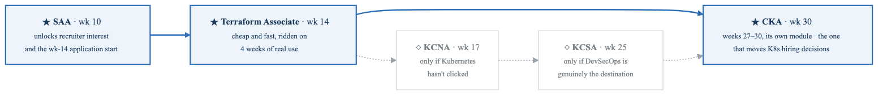

# Certification Strategy

> What each cert is actually worth, when to sit it, and why I'd swap KCNA for CKA.

**Verify before booking:** exam codes, prices, and objectives change. AWS refreshes exam versions roughly every three years and the Linux Foundation has repriced its exams more than once. Every figure below is a planning estimate — confirm at registration.

---

## 1. The honest signal ratings

What a certification does for a candidate with no professional experience, ranked by what it actually changes:

| Cert | When | Est. cost | Prep hrs (in this plan) | Hiring signal | Verdict |
|---|---|---|---|---|---|
| **AWS Solutions Architect – Associate** | Week 10 | ~$150 | ~120 (weeks 5–9) | **High** | **Take it. Non-negotiable.** |
| **HashiCorp Terraform Associate** | Week 14 | ~$70 | ~30 (after 4 wks real use) | **Medium-High** | **Take it. Best value in the industry.** |
| **KCNA** | Week 17 | ~$250 | ~25 | **Low-Medium** | **Conditional — see §3.** |
| **KCSA** | Week 25 | ~$250 | ~30 | **Medium** (in DevSecOps only) | Conditional — see §3. |
| **CKA** | Weeks 27–30 (month 7) | ~$445 | ~70 (its own module) | **High** | **Take it. The K8s cert that moves hiring decisions, in a four-week module after Gate 6.** |
| AWS Cloud Practitioner | — | ~$100 | ~25 | Very low | **Skip.** Go straight to SAA. |
| CompTIA Security+ | — | ~$400 | ~60 | Situationally **very high** | See §5 — the one wildcard. |

### Why SAA is non-negotiable

It is the single most-requested credential in cloud infrastructure job descriptions, which makes it the keyword that gets a résumé past automated filtering and a recruiter's first pass. For a candidate with no professional experience it is the cheapest available proof that the AWS knowledge is real rather than claimed. It is also, unusually among multiple-choice exams, genuinely good curriculum — preparing for it properly forces architectural reasoning about tradeoffs rather than memorization.

### Why Terraform Associate is the best value on the list

Roughly $70 and ~30 hours *after* the student has already been writing Terraform for four weeks. It is close to free. Terraform is the default IaC tool in the market, so the credential maps directly onto the day-to-day work of the target job, and the exam's one real quirk — heavier coverage of Terraform Cloud/HCP than most people touch in practice — is a 4-hour gap to close.

**Time it right:** week 14, immediately after four weeks of hands-on Terraform. Sitting it cold would cost 60+ hours; sitting it warm costs 30.

---

## 2. Sequencing, and why this order

```mermaid
%%{init: {'theme':'base','themeVariables':{'fontFamily':'Helvetica, Arial, sans-serif','fontSize':'13px','primaryColor':'#ffffff','primaryTextColor':'#2d3436','primaryBorderColor':'#9aa3ab','lineColor':'#9aa3ab','textColor':'#2d3436','clusterBkg':'#fbfcfd','clusterBorder':'#d4dae0','edgeLabelBackground':'#ffffff','tertiaryColor':'#eef4fb'},'flowchart':{'curve':'basis','padding':14,'nodeSpacing':42,'rankSpacing':58}}}%%
flowchart LR
  classDef default fill:#ffffff,stroke:#9aa3ab,stroke-width:1.3px,color:#2d3436
  classDef n    fill:#ffffff,stroke:#9aa3ab,stroke-width:1.3px,color:#2d3436
  classDef crit fill:#eef4fb,stroke:#2f6fb8,stroke-width:1.8px,color:#1b3a5c
  classDef data fill:#f4f7fa,stroke:#9aa3ab,stroke-width:1.3px,color:#2d3436
  classDef mut  fill:#ffffff,stroke:#cfd6dc,stroke-width:1.1px,color:#7a8288
  classDef warn fill:#fdf0ec,stroke:#c0522d,stroke-width:1.6px,color:#8a3a1e

  SAA["<b>★ SAA</b> · wk 10<br/><small>unlocks recruiter interest<br/>and the wk-14 application start</small>"]:::crit
  TF["<b>★ Terraform Associate</b> · wk 14<br/><small>cheap and fast, ridden on<br/>4 weeks of real use</small>"]:::crit
  KCNA["<b>◇ KCNA</b> · wk 17<br/><small>only if Kubernetes<br/>hasn't clicked</small>"]:::mut
  KCSA["<b>◇ KCSA</b> · wk 25<br/><small>only if DevSecOps is<br/>genuinely the destination</small>"]:::mut
  CKA["<b>★ CKA</b> · wk 30<br/><small>weeks 27–30, its own module · the one<br/>that moves K8s hiring decisions</small>"]:::crit

  SAA --> TF
  TF -.-> KCNA
  TF --> CKA
  KCNA -.-> KCSA
  KCSA -.-> CKA

  linkStyle 0,2 stroke:#2f6fb8,stroke-width:2px
```

<!-- figure: generated from the Mermaid below by _shared/diagrams/embed-figures.py — do not edit the image -->


<details>
<summary>Diagram source (Mermaid)</summary>



</details>

Three constraints drove this order:```

Three constraints drove this order:

**SAA must land before applications start.** Week 14 is when the student begins applying ([ROADMAP.md R5](ROADMAP.md#r5--start-applying-week-14-not-week-26)), and a résumé without a cloud certification and without a shipped project gets filtered before a human reads it. SAA at week 10 gives four weeks of buffer for a retake and still makes the deadline.

**Certs are scheduled where the material is already fresh.** Every exam in this plan sits at the end of the module that teaches it, so cram time never exceeds ~15% of a week. Certification study that displaces building is the failure mode; scheduling prevents it structurally.

**Never two exams in one month.** Exam weeks cost momentum on projects. Weeks 10, 14, 17, and 25 are spaced deliberately.

---

## 3. The KCNA and KCSA question — my actual recommendation

You asked about both. Here is the straight read.

### KCNA

**What it is:** a multiple-choice, entry-tier credential covering Kubernetes fundamentals, container orchestration, cloud-native architecture, observability, and application delivery. It is explicitly designed as an on-ramp.

**The problem:** it is an *awareness* credential, and hiring managers who care about Kubernetes filter on **CKA** — which is performance-based, done in a live terminal against real clusters, and therefore very hard to fake. A junior candidate holding KCNA next to a junior holding CKA is not a close comparison. And at roughly $250, KCNA costs more than three times Terraform Associate for meaningfully less hiring signal.

**Where it genuinely helps:** it is a real forcing function. Some students learn much better against a deadline with a score attached, and a pass in week 17 is a confidence win at exactly the point in a 26-week program where motivation typically sags. That is a legitimate reason to take it — just be clear that you're buying motivation and structure, not hiring signal.

**Decision rule, evaluated at week 17:**

> If the student can diagnose the five broken-cluster scenarios in Gate 4 unaided, under 15 minutes each — **skip KCNA.** Redirect the ~$250 and ~25 hours toward CKA.
>
> If Gate 4 is a struggle — **take KCNA in week 17.** Use it to force the fundamentals to consolidate, then target CKA after the first job.

### KCSA

**What it is:** Kubernetes and Cloud Native Security Associate — multiple choice, covering the 4Cs of cloud native security, the Kubernetes threat model, platform and cluster hardening, supply chain security, and compliance frameworks.

**The case for it is stronger than KCNA's,** for two reasons. First, entry-level credentials in the DevSecOps space are scarce, so it differentiates in a way KCNA does not — very few junior candidates hold it. Second, its objectives map almost one-to-one onto weeks 18–19 of this plan, so prep is consolidation rather than new learning, at ~30 hours.

**The case against:** it is still multiple choice, still associate tier, and if DevSecOps is not the actual destination, the ~$250 and ~30 hours buy more as a better Project Charlie.

**Decision rule:** take KCSA in week 25 **if and only if** the student's application mix by week 22 is genuinely weighted toward security-adjacent roles. If they're converting on plain DevOps and Cloud Engineer screens, skip it and put the week into interview preparation, which has a far higher expected value at that stage.

### CKA — the one I'd actually push toward

Performance-based, 2 hours in a live terminal, real clusters, real broken things. It cannot be passed by someone who has only watched videos, and hiring managers know that. It is the K8s credential that changes a screening decision.

It is not in the six-month core plan because it needs ~70 hours of dedicated practice on top of everything else, and weeks 22–26 belong to Project Charlie and interviewing. So it has its own module: **weeks 27–30**, month 7, run alongside the week-26 cadence (20 h interviewing, 10 h building, ~17 h of labs a week).

| Week | Focus | Gate |
|---|---|---|
| 27 | Cluster architecture on kubeadm: init, join, certificates, etcd backup and restore, upgrade one minor | |
| 28 | The objects the 2025 blueprint added: Kustomize, Helm, Gateway API, CoreDNS, CRDs and operators, scheduling, dynamic provisioning | |
| 29 | Troubleshooting on real nodes and speed: the exam terminal, a mock exam, killer.sh session 1 | |
| 30 | killer.sh session 2 as **★ Gate 7**, weak-domain drills, the exam | ★ CKA |

Book the exam on the Monday of week 27 for the end of week 30; an unbooked exam slips, and the package carries one free retake. The kubeadm nodes live in `curriculum/_setup/gcp-lab/` (`kubeadm_nodes = 2`), because kind cannot teach the install-and-upgrade quarter of the exam. If the KCNA decision at week 17 goes to "skip," those hours are already banked toward this. Week 17 Thursday is the first `kubeadm init`; the module is where you own it.

---

## 4. Three tracks

Pick one at week 1, commit, and revisit only at the week-17 decision point.

### Track A — As asked (4 certs, ~$720)

`SAA → Terraform Associate → KCNA → KCSA`

Broadest keyword coverage, four line items on the résumé, four deadline-driven milestones. Best fit for a student who is motivated by structured checkpoints and has the budget. Weakness: two of the four are associate-tier multiple choice with modest signal, and they consume ~55 hours that could have gone into Project Charlie.

### Track B — My recommendation (3 certs, ~$665)

`SAA → Terraform Associate → CKA` *(+ KCSA only if DevSecOps is confirmed as the target)*

Fewer credentials, heavier ones. SAA and CKA are the two that most reliably change a screening outcome, and Terraform Associate is nearly free. This is the strongest résumé of the three tracks for the target roles.

The tradeoff is real: CKA is hard, and a fail during an active job search is demoralizing. That is why it sits in weeks 27–30, after Gate 6, with a simulator session as the gate before the exam is sat, and a free retake in the package.

### Track C — Budget-constrained (2 certs, ~$220)

`SAA → Terraform Associate`

Then put the ~$450 and ~55 hours into a fourth portfolio project and more aggressive networking. This track is not obviously worse than Track A. A candidate with SAA + Terraform Associate + three excellent shipped projects + 20 blog posts + real referrals beats a candidate with four certs and a thin GitHub. **If money is tight, this is a legitimate choice and not a compromise.**

---

## 5. The wildcard: Security+

Worth naming because it is the one certification not on the list that can outrank everything on it — in a specific market.

For US defense contracting, federal work, and any role touching DoD systems, **Security+ satisfies a baseline workforce requirement** that gates whole categories of job postings. In that market it is not a nice-to-have; without it, a large set of roles will not consider the candidate regardless of skill. Outside that market, its value for infrastructure roles is modest.

**Decision:** in week 1, search local job postings for the target titles. If a meaningful share mention a security clearance, "DoD 8570," or Security+ by name, add it — ideally between weeks 20 and 24, where it overlaps the DevSecOps material. Otherwise ignore it.

The same week-1 market check governs the AWS-vs-Azure question ([ROADMAP.md §8](ROADMAP.md#8-what-to-deliberately-skip)): if the local market is visibly Azure-dominant, swap SAA for AZ-104 wholesale rather than attempting both.

---

## 6. Study resources

Deliberately short. One spine per exam, plus one question bank. **More resources is not better** — a second video course on the same subject is procrastination that feels like studying.

### AWS SAA
- **Spine (pick exactly one):** Stephane Maarek (AWS Certified Solutions Architect Associate) or Adrian Cantrill (deeper, longer, better hands-on labs). Cantrill if the student is enjoying depth; Maarek if they need pace.
- **Questions:** Tutorials Dojo practice exams. The explanations are the product — read all of them, including for correct answers.
- **Free and authoritative:** the AWS official exam guide (use it as the coverage checklist), AWS Skill Builder, AWS Well-Architected Framework whitepaper, the AWS FAQs for the top ~15 services.
- **Method:** build every service by hand in the console before automating it.

### Terraform Associate
- **Spine:** the official HashiCorp study guide and exam objectives — it is short and genuinely sufficient after real hands-on use.
- **Supplement:** HashiCorp Learn tutorials, particularly the Terraform Cloud/HCP ones, which cover the plan's main blind spot.
- **Questions:** any reputable practice set; Bryan Krausen's are widely used.

### KCNA / KCSA
- **Free and official:** the CNCF/Linux Foundation intro courses, and the exam curriculum on the CNCF certification GitHub repo — read the curriculum document directly, it is the actual contract.
- **KCSA specifically:** the Kubernetes hardening guidance published by NSA/CISA, the CIS Kubernetes Benchmark, and the Kubernetes documentation's security section.
- **Note:** both come with a free retake in the standard Linux Foundation package — confirm at purchase.

### CKA
- **In this plan:** [`curriculum/week-27/`](curriculum/week-27/) to [`week-30/`](curriculum/week-30/): the kubeadm lab, two mock exams with weights, the node-level break/fix set, and the gate. The exam facts there are planning estimates; the candidate handbook is the contract.
- **Spine:** Killer.sh simulator (two sessions included with the exam and harder than the real thing — this is the single highest-value resource) plus Mumshad Mannambeth's CKA course with KodeKloud labs.
- **Method:** the exam is a speed test as much as a knowledge test. Drill `kubectl` imperative commands, aliases, `--dry-run=client -o yaml`, and fluent use of `kubectl explain` and the docs site, because the docs are available during the exam and navigating them fast is a scored skill in practice.

### Cross-cutting
- **Anki**, daily, for every exam. Cards are written by the student — writing the card is most of the learning.
- **The vendor documentation.** A habit of reading primary docs instead of blog posts is worth more over a career than any course on this list.

---

## 7. Exam tactics

**Booking**
- Book the exam *before* feeling ready. An unbooked exam slips indefinitely; a booked one creates the deadline that makes the studying happen.
- Test center over online proctoring when possible. Online proctoring adds avoidable failure modes — room scans, connection drops, software problems — on the one day they are most expensive.
- Morning slots. Decision quality degrades over a day.
- Non-native English speakers can request additional exam time from AWS — request it in advance, it is granted routinely and is not noted on the result.

**The week before**
- Two full-length timed practice exams under real conditions, no pausing.
- Review every question missed **and** every question answered correctly by guessing. The second category is the dangerous one.
- Do not learn new material in the final three days. Consolidate only.
- The day before: light review and sleep. Cramming the night before measurably lowers scores.

**During**
- First pass: answer everything that is quick, flag anything that isn't. Do not burn 6 minutes on question 4.
- Second pass: work the flagged questions.
- On the hard ones, eliminate wrong answers rather than searching for the right one. AWS questions usually have two obviously wrong options and two plausible ones; the distinction between the final two is almost always **cost** or **operational overhead**.
- Read the last sentence of the question first. "Most cost-effective," "least operational overhead," and "highest availability" select different correct answers from the same scenario.

**After**
- Pass: post it on LinkedIn the same day with a short note about what was actually learned — not just the badge. Update the résumé immediately.
- Fail: reschedule within two weeks while the material is still loaded, and diagnose *why* — knowledge gap, timing, or test technique, because the fixes are completely different. A fail costs a week; quitting costs the program.

---

## 8. Budget summary

| Track | Certs | Exam cost | + practice materials | Total |
|---|---|---|---|---|
| **A** (as asked) | SAA, TF, KCNA, KCSA | ~$720 | ~$100 | **~$820** |
| **B** (recommended) | SAA, TF, CKA | ~$665 | ~$150 | **~$815** |
| **C** (budget) | SAA, TF | ~$220 | ~$80 | **~$300** |

Plus **~$30–60/month** for the AWS lab across 6 months (~$180–360) and ~$12 for a domain name. See [ROADMAP.md §7](ROADMAP.md#7-lab-environment-and-cost-control) for the guardrails that keep the lab number honest.

**Watch for discounts:** AWS frequently issues 50% retake and next-exam vouchers after a pass, Linux Foundation runs substantial sales several times a year (buying a KCSA or CKA voucher on sale and sitting it months later is normal and the voucher validity window is generous), and HashiCorp exams are inexpensive at list price. Never pay full price for a Linux Foundation exam in a month with a sale running.
