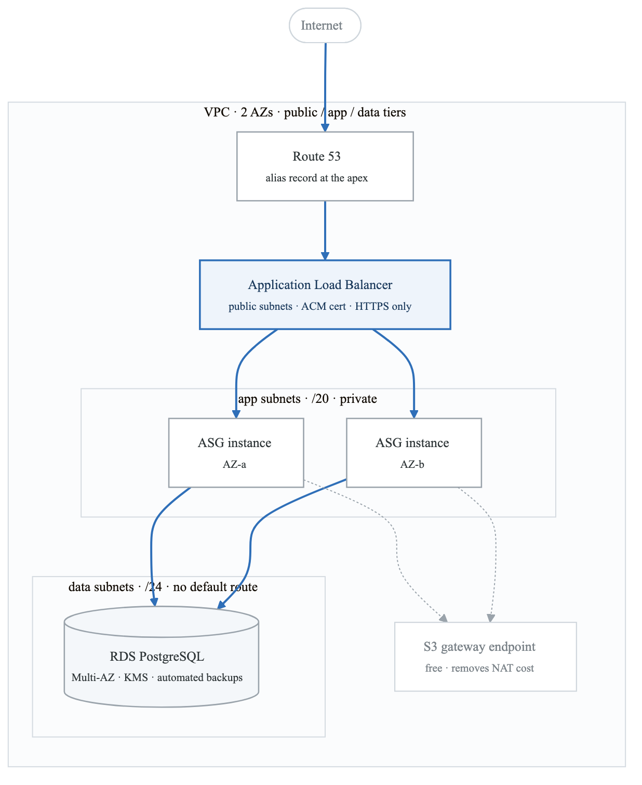
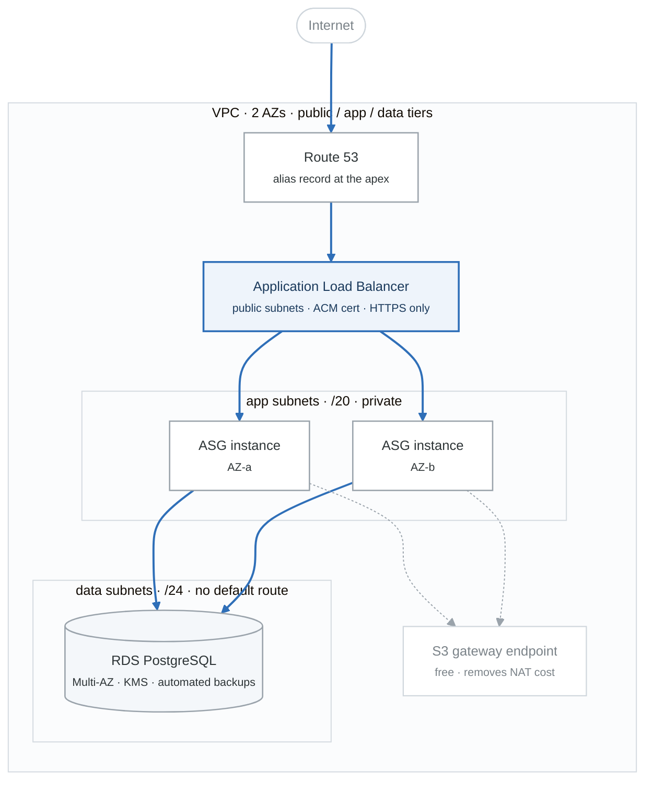
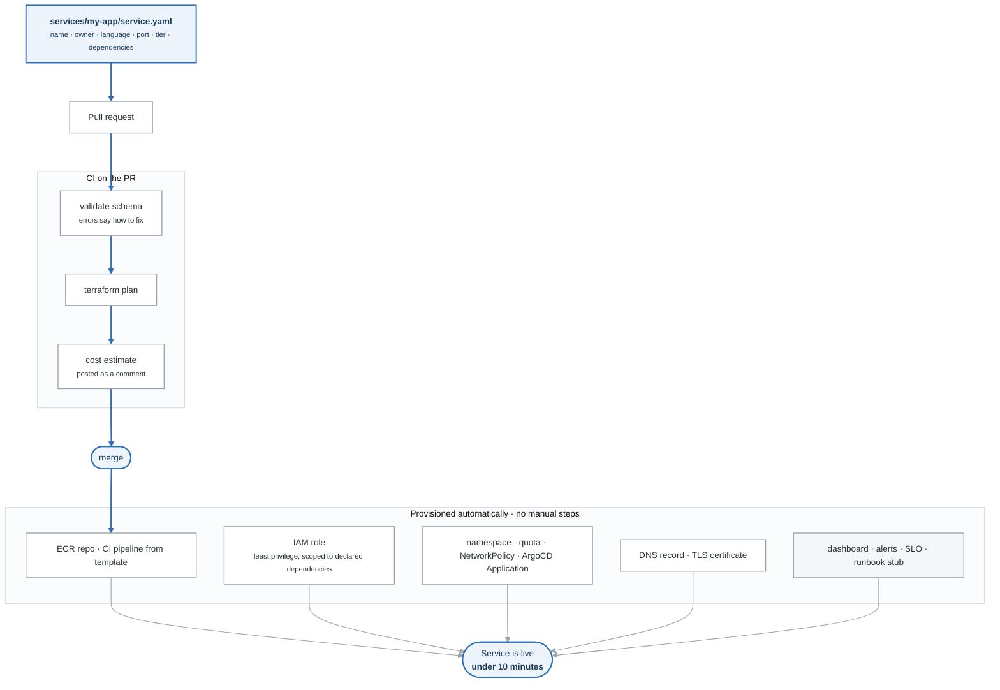

# The Portfolio

> Three flagship projects with hard acceptance criteria, twelve micro-projects, and how to present them so they convert.

Certifications get a résumé past the filter. **Projects win the room.** Every technical interview in this space eventually becomes "tell me about something you built," and the quality of that answer decides the loop.

---

## 1. The rules that apply to all three

**Public, or it doesn't exist.** Private repos are unverifiable claims.

**One repo per project, not a monorepo of experiments.** A hiring manager spends 90 seconds. Make those 90 seconds legible.

**Every repo has, without exception:**

| Element | Why |
|---|---|
| **README that opens with the problem**, not the tech list | "This deploys a 3-tier app with zero manual steps and no static credentials" beats "Built with Terraform, AWS, Docker" |
| **Architecture diagram** (draw.io, Excalidraw, or Mermaid) | Most candidates have none. It takes 30 minutes and it is the first thing that gets looked at. |
| **One-command deploy**, with the command shown | Proves it's real |
| **Teardown instructions** | Signals operational maturity |
| **Cost breakdown** — what it costs per month to run | Almost nobody does this. It reads as someone who has worked with a budget. |
| **A "What broke and how I fixed it" section** | **The single highest-value section in any junior portfolio.** See below. |
| **CI badge that is actually green** | A red badge is worse than no badge |
| **An ADR directory** — the non-obvious decisions and what was rejected | Interviewers probe judgment, not tool familiarity |

### On the "What broke" section

Write three to five real failures per project: the symptom, what was wrong, how it was found, and what would prevent it. It is counter-intuitive to document your own mistakes in a portfolio, and it is the highest-signal thing in the repo.

Two reasons. First, it proves the project was actually built rather than copied from a tutorial — tutorial output has no scars. Second, it hands the interviewer their own best question, pre-answered, in a format that makes the candidate look like someone who learns in public. Interviewers read that section and ask about it, and the candidate is prepared, specific, and honest. That combination is rare at any level.

---

## 2. Project ALPHA — Production-Shaped Cloud Infrastructure

**Weeks 10–13** · Proves: **AWS · Terraform · CI/CD**

### The claim it supports
*"I can take an application and stand up production-shaped infrastructure for it, entirely in code, deployed by a pipeline, with no human clicking in a console and no long-lived credentials anywhere."*

### What it is
The three-tier web application from months 1–2, rebuilt entirely as Terraform and delivered by GitHub Actions.

<!-- figure: generated from the Mermaid below by _shared/diagrams/embed-figures.py — do not edit the image -->


<details>
<summary>Diagram source (Mermaid)</summary>



</details>

**Terraform:**```

**Terraform:** `network/`, `compute/`, `database/`, `security/`, `observability/` modules · `dev/` and `prod/` environments consuming them with different inputs · remote state on S3 with locking.

**Pipeline:** OIDC federation to AWS (no static keys) · `fmt` → `validate` → `tflint` → `checkov` → `plan` → plan posted as a PR comment → approval gate → `apply` on merge.

**Operations:** CloudWatch alarms on the signals that matter, a dashboard, and a runbook per alarm.

### Acceptance criteria — all must be true
- [ ] `terraform apply` in a **clean AWS account** produces a working, reachable application
- [ ] `grep -ri "AKIA"` across the repo and its history returns nothing
- [ ] Remote state, with locking, verified by attempting two concurrent applies
- [ ] Both `dev` and `prod` deploy from the same modules with different inputs
- [ ] Terminating an app instance results in automatic recovery; the recovery time is measured and documented
- [ ] RDS failover triggered manually; downtime measured and documented
- [ ] Pipeline runs plan on PR and apply on merge, with an approval gate
- [ ] `checkov` passes, or every exception is documented with a written justification
- [ ] README, diagram, cost breakdown, teardown, and "what broke" all present
- [ ] The whole thing destroys cleanly, leaving nothing billable

### The detail that makes it stand out
**OIDC federation.** Static AWS keys in GitHub secrets is the most common amateur tell in a junior portfolio, and a candidate who eliminated them — and can explain the token exchange and the trust policy `sub` claim — reads several years more experienced than they are. This is a three-hour lesson with an outsized return.

---

## 3. Project BRAVO — Secure Kubernetes Delivery

**Weeks 17–21** · Proves: **Kubernetes · DevSecOps · GitOps**

### The claim it supports
*"I can build a delivery pipeline that makes it structurally difficult to ship something insecure — and I can show you it stopping a real vulnerability."*

### What it is
An application delivered to Kubernetes through a pipeline with security gates at every stage, plus admission control in the cluster.

```mermaid
%%{init: {'theme':'base','themeVariables':{'fontFamily':'Helvetica, Arial, sans-serif','fontSize':'13px','primaryColor':'#ffffff','primaryTextColor':'#2d3436','primaryBorderColor':'#9aa3ab','lineColor':'#9aa3ab','textColor':'#2d3436','clusterBkg':'#fbfcfd','clusterBorder':'#d4dae0','edgeLabelBackground':'#ffffff','tertiaryColor':'#eef4fb'},'flowchart':{'curve':'basis','padding':14,'nodeSpacing':42,'rankSpacing':58}}}%%
flowchart LR
  classDef default fill:#ffffff,stroke:#9aa3ab,stroke-width:1.3px,color:#2d3436
  classDef n    fill:#ffffff,stroke:#9aa3ab,stroke-width:1.3px,color:#2d3436
  classDef crit fill:#eef4fb,stroke:#2f6fb8,stroke-width:1.8px,color:#1b3a5c
  classDef data fill:#f4f7fa,stroke:#9aa3ab,stroke-width:1.3px,color:#2d3436
  classDef mut  fill:#ffffff,stroke:#cfd6dc,stroke-width:1.1px,color:#7a8288
  classDef warn fill:#fdf0ec,stroke:#c0522d,stroke-width:1.6px,color:#8a3a1e

  DEV["commit"]:::mut

  subgraph CI["CI · every gate hard-fails · cheapest checks first"]
    direction TB
    G1["gitleaks<br/><small>secrets · full history</small>"]:::n
    G2["Semgrep<br/><small>SAST</small>"]:::n
    G3["Trivy fs<br/><small>dependencies</small>"]:::n
    G4["build<br/><small>distroless · non-root</small>"]:::n
    G5["Trivy image<br/><small>container CVEs</small>"]:::crit
    G6["syft<br/><small>SBOM</small>"]:::n
    G7["cosign sign<br/><small>signs the DIGEST</small>"]:::crit
    G1 --> G2 --> G3 --> G4 --> G5 --> G6 --> G7
  end

  subgraph REG["Registry"]
    IMG["image + signature + SBOM attestation"]:::data
  end

  ARGO["ArgoCD<br/><small>pull-based · selfHeal</small>"]:::n

  subgraph K8S["Cluster · admission and runtime"]
    direction TB
    KY["Kyverno<br/><small>signed images only · non-root · limits · no :latest</small>"]:::crit
    PSS["Pod Security Standards<br/><small>restricted</small>"]:::n
    NP["NetworkPolicy<br/><small>default-deny + DNS</small>"]:::n
    FAL["Falco<br/><small>runtime detection</small>"]:::n
    KY --> PSS --> NP --> FAL
  end

  DEV --> G1
  G7 --> IMG --> ARGO --> KY

  linkStyle 9,10,11,12 stroke:#2f6fb8,stroke-width:2px
```

<!-- figure: generated from the Mermaid below by _shared/diagrams/embed-figures.py — do not edit the image -->


<details>
<summary>Diagram source (Mermaid)</summary>



</details>

**Infrastructure:**```

**Infrastructure:** EKS provisioned by Terraform (reusing Alpha's network module — *reuse is itself a signal*), IRSA, AWS Load Balancer Controller, External Secrets Operator.

**Delivery:** ArgoCD app-of-apps, sync waves, drift detection with self-healing.

**Security:** the full chain above, plus a written STRIDE threat model and a control narrative mapping each control to what it mitigates.

### Acceptance criteria — all must be true
- [ ] A deliberately-introduced critical CVE **blocks the pipeline**, with a screenshot and the log output
- [ ] An **unsigned image is refused by admission control**, with the rejection captured
- [ ] A pod attempting to run as root is rejected by Pod Security Standards
- [ ] A NetworkPolicy-blocked connection is demonstrated as blocked, not just declared
- [ ] SBOM generated, attached to the image, and retrievable
- [ ] Images are signed with cosign and verification is enforced, not advisory
- [ ] Changing a manifest in Git syncs to the cluster within 3 minutes
- [ ] Changing the cluster by hand is reverted automatically by ArgoCD
- [ ] Container image CVE count documented before and after hardening
- [ ] STRIDE threat model written up
- [ ] A control narrative table: control → what it mitigates → evidence
- [ ] Falco alerts on a shell spawned inside a running container

### The detail that makes it stand out
**Evidence, not assertions.** Almost every portfolio claims "security scanning integrated." Almost none *show the pipeline refusing to ship something.* Screenshots of a blocked build and a rejected deployment, in the README, convert a claim into a demonstration — and a demonstration is what an interviewer will ask you to walk through.

The control narrative table is the second differentiator: it is how security work is actually communicated in a regulated environment, and a junior who produces one unprompted is speaking the language of the job.

---

## 4. Project CHARLIE — The Internal Developer Platform

**Weeks 22–24** · Proves: **Platform engineering judgment**

### The claim it supports
*"I understand that a platform is a product with users, and I built one where a developer ships a new service by opening a pull request — no tickets, no platform-team involvement, under ten minutes."*

### What it is
The capstone. Everything from months 1–5 composed into a self-service paved road.

**The developer experience, end to end:**

<!-- figure: generated from the Mermaid below by _shared/diagrams/embed-figures.py — do not edit the image -->


<details>
<summary>Diagram source (Mermaid)</summary>



</details>

**Components:**```

**Components:** a versioned Terraform module registry · a `template-service/` scaffold repo · the `service.yaml` contract with a JSON schema · the platform controller (GitHub Actions + Terraform, or a small Python service) · generated golden-path CI pipelines · auto-provisioned observability · a documentation site.

### Acceptance criteria — all must be true
- [ ] **A person who has never seen the repo deploys a new service via PR in under 10 minutes, unaided.** *(This is Gate 6 and the only criterion that truly matters.)*
- [ ] Zero manual steps between merge and a running service
- [ ] A malformed `service.yaml` fails fast with an error message that tells the developer exactly what to fix
- [ ] Every provisioned service automatically gets a dashboard, alerts, and an SLO — the developer does not opt in
- [ ] Cost estimate appears as a PR comment before merge
- [ ] Terraform modules are versioned and documented with `terraform-docs`
- [ ] A getting-started guide, a contract reference, and ADRs all exist
- [ ] A 5-minute demo video walks PR → production
- [ ] Two example services exist, provisioned entirely through the platform
- [ ] Deleting a `service.yaml` deprovisions cleanly

### Build it, then user-test it
Week 24's most important hour: hand the README to someone unfamiliar with it and watch them use it **without helping them.** Write down every place they hesitate. Every hesitation is a bug in the product.

This exercise is the entire difference between a repo and a platform, and it is the thing that lets a junior candidate talk about developer experience from experience rather than from a blog post.

### A note on scope
[ROADMAP.md §5 month 6](ROADMAP.md#month-6--weeks-2226--platform-engineering-and-conversion--kcsa-week-25) argues against Backstage here. To restate briefly: Backstage is heavy enough to consume two weeks producing a demo that demonstrates framework-following rather than judgment. A module registry + template repo + PR-driven onboarding + a small CLI is faster to build, far easier to explain in an interview, and shows the same understanding. Choose Backstage only if target employers name it in their postings.

---

## 5. Twelve micro-projects

One to two days each. Fill gaps, make good blog posts, and give the GitHub profile evidence of consistency rather than three bursts of activity.

| # | Project | Week | Skill proven |
|---|---|---|---|
| 1 | `sysreport` — system health CLI, Bash then Python | 1, 4 | Linux, scripting, CLI design |
| 2 | Log parser producing a top-N report from 100k lines | 1 | Text processing at scale |
| 3 | Automated backup script with rotation and restore verification | 2 | Ops discipline — *most people never test the restore* |
| 4 | Self-hosted reverse proxy + Let's Encrypt automation | 3 | Networking, TLS |
| 5 | `aws-inventory` — boto3 script auditing resources across regions | 5 | Python + AWS API |
| 6 | Cost reporter — daily spend by tag, posted to Slack | 8 | FinOps instinct |
| 7 | Custom Terraform module published to the registry | 11 | Module design, versioning, docs |
| 8 | Reusable GitHub Actions workflow, consumed by 2+ repos | 12 | CI/CD abstraction |
| 9 | Kubernetes operator or controller (Python/kopf) | 16 | Deep K8s understanding |
| 10 | Admission webhook written from scratch (not Kyverno) | 19 | Policy internals |
| 11 | Custom Prometheus exporter for something real | 20 | Observability internals |
| 12 | Chaos script that randomly kills pods, with SLO impact measured | 21 | Resilience thinking |

**#3 is underrated.** Everyone writes a backup script. Almost nobody writes one that automatically verifies the restore. That distinction is a complete answer to "tell me about a time you thought about failure."

---

## 6. Presenting the work

### The GitHub profile
Profile README with a one-line positioning statement, the three flagship projects pinned with one-line descriptions of the *problem* each solves, and contributions visible across all 26 weeks. Consistency over intensity — a steady graph reads as discipline; three clusters read as bootcamp.

### The demo video
Five minutes, per flagship project. Screen recording with voice: the problem (30s), the architecture (60s), a live demo (2 min), something that broke and how it was fixed (60s), what you'd do differently (30s).

Link it at the top of the README. A hiring manager who watches a five-minute video has effectively given you a first-round screen before deciding whether to grant one.

### Talking about them in interviews
Have three depths ready for each project:

- **30 seconds** — the elevator version. Problem, approach, outcome.
- **3 minutes** — architecture walkthrough with the tradeoffs called out.
- **15 minutes** — deep dive on any single component, including what you'd change now.

Practice the transitions out loud. The most common failure is a candidate who built something real and cannot describe it in under four minutes.

### The numbers to have memorized
Interviewers respond to specifics, and every one of these is measurable from the projects:

- Image size before and after hardening
- CVE count before and after
- Deploy time, and time from PR open to production
- Recovery time after an instance termination
- RDS failover duration
- Monthly cost of each environment
- Time for a new service to go from PR to live on the platform
- The four DORA metrics for the Alpha and Bravo pipelines

A junior who answers "how long does your deploy take" with "four minutes twenty, and the bottleneck is the image build, which I could cut with better layer caching" is not interviewing like a junior.
