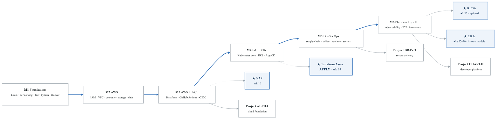
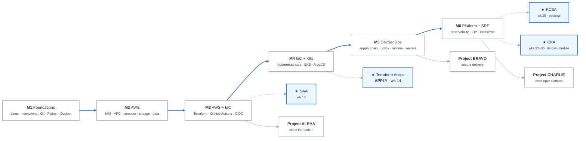

# Zero to Hired — 6-Month DevOps / DevSecOps / Platform Engineering Track

> A 26-week, 1,000+ hour program for a student starting at zero, studying 4–8+ hours/day,
> targeting AWS SAA + HashiCorp Terraform Associate (+ optional KCSA, and CKA in a four-week module after week 26),
> three shipped portfolio projects, and a job offer.

**Built:** 2026-09-20 · **Audience:** absolute beginner with full-time study availability

---

## Read in this order

| # | File | What it is |
|---|---|---|
| 1 | **[ROADMAP.md](ROADMAP.md)** | The strategy. Honest framing, the 9 core recommendations, the 6-month arc, monthly go/no-go gates, failure modes. **Start here.** |
| 2 | **[curriculum/STEP-BY-STEP.md](curriculum/STEP-BY-STEP.md)** | **The operating manual.** What you actually do on an ordinary Tuesday, and how that compounds into 26 weeks. Four nested loops: day, week, gate, program — plus what to do when you fail a gate or fall behind. |
| 3 | **[WEEK-BY-WEEK.md](WEEK-BY-WEEK.md)** | The execution plan. All 26 weeks: focus, labs, deliverable, recall drills, exit criteria. |
| 4 | **[CERTIFICATIONS.md](CERTIFICATIONS.md)** | Cert strategy and sequencing, honest signal-value ratings, three tracks (including why I'd swap KCNA for CKA), study resources, exam tactics. |
| 5 | **[PROJECTS.md](PROJECTS.md)** | Three flagship projects with hard acceptance criteria, 12 micro-projects, and how to present them so they actually convert. |
| 6 | **[JOB-SEARCH.md](JOB-SEARCH.md)** | Starts week 14, not week 26. Target titles, pipeline math, résumé rules for career changers, referral scripts, interview loop prep. |
| 7 | **[curriculum/](curriculum/)** | **The actual content.** All 26 weeks — labs, worked solutions, running code, assessments — plus a 58-scenario break/fix library, drills, an interview bank, 623 files of anonymized reference material, and three project implementations. Start at [curriculum/START-HERE.md](curriculum/START-HERE.md). |
| 8 | **[KUBERNETES-MASTERY.md](KUBERNETES-MASTERY.md)** | The Kubernetes mastery ladder: five rungs, twelve topics, the rubric, the eleven Go deeper labs, the long-lived cluster, the reading, the scoring. The exam is rung two; this is the rest |

---

## The 30-second version

<!-- figure: generated from the Mermaid below by _shared/diagrams/embed-figures.py — do not edit the image -->

Diagram source (Mermaid)

**Three non-negotiables**
1. **70% keyboard, 30% input.** Beginners invert this and stall at month 3.
2. **Apply from week 14.** The pipeline has a 6–10 week lag; starting at week 26 means hired at month 9.
3. **One rest day per week.** 26 weeks at this intensity is won on sustainability, not heroics.

---

## Honest expected outcome

At 4–8 hrs/day for 26 weeks (~1,000–1,300 focused hours) with all three projects shipped and 2–4 certs
earned, the most likely outcome is **an offer in month 6–10**, not month 6. Plan runway for 9 months.
The roadmap is built so that month 6 is when the *pipeline is full and converting* — not when it starts.

See [ROADMAP.md § Honest framing](ROADMAP.md#1-honest-framing--read-this-before-anything-else).

---

## The curriculum

[`curriculum/`](curriculum/) contains everything needed to actually execute the 26 weeks, plus the four-week CKA module (weeks 27–30) that runs alongside the job search.

**`curriculum/`**

| File | What it is |
|---|---|
| `START-HERE.md` | day-one setup and the rules that make the rest work |
| `STEP-BY-STEP.md` | the operating manual — the daily, weekly, gate and program loops |
| `SOURCES.md` | provenance and the anonymization record |
| `_setup/` | runnable scripts: toolchain, AWS guardrails, kind, teardown |
| `_shared/` | 58 break/fix scenarios · drills · Anki · interview bank · templates |
| `_reference/` | 623 anonymized files, ~338k lines, mapped week by week |
| week-01/ … week-26/   README · labs/ · solutions/ · assessment.md |  |
| `projects/` | alpha (validated Terraform) · bravo · charlie (working validator + CLI) |

| | |
|---|---|
| Written for this curriculum | ~21,000 lines across 144 week files + shared assets + projects |
| Curated reference library | 623 files, ~338,000 lines, fully anonymized |
| Break/fix scenarios with solutions | 58 |
| Interview questions with model answers | ~60 |
| Gates | 6, each demonstrated rather than self-assessed |

Everything executable was verified — `terraform validate`, `conftest verify`, `kubectl kustomize`,
`docker compose config`, `bash -n`, and YAML/JSON parsing. See
[curriculum/SOURCES.md](curriculum/SOURCES.md).
