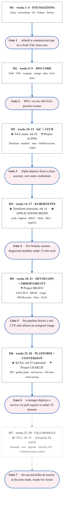

# Zero to Hired — The Strategy

> 26 weeks. 4–8+ hrs/day. From zero to a paid DevOps / Cloud / Platform role.

---

## Table of contents

1. [Honest framing — read this before anything else](#1-honest-framing--read-this-before-anything-else)
2. [The nine recommendations](#2-the-nine-recommendations)
3. [The operating system — how a day and a week are built](#3-the-operating-system--how-a-day-and-a-week-are-built)
4. [The six-month arc](#4-the-six-month-arc)
5. [Month-by-month detail](#5-month-by-month-detail)
6. [Go / no-go gates](#6-go--no-go-gates)
7. [Lab environment and cost control](#7-lab-environment-and-cost-control)
8. [What to deliberately skip](#8-what-to-deliberately-skip)
9. [Failure modes and how each one is caught](#9-failure-modes-and-how-each-one-is-caught)
10. [Tracking — the three artifacts that run the program](#10-tracking--the-three-artifacts-that-run-the-program)

---

## 1. Honest framing — read this before anything else

### 1.1 "A role in DevOps, DevSecOps, or Platform Engineering" is three different asks

They are not three doors at the same height.

| Title | Typical entry point | Realistic in 6 months from zero? |
|---|---|---|
| **DevOps Engineer / Cloud Engineer / Cloud Infrastructure Engineer** | Genuine junior/associate postings exist, especially at MSPs, consultancies, mid-market, and government contractors | **Yes — this is the target.** |
| **DevSecOps Engineer** | Almost always requires 3–5 yrs and usually a security *or* ops background first | Not as a first title. It is a **month-18 destination**, and month 5 of this plan builds the foundation for it. |
| **Platform Engineer** | Staffed by people who have already operated the thing they're now productizing | Not as a first title, with one exception: companies that *have* a platform team sometimes hire "Associate Platform Engineer" as a feeder role. Month 6 targets exactly those. |

**Recommendation:** Point the résumé and the application volume at **DevOps Engineer / Cloud Engineer / Site Reliability Engineer I / Infrastructure Engineer**. Build DevSecOps and Platform depth anyway — it is what makes a junior candidate beat other juniors — but do not let the student spend month 4 applying only to Senior Platform Engineer roles and conclude the market is closed.

There is a fourth door worth naming explicitly because it is high-volume and under-used: **cloud support engineer** roles (AWS Support, Azure Support, managed-service providers, and the support orgs at Datadog / HashiCorp / GitLab). These hire at exactly this skill level, are heavy on real troubleshooting, and convert internally to DevOps/SRE in 12–24 months. Treat them as a legitimate win, not a consolation prize.

### 1.2 What actually gets a beginner hired, ranked

1. **Someone who knows them vouching for them.** Referrals convert 5–15× cold applications. This is why [JOB-SEARCH.md](JOB-SEARCH.md) starts networking in week 14, not week 26.
2. **Proof of build.** Three real repos with architecture diagrams, CI that runs, and a "what broke" section beat any number of course completion certificates.
3. **Certifications.** These do one job very well: get past the ATS keyword filter and the recruiter's 8-second scan. They do not win the technical round.
4. **Troubleshooting fluency out loud.** The single most common junior rejection reason is "couldn't reason through a broken system." This is trainable and most beginners never train it. Week-by-week builds it in.
5. **Communication.** Writing a clear README, a clear postmortem, and a clear Slack update is a differentiator, not a soft skill.

Note the ranking. A student who spends 6 months collecting certificates and zero months building and talking to people will be unemployed at month 9. The plan allocates accordingly.

### 1.3 The arithmetic

4–8 hrs/day × 6 days/week × 26 weeks = **624–1,248 focused hours**. Call it ~1,000.

That is roughly equivalent to a serious bootcamp plus a half-year of on-the-job exposure — genuinely enough to be *useful* to an employer at junior level. It is not enough to be *senior*. Anyone promising otherwise is selling something. The goal here is: **be the most obviously hireable junior in the stack of applicants**, which is an achievable and well-defined target.

---

## 2. The nine recommendations

These are the opinions. Everything downstream is execution.

### R1 — Target one title, build toward three

Résumé headline and 80% of applications: **DevOps / Cloud Engineer**. Reserve ~20% of volume for Associate Platform Engineer and Cloud Security Engineer I. Revisit the mix at week 20 based on which screens actually convert — the interview data is better than any guess made now.

### R2 — Invert the tutorial ratio: 70% keyboard, 30% input

The default beginner failure is watching a 60-hour video course, feeling productive, and being unable to build a VPC from an empty file. The rule for every topic:

> **Watch/read once → build it from memory with docs only → break it → fix it → write down what broke.**

If the student cannot rebuild a lab from a blank terminal without following along, the topic is not learned. This ratio is the single highest-leverage decision in the plan.

### R3 — Certs get past the filter; projects win the room. Budget accordingly.

Sequence: **AWS SAA (wk10) → Terraform Associate (wk14) → optional K8s cert (wk17 or wk25)**. SAA first because it is the #1 ATS keyword for cloud infrastructure roles and it unlocks the week-14 application start. Terraform Associate second because after 6 weeks of real Terraform it costs ~30 hours and is the cheapest credible credential in the industry.

**On KCNA and KCSA — my honest read, then a decision rule.** Both are multiple-choice associate-tier certs. KCNA is a Kubernetes *awareness* credential; hiring managers who care about Kubernetes filter on **CKA**, which is hands-on and carries several times the signal. KCSA is more defensible: the DevSecOps niche has few entry credentials, so it stands out more than KCNA does, and it maps directly to month 5's material.

Decision rule at week 15:
- If Kubernetes clicks quickly (student is comfortable debugging a broken pod by week 16) → **skip KCNA, put those hours and dollars toward CKA** in weeks 27–30, the module after Gate 6.
- If Kubernetes feels shaky → **take KCNA in week 17** as a forcing function and a confidence win, then take the weeks 27–30 CKA module after the first job.
- Take **KCSA in week 25** only if DevSecOps is genuinely the destination. Otherwise skip it and ship a better Project Charlie.

Full analysis, costs, and three alternative tracks in [CERTIFICATIONS.md](CERTIFICATIONS.md).

### R4 — Ship three flagship projects, on a schedule, with acceptance criteria

Not "a portfolio." Three specific artifacts, each proving a different claim, each with a hard definition of done:

| | Project | Weeks | Proves |
|---|---|---|---|
| **ALPHA** | Production-shaped 3-tier AWS app, 100% Terraform, GitHub Actions with OIDC | 10–13 | Cloud + IaC + CI/CD |
| **BRAVO** | Secure Kubernetes delivery pipeline — GitOps, scanning, SBOM, signing, policy | 17–19 | Kubernetes + DevSecOps |
| **CHARLIE** | Internal Developer Platform — golden path, self-service onboarding, SLOs | 22–24 | Platform engineering judgment |

Specs and acceptance criteria in [PROJECTS.md](PROJECTS.md). Every one must be public, documented, diagrammed, and cost-annotated.

### R5 — Start applying week 14, not week 26

Pipeline math: application → recruiter screen → technical → onsite → offer → start is **6–10 weeks** even when everything goes right, and junior pipelines need 100–200 quality applications to produce a handful of offers. Starting at week 26 means the first offer lands at month 9 with no income.

Week 14 is chosen deliberately: SAA and Terraform Associate are both done, Project Alpha is shipped, and the résumé has something true to say. Early interviews also serve as free diagnostics — they reveal weak spots faster than any self-assessment, and there is still 12 weeks of runway to fix what they expose.

### R6 — Train troubleshooting as a first-class subject

Every Friday is **Break/Fix Friday**: the student deliberately breaks their own environment (or a partner does), then diagnoses it under a timer, narrating out loud as they would in an interview. Wrong DNS, exhausted disk, bad IAM trust policy, misconfigured security group, OOMKilled pod, Terraform state lock, expired cert, full CIDR.

Every incident gets a 10-line entry in `incident-journal.md`: symptom → hypothesis → how it was confirmed → root cause → fix → prevention. By week 26 there are ~50 entries. That journal is simultaneously the best interview-story bank the student will ever have and the reason they can answer "walk me through how you'd debug this."

### R7 — Write in public, once a week

One post per week, 500–1,200 words, on what was built or broken that week. 20+ posts by week 26.

This is the cheapest credibility multiplier available. It doubles as spaced-repetition (explaining forces retrieval), it gives recruiters something to find, it produces linkable proof, and it makes the student findable for the exact keywords they want to be hired on. Dev.to, Hashnode, or a plain GitHub Pages site — the platform is irrelevant, the consistency is not.

### R8 — Python and Bash. Go only if there is slack.

Bash for glue, Python for anything over 50 lines, `boto3` for AWS automation. Resist Go until after the first job unless month 6 runs ahead of schedule — Go is valuable for platform roles but it will not decide the first offer, and half-learning it costs 60 hours that Project Charlie needs.

### R9 — Put cost guardrails in place on day one of AWS

A surprise $400 AWS bill in week 6 ends programs. Before the first `terraform apply`: budget alarm at $25/$50/$100, billing alerts on, an IAM user with no root access keys, and a nightly `terraform destroy` habit for anything not needed overnight. Run Kubernetes locally on kind/k3d — EKS only for two deliberate weeks. Target: **$30–60/month**. Details in [§7](#7-lab-environment-and-cost-control).

---

## 3. The operating system — how a day and a week are built

### 3.1 Daily template (~6.25 hrs — scale blocks up or down for a 4 or 8 hr day)

| Block | Time | Activity | Why |
|---|---|---|---|
| **1. Input** | 90 min | New material — course, docs, book. Notes written **in the student's own words**, never copied. | Acquire |
| **2. Build** | 150 min | The week's lab or project work. Keyboard only. No video playing. | Encode |
| **3. Break/fix** | 60 min | Reproduce a failure, diagnose it, fix it. Narrate out loud. Log it. | The differentiator |
| **4. Recall** | 45 min | Anki + practice exam questions. Spaced repetition, not re-reading. | Retain |
| **5. Ship** | 30 min | Commit with a real message, update the README, draft blog notes. | Prove |

The order matters. Input before build (context), build before break (can't break what doesn't exist), recall late (interleaving beats blocking), ship last (closes the loop daily so nothing sits unfinished).

At 8 hrs/day, extend blocks 2 and 3 — never block 1. More passive input is the trap, not the solution.

### 3.2 Weekly rhythm

| Day | Shape |
|---|---|
| **Mon–Thu** | Standard daily template |
| **Fri** | **Break/Fix Friday** — extended troubleshooting (2–3 hrs), then week's deliverable finished and pushed |
| **Sat** | Project sprint, 4–6 hrs of uninterrupted build. This is where the flagship projects actually get made. |
| **Sun** | 2 hrs: write the blog post, review the week, plan next week, update the tracker. Then **stop**. |

**One full rest day per week is part of the plan, not a deviation from it.** So is sleep and exercise. 26 weeks is a long time and the failure mode at week 15 is not ignorance, it is burnout.

### 3.3 The three rules of studying

1. **Never watch a video without the terminal open.** Pause, do the thing, then resume.
2. **If it can't be rebuilt from blank, it isn't learned.** Weekly: delete a lab and rebuild it from memory with docs only.
3. **Explain it out loud before moving on.** The Feynman check. Stumbling is the signal to go back.

---

## 4. The six-month arc

```mermaid
%%{init: {'theme':'base','themeVariables':{'fontFamily':'Helvetica, Arial, sans-serif','fontSize':'13px','primaryColor':'#ffffff','primaryTextColor':'#2d3436','primaryBorderColor':'#9aa3ab','lineColor':'#9aa3ab','textColor':'#2d3436','clusterBkg':'#fbfcfd','clusterBorder':'#d4dae0','edgeLabelBackground':'#ffffff','tertiaryColor':'#eef4fb'},'flowchart':{'curve':'basis','padding':14,'nodeSpacing':42,'rankSpacing':58}}}%%
flowchart TB
  classDef default fill:#ffffff,stroke:#9aa3ab,stroke-width:1.3px,color:#2d3436
  classDef n    fill:#ffffff,stroke:#9aa3ab,stroke-width:1.3px,color:#2d3436
  classDef crit fill:#eef4fb,stroke:#2f6fb8,stroke-width:1.8px,color:#1b3a5c
  classDef data fill:#f4f7fa,stroke:#9aa3ab,stroke-width:1.3px,color:#2d3436
  classDef mut  fill:#ffffff,stroke:#cfd6dc,stroke-width:1.1px,color:#7a8288
  classDef warn fill:#fdf0ec,stroke:#c0522d,stroke-width:1.6px,color:#8a3a1e
  classDef gate fill:#fdeef2,stroke:#2f6fb8,stroke-width:1.6px,color:#2d3436

  M1["<b>M1 · weeks 1–4 · FOUNDATIONS</b><br/><small>Linux · networking · Git · Python · Docker</small>"]:::n
  G1(["<b>Gate 1</b> &nbsp;·&nbsp; rebuild a containerized app on a fresh VM, from zero"]):::gate

  M2["<b>M2 · weeks 5–9 · AWS CORE</b><br/><small>IAM · VPC · compute · storage · data · SAA prep</small>"]:::n
  G2(["<b>Gate 2</b> &nbsp;·&nbsp; 80%+ on two full SAA practice exams"]):::gate

  M3["<b>M3 · weeks 10–13 · IaC + CI/CD</b><br/>★ SAA exam, wk 10 &nbsp;·&nbsp; ⚑ Project ALPHA<br/><small>Terraform · modules · state · GitHub Actions · OIDC</small>"]:::n
  G3(["<b>Gate 3</b> &nbsp;·&nbsp; Alpha deploys from a clean account, zero static credentials"]):::gate

  M4["<b>M4 · weeks 14–17 · KUBERNETES</b><br/>★ Terraform Associate, wk 14 &nbsp;·&nbsp; ★ APPLICATIONS BEGIN<br/><small>pods→Ingress · RBAC · Helm · EKS · ArgoCD</small>"]:::n
  G4(["<b>Gate 4</b> &nbsp;·&nbsp; five broken clusters diagnosed unaided, under 15 min each"]):::gate

  M5["<b>M5 · weeks 18–21 · DEVSECOPS + OBSERVABILITY</b><br/>⚑ Project BRAVO<br/><small>SAST/SCA · SBOM · cosign · OPA/Kyverno · Falco · SLOs</small>"]:::n
  G5(["<b>Gate 5</b> &nbsp;·&nbsp; the pipeline blocks a real CVE and refuses an unsigned image"]):::gate

  M6["<b>M6 · weeks 22–26 · PLATFORM + CONVERSION</b><br/>★ KCSA, wk 25 (optional) &nbsp;·&nbsp; ⚑ Project CHARLIE<br/><small>IDP · golden paths · self-service · full-time interviewing</small>"]:::n
  G6(["<b>Gate 6</b> &nbsp;·&nbsp; a stranger deploys a service via pull request in under 10 minutes"]):::gate

  M7["<b>M7 · weeks 27–30 · CKA MODULE</b><br/>★ CKA, wk 30 &nbsp;·&nbsp; alongside the search<br/><small>kubeadm · etcd · upgrade · Gateway API · troubleshooting at speed</small>"]:::mut
  G7(["<b>Gate 7</b> &nbsp;·&nbsp; the second killer.sh session at the pass mark, inside two hours"]):::gate

  M1 --> G1 --> M2 --> G2 --> M3 --> G3 --> M4 --> G4 --> M5 --> G5 --> M6 --> G6
  G6 -.-> M7 --> G7

  linkStyle 0,1,2,3,4,5,6,7,8,9,10 stroke:#2f6fb8,stroke-width:2px
```

<!-- figure: generated from the Mermaid below by _shared/diagrams/embed-figures.py — do not edit the image -->


<details>
<summary>Diagram source (Mermaid)</summary>



</details>

Certification and application milestones overlay the technical arc rather than interrupting it. Exams are scheduled in weeks where the material is already fresh, so cram time stays under 15% of the week.

---

## 5. Month-by-month detail

### Month 1 · Weeks 1–4 — Foundations

**The thesis:** every DevOps concept the student will meet for the rest of their career is a Linux concept, a networking concept, or a Git concept wearing a cloud costume. A container is namespaces and cgroups. A Kubernetes Service is iptables/eBPF. A VPC is routing and subnetting. Skipping this month is why people plateau at "I can follow a tutorial."

**Coverage:** Linux (filesystem, permissions, processes, systemd, journald, package management, users/sudo, SSH, disks, cron/timers, text processing with grep/sed/awk/jq) · Networking (OSI, TCP/IP, **CIDR and subnetting drilled to automaticity**, DNS resolution path, HTTP/1.1 vs 2, TLS handshake, NAT, routing, firewalls, load balancing, reverse proxies) · Git (branching, rebase vs merge, conflict resolution, PR workflow, tags, semantic versioning) · Python for ops (types, files, `requests`, `argparse`, exceptions, venv, pytest basics) · Docker (images vs containers, Dockerfile, layer caching, multi-stage, volumes, networks, Compose).

**Weight the subnetting.** A junior who can convert /19 to a host count in their head, in an interview, without a calculator, reads as competent. It takes ~6 hours of drilling and pays for itself in every AWS and Kubernetes conversation afterward.

**Deliverable:** a Flask/FastAPI app deployed on a Linux VM behind Nginx, managed by a systemd unit, then containerized with a multi-stage Dockerfile and Compose — with a `RUNBOOK.md` the student wrote themselves.

### Month 2 · Weeks 5–9 — AWS core

**The thesis:** learn AWS as an *architect* reasoning about tradeoffs, not as a click-path memorizer. SAA rewards this and so do interviews.

**Coverage:** account structure, IAM (users, roles, policies, trust relationships, assume-role — this is the #1 source of real-world breakage, so over-invest) · VPC (subnets, route tables, IGW, NAT GW, SG vs NACL, VPC endpoints, peering/TGW at concept level) · EC2, EBS, AMIs, ALB/NLB, ASG, launch templates · S3 (storage classes, lifecycle, versioning, encryption, bucket policies vs IAM) · RDS/Aurora, DynamoDB, ElastiCache · Lambda, SQS, SNS, EventBridge · CloudFront, Route 53 · KMS, Secrets Manager, CloudWatch, CloudTrail · Organizations and SCPs · Well-Architected Framework, DR strategies (backup-restore → pilot light → warm standby → multi-site), cost fundamentals.

**How to study for SAA specifically:** one video course as spine (~50 hrs), the official exam guide as the checklist, and *build every service at least once by hand in the console before automating it*. Console-first here is deliberate — it builds the mental model that makes Terraform legible in month 3. Then three full-length practice exams in week 9, reviewing **every** question including the ones answered correctly for the wrong reason.

**Deliverable:** a hand-built 3-tier architecture in the console (VPC across 2 AZs, ALB, ASG, RDS Multi-AZ, S3, CloudWatch alarms) — torn down nightly — plus a written architecture decision record explaining each choice.

### Month 3 · Weeks 10–13 — IaC and CI/CD ★ SAA exam week 10

**The thesis:** month 2 built it by hand so month 3 can prove it belongs in code. Terraform immediately after SAA is the correct order — the student already knows what the resources *are*, so Terraform becomes a syntax and lifecycle problem rather than two problems at once.

**Coverage:** HCL, providers, resources, variables, locals, outputs · **state** (what it is, why it corrupts, remote backends on S3 with locking, `import`, `state mv`, drift) · modules (authoring, composition, versioning, registry) · `for_each` vs `count`, dynamic blocks, data sources, lifecycle rules · environments via directories vs workspaces (and why directories usually win) · testing: `fmt`, `validate`, `tflint`, `checkov`, `terraform test` · GitHub Actions (workflows, jobs, matrices, caching, reusable workflows, environments and approvals) · **OIDC federation to AWS so no long-lived access key ever exists** · plan-on-PR / apply-on-merge, trunk-based development, release automation.

The OIDC piece matters disproportionately. Static AWS keys in GitHub secrets is the single most common amateur tell in a junior portfolio. Getting federation right is a 3-hour lesson that reads as 3 years of experience.

**Deliverable:** **Project ALPHA** — month 2's architecture, entirely in Terraform, deployed by CI, with zero static credentials.

### Month 4 · Weeks 14–17 — Kubernetes ★ Terraform Associate week 14 ★ Applications begin week 14

**The thesis:** Kubernetes is the highest-leverage single skill on this list and also where beginners most often learn shallowly. The fix is local-first (kind/k3d, fast feedback, free) and debugging-first.

**Coverage:** control plane architecture (API server, etcd, scheduler, controller manager) and node components (kubelet, CRI, containerd) · Pods, ReplicaSets, Deployments, Services (all types), Ingress · ConfigMaps, Secrets, namespaces, labels and selectors · probes, resource requests/limits, QoS classes, HPA, PodDisruptionBudgets · StatefulSets, PV/PVC/StorageClass · RBAC, ServiceAccounts · taints, tolerations, affinity · Helm (consuming and authoring) · **debugging: events, describe, logs, exec, ephemeral containers, and the CrashLoopBackOff / ImagePullBackOff / Pending / OOMKilled decision tree** · then EKS via Terraform: IRSA or Pod Identity, AWS Load Balancer Controller, managed node groups, External Secrets Operator · ArgoCD: app-of-apps, sync waves, drift detection.

**Week 14 is the hinge week of the program.** Two certs are done, Project Alpha is live, the résumé is true, and applications start. Protect it — it is tempting to delay applying "until I know Kubernetes," and that instinct costs three months of runway.

**Deliverable:** an EKS cluster provisioned by Terraform, applications delivered by ArgoCD, plus five deliberately-broken-cluster scenarios diagnosed under a timer.

### Month 5 · Weeks 18–21 — DevSecOps and observability

**The thesis:** this is the month that makes the student beat other juniors. Almost no candidate at this level can talk credibly about supply chain security, and it is exactly what hiring managers have been told to care about.

**DevSecOps coverage:** SAST (Semgrep) · SCA and container scanning (Trivy, Grype) · secret scanning (gitleaks) and pre-commit hooks · image hardening — distroless, non-root, read-only filesystem, dropped capabilities · **SBOM generation (syft) and image signing/verification (cosign)** · SLSA provenance at concept level · policy as code (OPA/Conftest for Terraform, Kyverno or Gatekeeper for Kubernetes) · Pod Security Standards · NetworkPolicies and default-deny · runtime detection (Falco) · secrets management (AWS Secrets Manager + External Secrets, or Vault) · threat modeling basics (STRIDE on your own architecture) · compliance literacy: CIS Benchmarks, and enough NIST 800-53 / SOC 2 vocabulary to not look blank when asked.

**Observability coverage:** the three signals · Prometheus and **PromQL written by hand, not copied** · Grafana dashboards · Alertmanager and alert design (symptom-based, not cause-based) · OpenTelemetry instrumentation · log aggregation (Loki or CloudWatch) · **SLIs, SLOs, error budgets** · incident response, postmortem writing, runbooks · DORA metrics.

Have the student run three self-inflicted incidents end-to-end — detect via alert, diagnose, mitigate, write a blameless postmortem. Those three documents are worth more in a behavioral interview than any project README.

**Deliverable:** **Project BRAVO** — a pipeline that demonstrably blocks a known-vulnerable dependency and an unsigned image, with screenshots and a written control narrative.

### Month 6 · Weeks 22–26 — Platform engineering and conversion ★ KCSA week 25

**The thesis:** platform engineering is a *product* discipline applied to infrastructure. The concept a junior must be able to articulate is the **golden path**: an opinionated, paved, self-service route that makes the right thing the easy thing. Most candidates cannot explain this. One who can — with a working demo — interviews above their level.

**Coverage:** internal developer platforms, platform-as-product thinking, developer experience metrics · service catalogs and scaffolding (Backstage, or a deliberately simpler custom alternative) · self-service via pull request · multi-environment promotion · tenancy models · a shared Terraform module registry · platform contracts and paved-road documentation · FinOps basics — tagging strategy, cost allocation, rightsizing · ADRs and documentation as a deliverable.

**A deliberate note on Backstage:** it is heavy and can eat two weeks producing a demo that shows framework-following rather than judgment. A Terraform module registry + a template repo + a PR-driven onboarding workflow + a `platform-cli` is faster to build, easier to explain, and demonstrates the same understanding. Choose Backstage only if a target employer's job descriptions mention it by name.

The second half of this month is **conversion**: interviewing is now the primary activity, ~20 hrs/week. STAR stories built from the incident journal and the three projects, system design practice (design a CI/CD platform for 50 engineers; design a multi-account AWS landing zone; design a K8s platform for 20 teams), live coding in Bash/Python/Terraform, and at least six mock interviews.

**Deliverable:** **Project CHARLIE** plus a full interview kit — see [JOB-SEARCH.md](JOB-SEARCH.md).

### Month 7 · Weeks 27–30 — The CKA module ★ CKA week 30

**The thesis:** the CKA is the Kubernetes credential hiring managers filter on, and it cannot be passed from videos. The core plan taught the objects; this module teaches the quarter of the exam that lives on real nodes (kubeadm install and upgrade, etcd backup and restore, certificates, node failures) and the speed the exam demands. It runs alongside the week-26 cadence, about 17 hours of labs a week, and it is optional: [CERTIFICATIONS.md](CERTIFICATIONS.md) Track B.

**Coverage:** kubeadm on two or three lab VMs · Calico · certificates and kubeconfigs · etcd snapshot and restore · a one-minor upgrade · Kustomize and Helm as install tools · Gateway API and CoreDNS · CRDs and an operator · scheduling, Jobs, CronJobs, DaemonSets · dynamic provisioning · the four troubleshooting families on real nodes · two mock exams with weights · both killer.sh sessions.

**Deliverable:** the certificate, and a kubeadm cluster you built, broke, restored and upgraded, which is the story you tell about it. The exam is rung two of the Kubernetes mastery ladder in [KUBERNETES-MASTERY.md](KUBERNETES-MASTERY.md); the ladder runs from week 1 through the thread and continues after week 30.

---

## 6. Go / no-go gates

Each gate is tested at month end. Passing is binary and demonstrated, not self-assessed. Failing a gate means **spend one extra week and re-test** — do not advance on a broken foundation, and do not let a failed gate become a reason to quit. Two consecutive failed gates means the daily time budget or the input/build ratio is wrong; diagnose that, not the material.

| Gate | Week | Pass condition |
|---|---|---|
| **1 · Foundations** | 4 | From a fresh Linux VM, with docs only: install runtime, deploy a containerized app behind Nginx, manage it with systemd, open the right firewall port, and explain the full packet path from browser to process. **Plus:** convert between CIDR and host counts without a calculator. |
| **2 · AWS** | 9 | 80%+ on two different full-length SAA practice exams, and draw the month-2 architecture from memory on a whiteboard while explaining every tradeoff. |
| **3 · IaC + CI/CD** | 13 | `terraform apply` from a clean AWS account produces a working Project Alpha. CI runs plan on PR and apply on merge. `grep -ri "AKIA" .` returns nothing. State is remote and locked. |
| **4 · Kubernetes** | 17 | Diagnose 5 broken-cluster scenarios unaided, under 15 minutes each, narrating the reasoning aloud. Write a Deployment + Service + Ingress + RBAC from memory. |
| **5 · DevSecOps** | 21 | The Bravo pipeline blocks a deliberately-introduced critical CVE and refuses to deploy an unsigned image — both demonstrated live. Write a PromQL query and a valid SLO from scratch. |
| **6 · Platform** | 26 | A person who has never seen the repo follows the README and deploys a new service via pull request in under 10 minutes, unaided. |
| **7 · CKA** (optional) | 30 | The second killer.sh session finished inside two hours at or above the pass mark, without opening the solutions. Then the exam is sat. |

Gate 6 is the real one. If a stranger can self-serve against the platform, the student has *built a platform*, and can say so in an interview without qualification.

---

## 7. Lab environment and cost control

**Day-one setup, before any cloud resource is created:**

```bash
# 1. AWS budget alarm FIRST - $25 / $50 / $100 thresholds, email on each
# 2. Billing alerts enabled in account preferences
# 3. Root account: MFA on, no access keys, never used again
# 4. Daily IAM user with MFA + an admin role to assume
# 5. Cost Explorer enabled, checked every Monday morning
```

**Rules that keep the bill under $60/month:**

| Rule | Why |
|---|---|
| Kubernetes runs on **kind or k3d locally** by default | EKS control plane bills per hour whether used or not. Local clusters are free and iterate faster. |
| EKS gets exactly **two deliberate weeks** (17 and 19), destroyed nightly | Enough to learn IRSA, the ALB controller, and managed node groups. Not enough to hurt. |
| **`terraform destroy` every night**, non-negotiable | NAT Gateways and idle RDS instances are where beginner bills come from. |
| Managed NAT Gateway replaced with a **NAT instance** or public subnets in labs | NAT GW alone is meaningful monthly spend for a lab. |
| Spot instances everywhere that tolerates interruption | 60–80% cheaper and teaches interruption handling, which is itself interview material. |
| A **teardown checklist** in every project README | Also happens to be excellent documentation practice. |

**Local toolchain:** VS Code, Docker Desktop or Colima, kind/k3d, kubectl + k9s, terraform + tflint + terraform-docs, awscli v2, gh, jq/yq, Helm, pre-commit, Anki.

**Budget the exams separately** from the lab: 2–4 exams is roughly **$220–$720** depending on track. See [CERTIFICATIONS.md](CERTIFICATIONS.md).

---

## 8. What to deliberately skip

Curriculum discipline is most of the value of a roadmap. Everything below is real and useful and **not now**:

| Skip | Why | When it becomes relevant |
|---|---|---|
| **Jenkins** | GitHub Actions teaches the same concepts with better feedback loops. Learn Jenkins when an employer hands it to you — it takes a week. | On the job |
| **Ansible / Chef / Puppet** | Config management is declining relative to immutable infrastructure. Terraform + containers covers the ground. | If a JD demands it |
| **Azure and GCP** | Breadth before depth is the classic junior mistake. One cloud, deeply. Concepts transfer; the second cloud takes weeks, not months. | Post-hire, or if local market demands it |
| **Go** | Real value for platform work, but 60 hours that Project Charlie needs more. | Month 7+ |
| **Service mesh (Istio/Linkerd)** | Cannot be discussed credibly without having operated one. A junior who name-drops Istio invites a question they'll lose. | Post-hire |
| **CKS** | Requires CKA first and assumes operating experience. | Year 2 |
| **Multi-cloud anything** | Nobody is hiring a junior for multi-cloud. | Never, as a learning goal |
| **A second video course on the same topic** | This is procrastination that feels like studying. Build instead. | Never |

The one exception worth making: if the student's local job market is visibly Azure-dominant (common in government, healthcare, and large enterprise in some regions), **swap AWS for Azure wholesale** — AZ-104 in place of SAA — rather than trying to do both. Check 30 local job postings in week 1 and decide once. Do not revisit.

---

## 9. Failure modes and how each one is caught

| Failure mode | Early warning sign | Built-in countermeasure |
|---|---|---|
| **Tutorial hell** | Can follow along but can't start from blank | R2's 70/30 rule; weekly rebuild-from-blank drill; Gate tests are all from-scratch |
| **Cert tunnel vision** | Studying exam questions in a week with no scheduled exam | Certs are capped at 2 weeks of prep each and pinned to specific weeks |
| **Portfolio never ships** | Project Alpha still "almost done" in week 16 | Hard acceptance criteria; Saturday sprints; gates block advancement |
| **Applying too late** | "I'll apply when I'm ready" | Week 14 is a gate, not a suggestion. Ready is a feeling; the pipeline is math. |
| **Burnout at week 14–18** | Skipped rest days; irritability; declining output at constant hours | Mandatory rest day; the plan assumes 6 days/week and is sized for it |
| **Breadth without depth** | Can name 40 tools, has operated 4 | The skip list; three deep projects instead of twelve shallow ones |
| **Surprise cloud bill** | Any bill over $75 | Budget alarms day one; nightly destroy; local-first Kubernetes |
| **Silent isolation** | No conversations with working engineers by week 12 | Networking starts week 14 with explicit weekly targets in JOB-SEARCH.md |
| **Résumé lies** | "5 years experience" on a 6-month résumé | Everything claimed must map to a repo or an incident-journal entry. This is also self-protection: fabrications collapse in technical rounds. |

---

## 10. Tracking — the three artifacts that run the program

Three files, maintained continuously. They are the program's instrumentation, and they double as interview material.

**`progress.md`** — one row per week: week number, focus, deliverable shipped (y/n), gate status, hours logged, and a one-line "what surprised me." That last column is the highest-value field in the whole system; surprise marks the boundary of the mental model, and reviewing the column monthly surfaces blind spots no checklist can.

**`incident-journal.md`** — every break/fix and every real failure. Symptom → hypothesis → confirmation → root cause → fix → prevention. Target ~50 entries by week 26. This becomes the STAR story bank.

**`decisions.md`** — a lightweight ADR log. Every non-obvious technical choice across the three projects: what was chosen, what was rejected, why. Interviewers at this level probe *judgment*, and a junior who can say "I chose X over Y because Z, and here's what I'd revisit" is operating a level above their experience.

---

**Next:** [WEEK-BY-WEEK.md](WEEK-BY-WEEK.md) for execution · [CERTIFICATIONS.md](CERTIFICATIONS.md) for the cert decision · [PROJECTS.md](PROJECTS.md) for the builds · [JOB-SEARCH.md](JOB-SEARCH.md) for conversion
