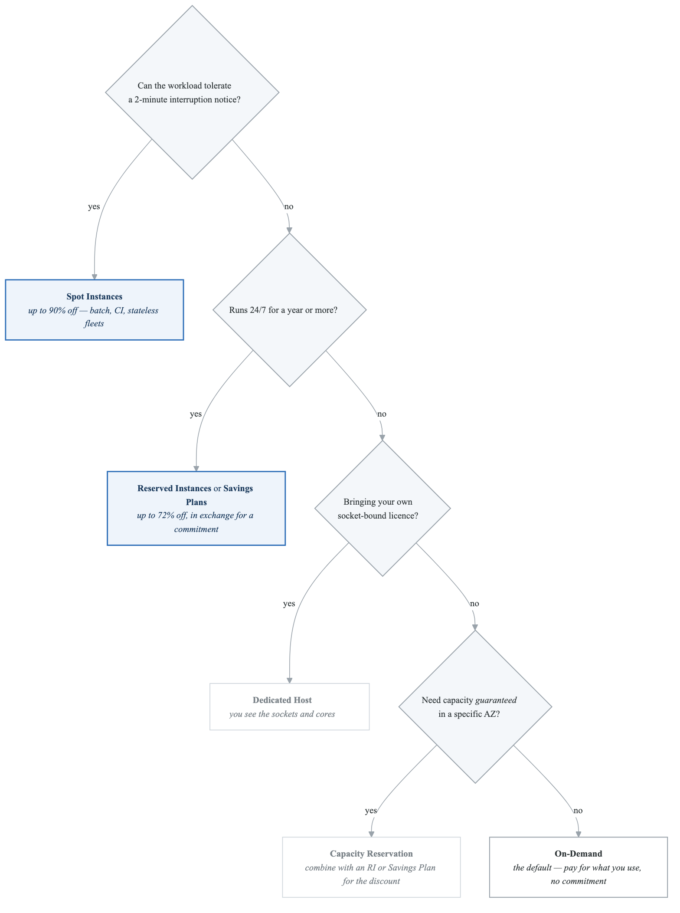
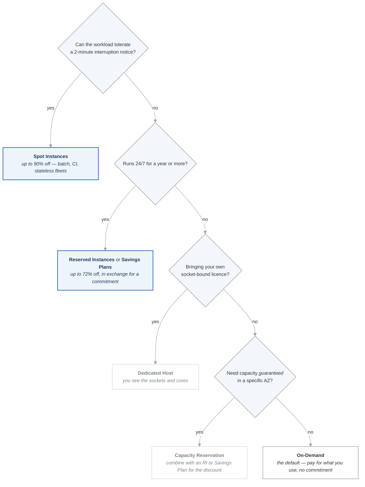

# EC2 & Compute Cheat Sheet

## Instance Type Families — Quick Reference

| Family | Category | Key Trait | Mnemonic |
|---|---|---|---|
| **M** | General Purpose | Balanced CPU/memory | **M**edium of everything |
| **T** | General Purpose (burstable) | CPU credits, variable workloads | **T**hrottled then burst |
| **C** | Compute Optimized | High-performance CPU | **C**PU-intensive |
| **R** | Memory Optimized | Large RAM | **R**AM |
| **X** | Memory Optimized | Extreme memory (up to 4 TB) | e**X**treme memory |
| **I** | Storage Optimized | High sequential I/O (NVMe SSD) | **I**/O intensive |
| **D** | Storage Optimized | Dense HDD storage | **D**ense storage |
| **P** | Accelerated | GPU for ML training | **P**arallel (GPU) |
| **G** | Accelerated | GPU for graphics | **G**raphics |
| **Inf** | Accelerated | ML inference | **Inf**erence |
| **HPC** | HPC | Tightly coupled workloads | **H**igh **P**erformance **C**ompute |

**Graviton (ARM):** Suffix `g` (e.g., m7g, c7g). Up to 40% better price-performance. Requires ARM AMIs.

---

## Purchase Options Comparison

| Option | Discount | Commitment | Interruption? | Best For |
|---|---|---|---|---|
| **On-Demand** | 0% | None | No | Short-term, unpredictable |
| **Reserved (Standard)** | Up to 72% | 1 or 3 years | No | Steady-state workloads |
| **Reserved (Convertible)** | Up to 66% | 1 or 3 years | No | Steady-state, flexibility to change family |
| **Compute Savings Plan** | Up to 66% | 1 or 3 years ($/hr) | No | Flexible across EC2, Fargate, Lambda |
| **EC2 Instance Savings Plan** | Up to 72% | 1 or 3 years ($/hr) | No | Locked to family+region |
| **Spot** | Up to 90% | None | **Yes** (2-min warning) | Fault-tolerant, batch, CI/CD |
| **Dedicated Instance** | Varies | None or Reserved | No | Compliance (no shared hardware) |
| **Dedicated Host** | Varies | None or Reserved | No | BYOL, licensing, compliance |
| **Capacity Reservation** | 0% (On-Demand price) | None | No | Guaranteed capacity in an AZ |

### Decision Flow

<!-- figure: generated from the Mermaid below by _shared/diagrams/embed-figures.py — do not edit the image -->


<details>
<summary>Diagram source (Mermaid)</summary>



</details>

---

## Placement Groups

| Type | Location | Max per AZ | Use Case |
|---|---|---|---|
| **Cluster** | Same rack, single AZ | No limit | Lowest latency (HPC, big data) |
| **Spread** | Different racks, multi-AZ | **7 instances per AZ** | Max availability (critical instances) |
| **Partition** | Separate racks per partition, multi-AZ | **7 partitions per AZ** | Distributed systems (HDFS, Kafka, Cassandra) |

---

## Auto Scaling Policies

| Policy | Trigger | Proactive? | Best For |
|---|---|---|---|
| **Target Tracking** | Metric target (e.g., CPU 50%) | Reactive | Default choice, most workloads |
| **Step Scaling** | CloudWatch alarm thresholds | Reactive | Different amounts at different thresholds |
| **Simple Scaling** | Single CloudWatch alarm | Reactive | Legacy — avoid |
| **Scheduled** | Cron/date-time | **Proactive** | Known traffic patterns (9-5 workday) |
| **Predictive** | ML forecast (14-day history) | **Proactive** | Cyclical patterns (daily/weekly) |

### ASG Key Numbers

| Setting | Default |
|---|---|
| Cooldown period | 300 seconds (5 min) |
| Health check grace period | 300 seconds |
| Default health check type | EC2 (not ELB) |
| AZ rebalancing | Can exceed max by 10% |
| Warm pool states | Stopped, Running, Hibernated |

---

## Launch Template vs Launch Configuration

| Feature | Launch Template | Launch Configuration |
|---|---|---|
| Versioning | Yes | No (immutable) |
| Mixed instance types | Yes | No |
| Spot + On-Demand | Yes | No |
| **Use this one** | **Always** | **Never (legacy)** |

---

## ENI / ENA / EFA

| Component | What It Is | Use Case |
|---|---|---|
| **ENI** | Virtual network card | Basic networking, failover (move ENI between instances) |
| **ENA** | Enhanced networking (SR-IOV), up to 100 Gbps | High throughput, low latency |
| **EFA** | Fabric adapter with OS bypass | HPC, MPI, tightly coupled workloads |

---

## Instance Metadata (IMDSv2)

```bash
TOKEN=$(curl -X PUT "http://169.254.169.254/latest/api/token" \
  -H "X-aws-ec2-metadata-token-ttl-seconds: 21600")
curl -H "X-aws-ec2-metadata-token: $TOKEN" \
  http://169.254.169.254/latest/meta-data/<path>
```

Key paths: `instance-id`, `ami-id`, `local-ipv4`, `public-ipv4`, `placement/availability-zone`, `iam/security-credentials/<role>`, `instance-type`.

---

## Exam Pattern Matching

| Keyword in Question | Answer |
|---|---|
| "Variable workload", "occasional spikes" | T-series (burstable) |
| "Consistently high CPU" | C-series (compute optimized) |
| "In-memory cache", "large datasets in RAM" | R-series (memory optimized) |
| "HPC", "tightly coupled", "MPI" | Cluster placement group + EFA |
| "Can tolerate interruptions", "fault-tolerant batch" | Spot Instances |
| "Steady-state 24/7 workload" | Reserved Instances or Savings Plans |
| "BYOL", "bring your own license" | Dedicated Hosts |
| "Maximize availability", "isolate failures" | Spread placement group |
| "Fastest rollback", "zero downtime deploy" | Immutable deployment (Beanstalk) |
| "Pre-provision before traffic arrives" | Scheduled or Predictive Scaling |
| "Instances unresponsive but pass EC2 checks" | Enable ELB health checks on ASG |
| "Reduce time to scale out" | Warm Pools |
| "Update all instances to new AMI" | Instance Refresh |
| "Protect against SSRF on metadata" | IMDSv2 |

<!-- feynman-check -->

---

## Feynman check

Close the file. Blank page, no notes. Explain each of these to a competent engineer who has never
used this tool — **under five minutes, no jargon you can't define on the spot:**

- Instance Type Families — Quick Reference
- Purchase Options Comparison
- Placement Groups
- Auto Scaling Policies

**The gap is not what you forgot. It is where you used a word instead of a mechanism.**

| | |
|---|---|
| ✗ | *"The security group allows the traffic."* |
| ✓ | *"A security group is a stateful allow-list attached to an ENI. Traffic matching an inbound rule is permitted and the reply is permitted automatically, because the connection is tracked — which is why you never write an outbound rule for a reply."* |

**Trace it:** A request from the internet to an instance in a private subnet. Name every hop, every route-table lookup, and every rule evaluated, in order.

Stop at the first component you cannot name. Reopen this file and read **only** that.

**Go deeper — only once the gap has a name:** [Timeouts, retries and backoff with jitter](https://aws.amazon.com/builders-library/timeouts-retries-and-backoff-with-jitter/) — 15 minutes from the AWS Builders' Library, and it changes how you write every client you touch afterwards.
Full list per domain: [`SOURCES.md`](../SOURCES.md#aws)

→ Protocol, the three levels of knowing, and worked examples: [`MASTERY.md`](../MASTERY.md)

<!-- /feynman-check -->
