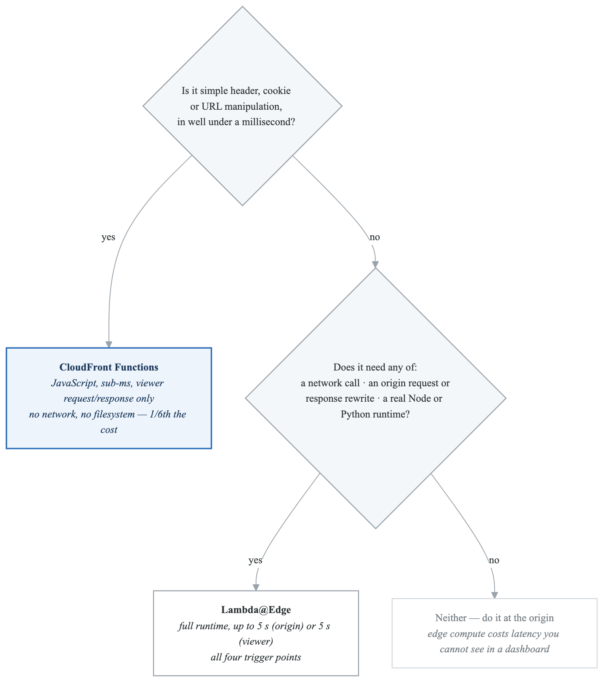
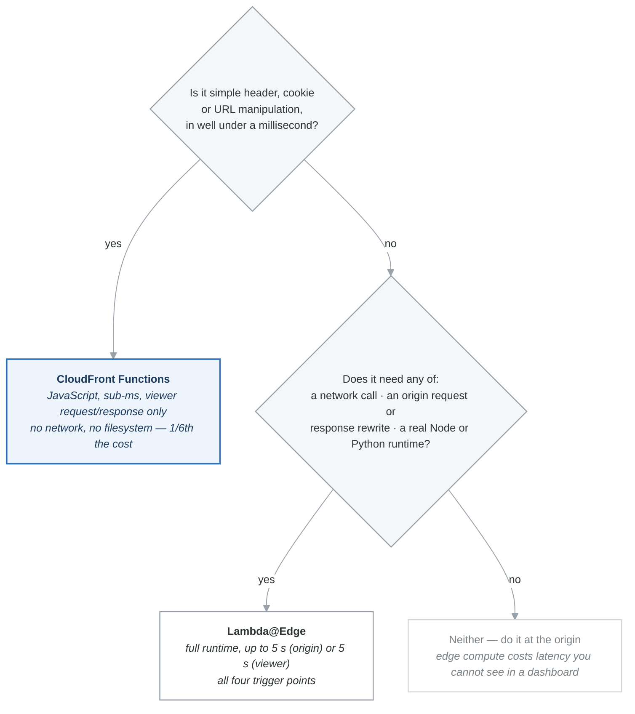
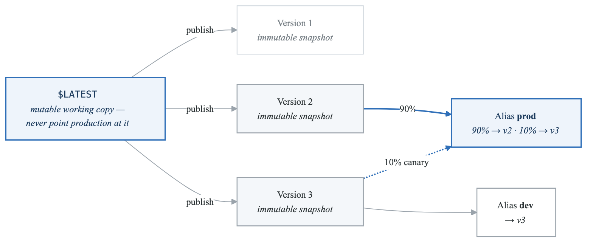
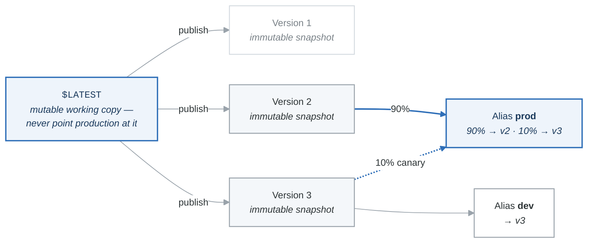

# Lambda & Serverless Cheat Sheet

## Lambda Limits — Quick Reference

| Limit | Value |
|---|---|
| **Max timeout** | **15 minutes (900 seconds)** |
| **Max memory** | 10,240 MB (10 GB) |
| **Deployment package (zipped)** | 50 MB direct upload |
| **Deployment package (unzipped + layers)** | 250 MB |
| **Container image size** | 10 GB |
| **/tmp disk space** | 512 MB - 10,240 MB (10 GB) |
| **Environment variables** | 4 KB total |
| **Concurrent executions (account default)** | 1,000 per region |
| **Burst concurrency** | 500 - 3,000 (region-dependent) |
| **Layers per function** | 5 |
| **Synchronous payload** | 6 MB (request + response) |
| **Asynchronous payload** | 256 KB |
| **Free Tier** | 1M requests + 400,000 GB-sec/month (perpetual) |

### When Lambda is NOT the Answer

- Task takes longer than **15 minutes** -> Use ECS Fargate, Step Functions, or EC2.
- Package size exceeds **250 MB** unzipped -> Use container image (up to 10 GB) or ECS.
- Needs persistent local storage -> Use ECS with EBS, or EFS mounted to Lambda.
- Needs GPU -> Use EC2 or ECS with GPU instance types.

---

## Concurrency Types

| Type | What It Does | Cost | Use Case |
|---|---|---|---|
| **Unreserved** | Shared pool across all functions (default: 1,000) | Free | Default behavior |
| **Reserved** | Guarantees N concurrent executions for this function; also **caps** it at N | Free | Guarantee capacity; prevent one function from consuming all capacity |
| **Provisioned** | Pre-initializes N execution environments (always warm) | **Costs money** | Eliminate cold starts for latency-sensitive functions |

### Concurrency Math

```
Account limit: 1,000
Function A (reserved): 200  -> guaranteed 200, max 200
Function B (reserved): 100  -> guaranteed 100, max 100
All other functions share:  700 unreserved
```

**Throttling behavior:**
- Synchronous: HTTP 429 (Too Many Requests)
- Asynchronous: Retries with backoff, then DLQ/destination

---

## Invocation Types

| Type | Caller Waits? | Retries | Error Handling | Examples |
|---|---|---|---|---|
| **Synchronous** | Yes | No (caller retries) | Return error to caller | API Gateway, ALB, CloudFront |
| **Asynchronous** | No (gets 202) | 2 retries (3 total) | DLQ or Destinations | S3, SNS, EventBridge |
| **Event Source Mapping** | N/A (Lambda polls) | Varies by source | Source-specific | SQS, Kinesis, DynamoDB Streams |

### Event Source Mapping Details

| Source | Ordering | On Failure | DLQ Location |
|---|---|---|---|
| **SQS** | No ordering (standard) / Ordered (FIFO) | Message returns to queue after visibility timeout | **On the SQS queue** (not Lambda) |
| **Kinesis** | Per-shard ordering | Blocks the shard until resolved | OnFailure destination |
| **DynamoDB Streams** | Per-shard ordering | Blocks the shard until resolved | OnFailure destination |

**Kinesis/DynamoDB failure options:**
- `BisectBatchOnFunctionError`: Split the batch and retry halves
- `MaximumRetryAttempts`: Limit retries before discarding
- `MaximumRecordAgeInSeconds`: Discard records older than X
- `OnFailure` destination: Send failed records to SQS/SNS

---

## Lambda@Edge vs CloudFront Functions

| Feature | **CloudFront Functions** | **Lambda@Edge** |
|---|---|---|
| Runtime | JavaScript only | Node.js, Python |
| Location | 218+ edge locations | ~13 regional edge caches |
| Scale | Millions req/sec | Thousands req/sec |
| Execution time | **< 1 ms** | 5 sec (viewer) / 30 sec (origin) |
| Memory | 2 MB | 128 MB - 10 GB |
| Network access | **No** | Yes |
| Request body access | **No** | Yes |
| Triggers | Viewer Request, Viewer Response | All 4 events |
| Cost | ~$0.10 per 1M invocations | ~$0.60 per 1M invocations |

### CloudFront Event Types

```
Client → [Viewer Request] → CloudFront Cache → [Origin Request] → Origin
Origin → [Origin Response] → CloudFront Cache → [Viewer Response] → Client
```

| Event | CloudFront Functions | Lambda@Edge |
|---|---|---|
| Viewer Request | Yes | Yes |
| Viewer Response | Yes | Yes |
| Origin Request | **No** | Yes |
| Origin Response | **No** | Yes |

### Decision Flow

<!-- figure: generated from the Mermaid below by _shared/diagrams/embed-figures.py — do not edit the image -->


<details>
<summary>Diagram source (Mermaid)</summary>



</details>

---

## Lambda Networking

| Configuration | Internet Access | VPC Resource Access |
|---|---|---|
| **Default (no VPC)** | Yes | No |
| **VPC (private subnet + NAT GW)** | Yes (via NAT) | Yes |
| **VPC (private subnet, no NAT)** | **No** | Yes |
| **VPC + VPC Endpoints** | No (but can access AWS services) | Yes |

**Key rule:** Lambda in a VPC **loses internet access** unless the subnet has a route to a NAT Gateway.

---

## Lambda Versions, Aliases, and Traffic Shifting

<!-- figure: generated from the Mermaid below by _shared/diagrams/embed-figures.py — do not edit the image -->


<details>
<summary>Diagram source (Mermaid)</summary>



</details>

- **Aliases** enable canary and blue/green deployments.
- **CodeDeploy** can automate traffic shifting (Linear, Canary, AllAtOnce).

---

## Lambda Destinations vs DLQ

| Feature | DLQ | Destinations |
|---|---|---|
| Success routing | No | **Yes** |
| Failure routing | Yes | Yes |
| Event data | Event payload only | Full invocation record (request, response, context) |
| Targets | SQS, SNS | SQS, SNS, Lambda, EventBridge |
| Recommendation | Legacy | **Preferred** |

---

## Serverless Services on the SAA Exam

| Service | What It Does |
|---|---|
| **Lambda** | Run code without servers (up to 15 min) |
| **API Gateway** | Create REST/HTTP/WebSocket APIs |
| **S3** | Object storage (event-driven triggers) |
| **DynamoDB** | NoSQL database (streams trigger Lambda) |
| **SNS** | Pub/sub messaging |
| **SQS** | Message queuing (Lambda polls) |
| **Step Functions** | Orchestrate Lambda functions (workflows) |
| **EventBridge** | Event bus for routing events |
| **Fargate** | Serverless containers (ECS/EKS) |
| **Aurora Serverless** | Serverless relational database |
| **AppSync** | Managed GraphQL |

---

## Exam Pattern Matching — Serverless

| Keyword in Question | Answer |
|---|---|
| "Task longer than 15 minutes" | NOT Lambda — use ECS/Fargate or Step Functions |
| "Eliminate cold starts" | Provisioned Concurrency |
| "Prevent one function from using all capacity" | Reserved Concurrency |
| "Simple header manipulation at edge, lowest cost" | CloudFront Functions |
| "Complex logic at edge, needs network access" | Lambda@Edge |
| "Lambda needs to access RDS in private subnet" | Attach Lambda to VPC |
| "Lambda in VPC needs internet" | NAT Gateway in public subnet |
| "Lambda in VPC needs to access S3" | VPC Gateway Endpoint for S3 |
| "Canary deployment for Lambda" | Aliases + traffic shifting (or CodeDeploy) |
| "S3 upload should trigger processing" | S3 event notification -> Lambda |
| "Failed messages should go to dead letter queue" | SQS: DLQ on the queue. Async Lambda: DLQ or Destination |
| "Kinesis failure blocks shard" | BisectBatchOnFunctionError + MaxRetryAttempts |
| "Process SQS messages" | Lambda Event Source Mapping (polls the queue) |
| "Orchestrate multiple Lambda functions" | Step Functions |

<!-- feynman-check -->

---

## Feynman check

Close the file. Blank page, no notes. Explain each of these to a competent engineer who has never
used this tool — **under five minutes, no jargon you can't define on the spot:**

- Lambda Limits — Quick Reference
- Concurrency Types
- Invocation Types
- Lambda@Edge vs CloudFront Functions

**The gap is not what you forgot. It is where you used a word instead of a mechanism.**

| | |
|---|---|
| ✗ | *"The security group allows the traffic."* |
| ✓ | *"A security group is a stateful allow-list attached to an ENI. Traffic matching an inbound rule is permitted and the reply is permitted automatically, because the connection is tracked — which is why you never write an outbound rule for a reply."* |

**Trace it:** A request from the internet to an instance in a private subnet. Name every hop, every route-table lookup, and every rule evaluated, in order.

Stop at the first component you cannot name. Reopen this file and read **only** that.

**Go deeper — only once the gap has a name:** [Timeouts, retries and backoff with jitter](https://aws.amazon.com/builders-library/timeouts-retries-and-backoff-with-jitter/) — 15 minutes from the AWS Builders' Library, and it changes how you write every client you touch afterwards.
Full list per domain: [`SOURCES.md`](../SOURCES.md#aws)

→ Protocol, the three levels of knowing, and worked examples: [`MASTERY.md`](../MASTERY.md)

<!-- /feynman-check -->
