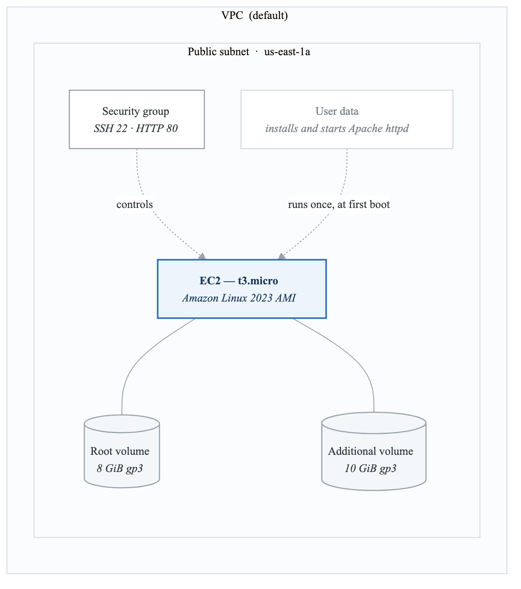
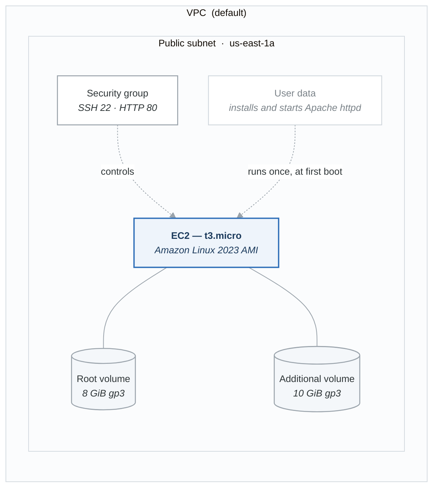

# Lab 01 — Launch and Configure an EC2 Instance

## Objective

Launch an EC2 instance with user data, configure security groups, SSH into the instance, attach an additional EBS volume, and create a snapshot. You will use both AWS CLI and Python/Boto3.

## Prerequisites

- Phase 1 complete (AWS account, CLI configured, Boto3 installed).
- A key pair created in your region (`aws ec2 create-key-pair --key-name my-lab-key --query 'KeyMaterial' --output text > my-lab-key.pem && chmod 400 my-lab-key.pem`).
- Your default VPC ID and a public subnet ID (from Phase 1).

## Cost Estimate

- t3.micro EC2 instance: Free Tier eligible (750 hours/month for 12 months). If outside Free Tier: ~$0.01/hour.
- 8 GiB gp3 root volume: Free Tier eligible. If outside: ~$0.64/month.
- 10 GiB gp3 additional volume: ~$0.80/month.
- Snapshot: ~$0.05/GiB/month.
- **Total if torn down within 1 hour: < $0.05**

## Architecture

<!-- figure: generated from the Mermaid below by _shared/diagrams/embed-figures.py — do not edit the image -->


<details>
<summary>Diagram source (Mermaid)</summary>



</details>

---

## Part 1: Launch EC2 with AWS CLI

### Step 1: Create a Security Group

```bash
# Get your default VPC ID
VPC_ID=$(aws ec2 describe-vpcs \
  --filters "Name=isDefault,Values=true" \
  --query "Vpcs[0].VpcId" --output text)

echo "VPC ID: $VPC_ID"

# Create a security group
SG_ID=$(aws ec2 create-security-group \
  --group-name lab01-web-sg \
  --description "Allow SSH and HTTP" \
  --vpc-id "$VPC_ID" \
  --query "GroupId" --output text)

echo "Security Group ID: $SG_ID"

# Allow SSH from your IP only
MY_IP=$(curl -s https://checkip.amazonaws.com)
aws ec2 authorize-security-group-ingress \
  --group-id "$SG_ID" \
  --protocol tcp --port 22 \
  --cidr "${MY_IP}/32"

# Allow HTTP from anywhere
aws ec2 authorize-security-group-ingress \
  --group-id "$SG_ID" \
  --protocol tcp --port 80 \
  --cidr "0.0.0.0/0"
```

### Step 2: Create User Data Script

```bash
cat > user-data.sh << 'USERDATA'
#!/bin/bash
yum update -y
yum install -y httpd
systemctl start httpd
systemctl enable httpd
INSTANCE_ID=$(curl -s http://169.254.169.254/latest/meta-data/instance-id)
AZ=$(curl -s http://169.254.169.254/latest/meta-data/placement/availability-zone)
echo "<h1>Hello from EC2</h1><p>Instance: $INSTANCE_ID</p><p>AZ: $AZ</p>" > /var/www/html/index.html
USERDATA
```

### Step 3: Launch the Instance

```bash
# Find the latest Amazon Linux 2023 AMI
AMI_ID=$(aws ssm get-parameters \
  --names /aws/service/ami-amazon-linux-latest/al2023-ami-kernel-6.1-x86_64 \
  --query "Parameters[0].Value" --output text)

echo "AMI ID: $AMI_ID"

# Launch the instance
INSTANCE_ID=$(aws ec2 run-instances \
  --image-id "$AMI_ID" \
  --instance-type t3.micro \
  --key-name my-lab-key \
  --security-group-ids "$SG_ID" \
  --user-data file://user-data.sh \
  --tag-specifications 'ResourceType=instance,Tags=[{Key=Name,Value=lab01-web-server}]' \
  --query "Instances[0].InstanceId" --output text)

echo "Instance ID: $INSTANCE_ID"

# Wait for the instance to be running
aws ec2 wait instance-running --instance-ids "$INSTANCE_ID"
echo "Instance is running!"

# Get the public IP
PUBLIC_IP=$(aws ec2 describe-instances \
  --instance-ids "$INSTANCE_ID" \
  --query "Reservations[0].Instances[0].PublicIpAddress" --output text)

echo "Public IP: $PUBLIC_IP"
echo "Web URL: http://$PUBLIC_IP"
```

### Step 4: SSH into the Instance

```bash
ssh -i my-lab-key.pem ec2-user@$PUBLIC_IP
```

Once connected, verify user data ran successfully:

```bash
# Check Apache is running
systemctl status httpd

# Check the web page
curl http://localhost

# Check instance metadata (IMDSv2)
TOKEN=$(curl -X PUT "http://169.254.169.254/latest/api/token" \
  -H "X-aws-ec2-metadata-token-ttl-seconds: 21600")
curl -H "X-aws-ec2-metadata-token: $TOKEN" http://169.254.169.254/latest/meta-data/instance-id
curl -H "X-aws-ec2-metadata-token: $TOKEN" http://169.254.169.254/latest/meta-data/instance-type

# Exit SSH
exit
```

### Step 5: Attach an Additional EBS Volume

```bash
# Get the instance's AZ
AZ=$(aws ec2 describe-instances \
  --instance-ids "$INSTANCE_ID" \
  --query "Reservations[0].Instances[0].Placement.AvailabilityZone" --output text)

# Create a 10 GiB gp3 volume in the same AZ
VOLUME_ID=$(aws ec2 create-volume \
  --volume-type gp3 \
  --size 10 \
  --availability-zone "$AZ" \
  --tag-specifications 'ResourceType=volume,Tags=[{Key=Name,Value=lab01-data-volume}]' \
  --query "VolumeId" --output text)

echo "Volume ID: $VOLUME_ID"

# Wait for the volume to be available
aws ec2 wait volume-available --volume-ids "$VOLUME_ID"

# Attach the volume to the instance
aws ec2 attach-volume \
  --volume-id "$VOLUME_ID" \
  --instance-id "$INSTANCE_ID" \
  --device /dev/xvdf

echo "Volume attached!"
```

SSH in again and format/mount the volume:

```bash
ssh -i my-lab-key.pem ec2-user@$PUBLIC_IP

# List block devices
lsblk

# Format the volume (xvdf or nvme1n1 depending on instance type)
sudo mkfs -t xfs /dev/xvdf

# Create mount point and mount
sudo mkdir /data
sudo mount /dev/xvdf /data

# Verify
df -h /data

# Write a test file
echo "Hello from EBS volume" | sudo tee /data/test.txt

exit
```

### Step 6: Create a Snapshot

```bash
SNAPSHOT_ID=$(aws ec2 create-snapshot \
  --volume-id "$VOLUME_ID" \
  --description "Lab01 data volume snapshot" \
  --tag-specifications 'ResourceType=snapshot,Tags=[{Key=Name,Value=lab01-snapshot}]' \
  --query "SnapshotId" --output text)

echo "Snapshot ID: $SNAPSHOT_ID"

# Check snapshot progress
aws ec2 describe-snapshots \
  --snapshot-ids "$SNAPSHOT_ID" \
  --query "Snapshots[0].{State:State,Progress:Progress}"
```

---

## Part 2: Same Operations with Boto3

Create a file named `lab01_ec2.py`:

```python
#!/usr/bin/env python3
"""Lab 01: Launch and configure an EC2 instance using Boto3."""

import boto3
import time
import base64

ec2_client = boto3.client('ec2')
ec2_resource = boto3.resource('ec2')
ssm_client = boto3.client('ssm')


def get_latest_ami():
    """Get the latest Amazon Linux 2023 AMI ID."""
    response = ssm_client.get_parameter(
        Name='/aws/service/ami-amazon-linux-latest/al2023-ami-kernel-6.1-x86_64'
    )
    ami_id = response['Parameter']['Value']
    print(f"Latest AMI: {ami_id}")
    return ami_id


def get_default_vpc_id():
    """Get the default VPC ID."""
    response = ec2_client.describe_vpcs(
        Filters=[{'Name': 'isDefault', 'Values': ['true']}]
    )
    vpc_id = response['Vpcs'][0]['VpcId']
    print(f"Default VPC: {vpc_id}")
    return vpc_id


def create_security_group(vpc_id):
    """Create a security group allowing SSH and HTTP."""
    sg = ec2_resource.create_security_group(
        GroupName='lab01-boto3-web-sg',
        Description='Allow SSH and HTTP (Boto3)',
        VpcId=vpc_id,
    )

    sg.authorize_ingress(
        IpPermissions=[
            {
                'IpProtocol': 'tcp',
                'FromPort': 22,
                'ToPort': 22,
                'IpRanges': [{'CidrIp': '0.0.0.0/0', 'Description': 'SSH'}],
            },
            {
                'IpProtocol': 'tcp',
                'FromPort': 80,
                'ToPort': 80,
                'IpRanges': [{'CidrIp': '0.0.0.0/0', 'Description': 'HTTP'}],
            },
        ]
    )

    print(f"Security Group created: {sg.id}")
    return sg.id


def launch_instance(ami_id, sg_id):
    """Launch an EC2 instance with user data."""
    user_data_script = """#!/bin/bash
yum update -y
yum install -y httpd
systemctl start httpd
systemctl enable httpd
INSTANCE_ID=$(curl -s http://169.254.169.254/latest/meta-data/instance-id)
echo "<h1>Hello from Boto3-launched EC2</h1><p>Instance: $INSTANCE_ID</p>" > /var/www/html/index.html
"""

    instances = ec2_resource.create_instances(
        ImageId=ami_id,
        InstanceType='t3.micro',
        KeyName='my-lab-key',
        SecurityGroupIds=[sg_id],
        UserData=user_data_script,
        MinCount=1,
        MaxCount=1,
        TagSpecifications=[
            {
                'ResourceType': 'instance',
                'Tags': [{'Key': 'Name', 'Value': 'lab01-boto3-web-server'}],
            }
        ],
    )

    instance = instances[0]
    print(f"Instance launched: {instance.id}")
    print("Waiting for instance to be running...")
    instance.wait_until_running()
    instance.reload()
    print(f"Instance running! Public IP: {instance.public_ip_address}")
    return instance


def create_and_attach_volume(instance):
    """Create a gp3 volume and attach it to the instance."""
    az = instance.placement['AvailabilityZone']

    volume = ec2_resource.create_volume(
        VolumeType='gp3',
        Size=10,
        AvailabilityZone=az,
        TagSpecifications=[
            {
                'ResourceType': 'volume',
                'Tags': [{'Key': 'Name', 'Value': 'lab01-boto3-data-volume'}],
            }
        ],
    )

    print(f"Volume created: {volume.id}")
    print("Waiting for volume to be available...")

    waiter = ec2_client.get_waiter('volume_available')
    waiter.wait(VolumeIds=[volume.id])

    instance.attach_volume(VolumeId=volume.id, Device='/dev/xvdf')
    print(f"Volume {volume.id} attached to {instance.id}")
    return volume


def create_snapshot(volume):
    """Create a snapshot of the volume."""
    snapshot = volume.create_snapshot(
        Description='Lab01 Boto3 data volume snapshot',
        TagSpecifications=[
            {
                'ResourceType': 'snapshot',
                'Tags': [{'Key': 'Name', 'Value': 'lab01-boto3-snapshot'}],
            }
        ],
    )
    print(f"Snapshot created: {snapshot.id}")
    print("Waiting for snapshot to complete...")
    snapshot.wait_until_completed()
    print("Snapshot complete!")
    return snapshot


def main():
    """Main execution flow."""
    ami_id = get_latest_ami()
    vpc_id = get_default_vpc_id()
    sg_id = create_security_group(vpc_id)
    instance = launch_instance(ami_id, sg_id)
    volume = create_and_attach_volume(instance)

    input("\nPress Enter after you have SSH'd in and written data to the volume...")

    snapshot = create_snapshot(volume)

    print("\n--- Summary ---")
    print(f"Instance ID:  {instance.id}")
    print(f"Public IP:    {instance.public_ip_address}")
    print(f"Volume ID:    {volume.id}")
    print(f"Snapshot ID:  {snapshot.id}")
    print(f"Web URL:      http://{instance.public_ip_address}")


if __name__ == '__main__':
    main()
```

---

## Teardown (IMPORTANT — Do This to Avoid Charges)

```bash
# Terminate the instance
aws ec2 terminate-instances --instance-ids "$INSTANCE_ID"
aws ec2 wait instance-terminated --instance-ids "$INSTANCE_ID"

# Delete the additional volume (will auto-detach on termination, but verify)
aws ec2 delete-volume --volume-id "$VOLUME_ID"

# Delete the snapshot
aws ec2 delete-snapshot --snapshot-id "$SNAPSHOT_ID"

# Delete the security group
aws ec2 delete-security-group --group-id "$SG_ID"

# Verify nothing is running
aws ec2 describe-instances \
  --filters "Name=tag:Name,Values=lab01-*" "Name=instance-state-name,Values=running" \
  --query "Reservations[*].Instances[*].[InstanceId,State.Name]" --output table

echo "Teardown complete!"
```

---

## Verification Checklist

- [ ] Security group created with SSH and HTTP rules.
- [ ] EC2 instance launched with user data.
- [ ] Apache web page accessible at public IP.
- [ ] Instance metadata retrieved via IMDSv2.
- [ ] Additional EBS volume attached, formatted, and mounted.
- [ ] Data written to the EBS volume.
- [ ] Snapshot created from the volume.
- [ ] All resources torn down.

<!-- feynman-check -->

---

## Feynman check

Close the file. Blank page, no notes. Explain each of these to a competent engineer who has never
used this tool — **under five minutes, no jargon you can't define on the spot:**

- Launch EC2 with AWS CLI
- Same Operations with Boto3
- Teardown (IMPORTANT — Do This to Avoid Charges)
- Create a Security Group

**The gap is not what you forgot. It is where you used a word instead of a mechanism.**

| | |
|---|---|
| ✗ | *"The security group allows the traffic."* |
| ✓ | *"A security group is a stateful allow-list attached to an ENI. Traffic matching an inbound rule is permitted and the reply is permitted automatically, because the connection is tracked — which is why you never write an outbound rule for a reply."* |

**Trace it:** A request from the internet to an instance in a private subnet. Name every hop, every route-table lookup, and every rule evaluated, in order.

Stop at the first component you cannot name. Reopen this file and read **only** that.

**Go deeper — only once the gap has a name:** [Timeouts, retries and backoff with jitter](https://aws.amazon.com/builders-library/timeouts-retries-and-backoff-with-jitter/) — 15 minutes from the AWS Builders' Library, and it changes how you write every client you touch afterwards.
Full list per domain: [`SOURCES.md`](../SOURCES.md#aws)

→ Protocol, the three levels of knowing, and worked examples: [`MASTERY.md`](../MASTERY.md)

<!-- /feynman-check -->
