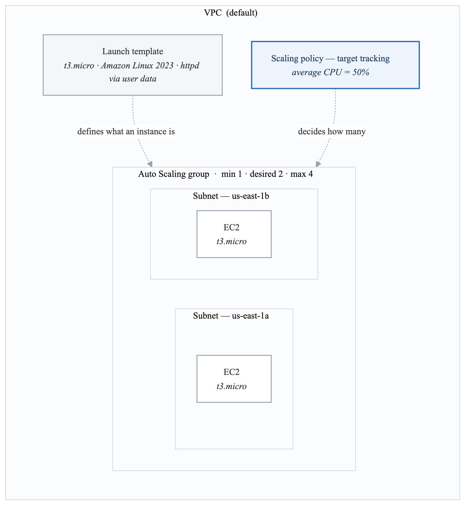
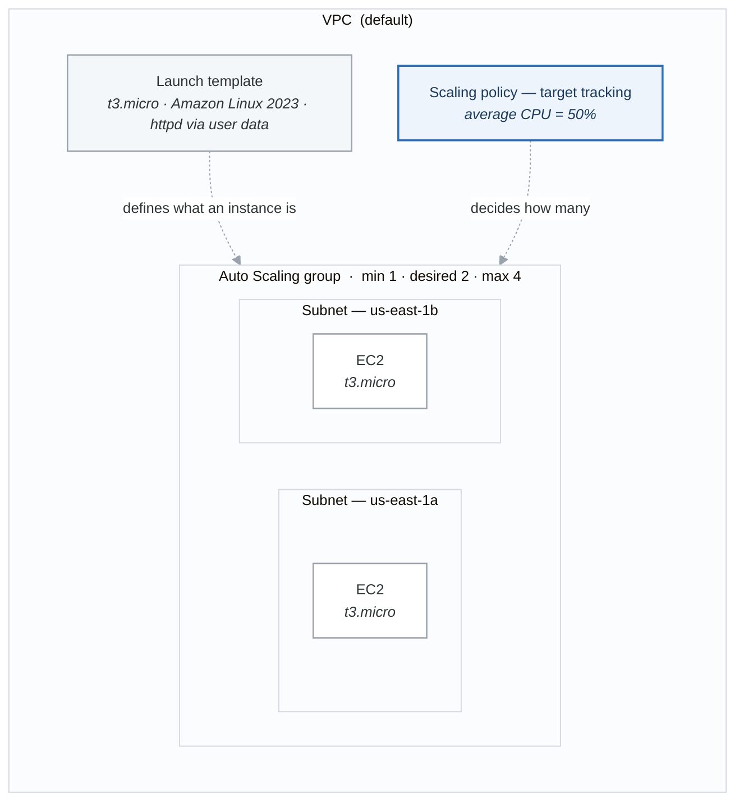

# Lab 02 — Auto Scaling Group with Target Tracking

## Objective

Create a launch template, set up an Auto Scaling Group with a target tracking scaling policy, and test scaling by generating load. You will use both AWS CLI and Python/Boto3.

## Prerequisites

- Lab 01 completed (familiar with launching EC2, security groups).
- A key pair in your region.
- Default VPC with at least two public subnets in different AZs.

## Cost Estimate

- 2-4 t3.micro instances: Free Tier eligible. If outside: ~$0.01/hour each.
- No load balancer in this lab (to keep costs minimal). We use ASG health checks only.
- **Total if torn down within 1 hour: < $0.10**

## Architecture

<!-- figure: generated from the Mermaid below by _shared/diagrams/embed-figures.py — do not edit the image -->


<details>
<summary>Diagram source (Mermaid)</summary>



</details>

---

## Part 1: Create Launch Template and ASG with AWS CLI

### Step 1: Gather Prerequisites

```bash
# Get default VPC
VPC_ID=$(aws ec2 describe-vpcs \
  --filters "Name=isDefault,Values=true" \
  --query "Vpcs[0].VpcId" --output text)

# Get two public subnets
SUBNETS=$(aws ec2 describe-subnets \
  --filters "Name=vpc-id,Values=$VPC_ID" "Name=default-for-az,Values=true" \
  --query "Subnets[:2].SubnetId" --output text | tr '\t' ',')

echo "VPC: $VPC_ID"
echo "Subnets: $SUBNETS"

# Get the latest Amazon Linux 2023 AMI
AMI_ID=$(aws ssm get-parameters \
  --names /aws/service/ami-amazon-linux-latest/al2023-ami-kernel-6.1-x86_64 \
  --query "Parameters[0].Value" --output text)

echo "AMI: $AMI_ID"
```

### Step 2: Create a Security Group

```bash
SG_ID=$(aws ec2 create-security-group \
  --group-name lab02-asg-sg \
  --description "Lab02 ASG Security Group" \
  --vpc-id "$VPC_ID" \
  --query "GroupId" --output text)

# Allow SSH
MY_IP=$(curl -s https://checkip.amazonaws.com)
aws ec2 authorize-security-group-ingress \
  --group-id "$SG_ID" \
  --protocol tcp --port 22 --cidr "${MY_IP}/32"

# Allow HTTP
aws ec2 authorize-security-group-ingress \
  --group-id "$SG_ID" \
  --protocol tcp --port 80 --cidr "0.0.0.0/0"

echo "Security Group: $SG_ID"
```

### Step 3: Create a Launch Template

```bash
# Encode user data
USER_DATA=$(cat << 'EOF' | base64
#!/bin/bash
yum update -y
yum install -y httpd stress-ng
systemctl start httpd
systemctl enable httpd
INSTANCE_ID=$(curl -s http://169.254.169.254/latest/meta-data/instance-id)
AZ=$(curl -s http://169.254.169.254/latest/meta-data/placement/availability-zone)
cat > /var/www/html/index.html << HTML
<h1>Auto Scaled Instance</h1>
<p>Instance ID: $INSTANCE_ID</p>
<p>AZ: $AZ</p>
HTML
EOF
)

aws ec2 create-launch-template \
  --launch-template-name lab02-web-template \
  --version-description "v1 - web server with stress-ng" \
  --launch-template-data "{
    \"ImageId\": \"$AMI_ID\",
    \"InstanceType\": \"t3.micro\",
    \"KeyName\": \"my-lab-key\",
    \"SecurityGroupIds\": [\"$SG_ID\"],
    \"UserData\": \"$USER_DATA\",
    \"TagSpecifications\": [
      {
        \"ResourceType\": \"instance\",
        \"Tags\": [{\"Key\": \"Name\", \"Value\": \"lab02-asg-instance\"}]
      }
    ]
  }"

echo "Launch template created!"
```

### Step 4: Create the Auto Scaling Group

```bash
aws autoscaling create-auto-scaling-group \
  --auto-scaling-group-name lab02-asg \
  --launch-template LaunchTemplateName=lab02-web-template,Version='$Latest' \
  --min-size 1 \
  --max-size 4 \
  --desired-capacity 2 \
  --vpc-zone-identifier "$SUBNETS" \
  --health-check-type EC2 \
  --health-check-grace-period 120 \
  --tags "Key=Name,Value=lab02-asg-instance,PropagateAtLaunch=true" \
         "Key=Lab,Value=02,PropagateAtLaunch=true"

echo "ASG created! Waiting for instances..."

# Wait and check instances
sleep 60
aws autoscaling describe-auto-scaling-groups \
  --auto-scaling-group-names lab02-asg \
  --query "AutoScalingGroups[0].{
    MinSize:MinSize,
    MaxSize:MaxSize,
    DesiredCapacity:DesiredCapacity,
    Instances:Instances[*].{Id:InstanceId,AZ:AvailabilityZone,Health:HealthStatus,State:LifecycleState}
  }"
```

### Step 5: Attach a Target Tracking Scaling Policy

```bash
aws autoscaling put-scaling-policy \
  --auto-scaling-group-name lab02-asg \
  --policy-name lab02-cpu-target-50 \
  --policy-type TargetTrackingScaling \
  --target-tracking-configuration '{
    "PredefinedMetricSpecification": {
      "PredefinedMetricType": "ASGAverageCPUUtilization"
    },
    "TargetValue": 50.0,
    "DisableScaleIn": false
  }'

echo "Target tracking policy attached (target CPU: 50%)"
```

### Step 6: Test Scale-Out by Generating Load

SSH into one of the ASG instances and generate CPU load:

```bash
# Get a running instance's public IP
INSTANCE_IP=$(aws ec2 describe-instances \
  --filters "Name=tag:Name,Values=lab02-asg-instance" "Name=instance-state-name,Values=running" \
  --query "Reservations[0].Instances[0].PublicIpAddress" --output text)

ssh -i my-lab-key.pem ec2-user@$INSTANCE_IP

# Inside the instance: stress all CPUs for 5 minutes
stress-ng --cpu 0 --timeout 300s
```

In another terminal, monitor the ASG:

```bash
# Watch ASG activity (run every 30 seconds)
watch -n 30 'aws autoscaling describe-auto-scaling-activities \
  --auto-scaling-group-name lab02-asg \
  --query "Activities[:5].{Description:Description,StatusCode:StatusCode,Cause:Cause}" \
  --output table'
```

```bash
# Watch instance count
watch -n 30 'aws autoscaling describe-auto-scaling-groups \
  --auto-scaling-group-names lab02-asg \
  --query "AutoScalingGroups[0].{Desired:DesiredCapacity,Running:length(Instances)}"'
```

After a few minutes, you should see the desired capacity increase as CPU exceeds 50%.

### Step 7: Observe Scale-In

Stop the stress test (Ctrl+C) and wait 5-10 minutes. The ASG should scale back down as CPU drops below the target.

---

## Part 2: Same Operations with Boto3

Create a file named `lab02_asg.py`:

```python
#!/usr/bin/env python3
"""Lab 02: Create an Auto Scaling Group with target tracking using Boto3."""

import boto3
import json
import time
import base64

ec2_client = boto3.client('ec2')
asg_client = boto3.client('autoscaling')
ssm_client = boto3.client('ssm')

LAUNCH_TEMPLATE_NAME = 'lab02-boto3-web-template'
ASG_NAME = 'lab02-boto3-asg'


def get_prerequisites():
    """Gather VPC, subnets, AMI, and create security group."""
    # Default VPC
    vpcs = ec2_client.describe_vpcs(
        Filters=[{'Name': 'isDefault', 'Values': ['true']}]
    )
    vpc_id = vpcs['Vpcs'][0]['VpcId']

    # Two subnets
    subnets = ec2_client.describe_subnets(
        Filters=[
            {'Name': 'vpc-id', 'Values': [vpc_id]},
            {'Name': 'default-for-az', 'Values': ['true']},
        ]
    )
    subnet_ids = [s['SubnetId'] for s in subnets['Subnets'][:2]]

    # Latest AMI
    param = ssm_client.get_parameter(
        Name='/aws/service/ami-amazon-linux-latest/al2023-ami-kernel-6.1-x86_64'
    )
    ami_id = param['Parameter']['Value']

    # Security group
    sg = ec2_client.create_security_group(
        GroupName='lab02-boto3-asg-sg',
        Description='Lab02 Boto3 ASG SG',
        VpcId=vpc_id,
    )
    sg_id = sg['GroupId']

    ec2_client.authorize_security_group_ingress(
        GroupId=sg_id,
        IpPermissions=[
            {'IpProtocol': 'tcp', 'FromPort': 22, 'ToPort': 22,
             'IpRanges': [{'CidrIp': '0.0.0.0/0'}]},
            {'IpProtocol': 'tcp', 'FromPort': 80, 'ToPort': 80,
             'IpRanges': [{'CidrIp': '0.0.0.0/0'}]},
        ],
    )

    print(f"VPC: {vpc_id}")
    print(f"Subnets: {subnet_ids}")
    print(f"AMI: {ami_id}")
    print(f"SG: {sg_id}")

    return vpc_id, subnet_ids, ami_id, sg_id


def create_launch_template(ami_id, sg_id):
    """Create a launch template."""
    user_data_script = """#!/bin/bash
yum update -y
yum install -y httpd stress-ng
systemctl start httpd
systemctl enable httpd
INSTANCE_ID=$(curl -s http://169.254.169.254/latest/meta-data/instance-id)
echo "<h1>Boto3 ASG Instance: $INSTANCE_ID</h1>" > /var/www/html/index.html
"""
    user_data_b64 = base64.b64encode(user_data_script.encode()).decode()

    response = ec2_client.create_launch_template(
        LaunchTemplateName=LAUNCH_TEMPLATE_NAME,
        VersionDescription='v1 - web server with stress-ng',
        LaunchTemplateData={
            'ImageId': ami_id,
            'InstanceType': 't3.micro',
            'KeyName': 'my-lab-key',
            'SecurityGroupIds': [sg_id],
            'UserData': user_data_b64,
            'TagSpecifications': [
                {
                    'ResourceType': 'instance',
                    'Tags': [{'Key': 'Name', 'Value': 'lab02-boto3-asg-instance'}],
                }
            ],
        },
    )
    lt_id = response['LaunchTemplate']['LaunchTemplateId']
    print(f"Launch Template created: {lt_id}")
    return lt_id


def create_auto_scaling_group(subnet_ids):
    """Create an ASG with min=1, desired=2, max=4."""
    asg_client.create_auto_scaling_group(
        AutoScalingGroupName=ASG_NAME,
        LaunchTemplate={
            'LaunchTemplateName': LAUNCH_TEMPLATE_NAME,
            'Version': '$Latest',
        },
        MinSize=1,
        MaxSize=4,
        DesiredCapacity=2,
        VPCZoneIdentifier=','.join(subnet_ids),
        HealthCheckType='EC2',
        HealthCheckGracePeriod=120,
        Tags=[
            {
                'Key': 'Name',
                'Value': 'lab02-boto3-asg-instance',
                'PropagateAtLaunch': True,
            },
        ],
    )
    print(f"ASG '{ASG_NAME}' created with desired capacity 2")


def attach_scaling_policy():
    """Attach a target tracking policy for CPU utilization at 50%."""
    response = asg_client.put_scaling_policy(
        AutoScalingGroupName=ASG_NAME,
        PolicyName='lab02-boto3-cpu-target-50',
        PolicyType='TargetTrackingScaling',
        TargetTrackingConfiguration={
            'PredefinedMetricSpecification': {
                'PredefinedMetricType': 'ASGAverageCPUUtilization',
            },
            'TargetValue': 50.0,
            'DisableScaleIn': False,
        },
    )
    print(f"Scaling policy attached: {response['PolicyARN']}")


def monitor_asg():
    """Display the current state of the ASG."""
    response = asg_client.describe_auto_scaling_groups(
        AutoScalingGroupNames=[ASG_NAME]
    )
    asg = response['AutoScalingGroups'][0]
    print(f"\n--- ASG Status ---")
    print(f"Min: {asg['MinSize']}, Desired: {asg['DesiredCapacity']}, Max: {asg['MaxSize']}")
    print(f"Instances ({len(asg['Instances'])}):")
    for inst in asg['Instances']:
        print(f"  {inst['InstanceId']} | AZ: {inst['AvailabilityZone']} | "
              f"Health: {inst['HealthStatus']} | State: {inst['LifecycleState']}")


def main():
    """Main execution flow."""
    vpc_id, subnet_ids, ami_id, sg_id = get_prerequisites()
    create_launch_template(ami_id, sg_id)
    create_auto_scaling_group(subnet_ids)
    attach_scaling_policy()

    print("\nWaiting 90 seconds for instances to launch...")
    time.sleep(90)
    monitor_asg()

    print("\n--- Next Steps ---")
    print("1. SSH into one of the instances and run: stress-ng --cpu 0 --timeout 300s")
    print("2. In another terminal, run this script with 'monitor' argument to watch scaling")
    print("3. After testing, run the teardown commands below")


if __name__ == '__main__':
    import sys
    if len(sys.argv) > 1 and sys.argv[1] == 'monitor':
        for i in range(20):
            monitor_asg()
            time.sleep(30)
    else:
        main()
```

---

## Teardown (IMPORTANT)

```bash
# Delete the ASG (this terminates all instances)
aws autoscaling delete-auto-scaling-group \
  --auto-scaling-group-name lab02-asg \
  --force-delete

# Wait for instances to terminate
echo "Waiting for instances to terminate..."
sleep 120

# Delete the launch template
aws ec2 delete-launch-template --launch-template-name lab02-web-template

# Delete security group (may need to wait for instances to fully terminate)
aws ec2 delete-security-group --group-id "$SG_ID"

# Also delete Boto3 resources if you ran Part 2
aws autoscaling delete-auto-scaling-group \
  --auto-scaling-group-name lab02-boto3-asg \
  --force-delete 2>/dev/null
sleep 120
aws ec2 delete-launch-template --launch-template-name lab02-boto3-web-template 2>/dev/null

echo "Teardown complete!"
```

---

## Verification Checklist

- [ ] Launch template created with user data and instance type.
- [ ] ASG created with min=1, desired=2, max=4.
- [ ] Two instances running across two AZs.
- [ ] Target tracking scaling policy attached (CPU 50%).
- [ ] Scale-out observed after CPU stress test.
- [ ] Scale-in observed after stress test ends.
- [ ] All resources torn down.

<!-- feynman-check -->

---

## Feynman check

Close the file. Blank page, no notes. Explain each of these to a competent engineer who has never
used this tool — **under five minutes, no jargon you can't define on the spot:**

- Create Launch Template and ASG with AWS CLI
- Same Operations with Boto3
- Teardown (IMPORTANT)
- Gather Prerequisites

**The gap is not what you forgot. It is where you used a word instead of a mechanism.**

| | |
|---|---|
| ✗ | *"The security group allows the traffic."* |
| ✓ | *"A security group is a stateful allow-list attached to an ENI. Traffic matching an inbound rule is permitted and the reply is permitted automatically, because the connection is tracked — which is why you never write an outbound rule for a reply."* |

**Trace it:** A request from the internet to an instance in a private subnet. Name every hop, every route-table lookup, and every rule evaluated, in order.

Stop at the first component you cannot name. Reopen this file and read **only** that.

**Go deeper — only once the gap has a name:** [Timeouts, retries and backoff with jitter](https://aws.amazon.com/builders-library/timeouts-retries-and-backoff-with-jitter/) — 15 minutes from the AWS Builders' Library, and it changes how you write every client you touch afterwards.
Full list per domain: [`SOURCES.md`](../SOURCES.md#aws)

→ Protocol, the three levels of knowing, and worked examples: [`MASTERY.md`](../MASTERY.md)

<!-- /feynman-check -->
