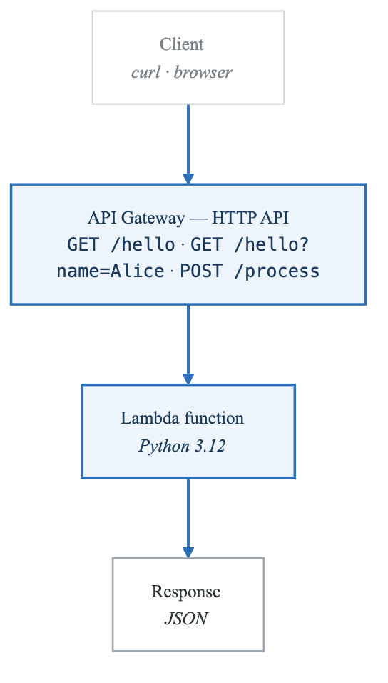
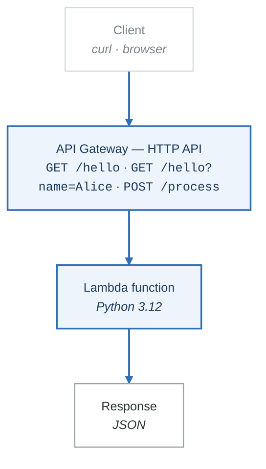

# Lab 03 — Lambda Function with API Gateway Trigger

## Objective

Create a Lambda function in Python, configure an API Gateway HTTP API as a trigger, and test invocations. All operations are within the perpetual Free Tier for Lambda and the 12-month Free Tier for API Gateway.

## Prerequisites

- AWS CLI configured with appropriate permissions.
- Python 3.9+ installed locally.
- Familiarity with basic Python.

## Cost Estimate

- **Lambda**: 1 million free requests/month + 400,000 GB-seconds/month (perpetual Free Tier). This lab uses < 100 invocations. **$0.00**
- **API Gateway HTTP API**: 1 million API calls/month free for 12 months. **$0.00**
- **Total: $0.00**

## Architecture

<!-- figure: generated from the Mermaid below by _shared/diagrams/embed-figures.py — do not edit the image -->


<details>
<summary>Diagram source (Mermaid)</summary>



</details>

---

## Part 1: Create Lambda Function with AWS CLI

### Step 1: Create the IAM Execution Role

```bash
# Create the trust policy document
cat > lambda-trust-policy.json << 'EOF'
{
  "Version": "2012-10-17",
  "Statement": [
    {
      "Effect": "Allow",
      "Principal": { "Service": "lambda.amazonaws.com" },
      "Action": "sts:AssumeRole"
    }
  ]
}
EOF

# Create the role
ROLE_ARN=$(aws iam create-role \
  --role-name lab03-lambda-execution-role \
  --assume-role-policy-document file://lambda-trust-policy.json \
  --query "Role.Arn" --output text)

# Attach the basic Lambda execution policy (for CloudWatch Logs)
aws iam attach-role-policy \
  --role-name lab03-lambda-execution-role \
  --policy-arn arn:aws:iam::aws:policy/service-role/AWSLambdaBasicExecutionRole

echo "Role ARN: $ROLE_ARN"

# Wait for role to propagate
sleep 10
```

### Step 2: Write the Lambda Function Code

```bash
cat > lambda_function.py << 'PYEOF'
import json
from datetime import datetime


def lambda_handler(event, context):
    """
    Handle API Gateway HTTP API events.

    Supports:
      GET  /hello           -> greeting message
      GET  /hello?name=X    -> personalized greeting
      POST /process         -> process JSON body
    """
    # Extract HTTP method and path from the API Gateway event
    http_method = event.get('requestContext', {}).get('http', {}).get('method', 'UNKNOWN')
    path = event.get('requestContext', {}).get('http', {}).get('path', '/')
    query_params = event.get('queryStringParameters') or {}

    print(f"Received {http_method} {path} with query params: {query_params}")

    if path == '/hello' and http_method == 'GET':
        name = query_params.get('name', 'World')
        body = {
            'message': f'Hello, {name}!',
            'timestamp': datetime.utcnow().isoformat(),
            'function_name': context.function_name,
            'memory_limit_mb': context.memory_limit_in_mb,
            'remaining_time_ms': context.get_remaining_time_in_millis(),
        }
        return {
            'statusCode': 200,
            'headers': {'Content-Type': 'application/json'},
            'body': json.dumps(body),
        }

    elif path == '/process' and http_method == 'POST':
        try:
            request_body = json.loads(event.get('body', '{}'))
        except json.JSONDecodeError:
            return {
                'statusCode': 400,
                'body': json.dumps({'error': 'Invalid JSON in request body'}),
            }

        # Simple processing: uppercase all string values
        processed = {
            k: v.upper() if isinstance(v, str) else v
            for k, v in request_body.items()
        }

        return {
            'statusCode': 200,
            'headers': {'Content-Type': 'application/json'},
            'body': json.dumps({
                'message': 'Data processed successfully',
                'original': request_body,
                'processed': processed,
            }),
        }

    else:
        return {
            'statusCode': 404,
            'body': json.dumps({
                'error': f'Route not found: {http_method} {path}',
                'available_routes': [
                    'GET /hello',
                    'GET /hello?name=YourName',
                    'POST /process',
                ],
            }),
        }
PYEOF

# Package the function
zip lambda_function.zip lambda_function.py
```

### Step 3: Create the Lambda Function

```bash
FUNCTION_ARN=$(aws lambda create-function \
  --function-name lab03-hello-api \
  --runtime python3.12 \
  --role "$ROLE_ARN" \
  --handler lambda_function.lambda_handler \
  --zip-file fileb://lambda_function.zip \
  --timeout 10 \
  --memory-size 128 \
  --description "Lab03: Hello API with API Gateway" \
  --query "FunctionArn" --output text)

echo "Lambda Function ARN: $FUNCTION_ARN"
```

### Step 4: Test the Lambda Function Directly

```bash
# Invoke with a simulated GET /hello event
cat > test-event-get.json << 'EOF'
{
  "requestContext": {
    "http": { "method": "GET", "path": "/hello" }
  },
  "queryStringParameters": { "name": "Alice" }
}
EOF

aws lambda invoke \
  --function-name lab03-hello-api \
  --payload file://test-event-get.json \
  --cli-binary-format raw-in-base64-out \
  response.json

cat response.json | python3 -m json.tool

# Invoke with a simulated POST /process event
cat > test-event-post.json << 'EOF'
{
  "requestContext": {
    "http": { "method": "POST", "path": "/process" }
  },
  "body": "{\"name\": \"alice\", \"city\": \"new york\", \"count\": 42}"
}
EOF

aws lambda invoke \
  --function-name lab03-hello-api \
  --payload file://test-event-post.json \
  --cli-binary-format raw-in-base64-out \
  response.json

cat response.json | python3 -m json.tool
```

### Step 5: Create an API Gateway HTTP API

```bash
# Create the HTTP API
API_ID=$(aws apigatewayv2 create-api \
  --name lab03-hello-http-api \
  --protocol-type HTTP \
  --target "$FUNCTION_ARN" \
  --query "ApiId" --output text)

echo "API ID: $API_ID"

# Get the API endpoint
API_ENDPOINT=$(aws apigatewayv2 get-api \
  --api-id "$API_ID" \
  --query "ApiEndpoint" --output text)

echo "API Endpoint: $API_ENDPOINT"

# Grant API Gateway permission to invoke the Lambda function
ACCOUNT_ID=$(aws sts get-caller-identity --query "Account" --output text)
REGION=$(aws configure get region)

aws lambda add-permission \
  --function-name lab03-hello-api \
  --statement-id apigateway-invoke \
  --action lambda:InvokeFunction \
  --principal apigateway.amazonaws.com \
  --source-arn "arn:aws:execute-api:${REGION}:${ACCOUNT_ID}:${API_ID}/*"
```

### Step 6: Test via API Gateway

```bash
# Test GET /hello
echo "--- GET /hello ---"
curl -s "$API_ENDPOINT/hello" | python3 -m json.tool

# Test GET /hello?name=Alice
echo "--- GET /hello?name=Alice ---"
curl -s "$API_ENDPOINT/hello?name=Alice" | python3 -m json.tool

# Test POST /process
echo "--- POST /process ---"
curl -s -X POST "$API_ENDPOINT/process" \
  -H "Content-Type: application/json" \
  -d '{"name": "alice", "city": "new york", "count": 42}' | python3 -m json.tool

# Test 404
echo "--- GET /unknown ---"
curl -s "$API_ENDPOINT/unknown" | python3 -m json.tool
```

### Step 7: View CloudWatch Logs

```bash
# List log streams for the Lambda function
aws logs describe-log-streams \
  --log-group-name /aws/lambda/lab03-hello-api \
  --order-by LastEventTime \
  --descending \
  --query "logStreams[:3].logStreamName"

# Get the latest log events
LATEST_STREAM=$(aws logs describe-log-streams \
  --log-group-name /aws/lambda/lab03-hello-api \
  --order-by LastEventTime --descending \
  --query "logStreams[0].logStreamName" --output text)

aws logs get-log-events \
  --log-group-name /aws/lambda/lab03-hello-api \
  --log-stream-name "$LATEST_STREAM" \
  --query "events[*].message" --output text
```

---

## Part 2: Same Operations with Boto3

Create a file named `lab03_lambda.py`:

```python
#!/usr/bin/env python3
"""Lab 03: Create a Lambda function with API Gateway using Boto3."""

import boto3
import json
import time
import zipfile
import io

iam_client = boto3.client('iam')
lambda_client = boto3.client('lambda')
apigw_client = boto3.client('apigatewayv2')
sts_client = boto3.client('sts')

FUNCTION_NAME = 'lab03-boto3-hello-api'
ROLE_NAME = 'lab03-boto3-lambda-role'
API_NAME = 'lab03-boto3-http-api'


LAMBDA_CODE = '''
import json
from datetime import datetime

def lambda_handler(event, context):
    http_method = event.get("requestContext", {}).get("http", {}).get("method", "UNKNOWN")
    path = event.get("requestContext", {}).get("http", {}).get("path", "/")
    query_params = event.get("queryStringParameters") or {}

    if path == "/hello" and http_method == "GET":
        name = query_params.get("name", "World")
        return {
            "statusCode": 200,
            "headers": {"Content-Type": "application/json"},
            "body": json.dumps({
                "message": f"Hello, {name}! (from Boto3-created Lambda)",
                "timestamp": datetime.utcnow().isoformat(),
            }),
        }
    return {
        "statusCode": 404,
        "body": json.dumps({"error": f"Not found: {http_method} {path}"}),
    }
'''


def create_lambda_zip():
    """Create an in-memory zip file with the Lambda code."""
    buffer = io.BytesIO()
    with zipfile.ZipFile(buffer, 'w', zipfile.ZIP_DEFLATED) as zf:
        zf.writestr('lambda_function.py', LAMBDA_CODE)
    buffer.seek(0)
    return buffer.read()


def create_execution_role():
    """Create the IAM execution role for Lambda."""
    trust_policy = json.dumps({
        "Version": "2012-10-17",
        "Statement": [{
            "Effect": "Allow",
            "Principal": {"Service": "lambda.amazonaws.com"},
            "Action": "sts:AssumeRole",
        }],
    })

    role = iam_client.create_role(
        RoleName=ROLE_NAME,
        AssumeRolePolicyDocument=trust_policy,
    )
    role_arn = role['Role']['Arn']

    iam_client.attach_role_policy(
        RoleName=ROLE_NAME,
        PolicyArn='arn:aws:iam::aws:policy/service-role/AWSLambdaBasicExecutionRole',
    )

    print(f"IAM Role created: {role_arn}")
    print("Waiting 10 seconds for role propagation...")
    time.sleep(10)
    return role_arn


def create_lambda_function(role_arn):
    """Create the Lambda function."""
    zip_content = create_lambda_zip()

    response = lambda_client.create_function(
        FunctionName=FUNCTION_NAME,
        Runtime='python3.12',
        Role=role_arn,
        Handler='lambda_function.lambda_handler',
        Code={'ZipFile': zip_content},
        Timeout=10,
        MemorySize=128,
        Description='Lab03 Boto3: Hello API',
    )
    function_arn = response['FunctionArn']
    print(f"Lambda function created: {function_arn}")

    # Wait for function to be active
    waiter = lambda_client.get_waiter('function_active_v2')
    waiter.wait(FunctionName=FUNCTION_NAME)
    print("Function is active!")
    return function_arn


def create_api_gateway(function_arn):
    """Create an HTTP API in API Gateway."""
    response = apigw_client.create_api(
        Name=API_NAME,
        ProtocolType='HTTP',
        Target=function_arn,
    )
    api_id = response['ApiId']
    api_endpoint = response['ApiEndpoint']
    print(f"API Gateway created: {api_id}")
    print(f"API Endpoint: {api_endpoint}")

    # Grant permission
    account_id = sts_client.get_caller_identity()['Account']
    region = lambda_client.meta.region_name

    lambda_client.add_permission(
        FunctionName=FUNCTION_NAME,
        StatementId='apigateway-invoke',
        Action='lambda:InvokeFunction',
        Principal='apigateway.amazonaws.com',
        SourceArn=f'arn:aws:execute-api:{region}:{account_id}:{api_id}/*',
    )
    print("Permission granted to API Gateway")
    return api_id, api_endpoint


def test_function():
    """Test the Lambda function directly."""
    test_event = {
        "requestContext": {"http": {"method": "GET", "path": "/hello"}},
        "queryStringParameters": {"name": "Boto3User"},
    }

    response = lambda_client.invoke(
        FunctionName=FUNCTION_NAME,
        Payload=json.dumps(test_event),
    )

    payload = json.loads(response['Payload'].read())
    print(f"\n--- Direct Invocation Result ---")
    print(json.dumps(json.loads(payload['body']), indent=2))


def main():
    """Main execution flow."""
    role_arn = create_execution_role()
    function_arn = create_lambda_function(role_arn)
    api_id, api_endpoint = create_api_gateway(function_arn)
    test_function()

    print(f"\n--- Test with curl ---")
    print(f"curl {api_endpoint}/hello")
    print(f"curl '{api_endpoint}/hello?name=Alice'")


if __name__ == '__main__':
    main()
```

---

## Teardown

```bash
# Delete the API Gateway
aws apigatewayv2 delete-api --api-id "$API_ID"

# Delete the Lambda function
aws lambda delete-function --function-name lab03-hello-api

# Delete CloudWatch log group
aws logs delete-log-group --log-group-name /aws/lambda/lab03-hello-api 2>/dev/null

# Detach policy and delete role
aws iam detach-role-policy \
  --role-name lab03-lambda-execution-role \
  --policy-arn arn:aws:iam::aws:policy/service-role/AWSLambdaBasicExecutionRole
aws iam delete-role --role-name lab03-lambda-execution-role

# Also clean up Boto3 resources if Part 2 was run
aws apigatewayv2 list-apis --query "Items[?Name=='lab03-boto3-http-api'].ApiId" --output text | \
  xargs -I {} aws apigatewayv2 delete-api --api-id {} 2>/dev/null
aws lambda delete-function --function-name lab03-boto3-hello-api 2>/dev/null
aws logs delete-log-group --log-group-name /aws/lambda/lab03-boto3-hello-api 2>/dev/null
aws iam detach-role-policy \
  --role-name lab03-boto3-lambda-role \
  --policy-arn arn:aws:iam::aws:policy/service-role/AWSLambdaBasicExecutionRole 2>/dev/null
aws iam delete-role --role-name lab03-boto3-lambda-role 2>/dev/null

# Clean up local files
rm -f lambda_function.py lambda_function.zip lambda-trust-policy.json
rm -f test-event-get.json test-event-post.json response.json

echo "Teardown complete!"
```

---

## Verification Checklist

- [ ] IAM execution role created with Lambda basic execution policy.
- [ ] Lambda function deployed and invokable directly.
- [ ] API Gateway HTTP API created and connected to Lambda.
- [ ] GET /hello returns a JSON greeting.
- [ ] GET /hello?name=Alice returns a personalized greeting.
- [ ] POST /process processes the JSON body.
- [ ] CloudWatch Logs contain Lambda execution logs.
- [ ] All resources torn down.

<!-- feynman-check -->

---

## Feynman check

Close the file. Blank page, no notes. Explain each of these to a competent engineer who has never
used this tool — **under five minutes, no jargon you can't define on the spot:**

- Create Lambda Function with AWS CLI
- Same Operations with Boto3
- Create the IAM Execution Role
- Write the Lambda Function Code

**The gap is not what you forgot. It is where you used a word instead of a mechanism.**

| | |
|---|---|
| ✗ | *"The security group allows the traffic."* |
| ✓ | *"A security group is a stateful allow-list attached to an ENI. Traffic matching an inbound rule is permitted and the reply is permitted automatically, because the connection is tracked — which is why you never write an outbound rule for a reply."* |

**Trace it:** A request from the internet to an instance in a private subnet. Name every hop, every route-table lookup, and every rule evaluated, in order.

Stop at the first component you cannot name. Reopen this file and read **only** that.

**Go deeper — only once the gap has a name:** [Timeouts, retries and backoff with jitter](https://aws.amazon.com/builders-library/timeouts-retries-and-backoff-with-jitter/) — 15 minutes from the AWS Builders' Library, and it changes how you write every client you touch afterwards.
Full list per domain: [`SOURCES.md`](../SOURCES.md#aws)

→ Protocol, the three levels of knowing, and worked examples: [`MASTERY.md`](../MASTERY.md)

<!-- /feynman-check -->
