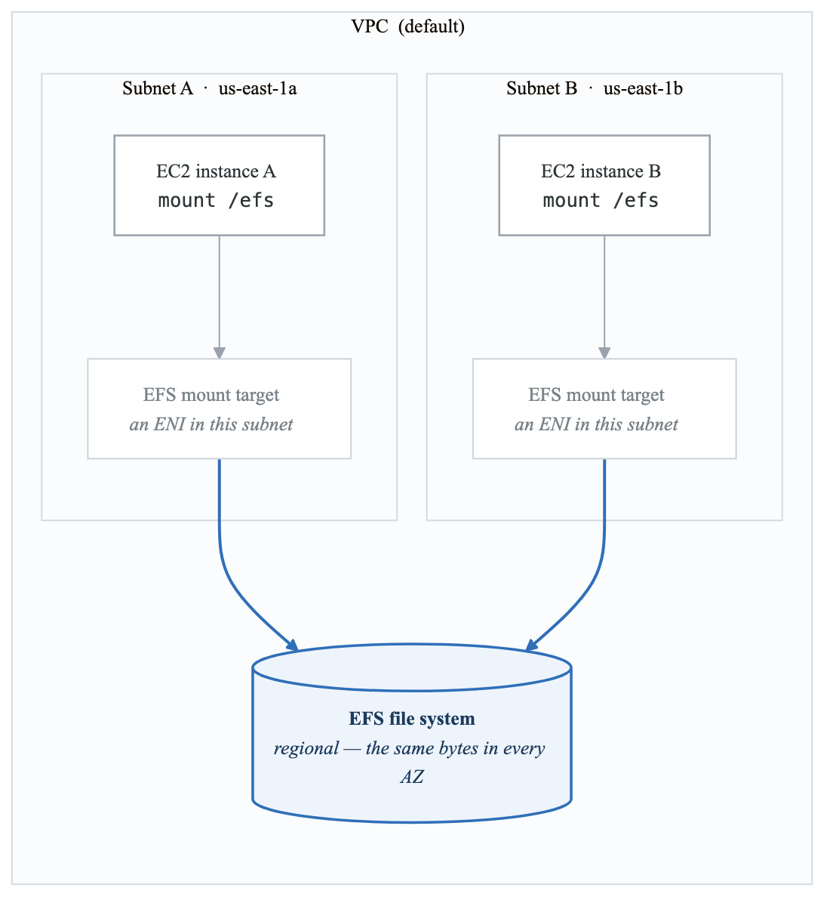
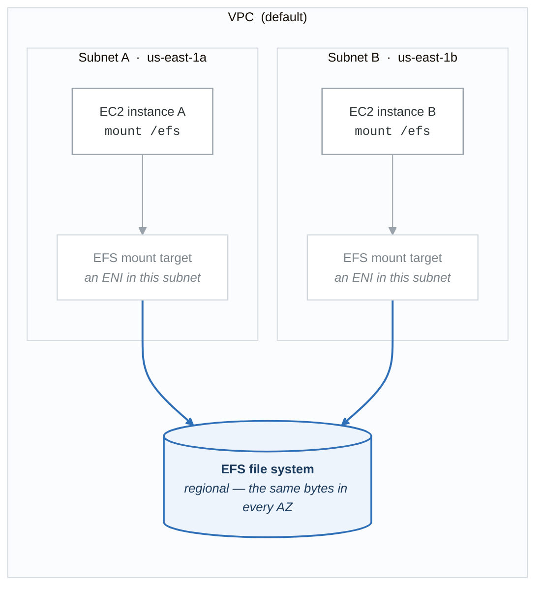

# Lab 05 — EFS Shared Storage

## Objective

Create an Amazon EFS file system, mount it on two EC2 instances in different Availability Zones, and verify shared file access. Uses AWS CLI and Python/Boto3.

## Prerequisites

- AWS CLI configured, Boto3 installed, key pair available.
- Default VPC with subnets in at least two AZs.

## Cost Estimate

- 2x t3.micro EC2 instances: Free Tier eligible. If outside: ~$0.02/hour.
- EFS Standard: $0.30/GB/month. A few KB of test files: **< $0.01**.
- **Total if torn down within 1 hour: < $0.05**
- **Important: Delete the EFS file system after the lab!** Even empty EFS file systems incur charges.

## Architecture

<!-- figure: generated from the Mermaid below by _shared/diagrams/embed-figures.py — do not edit the image -->


<details>
<summary>Diagram source (Mermaid)</summary>



</details>

---

## Part 1: Create EFS and EC2 Instances (CLI)

### Step 1: Gather Prerequisites

```bash
# Get default VPC
VPC_ID=$(aws ec2 describe-vpcs \
  --filters "Name=isDefault,Values=true" \
  --query "Vpcs[0].VpcId" --output text)

# Get two subnets in different AZs
SUBNET_A=$(aws ec2 describe-subnets \
  --filters "Name=vpc-id,Values=$VPC_ID" "Name=default-for-az,Values=true" \
  --query "Subnets[0].{SubnetId:SubnetId,AZ:AvailabilityZone}" --output json)
SUBNET_B=$(aws ec2 describe-subnets \
  --filters "Name=vpc-id,Values=$VPC_ID" "Name=default-for-az,Values=true" \
  --query "Subnets[1].{SubnetId:SubnetId,AZ:AvailabilityZone}" --output json)

SUBNET_A_ID=$(echo $SUBNET_A | python3 -c "import sys,json; print(json.load(sys.stdin)['SubnetId'])")
SUBNET_B_ID=$(echo $SUBNET_B | python3 -c "import sys,json; print(json.load(sys.stdin)['SubnetId'])")
AZ_A=$(echo $SUBNET_A | python3 -c "import sys,json; print(json.load(sys.stdin)['AZ'])")
AZ_B=$(echo $SUBNET_B | python3 -c "import sys,json; print(json.load(sys.stdin)['AZ'])")

echo "Subnet A: $SUBNET_A_ID ($AZ_A)"
echo "Subnet B: $SUBNET_B_ID ($AZ_B)"

# Get the latest AMI
AMI_ID=$(aws ssm get-parameters \
  --names /aws/service/ami-amazon-linux-latest/al2023-ami-kernel-6.1-x86_64 \
  --query "Parameters[0].Value" --output text)
```

### Step 2: Create Security Groups

```bash
# Security group for EC2 instances
EC2_SG=$(aws ec2 create-security-group \
  --group-name lab05-ec2-sg \
  --description "Lab05 EC2 SG - SSH" \
  --vpc-id "$VPC_ID" \
  --query "GroupId" --output text)

MY_IP=$(curl -s https://checkip.amazonaws.com)
aws ec2 authorize-security-group-ingress \
  --group-id "$EC2_SG" \
  --protocol tcp --port 22 --cidr "${MY_IP}/32"

# Security group for EFS mount targets (allow NFS from EC2 SG)
EFS_SG=$(aws ec2 create-security-group \
  --group-name lab05-efs-sg \
  --description "Lab05 EFS SG - NFS from EC2" \
  --vpc-id "$VPC_ID" \
  --query "GroupId" --output text)

aws ec2 authorize-security-group-ingress \
  --group-id "$EFS_SG" \
  --protocol tcp --port 2049 \
  --source-group "$EC2_SG"

echo "EC2 SG: $EC2_SG"
echo "EFS SG: $EFS_SG"
```

### Step 3: Create the EFS File System

```bash
# Create EFS file system
EFS_ID=$(aws efs create-file-system \
  --performance-mode generalPurpose \
  --throughput-mode elastic \
  --encrypted \
  --tags "Key=Name,Value=lab05-shared-efs" \
  --query "FileSystemId" --output text)

echo "EFS File System ID: $EFS_ID"

# Wait for EFS to be available
echo "Waiting for EFS to be available..."
aws efs describe-file-systems --file-system-id "$EFS_ID" \
  --query "FileSystems[0].LifeCycleState"

sleep 10

# Create mount targets in both subnets
MT_A=$(aws efs create-mount-target \
  --file-system-id "$EFS_ID" \
  --subnet-id "$SUBNET_A_ID" \
  --security-groups "$EFS_SG" \
  --query "MountTargetId" --output text)

MT_B=$(aws efs create-mount-target \
  --file-system-id "$EFS_ID" \
  --subnet-id "$SUBNET_B_ID" \
  --security-groups "$EFS_SG" \
  --query "MountTargetId" --output text)

echo "Mount Target A: $MT_A (in $AZ_A)"
echo "Mount Target B: $MT_B (in $AZ_B)"

# Wait for mount targets to be available (takes ~1-2 minutes)
echo "Waiting for mount targets to become available..."
sleep 90

aws efs describe-mount-targets \
  --file-system-id "$EFS_ID" \
  --query "MountTargets[*].{Id:MountTargetId,AZ:AvailabilityZoneName,State:LifeCycleState}"
```

### Step 4: Launch Two EC2 Instances

```bash
# User data script to install EFS mount helper and mount the EFS
USER_DATA=$(cat << EOF | base64
#!/bin/bash
yum update -y
yum install -y amazon-efs-utils
mkdir -p /efs
# Mount using the EFS mount helper (uses TLS by default)
mount -t efs -o tls ${EFS_ID}:/ /efs
# Add to fstab for persistence
echo "${EFS_ID}:/ /efs efs _netdev,tls 0 0" >> /etc/fstab
EOF
)

# Launch Instance A in Subnet A
INSTANCE_A=$(aws ec2 run-instances \
  --image-id "$AMI_ID" \
  --instance-type t3.micro \
  --key-name my-lab-key \
  --security-group-ids "$EC2_SG" \
  --subnet-id "$SUBNET_A_ID" \
  --user-data "$USER_DATA" \
  --tag-specifications 'ResourceType=instance,Tags=[{Key=Name,Value=lab05-instance-A}]' \
  --query "Instances[0].InstanceId" --output text)

# Launch Instance B in Subnet B
INSTANCE_B=$(aws ec2 run-instances \
  --image-id "$AMI_ID" \
  --instance-type t3.micro \
  --key-name my-lab-key \
  --security-group-ids "$EC2_SG" \
  --subnet-id "$SUBNET_B_ID" \
  --user-data "$USER_DATA" \
  --tag-specifications 'ResourceType=instance,Tags=[{Key=Name,Value=lab05-instance-B}]' \
  --query "Instances[0].InstanceId" --output text)

echo "Instance A: $INSTANCE_A (in $AZ_A)"
echo "Instance B: $INSTANCE_B (in $AZ_B)"

# Wait for instances
aws ec2 wait instance-running --instance-ids "$INSTANCE_A" "$INSTANCE_B"

# Get public IPs
IP_A=$(aws ec2 describe-instances --instance-ids "$INSTANCE_A" \
  --query "Reservations[0].Instances[0].PublicIpAddress" --output text)
IP_B=$(aws ec2 describe-instances --instance-ids "$INSTANCE_B" \
  --query "Reservations[0].Instances[0].PublicIpAddress" --output text)

echo "Instance A IP: $IP_A"
echo "Instance B IP: $IP_B"
```

### Step 5: Verify Shared File Access

Wait 2-3 minutes for user data to complete, then:

**Terminal 1 — Instance A:**

```bash
ssh -i my-lab-key.pem ec2-user@$IP_A

# Verify EFS is mounted
df -h /efs
mount | grep efs

# Write a file on Instance A
echo "Hello from Instance A in $(curl -s http://169.254.169.254/latest/meta-data/placement/availability-zone)" | sudo tee /efs/hello-from-A.txt

# Create a larger file
sudo dd if=/dev/urandom of=/efs/test-data.bin bs=1M count=10
ls -lh /efs/
```

**Terminal 2 — Instance B:**

```bash
ssh -i my-lab-key.pem ec2-user@$IP_B

# Verify EFS is mounted
df -h /efs

# Read the file written by Instance A
cat /efs/hello-from-A.txt
# Should show "Hello from Instance A in us-east-1a"

# List all files (should see files from Instance A)
ls -lh /efs/

# Write a file from Instance B
echo "Hello from Instance B in $(curl -s http://169.254.169.254/latest/meta-data/placement/availability-zone)" | sudo tee /efs/hello-from-B.txt
```

**Back on Terminal 1 (Instance A):**

```bash
# Verify you can see Instance B's file
cat /efs/hello-from-B.txt
# Should show "Hello from Instance B in us-east-1b"

ls -lh /efs/
# Should show both files
```

---

## Part 2: Boto3 Script for EFS Operations

Create a file named `lab05_efs.py`:

```python
#!/usr/bin/env python3
"""Lab 05: Create and manage an EFS file system using Boto3."""

import boto3
import time

ec2_client = boto3.client('ec2')
efs_client = boto3.client('efs')


def create_efs_filesystem():
    """Create an encrypted EFS file system with elastic throughput."""
    response = efs_client.create_file_system(
        PerformanceMode='generalPurpose',
        ThroughputMode='elastic',
        Encrypted=True,
        Tags=[{'Key': 'Name', 'Value': 'lab05-boto3-efs'}],
    )
    fs_id = response['FileSystemId']
    print(f"EFS created: {fs_id}")

    # Wait for file system to be available
    while True:
        desc = efs_client.describe_file_systems(FileSystemId=fs_id)
        state = desc['FileSystems'][0]['LifeCycleState']
        if state == 'available':
            break
        print(f"  State: {state}, waiting...")
        time.sleep(5)

    print(f"EFS {fs_id} is available")
    return fs_id


def create_mount_targets(fs_id, subnet_ids, security_group_id):
    """Create mount targets in the specified subnets."""
    mount_target_ids = []
    for subnet_id in subnet_ids:
        response = efs_client.create_mount_target(
            FileSystemId=fs_id,
            SubnetId=subnet_id,
            SecurityGroups=[security_group_id],
        )
        mt_id = response['MountTargetId']
        print(f"Mount target created: {mt_id} in {subnet_id}")
        mount_target_ids.append(mt_id)

    # Wait for mount targets to be available
    print("Waiting for mount targets to become available...")
    for mt_id in mount_target_ids:
        while True:
            desc = efs_client.describe_mount_targets(MountTargetId=mt_id)
            state = desc['MountTargets'][0]['LifeCycleState']
            if state == 'available':
                break
            time.sleep(10)
        print(f"  {mt_id}: available")

    return mount_target_ids


def describe_efs(fs_id):
    """Display detailed information about the EFS file system."""
    fs = efs_client.describe_file_systems(FileSystemId=fs_id)['FileSystems'][0]
    mts = efs_client.describe_mount_targets(FileSystemId=fs_id)['MountTargets']

    print(f"\n--- EFS File System ---")
    print(f"ID: {fs['FileSystemId']}")
    print(f"State: {fs['LifeCycleState']}")
    print(f"Performance Mode: {fs['PerformanceMode']}")
    print(f"Throughput Mode: {fs['ThroughputMode']}")
    print(f"Encrypted: {fs['Encrypted']}")
    print(f"Size (bytes): {fs['SizeInBytes']['Value']}")
    print(f"Mount Targets ({len(mts)}):")
    for mt in mts:
        print(f"  {mt['MountTargetId']} | AZ: {mt['AvailabilityZoneName']} | "
              f"IP: {mt['IpAddress']} | State: {mt['LifeCycleState']}")


def enable_lifecycle_policy(fs_id):
    """Enable lifecycle management to transition to IA after 30 days."""
    efs_client.put_lifecycle_configuration(
        FileSystemId=fs_id,
        LifecyclePolicies=[
            {'TransitionToIA': 'AFTER_30_DAYS'},
            {'TransitionToPrimaryStorageClass': 'AFTER_1_ACCESS'},
        ],
    )
    print(f"Lifecycle policy set: transition to IA after 30 days, back to Standard on access")


def cleanup(fs_id):
    """Delete mount targets and file system."""
    # Delete mount targets
    mts = efs_client.describe_mount_targets(FileSystemId=fs_id)['MountTargets']
    for mt in mts:
        efs_client.delete_mount_target(MountTargetId=mt['MountTargetId'])
        print(f"Mount target {mt['MountTargetId']} deletion initiated")

    # Wait for mount targets to be deleted
    print("Waiting for mount targets to be deleted...")
    time.sleep(90)

    # Delete the file system
    efs_client.delete_file_system(FileSystemId=fs_id)
    print(f"EFS {fs_id} deletion initiated")


if __name__ == '__main__':
    import sys
    if len(sys.argv) > 1 and sys.argv[1] == 'cleanup':
        fs_id = input("Enter EFS File System ID to delete: ")
        cleanup(fs_id)
    else:
        print("This script creates and describes an EFS file system.")
        print("Mount targets require subnet IDs and a security group.")
        print("Modify the main block to pass your specific values.")
```

---

## Teardown (IMPORTANT — EFS Charges Even When Empty)

```bash
# Terminate EC2 instances
aws ec2 terminate-instances --instance-ids "$INSTANCE_A" "$INSTANCE_B"
aws ec2 wait instance-terminated --instance-ids "$INSTANCE_A" "$INSTANCE_B"
echo "Instances terminated."

# Delete mount targets (MUST delete before file system)
aws efs delete-mount-target --mount-target-id "$MT_A"
aws efs delete-mount-target --mount-target-id "$MT_B"
echo "Mount target deletion initiated. Waiting..."
sleep 90

# Delete the EFS file system
aws efs delete-file-system --file-system-id "$EFS_ID"
echo "EFS file system deleted."

# Delete security groups
aws ec2 delete-security-group --group-id "$EFS_SG"
aws ec2 delete-security-group --group-id "$EC2_SG"
echo "Security groups deleted."

echo "Teardown complete!"
```

---

## Verification Checklist

- [ ] EFS file system created with encryption and elastic throughput.
- [ ] Mount targets created in two AZs.
- [ ] EC2 Instance A mounts EFS at /efs.
- [ ] EC2 Instance B mounts EFS at /efs.
- [ ] File written on Instance A is readable on Instance B (and vice versa).
- [ ] EFS mount confirmed via `df -h` and `mount` commands.
- [ ] All resources torn down (especially the EFS file system).

<!-- feynman-check -->

---

## Feynman check

Close the file. Blank page, no notes. Explain each of these to a competent engineer who has never
used this tool — **under five minutes, no jargon you can't define on the spot:**

- Create EFS and EC2 Instances (CLI)
- Boto3 Script for EFS Operations
- Teardown (IMPORTANT — EFS Charges Even When Empty)
- Gather Prerequisites

**The gap is not what you forgot. It is where you used a word instead of a mechanism.**

| | |
|---|---|
| ✗ | *"The security group allows the traffic."* |
| ✓ | *"A security group is a stateful allow-list attached to an ENI. Traffic matching an inbound rule is permitted and the reply is permitted automatically, because the connection is tracked — which is why you never write an outbound rule for a reply."* |

**Trace it:** A request from the internet to an instance in a private subnet. Name every hop, every route-table lookup, and every rule evaluated, in order.

Stop at the first component you cannot name. Reopen this file and read **only** that.

**Go deeper — only once the gap has a name:** [Timeouts, retries and backoff with jitter](https://aws.amazon.com/builders-library/timeouts-retries-and-backoff-with-jitter/) — 15 minutes from the AWS Builders' Library, and it changes how you write every client you touch afterwards.
Full list per domain: [`SOURCES.md`](../SOURCES.md#aws)

→ Protocol, the three levels of knowing, and worked examples: [`MASTERY.md`](../MASTERY.md)

<!-- /feynman-check -->
