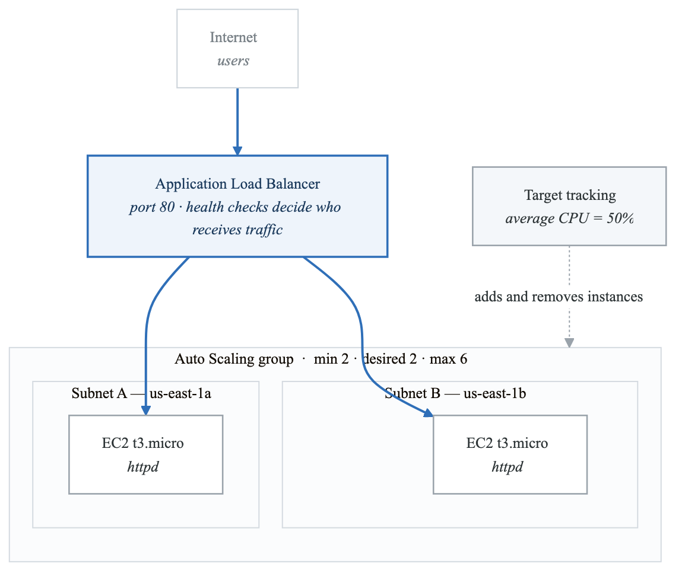
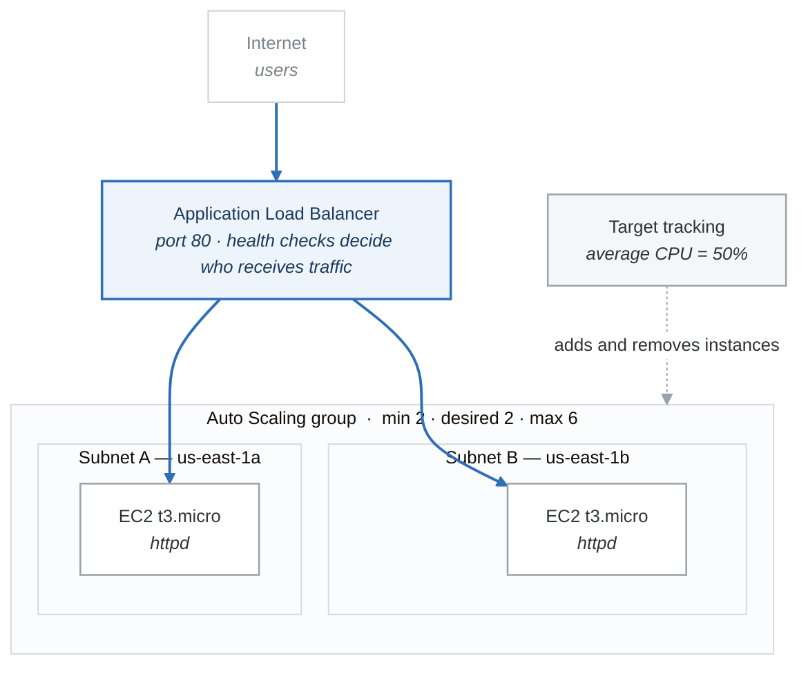

# Project 01 — Auto-Scaling Web Application Behind ALB

## Overview

Deploy a web application on EC2 instances behind an Application Load Balancer (ALB) with an Auto Scaling Group that scales based on CPU utilization. Infrastructure is provisioned using Terraform. A Boto3 script is used for deployment verification and load testing.

## Architecture

<!-- figure: generated from the Mermaid below by _shared/diagrams/embed-figures.py — do not edit the image -->


<details>
<summary>Diagram source (Mermaid)</summary>



</details>

## Requirements

1. All infrastructure must be defined in Terraform (IaC).
2. The ALB must be internet-facing on port 80.
3. EC2 instances must be in private subnets (no direct internet access), with a NAT gateway for outbound traffic.
4. The ASG must span at least 2 AZs.
5. The ASG must use a target tracking scaling policy targeting 50% average CPU utilization.
6. Each EC2 instance runs Apache httpd displaying the instance ID and AZ.
7. A Boto3 script verifies the deployment and generates load for testing.

## Acceptance Criteria

- [ ] `terraform apply` creates all resources without errors.
- [ ] The ALB DNS name returns an HTTP 200 response.
- [ ] Refreshing the ALB URL shows responses from different instances (round-robin).
- [ ] Under load, the ASG scales out (adds instances).
- [ ] After load stops, the ASG scales in (removes instances).
- [ ] `terraform destroy` removes all resources.

---

## Terraform Configuration

### Directory Structure

**`project-01-auto-scaling-web-app/`**

- `main.tf`
- `variables.tf`
- `outputs.tf`
- `user_data.sh`
- `verify_deploy.py`


### variables.tf

```hcl
variable "aws_region" {
  description = "AWS region to deploy into"
  type        = string
  default     = "us-east-1"
}

variable "instance_type" {
  description = "EC2 instance type"
  type        = string
  default     = "t3.micro"
}

variable "asg_min" {
  description = "Minimum instances in the ASG"
  type        = number
  default     = 2
}

variable "asg_max" {
  description = "Maximum instances in the ASG"
  type        = number
  default     = 6
}

variable "asg_desired" {
  description = "Desired instances in the ASG"
  type        = number
  default     = 2
}

variable "cpu_target" {
  description = "Target CPU utilization for scaling policy"
  type        = number
  default     = 50.0
}

variable "project_name" {
  description = "Name prefix for all resources"
  type        = string
  default     = "lab-p01"
}
```

### user_data.sh

```bash
#!/bin/bash
yum update -y
yum install -y httpd stress-ng

# Get instance metadata using IMDSv2
TOKEN=$(curl -X PUT "http://169.254.169.254/latest/api/token" \
  -H "X-aws-ec2-metadata-token-ttl-seconds: 21600")
INSTANCE_ID=$(curl -H "X-aws-ec2-metadata-token: $TOKEN" \
  http://169.254.169.254/latest/meta-data/instance-id)
AZ=$(curl -H "X-aws-ec2-metadata-token: $TOKEN" \
  http://169.254.169.254/latest/meta-data/placement/availability-zone)
PRIVATE_IP=$(curl -H "X-aws-ec2-metadata-token: $TOKEN" \
  http://169.254.169.254/latest/meta-data/local-ipv4)

cat > /var/www/html/index.html << HTML
<!DOCTYPE html>
<html>
<head><title>Auto-Scaled Web App</title></head>
<body>
  <h1>Auto-Scaled Web Application</h1>
  <table border="1" cellpadding="8">
    <tr><td><b>Instance ID</b></td><td>${INSTANCE_ID}</td></tr>
    <tr><td><b>Availability Zone</b></td><td>${AZ}</td></tr>
    <tr><td><b>Private IP</b></td><td>${PRIVATE_IP}</td></tr>
  </table>
  <p>Served at: $(date)</p>
</body>
</html>
HTML

# Health check endpoint
cat > /var/www/html/health << 'HEALTH'
OK
HEALTH

systemctl start httpd
systemctl enable httpd
```

### main.tf

```hcl
terraform {
  required_version = ">= 1.5"
  required_providers {
    aws = {
      source  = "hashicorp/aws"
      version = "~> 5.0"
    }
  }
}

provider "aws" {
  region = var.aws_region
}

# --- Data Sources ---

data "aws_availability_zones" "available" {
  state = "available"
}

data "aws_ssm_parameter" "ami" {
  name = "/aws/service/ami-amazon-linux-latest/al2023-ami-kernel-6.1-x86_64"
}

# --- VPC ---

resource "aws_vpc" "main" {
  cidr_block           = "10.0.0.0/16"
  enable_dns_support   = true
  enable_dns_hostnames = true

  tags = { Name = "${var.project_name}-vpc" }
}

resource "aws_internet_gateway" "igw" {
  vpc_id = aws_vpc.main.id
  tags   = { Name = "${var.project_name}-igw" }
}

# Public subnets (for ALB and NAT Gateway)
resource "aws_subnet" "public" {
  count                   = 2
  vpc_id                  = aws_vpc.main.id
  cidr_block              = "10.0.${count.index + 1}.0/24"
  availability_zone       = data.aws_availability_zones.available.names[count.index]
  map_public_ip_on_launch = true

  tags = { Name = "${var.project_name}-public-${count.index + 1}" }
}

# Private subnets (for EC2 instances)
resource "aws_subnet" "private" {
  count             = 2
  vpc_id            = aws_vpc.main.id
  cidr_block        = "10.0.${count.index + 10}.0/24"
  availability_zone = data.aws_availability_zones.available.names[count.index]

  tags = { Name = "${var.project_name}-private-${count.index + 1}" }
}

# NAT Gateway (single, for cost savings)
resource "aws_eip" "nat" {
  domain = "vpc"
  tags   = { Name = "${var.project_name}-nat-eip" }
}

resource "aws_nat_gateway" "nat" {
  allocation_id = aws_eip.nat.id
  subnet_id     = aws_subnet.public[0].id

  tags       = { Name = "${var.project_name}-nat" }
  depends_on = [aws_internet_gateway.igw]
}

# Route tables
resource "aws_route_table" "public" {
  vpc_id = aws_vpc.main.id
  route {
    cidr_block = "0.0.0.0/0"
    gateway_id = aws_internet_gateway.igw.id
  }
  tags = { Name = "${var.project_name}-public-rt" }
}

resource "aws_route_table_association" "public" {
  count          = 2
  subnet_id      = aws_subnet.public[count.index].id
  route_table_id = aws_route_table.public.id
}

resource "aws_route_table" "private" {
  vpc_id = aws_vpc.main.id
  route {
    cidr_block     = "0.0.0.0/0"
    nat_gateway_id = aws_nat_gateway.nat.id
  }
  tags = { Name = "${var.project_name}-private-rt" }
}

resource "aws_route_table_association" "private" {
  count          = 2
  subnet_id      = aws_subnet.private[count.index].id
  route_table_id = aws_route_table.private.id
}

# --- Security Groups ---

resource "aws_security_group" "alb" {
  name        = "${var.project_name}-alb-sg"
  description = "Allow HTTP from internet"
  vpc_id      = aws_vpc.main.id

  ingress {
    from_port   = 80
    to_port     = 80
    protocol    = "tcp"
    cidr_blocks = ["0.0.0.0/0"]
  }

  egress {
    from_port   = 0
    to_port     = 0
    protocol    = "-1"
    cidr_blocks = ["0.0.0.0/0"]
  }

  tags = { Name = "${var.project_name}-alb-sg" }
}

resource "aws_security_group" "ec2" {
  name        = "${var.project_name}-ec2-sg"
  description = "Allow HTTP from ALB only"
  vpc_id      = aws_vpc.main.id

  ingress {
    from_port       = 80
    to_port         = 80
    protocol        = "tcp"
    security_groups = [aws_security_group.alb.id]
  }

  egress {
    from_port   = 0
    to_port     = 0
    protocol    = "-1"
    cidr_blocks = ["0.0.0.0/0"]
  }

  tags = { Name = "${var.project_name}-ec2-sg" }
}

# --- ALB ---

resource "aws_lb" "app" {
  name               = "${var.project_name}-alb"
  internal           = false
  load_balancer_type = "application"
  security_groups    = [aws_security_group.alb.id]
  subnets            = aws_subnet.public[*].id

  tags = { Name = "${var.project_name}-alb" }
}

resource "aws_lb_target_group" "app" {
  name     = "${var.project_name}-tg"
  port     = 80
  protocol = "HTTP"
  vpc_id   = aws_vpc.main.id

  health_check {
    path                = "/health"
    healthy_threshold   = 2
    unhealthy_threshold = 3
    interval            = 15
    timeout             = 5
  }

  tags = { Name = "${var.project_name}-tg" }
}

resource "aws_lb_listener" "http" {
  load_balancer_arn = aws_lb.app.arn
  port              = 80
  protocol          = "HTTP"

  default_action {
    type             = "forward"
    target_group_arn = aws_lb_target_group.app.arn
  }
}

# --- Launch Template ---

resource "aws_launch_template" "app" {
  name_prefix   = "${var.project_name}-lt-"
  image_id      = data.aws_ssm_parameter.ami.value
  instance_type = var.instance_type

  vpc_security_group_ids = [aws_security_group.ec2.id]
  user_data              = base64encode(file("user_data.sh"))

  tag_specifications {
    resource_type = "instance"
    tags = {
      Name    = "${var.project_name}-web-instance"
      Project = var.project_name
    }
  }

  lifecycle {
    create_before_destroy = true
  }
}

# --- Auto Scaling Group ---

resource "aws_autoscaling_group" "app" {
  name                = "${var.project_name}-asg"
  min_size            = var.asg_min
  max_size            = var.asg_max
  desired_capacity    = var.asg_desired
  vpc_zone_identifier = aws_subnet.private[*].id
  target_group_arns   = [aws_lb_target_group.app.arn]

  health_check_type         = "ELB"
  health_check_grace_period = 180

  launch_template {
    id      = aws_launch_template.app.id
    version = "$Latest"
  }

  tag {
    key                 = "Name"
    value               = "${var.project_name}-asg-instance"
    propagate_at_launch = true
  }
}

resource "aws_autoscaling_policy" "cpu_target" {
  name                   = "${var.project_name}-cpu-target"
  autoscaling_group_name = aws_autoscaling_group.app.name
  policy_type            = "TargetTrackingScaling"

  target_tracking_configuration {
    predefined_metric_specification {
      predefined_metric_type = "ASGAverageCPUUtilization"
    }
    target_value = var.cpu_target
  }
}
```

### outputs.tf

```hcl
output "alb_dns_name" {
  description = "DNS name of the Application Load Balancer"
  value       = aws_lb.app.dns_name
}

output "alb_url" {
  description = "URL of the application"
  value       = "http://${aws_lb.app.dns_name}"
}

output "asg_name" {
  description = "Name of the Auto Scaling Group"
  value       = aws_autoscaling_group.app.name
}

output "vpc_id" {
  description = "VPC ID"
  value       = aws_vpc.main.id
}
```

---

## Deployment Verification Script (Boto3)

### verify_deploy.py

```python
#!/usr/bin/env python3
"""Verify the auto-scaling web app deployment and test scaling."""

import boto3
import requests
import time
import sys
from collections import Counter

asg_client = boto3.client('autoscaling')
elbv2_client = boto3.client('elbv2')
ec2_client = boto3.client('ec2')


def get_alb_url():
    """Find the ALB URL from the project."""
    lbs = elbv2_client.describe_load_balancers()
    for lb in lbs['LoadBalancers']:
        if 'lab-p01' in lb['LoadBalancerName']:
            return f"http://{lb['DNSName']}"
    print("ERROR: ALB not found. Did you run terraform apply?")
    sys.exit(1)


def verify_alb_responses(url, count=10):
    """Hit the ALB multiple times and verify responses from different instances."""
    print(f"\n--- Hitting ALB {count} times ---")
    instances_seen = Counter()
    for i in range(count):
        try:
            response = requests.get(url, timeout=5)
            if response.status_code == 200:
                # Parse instance ID from HTML
                text = response.text
                if 'Instance ID' in text:
                    # Extract instance ID between <td> tags after Instance ID
                    start = text.find('Instance ID') + len('Instance ID</b></td><td>')
                    end = text.find('</td>', start)
                    instance_id = text[start:end].strip()
                    instances_seen[instance_id] += 1
            else:
                print(f"  Request {i+1}: HTTP {response.status_code}")
        except requests.exceptions.RequestException as e:
            print(f"  Request {i+1}: Error - {e}")
        time.sleep(0.5)

    print(f"\nResponses by instance:")
    for instance_id, count in instances_seen.items():
        print(f"  {instance_id}: {count} responses")
    print(f"Total unique instances: {len(instances_seen)}")
    return len(instances_seen) >= 2


def get_asg_status():
    """Display the current ASG status."""
    response = asg_client.describe_auto_scaling_groups(
        AutoScalingGroupNames=['lab-p01-asg']
    )
    if not response['AutoScalingGroups']:
        print("ASG not found")
        return

    asg = response['AutoScalingGroups'][0]
    print(f"\n--- ASG Status ---")
    print(f"Min: {asg['MinSize']} | Desired: {asg['DesiredCapacity']} | Max: {asg['MaxSize']}")
    print(f"Instances ({len(asg['Instances'])}):")
    for inst in asg['Instances']:
        print(f"  {inst['InstanceId']} | AZ: {inst['AvailabilityZone']} | "
              f"Health: {inst['HealthStatus']} | State: {inst['LifecycleState']}")


def monitor_scaling(duration_minutes=5):
    """Monitor the ASG for scaling activities."""
    print(f"\n--- Monitoring scaling for {duration_minutes} minutes ---")
    end_time = time.time() + (duration_minutes * 60)
    while time.time() < end_time:
        get_asg_status()
        activities = asg_client.describe_scaling_activities(
            AutoScalingGroupName='lab-p01-asg',
            MaxRecords=3,
        )
        for act in activities['Activities']:
            print(f"  Activity: {act['Description'][:80]} | Status: {act['StatusCode']}")
        remaining = int(end_time - time.time())
        print(f"  ({remaining}s remaining)")
        time.sleep(30)


if __name__ == '__main__':
    url = get_alb_url()
    print(f"ALB URL: {url}")

    if len(sys.argv) > 1 and sys.argv[1] == 'monitor':
        monitor_scaling(10)
    else:
        verify_alb_responses(url, 20)
        get_asg_status()
```

---

## Step-by-Step Execution

```bash
# 1. Initialize Terraform
cd project-01-auto-scaling-web-app
terraform init

# 2. Review the plan
terraform plan

# 3. Deploy (takes 3-5 minutes)
terraform apply -auto-approve

# 4. Note the ALB URL from the output
ALB_URL=$(terraform output -raw alb_url)
echo "ALB URL: $ALB_URL"

# 5. Wait 2-3 minutes for instances to pass health checks, then test
curl "$ALB_URL"
curl "$ALB_URL/health"

# 6. Run the verification script
python3 verify_deploy.py

# 7. Run monitoring in the background
python3 verify_deploy.py monitor &

# 8. Generate load (from your machine)
# Install ab (Apache Bench) if needed: sudo yum install httpd-tools
ab -n 100000 -c 100 "$ALB_URL/"
```

---

## Teardown (CRITICAL)

```bash
# Destroy ALL resources
terraform destroy -auto-approve

# Verify nothing is running
aws ec2 describe-instances \
  --filters "Name=tag:Project,Values=lab-p01" "Name=instance-state-name,Values=running" \
  --query "Reservations[*].Instances[*].InstanceId" --output text

echo "Teardown complete!"
```

**Warning:** The NAT Gateway alone costs approximately $0.045/hour ($32/month). Always run `terraform destroy` when done.

---

## Cost Breakdown

| Resource | Cost/Hour | Notes |
|---|---|---|
| NAT Gateway | $0.045 | Plus $0.045/GB processed |
| ALB | $0.0225 | Plus LCU charges |
| 2x t3.micro EC2 | $0.0208 | Free Tier eligible |
| Elastic IP | $0.005 | Only when not associated with running NAT GW (free when associated) |
| **Total** | **~$0.09/hour** | **Tear down promptly!** |

---

## What You Learned

- Designing a multi-AZ web application architecture.
- Using Terraform for infrastructure as code.
- Configuring ALB with health checks.
- Setting up Auto Scaling with target tracking policies.
- Verifying load balancing and scaling behavior.
- Importance of tearing down resources to control costs.

<!-- feynman-check -->

---

## Feynman check

Close the file. Blank page, no notes. Explain each of these to a competent engineer who has never
used this tool — **under five minutes, no jargon you can't define on the spot:**

- Terraform Configuration
- Deployment Verification Script (Boto3)
- Step-by-Step Execution
- Teardown (CRITICAL)

**The gap is not what you forgot. It is where you used a word instead of a mechanism.**

| | |
|---|---|
| ✗ | *"The security group allows the traffic."* |
| ✓ | *"A security group is a stateful allow-list attached to an ENI. Traffic matching an inbound rule is permitted and the reply is permitted automatically, because the connection is tracked — which is why you never write an outbound rule for a reply."* |

**Trace it:** A request from the internet to an instance in a private subnet. Name every hop, every route-table lookup, and every rule evaluated, in order.

Stop at the first component you cannot name. Reopen this file and read **only** that.

**Go deeper — only once the gap has a name:** [Timeouts, retries and backoff with jitter](https://aws.amazon.com/builders-library/timeouts-retries-and-backoff-with-jitter/) — 15 minutes from the AWS Builders' Library, and it changes how you write every client you touch afterwards.
Full list per domain: [`SOURCES.md`](../SOURCES.md#aws)

→ Protocol, the three levels of knowing, and worked examples: [`MASTERY.md`](../MASTERY.md)

<!-- /feynman-check -->
