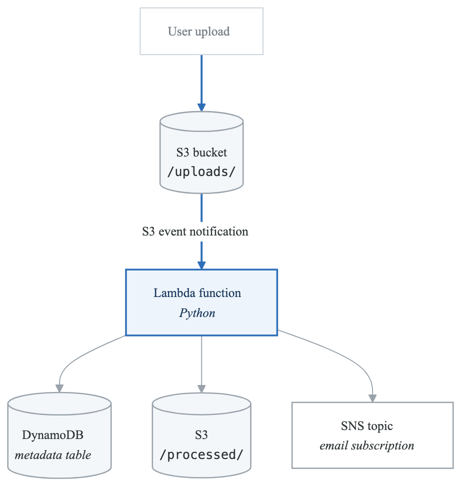
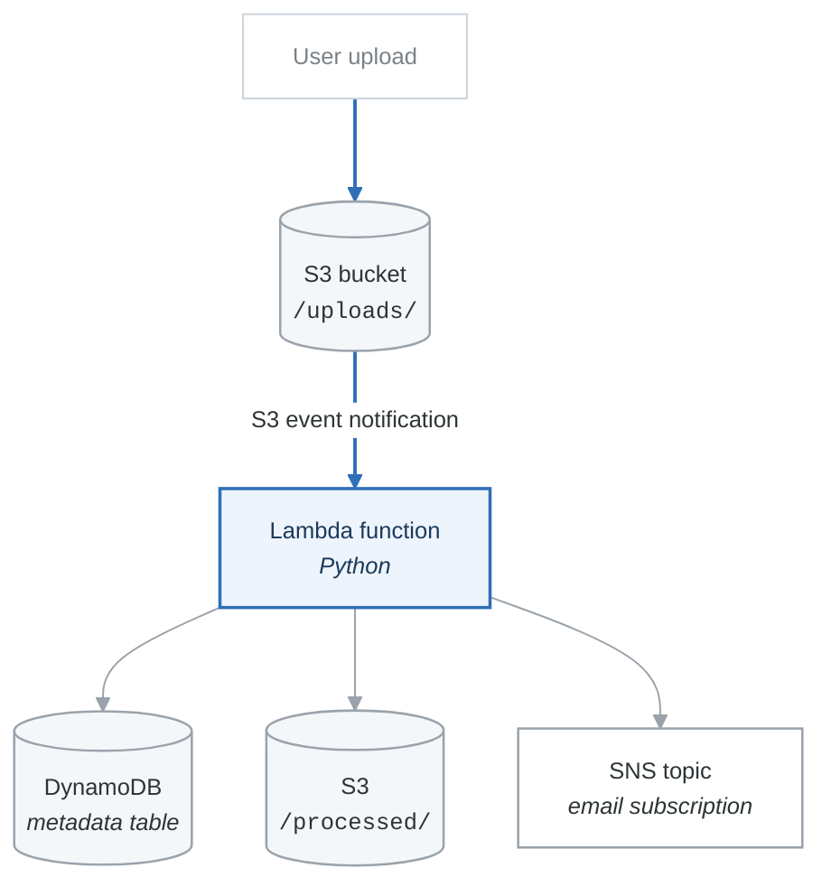

# Project 02 — Serverless File Processor

## Overview

Build a serverless file processing pipeline: when a file is uploaded to S3, it triggers a Lambda function that processes the file, stores metadata in DynamoDB, and sends a notification via SNS. Fully implemented in Python/Boto3 with AWS CLI for setup.

## Architecture

<!-- figure: generated from the Mermaid below by _shared/diagrams/embed-figures.py — do not edit the image -->


<details>
<summary>Diagram source (Mermaid)</summary>



</details>

**Flow**

1. A user uploads a file to `s3://bucket/uploads/`
2. The S3 event notification invokes the Lambda function
3. Lambda reads the object from S3
4. Lambda processes it — word count, line count, size analysis
5. Lambda writes the metadata row to DynamoDB
6. Lambda copies the file to `s3://bucket/processed/` and deletes the original
7. Lambda publishes to the SNS topic
8. SNS delivers the email

**The trap in step 6.** Writing the processed file back into the *same* bucket under a different
prefix is fine — writing it back under `/uploads/` invokes the function again, forever. Scope the
event notification to the `uploads/` prefix and write only outside it. This is the single most common
way a first serverless project produces a surprising bill.

## Requirements

1. All AWS resource creation via CLI/Boto3 (no console).
2. Lambda function written in Python.
3. S3 bucket with event notification for `s3:ObjectCreated:*` on `uploads/` prefix.
4. DynamoDB table stores: file name, size, word count, line count, processing timestamp, status.
5. SNS topic sends email notification on successful processing.
6. Proper IAM roles with least-privilege permissions.
7. Error handling: failed processing sends an error notification.

## Acceptance Criteria

- [ ] Uploading a `.txt` file to `uploads/` triggers Lambda automatically.
- [ ] DynamoDB contains a record with correct metadata for each processed file.
- [ ] Processed file appears in `processed/` prefix.
- [ ] Email notification received for each successful upload.
- [ ] Uploading a non-text file is handled gracefully (error recorded).
- [ ] All resources can be torn down cleanly.

---

## File Structure

**`project-02-serverless-file-processor/`**

| File | What it is |
|---|---|
| `setup_infrastructure.py` | Creates all AWS resources |
| `lambda_function.py` | Lambda function code |
| `upload_test_files.py` | Uploads test files and verifies results |
| `teardown.py` | Deletes all AWS resources |
| `requirements.txt` | Python dependencies |


---

## setup_infrastructure.py

```python
#!/usr/bin/env python3
"""Create all AWS infrastructure for the serverless file processor."""

import boto3
import json
import time
import zipfile
import io
import os

REGION = 'us-east-1'
PROJECT = 'saa-p02'
BUCKET_NAME = None  # Will be set dynamically
TABLE_NAME = f'{PROJECT}-file-metadata'
FUNCTION_NAME = f'{PROJECT}-file-processor'
TOPIC_NAME = f'{PROJECT}-notifications'
ROLE_NAME = f'{PROJECT}-lambda-role'

iam_client = boto3.client('iam', region_name=REGION)
s3_client = boto3.client('s3', region_name=REGION)
dynamodb_client = boto3.client('dynamodb', region_name=REGION)
lambda_client = boto3.client('lambda', region_name=REGION)
sns_client = boto3.client('sns', region_name=REGION)
sts_client = boto3.client('sts', region_name=REGION)


def get_account_id():
    return sts_client.get_caller_identity()['Account']


def create_s3_bucket():
    """Create the S3 bucket for uploads and processed files."""
    account_id = get_account_id()
    bucket_name = f'{PROJECT}-files-{account_id}'

    # us-east-1 does not use LocationConstraint
    if REGION == 'us-east-1':
        s3_client.create_bucket(Bucket=bucket_name)
    else:
        s3_client.create_bucket(
            Bucket=bucket_name,
            CreateBucketConfiguration={'LocationConstraint': REGION},
        )

    # Enable versioning
    s3_client.put_bucket_versioning(
        Bucket=bucket_name,
        VersioningConfiguration={'Status': 'Enabled'},
    )

    print(f"S3 bucket created: {bucket_name}")
    return bucket_name


def create_dynamodb_table():
    """Create the DynamoDB table for file metadata."""
    dynamodb_client.create_table(
        TableName=TABLE_NAME,
        KeySchema=[
            {'AttributeName': 'file_id', 'KeyType': 'HASH'},
        ],
        AttributeDefinitions=[
            {'AttributeName': 'file_id', 'AttributeType': 'S'},
        ],
        BillingMode='PAY_PER_REQUEST',
        Tags=[{'Key': 'Project', 'Value': PROJECT}],
    )

    # Wait for table to be active
    waiter = dynamodb_client.get_waiter('table_exists')
    waiter.wait(TableName=TABLE_NAME)
    print(f"DynamoDB table created: {TABLE_NAME}")


def create_sns_topic(email_address):
    """Create an SNS topic and subscribe an email address."""
    response = sns_client.create_topic(Name=TOPIC_NAME)
    topic_arn = response['TopicArn']

    sns_client.subscribe(
        TopicArn=topic_arn,
        Protocol='email',
        Endpoint=email_address,
    )

    print(f"SNS topic created: {topic_arn}")
    print(f"Check your email ({email_address}) and confirm the subscription!")
    return topic_arn


def create_lambda_role(bucket_name, topic_arn):
    """Create IAM role with least-privilege permissions for Lambda."""
    account_id = get_account_id()

    # Trust policy
    trust_policy = json.dumps({
        "Version": "2012-10-17",
        "Statement": [{
            "Effect": "Allow",
            "Principal": {"Service": "lambda.amazonaws.com"},
            "Action": "sts:AssumeRole",
        }],
    })

    role = iam_client.create_role(
        RoleName=ROLE_NAME,
        AssumeRolePolicyDocument=trust_policy,
    )
    role_arn = role['Role']['Arn']

    # Inline policy with least-privilege permissions
    policy = json.dumps({
        "Version": "2012-10-17",
        "Statement": [
            {
                "Effect": "Allow",
                "Action": [
                    "logs:CreateLogGroup",
                    "logs:CreateLogStream",
                    "logs:PutLogEvents",
                ],
                "Resource": f"arn:aws:logs:{REGION}:{account_id}:*",
            },
            {
                "Effect": "Allow",
                "Action": ["s3:GetObject", "s3:PutObject", "s3:DeleteObject"],
                "Resource": f"arn:aws:s3:::{bucket_name}/*",
            },
            {
                "Effect": "Allow",
                "Action": ["dynamodb:PutItem", "dynamodb:UpdateItem"],
                "Resource": f"arn:aws:dynamodb:{REGION}:{account_id}:table/{TABLE_NAME}",
            },
            {
                "Effect": "Allow",
                "Action": ["sns:Publish"],
                "Resource": topic_arn,
            },
        ],
    })

    iam_client.put_role_policy(
        RoleName=ROLE_NAME,
        PolicyName=f'{PROJECT}-lambda-policy',
        PolicyDocument=policy,
    )

    print(f"IAM role created: {role_arn}")
    time.sleep(10)  # Wait for role propagation
    return role_arn


def create_lambda_function(role_arn, bucket_name, topic_arn):
    """Package and deploy the Lambda function."""
    # Read the Lambda function code
    lambda_code_path = os.path.join(os.path.dirname(__file__), 'lambda_function.py')
    with open(lambda_code_path, 'r') as f:
        code = f.read()

    # Create zip in memory
    buffer = io.BytesIO()
    with zipfile.ZipFile(buffer, 'w', zipfile.ZIP_DEFLATED) as zf:
        zf.writestr('lambda_function.py', code)
    buffer.seek(0)

    response = lambda_client.create_function(
        FunctionName=FUNCTION_NAME,
        Runtime='python3.12',
        Role=role_arn,
        Handler='lambda_function.lambda_handler',
        Code={'ZipFile': buffer.read()},
        Timeout=60,
        MemorySize=256,
        Environment={
            'Variables': {
                'TABLE_NAME': TABLE_NAME,
                'TOPIC_ARN': topic_arn,
                'PROCESSED_PREFIX': 'processed/',
            },
        },
        Description='Process files uploaded to S3, store metadata in DynamoDB, notify via SNS',
    )

    function_arn = response['FunctionArn']
    print(f"Lambda function created: {function_arn}")

    # Wait for function to be active
    waiter = lambda_client.get_waiter('function_active_v2')
    waiter.wait(FunctionName=FUNCTION_NAME)

    # Grant S3 permission to invoke Lambda
    account_id = get_account_id()
    lambda_client.add_permission(
        FunctionName=FUNCTION_NAME,
        StatementId='s3-invoke',
        Action='lambda:InvokeFunction',
        Principal='s3.amazonaws.com',
        SourceArn=f'arn:aws:s3:::{bucket_name}',
        SourceAccount=account_id,
    )

    return function_arn


def configure_s3_notification(bucket_name, function_arn):
    """Configure S3 event notification to trigger Lambda."""
    s3_client.put_bucket_notification_configuration(
        Bucket=bucket_name,
        NotificationConfiguration={
            'LambdaFunctionConfigurations': [
                {
                    'Id': 'ProcessUploads',
                    'LambdaFunctionArn': function_arn,
                    'Events': ['s3:ObjectCreated:*'],
                    'Filter': {
                        'Key': {
                            'FilterRules': [
                                {'Name': 'prefix', 'Value': 'uploads/'},
                            ],
                        },
                    },
                },
            ],
        },
    )
    print("S3 event notification configured for uploads/ prefix")


def main():
    """Set up all infrastructure."""
    email = input("Enter your email for SNS notifications: ").strip()
    if not email:
        print("Email is required for SNS notifications.")
        return

    print("\n=== Creating Infrastructure ===\n")

    bucket_name = create_s3_bucket()
    create_dynamodb_table()
    topic_arn = create_sns_topic(email)
    role_arn = create_lambda_role(bucket_name, topic_arn)
    function_arn = create_lambda_function(role_arn, bucket_name, topic_arn)
    configure_s3_notification(bucket_name, function_arn)

    print("\n=== Infrastructure Created ===")
    print(f"Bucket:   {bucket_name}")
    print(f"Table:    {TABLE_NAME}")
    print(f"Function: {FUNCTION_NAME}")
    print(f"Topic:    {topic_arn}")
    print(f"\nIMPORTANT: Confirm the SNS email subscription before testing!")

    # Save config for other scripts
    config = {
        'bucket_name': bucket_name,
        'table_name': TABLE_NAME,
        'function_name': FUNCTION_NAME,
        'topic_arn': topic_arn,
        'role_name': ROLE_NAME,
        'region': REGION,
    }
    with open('config.json', 'w') as f:
        json.dump(config, f, indent=2)
    print("Config saved to config.json")


if __name__ == '__main__':
    main()
```

---

## lambda_function.py

```python
"""
Serverless File Processor Lambda Function.

Triggered by S3 ObjectCreated events on the uploads/ prefix.
1. Reads the uploaded file from S3.
2. Processes the file (word count, line count, character count).
3. Stores metadata in DynamoDB.
4. Copies the processed file to the processed/ prefix.
5. Deletes the original from uploads/.
6. Publishes a notification to SNS.
"""

import json
import os
import uuid
import urllib.parse
from datetime import datetime

import boto3

s3_client = boto3.client('s3')
dynamodb = boto3.resource('dynamodb')
sns_client = boto3.client('sns')

TABLE_NAME = os.environ['TABLE_NAME']
TOPIC_ARN = os.environ['TOPIC_ARN']
PROCESSED_PREFIX = os.environ.get('PROCESSED_PREFIX', 'processed/')

table = dynamodb.Table(TABLE_NAME)


def lambda_handler(event, context):
    """Main handler for S3 event notifications."""
    print(f"Received event: {json.dumps(event)}")

    for record in event.get('Records', []):
        try:
            process_record(record)
        except Exception as e:
            print(f"Error processing record: {e}")
            handle_error(record, str(e))
            raise


def process_record(record):
    """Process a single S3 event record."""
    bucket = record['s3']['bucket']['name']
    key = urllib.parse.unquote_plus(record['s3']['object']['key'])
    size = record['s3']['object'].get('size', 0)
    event_time = record.get('eventTime', datetime.utcnow().isoformat())

    print(f"Processing: s3://{bucket}/{key} ({size} bytes)")

    # Generate a unique file ID
    file_id = str(uuid.uuid4())
    file_name = key.split('/')[-1]

    # Read the file from S3
    response = s3_client.get_object(Bucket=bucket, Key=key)
    content_type = response.get('ContentType', 'unknown')

    try:
        body = response['Body'].read().decode('utf-8')
        is_text = True
    except UnicodeDecodeError:
        body = None
        is_text = False

    # Process the file
    if is_text and body:
        metadata = {
            'file_id': file_id,
            'file_name': file_name,
            'original_key': key,
            'size_bytes': size,
            'content_type': content_type,
            'line_count': len(body.splitlines()),
            'word_count': len(body.split()),
            'char_count': len(body),
            'unique_words': len(set(body.lower().split())),
            'processing_timestamp': datetime.utcnow().isoformat(),
            'status': 'processed',
            'event_time': event_time,
        }
    else:
        metadata = {
            'file_id': file_id,
            'file_name': file_name,
            'original_key': key,
            'size_bytes': size,
            'content_type': content_type,
            'line_count': 0,
            'word_count': 0,
            'char_count': 0,
            'unique_words': 0,
            'processing_timestamp': datetime.utcnow().isoformat(),
            'status': 'skipped_binary',
            'event_time': event_time,
        }

    # Store metadata in DynamoDB
    table.put_item(Item=metadata)
    print(f"Metadata stored in DynamoDB: {file_id}")

    # Copy to processed/ prefix
    processed_key = f"{PROCESSED_PREFIX}{file_name}"
    s3_client.copy_object(
        Bucket=bucket,
        CopySource={'Bucket': bucket, 'Key': key},
        Key=processed_key,
    )
    print(f"File copied to: {processed_key}")

    # Delete from uploads/
    s3_client.delete_object(Bucket=bucket, Key=key)
    print(f"Original deleted: {key}")

    # Send SNS notification
    message = (
        f"File Processed Successfully\n"
        f"{'=' * 40}\n"
        f"File: {file_name}\n"
        f"Size: {size:,} bytes\n"
        f"Lines: {metadata['line_count']:,}\n"
        f"Words: {metadata['word_count']:,}\n"
        f"Characters: {metadata['char_count']:,}\n"
        f"Unique Words: {metadata['unique_words']:,}\n"
        f"Status: {metadata['status']}\n"
        f"Processed At: {metadata['processing_timestamp']}\n"
        f"File ID: {file_id}\n"
    )

    sns_client.publish(
        TopicArn=TOPIC_ARN,
        Subject=f"File Processed: {file_name}",
        Message=message,
    )
    print(f"SNS notification sent for: {file_name}")

    return metadata


def handle_error(record, error_message):
    """Handle processing errors by recording in DynamoDB and sending an error notification."""
    bucket = record['s3']['bucket']['name']
    key = urllib.parse.unquote_plus(record['s3']['object']['key'])
    file_name = key.split('/')[-1]
    file_id = str(uuid.uuid4())

    # Record the error in DynamoDB
    table.put_item(Item={
        'file_id': file_id,
        'file_name': file_name,
        'original_key': key,
        'processing_timestamp': datetime.utcnow().isoformat(),
        'status': 'error',
        'error_message': error_message,
    })

    # Send error notification
    sns_client.publish(
        TopicArn=TOPIC_ARN,
        Subject=f"Error Processing: {file_name}",
        Message=f"Error processing file: {file_name}\nKey: {key}\nError: {error_message}",
    )
```

---

## upload_test_files.py

```python
#!/usr/bin/env python3
"""Upload test files and verify the processing pipeline."""

import boto3
import json
import time

# Load config
with open('config.json', 'r') as f:
    config = json.load(f)

BUCKET = config['bucket_name']
TABLE = config['table_name']
REGION = config['region']

s3_client = boto3.client('s3', region_name=REGION)
dynamodb = boto3.resource('dynamodb', region_name=REGION)
table = dynamodb.Table(TABLE)


def upload_test_text():
    """Upload a sample text file."""
    content = """The quick brown fox jumps over the lazy dog.
This is a test file for the serverless file processor.
It contains multiple lines and various words.
The processor should count lines, words, and characters.
This is the final line of the test file.
"""
    s3_client.put_object(
        Bucket=BUCKET,
        Key='uploads/sample-text.txt',
        Body=content.encode(),
        ContentType='text/plain',
    )
    print("Uploaded: uploads/sample-text.txt")


def upload_csv():
    """Upload a sample CSV file."""
    content = """name,age,city
Alice,30,New York
Bob,25,San Francisco
Charlie,35,Chicago
Diana,28,Austin
Eve,32,Seattle
"""
    s3_client.put_object(
        Bucket=BUCKET,
        Key='uploads/data.csv',
        Body=content.encode(),
        ContentType='text/csv',
    )
    print("Uploaded: uploads/data.csv")


def upload_large_text():
    """Upload a larger text file."""
    lines = [f"Line {i}: {'word ' * 20}" for i in range(1, 501)]
    content = '\n'.join(lines)
    s3_client.put_object(
        Bucket=BUCKET,
        Key='uploads/large-file.txt',
        Body=content.encode(),
        ContentType='text/plain',
    )
    print("Uploaded: uploads/large-file.txt (500 lines)")


def check_results():
    """Check DynamoDB for processing results."""
    print("\n--- DynamoDB Records ---")
    response = table.scan()
    items = response.get('Items', [])

    if not items:
        print("No records found yet. Lambda may still be processing...")
        return False

    for item in items:
        print(f"\nFile: {item.get('file_name')}")
        print(f"  Status: {item.get('status')}")
        print(f"  Size: {item.get('size_bytes', 'N/A')} bytes")
        print(f"  Lines: {item.get('line_count', 'N/A')}")
        print(f"  Words: {item.get('word_count', 'N/A')}")
        print(f"  Characters: {item.get('char_count', 'N/A')}")
        print(f"  Unique Words: {item.get('unique_words', 'N/A')}")
        print(f"  Processed At: {item.get('processing_timestamp', 'N/A')}")

    return True


def check_processed_bucket():
    """Check if files were moved to the processed/ prefix."""
    print("\n--- Processed Files in S3 ---")
    response = s3_client.list_objects_v2(
        Bucket=BUCKET,
        Prefix='processed/',
    )
    for obj in response.get('Contents', []):
        print(f"  {obj['Key']} ({obj['Size']} bytes)")


def main():
    """Upload test files and verify processing."""
    print("=== Uploading Test Files ===\n")
    upload_test_text()
    upload_csv()
    upload_large_text()

    print("\nWaiting 15 seconds for Lambda to process...")
    time.sleep(15)

    check_results()
    check_processed_bucket()

    print("\nCheck your email for SNS notifications!")


if __name__ == '__main__':
    main()
```

---

## teardown.py

```python
#!/usr/bin/env python3
"""Tear down all infrastructure for the serverless file processor."""

import boto3
import json
import time

# Load config
with open('config.json', 'r') as f:
    config = json.load(f)

REGION = config['region']

s3_client = boto3.client('s3', region_name=REGION)
dynamodb_client = boto3.client('dynamodb', region_name=REGION)
lambda_client = boto3.client('lambda', region_name=REGION)
sns_client = boto3.client('sns', region_name=REGION)
iam_client = boto3.client('iam', region_name=REGION)
logs_client = boto3.client('logs', region_name=REGION)


def empty_and_delete_bucket(bucket_name):
    """Delete all objects (including versions) and the bucket."""
    print(f"Emptying bucket: {bucket_name}")

    # Delete all object versions
    paginator = s3_client.get_paginator('list_object_versions')
    for page in paginator.paginate(Bucket=bucket_name):
        objects_to_delete = []
        for version in page.get('Versions', []):
            objects_to_delete.append({
                'Key': version['Key'],
                'VersionId': version['VersionId'],
            })
        for marker in page.get('DeleteMarkers', []):
            objects_to_delete.append({
                'Key': marker['Key'],
                'VersionId': marker['VersionId'],
            })
        if objects_to_delete:
            s3_client.delete_objects(
                Bucket=bucket_name,
                Delete={'Objects': objects_to_delete},
            )

    s3_client.delete_bucket(Bucket=bucket_name)
    print(f"Bucket deleted: {bucket_name}")


def delete_dynamodb_table(table_name):
    """Delete the DynamoDB table."""
    dynamodb_client.delete_table(TableName=table_name)
    waiter = dynamodb_client.get_waiter('table_not_exists')
    waiter.wait(TableName=table_name)
    print(f"DynamoDB table deleted: {table_name}")


def delete_lambda_function(function_name):
    """Delete the Lambda function."""
    lambda_client.delete_function(FunctionName=function_name)
    print(f"Lambda function deleted: {function_name}")

    # Delete log group
    try:
        logs_client.delete_log_group(
            logGroupName=f'/aws/lambda/{function_name}'
        )
        print(f"Log group deleted: /aws/lambda/{function_name}")
    except logs_client.exceptions.ResourceNotFoundException:
        pass


def delete_sns_topic(topic_arn):
    """Delete the SNS topic and all subscriptions."""
    # Delete subscriptions
    subs = sns_client.list_subscriptions_by_topic(TopicArn=topic_arn)
    for sub in subs.get('Subscriptions', []):
        if sub['SubscriptionArn'] != 'PendingConfirmation':
            sns_client.unsubscribe(SubscriptionArn=sub['SubscriptionArn'])

    sns_client.delete_topic(TopicArn=topic_arn)
    print(f"SNS topic deleted: {topic_arn}")


def delete_iam_role(role_name):
    """Delete inline policies and the IAM role."""
    # Delete inline policies
    policies = iam_client.list_role_policies(RoleName=role_name)
    for policy_name in policies.get('PolicyNames', []):
        iam_client.delete_role_policy(
            RoleName=role_name,
            PolicyName=policy_name,
        )

    # Detach managed policies
    attached = iam_client.list_attached_role_policies(RoleName=role_name)
    for policy in attached.get('AttachedPolicies', []):
        iam_client.detach_role_policy(
            RoleName=role_name,
            PolicyArn=policy['PolicyArn'],
        )

    iam_client.delete_role(RoleName=role_name)
    print(f"IAM role deleted: {role_name}")


def main():
    """Tear down all resources."""
    print("=== Tearing Down Infrastructure ===\n")

    delete_lambda_function(config['function_name'])
    empty_and_delete_bucket(config['bucket_name'])
    delete_dynamodb_table(config['table_name'])
    delete_sns_topic(config['topic_arn'])
    delete_iam_role(config['role_name'])

    print("\n=== Teardown Complete ===")
    print("All resources have been deleted.")


if __name__ == '__main__':
    confirm = input("This will DELETE all project resources. Type 'yes' to confirm: ")
    if confirm.lower() == 'yes':
        main()
    else:
        print("Teardown cancelled.")
```

---

## requirements.txt

```
boto3>=1.28.0
```

---

## Step-by-Step Execution

```bash
# 1. Navigate to project directory
cd project-02-serverless-file-processor

# 2. Install dependencies
pip install -r requirements.txt

# 3. Set up infrastructure (creates S3, DynamoDB, SNS, Lambda, event notification)
python3 setup_infrastructure.py

# 4. IMPORTANT: Check your email and confirm the SNS subscription

# 5. Upload test files and verify processing
python3 upload_test_files.py

# 6. Check your email for processing notifications

# 7. Tear down all resources
python3 teardown.py
```

---

## Cost Estimate

| Resource | Cost |
|---|---|
| S3 Standard | Free tier (5 GB, 2,000 PUT, 20,000 GET) |
| Lambda | Free tier (1M requests, 400K GB-seconds) |
| DynamoDB (on-demand) | Free tier (25 GB, 25 WCU, 25 RCU) |
| SNS | Free tier (1M publishes, 1,000 email) |
| **Total** | **$0.00** |

---

## What You Learned

- Event-driven serverless architecture with S3 + Lambda.
- Configuring S3 event notifications with prefix filtering.
- Reading and writing to S3 from Lambda.
- Using DynamoDB for metadata storage.
- Publishing SNS notifications from Lambda.
- Least-privilege IAM roles for Lambda functions.
- Proper error handling in serverless applications.
- Full infrastructure-as-code with Python/Boto3 (setup and teardown).

<!-- feynman-check -->

---

## Feynman check

Close the file. Blank page, no notes. Explain each of these to a competent engineer who has never
used this tool — **under five minutes, no jargon you can't define on the spot:**

- Step-by-Step Execution

**The gap is not what you forgot. It is where you used a word instead of a mechanism.**

| | |
|---|---|
| ✗ | *"The security group allows the traffic."* |
| ✓ | *"A security group is a stateful allow-list attached to an ENI. Traffic matching an inbound rule is permitted and the reply is permitted automatically, because the connection is tracked — which is why you never write an outbound rule for a reply."* |

**Trace it:** A request from the internet to an instance in a private subnet. Name every hop, every route-table lookup, and every rule evaluated, in order.

Stop at the first component you cannot name. Reopen this file and read **only** that.

**Go deeper — only once the gap has a name:** [Timeouts, retries and backoff with jitter](https://aws.amazon.com/builders-library/timeouts-retries-and-backoff-with-jitter/) — 15 minutes from the AWS Builders' Library, and it changes how you write every client you touch afterwards.
Full list per domain: [`SOURCES.md`](../SOURCES.md#aws)

→ Protocol, the three levels of knowing, and worked examples: [`MASTERY.md`](../MASTERY.md)

<!-- /feynman-check -->
