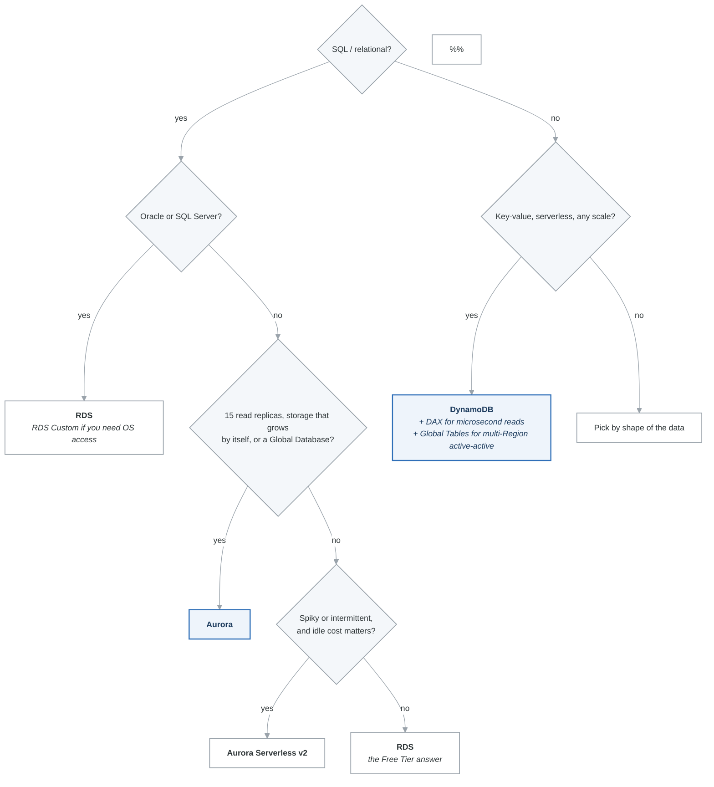

# Databases Cheat Sheet

Quick reference for all AWS database services covered in Phase 3. Use this for last-minute review before practice exams.

---

## All Database Services at a Glance

| Service | Type | Use Case | Latency | Max Storage | Scaling | Replication |
|---|---|---|---|---|---|---|
| **RDS** | Relational (SQL) | Traditional OLTP apps | Milliseconds | 64 TB | Vertical (instance resize) | Multi-AZ (sync), Read Replicas (async) |
| **Aurora** | Relational (SQL) | High-perf OLTP, 15 replicas | Milliseconds | 128 TB | Vertical + Serverless v2 | 6 copies / 3 AZs, Global DB |
| **DynamoDB** | Key-value / Document | Serverless NoSQL, any scale | Single-digit ms | Unlimited | Automatic (on-demand) or provisioned | Global Tables (multi-Region active-active) |
| **ElastiCache Redis** | In-memory | Caching, sessions, leaderboards | Sub-millisecond | ~6.1 TB (cluster) | Horizontal (cluster mode) | Primary + up to 5 replicas, Multi-AZ |
| **ElastiCache Memcached** | In-memory | Simple caching | Sub-millisecond | Depends on nodes | Horizontal (add nodes) | None |
| **Redshift** | Columnar (OLAP) | Data warehouse, analytics | Seconds | Petabytes | Horizontal (add nodes), Serverless | Snapshots (cross-Region) |
| **Neptune** | Graph | Social networks, fraud detection | Milliseconds | 128 TB | Up to 15 read replicas | 6 copies / 3 AZs |
| **DocumentDB** | Document (MongoDB) | Content mgmt, user profiles | Milliseconds | 128 TB | Up to 15 read replicas | 6 copies / 3 AZs |
| **Keyspaces** | Wide column (Cassandra) | IoT, time-series (Cassandra workloads) | Single-digit ms | Unlimited | Automatic (serverless) | 3 copies / multi-AZ |
| **QLDB** | Ledger | Immutable audit trails | Milliseconds | Not specified | Automatic (serverless) | Cryptographic hash chain |
| **Timestream** | Time-series | IoT metrics, app monitoring | Milliseconds | Unlimited | Automatic (serverless) | Multi-AZ |
| **OpenSearch** | Search / Analytics | Full-text search, log analytics | Milliseconds | Petabytes | Horizontal (add nodes) | Multi-AZ |

---

## RDS vs Aurora Quick Comparison

| Feature | RDS | Aurora |
|---|---|---|
| Engines | MySQL, PostgreSQL, MariaDB, Oracle, SQL Server | MySQL-compatible, PostgreSQL-compatible |
| Storage copies | 1 AZ or 2 (Multi-AZ) | 6 copies across 3 AZs (always) |
| Auto-scaling storage | No (manual up to 64 TB) | Yes (up to 128 TB) |
| Self-healing storage | No | Yes |
| Max Read Replicas | 5 | 15 |
| Replica lag | Seconds (async, separate storage) | < 10 ms (shared storage) |
| Failover time | 60-120 sec | < 30 sec |
| Global Database | No (cross-Region RR only) | Yes (< 1 sec lag) |
| Serverless option | No | Serverless v2 |
| Backtrack | No | Yes (MySQL only) |
| Cloning | No (snapshot restore) | Yes (copy-on-write, instant) |
| Free Tier | Yes (db.t3.micro) | No |

**Rule of thumb:** If the question mentions MySQL or PostgreSQL and needs high availability, auto-scaling storage, or 15+ replicas, choose Aurora. If it needs Oracle, SQL Server, or Free Tier, choose RDS.

---

## DynamoDB Keys and Indexes

### Primary Key Types

| Type | Description | Example |
|---|---|---|
| Partition Key (PK) | Single hash attribute | `user_id` |
| Partition Key + Sort Key (PK+SK) | Composite key | PK: `user_id`, SK: `order_date` |

### Index Comparison

| Feature | LSI | GSI |
|---|---|---|
| When created | Table creation ONLY | Anytime |
| Partition key | Same as table | Any attribute |
| Sort key | Different from table | Any attribute |
| Max per table | 5 | 20 |
| Capacity | Shares with table | Own capacity |
| Consistent reads | Strong + eventual | Eventual ONLY |

### Capacity Math

| Unit | Strongly Consistent | Eventually Consistent | Write |
|---|---|---|---|
| 1 RCU | 1 read/sec (4 KB) | 2 reads/sec (4 KB) | -- |
| 1 WCU | -- | -- | 1 write/sec (1 KB) |
| Transactions | 2x RCU | 2x RCU | 2x WCU |

### DynamoDB Feature Quick Reference

| Feature | Key Detail |
|---|---|
| DAX | Microsecond reads, drop-in (no code changes) |
| Global Tables | Multi-Region active-active, < 1 sec replication |
| Streams | 24-hour change log, triggers Lambda |
| TTL | Auto-delete expired items, no WCU cost |
| Transactions | ACID across up to 100 items, 2x capacity cost |
| On-Demand mode | Auto-scales, best for unpredictable traffic |
| Provisioned mode | Cheaper for steady workloads, use with auto scaling |

---

## ElastiCache: Redis vs Memcached

| Feature | Redis | Memcached |
|---|---|---|
| Persistence | Yes | No |
| Replication | Yes (up to 5 replicas) | No |
| Multi-AZ | Yes (auto failover) | No |
| Backup/Restore | Yes | No |
| Data structures | Strings, lists, sets, sorted sets, hashes | Strings only |
| Cluster mode | Yes (sharding for scale) | Yes (multi-node) |
| Multi-threaded | No (single-threaded) | Yes |
| Pub/Sub | Yes | No |
| Use case | Sessions, leaderboards, queues, caching + HA | Simple cache, ephemeral |

**Rule of thumb:** Choose Redis unless the question specifically asks for "simplest caching" with no persistence or HA requirements.

---

## Caching Strategies

| Strategy | Data Freshness | Memory Efficiency | Read Penalty | Write Penalty |
|---|---|---|---|---|
| Lazy Loading | Stale possible | Good (only requested data) | Cache miss = 3 trips | None |
| Write-Through | Always fresh | Poor (all data cached) | None | 2x writes |
| Lazy Loading + TTL | Stale up to TTL | Good | After TTL expires | None |

---

## Database Selection Decision Tree

<!-- figure: generated from the Mermaid below by _shared/diagrams/embed-figures.py — do not edit the image -->

Diagram source (Mermaid)

---

## Encryption at Rest

| Service | Default | Options |
|---|---|---|
| RDS | Optional (KMS at creation) | AWS managed or customer managed KMS key |
| Aurora | Optional (KMS at creation) | AWS managed or customer managed KMS key |
| DynamoDB | Enabled by default | AWS owned, AWS managed, or customer managed key |
| ElastiCache Redis | Optional | KMS |
| Redshift | Optional | KMS or CloudHSM |

---

## Key Numbers to Remember

| Service | Number | What |
|---|---|---|
| RDS | 5 | Max Read Replicas |
| RDS | 35 days | Max backup retention |
| Aurora | 15 | Max Aurora Replicas |
| Aurora | 6 copies / 3 AZs | Storage replication |
| Aurora | 128 TB | Max storage |
| Aurora Global | < 1 sec | Cross-Region replication lag |
| DynamoDB | 400 KB | Max item size |
| DynamoDB | 5 LSI / 20 GSI | Max indexes per table |
| DynamoDB | 25 RCU + 25 WCU | Always-free tier |
| ElastiCache Redis | 5 | Max replicas per shard |
| ElastiCache Redis | 500 | Max nodes (cluster mode) |

<!-- feynman-check -->

---

## Feynman check

Close the file. Blank page, no notes. Explain each of these to a competent engineer who has never
used this tool — **under five minutes, no jargon you can't define on the spot:**

- All Database Services at a Glance
- RDS vs Aurora Quick Comparison
- DynamoDB Keys and Indexes
- ElastiCache: Redis vs Memcached

**The gap is not what you forgot. It is where you used a word instead of a mechanism.**

| | |
|---|---|
| ✗ | *"The security group allows the traffic."* |
| ✓ | *"A security group is a stateful allow-list attached to an ENI. Traffic matching an inbound rule is permitted and the reply is permitted automatically, because the connection is tracked — which is why you never write an outbound rule for a reply."* |

**Trace it:** A request from the internet to an instance in a private subnet. Name every hop, every route-table lookup, and every rule evaluated, in order.

Stop at the first component you cannot name. Reopen this file and read **only** that.

**Go deeper — only once the gap has a name:** [Timeouts, retries and backoff with jitter](https://aws.amazon.com/builders-library/timeouts-retries-and-backoff-with-jitter/) — 15 minutes from the AWS Builders' Library, and it changes how you write every client you touch afterwards.
Full list per domain: [`SOURCES.md`](../SOURCES.md#aws)

→ Protocol, the three levels of knowing, and worked examples: [`MASTERY.md`](../MASTERY.md)

<!-- /feynman-check -->
