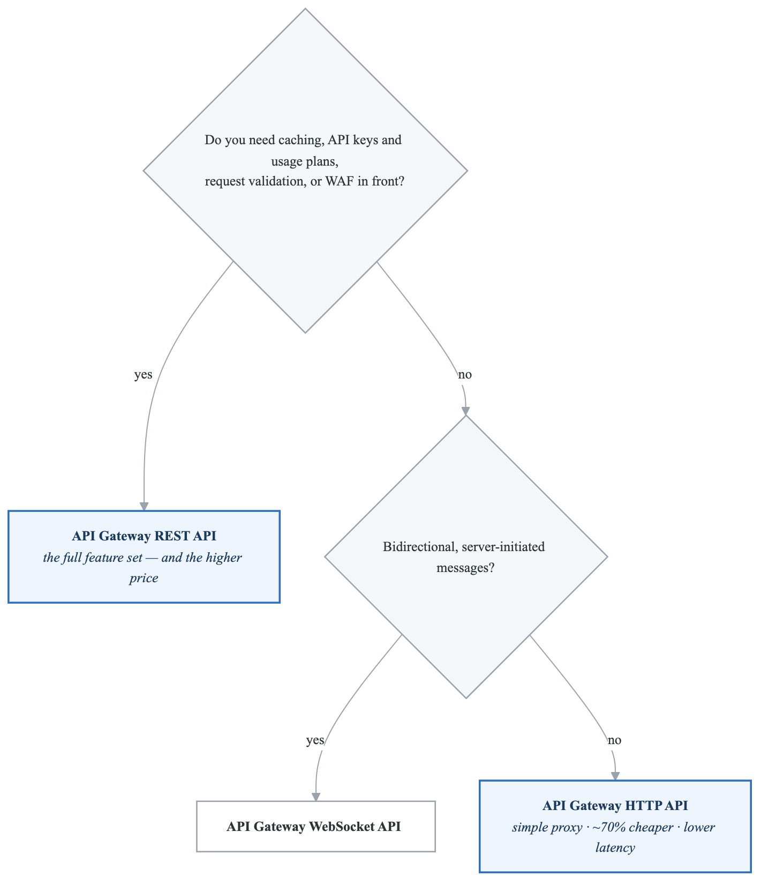
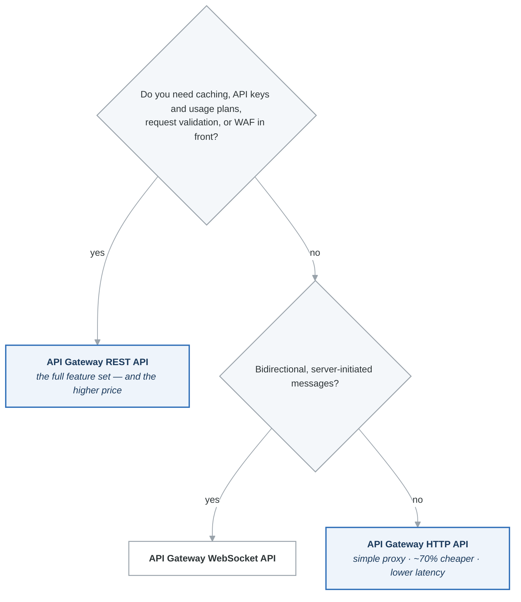

# Messaging & Integration Cheat Sheet

Quick reference for all application integration services covered in Phase 3. Use this for last-minute review before practice exams.

---

## SQS: Standard vs FIFO

| Feature | Standard | FIFO |
|---|---|---|
| Throughput | Unlimited | 300 msg/sec (3000 batched, 70K high throughput) |
| Ordering | Best-effort | Strict FIFO (per Message Group) |
| Delivery | At-least-once (duplicates possible) | Exactly-once |
| Deduplication | None | Content-based or Deduplication ID |
| Queue name | Any | Must end with `.fifo` |
| Use case | High throughput, order not critical | Transactions, bookings, inventory |

### Key SQS Numbers

| Setting | Default | Range |
|---|---|---|
| Visibility timeout | 30 sec | 0 sec - 12 hours |
| Message retention | 4 days | 1 min - 14 days |
| Max message size | 256 KB | (use S3 Extended Client for larger) |
| Long polling wait | 0 sec (short) | 1-20 seconds |
| Delay queue | 0 sec | 0-15 minutes |
| DLQ maxReceiveCount | You set it | 1+ |

### SQS Troubleshooting

| Problem | Cause | Fix |
|---|---|---|
| Messages processed twice | Visibility timeout too short | Increase visibility timeout |
| Empty responses (wasted API calls) | Short polling | Enable long polling (WaitTimeSeconds > 0) |
| Messages disappearing | Retention period expired | Increase retention or process faster |
| Consumer cannot keep up | Not enough consumers | SQS + ASG scaling on queue depth |
| Failed messages lost | No DLQ configured | Add DLQ with redrive policy |

---

## SNS vs EventBridge

| Feature | SNS | EventBridge |
|---|---|---|
| Pattern | Pub/Sub | Event Bus |
| Routing | Topic-based | Rule-based (content filtering) |
| Filtering | Message attributes (simple) | Event patterns (rich: prefix, numeric, exists) |
| Targets | SQS, Lambda, HTTP, Email, SMS | 20+ AWS services |
| SaaS integration | No | Yes (partner event bus) |
| Archive/Replay | No | Yes |
| Schema registry | No | Yes |
| FIFO support | Yes | No |
| Throughput | Very high | Lower (soft limits) |
| Cost | $0.50/M publishes | $1.00/M events |

### When to Use Which

| Scenario | Service |
|---|---|
| Simple fan-out to SQS queues | SNS |
| Send email/SMS notifications | SNS |
| Route events by content to different targets | EventBridge |
| Integrate with SaaS (Zendesk, Datadog) | EventBridge |
| Replay past events for debugging | EventBridge |
| FIFO fan-out | SNS FIFO + SQS FIFO |
| Run Lambda on a cron schedule | EventBridge scheduled rule |

---

## Kinesis vs SQS

| Feature | Kinesis Data Streams | SQS |
|---|---|---|
| Pattern | Streaming | Messaging |
| Consumer model | Multiple independent consumers | Competing consumers (one processes each msg) |
| Ordering | Per-shard | FIFO only |
| Replay | Yes (within retention) | No |
| Retention | 1-365 days | 1 min - 14 days |
| Scaling | Manual (add/remove shards) | Automatic |
| Throughput | Per shard (1 MB/s write, 2 MB/s read) | Unlimited (Standard) |
| Message size | 1 MB | 256 KB |
| Managed capacity | No | Yes |
| Use case | Real-time analytics, IoT, clickstream | Decoupling, task queues, buffering |

### Kinesis Family Quick Reference

| Service | Latency | Management | Use Case |
|---|---|---|---|
| Data Streams | Real-time (~200 ms) | You manage shards | Custom real-time processing |
| Data Firehose | Near real-time (60-900 sec buffer) | Fully managed | Delivery to S3, Redshift, OpenSearch |
| Data Analytics | Real-time | Managed | SQL / Flink on streaming data |

### Kinesis Data Firehose Destinations

| Destination | Notes |
|---|---|
| S3 | Most common, supports compression and partitioning |
| Redshift | Via S3 intermediate + COPY command |
| OpenSearch | Direct delivery |
| HTTP endpoint | Custom destinations |
| Splunk, Datadog, etc. | Third-party integrations |

---

## API Gateway: REST vs HTTP vs WebSocket

| Feature | REST API | HTTP API | WebSocket API |
|---|---|---|---|
| Cost | $3.50/M requests | $1.00/M requests | $1.00/M messages |
| Latency | Higher | Lower | Persistent |
| Caching | Yes | No | No |
| API keys / Usage plans | Yes | No | No |
| Request validation | Yes | No | No |
| WAF | Yes | No | Yes |
| Authorizers | IAM, Cognito, Lambda | IAM, Cognito, Lambda, JWT | IAM, Lambda |
| Private API | Yes | No | No |
| Use case | Full-featured APIs | Low-cost Lambda proxy | Real-time chat, dashboards |

### API Gateway Decision

<!-- figure: generated from the Mermaid below by _shared/diagrams/embed-figures.py — do not edit the image -->


<details>
<summary>Diagram source (Mermaid)</summary>



</details>

### API Gateway Authorizer Decision

| Scenario | Authorizer |
|---|---|
| AWS service-to-service | IAM (SigV4) |
| Cognito User Pool (JWT) | Cognito |
| Third-party IdP / custom logic | Lambda authorizer |
| Rate limiting (not auth) | API keys + usage plans |

### API Gateway Integration Types

| Type | Description | Use Case |
|---|---|---|
| Lambda Proxy | Pass entire request to Lambda | Most common |
| AWS Service | Directly call AWS API (SQS, Step Functions) | Skip Lambda, reduce cost |
| HTTP Proxy | Forward to HTTP backend | Existing HTTP services |
| Mock | Return static response | Testing |

---

## Step Functions: Standard vs Express

| Feature | Standard | Express |
|---|---|---|
| Max duration | 1 year | 5 minutes |
| Execution | Exactly-once | At-least-once / at-most-once |
| History | Stored 90 days | CloudWatch Logs (you configure) |
| Pricing | Per state transition | Per request + duration |
| Start rate | 2,000/sec | 100,000/sec |
| Use case | Long workflows, human approval | High-volume, short processing |

---

## Common Architecture Patterns

### Pattern 1: Serverless REST API

```
Client --> API Gateway (REST) --> Lambda --> DynamoDB
```

### Pattern 2: Asynchronous Processing

```
API Gateway --> Lambda --> SQS --> Lambda --> DynamoDB
```

### Pattern 3: Fan-Out

```
Publisher --> SNS Topic --> SQS Queue A --> Consumer A
                       --> SQS Queue B --> Consumer B
                       --> SQS Queue C --> Consumer C
```

### Pattern 4: SQS + ASG Scaling

```
Producers --> SQS --> EC2 ASG (CloudWatch alarm on queue depth)
```

### Pattern 5: Real-Time Streaming

```
Producers --> Kinesis Data Streams --> Lambda --> DynamoDB
                                  --> Firehose --> S3
```

### Pattern 6: Event-Driven Microservices

```
Service A --> EventBridge --> Rule 1 --> Lambda (Service B)
                          --> Rule 2 --> SQS (Service C)
                          --> Rule 3 --> Step Functions (Service D)
```

### Pattern 7: S3 Event Processing

```
S3 Upload --> EventBridge --> Lambda --> DynamoDB + SNS
```

---

## Integration Services Decision Tree

**Decoupling two components**

| Shape | Service |
|---|---|
| One producer, one consumer | **SQS** |
| One producer, many consumers — **each gets the same message** | **SNS + SQS** (fan-out) |
| One producer, many consumers — **different messages to different consumers** | **EventBridge** (content-based rules) |
| A continuous stream, replayable, multiple independent readers | **Kinesis Data Streams** |

**Real-time streaming**

| Need | Service |
|---|---|
| Custom processing, you own the consumer | Kinesis **Data Streams** |
| Just land it in S3, Redshift, or OpenSearch | Kinesis **Data Firehose** |
| SQL over a moving window | **Managed Service for Apache Flink** (formerly Kinesis Data Analytics) |

**APIs**

| Need | Service |
|---|---|
| REST with the full feature set — request validation, API keys, usage plans, WAF | API Gateway **REST** |
| A simple, cheap, fast proxy to Lambda or an HTTP backend | API Gateway **HTTP** |
| Real-time bidirectional | API Gateway **WebSocket** |
| GraphQL | **AppSync** |

**Workflow orchestration**

| Need | Service |
|---|---|
| Long-running (beyond 5 minutes), needs audit history and exactly-once | Step Functions **Standard** |
| Short, very high volume, at-least-once is fine | Step Functions **Express** |

**Migrating an existing broker** — ActiveMQ or RabbitMQ, and you want to keep the protocol
(JMS, AMQP, MQTT, STOMP): **Amazon MQ**. Choosing SQS instead means rewriting the application.

The distinction that decides most exam questions: **SQS is a queue** (a message is consumed once),
**SNS is a broadcast** (every subscriber gets a copy, nothing is retained), and **Kinesis is a log**
(records stay for the retention period and can be re-read from any position).

---

## Key Exam Keywords and Answers

| Keyword in Question | Answer |
|---|---|
| "Decouple" | SQS |
| "Buffer traffic spikes" | SQS |
| "Fan-out" / "one to many" | SNS + SQS |
| "Real-time" + "streaming" | Kinesis Data Streams |
| "Near real-time" + "S3 delivery" | Kinesis Data Firehose |
| "Replay events" | Kinesis Data Streams or EventBridge Archive |
| "Route events by content" | EventBridge |
| "SaaS partner events" | EventBridge partner bus |
| "Run Lambda on schedule" | EventBridge scheduled rule |
| "Orchestrate Lambda functions" | Step Functions |
| "Human approval workflow" | Step Functions Standard |
| "API caching" | API Gateway REST API |
| "Lowest cost API" | API Gateway HTTP API |
| "GraphQL" | AppSync |
| "Migrate ActiveMQ" | Amazon MQ |
| "Lambda + RDS connection issues" | RDS Proxy |
| "Exactly-once processing" | SQS FIFO |
| "Messages processed in order" | SQS FIFO |
| "Scale consumers with queue depth" | SQS + ASG + CloudWatch alarm |
| "Handle failed messages" | Dead-Letter Queue (DLQ) |

<!-- feynman-check -->

---

## Feynman check

Close the file. Blank page, no notes. Explain each of these to a competent engineer who has never
used this tool — **under five minutes, no jargon you can't define on the spot:**

- SQS: Standard vs FIFO
- SNS vs EventBridge
- Kinesis vs SQS
- API Gateway: REST vs HTTP vs WebSocket

**The gap is not what you forgot. It is where you used a word instead of a mechanism.**

| | |
|---|---|
| ✗ | *"The security group allows the traffic."* |
| ✓ | *"A security group is a stateful allow-list attached to an ENI. Traffic matching an inbound rule is permitted and the reply is permitted automatically, because the connection is tracked — which is why you never write an outbound rule for a reply."* |

**Trace it:** A request from the internet to an instance in a private subnet. Name every hop, every route-table lookup, and every rule evaluated, in order.

Stop at the first component you cannot name. Reopen this file and read **only** that.

**Go deeper — only once the gap has a name:** [Timeouts, retries and backoff with jitter](https://aws.amazon.com/builders-library/timeouts-retries-and-backoff-with-jitter/) — 15 minutes from the AWS Builders' Library, and it changes how you write every client you touch afterwards.
Full list per domain: [`SOURCES.md`](../SOURCES.md#aws)

→ Protocol, the three levels of knowing, and worked examples: [`MASTERY.md`](../MASTERY.md)

<!-- /feynman-check -->
