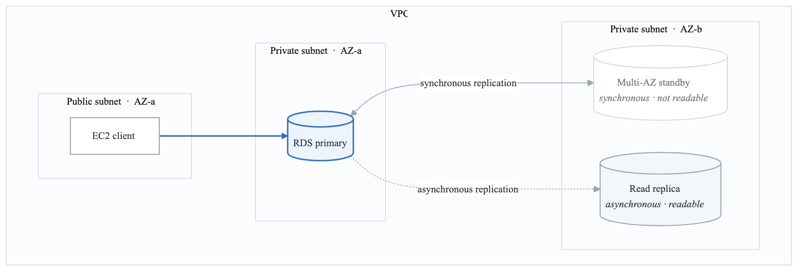
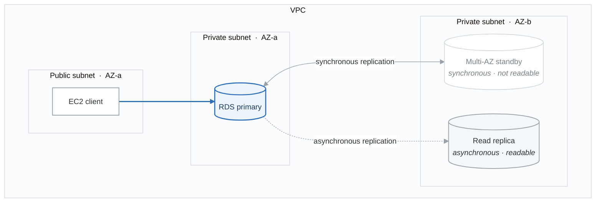

# Lab 01: RDS MySQL Setup

## Objective

Launch an RDS MySQL instance, configure Multi-AZ for high availability, create a Read Replica, connect from an EC2 instance, and test failover behavior. You will use the AWS CLI, Boto3, and Terraform.

---

## Prerequisites

- Phase 1 and Phase 2 labs complete.
- A VPC with public and private subnets across at least 2 AZs (from Phase 1).
- An EC2 instance in a public or private subnet to act as the database client.
- MySQL client installed on the EC2 instance (`sudo yum install mysql -y` for Amazon Linux).
- AWS CLI configured. Boto3 installed.

---

## Cost Estimate

| Resource | Cost |
|---|---|
| db.t3.micro (Free Tier eligible) | Free (single-AZ, 750 hrs/month for 12 months) |
| Multi-AZ (doubles the instance) | ~$0.034/hr (~$0.80 for 24 hours) |
| Read Replica (additional instance) | ~$0.017/hr |
| 20 GB gp2 storage | Free (Free Tier: 20 GB) |
| **Total for a 2-3 hour lab** | **~$0.15-0.25** |
| **Total if left running 24 hours** | **~$2-5** |

> **IMPORTANT:** Tear down all RDS resources immediately after the lab. Delete the Read Replica first, then the primary instance (skip final snapshot for lab purposes).

---

## Architecture

<!-- figure: generated from the Mermaid below by _shared/diagrams/embed-figures.py — do not edit the image -->


<details>
<summary>Diagram source (Mermaid)</summary>



</details>

---

## Part 1: Create RDS MySQL with AWS CLI

### Step 1: Create a DB Subnet Group

A DB subnet group tells RDS which subnets (and AZs) to use.

```bash
# Replace with your actual subnet IDs from Phase 1
aws rds create-db-subnet-group \
  --db-subnet-group-name saa-lab-db-subnet-group \
  --db-subnet-group-description "Subnet group for SAA RDS lab" \
  --subnet-ids '["subnet-xxxxxxxx","subnet-yyyyyyyy"]' \
  --profile saa-study
```

### Step 2: Create a Security Group for RDS

```bash
# Create a security group in your VPC
aws ec2 create-security-group \
  --group-name saa-lab-rds-sg \
  --description "Allow MySQL access from EC2" \
  --vpc-id vpc-xxxxxxxx \
  --profile saa-study

# Allow inbound MySQL (port 3306) from your EC2 security group
aws ec2 authorize-security-group-ingress \
  --group-id sg-rds-xxxxxxxx \
  --protocol tcp \
  --port 3306 \
  --source-group sg-ec2-xxxxxxxx \
  --profile saa-study
```

### Step 3: Launch RDS MySQL (Single-AZ)

```bash
aws rds create-db-instance \
  --db-instance-identifier saa-lab-mysql \
  --db-instance-class db.t3.micro \
  --engine mysql \
  --engine-version "8.0" \
  --master-username admin \
  --master-user-password YourSecurePassword123! \
  --allocated-storage 20 \
  --storage-type gp2 \
  --db-subnet-group-name saa-lab-db-subnet-group \
  --vpc-security-group-ids sg-rds-xxxxxxxx \
  --no-publicly-accessible \
  --backup-retention-period 7 \
  --no-multi-az \
  --profile saa-study
```

> Wait 5-10 minutes for the instance to become available.

### Step 4: Check Instance Status

```bash
aws rds describe-db-instances \
  --db-instance-identifier saa-lab-mysql \
  --query 'DBInstances[0].[DBInstanceStatus,Endpoint.Address,Endpoint.Port]' \
  --output table \
  --profile saa-study
```

---

## Part 2: Connect from EC2

### Step 5: Connect via MySQL Client

SSH into your EC2 instance, then:

```bash
mysql -h saa-lab-mysql.xxxxxxxxxxxx.us-east-1.rds.amazonaws.com \
      -u admin -p
```

### Step 6: Create a Test Database and Table

```sql
CREATE DATABASE saa_lab;
USE saa_lab;

CREATE TABLE users (
    id INT AUTO_INCREMENT PRIMARY KEY,
    name VARCHAR(100) NOT NULL,
    email VARCHAR(100) NOT NULL,
    created_at TIMESTAMP DEFAULT CURRENT_TIMESTAMP
);

INSERT INTO users (name, email) VALUES
    ('Alice', 'alice@example.com'),
    ('Bob', 'bob@example.com'),
    ('Charlie', 'charlie@example.com');

SELECT * FROM users;
```

---

## Part 3: Enable Multi-AZ

### Step 7: Modify Instance to Multi-AZ

```bash
aws rds modify-db-instance \
  --db-instance-identifier saa-lab-mysql \
  --multi-az \
  --apply-immediately \
  --profile saa-study
```

> This takes 10-15 minutes. RDS creates a standby replica in another AZ.

### Step 8: Verify Multi-AZ Status

```bash
aws rds describe-db-instances \
  --db-instance-identifier saa-lab-mysql \
  --query 'DBInstances[0].[MultiAZ,AvailabilityZone,SecondaryAvailabilityZone]' \
  --output table \
  --profile saa-study
```

---

## Part 4: Create a Read Replica

### Step 9: Create Read Replica

```bash
aws rds create-db-instance-read-replica \
  --db-instance-identifier saa-lab-mysql-replica \
  --source-db-instance-identifier saa-lab-mysql \
  --db-instance-class db.t3.micro \
  --profile saa-study
```

### Step 10: Connect to Read Replica and Verify Data

```bash
# Get the replica endpoint
aws rds describe-db-instances \
  --db-instance-identifier saa-lab-mysql-replica \
  --query 'DBInstances[0].Endpoint.Address' \
  --output text \
  --profile saa-study

# Connect from EC2
mysql -h saa-lab-mysql-replica.xxxxxxxxxxxx.us-east-1.rds.amazonaws.com \
      -u admin -p

# Verify data replication
USE saa_lab;
SELECT * FROM users;

# Try to write (should fail -- replicas are read-only)
INSERT INTO users (name, email) VALUES ('Dave', 'dave@example.com');
-- ERROR: Read replica is read-only
```

---

## Part 5: Boto3 Script -- RDS Operations

Create a file `rds_operations.py`:

```python
import boto3
import time

session = boto3.Session(profile_name='saa-study')
rds = session.client('rds', region_name='us-east-1')


def describe_instance(db_id):
    """Describe an RDS instance and print key details."""
    response = rds.describe_db_instances(DBInstanceIdentifier=db_id)
    db = response['DBInstances'][0]
    print(f"Instance: {db['DBInstanceIdentifier']}")
    print(f"  Status:        {db['DBInstanceStatus']}")
    print(f"  Engine:        {db['Engine']} {db['EngineVersion']}")
    print(f"  Class:         {db['DBInstanceClass']}")
    print(f"  Multi-AZ:      {db['MultiAZ']}")
    print(f"  Storage:       {db['AllocatedStorage']} GB")
    print(f"  Endpoint:      {db['Endpoint']['Address']}:{db['Endpoint']['Port']}")
    print(f"  AZ:            {db['AvailabilityZone']}")
    if db.get('ReadReplicaDBInstanceIdentifiers'):
        print(f"  Read Replicas: {db['ReadReplicaDBInstanceIdentifiers']}")
    print()


def list_snapshots(db_id):
    """List all snapshots for an RDS instance."""
    response = rds.describe_db_snapshots(DBInstanceIdentifier=db_id)
    for snap in response['DBSnapshots']:
        print(f"  Snapshot: {snap['DBSnapshotIdentifier']}")
        print(f"    Status: {snap['Status']}")
        print(f"    Type:   {snap['SnapshotType']}")
        print(f"    Time:   {snap.get('SnapshotCreateTime', 'N/A')}")
        print()


def create_snapshot(db_id, snapshot_id):
    """Create a manual snapshot."""
    print(f"Creating snapshot '{snapshot_id}' for '{db_id}'...")
    rds.create_db_snapshot(
        DBSnapshotIdentifier=snapshot_id,
        DBInstanceIdentifier=db_id
    )
    waiter = rds.get_waiter('db_snapshot_available')
    waiter.wait(DBSnapshotIdentifier=snapshot_id)
    print(f"Snapshot '{snapshot_id}' is available.")


def test_failover(db_id):
    """Trigger a Multi-AZ failover (reboot with failover)."""
    print(f"Triggering failover for '{db_id}'...")
    print(f"  Current AZ before failover:")
    describe_instance(db_id)
    rds.reboot_db_instance(
        DBInstanceIdentifier=db_id,
        ForceFailover=True
    )
    print("  Failover initiated. Waiting for instance to become available...")
    waiter = rds.get_waiter('db_instance_available')
    waiter.wait(DBInstanceIdentifier=db_id)
    print(f"  AZ after failover:")
    describe_instance(db_id)


if __name__ == '__main__':
    print("=== RDS Instance Details ===")
    describe_instance('saa-lab-mysql')

    print("=== Read Replica Details ===")
    describe_instance('saa-lab-mysql-replica')

    print("=== Creating Manual Snapshot ===")
    create_snapshot('saa-lab-mysql', 'saa-lab-mysql-manual-snap')

    print("=== Listing Snapshots ===")
    list_snapshots('saa-lab-mysql')

    # Uncomment the line below to test failover (only if Multi-AZ is enabled)
    # test_failover('saa-lab-mysql')
```

---

## Part 6: Terraform Configuration

Create a file `main.tf`:

```hcl
provider "aws" {
  region  = "us-east-1"
  profile = "saa-study"
}

# --- Variables ---
variable "vpc_id" {
  description = "VPC ID from Phase 1"
  type        = string
}

variable "private_subnet_ids" {
  description = "List of private subnet IDs (at least 2 AZs)"
  type        = list(string)
}

variable "ec2_security_group_id" {
  description = "Security group ID of the EC2 client instance"
  type        = string
}

variable "db_password" {
  description = "Master password for the RDS instance"
  type        = string
  sensitive   = true
}

# --- DB Subnet Group ---
resource "aws_db_subnet_group" "lab" {
  name       = "saa-lab-db-subnet-group"
  subnet_ids = var.private_subnet_ids
  tags = {
    Name = "saa-lab-db-subnet-group"
  }
}

# --- Security Group ---
resource "aws_security_group" "rds" {
  name        = "saa-lab-rds-sg"
  description = "Allow MySQL access from EC2"
  vpc_id      = var.vpc_id

  ingress {
    from_port       = 3306
    to_port         = 3306
    protocol        = "tcp"
    security_groups = [var.ec2_security_group_id]
  }

  egress {
    from_port   = 0
    to_port     = 0
    protocol    = "-1"
    cidr_blocks = ["0.0.0.0/0"]
  }

  tags = {
    Name = "saa-lab-rds-sg"
  }
}

# --- RDS MySQL Instance ---
resource "aws_db_instance" "primary" {
  identifier              = "saa-lab-mysql-tf"
  engine                  = "mysql"
  engine_version          = "8.0"
  instance_class          = "db.t3.micro"
  allocated_storage       = 20
  storage_type            = "gp2"
  username                = "admin"
  password                = var.db_password
  db_subnet_group_name    = aws_db_subnet_group.lab.name
  vpc_security_group_ids  = [aws_security_group.rds.id]
  publicly_accessible     = false
  multi_az                = false   # Set to true to test Multi-AZ
  backup_retention_period = 7
  skip_final_snapshot     = true    # For lab only -- never do this in production

  tags = {
    Name        = "saa-lab-mysql-tf"
    Environment = "lab"
  }
}

# --- Read Replica (uncomment to create) ---
# resource "aws_db_instance" "replica" {
#   identifier             = "saa-lab-mysql-tf-replica"
#   replicate_source_db    = aws_db_instance.primary.identifier
#   instance_class         = "db.t3.micro"
#   publicly_accessible    = false
#   skip_final_snapshot    = true
#
#   tags = {
#     Name        = "saa-lab-mysql-tf-replica"
#     Environment = "lab"
#   }
# }

# --- Outputs ---
output "rds_endpoint" {
  value = aws_db_instance.primary.endpoint
}

output "rds_arn" {
  value = aws_db_instance.primary.arn
}
```

### Terraform Commands

```bash
terraform init
terraform plan -var="vpc_id=vpc-xxx" \
  -var='private_subnet_ids=["subnet-aaa","subnet-bbb"]' \
  -var="ec2_security_group_id=sg-xxx" \
  -var="db_password=YourSecurePassword123!"

terraform apply  # Review and confirm

# When done:
terraform destroy  # Cleans up everything
```

---

## Part 7: Test Failover (Multi-AZ)

If you enabled Multi-AZ (Step 7), test a failover:

```bash
# Reboot with forced failover
aws rds reboot-db-instance \
  --db-instance-identifier saa-lab-mysql \
  --force-failover \
  --profile saa-study
```

**Observe:**
1. Note the AZ before failover.
2. The endpoint DNS remains the same (automatic DNS flip).
3. After the instance becomes available, check the AZ -- it should have changed.
4. Your application connection will briefly drop (~60-120 seconds).

---

## Cleanup

**Delete resources in this order:**

```bash
# 1. Delete Read Replica (no final snapshot needed)
aws rds delete-db-instance \
  --db-instance-identifier saa-lab-mysql-replica \
  --skip-final-snapshot \
  --profile saa-study

# 2. Wait for replica deletion, then delete primary
aws rds delete-db-instance \
  --db-instance-identifier saa-lab-mysql \
  --skip-final-snapshot \
  --profile saa-study

# 3. After instances are deleted, delete subnet group
aws rds delete-db-subnet-group \
  --db-subnet-group-name saa-lab-db-subnet-group \
  --profile saa-study

# 4. Delete security group
aws ec2 delete-security-group \
  --group-id sg-rds-xxxxxxxx \
  --profile saa-study

# 5. Delete manual snapshots if created
aws rds delete-db-snapshot \
  --db-snapshot-identifier saa-lab-mysql-manual-snap \
  --profile saa-study
```

Or if using Terraform: `terraform destroy`

---

## What You Learned

- [x] How to launch an RDS MySQL instance in private subnets.
- [x] How to configure Multi-AZ for high availability.
- [x] How to create and connect to a Read Replica.
- [x] The difference between Multi-AZ (HA) and Read Replicas (read scaling).
- [x] How RDS failover works (DNS flip, same endpoint).
- [x] How to manage RDS with CLI, Boto3, and Terraform.
- [x] How to create manual snapshots for backups.

<!-- feynman-check -->

---

## Feynman check

Close the file. Blank page, no notes. Explain each of these to a competent engineer who has never
used this tool — **under five minutes, no jargon you can't define on the spot:**

- Create RDS MySQL with AWS CLI
- Connect from EC2
- Enable Multi-AZ
- Create a Read Replica

**The gap is not what you forgot. It is where you used a word instead of a mechanism.**

| | |
|---|---|
| ✗ | *"The security group allows the traffic."* |
| ✓ | *"A security group is a stateful allow-list attached to an ENI. Traffic matching an inbound rule is permitted and the reply is permitted automatically, because the connection is tracked — which is why you never write an outbound rule for a reply."* |

**Trace it:** A request from the internet to an instance in a private subnet. Name every hop, every route-table lookup, and every rule evaluated, in order.

Stop at the first component you cannot name. Reopen this file and read **only** that.

**Go deeper — only once the gap has a name:** [Timeouts, retries and backoff with jitter](https://aws.amazon.com/builders-library/timeouts-retries-and-backoff-with-jitter/) — 15 minutes from the AWS Builders' Library, and it changes how you write every client you touch afterwards.
Full list per domain: [`SOURCES.md`](../SOURCES.md#aws)

→ Protocol, the three levels of knowing, and worked examples: [`MASTERY.md`](../MASTERY.md)

<!-- /feynman-check -->
