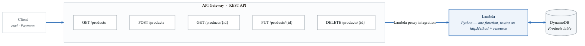

# Lab 04: API Gateway + Lambda + DynamoDB

## Objective

Build a complete serverless REST API using API Gateway, Lambda, and DynamoDB. The API will support full CRUD operations (Create, Read, Update, Delete) for a simple "Products" resource. This is the most common serverless architecture pattern on the SAA-C03 exam.

---

## Prerequisites

- AWS CLI configured with your `saa-study` profile.
- Python 3.10+ with `boto3` installed.
- Lab 02 (DynamoDB) completed (familiarity with DynamoDB operations).

---

## Cost Estimate

| Resource | Cost |
|---|---|
| Lambda (1M requests Free Tier) | **Free** |
| API Gateway (1M REST API calls Free Tier, 12 months) | **Free** |
| DynamoDB (25 RCU/WCU always-free) | **Free** |
| **Total** | **$0** (within Free Tier) |

---

## Architecture

```mermaid
%%{init: {'theme':'base','themeVariables':{'fontFamily':'Helvetica, Arial, sans-serif','fontSize':'13px','primaryColor':'#ffffff','primaryTextColor':'#2d3436','primaryBorderColor':'#9aa3ab','lineColor':'#9aa3ab','textColor':'#2d3436','clusterBkg':'#fbfcfd','clusterBorder':'#d4dae0','edgeLabelBackground':'#ffffff','tertiaryColor':'#eef4fb'},'flowchart':{'curve':'basis','padding':14,'nodeSpacing':42,'rankSpacing':58}}}%%
flowchart LR
  classDef default fill:#ffffff,stroke:#9aa3ab,stroke-width:1.3px,color:#2d3436
  classDef n    fill:#ffffff,stroke:#9aa3ab,stroke-width:1.3px,color:#2d3436
  classDef crit fill:#eef4fb,stroke:#2f6fb8,stroke-width:1.8px,color:#1b3a5c
  classDef data fill:#f4f7fa,stroke:#9aa3ab,stroke-width:1.3px,color:#2d3436
  classDef mut  fill:#ffffff,stroke:#cfd6dc,stroke-width:1.1px,color:#7a8288
  classDef warn fill:#fdf0ec,stroke:#c0522d,stroke-width:1.6px,color:#8a3a1e
  C["Client<br/><i>curl · Postman</i>"]
  subgraph API["API Gateway &nbsp;·&nbsp; REST API"]
    direction TB
    R1["GET /products"]
    R2["POST /products"]
    R3["GET /products/{id}"]
    R4["PUT /products/{id}"]
    R5["DELETE /products/{id}"]
  end
  L["Lambda<br/><i>Python — one function, routes on httpMethod + resource</i>"]
  D[("DynamoDB<br/><i>Products table</i>")]
  C ==> API
  API ==>|"Lambda proxy integration"| L
  L <==> D
  class C mut
  class R1,R2,R3,R4,R5 n
  class L crit
  class D data
  linkStyle 0,1,2 stroke:#2f6fb8,stroke-width:2px

%% Proxy integration hands the whole request to Lambda as a single event object
%% and expects a specific response shape back -- statusCode, headers, body as a
%% STRING. Returning a dict instead of json.dumps(dict) produces a 502 with an
%% empty message, which is the most-searched error in this lab.
```

<!-- figure: generated from the Mermaid below by _shared/diagrams/embed-figures.py — do not edit the image -->


<details>
<summary>Diagram source (Mermaid)</summary>



</details>

---

## Part 1: Create the DynamoDB Table

```bash
aws dynamodb create-table \
  --table-name saa-lab-products \
  --attribute-definitions AttributeName=product_id,AttributeType=S \
  --key-schema AttributeName=product_id,KeyType=HASH \
  --billing-mode PAY_PER_REQUEST \
  --profile saa-study
```

---

## Part 2: Create the Lambda Function

### Step 1: Write the Lambda Code

Create a file `lambda_function.py`:

```python
import json
import boto3
import uuid
from decimal import Decimal

dynamodb = boto3.resource('dynamodb')
table = dynamodb.Table('saa-lab-products')


class DecimalEncoder(json.JSONEncoder):
    """Handle Decimal types from DynamoDB."""
    def default(self, obj):
        if isinstance(obj, Decimal):
            return float(obj)
        return super().default(obj)


def build_response(status_code, body):
    return {
        'statusCode': status_code,
        'headers': {
            'Content-Type': 'application/json',
            'Access-Control-Allow-Origin': '*',
        },
        'body': json.dumps(body, cls=DecimalEncoder),
    }


def lambda_handler(event, context):
    """Main Lambda handler for API Gateway proxy integration."""
    http_method = event['httpMethod']
    path = event['path']
    path_params = event.get('pathParameters') or {}
    body = json.loads(event['body']) if event.get('body') else {}

    try:
        # GET /products -- List all products
        if http_method == 'GET' and path == '/products':
            response = table.scan()
            return build_response(200, {
                'products': response['Items'],
                'count': response['Count'],
            })

        # GET /products/{id} -- Get a single product
        elif http_method == 'GET' and 'product_id' in path_params:
            product_id = path_params['product_id']
            response = table.get_item(Key={'product_id': product_id})
            item = response.get('Item')
            if not item:
                return build_response(404, {'error': 'Product not found'})
            return build_response(200, item)

        # POST /products -- Create a new product
        elif http_method == 'POST' and path == '/products':
            product_id = str(uuid.uuid4())[:8]
            item = {
                'product_id': product_id,
                'name': body['name'],
                'price': Decimal(str(body['price'])),
                'category': body.get('category', 'general'),
            }
            table.put_item(Item=item)
            return build_response(201, {
                'message': 'Product created',
                'product': item,
            })

        # PUT /products/{id} -- Update a product
        elif http_method == 'PUT' and 'product_id' in path_params:
            product_id = path_params['product_id']
            update_expr = 'SET #n = :name, price = :price, category = :category'
            response = table.update_item(
                Key={'product_id': product_id},
                UpdateExpression=update_expr,
                ExpressionAttributeNames={'#n': 'name'},
                ExpressionAttributeValues={
                    ':name': body['name'],
                    ':price': Decimal(str(body['price'])),
                    ':category': body.get('category', 'general'),
                },
                ReturnValues='ALL_NEW',
            )
            return build_response(200, {
                'message': 'Product updated',
                'product': response['Attributes'],
            })

        # DELETE /products/{id} -- Delete a product
        elif http_method == 'DELETE' and 'product_id' in path_params:
            product_id = path_params['product_id']
            table.delete_item(Key={'product_id': product_id})
            return build_response(200, {'message': f'Product {product_id} deleted'})

        else:
            return build_response(400, {'error': 'Unsupported route'})

    except Exception as e:
        print(f"Error: {str(e)}")
        return build_response(500, {'error': str(e)})
```

### Step 2: Package the Lambda Function

```bash
zip lambda_function.zip lambda_function.py
```

### Step 3: Create an IAM Role for Lambda

```bash
# Create the trust policy
cat > trust-policy.json << 'EOF'
{
  "Version": "2012-10-17",
  "Statement": [
    {
      "Effect": "Allow",
      "Principal": {"Service": "lambda.amazonaws.com"},
      "Action": "sts:AssumeRole"
    }
  ]
}
EOF

# Create the role
aws iam create-role \
  --role-name saa-lab-lambda-api-role \
  --assume-role-policy-document file://trust-policy.json \
  --profile saa-study

# Attach basic Lambda execution policy (CloudWatch Logs)
aws iam attach-role-policy \
  --role-name saa-lab-lambda-api-role \
  --policy-arn arn:aws:iam::aws:policy/service-role/AWSLambdaBasicExecutionRole \
  --profile saa-study

# Create and attach DynamoDB policy
cat > dynamodb-policy.json << 'EOF'
{
  "Version": "2012-10-17",
  "Statement": [
    {
      "Effect": "Allow",
      "Action": [
        "dynamodb:GetItem",
        "dynamodb:PutItem",
        "dynamodb:UpdateItem",
        "dynamodb:DeleteItem",
        "dynamodb:Scan",
        "dynamodb:Query"
      ],
      "Resource": "arn:aws:dynamodb:us-east-1:*:table/saa-lab-products"
    }
  ]
}
EOF

aws iam put-role-policy \
  --role-name saa-lab-lambda-api-role \
  --policy-name DynamoDBAccess \
  --policy-document file://dynamodb-policy.json \
  --profile saa-study
```

### Step 4: Create the Lambda Function

```bash
# Wait 10 seconds for the role to propagate
sleep 10

aws lambda create-function \
  --function-name saa-lab-products-api \
  --runtime python3.12 \
  --handler lambda_function.lambda_handler \
  --role arn:aws:iam::ACCOUNT_ID:role/saa-lab-lambda-api-role \
  --zip-file fileb://lambda_function.zip \
  --timeout 10 \
  --memory-size 128 \
  --profile saa-study
```

---

## Part 3: Create the API Gateway REST API

### Step 5: Create the REST API

```bash
# Create the API
aws apigateway create-rest-api \
  --name saa-lab-products-api \
  --description "Products CRUD API for SAA lab" \
  --endpoint-configuration types=REGIONAL \
  --profile saa-study
```

Save the `id` from the response (this is the API ID).

### Step 6: Get the Root Resource ID

```bash
aws apigateway get-resources \
  --rest-api-id API_ID \
  --profile saa-study
```

Save the `id` of the root resource (`/`).

### Step 7: Create Resources and Methods

```bash
# Create /products resource
aws apigateway create-resource \
  --rest-api-id API_ID \
  --parent-id ROOT_RESOURCE_ID \
  --path-part products \
  --profile saa-study
# Save the resource ID as PRODUCTS_RESOURCE_ID

# Create /products/{product_id} resource
aws apigateway create-resource \
  --rest-api-id API_ID \
  --parent-id PRODUCTS_RESOURCE_ID \
  --path-part "{product_id}" \
  --profile saa-study
# Save the resource ID as PRODUCT_ID_RESOURCE_ID
```

### Step 8: Set Up Methods and Lambda Integration

For each method, you need to create the method and the Lambda integration. Here is POST /products as an example:

```bash
# Create POST method on /products
aws apigateway put-method \
  --rest-api-id API_ID \
  --resource-id PRODUCTS_RESOURCE_ID \
  --http-method POST \
  --authorization-type NONE \
  --profile saa-study

# Create Lambda proxy integration
aws apigateway put-integration \
  --rest-api-id API_ID \
  --resource-id PRODUCTS_RESOURCE_ID \
  --http-method POST \
  --type AWS_PROXY \
  --integration-http-method POST \
  --uri "arn:aws:apigateway:us-east-1:lambda:path/2015-03-31/functions/arn:aws:lambda:us-east-1:ACCOUNT_ID:function:saa-lab-products-api/invocations" \
  --profile saa-study
```

Repeat for GET /products, GET /products/{product_id}, PUT /products/{product_id}, DELETE /products/{product_id}.

### Step 9: Grant API Gateway Permission to Invoke Lambda

```bash
aws lambda add-permission \
  --function-name saa-lab-products-api \
  --statement-id apigateway-invoke \
  --action lambda:InvokeFunction \
  --principal apigateway.amazonaws.com \
  --source-arn "arn:aws:execute-api:us-east-1:ACCOUNT_ID:API_ID/*" \
  --profile saa-study
```

### Step 10: Deploy the API

```bash
aws apigateway create-deployment \
  --rest-api-id API_ID \
  --stage-name dev \
  --description "Initial deployment" \
  --profile saa-study
```

---

## Part 4: Boto3 Script -- Automated Setup

For convenience, here is a Boto3 script that automates the API Gateway setup:

Create a file `setup_api.py`:

```python
import boto3
import json
import time

session = boto3.Session(profile_name='saa-study')
apigw = session.client('apigateway', region_name='us-east-1')
lambda_client = session.client('lambda', region_name='us-east-1')
sts = session.client('sts', region_name='us-east-1')

ACCOUNT_ID = sts.get_caller_identity()['Account']
REGION = 'us-east-1'
FUNCTION_NAME = 'saa-lab-products-api'


def get_lambda_arn():
    response = lambda_client.get_function(FunctionName=FUNCTION_NAME)
    return response['Configuration']['FunctionArn']


def create_api():
    """Create the REST API with all resources and methods."""
    lambda_arn = get_lambda_arn()
    integration_uri = (
        f"arn:aws:apigateway:{REGION}:lambda:path/2015-03-31"
        f"/functions/{lambda_arn}/invocations"
    )

    # Create REST API
    api = apigw.create_rest_api(
        name='saa-lab-products-api',
        description='Products CRUD API',
        endpointConfiguration={'types': ['REGIONAL']},
    )
    api_id = api['id']
    print(f"API created: {api_id}")

    # Get root resource
    resources = apigw.get_resources(restApiId=api_id)
    root_id = resources['items'][0]['id']

    # Create /products
    products = apigw.create_resource(
        restApiId=api_id, parentId=root_id, pathPart='products'
    )
    products_id = products['id']

    # Create /products/{product_id}
    product_detail = apigw.create_resource(
        restApiId=api_id, parentId=products_id, pathPart='{product_id}'
    )
    product_detail_id = product_detail['id']

    # Define methods for each resource
    methods = [
        (products_id, 'GET'),
        (products_id, 'POST'),
        (product_detail_id, 'GET'),
        (product_detail_id, 'PUT'),
        (product_detail_id, 'DELETE'),
    ]

    for resource_id, method in methods:
        apigw.put_method(
            restApiId=api_id,
            resourceId=resource_id,
            httpMethod=method,
            authorizationType='NONE',
        )
        apigw.put_integration(
            restApiId=api_id,
            resourceId=resource_id,
            httpMethod=method,
            type='AWS_PROXY',
            integrationHttpMethod='POST',
            uri=integration_uri,
        )
        print(f"  Method created: {method}")

    # Grant API Gateway permission to invoke Lambda
    try:
        lambda_client.add_permission(
            FunctionName=FUNCTION_NAME,
            StatementId='apigateway-invoke-all',
            Action='lambda:InvokeFunction',
            Principal='apigateway.amazonaws.com',
            SourceArn=f'arn:aws:execute-api:{REGION}:{ACCOUNT_ID}:{api_id}/*',
        )
    except lambda_client.exceptions.ResourceConflictException:
        print("  Lambda permission already exists.")

    # Deploy to 'dev' stage
    apigw.create_deployment(
        restApiId=api_id,
        stageName='dev',
        description='Initial deployment',
    )

    base_url = f"https://{api_id}.execute-api.{REGION}.amazonaws.com/dev"
    print(f"\nAPI deployed!")
    print(f"Base URL: {base_url}")
    print(f"\nTest with:")
    print(f"  curl {base_url}/products")
    print(f'  curl -X POST {base_url}/products -d \'{{"name":"Laptop","price":999.99}}\'')

    return api_id, base_url


if __name__ == '__main__':
    api_id, base_url = create_api()
```

---

## Part 5: Test the API

```bash
BASE_URL="https://API_ID.execute-api.us-east-1.amazonaws.com/dev"

# Create a product
curl -X POST "$BASE_URL/products" \
  -H "Content-Type: application/json" \
  -d '{"name": "Laptop", "price": 999.99, "category": "electronics"}'

# List all products
curl "$BASE_URL/products"

# Get a specific product (use product_id from the POST response)
curl "$BASE_URL/products/PRODUCT_ID"

# Update a product
curl -X PUT "$BASE_URL/products/PRODUCT_ID" \
  -H "Content-Type: application/json" \
  -d '{"name": "Gaming Laptop", "price": 1299.99, "category": "electronics"}'

# Delete a product
curl -X DELETE "$BASE_URL/products/PRODUCT_ID"
```

---

## Cleanup

```bash
# Delete API Gateway
aws apigateway delete-rest-api --rest-api-id API_ID --profile saa-study

# Delete Lambda function
aws lambda delete-function --function-name saa-lab-products-api --profile saa-study

# Delete IAM role policies and role
aws iam delete-role-policy --role-name saa-lab-lambda-api-role --policy-name DynamoDBAccess --profile saa-study
aws iam detach-role-policy --role-name saa-lab-lambda-api-role --policy-arn arn:aws:iam::aws:policy/service-role/AWSLambdaBasicExecutionRole --profile saa-study
aws iam delete-role --role-name saa-lab-lambda-api-role --profile saa-study

# Delete DynamoDB table
aws dynamodb delete-table --table-name saa-lab-products --profile saa-study

# Clean up local files
rm -f lambda_function.zip trust-policy.json dynamodb-policy.json
```

---

## What You Learned

- [x] How to build a serverless REST API with API Gateway + Lambda + DynamoDB.
- [x] Lambda proxy integration (API Gateway passes the full request to Lambda).
- [x] IAM role creation for Lambda with least-privilege DynamoDB access.
- [x] API Gateway resource and method configuration.
- [x] Deploying an API to a stage.
- [x] Testing API endpoints with curl.
- [x] The most common serverless architecture pattern on the SAA-C03 exam.

<!-- feynman-check -->

---

## Feynman check

Close the file. Blank page, no notes. Explain each of these to a competent engineer who has never
used this tool — **under five minutes, no jargon you can't define on the spot:**

- Create the DynamoDB Table
- Create the Lambda Function
- Create the API Gateway REST API
- Boto3 Script -- Automated Setup

**The gap is not what you forgot. It is where you used a word instead of a mechanism.**

| | |
|---|---|
| ✗ | *"The security group allows the traffic."* |
| ✓ | *"A security group is a stateful allow-list attached to an ENI. Traffic matching an inbound rule is permitted and the reply is permitted automatically, because the connection is tracked — which is why you never write an outbound rule for a reply."* |

**Trace it:** A request from the internet to an instance in a private subnet. Name every hop, every route-table lookup, and every rule evaluated, in order.

Stop at the first component you cannot name. Reopen this file and read **only** that.

**Go deeper — only once the gap has a name:** [Timeouts, retries and backoff with jitter](https://aws.amazon.com/builders-library/timeouts-retries-and-backoff-with-jitter/) — 15 minutes from the AWS Builders' Library, and it changes how you write every client you touch afterwards.
Full list per domain: [`SOURCES.md`](../SOURCES.md#aws)

→ Protocol, the three levels of knowing, and worked examples: [`MASTERY.md`](../MASTERY.md)

<!-- /feynman-check -->
