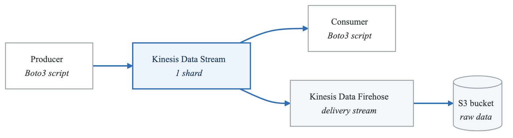
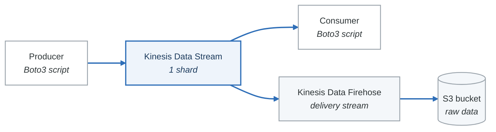

# Lab 05: Kinesis Data Streams and Firehose

## Objective

Create a Kinesis Data Stream, produce and consume records with Boto3, set up a Kinesis Data Firehose delivery stream to S3, and observe the end-to-end data flow. This lab demonstrates the difference between real-time streaming (Data Streams) and near-real-time delivery (Firehose).

---

## Prerequisites

- AWS CLI configured with your `saa-study` profile.
- Python 3.10+ with `boto3` installed.
- An S3 bucket for Firehose delivery (create one or reuse from Phase 2).

---

## Cost Estimate

| Resource | Cost |
|---|---|
| Kinesis Data Stream (1 shard) | ~$0.015/hr (~$0.36/day) |
| PUT payload units | ~$0.014 per million |
| Kinesis Data Firehose | ~$0.029 per GB ingested |
| S3 storage | Negligible (small test data) |
| **Total for 2-3 hour lab** | **~$0.05-0.10** |
| **Total if left running 24 hours** | **~$0.40** |

> **IMPORTANT:** Delete the Kinesis Data Stream and Firehose delivery stream immediately after the lab.

---

## Architecture

<!-- figure: generated from the Mermaid below by _shared/diagrams/embed-figures.py — do not edit the image -->


<details>
<summary>Diagram source (Mermaid)</summary>



</details>

---

## Part 1: Create a Kinesis Data Stream

### CLI

```bash
aws kinesis create-stream \
  --stream-name saa-lab-sensor-stream \
  --shard-count 1 \
  --profile saa-study

# Wait for the stream to become ACTIVE
aws kinesis describe-stream-summary \
  --stream-name saa-lab-sensor-stream \
  --profile saa-study
```

### Boto3

```python
import boto3

session = boto3.Session(profile_name='saa-study')
kinesis = session.client('kinesis', region_name='us-east-1')


def create_stream():
    """Create a Kinesis Data Stream with 1 shard."""
    print("Creating Kinesis Data Stream...")
    kinesis.create_stream(
        StreamName='saa-lab-sensor-stream',
        ShardCount=1,
    )
    waiter = kinesis.get_waiter('stream_exists')
    waiter.wait(StreamName='saa-lab-sensor-stream')
    print("Stream is ACTIVE.")

    # Get stream details
    response = kinesis.describe_stream_summary(
        StreamName='saa-lab-sensor-stream'
    )
    summary = response['StreamDescriptionSummary']
    print(f"  Stream ARN: {summary['StreamARN']}")
    print(f"  Shard count: {summary['OpenShardCount']}")
    print(f"  Retention: {summary['RetentionPeriodHours']} hours")
```

---

## Part 2: Produce Records

Create a file `kinesis_producer.py`:

```python
import boto3
import json
import time
import random
from datetime import datetime

session = boto3.Session(profile_name='saa-study')
kinesis = session.client('kinesis', region_name='us-east-1')

STREAM_NAME = 'saa-lab-sensor-stream'

# Simulated IoT sensor configuration
SENSORS = ['sensor-001', 'sensor-002', 'sensor-003', 'sensor-004', 'sensor-005']
LOCATIONS = ['warehouse-a', 'warehouse-b', 'factory-floor']


def generate_sensor_reading(sensor_id):
    """Generate a simulated IoT sensor reading."""
    return {
        'sensor_id': sensor_id,
        'timestamp': datetime.utcnow().isoformat() + 'Z',
        'temperature': round(random.uniform(18.0, 35.0), 2),
        'humidity': round(random.uniform(30.0, 80.0), 2),
        'pressure': round(random.uniform(1010.0, 1025.0), 2),
        'location': random.choice(LOCATIONS),
    }


def produce_single_record():
    """Send a single record to the stream."""
    sensor_id = random.choice(SENSORS)
    reading = generate_sensor_reading(sensor_id)

    response = kinesis.put_record(
        StreamName=STREAM_NAME,
        Data=json.dumps(reading),
        PartitionKey=sensor_id,  # Records with same key go to same shard
    )
    print(f"Produced: {sensor_id} | "
          f"Temp: {reading['temperature']}C | "
          f"Shard: {response['ShardId']} | "
          f"Seq: {response['SequenceNumber'][:20]}...")
    return response


def produce_batch():
    """Send a batch of records (up to 500 per PutRecords call)."""
    records = []
    for _ in range(25):
        sensor_id = random.choice(SENSORS)
        reading = generate_sensor_reading(sensor_id)
        records.append({
            'Data': json.dumps(reading),
            'PartitionKey': sensor_id,
        })

    response = kinesis.put_records(
        StreamName=STREAM_NAME,
        Records=records,
    )
    failed = response['FailedRecordCount']
    print(f"Batch sent: {len(records)} records, {failed} failed")
    return response


def continuous_producer(duration_seconds=30, interval=1.0):
    """Continuously produce sensor readings for a specified duration."""
    print(f"Producing records for {duration_seconds} seconds...")
    end_time = time.time() + duration_seconds
    count = 0

    while time.time() < end_time:
        produce_single_record()
        count += 1
        time.sleep(interval)

    print(f"Produced {count} records total.")


if __name__ == '__main__':
    print("=== Kinesis Producer ===\n")

    # Send some individual records
    print("--- Single Records ---")
    for _ in range(5):
        produce_single_record()
        time.sleep(0.5)

    # Send a batch
    print("\n--- Batch Records ---")
    produce_batch()

    # Continuous production (Ctrl+C to stop early)
    print("\n--- Continuous Production (30 seconds) ---")
    continuous_producer(duration_seconds=30, interval=1.0)
```

---

## Part 3: Consume Records

Create a file `kinesis_consumer.py`:

```python
import boto3
import json
import time

session = boto3.Session(profile_name='saa-study')
kinesis = session.client('kinesis', region_name='us-east-1')

STREAM_NAME = 'saa-lab-sensor-stream'


def get_shard_ids():
    """List all shard IDs in the stream."""
    response = kinesis.list_shards(StreamName=STREAM_NAME)
    shard_ids = [shard['ShardId'] for shard in response['Shards']]
    print(f"Shards: {shard_ids}")
    return shard_ids


def consume_from_shard(shard_id, iterator_type='TRIM_HORIZON', max_records=20):
    """Read records from a specific shard.

    Iterator types:
    - TRIM_HORIZON: Start from the oldest record in the shard
    - LATEST: Start from the newest record (only new records)
    - AT_TIMESTAMP: Start from a specific timestamp
    - AT_SEQUENCE_NUMBER / AFTER_SEQUENCE_NUMBER: Start from a specific sequence
    """
    # Get a shard iterator
    response = kinesis.get_shard_iterator(
        StreamName=STREAM_NAME,
        ShardId=shard_id,
        ShardIteratorType=iterator_type,
    )
    shard_iterator = response['ShardIterator']

    records_read = 0
    empty_reads = 0

    print(f"\nConsuming from {shard_id} (type: {iterator_type})...")

    while shard_iterator and records_read < max_records and empty_reads < 3:
        response = kinesis.get_records(
            ShardIterator=shard_iterator,
            Limit=10,
        )

        records = response['Records']
        shard_iterator = response['NextShardIterator']

        if not records:
            empty_reads += 1
            print(f"  No records (empty read {empty_reads}/3). Waiting...")
            time.sleep(1)
            continue

        empty_reads = 0
        for record in records:
            data = json.loads(record['Data'])
            print(f"  [{record['ApproximateArrivalTimestamp'].strftime('%H:%M:%S')}] "
                  f"{data['sensor_id']} | "
                  f"Temp: {data['temperature']}C | "
                  f"Humidity: {data['humidity']}% | "
                  f"Location: {data['location']}")
            records_read += 1

        # Respect the 5 GetRecords/sec/shard limit
        time.sleep(0.25)

    print(f"Total records consumed: {records_read}")


def consume_all():
    """Consume records from all shards."""
    shard_ids = get_shard_ids()
    for shard_id in shard_ids:
        consume_from_shard(shard_id)


if __name__ == '__main__':
    print("=== Kinesis Consumer ===\n")
    consume_all()
```

---

## Part 4: Set Up Kinesis Data Firehose to S3

### Step 1: Create an S3 Bucket (if needed)

```bash
aws s3 mb s3://saa-lab-kinesis-delivery-ACCOUNT_ID \
  --profile saa-study
```

### Step 2: Create an IAM Role for Firehose

```bash
# Trust policy for Firehose
cat > firehose-trust-policy.json << 'EOF'
{
  "Version": "2012-10-17",
  "Statement": [
    {
      "Effect": "Allow",
      "Principal": {"Service": "firehose.amazonaws.com"},
      "Action": "sts:AssumeRole"
    }
  ]
}
EOF

aws iam create-role \
  --role-name saa-lab-firehose-role \
  --assume-role-policy-document file://firehose-trust-policy.json \
  --profile saa-study

# Policy for S3 and Kinesis access
cat > firehose-policy.json << 'EOF'
{
  "Version": "2012-10-17",
  "Statement": [
    {
      "Effect": "Allow",
      "Action": [
        "s3:PutObject",
        "s3:GetBucketLocation",
        "s3:ListBucket"
      ],
      "Resource": [
        "arn:aws:s3:::saa-lab-kinesis-delivery-*",
        "arn:aws:s3:::saa-lab-kinesis-delivery-*/*"
      ]
    },
    {
      "Effect": "Allow",
      "Action": [
        "kinesis:DescribeStream",
        "kinesis:GetShardIterator",
        "kinesis:GetRecords",
        "kinesis:ListShards"
      ],
      "Resource": "arn:aws:kinesis:us-east-1:*:stream/saa-lab-sensor-stream"
    }
  ]
}
EOF

aws iam put-role-policy \
  --role-name saa-lab-firehose-role \
  --policy-name FirehoseS3KinesisAccess \
  --policy-document file://firehose-policy.json \
  --profile saa-study
```

### Step 3: Create the Firehose Delivery Stream

```bash
# Wait for role propagation
sleep 10

aws firehose create-delivery-stream \
  --delivery-stream-name saa-lab-sensor-delivery \
  --delivery-stream-type KinesisStreamAsSource \
  --kinesis-stream-source-configuration \
    "KinesisStreamARN=arn:aws:kinesis:us-east-1:ACCOUNT_ID:stream/saa-lab-sensor-stream,RoleARN=arn:aws:iam::ACCOUNT_ID:role/saa-lab-firehose-role" \
  --s3-destination-configuration \
    "RoleARN=arn:aws:iam::ACCOUNT_ID:role/saa-lab-firehose-role,BucketARN=arn:aws:s3:::saa-lab-kinesis-delivery-ACCOUNT_ID,Prefix=sensor-data/year=!{timestamp:yyyy}/month=!{timestamp:MM}/day=!{timestamp:dd}/,ErrorOutputPrefix=errors/,BufferingHints={SizeInMBs=1,IntervalInSeconds=60},CompressionFormat=GZIP" \
  --profile saa-study
```

### Boto3 Alternative: Create Firehose

```python
def create_firehose(account_id, stream_arn, bucket_name):
    """Create a Firehose delivery stream from Kinesis to S3."""
    firehose = session.client('firehose', region_name='us-east-1')

    role_arn = f"arn:aws:iam::{account_id}:role/saa-lab-firehose-role"

    response = firehose.create_delivery_stream(
        DeliveryStreamName='saa-lab-sensor-delivery',
        DeliveryStreamType='KinesisStreamAsSource',
        KinesisStreamSourceConfiguration={
            'KinesisStreamARN': stream_arn,
            'RoleARN': role_arn,
        },
        S3DestinationConfiguration={
            'RoleARN': role_arn,
            'BucketARN': f'arn:aws:s3:::{bucket_name}',
            'Prefix': 'sensor-data/year=!{timestamp:yyyy}/month=!{timestamp:MM}/day=!{timestamp:dd}/',
            'ErrorOutputPrefix': 'errors/',
            'BufferingHints': {
                'SizeInMBs': 1,      # Minimum 1 MB buffer
                'IntervalInSeconds': 60,  # Minimum 60 seconds
            },
            'CompressionFormat': 'GZIP',
        },
    )
    print(f"Firehose created: {response['DeliveryStreamARN']}")
```

### Step 4: Verify Data in S3

After producing some records and waiting 60-90 seconds (Firehose buffer interval):

```bash
# List objects delivered to S3
aws s3 ls s3://saa-lab-kinesis-delivery-ACCOUNT_ID/sensor-data/ \
  --recursive --profile saa-study

# Download and inspect a file
aws s3 cp s3://saa-lab-kinesis-delivery-ACCOUNT_ID/sensor-data/LATEST_FILE . \
  --profile saa-study
gunzip LATEST_FILE
cat LATEST_FILE
```

---

## Part 5: Observe the Full Pipeline

Run the producer in one terminal and the consumer in another:

```bash
# Terminal 1: Producer
python kinesis_producer.py

# Terminal 2: Consumer
python kinesis_consumer.py

# After 60-90 seconds, check S3 for Firehose-delivered data
aws s3 ls s3://saa-lab-kinesis-delivery-ACCOUNT_ID/sensor-data/ --recursive --profile saa-study
```

---

## Cleanup

```bash
# 1. Delete Firehose delivery stream
aws firehose delete-delivery-stream \
  --delivery-stream-name saa-lab-sensor-delivery \
  --profile saa-study

# 2. Delete Kinesis Data Stream
aws kinesis delete-stream \
  --stream-name saa-lab-sensor-stream \
  --profile saa-study

# 3. Delete S3 bucket contents and bucket
aws s3 rm s3://saa-lab-kinesis-delivery-ACCOUNT_ID --recursive --profile saa-study
aws s3 rb s3://saa-lab-kinesis-delivery-ACCOUNT_ID --profile saa-study

# 4. Delete IAM role
aws iam delete-role-policy --role-name saa-lab-firehose-role --policy-name FirehoseS3KinesisAccess --profile saa-study
aws iam delete-role --role-name saa-lab-firehose-role --profile saa-study

# Clean up local files
rm -f firehose-trust-policy.json firehose-policy.json
```

---

## What You Learned

- [x] How Kinesis Data Streams works: shards, partition keys, and shard iterators.
- [x] Producing records with PutRecord (single) and PutRecords (batch).
- [x] Consuming records with GetShardIterator and GetRecords.
- [x] Iterator types: TRIM_HORIZON (oldest), LATEST (newest).
- [x] How Kinesis Data Firehose delivers data to S3 in near-real-time.
- [x] Firehose buffering (time and size), compression (GZIP), and partitioning.
- [x] The difference between real-time (Data Streams) and near-real-time (Firehose).
- [x] IAM roles for Firehose (needs access to both Kinesis and S3).

<!-- feynman-check -->

---

## Feynman check

Close the file. Blank page, no notes. Explain each of these to a competent engineer who has never
used this tool — **under five minutes, no jargon you can't define on the spot:**

- Create a Kinesis Data Stream
- Produce Records
- Consume Records
- Set Up Kinesis Data Firehose to S3

**The gap is not what you forgot. It is where you used a word instead of a mechanism.**

| | |
|---|---|
| ✗ | *"The security group allows the traffic."* |
| ✓ | *"A security group is a stateful allow-list attached to an ENI. Traffic matching an inbound rule is permitted and the reply is permitted automatically, because the connection is tracked — which is why you never write an outbound rule for a reply."* |

**Trace it:** A request from the internet to an instance in a private subnet. Name every hop, every route-table lookup, and every rule evaluated, in order.

Stop at the first component you cannot name. Reopen this file and read **only** that.

**Go deeper — only once the gap has a name:** [Timeouts, retries and backoff with jitter](https://aws.amazon.com/builders-library/timeouts-retries-and-backoff-with-jitter/) — 15 minutes from the AWS Builders' Library, and it changes how you write every client you touch afterwards.
Full list per domain: [`SOURCES.md`](../SOURCES.md#aws)

→ Protocol, the three levels of knowing, and worked examples: [`MASTERY.md`](../MASTERY.md)

<!-- /feynman-check -->
