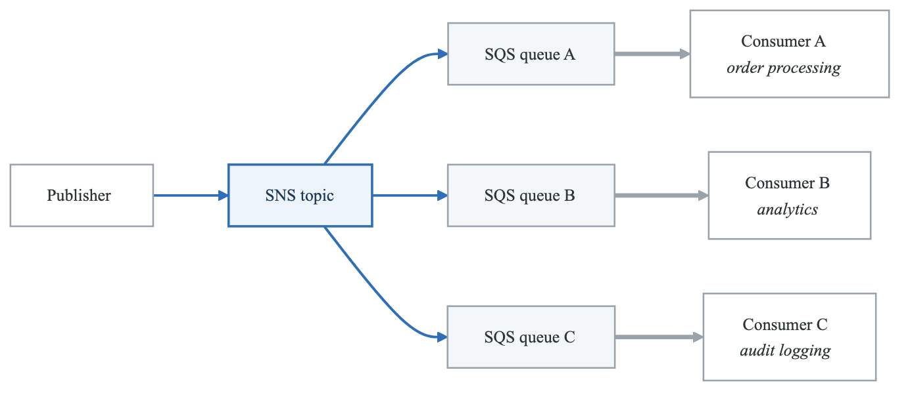
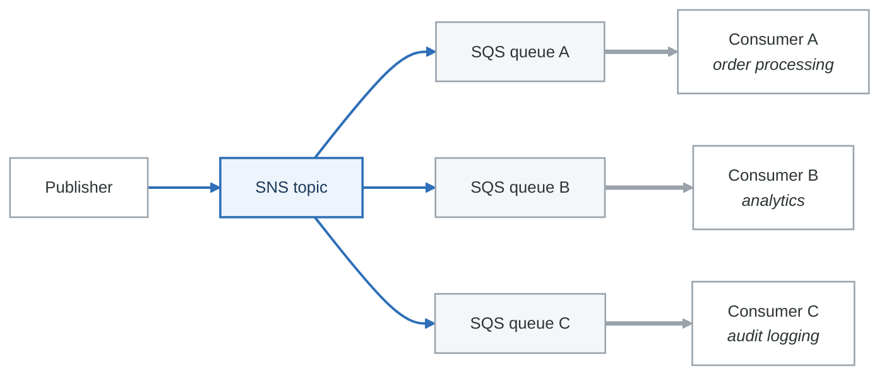

# Amazon SNS and Amazon EventBridge

## Part 1: Amazon SNS (Simple Notification Service)

### What is SNS?

Amazon SNS is a fully managed publish/subscribe (pub/sub) messaging service. A publisher sends a message to a **topic**, and SNS delivers the message to all **subscribers** of that topic.

---

### Topics and Subscriptions

**Topic:** A logical access point and communication channel. Messages are published to a topic.

**Subscription:** An endpoint that receives messages from a topic.

| Subscription Protocol | Description |
|---|---|
| **SQS** | Deliver to an SQS queue |
| **Lambda** | Invoke a Lambda function |
| **HTTP/HTTPS** | POST to an HTTP endpoint |
| **Email** | Send an email (for human notifications) |
| **Email-JSON** | Send a JSON-formatted email |
| **SMS** | Send a text message |
| **Platform application** | Push notification (iOS, Android, etc.) |
| **Kinesis Data Firehose** | Deliver to a Firehose stream |

### Key Limits

| Limit | Value |
|---|---|
| **Subscriptions per topic** | 12,500,000 |
| **Topics per account** | 100,000 (soft limit) |
| **Message size** | 256 KB |
| **For larger messages** | Use the SNS Extended Client Library (stores payload in S3) |

---

### Fan-Out Pattern (SNS + SQS)

The fan-out pattern is one of the most important architectures for the exam.

#### Architecture

<!-- figure: generated from the Mermaid below by _shared/diagrams/embed-figures.py — do not edit the image -->


<details>
<summary>Diagram source (Mermaid)</summary>



</details>

#### How It Works
1. A publisher sends a single message to an SNS topic.
2. SNS delivers a copy of the message to ALL subscribed SQS queues.
3. Each queue processes the message independently and at its own pace.
4. Each SQS queue must have a resource-based policy allowing the SNS topic to send messages.

#### Why Fan-Out?
- **Full decoupling:** Adding a new consumer is just adding a new SQS subscription. No code changes to the publisher.
- **Independent processing:** Each consumer processes at its own rate without blocking others.
- **No data loss:** SQS queues buffer messages if consumers are slow.

> **Exam tip:** "Send one message to multiple consumers" or "one event triggers multiple downstream processes" -> SNS + SQS fan-out.

---

### SNS Message Filtering

By default, every subscriber receives every message. **Message filtering** lets each subscriber receive only the messages it cares about.

#### How It Works
- Attach a **filter policy** (JSON) to a subscription.
- The filter policy specifies attribute values to match.
- SNS evaluates the message attributes against each subscription's filter policy and delivers only matching messages.

#### Example
```json
{
  "event_type": ["order_placed"],
  "store": ["us-east", "us-west"]
}
```
This subscription only receives messages where `event_type` is `order_placed` AND `store` is `us-east` or `us-west`.

> **Exam tip:** "Each subscriber needs only a subset of messages" -> SNS message filtering. Avoids building filtering logic in the consumer.

---

### SNS FIFO Topics

- Work with SQS FIFO queues to provide **ordered, exactly-once delivery** in a fan-out pattern.
- Topic name must end with `.fifo`.
- Subscribers must be SQS FIFO queues only.
- Support Message Group ID (ordering within a group) and Message Deduplication ID.

---

## Part 2: Amazon EventBridge

### What is EventBridge?

Amazon EventBridge is a serverless event bus service for building event-driven architectures. It was formerly called CloudWatch Events and extends it with custom event buses, third-party integrations, and schema management.

---

### Event Buses

| Event Bus Type | Description |
|---|---|
| **Default event bus** | Receives events from AWS services (EC2 state change, S3 events via CloudTrail, etc.) |
| **Custom event bus** | Receives events from your own applications |
| **Partner event bus** | Receives events from SaaS partners (Zendesk, Datadog, Auth0, etc.) |

### Rules

Rules match incoming events and route them to targets.

- Each rule has an **event pattern** (JSON) that defines which events to match.
- A rule can have up to **5 targets**.
- Rules can also be **scheduled** (cron or rate expressions) -- like a managed cron job.

### Targets

EventBridge can route events to over 20 AWS services, including:

| Target | Use Case |
|---|---|
| **Lambda** | Process the event |
| **SQS** | Queue for later processing |
| **SNS** | Fan out to multiple subscribers |
| **Step Functions** | Start a workflow |
| **Kinesis Data Streams** | Stream processing |
| **API Gateway** | Trigger an API |
| **ECS Task** | Run a container |
| **Batch** | Submit a batch job |
| **CodePipeline** | Start a deployment pipeline |
| **Another Event Bus** | Cross-account or cross-Region routing |

### Schema Registry

- EventBridge can **discover and store schemas** for events flowing through your event bus.
- Schemas define the structure (fields, types) of an event.
- You can **generate code bindings** (Java, Python, TypeScript) from schemas.
- Use case: Know what fields an event contains without guessing.

### Archive and Replay

- **Archive:** Store events for a configurable retention period (or indefinitely).
- **Replay:** Replay archived events to an event bus.
- Use case: Debug issues by replaying past events. Reprocess events after deploying a bug fix.

> **Exam tip:** "Replay events" or "reprocess events from the past" -> EventBridge Archive and Replay.

---

## SNS vs EventBridge -- Comparison Table

| Feature | SNS | EventBridge |
|---|---|---|
| **Pattern** | Pub/Sub | Event Bus |
| **Event sources** | Your applications, AWS services (limited) | Your apps, 100+ AWS services, SaaS partners |
| **Routing** | Topic-based (all subscribers get the message, or use filter policies) | Rule-based (complex event pattern matching) |
| **Filtering** | Message attribute filtering (simple) | Event pattern matching (rich: content, prefix, numeric range, exists) |
| **Targets** | SQS, Lambda, HTTP, Email, SMS, Firehose | 20+ AWS services |
| **Schema** | No schema management | Schema registry with code generation |
| **Archive/Replay** | No | Yes |
| **Throughput** | Very high (millions of msgs/sec) | Lower (default soft limit varies by Region) |
| **FIFO support** | Yes (SNS FIFO topics) | No |
| **Cross-account** | Yes (via topic policy) | Yes (via event bus policy or cross-account rules) |
| **Cost** | $0.50 per million publishes | $1.00 per million events |
| **Best for** | Simple fan-out, high throughput, notifications | Complex event routing, SaaS integration, event-driven architectures |

### Decision Framework

**Choose SNS when:**
- You need simple fan-out to multiple SQS queues.
- You need high throughput pub/sub.
- You need to send notifications (email, SMS, push).
- You need FIFO ordering with fan-out.

**Choose EventBridge when:**
- You need complex event routing based on event content.
- You integrate with third-party SaaS providers.
- You need archive and replay.
- You want schema discovery and management.
- You are building a loosely coupled, event-driven architecture with many different event types.

> **Exam tip:** EventBridge is the more modern and flexible service. For new architectures, AWS recommends EventBridge. For simple fan-out patterns, SNS + SQS is still the standard.

---

## Common Architectures

### S3 Event Notifications

S3 can send event notifications to:
- **SNS** -- fan-out to multiple consumers
- **SQS** -- queue for processing
- **Lambda** -- direct invocation
- **EventBridge** -- route to any of 20+ targets with filtering

> **Exam tip:** If the question asks for S3 events going to multiple targets with complex routing, use S3 -> EventBridge -> multiple targets.

### Scheduled Tasks (Cron)

EventBridge scheduled rules replace the old CloudWatch Events cron functionality.

```
EventBridge Rule (cron: 0 8 * * ? *)  -->  Lambda function (daily cleanup)
```

> **Exam tip:** "Run a Lambda function on a schedule" -> EventBridge scheduled rule.

---

## Key Exam Scenarios

| Scenario | Answer |
|---|---|
| "Send one event to multiple consumers" | SNS + SQS fan-out |
| "Route events based on content" | EventBridge rules with event patterns |
| "Receive events from SaaS partner" | EventBridge partner event bus |
| "Replay past events for debugging" | EventBridge Archive and Replay |
| "Send email notifications" | SNS (email subscription) |
| "Run Lambda on a schedule" | EventBridge scheduled rule |
| "Fan-out with ordered, exactly-once delivery" | SNS FIFO + SQS FIFO |
| "Each subscriber needs different events" | SNS message filtering or EventBridge rules |
| "Complex event routing to many AWS services" | EventBridge |

<!-- feynman-check -->

---

## Feynman check

Close the file. Blank page, no notes. Explain each of these to a competent engineer who has never
used this tool — **under five minutes, no jargon you can't define on the spot:**

- Amazon SNS (Simple Notification Service)
- Amazon EventBridge
- SNS vs EventBridge -- Comparison Table
- Common Architectures

**The gap is not what you forgot. It is where you used a word instead of a mechanism.**

| | |
|---|---|
| ✗ | *"The security group allows the traffic."* |
| ✓ | *"A security group is a stateful allow-list attached to an ENI. Traffic matching an inbound rule is permitted and the reply is permitted automatically, because the connection is tracked — which is why you never write an outbound rule for a reply."* |

**Trace it:** A request from the internet to an instance in a private subnet. Name every hop, every route-table lookup, and every rule evaluated, in order.

Stop at the first component you cannot name. Reopen this file and read **only** that.

**Go deeper — only once the gap has a name:** [Timeouts, retries and backoff with jitter](https://aws.amazon.com/builders-library/timeouts-retries-and-backoff-with-jitter/) — 15 minutes from the AWS Builders' Library, and it changes how you write every client you touch afterwards.
Full list per domain: [`SOURCES.md`](../SOURCES.md#aws)

→ Protocol, the three levels of knowing, and worked examples: [`MASTERY.md`](../MASTERY.md)

<!-- /feynman-check -->
