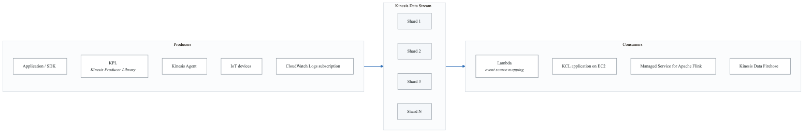
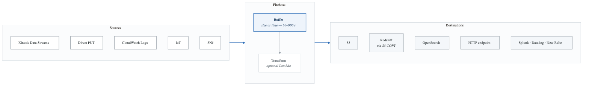

```mermaid
%%{init: {'theme':'base','themeVariables':{'fontFamily':'Helvetica, Arial, sans-serif','fontSize':'13px','primaryColor':'#ffffff','primaryTextColor':'#2d3436','primaryBorderColor':'#9aa3ab','lineColor':'#9aa3ab','textColor':'#2d3436','clusterBkg':'#fbfcfd','clusterBorder':'#d4dae0','edgeLabelBackground':'#ffffff','tertiaryColor':'#eef4fb'},'flowchart':{'curve':'basis','padding':14,'nodeSpacing':42,'rankSpacing':58}}}%%
flowchart LR
  classDef default fill:#ffffff,stroke:#9aa3ab,stroke-width:1.3px,color:#2d3436
  classDef n    fill:#ffffff,stroke:#9aa3ab,stroke-width:1.3px,color:#2d3436
  classDef crit fill:#eef4fb,stroke:#2f6fb8,stroke-width:1.8px,color:#1b3a5c
  classDef data fill:#f4f7fa,stroke:#9aa3ab,stroke-width:1.3px,color:#2d3436
  classDef mut  fill:#ffffff,stroke:#cfd6dc,stroke-width:1.1px,color:#7a8288
  classDef warn fill:#fdf0ec,stroke:#c0522d,stroke-width:1.6px,color:#8a3a1e
  subgraph PROD["Producers"]
    direction TB
    P1["Application / SDK"]
    P2["KPL<br/><i>Kinesis Producer Library</i>"]
    P3["Kinesis Agent"]
    P4["IoT devices"]
    P5["CloudWatch Logs subscription"]
  end
  subgraph KDS["Kinesis Data Stream"]
    direction LR
    S1["Shard 1"]
    S2["Shard 2"]
    S3["Shard 3"]
    SN["Shard N"]
  end
  subgraph CONS["Consumers"]
    direction TB
    C1["Lambda<br/><i>event source mapping</i>"]
    C2["KCL application on EC2"]
    C3["Managed Service for Apache Flink"]
    C4["Kinesis Data Firehose"]
  end
  PROD ==> KDS ==> CONS
  class P1,P2,P3,P4,P5 n
  class S1,S2,S3,SN data
  class C1,C2,C3,C4 n
  linkStyle 0,1 stroke:#2f6fb8,stroke-width:2px

%% The partition key decides the shard, and ordering is guaranteed WITHIN a
%% shard only. Pick a key with poor cardinality -- a country code, a status
%% string -- and you get a hot shard that throttles while the others idle.
```

# Amazon Kinesis

## What is Kinesis?

Amazon Kinesis is a platform for collecting, processing, and analyzing real-time streaming data. It consists of several services, each designed for a different part of the streaming pipeline.

> **Exam tip:** "Real-time," "streaming data," or "continuously generated data" -> Kinesis. If the question says "near real-time" and mentions delivery to S3/Redshift -> Kinesis Data Firehose.

---

## Kinesis Data Streams

### What It Is
A real-time data streaming service where you manage the capacity (shards) and consumers.

### Architecture

<!-- figure: generated from the Mermaid below by _shared/diagrams/embed-figures.py — do not edit the image -->

Diagram source (Mermaid)

### Key Facts

| Feature | Detail |
|---|---|
| **Real-time** | Data available within ~200 ms of being written |
| **Shards** | Unit of capacity. Each shard provides 1 MB/sec write and 2 MB/sec read. |
| **Data retention** | Default 24 hours. Configurable from 1 to 365 days. |
| **Replay** | Yes -- consumers can re-read data within the retention window |
| **Ordering** | Per-shard ordering (records with the same partition key go to the same shard) |
| **Immutability** | Once data is written to a stream, it cannot be deleted (it expires after retention) |
| **Consumers** | Multiple consumers can read from the same stream independently |
| **Scaling** | Add or remove shards (shard splitting / merging) |

### Capacity Planning

| Direction | Per Shard | Example: 10 Shards |
|---|---|---|
| **Write** | 1 MB/sec or 1,000 records/sec | 10 MB/sec or 10,000 records/sec |
| **Read (shared)** | 2 MB/sec across all consumers | 20 MB/sec |
| **Read (enhanced fan-out)** | 2 MB/sec per consumer | 20 MB/sec per consumer |

### Enhanced Fan-Out
- Each consumer gets a **dedicated 2 MB/sec** throughput per shard (instead of sharing).
- Uses `SubscribeToShard` API (push model) instead of `GetRecords` (pull model).
- Lower latency (~70 ms vs ~200 ms).
- Use when you have multiple consumers that all need high throughput.

### Producers
- **AWS SDK (PutRecord / PutRecords):** Simple, any language.
- **Kinesis Producer Library (KPL):** Batching, compression, retries. Higher throughput.
- **Kinesis Agent:** Pre-built Java agent that monitors log files and sends to Kinesis.

### Consumers
- **AWS SDK (GetRecords):** Simple, pull-based.
- **Kinesis Client Library (KCL):** Manages shard assignment, checkpointing, and load balancing across multiple consumer instances.
- **AWS Lambda:** Triggered by Kinesis, processes batches of records.
- **Kinesis Data Firehose:** Delivers data to S3, Redshift, OpenSearch, etc.
- **Kinesis Data Analytics:** Run SQL or Apache Flink on the stream.

---

## Kinesis Data Firehose

### What It Is
A fully managed service that delivers streaming data to destinations. It handles batching, compression, encryption, and transformation automatically.

### Key Facts

| Feature | Detail |
|---|---|
| **Latency** | Near real-time (minimum 60-second buffer interval) |
| **Fully managed** | No shards, no capacity management, auto-scales |
| **Destinations** | S3, Redshift (via S3 COPY), OpenSearch, HTTP endpoints, third-party (Splunk, Datadog, etc.) |
| **Data transformation** | Optional Lambda function to transform records before delivery |
| **Compression** | GZIP, Snappy, ZIP (for S3 delivery) |
| **Encryption** | KMS at rest, TLS in transit |
| **Backup** | Can send all or failed records to a backup S3 bucket |
| **Replay** | No (Firehose does not store data -- it delivers and moves on) |
| **Record size** | Up to 1 MB |

### Architecture

<!-- figure: generated from the Mermaid below by _shared/diagrams/embed-figures.py — do not edit the image -->

Diagram source (Mermaid)

```mermaid
%%{init: {'theme':'base','themeVariables':{'fontFamily':'Helvetica, Arial, sans-serif','fontSize':'13px','primaryColor':'#ffffff','primaryTextColor':'#2d3436','primaryBorderColor':'#9aa3ab','lineColor':'#9aa3ab','textColor':'#2d3436','clusterBkg':'#fbfcfd','clusterBorder':'#d4dae0','edgeLabelBackground':'#ffffff','tertiaryColor':'#eef4fb'},'flowchart':{'curve':'basis','padding':14,'nodeSpacing':42,'rankSpacing':58}}}%%
flowchart LR
  classDef default fill:#ffffff,stroke:#9aa3ab,stroke-width:1.3px,color:#2d3436
  classDef n    fill:#ffffff,stroke:#9aa3ab,stroke-width:1.3px,color:#2d3436
  classDef crit fill:#eef4fb,stroke:#2f6fb8,stroke-width:1.8px,color:#1b3a5c
  classDef data fill:#f4f7fa,stroke:#9aa3ab,stroke-width:1.3px,color:#2d3436
  classDef mut  fill:#ffffff,stroke:#cfd6dc,stroke-width:1.1px,color:#7a8288
  classDef warn fill:#fdf0ec,stroke:#c0522d,stroke-width:1.6px,color:#8a3a1e
  subgraph SRC["Sources"]
    direction TB
    A1["Kinesis Data Streams"]
    A2["Direct PUT"]
    A3["CloudWatch Logs"]
    A4["IoT"]
    A5["SNS"]
  end
  subgraph FH["Firehose"]
    direction TB
    BUF["Buffer<br/><i>size or time — 60–900 s</i>"]
    TR["Transform<br/><i>optional Lambda</i>"]
    BUF --> TR
  end
  subgraph DST["Destinations"]
    direction TB
    D1["S3"]
    D2["Redshift<br/><i>via S3 COPY</i>"]
    D3["OpenSearch"]
    D4["HTTP endpoint"]
    D5["Splunk · Datadog · New Relic"]
  end
  SRC ==> FH ==> DST
  class A1,A2,A3,A4,A5 n
  class BUF crit
  class TR mut
  class D1,D2,D3,D4,D5 data
  linkStyle 1,2 stroke:#2f6fb8,stroke-width:2px

%% Firehose is near-real-time, not real-time: the buffer is the whole design.
%% The lowest latency you can configure is 60 seconds, so "sub-second" in a
%% question rules Firehose out and points at Data Streams with a Lambda
%% consumer.
```

> **Exam tip:** Firehose is the easiest way to get streaming data into S3. "Load streaming data into S3 with minimal management" -> Firehose.

---

## Kinesis Data Analytics

### What It Is
A managed service to analyze streaming data using SQL or Apache Flink.

| Mode | Description |
|---|---|
| **SQL** | Write SQL queries on streaming data. Input from Data Streams or Firehose. Output to Data Streams, Firehose, or Lambda. |
| **Apache Flink** | Full-featured stream processing framework. More powerful than SQL. Java, Scala, or Python. |

### Use Cases
- Real-time dashboards
- Real-time anomaly detection
- Streaming ETL (transform and enrich data in-flight)

> **Exam tip:** "Run SQL on streaming data" -> Kinesis Data Analytics for SQL. "Complex stream processing" -> Kinesis Data Analytics for Apache Flink.

---

## Kinesis vs SQS -- Comparison Table

| Feature | Kinesis Data Streams | SQS |
|---|---|---|
| **Pattern** | Streaming (continuous data flow) | Messaging (discrete messages) |
| **Consumer model** | Multiple consumers read the same data independently | One consumer processes each message (competing consumers) |
| **Ordering** | Per-shard (partition key) | Standard: best-effort. FIFO: strict ordering. |
| **Replay** | Yes (within retention period) | No (once processed and deleted, gone) |
| **Data retention** | 1 to 365 days | 1 minute to 14 days |
| **Scaling** | Manual (add/remove shards) | Automatic (unlimited throughput for Standard) |
| **Throughput** | Provisioned (per shard) | Virtually unlimited (Standard) |
| **Latency** | ~200 ms (real-time) | Milliseconds |
| **Max message/record size** | 1 MB | 256 KB |
| **Multiple consumers** | Yes (each reads all data) | No (message deleted after processing) |
| **Use case** | Real-time analytics, log aggregation, IoT, clickstream | Decoupling, buffering, task queues |
| **Managed capacity** | No (you manage shards) | Yes (fully managed) |
| **Cost model** | Per shard-hour + per PUT payload unit | Per request |

### When to Use Which

**Choose Kinesis Data Streams when:**
- You need real-time processing of continuously generated data.
- Multiple consumers need to independently read the same data.
- You need to replay data.
- You need per-shard ordering (e.g., all events for the same user processed in order).
- Use cases: clickstream analytics, real-time dashboards, IoT telemetry, log aggregation.

**Choose SQS when:**
- You need to decouple two application components.
- You need a task queue (each message processed once by one consumer).
- You do not need replay.
- You want fully managed scaling with no capacity planning.
- Use cases: order processing, email sending queue, async task processing.

> **Exam tip:** "Real-time analytics" -> Kinesis. "Decouple microservices" -> SQS. "Multiple consumers reading the same data" -> Kinesis. "Task queue" -> SQS.

---

## Kinesis Pricing (Budget-Conscious)

### Data Streams
- **Shard hour:** ~$0.015/shard/hour (~$11/shard/month).
- **PUT Payload Units:** ~$0.014 per million.
- **Extended retention:** Extra charge for retention beyond 24 hours.
- Minimum 1 shard.

### Data Firehose
- **Data ingested:** ~$0.029 per GB (first 500 TB/month).
- No shard management.
- Additional charges for format conversion, compression, and Lambda transformations.

> **Lab tip:** For the Kinesis lab, use 1 shard and delete the stream within a few hours. Cost should be under $1. Firehose charges are per GB -- a small test will cost pennies.

---

## Key Exam Scenarios

| Scenario | Answer |
|---|---|
| "Real-time processing of streaming data" | Kinesis Data Streams |
| "Load streaming data into S3 automatically" | Kinesis Data Firehose |
| "Analyze streaming data with SQL" | Kinesis Data Analytics |
| "Multiple consumers need the same data" | Kinesis Data Streams (multiple consumers) |
| "Replay events from 3 days ago" | Kinesis Data Streams (set retention >= 3 days) |
| "Decouple two services asynchronously" | SQS (not Kinesis) |
| "IoT devices sending sensor data continuously" | Kinesis Data Streams |
| "Near real-time delivery to Redshift" | Kinesis Data Firehose -> S3 -> Redshift COPY |
| "Transform streaming records before storing" | Firehose with Lambda transformation |
| "Clickstream analytics, real-time dashboard" | Kinesis Data Streams -> Data Analytics |

<!-- feynman-check -->

---

## Feynman check

Close the file. Blank page, no notes. Explain each of these to a competent engineer who has never
used this tool — **under five minutes, no jargon you can't define on the spot:**

- What is Kinesis?
- Kinesis Data Streams
- Kinesis Data Firehose
- Kinesis Data Analytics

**The gap is not what you forgot. It is where you used a word instead of a mechanism.**

| | |
|---|---|
| ✗ | *"The security group allows the traffic."* |
| ✓ | *"A security group is a stateful allow-list attached to an ENI. Traffic matching an inbound rule is permitted and the reply is permitted automatically, because the connection is tracked — which is why you never write an outbound rule for a reply."* |

**Trace it:** A request from the internet to an instance in a private subnet. Name every hop, every route-table lookup, and every rule evaluated, in order.

Stop at the first component you cannot name. Reopen this file and read **only** that.

**Go deeper — only once the gap has a name:** [Timeouts, retries and backoff with jitter](https://aws.amazon.com/builders-library/timeouts-retries-and-backoff-with-jitter/) — 15 minutes from the AWS Builders' Library, and it changes how you write every client you touch afterwards.
Full list per domain: [`SOURCES.md`](../SOURCES.md#aws)

→ Protocol, the three levels of knowing, and worked examples: [`MASTERY.md`](../MASTERY.md)

<!-- /feynman-check -->
