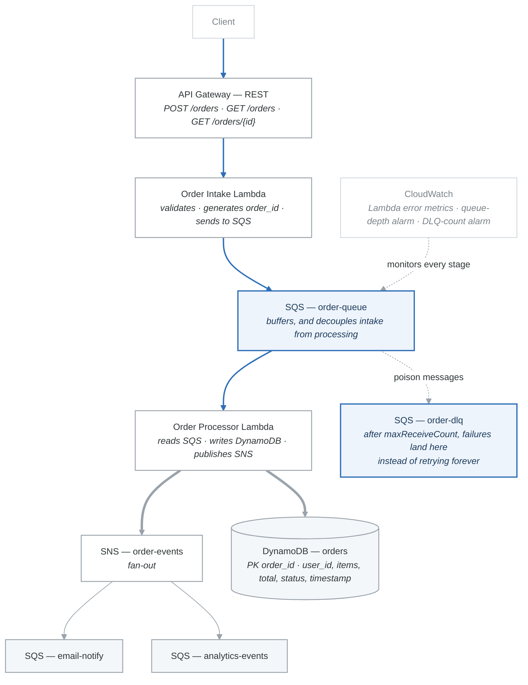

# Project 01: Event-Driven Architecture

## Overview

Build a fully event-driven order processing system using API Gateway, Lambda, SQS, DynamoDB, SNS, and CloudWatch. This project integrates nearly every service covered in Phase 3 and represents the type of architecture the SAA-C03 exam expects you to understand.

---

## Architecture Diagram

<!-- figure: generated from the Mermaid below by _shared/diagrams/embed-figures.py — do not edit the image -->


<details>
<summary>Diagram source (Mermaid)</summary>



</details>

---

## Requirements

### Functional Requirements

1. **Submit an order** (POST /orders): Accept order details (user_id, items, quantities), validate input, assign an order_id, and queue the order for processing.
2. **Retrieve an order** (GET /orders/{order_id}): Fetch order status and details from DynamoDB.
3. **List orders** (GET /orders?user_id=xxx): List all orders for a given user.
4. **Process orders asynchronously**: Lambda reads from SQS, calculates total, writes to DynamoDB, publishes event to SNS.
5. **Notify on completion**: SNS fans out order completion events to notification and analytics queues.
6. **Handle failures gracefully**: Failed messages go to a DLQ. CloudWatch alarm fires when DLQ has messages.

### Non-Functional Requirements

- All communication between services is asynchronous (via SQS).
- No data is lost (SQS retention + DLQ).
- Infrastructure defined in Terraform.
- All Lambda functions written in Python.
- Cost stays within Free Tier.

---

## Acceptance Criteria

- [ ] POST /orders returns 202 Accepted with an order_id.
- [ ] The order appears in DynamoDB within 5 seconds with status "completed."
- [ ] GET /orders/{order_id} returns the order details.
- [ ] GET /orders?user_id=xxx returns all orders for a user (via GSI).
- [ ] A message is delivered to both the notification queue and analytics queue (fan-out verified).
- [ ] Sending a malformed order causes the message to land in the DLQ after 3 retries.
- [ ] CloudWatch alarm fires when the DLQ receives a message.
- [ ] `terraform destroy` removes all resources.

---

## Cost Estimate

| Resource | Cost |
|---|---|
| Lambda (Free Tier: 1M requests/month) | Free |
| API Gateway (Free Tier: 1M calls/month, 12 months) | Free |
| SQS (Free Tier: 1M requests/month) | Free |
| SNS (Free Tier: 1M publishes/month) | Free |
| DynamoDB (Free Tier: always free, 25 RCU/WCU) | Free |
| CloudWatch (10 alarms Free Tier) | Free |
| **Total** | **$0** |

---

## Implementation Guide

### Step 1: DynamoDB Table

```python
# Table: saa-project-orders
# PK: order_id (String)
# GSI: user_id-index (PK: user_id, SK: created_at)

import boto3
from decimal import Decimal

session = boto3.Session(profile_name='saa-study')
dynamodb = session.resource('dynamodb', region_name='us-east-1')


def create_orders_table():
    table = dynamodb.create_table(
        TableName='saa-project-orders',
        KeySchema=[
            {'AttributeName': 'order_id', 'KeyType': 'HASH'},
        ],
        AttributeDefinitions=[
            {'AttributeName': 'order_id', 'AttributeType': 'S'},
            {'AttributeName': 'user_id', 'AttributeType': 'S'},
            {'AttributeName': 'created_at', 'AttributeType': 'N'},
        ],
        GlobalSecondaryIndexes=[
            {
                'IndexName': 'user_id-index',
                'KeySchema': [
                    {'AttributeName': 'user_id', 'KeyType': 'HASH'},
                    {'AttributeName': 'created_at', 'KeyType': 'RANGE'},
                ],
                'Projection': {'ProjectionType': 'ALL'},
            },
        ],
        BillingMode='PAY_PER_REQUEST',
    )
    table.wait_until_exists()
    print(f"Table created: {table.table_arn}")
```

### Step 2: SQS Queues

```python
sqs = session.client('sqs', region_name='us-east-1')


def create_queues():
    """Create the order queue, DLQ, and fan-out subscriber queues."""

    # DLQ first (needed by redrive policy)
    dlq = sqs.create_queue(
        QueueName='saa-project-order-dlq',
        Attributes={'MessageRetentionPeriod': '1209600'},  # 14 days
    )
    dlq_arn = sqs.get_queue_attributes(
        QueueUrl=dlq['QueueUrl'], AttributeNames=['QueueArn']
    )['Attributes']['QueueArn']

    # Main order queue with DLQ
    import json
    order_queue = sqs.create_queue(
        QueueName='saa-project-order-queue',
        Attributes={
            'VisibilityTimeout': '60',
            'ReceiveMessageWaitTimeSeconds': '5',
            'RedrivePolicy': json.dumps({
                'deadLetterTargetArn': dlq_arn,
                'maxReceiveCount': '3',
            }),
        },
    )

    # Fan-out subscriber queues
    notify_queue = sqs.create_queue(QueueName='saa-project-email-notify')
    analytics_queue = sqs.create_queue(QueueName='saa-project-analytics-events')

    return {
        'order_queue': order_queue['QueueUrl'],
        'dlq': dlq['QueueUrl'],
        'notify_queue': notify_queue['QueueUrl'],
        'analytics_queue': analytics_queue['QueueUrl'],
    }
```

### Step 3: SNS Topic with Fan-Out

```python
sns = session.client('sns', region_name='us-east-1')


def create_sns_fanout(notify_queue_arn, analytics_queue_arn):
    """Create SNS topic and subscribe fan-out queues."""
    topic = sns.create_topic(Name='saa-project-order-events')
    topic_arn = topic['TopicArn']

    # Subscribe both queues (remember to set SQS policies too)
    for queue_arn in [notify_queue_arn, analytics_queue_arn]:
        sns.subscribe(
            TopicArn=topic_arn,
            Protocol='sqs',
            Endpoint=queue_arn,
            Attributes={'RawMessageDelivery': 'true'},
        )

    return topic_arn
```

### Step 4: Lambda -- Order Intake

```python
# order_intake/lambda_function.py
import json
import uuid
import os
import boto3
from datetime import datetime

sqs = boto3.client('sqs')
QUEUE_URL = os.environ['ORDER_QUEUE_URL']


def lambda_handler(event, context):
    http_method = event['httpMethod']
    path = event.get('path', '')

    if http_method == 'POST' and path == '/orders':
        return handle_create_order(event)
    elif http_method == 'GET' and event.get('pathParameters'):
        return handle_get_order(event)
    elif http_method == 'GET' and path == '/orders':
        return handle_list_orders(event)
    else:
        return response(400, {'error': 'Unsupported route'})


def handle_create_order(event):
    body = json.loads(event['body'])

    # Validate
    if not body.get('user_id') or not body.get('items'):
        return response(400, {'error': 'user_id and items are required'})

    order_id = f"ord-{uuid.uuid4().hex[:8]}"
    message = {
        'order_id': order_id,
        'user_id': body['user_id'],
        'items': body['items'],
        'created_at': int(datetime.utcnow().timestamp()),
    }

    sqs.send_message(
        QueueUrl=QUEUE_URL,
        MessageBody=json.dumps(message),
    )

    return response(202, {
        'message': 'Order accepted for processing',
        'order_id': order_id,
    })


def handle_get_order(event):
    order_id = event['pathParameters']['order_id']
    dynamodb = boto3.resource('dynamodb')
    table = dynamodb.Table('saa-project-orders')
    result = table.get_item(Key={'order_id': order_id})
    item = result.get('Item')
    if not item:
        return response(404, {'error': 'Order not found'})
    return response(200, item)


def handle_list_orders(event):
    user_id = (event.get('queryStringParameters') or {}).get('user_id')
    if not user_id:
        return response(400, {'error': 'user_id query parameter required'})

    from boto3.dynamodb.conditions import Key
    dynamodb = boto3.resource('dynamodb')
    table = dynamodb.Table('saa-project-orders')
    result = table.query(
        IndexName='user_id-index',
        KeyConditionExpression=Key('user_id').eq(user_id),
    )
    return response(200, {'orders': result['Items'], 'count': result['Count']})


def response(status_code, body):
    from decimal import Decimal

    class DecimalEncoder(json.JSONEncoder):
        def default(self, obj):
            if isinstance(obj, Decimal):
                return float(obj)
            return super().default(obj)

    return {
        'statusCode': status_code,
        'headers': {'Content-Type': 'application/json'},
        'body': json.dumps(body, cls=DecimalEncoder),
    }
```

### Step 5: Lambda -- Order Processor

```python
# order_processor/lambda_function.py
import json
import os
import boto3
from decimal import Decimal
from datetime import datetime

dynamodb = boto3.resource('dynamodb')
sns = boto3.client('sns')

TABLE_NAME = 'saa-project-orders'
TOPIC_ARN = os.environ['ORDER_EVENTS_TOPIC_ARN']

# Simple product catalog for price lookup
PRODUCT_PRICES = {
    'laptop': Decimal('999.99'),
    'mouse': Decimal('29.99'),
    'keyboard': Decimal('79.99'),
    'monitor': Decimal('349.99'),
    'webcam': Decimal('59.99'),
}


def lambda_handler(event, context):
    table = dynamodb.Table(TABLE_NAME)

    for record in event['Records']:
        body = json.loads(record['body'])
        order_id = body['order_id']

        print(f"Processing order: {order_id}")

        # Calculate total
        total = Decimal('0')
        processed_items = []
        for item in body['items']:
            product = item['product'].lower()
            quantity = item.get('quantity', 1)
            price = PRODUCT_PRICES.get(product, Decimal('0'))
            subtotal = price * quantity
            total += subtotal
            processed_items.append({
                'product': product,
                'quantity': quantity,
                'price': float(price),
                'subtotal': float(subtotal),
            })

        # Write to DynamoDB
        table.put_item(Item={
            'order_id': order_id,
            'user_id': body['user_id'],
            'items': processed_items,
            'total': total,
            'status': 'completed',
            'created_at': body['created_at'],
            'processed_at': int(datetime.utcnow().timestamp()),
        })

        # Publish completion event to SNS
        sns.publish(
            TopicArn=TOPIC_ARN,
            Message=json.dumps({
                'event_type': 'order_completed',
                'order_id': order_id,
                'user_id': body['user_id'],
                'total': float(total),
            }),
            MessageAttributes={
                'event_type': {
                    'DataType': 'String',
                    'StringValue': 'order_completed',
                },
            },
        )
        print(f"Order {order_id} completed. Total: ${total}")
```

### Step 6: Terraform Infrastructure

```hcl
# main.tf

provider "aws" {
  region  = "us-east-1"
  profile = "saa-study"
}

# --- DynamoDB ---
resource "aws_dynamodb_table" "orders" {
  name         = "saa-project-orders"
  billing_mode = "PAY_PER_REQUEST"
  hash_key     = "order_id"

  attribute {
    name = "order_id"
    type = "S"
  }
  attribute {
    name = "user_id"
    type = "S"
  }
  attribute {
    name = "created_at"
    type = "N"
  }

  global_secondary_index {
    name            = "user_id-index"
    hash_key        = "user_id"
    range_key       = "created_at"
    projection_type = "ALL"
  }
}

# --- SQS ---
resource "aws_sqs_queue" "order_dlq" {
  name                      = "saa-project-order-dlq"
  message_retention_seconds = 1209600
}

resource "aws_sqs_queue" "order_queue" {
  name                       = "saa-project-order-queue"
  visibility_timeout_seconds = 60
  receive_wait_time_seconds  = 5
  redrive_policy = jsonencode({
    deadLetterTargetArn = aws_sqs_queue.order_dlq.arn
    maxReceiveCount     = 3
  })
}

resource "aws_sqs_queue" "email_notify" {
  name = "saa-project-email-notify"
}

resource "aws_sqs_queue" "analytics_events" {
  name = "saa-project-analytics-events"
}

# --- SNS ---
resource "aws_sns_topic" "order_events" {
  name = "saa-project-order-events"
}

resource "aws_sns_topic_subscription" "notify" {
  topic_arn            = aws_sns_topic.order_events.arn
  protocol             = "sqs"
  endpoint             = aws_sqs_queue.email_notify.arn
  raw_message_delivery = true
}

resource "aws_sns_topic_subscription" "analytics" {
  topic_arn            = aws_sns_topic.order_events.arn
  protocol             = "sqs"
  endpoint             = aws_sqs_queue.analytics_events.arn
  raw_message_delivery = true
}

# SQS policies allowing SNS to send messages
resource "aws_sqs_queue_policy" "notify_policy" {
  queue_url = aws_sqs_queue.email_notify.id
  policy = jsonencode({
    Version = "2012-10-17"
    Statement = [{
      Sid       = "AllowSNS"
      Effect    = "Allow"
      Principal = { Service = "sns.amazonaws.com" }
      Action    = "sqs:SendMessage"
      Resource  = aws_sqs_queue.email_notify.arn
      Condition = { ArnEquals = { "aws:SourceArn" = aws_sns_topic.order_events.arn } }
    }]
  })
}

resource "aws_sqs_queue_policy" "analytics_policy" {
  queue_url = aws_sqs_queue.analytics_events.id
  policy = jsonencode({
    Version = "2012-10-17"
    Statement = [{
      Sid       = "AllowSNS"
      Effect    = "Allow"
      Principal = { Service = "sns.amazonaws.com" }
      Action    = "sqs:SendMessage"
      Resource  = aws_sqs_queue.analytics_events.arn
      Condition = { ArnEquals = { "aws:SourceArn" = aws_sns_topic.order_events.arn } }
    }]
  })
}

# --- IAM Role for Lambda ---
resource "aws_iam_role" "lambda_role" {
  name = "saa-project-lambda-role"
  assume_role_policy = jsonencode({
    Version = "2012-10-17"
    Statement = [{
      Effect    = "Allow"
      Principal = { Service = "lambda.amazonaws.com" }
      Action    = "sts:AssumeRole"
    }]
  })
}

resource "aws_iam_role_policy" "lambda_policy" {
  name = "lambda-access"
  role = aws_iam_role.lambda_role.id
  policy = jsonencode({
    Version = "2012-10-17"
    Statement = [
      {
        Effect = "Allow"
        Action = [
          "logs:CreateLogGroup", "logs:CreateLogStream", "logs:PutLogEvents"
        ]
        Resource = "arn:aws:logs:*:*:*"
      },
      {
        Effect   = "Allow"
        Action   = ["sqs:SendMessage", "sqs:ReceiveMessage", "sqs:DeleteMessage", "sqs:GetQueueAttributes"]
        Resource = [aws_sqs_queue.order_queue.arn]
      },
      {
        Effect   = "Allow"
        Action   = ["dynamodb:PutItem", "dynamodb:GetItem", "dynamodb:Query"]
        Resource = [aws_dynamodb_table.orders.arn, "${aws_dynamodb_table.orders.arn}/index/*"]
      },
      {
        Effect   = "Allow"
        Action   = ["sns:Publish"]
        Resource = [aws_sns_topic.order_events.arn]
      },
    ]
  })
}

# --- Lambda Functions ---
# (Package and upload lambda code before applying)

# --- CloudWatch Alarm ---
resource "aws_cloudwatch_metric_alarm" "dlq_alarm" {
  alarm_name          = "saa-project-dlq-messages"
  comparison_operator = "GreaterThanThreshold"
  evaluation_periods  = 1
  metric_name         = "ApproximateNumberOfMessagesVisible"
  namespace           = "AWS/SQS"
  period              = 60
  statistic           = "Sum"
  threshold           = 0
  alarm_description   = "Alert when DLQ has messages (order processing failures)"
  dimensions = {
    QueueName = aws_sqs_queue.order_dlq.name
  }
}

# --- Outputs ---
output "order_queue_url" {
  value = aws_sqs_queue.order_queue.url
}

output "sns_topic_arn" {
  value = aws_sns_topic.order_events.arn
}

output "dynamodb_table_name" {
  value = aws_dynamodb_table.orders.name
}
```

---

## Testing

### Test 1: Submit an Order

```bash
curl -X POST "$BASE_URL/orders" \
  -H "Content-Type: application/json" \
  -d '{
    "user_id": "user-001",
    "items": [
      {"product": "Laptop", "quantity": 1},
      {"product": "Mouse", "quantity": 2}
    ]
  }'
# Expected: 202 Accepted with order_id
```

### Test 2: Retrieve the Order

```bash
# Wait a few seconds for processing
curl "$BASE_URL/orders/ORDER_ID"
# Expected: 200 with full order details, status "completed"
```

### Test 3: Verify Fan-Out

```bash
# Check notification queue
aws sqs receive-message --queue-url NOTIFY_QUEUE_URL --wait-time-seconds 5 --profile saa-study

# Check analytics queue
aws sqs receive-message --queue-url ANALYTICS_QUEUE_URL --wait-time-seconds 5 --profile saa-study
```

### Test 4: Test DLQ (Send Malformed Order)

```bash
# Send directly to SQS with invalid data
aws sqs send-message \
  --queue-url ORDER_QUEUE_URL \
  --message-body '{"invalid": "data"}' \
  --profile saa-study

# After 3 retries, check DLQ
aws sqs receive-message --queue-url DLQ_URL --wait-time-seconds 10 --profile saa-study
```

---

## Cleanup

```bash
terraform destroy
```

---

## What You Learned

- [x] End-to-end event-driven architecture with multiple AWS services.
- [x] Asynchronous processing with SQS (decoupling intake from processing).
- [x] Fan-out pattern with SNS to multiple SQS subscriber queues.
- [x] Dead-Letter Queue for handling failed messages.
- [x] CloudWatch alarms for monitoring queue depth and failures.
- [x] DynamoDB with GSI for flexible query patterns.
- [x] Lambda as both API handler and queue processor.
- [x] Terraform for Infrastructure as Code.

<!-- feynman-check -->

---

## Feynman check

Close the file. Blank page, no notes. Explain each of these to a competent engineer who has never
used this tool — **under five minutes, no jargon you can't define on the spot:**

- Testing
- Functional Requirements
- Non-Functional Requirements
- DynamoDB Table

**The gap is not what you forgot. It is where you used a word instead of a mechanism.**

| | |
|---|---|
| ✗ | *"The security group allows the traffic."* |
| ✓ | *"A security group is a stateful allow-list attached to an ENI. Traffic matching an inbound rule is permitted and the reply is permitted automatically, because the connection is tracked — which is why you never write an outbound rule for a reply."* |

**Trace it:** A request from the internet to an instance in a private subnet. Name every hop, every route-table lookup, and every rule evaluated, in order.

Stop at the first component you cannot name. Reopen this file and read **only** that.

**Go deeper — only once the gap has a name:** [Timeouts, retries and backoff with jitter](https://aws.amazon.com/builders-library/timeouts-retries-and-backoff-with-jitter/) — 15 minutes from the AWS Builders' Library, and it changes how you write every client you touch afterwards.
Full list per domain: [`SOURCES.md`](../SOURCES.md#aws)

→ Protocol, the three levels of knowing, and worked examples: [`MASTERY.md`](../MASTERY.md)

<!-- /feynman-check -->
