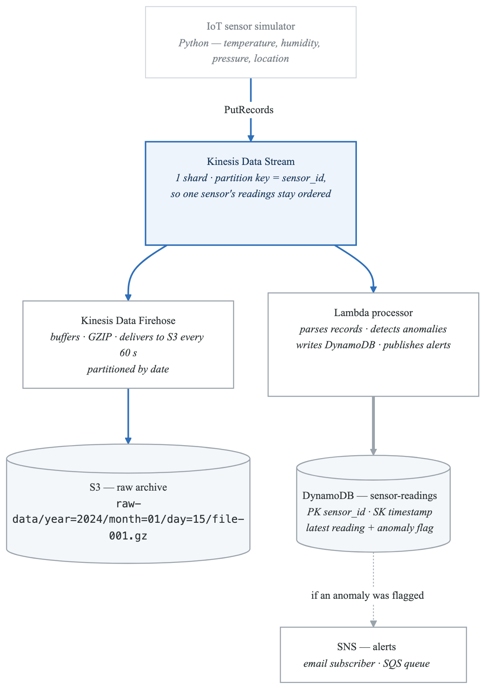
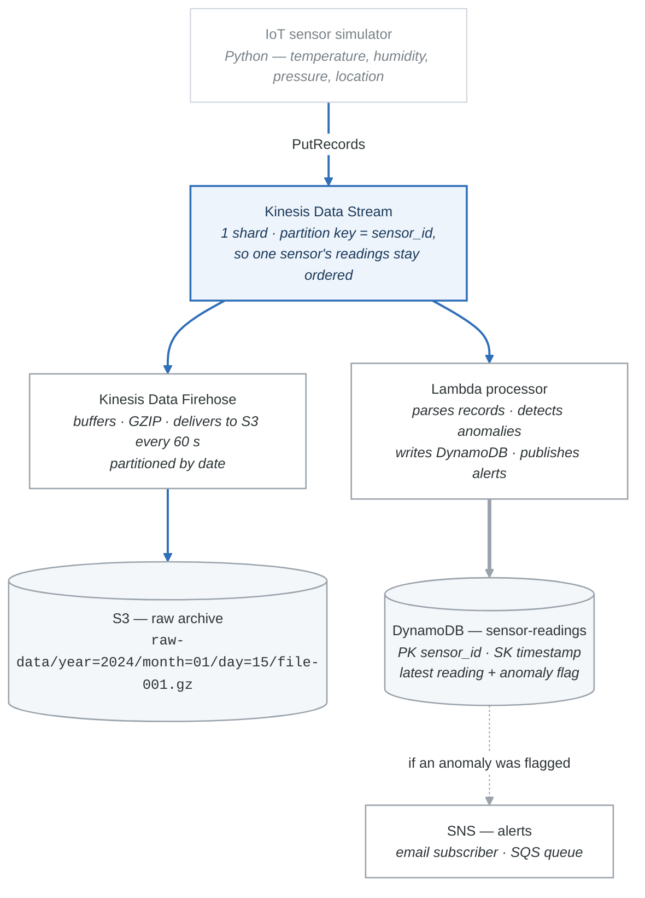

# Project 02: Real-Time Data Pipeline

## Overview

Build a real-time data pipeline that ingests simulated IoT sensor data through Kinesis Data Streams, processes it with Lambda, stores results in DynamoDB, and archives raw data to S3 via Kinesis Data Firehose. This project demonstrates the streaming data architecture pattern commonly tested on the SAA-C03 exam.

---

## Architecture Diagram

<!-- figure: generated from the Mermaid below by _shared/diagrams/embed-figures.py — do not edit the image -->


<details>
<summary>Diagram source (Mermaid)</summary>



</details>

---

## Requirements

### Functional Requirements

1. **Data ingestion:** Python producer script sends simulated sensor readings to Kinesis Data Streams every 1 second from 5 sensors.
2. **Real-time processing:** Lambda function triggered by Kinesis processes each batch of records.
3. **Anomaly detection:** Lambda checks if temperature exceeds 30C or humidity drops below 35%. Flag anomalous readings.
4. **Data storage:** Lambda writes processed readings to DynamoDB with anomaly flags.
5. **Alerting:** When an anomaly is detected, Lambda publishes to an SNS topic.
6. **Archival:** Kinesis Data Firehose delivers all raw data to S3 in GZIP format, partitioned by date.

### Non-Functional Requirements

- Data is available for real-time queries in DynamoDB within seconds.
- Raw data is archived to S3 within 60-90 seconds (Firehose buffer).
- All infrastructure can be created and destroyed with scripts.
- Total cost under $2 for a multi-hour session.

---

## Acceptance Criteria

- [ ] Producer script sends at least 100 records to Kinesis.
- [ ] Lambda processes all records and writes to DynamoDB.
- [ ] DynamoDB contains records with correct anomaly flags.
- [ ] At least one SNS alert is triggered for an anomalous reading.
- [ ] S3 bucket contains GZIP-compressed raw data files partitioned by date.
- [ ] All resources can be deleted with cleanup scripts.

---

## Cost Estimate

| Resource | Cost |
|---|---|
| Kinesis Data Stream (1 shard, 2-3 hours) | ~$0.05 |
| Kinesis Data Firehose (small data volume) | ~$0.01 |
| Lambda (Free Tier) | Free |
| DynamoDB (Free Tier) | Free |
| SNS (Free Tier) | Free |
| S3 (negligible storage) | ~$0.01 |
| **Total** | **~$0.10-0.50** |

---

## Implementation Guide

### Step 1: Create DynamoDB Table

```python
import boto3

session = boto3.Session(profile_name='saa-study')
dynamodb = session.resource('dynamodb', region_name='us-east-1')


def create_sensor_table():
    table = dynamodb.create_table(
        TableName='saa-project-sensor-readings',
        KeySchema=[
            {'AttributeName': 'sensor_id', 'KeyType': 'HASH'},
            {'AttributeName': 'timestamp', 'KeyType': 'RANGE'},
        ],
        AttributeDefinitions=[
            {'AttributeName': 'sensor_id', 'AttributeType': 'S'},
            {'AttributeName': 'timestamp', 'AttributeType': 'N'},
        ],
        BillingMode='PAY_PER_REQUEST',
    )
    table.wait_until_exists()
    print(f"Table created: {table.table_arn}")
    return table
```

### Step 2: Create Kinesis Data Stream

```python
kinesis = session.client('kinesis', region_name='us-east-1')


def create_stream():
    kinesis.create_stream(
        StreamName='saa-project-iot-stream',
        ShardCount=1,
    )
    waiter = kinesis.get_waiter('stream_exists')
    waiter.wait(StreamName='saa-project-iot-stream')
    print("Kinesis Data Stream created.")
```

### Step 3: Create SNS Alert Topic

```python
sns = session.client('sns', region_name='us-east-1')


def create_alert_topic():
    response = sns.create_topic(Name='saa-project-sensor-alerts')
    topic_arn = response['TopicArn']
    print(f"SNS Topic: {topic_arn}")

    # Optionally subscribe your email for testing
    # sns.subscribe(TopicArn=topic_arn, Protocol='email', Endpoint='you@example.com')

    return topic_arn
```

### Step 4: IoT Sensor Simulator (Producer)

Create a file `iot_producer.py`:

```python
import boto3
import json
import time
import random
from datetime import datetime

session = boto3.Session(profile_name='saa-study')
kinesis = session.client('kinesis', region_name='us-east-1')

STREAM_NAME = 'saa-project-iot-stream'

SENSORS = {
    'sensor-001': {'location': 'warehouse-a', 'type': 'environment'},
    'sensor-002': {'location': 'warehouse-a', 'type': 'environment'},
    'sensor-003': {'location': 'warehouse-b', 'type': 'environment'},
    'sensor-004': {'location': 'factory-floor', 'type': 'industrial'},
    'sensor-005': {'location': 'factory-floor', 'type': 'industrial'},
}


def generate_reading(sensor_id):
    """Generate a sensor reading. Occasionally generate anomalous values."""
    sensor = SENSORS[sensor_id]
    is_anomaly = random.random() < 0.1  # 10% chance of anomaly

    if is_anomaly:
        temperature = round(random.uniform(31.0, 45.0), 2)  # Too hot
        humidity = round(random.uniform(15.0, 34.0), 2)       # Too dry
    else:
        temperature = round(random.uniform(18.0, 28.0), 2)
        humidity = round(random.uniform(40.0, 70.0), 2)

    return {
        'sensor_id': sensor_id,
        'timestamp': int(datetime.utcnow().timestamp() * 1000),  # ms precision
        'temperature': temperature,
        'humidity': humidity,
        'pressure': round(random.uniform(1010.0, 1025.0), 2),
        'location': sensor['location'],
        'sensor_type': sensor['type'],
        'reading_time': datetime.utcnow().isoformat() + 'Z',
    }


def produce(duration_seconds=120, interval=1.0):
    """Produce sensor readings for the specified duration."""
    print(f"Producing sensor data for {duration_seconds} seconds...")
    end_time = time.time() + duration_seconds
    count = 0
    anomaly_count = 0

    while time.time() < end_time:
        records = []
        for sensor_id in SENSORS:
            reading = generate_reading(sensor_id)
            records.append({
                'Data': json.dumps(reading),
                'PartitionKey': sensor_id,
            })
            if reading['temperature'] > 30 or reading['humidity'] < 35:
                anomaly_count += 1

        response = kinesis.put_records(
            StreamName=STREAM_NAME,
            Records=records,
        )

        count += len(records)
        failed = response['FailedRecordCount']
        timestamp = datetime.utcnow().strftime('%H:%M:%S')
        print(f"[{timestamp}] Sent {len(records)} records "
              f"(failed: {failed}, total: {count}, anomalies: {anomaly_count})")

        time.sleep(interval)

    print(f"\nProduction complete: {count} records, {anomaly_count} anomalies")


if __name__ == '__main__':
    produce(duration_seconds=120, interval=1.0)
```

### Step 5: Lambda Processor

Create a file `stream_processor/lambda_function.py`:

```python
import json
import os
import base64
import boto3
from decimal import Decimal
from datetime import datetime

dynamodb = boto3.resource('dynamodb')
sns = boto3.client('sns')

TABLE_NAME = 'saa-project-sensor-readings'
ALERT_TOPIC_ARN = os.environ.get('ALERT_TOPIC_ARN', '')

# Anomaly thresholds
TEMP_THRESHOLD = 30.0
HUMIDITY_THRESHOLD = 35.0


def lambda_handler(event, context):
    """Process a batch of Kinesis records."""
    table = dynamodb.Table(TABLE_NAME)
    records_processed = 0
    anomalies_detected = 0

    for record in event['Records']:
        # Decode the Kinesis record
        payload = base64.b64decode(record['kinesis']['data'])
        reading = json.loads(payload)

        sensor_id = reading['sensor_id']
        timestamp = reading['timestamp']
        temperature = reading['temperature']
        humidity = reading['humidity']

        # Check for anomalies
        is_anomaly = temperature > TEMP_THRESHOLD or humidity < HUMIDITY_THRESHOLD
        anomaly_reasons = []
        if temperature > TEMP_THRESHOLD:
            anomaly_reasons.append(f'temperature={temperature}C (threshold={TEMP_THRESHOLD}C)')
        if humidity < HUMIDITY_THRESHOLD:
            anomaly_reasons.append(f'humidity={humidity}% (threshold={HUMIDITY_THRESHOLD}%)')

        # Write to DynamoDB
        item = {
            'sensor_id': sensor_id,
            'timestamp': timestamp,
            'temperature': Decimal(str(temperature)),
            'humidity': Decimal(str(humidity)),
            'pressure': Decimal(str(reading['pressure'])),
            'location': reading['location'],
            'sensor_type': reading['sensor_type'],
            'is_anomaly': is_anomaly,
            'anomaly_reasons': anomaly_reasons if anomaly_reasons else None,
            'processed_at': int(datetime.utcnow().timestamp() * 1000),
        }

        # Remove None values (DynamoDB does not accept None for non-key attributes
        # unless you use a specific type)
        item = {k: v for k, v in item.items() if v is not None}

        table.put_item(Item=item)
        records_processed += 1

        # Send alert if anomaly
        if is_anomaly and ALERT_TOPIC_ARN:
            anomalies_detected += 1
            sns.publish(
                TopicArn=ALERT_TOPIC_ARN,
                Subject=f'ALERT: Anomaly detected on {sensor_id}',
                Message=json.dumps({
                    'alert_type': 'sensor_anomaly',
                    'sensor_id': sensor_id,
                    'location': reading['location'],
                    'temperature': temperature,
                    'humidity': humidity,
                    'reasons': anomaly_reasons,
                    'reading_time': reading['reading_time'],
                }, indent=2),
            )

    print(f"Processed {records_processed} records, {anomalies_detected} anomalies")
    return {
        'records_processed': records_processed,
        'anomalies_detected': anomalies_detected,
    }
```

### Step 6: Deploy the Lambda

```bash
# Package the Lambda
cd stream_processor
zip lambda_function.zip lambda_function.py
cd ..

# Create IAM role (see project-01 for the pattern)
# Attach policies for: CloudWatch Logs, DynamoDB, SNS, Kinesis

# Create the Lambda function
aws lambda create-function \
  --function-name saa-project-stream-processor \
  --runtime python3.12 \
  --handler lambda_function.lambda_handler \
  --role arn:aws:iam::ACCOUNT_ID:role/saa-project-stream-processor-role \
  --zip-file fileb://stream_processor/lambda_function.zip \
  --timeout 60 \
  --memory-size 128 \
  --environment "Variables={ALERT_TOPIC_ARN=arn:aws:sns:us-east-1:ACCOUNT_ID:saa-project-sensor-alerts}" \
  --profile saa-study

# Create event source mapping (Kinesis -> Lambda trigger)
aws lambda create-event-source-mapping \
  --function-name saa-project-stream-processor \
  --event-source-arn arn:aws:kinesis:us-east-1:ACCOUNT_ID:stream/saa-project-iot-stream \
  --starting-position TRIM_HORIZON \
  --batch-size 50 \
  --profile saa-study
```

### Step 7: Set Up Firehose to S3

```bash
# Create S3 bucket
aws s3 mb s3://saa-project-iot-archive-ACCOUNT_ID --profile saa-study

# Create Firehose (see Lab 05 for detailed IAM role and Firehose creation steps)
aws firehose create-delivery-stream \
  --delivery-stream-name saa-project-iot-delivery \
  --delivery-stream-type KinesisStreamAsSource \
  --kinesis-stream-source-configuration \
    "KinesisStreamARN=arn:aws:kinesis:us-east-1:ACCOUNT_ID:stream/saa-project-iot-stream,RoleARN=arn:aws:iam::ACCOUNT_ID:role/saa-project-firehose-role" \
  --s3-destination-configuration \
    "RoleARN=arn:aws:iam::ACCOUNT_ID:role/saa-project-firehose-role,BucketARN=arn:aws:s3:::saa-project-iot-archive-ACCOUNT_ID,Prefix=raw-data/year=!{timestamp:yyyy}/month=!{timestamp:MM}/day=!{timestamp:dd}/,BufferingHints={SizeInMBs=1,IntervalInSeconds=60},CompressionFormat=GZIP" \
  --profile saa-study
```

### Step 8: Query DynamoDB for Results

```python
def query_sensor_readings(sensor_id, limit=10):
    """Query the latest readings for a sensor."""
    table = dynamodb.Table('saa-project-sensor-readings')
    from boto3.dynamodb.conditions import Key

    response = table.query(
        KeyConditionExpression=Key('sensor_id').eq(sensor_id),
        ScanIndexForward=False,  # Descending order (newest first)
        Limit=limit,
    )

    print(f"\nLatest {limit} readings for {sensor_id}:")
    for item in response['Items']:
        anomaly = ' ** ANOMALY **' if item.get('is_anomaly') else ''
        print(f"  Temp: {item['temperature']}C | "
              f"Humidity: {item['humidity']}% | "
              f"Location: {item['location']}{anomaly}")


def query_anomalies():
    """Scan for all anomalous readings."""
    table = dynamodb.Table('saa-project-sensor-readings')
    from boto3.dynamodb.conditions import Attr

    response = table.scan(
        FilterExpression=Attr('is_anomaly').eq(True),
    )
    print(f"\nAnomalies found: {response['Count']}")
    for item in response['Items']:
        print(f"  {item['sensor_id']} | "
              f"Temp: {item['temperature']}C | "
              f"Humidity: {item['humidity']}% | "
              f"Reasons: {item.get('anomaly_reasons', [])}")
```

---

## Running the Pipeline

```bash
# Terminal 1: Start the producer (generates data for 2 minutes)
python iot_producer.py

# Terminal 2: Watch Lambda logs (processing happens automatically)
aws logs tail /aws/lambda/saa-project-stream-processor --follow --profile saa-study

# After 60-90 seconds, check S3 for archived data
aws s3 ls s3://saa-project-iot-archive-ACCOUNT_ID/raw-data/ --recursive --profile saa-study

# Query DynamoDB for results
python -c "
import boto3
from boto3.dynamodb.conditions import Key
session = boto3.Session(profile_name='saa-study')
dynamodb = session.resource('dynamodb', region_name='us-east-1')
table = dynamodb.Table('saa-project-sensor-readings')
response = table.scan(Limit=10)
for item in response['Items']:
    print(f\"{item['sensor_id']} | Temp: {item['temperature']}C | Anomaly: {item.get('is_anomaly', False)}\")
"
```

---

## Cleanup

```bash
# Delete Lambda event source mapping
MAPPING_UUID=$(aws lambda list-event-source-mappings \
  --function-name saa-project-stream-processor \
  --query 'EventSourceMappings[0].UUID' --output text --profile saa-study)
aws lambda delete-event-source-mapping --uuid $MAPPING_UUID --profile saa-study

# Delete Lambda function
aws lambda delete-function --function-name saa-project-stream-processor --profile saa-study

# Delete Firehose
aws firehose delete-delivery-stream --delivery-stream-name saa-project-iot-delivery --profile saa-study

# Delete Kinesis stream
aws kinesis delete-stream --stream-name saa-project-iot-stream --profile saa-study

# Delete DynamoDB table
aws dynamodb delete-table --table-name saa-project-sensor-readings --profile saa-study

# Delete SNS topic
aws sns delete-topic --topic-arn arn:aws:sns:us-east-1:ACCOUNT_ID:saa-project-sensor-alerts --profile saa-study

# Delete S3 bucket
aws s3 rm s3://saa-project-iot-archive-ACCOUNT_ID --recursive --profile saa-study
aws s3 rb s3://saa-project-iot-archive-ACCOUNT_ID --profile saa-study

# Delete IAM roles (delete policies first)
aws iam delete-role-policy --role-name saa-project-stream-processor-role --policy-name StreamProcessorPolicy --profile saa-study
aws iam delete-role --role-name saa-project-stream-processor-role --profile saa-study
aws iam delete-role-policy --role-name saa-project-firehose-role --policy-name FirehosePolicy --profile saa-study
aws iam delete-role --role-name saa-project-firehose-role --profile saa-study
```

---

## What You Learned

- [x] End-to-end real-time data pipeline architecture.
- [x] Kinesis Data Streams for real-time ingestion with partition key ordering.
- [x] Lambda as a Kinesis consumer (event source mapping, batch processing, base64 decoding).
- [x] Kinesis Data Firehose for near-real-time archival to S3 with GZIP compression.
- [x] DynamoDB for storing processed results with composite keys.
- [x] SNS for real-time alerting on anomalies.
- [x] The difference between real-time (Lambda consumer) and near-real-time (Firehose to S3).
- [x] IoT data pipeline pattern frequently tested on SAA-C03.

<!-- feynman-check -->

---

## Feynman check

Close the file. Blank page, no notes. Explain each of these to a competent engineer who has never
used this tool — **under five minutes, no jargon you can't define on the spot:**

- Running the Pipeline
- Functional Requirements
- Non-Functional Requirements
- Create DynamoDB Table

**The gap is not what you forgot. It is where you used a word instead of a mechanism.**

| | |
|---|---|
| ✗ | *"The security group allows the traffic."* |
| ✓ | *"A security group is a stateful allow-list attached to an ENI. Traffic matching an inbound rule is permitted and the reply is permitted automatically, because the connection is tracked — which is why you never write an outbound rule for a reply."* |

**Trace it:** A request from the internet to an instance in a private subnet. Name every hop, every route-table lookup, and every rule evaluated, in order.

Stop at the first component you cannot name. Reopen this file and read **only** that.

**Go deeper — only once the gap has a name:** [Timeouts, retries and backoff with jitter](https://aws.amazon.com/builders-library/timeouts-retries-and-backoff-with-jitter/) — 15 minutes from the AWS Builders' Library, and it changes how you write every client you touch afterwards.
Full list per domain: [`SOURCES.md`](../SOURCES.md#aws)

→ Protocol, the three levels of knowing, and worked examples: [`MASTERY.md`](../MASTERY.md)

<!-- /feynman-check -->
