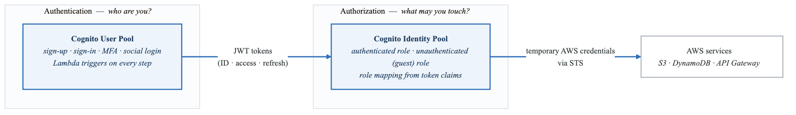
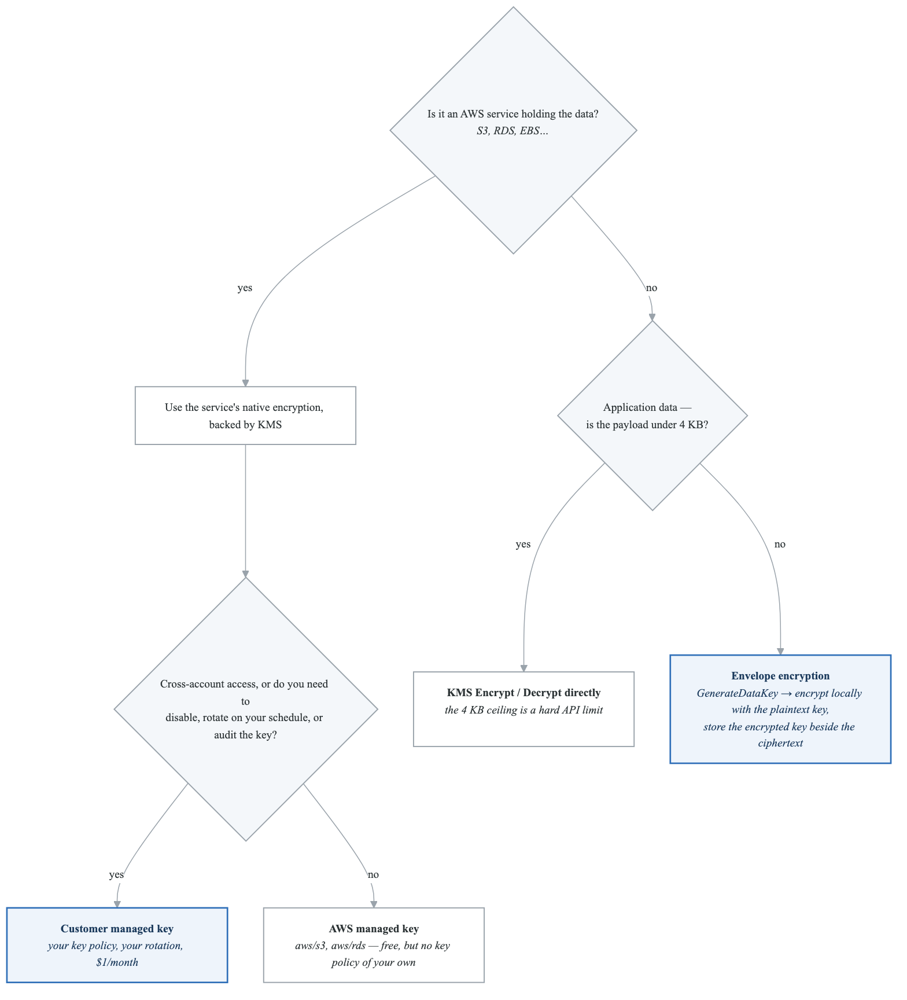
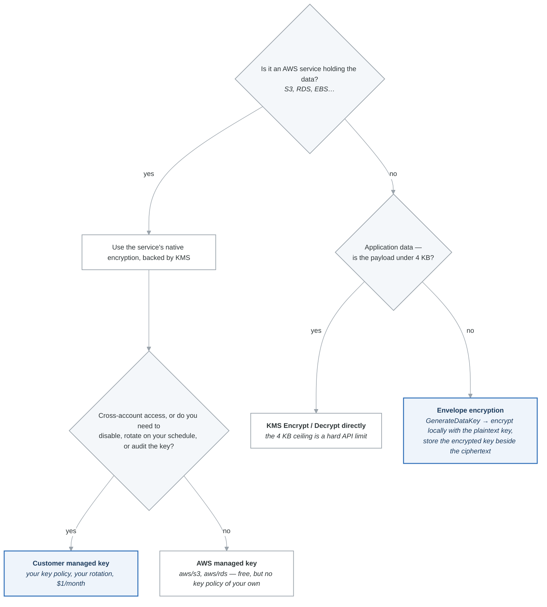
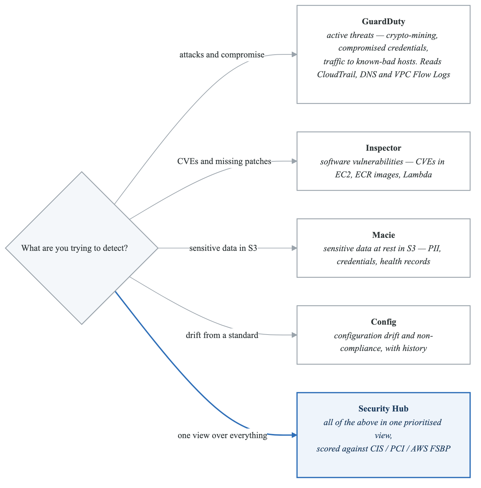
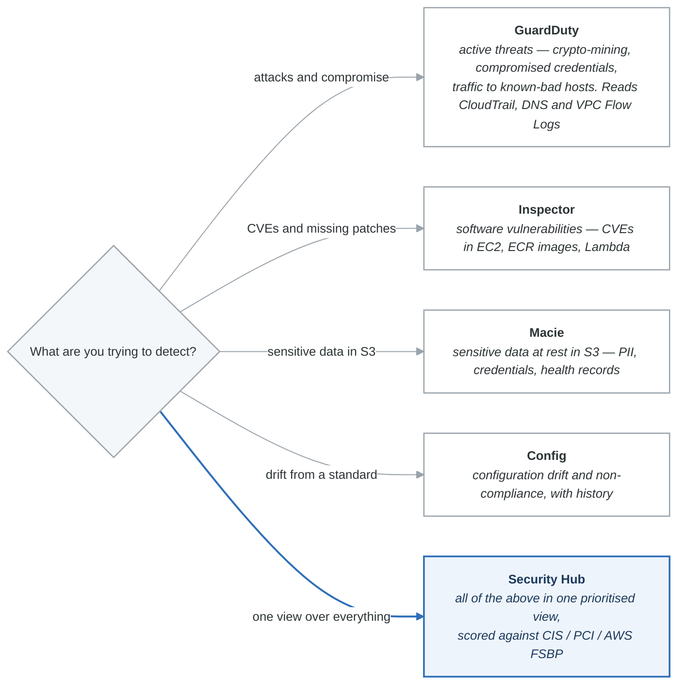
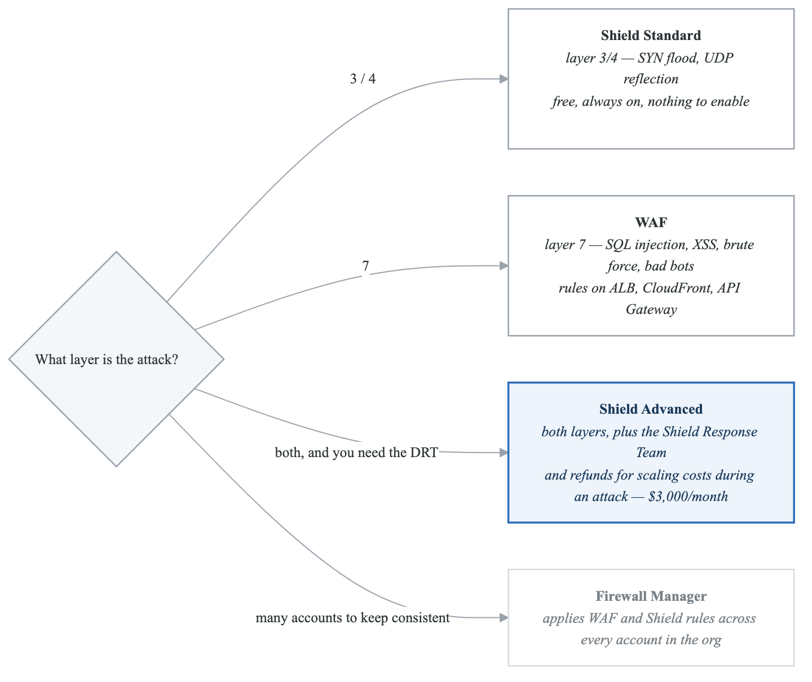
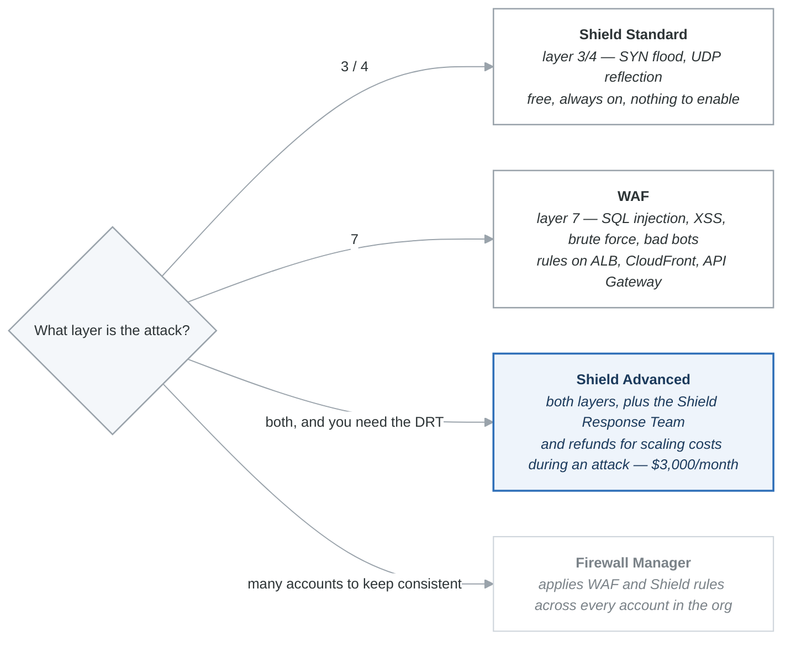

# Security Services — Cheat Sheet

## Master Comparison Table: All Security Services

| Service | What It Does | Key Exam Phrase | Layer |
|---------|-------------|-----------------|-------|
| **KMS** | Key management, encrypt/decrypt | "Encrypt data at rest," "CMK," "key rotation" | Encryption |
| **CloudHSM** | Dedicated HSM, FIPS 140-2 Level 3 | "FIPS Level 3," "Oracle TDE," "exclusive key control" | Encryption |
| **Secrets Manager** | Store/rotate secrets | "Rotate database credentials automatically" | Secrets |
| **SSM Parameter Store** | Store config/secrets (free) | "Store config values," "budget-conscious secrets" | Secrets |
| **ACM** | Free SSL/TLS certificates | "HTTPS on ALB," "free certificate" | Certificates |
| **WAF** | Web app firewall (Layer 7) | "SQL injection," "rate limiting," "geo blocking" | Network |
| **Shield Standard** | DDoS protection (free) | "DDoS protection, no cost" | Network |
| **Shield Advanced** | DDoS + DRT + cost protection | "DDoS response team," "$3K/month" | Network |
| **Firewall Manager** | Central firewall rule management | "Manage WAF across all org accounts" | Network |
| **Network Firewall** | VPC-level IDS/IPS | "VPC inspection," "Suricata rules," "domain filtering" | Network |
| **Verified Access** | Zero-trust app access | "Access without VPN," "zero trust" | Access |
| **GuardDuty** | Threat detection (ML) | "Detect compromised instance," "crypto mining" | Detection |
| **Inspector** | Vulnerability scanning | "CVE scan," "missing patches," "ECR scan" | Detection |
| **Macie** | S3 PII/sensitive data discovery | "Find SSN in S3," "PII discovery" | Detection |
| **Config** | Resource compliance | "Enforce encryption," "compliance rules" | Compliance |
| **Security Hub** | Centralized findings dashboard | "Single pane of glass," "aggregate findings" | Compliance |
| **Cognito User Pool** | User authentication | "User sign-up/sign-in," "MFA," "social login" | Identity |
| **Cognito Identity Pool** | AWS credentials for apps | "S3 upload from mobile," "temporary AWS creds" | Identity |
| **IAM Identity Center** | Workforce SSO | "SSO across accounts," "employee access" | Identity |
| **STS** | Temporary credentials | "Cross-account access," "AssumeRole" | Identity |

---

## KMS vs CloudHSM

| Feature | KMS | CloudHSM |
|---------|-----|----------|
| FIPS 140-2 | Level 2 | **Level 3** |
| Key control | Shared (AWS manages backend) | **Exclusive (you own keys)** |
| AWS access to keys | Yes | **No** |
| Cost | $1/key/month + API calls | **~$1.50/hour per HSM** |
| Integration | 100+ AWS services natively | Custom integration |
| Use for | Default encryption, most cases | FIPS Level 3, Oracle/SQL TDE, SSL offload |

---

## Secrets Manager vs SSM Parameter Store

| Feature | Secrets Manager | SSM Parameter Store |
|---------|----------------|-------------------|
| Auto rotation | **Yes (built-in)** | No (custom only) |
| Cost | $0.40/secret/month | **Free** (standard) |
| Max size | 64 KB | 4 KB (std) / 8 KB (adv) |
| Path hierarchy | No | **Yes** |
| Best for | DB credentials, rotating secrets | Config values, budget secrets |

---

## WAF vs Shield vs Firewall Manager vs Network Firewall

| Feature | WAF | Shield Std | Shield Adv | Firewall Mgr | Network FW |
|---------|-----|-----------|-----------|--------------|------------|
| Layer | 7 (HTTP) | 3/4 | 3/4/7 | Management | 3-7 (VPC) |
| Cost | $5/ACL/mo | Free | $3K/mo | Varies | ~$0.395/hr |
| Protects | ALB, CloudFront, API GW | All resources | ALB, NLB, CF, R53, EC2 EIP | Org-wide | VPC perimeter |
| Key feature | Rules, rate limit | Auto DDoS | DRT, cost protection | Central mgmt | IDS/IPS, domain filter |

---

## Detection Services: Which One for What?

| If You Need To Find... | Use This |
|------------------------|----------|
| Compromised EC2 instances | **GuardDuty** |
| Crypto mining | **GuardDuty** |
| Unusual API calls | **GuardDuty** |
| Communication with malicious IPs | **GuardDuty** |
| Missing OS patches on EC2 | **Inspector** |
| Container image CVEs | **Inspector** |
| Lambda dependency vulnerabilities | **Inspector** |
| PII in S3 (SSN, credit cards) | **Macie** |
| Sensitive data in S3 | **Macie** |
| S3 bucket encryption compliance | **Config** |
| SG with open SSH compliance | **Config** |
| Resource configuration history | **Config** |
| All findings in one place | **Security Hub** |
| CIS benchmark compliance | **Security Hub** |

---

## Encryption at Rest — Per Service Summary

| Service | Default Encryption | KMS Options | Notes |
|---------|-------------------|-------------|-------|
| **S3** | SSE-S3 (AES-256, free) | SSE-KMS (AWS/customer managed), SSE-C | Bucket Keys reduce KMS API costs |
| **EBS** | Not encrypted by default | AWS/customer managed KMS | Can set account-level default encryption |
| **RDS** | Not encrypted by default | AWS/customer managed KMS | Must enable at creation (cannot encrypt existing) |
| **Aurora** | Not encrypted by default | AWS/customer managed KMS | Same as RDS |
| **DynamoDB** | **Encrypted by default** | AWS owned or KMS | Always encrypted, choose key type |
| **EFS** | Not encrypted by default | KMS | Enable at creation |
| **Redshift** | Not encrypted by default | KMS or CloudHSM | Enable at creation |
| **Lambda env vars** | Encrypted by default | KMS | AWS managed key default, can use CMK |
| **SQS** | Not encrypted by default | SSE-KMS | Enable SSE on queue |
| **SNS** | Not encrypted by default | SSE-KMS | Enable SSE on topic |
| **Kinesis Data Streams** | Not encrypted by default | SSE-KMS | Server-side encryption option |
| **S3 Glacier** | **Encrypted by default** | AWS managed | Always encrypted |

---

## Cognito Quick Reference

```mermaid
%%{init: {'theme':'base','themeVariables':{'fontFamily':'Helvetica, Arial, sans-serif','fontSize':'13px','primaryColor':'#ffffff','primaryTextColor':'#2d3436','primaryBorderColor':'#9aa3ab','lineColor':'#9aa3ab','textColor':'#2d3436','clusterBkg':'#fbfcfd','clusterBorder':'#d4dae0','edgeLabelBackground':'#ffffff','tertiaryColor':'#eef4fb'},'flowchart':{'curve':'basis','padding':14,'nodeSpacing':42,'rankSpacing':58}}}%%
flowchart LR
  classDef default fill:#ffffff,stroke:#9aa3ab,stroke-width:1.3px,color:#2d3436
  classDef n    fill:#ffffff,stroke:#9aa3ab,stroke-width:1.3px,color:#2d3436
  classDef crit fill:#eef4fb,stroke:#2f6fb8,stroke-width:1.8px,color:#1b3a5c
  classDef data fill:#f4f7fa,stroke:#9aa3ab,stroke-width:1.3px,color:#2d3436
  classDef mut  fill:#ffffff,stroke:#cfd6dc,stroke-width:1.1px,color:#7a8288
  classDef warn fill:#fdf0ec,stroke:#c0522d,stroke-width:1.6px,color:#8a3a1e
  subgraph AUTHN["Authentication &nbsp;—&nbsp; <i>who are you?</i>"]
    UP["<b>Cognito User Pool</b><br/><i>sign-up · sign-in · MFA · social login<br/>Lambda triggers on every step</i>"]
  end
  subgraph AUTHZ["Authorization &nbsp;—&nbsp; <i>what may you touch?</i>"]
    IP["<b>Cognito Identity Pool</b><br/><i>authenticated role · unauthenticated (guest) role<br/>role mapping from token claims</i>"]
  end
  SVC["AWS services<br/><i>S3 · DynamoDB · API Gateway</i>"]
  UP ==>|"JWT tokens<br/>(ID · access · refresh)"| IP
  IP ==>|"temporary AWS credentials<br/>via STS"| SVC
  class UP crit
  class IP crit
  class SVC n
  linkStyle 0,1 stroke:#2f6fb8,stroke-width:2px

%% The exam distinction: a User Pool issues a JWT your APPLICATION understands.
%% An Identity Pool exchanges that JWT for IAM credentials that AWS understands.
%% If a question asks for direct S3 access from a mobile app, it needs both.
```

<!-- figure: generated from the Mermaid below by _shared/diagrams/embed-figures.py — do not edit the image -->

Diagram source (Mermaid)

| For... | Use... |
|--------|--------|
| Workforce SSO to AWS accounts | IAM Identity Center |
| Customer app sign-up/sign-in | Cognito User Pool |
| Get AWS creds for mobile/web app | Cognito Identity Pool |
| Cross-account API access | STS AssumeRole |
| Enterprise SAML federation | IAM Identity Center or STS AssumeRoleWithSAML |
| Temporary MFA-protected creds | STS GetSessionToken |

---

## Key Numbers to Remember

| Item | Value |
|------|-------|
| KMS Encrypt API max data size | **4 KB** |
| KMS automatic key rotation | **Every year** (customer managed) |
| KMS key deletion waiting period | **7-30 days** |
| SSM Parameter Store standard max size | **4 KB** |
| SSM Parameter Store advanced max size | **8 KB** |
| SSM Parameter Store standard max count | **10,000 per account/region** |
| Secrets Manager max secret size | **64 KB** |
| WAF rate-based rule minimum | **100 requests per 5 min** |
| WAF rate-based rule maximum | **20,000,000 requests per 5 min** |
| Shield Advanced cost | **$3,000/month** |
| GuardDuty free trial | **30 days** |
| Inspector free trial | **15 days** |
| Security Hub free trial | **30 days** |
| Trusted Advisor free checks | **7** (6 security + service limits) |
| Config free rule evaluations | **25 per region per month** |
| ACM CloudFront cert region | **us-east-1 only** |

---

## Quick Decision Trees

### "How should we encrypt this?"
<!-- figure: generated from the Mermaid below by _shared/diagrams/embed-figures.py — do not edit the image -->

Diagram source (Mermaid)

### "Which detection service?"
<!-- figure: generated from the Mermaid below by _shared/diagrams/embed-figures.py — do not edit the image -->

Diagram source (Mermaid)

### "WAF or Shield?"
<!-- figure: generated from the Mermaid below by _shared/diagrams/embed-figures.py — do not edit the image -->

Diagram source (Mermaid)

<!-- feynman-check -->

---

## Feynman check

Close the file. Blank page, no notes. Explain each of these to a competent engineer who has never
used this tool — **under five minutes, no jargon you can't define on the spot:**

- Master Comparison Table: All Security Services
- KMS vs CloudHSM
- Secrets Manager vs SSM Parameter Store
- WAF vs Shield vs Firewall Manager vs Network Firewall

**The gap is not what you forgot. It is where you used a word instead of a mechanism.**

| | |
|---|---|
| ✗ | *"The security group allows the traffic."* |
| ✓ | *"A security group is a stateful allow-list attached to an ENI. Traffic matching an inbound rule is permitted and the reply is permitted automatically, because the connection is tracked — which is why you never write an outbound rule for a reply."* |

**Trace it:** A request from the internet to an instance in a private subnet. Name every hop, every route-table lookup, and every rule evaluated, in order.

Stop at the first component you cannot name. Reopen this file and read **only** that.

**Go deeper — only once the gap has a name:** [Timeouts, retries and backoff with jitter](https://aws.amazon.com/builders-library/timeouts-retries-and-backoff-with-jitter/) — 15 minutes from the AWS Builders' Library, and it changes how you write every client you touch afterwards.
Full list per domain: [`SOURCES.md`](../SOURCES.md#aws)

→ Protocol, the three levels of knowing, and worked examples: [`MASTERY.md`](../MASTERY.md)

<!-- /feynman-check -->
