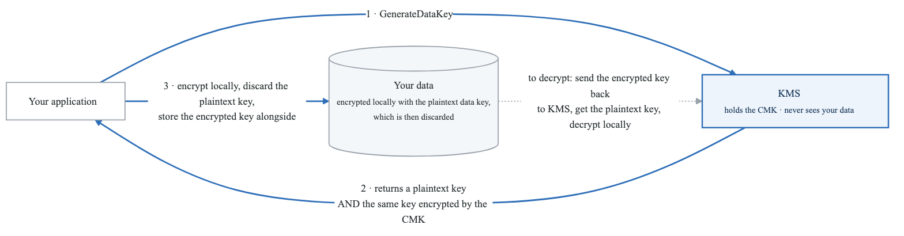
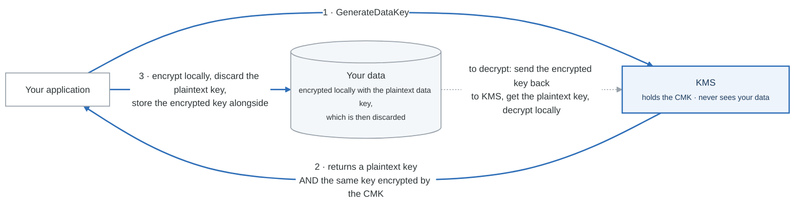

# 01 — KMS & Encryption

## Overview

AWS Key Management Service (KMS) is the backbone of encryption across nearly every AWS service. Understanding KMS key types, envelope encryption, key policies, and when to use CloudHSM instead is critical for the SAA-C03 exam. Expect 5-8 questions that directly or indirectly involve KMS.

---

## KMS Key Types

### Three Categories of KMS Keys

| Property | AWS Owned Keys | AWS Managed Keys | Customer Managed Keys (CMKs) |
|----------|---------------|------------------|------------------------------|
| **Who creates it** | AWS (internal) | AWS (in your account) | You |
| **Visible in your account** | No | Yes (alias: `aws/<service>`) | Yes |
| **Key policy editable** | No | No (view only) | Yes — full control |
| **Rotation** | Varies by service | Automatic every year (mandatory) | Optional — automatic every year if enabled |
| **Cost** | Free | Free (just pay per API call) | $1/month per key + API calls |
| **Use case** | Default encryption (SSE-S3) | Service-integrated encryption (SSE-KMS default) | Full control, cross-account, custom policies |
| **Example** | S3 SSE-S3 encryption | RDS default encryption key | Your own key for S3 SSE-KMS |
| **Can disable/delete** | No | No | Yes |

### Exam Tip
- "AWS managed key" = the key with alias `aws/s3`, `aws/ebs`, `aws/rds`, etc.
- "Customer managed key" = you created it, you control the key policy, you can grant cross-account access.
- If a question says "the company must control key rotation schedule" or "must be able to disable the key" or "grant cross-account access" => Customer Managed Key.

---

## Symmetric vs Asymmetric Keys

| Property | Symmetric (AES-256-GCM) | Asymmetric (RSA, ECC) |
|----------|-------------------------|----------------------|
| **Key material** | Single 256-bit key | Public + private key pair |
| **Never leaves KMS unencrypted** | Yes | Private key: yes. Public key: downloadable |
| **Who can use it** | Only via KMS API calls | Public key usable outside AWS |
| **Use case** | Encrypt/decrypt data, envelope encryption, most AWS service integrations | Digital signatures, encryption outside AWS (clients who cannot call KMS API) |
| **Performance** | Faster | Slower |
| **Default for new keys** | Yes | No (must explicitly choose) |

### When to Use Asymmetric Keys
- Users outside AWS need to encrypt data without calling KMS API
- Digital signature verification (code signing, document signing)
- Integration with systems that require RSA/ECC keys

### Exam Tip
If a question mentions "users who cannot make AWS API calls need to encrypt data," the answer is asymmetric KMS key with the public key downloaded.

---

## Key Rotation

### Automatic Rotation
- **Customer managed keys only** (symmetric)
- Rotates the backing key (cryptographic material) every year when enabled
- Old backing keys are preserved (so old ciphertext can still be decrypted)
- The key ID and ARN do NOT change — only the backing key rotates
- Transparent to applications

### Manual Rotation
- Create a new KMS key entirely
- Update applications/aliases to point to the new key
- Old key must be kept to decrypt old data
- Required for asymmetric keys (automatic rotation not supported)
- Required when you need rotation more frequently than once per year

### Imported Key Material
- You can import your own key material into KMS
- Automatic rotation is NOT supported — you must rotate manually
- You can set an expiration date on imported key material
- If key material is deleted or expires, all data encrypted with it becomes unrecoverable

---

## Key Policies and Grants

### Key Policies
Every KMS key has a key policy (similar to S3 bucket policy). Without a key policy, NO ONE can access the key — not even the root account.

**Default Key Policy:**
```json
{
  "Sid": "Enable IAM policies",
  "Effect": "Allow",
  "Principal": { "AWS": "arn:aws:iam::123456789012:root" },
  "Action": "kms:*",
  "Resource": "*"
}
```
This default policy allows IAM policies in the account to grant access to the key. Without this statement, IAM policies alone cannot grant KMS access.

**Cross-Account Access (two steps):**
1. Key policy in Account A allows Account B's root (or specific roles)
2. IAM policy in Account B grants the user/role permission to use the key

### Grants
- Temporary, scoped permissions to use a KMS key
- Created programmatically (not in the console)
- Used by AWS services internally (e.g., EBS encrypts a volume, creates a grant for EC2 to decrypt)
- Can be revoked independently of key policies
- Use case: delegate encryption/decryption to a specific service or operation without modifying the key policy

---

## Envelope Encryption — Step by Step

Envelope encryption is how KMS encrypts data larger than 4 KB. The exam loves testing this concept.

### Why Envelope Encryption?
- KMS `Encrypt` API can only encrypt data up to **4 KB** directly
- For larger data (files, database fields, etc.), you use envelope encryption
- The data key encrypts your data; KMS encrypts the data key

### The Process

<!-- figure: generated from the Mermaid below by _shared/diagrams/embed-figures.py — do not edit the image -->


<details>
<summary>Diagram source (Mermaid)</summary>



</details>

### Key Points for the Exam
1. The CMK (master key) never leaves KMS
2. The plaintext data key is used locally and must be discarded after use
3. Only the encrypted data key is stored alongside the ciphertext
4. `GenerateDataKey` returns both plaintext AND encrypted versions of the data key
5. `GenerateDataKeyWithoutPlaintext` returns ONLY the encrypted data key (for later use)
6. The actual data encryption/decryption happens in your application, NOT in KMS

---

## Multi-Region Keys

- Same key material replicated across multiple AWS regions
- Same key ID in each region (except for region prefix)
- Encrypt in one region, decrypt in another without cross-region API calls
- NOT global — you choose which regions to replicate to
- Use cases: global DynamoDB tables, global Aurora, disaster recovery
- One primary key, multiple replica keys
- Key policy, grants, and aliases are managed independently per region

### Exam Tip
If a question mentions "encrypt in us-east-1, decrypt in eu-west-1 with low latency" or "global client-side encryption," think multi-region KMS keys.

---

## CloudHSM

### What Is CloudHSM?
- Dedicated Hardware Security Module (HSM) in AWS
- **FIPS 140-2 Level 3** validated (KMS is Level 2)
- You manage your own keys — AWS has NO access to your key material
- Runs in your VPC
- Supports symmetric, asymmetric, and hashing operations
- High availability: deploy HSMs across multiple AZs in a cluster

### When to Use CloudHSM
- Regulatory requirement for FIPS 140-2 Level 3
- You need full, exclusive control of key material (AWS cannot access it)
- You need to perform cryptographic operations that KMS does not support
- SSL/TLS offloading for web servers
- Oracle Transparent Data Encryption (TDE)
- Microsoft SQL Server TDE
- Custom key store for KMS (link CloudHSM to KMS)

---

## KMS vs CloudHSM Comparison Table

| Feature | KMS | CloudHSM |
|---------|-----|----------|
| **FIPS 140-2** | Level 2 (some Level 3 on backend) | **Level 3** |
| **Key management** | Shared (multi-tenant backend) | **Dedicated HSM hardware** |
| **AWS access to keys** | Yes (AWS manages backend) | **No — you own the keys exclusively** |
| **Availability** | Managed by AWS (HA built-in) | You manage cluster (multi-AZ recommended) |
| **Integration** | Native with 100+ AWS services | Requires custom integration (or KMS custom key store) |
| **Key types** | Symmetric (AES-256), Asymmetric (RSA, ECC) | Symmetric, Asymmetric, Hashing, SSL/TLS |
| **Pricing** | $1/month/key + $0.03/10K API calls | ~$1.50/hour per HSM (~$1,100/month) |
| **Free tier** | 20,000 free requests/month | **No free tier** |
| **Multi-region** | Yes (multi-region keys) | No (manual replication) |
| **Exam scenario** | Default choice for encryption | FIPS 140-2 Level 3, exclusive control, Oracle/SQL Server TDE |

---

## Encryption Types Across AWS Services

| Service | Encryption at Rest | Encryption in Transit | Key Management |
|---------|-------------------|----------------------|----------------|
| **S3** | SSE-S3, SSE-KMS, SSE-C, client-side | HTTPS (TLS) | KMS or customer-provided |
| **EBS** | AES-256 via KMS | Encrypted between EC2 and EBS | KMS (AWS or customer managed) |
| **RDS** | AES-256 via KMS | SSL/TLS connections | KMS |
| **DynamoDB** | AES-256 (default, AWS owned or KMS) | HTTPS (TLS) | AWS owned or KMS |
| **EFS** | KMS | TLS (in-transit encryption option) | KMS |
| **Redshift** | AES-256 via KMS or CloudHSM | SSL | KMS or CloudHSM |
| **Lambda** | Environment variables encrypted by KMS | HTTPS | KMS |

---

## Common Exam Scenarios

| Scenario | Answer |
|----------|--------|
| "Company needs to control key rotation" | Customer managed KMS key |
| "Must share encrypted snapshots cross-account" | Customer managed KMS key (modify key policy) |
| "FIPS 140-2 Level 3 compliance" | CloudHSM |
| "Encrypt data > 4KB" | Envelope encryption (GenerateDataKey) |
| "Encrypt data and AWS must not have access to keys" | CloudHSM |
| "Oracle TDE encryption" | CloudHSM |
| "Encrypt in one region, decrypt in another" | Multi-region KMS key |
| "Client outside AWS needs to encrypt data" | Asymmetric KMS key (download public key) |
| "Default S3 encryption at no key cost" | SSE-S3 (AWS owned key) |
| "Cheapest KMS encryption for S3" | SSE-S3 (free) or SSE-KMS with AWS managed key (free key, pay per request) |

---

## Key Terms to Remember

- **CMK (Customer Master Key):** Now called "KMS key" in AWS docs, but exam may use either term
- **Data Key:** Generated by `GenerateDataKey`, used for envelope encryption
- **Ciphertext Blob:** Encrypted version of a data key or small piece of data
- **Key Alias:** Friendly name for a key (e.g., `alias/my-app-key`)
- **Key Material:** The actual cryptographic secret inside the key
- **Backing Key:** The cryptographic material that rotates (key ID stays the same)

---

## Next Steps

- Complete **Lab 01: KMS Encryption** to practice creating keys and encrypting data
- Continue to **Note 02: Secrets & Certificates** for Secrets Manager, Parameter Store, and ACM

<!-- feynman-check -->

---

## Feynman check

Close the file. Blank page, no notes. Explain each of these to a competent engineer who has never
used this tool — **under five minutes, no jargon you can't define on the spot:**

- KMS Key Types
- Symmetric vs Asymmetric Keys
- Key Rotation
- Key Policies and Grants

**The gap is not what you forgot. It is where you used a word instead of a mechanism.**

| | |
|---|---|
| ✗ | *"The security group allows the traffic."* |
| ✓ | *"A security group is a stateful allow-list attached to an ENI. Traffic matching an inbound rule is permitted and the reply is permitted automatically, because the connection is tracked — which is why you never write an outbound rule for a reply."* |

**Trace it:** A request from the internet to an instance in a private subnet. Name every hop, every route-table lookup, and every rule evaluated, in order.

Stop at the first component you cannot name. Reopen this file and read **only** that.

**Go deeper — only once the gap has a name:** [Timeouts, retries and backoff with jitter](https://aws.amazon.com/builders-library/timeouts-retries-and-backoff-with-jitter/) — 15 minutes from the AWS Builders' Library, and it changes how you write every client you touch afterwards.
Full list per domain: [`SOURCES.md`](../SOURCES.md#aws)

→ Protocol, the three levels of knowing, and worked examples: [`MASTERY.md`](../MASTERY.md)

<!-- /feynman-check -->
