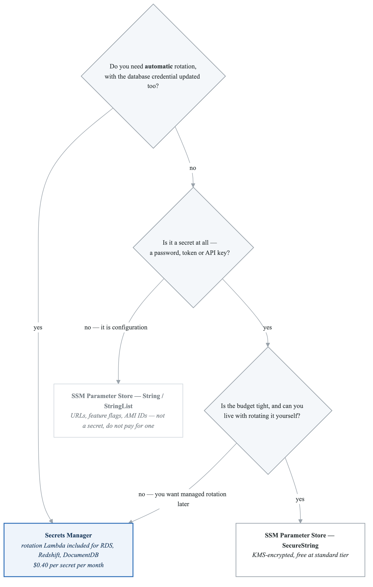
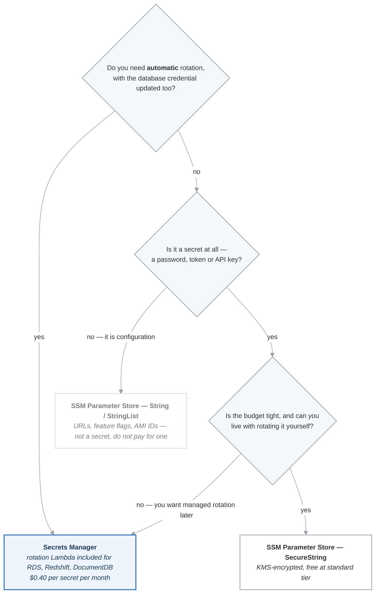
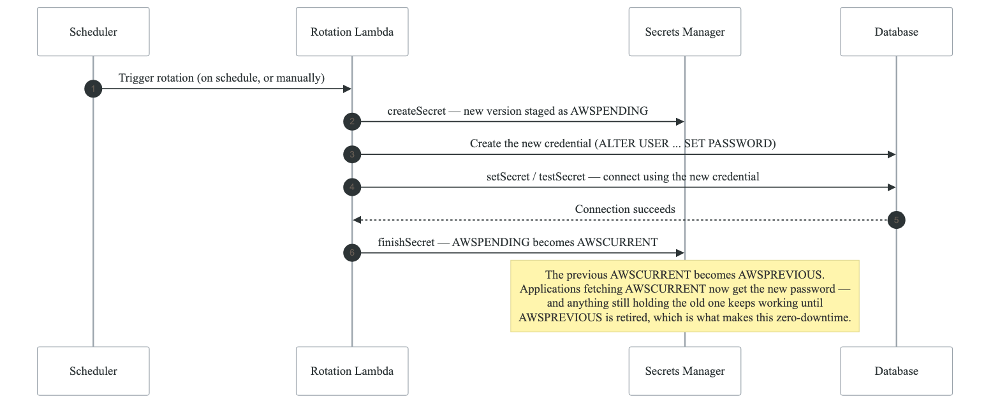
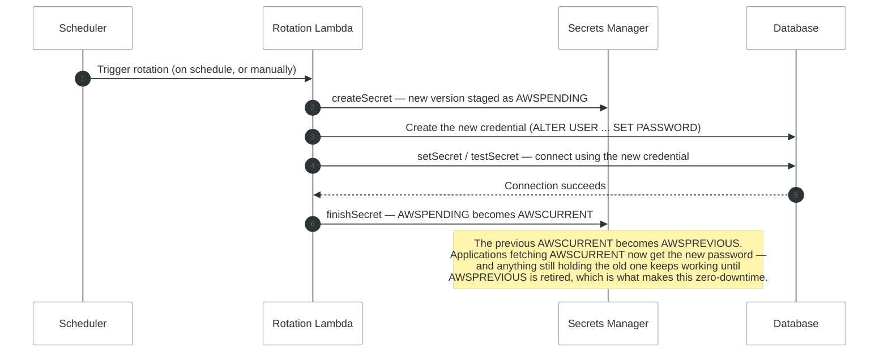

# 02 — Secrets Manager, SSM Parameter Store & ACM

## Overview

AWS provides two primary services for storing secrets and configuration data: **Secrets Manager** and **SSM Parameter Store**. Understanding when to use each is a frequent exam topic. **ACM (AWS Certificate Manager)** manages SSL/TLS certificates. This note covers all three.

---

## Secrets Manager vs SSM Parameter Store — Comparison Table

| Feature | Secrets Manager | SSM Parameter Store |
|---------|----------------|-------------------|
| **Primary purpose** | Store and rotate secrets (DB credentials, API keys) | Store configuration data and secrets |
| **Automatic rotation** | Yes — built-in Lambda rotation (RDS, Redshift, DocumentDB native) | No — you must build custom rotation |
| **Rotation interval** | Configurable (e.g., every 30, 60, 90 days) | Manual or custom automation |
| **Max secret size** | 64 KB | 4 KB (standard) / 8 KB (advanced) |
| **Versioning** | Yes (AWSCURRENT, AWSPREVIOUS, staging labels) | Yes (built-in versioning) |
| **Encryption** | Mandatory (KMS) | Optional for String/StringList, mandatory for SecureString |
| **Parameter types** | Secret value only | String, StringList, SecureString |
| **Hierarchy / paths** | No path hierarchy | Yes — `/app/prod/db/password` (tree structure) |
| **Cross-account access** | Yes (resource-based policy) | Yes (via IAM + KMS policy) |
| **CloudFormation integration** | Dynamic reference: `{{resolve:secretsmanager:...}}` | Dynamic reference: `{{resolve:ssm:...}}` |
| **Cost** | **$0.40/secret/month** + $0.05/10K API calls | **Free** (standard tier, up to 10K params) / $0.05/advanced param/month |
| **Free tier** | 30-day free trial | Yes — standard tier is free |
| **API throughput** | 10K requests/second | 40 TPS standard / 1,000 TPS higher throughput (advanced) |
| **Notification on change** | CloudTrail + EventBridge | CloudTrail + EventBridge + Parameter change notifications |
| **Best for** | Database credentials, API keys that need rotation | App config, feature flags, non-rotating secrets, AMI IDs |

### Decision Framework

<!-- figure: generated from the Mermaid below by _shared/diagrams/embed-figures.py — do not edit the image -->


<details>
<summary>Diagram source (Mermaid)</summary>



</details>

---

## Secrets Manager — Deep Dive

### How Automatic Rotation Works

<!-- figure: generated from the Mermaid below by _shared/diagrams/embed-figures.py — do not edit the image -->


<details>
<summary>Diagram source (Mermaid)</summary>



</details>

### Native Rotation Support
- Amazon RDS (MySQL, PostgreSQL, Oracle, SQL Server, MariaDB)
- Amazon Aurora
- Amazon Redshift
- Amazon DocumentDB
- Other services: custom Lambda rotation function required

### Key Features
- **Resource-based policy:** Share secrets across accounts without custom KMS key policy configuration
- **Replication:** Replicate secrets to other regions for disaster recovery
- **Caching:** Use the Secrets Manager caching library (Python, Java, Go, .NET) to reduce API calls and latency

### Boto3 Example — Retrieve a Secret

```python
import boto3
import json

def get_secret(secret_name, region="us-east-1"):
    client = boto3.client("secretsmanager", region_name=region)
    response = client.get_secret_value(SecretId=secret_name)

    # Secrets can be string or binary
    if "SecretString" in response:
        secret = json.loads(response["SecretString"])
        return secret
    else:
        return response["SecretBinary"]

# Usage
creds = get_secret("prod/myapp/database")
db_host = creds["host"]
db_user = creds["username"]
db_pass = creds["password"]
```

---

## SSM Parameter Store — Deep Dive

### Parameter Types

| Type | Encryption | Use Case |
|------|-----------|----------|
| `String` | None | Plain text config values, URLs, AMI IDs |
| `StringList` | None | Comma-separated list of values |
| `SecureString` | KMS encryption | Passwords, API keys, connection strings |

### Standard vs Advanced Tiers

| Feature | Standard | Advanced |
|---------|----------|----------|
| **Max parameters** | 10,000 per account/region | 100,000 |
| **Max value size** | 4 KB | 8 KB |
| **Parameter policies** | No | Yes (expiration, notification) |
| **Cost** | Free | $0.05/advanced param/month |
| **Throughput** | 40 TPS (default), 1,000 TPS (adjustable) | 1,000 TPS (default) |

### Parameter Hierarchy

**`/myapp/`**

- `prod/`
  - `db/host` — = "prod-db.example.com"
  - `db/port` — = "5432"
  - `db/password` — = (SecureString) "s3cur3P@ss"
  - `api/url` — = "https://api.prod.example.com"
- `dev/`
  - `db/host` — = "dev-db.example.com"
  - `db/port` — = "5432"
  - `db/password` — = (SecureString) "devP@ss123"
  - `api/url` — = "https://api.dev.example.com"


Use `GetParametersByPath` to fetch all parameters under a path:

```python
import boto3

ssm = boto3.client("ssm")
response = ssm.get_parameters_by_path(
    Path="/myapp/prod/db",
    Recursive=True,
    WithDecryption=True  # Decrypt SecureString parameters
)

for param in response["Parameters"]:
    print(f"{param['Name']} = {param['Value']}")
```

---

## ACM (AWS Certificate Manager)

### Key Concepts

- **Free public SSL/TLS certificates** for use with integrated AWS services
- **Regional service** — certificates must be in the same region as the resource, EXCEPT CloudFront (must be in `us-east-1`)
- **Automatic renewal** for ACM-issued certificates (DNS or email validation)
- **Cannot export** ACM-issued certificates (private key stays in ACM)
- For EC2, you need a third-party certificate (ACM certs cannot be installed directly on EC2)

### ACM Integration Points

| Service | Certificate Region | Use Case |
|---------|-------------------|----------|
| **ALB** | Same region as ALB | HTTPS termination at load balancer |
| **NLB** | Same region as NLB | TLS termination |
| **CloudFront** | **us-east-1 only** | HTTPS for CDN distributions |
| **API Gateway** | Same region as API | Custom domain HTTPS |
| **Elastic Beanstalk** | Via ALB (same region) | Application HTTPS |

### Validation Methods

| Method | How It Works | Best For |
|--------|-------------|----------|
| **DNS validation** | Add a CNAME record to your DNS | Automated with Route 53, auto-renewal |
| **Email validation** | AWS sends email to domain contacts | When you cannot modify DNS |

### Exam Tips
- "Free SSL/TLS certificate for ALB" => ACM
- "HTTPS on CloudFront with custom domain" => ACM certificate in **us-east-1**
- "Install SSL certificate directly on EC2" => NOT ACM (use third-party cert or ACM Private CA)
- "Certificate auto-renewal" => ACM with DNS validation

---

## Common Exam Scenarios

| Scenario | Answer |
|----------|--------|
| "Automatically rotate database credentials every 30 days" | Secrets Manager with native rotation |
| "Store application config values at no cost" | SSM Parameter Store (standard, String type) |
| "Store a license key securely, budget is tight" | SSM Parameter Store SecureString |
| "Share a secret with another AWS account" | Secrets Manager with resource-based policy |
| "Fetch all config for an environment in one call" | SSM Parameter Store GetParametersByPath |
| "Free SSL for ALB" | ACM public certificate |
| "HTTPS on CloudFront" | ACM cert in us-east-1 |
| "SSL cert on EC2 instance" | Third-party cert (not ACM) |
| "Secret should expire in 90 days" | SSM Parameter Store Advanced (parameter policies) or Secrets Manager (rotation schedule) |
| "Lambda needs database password" | Secrets Manager (use caching library for performance) |

---

## Next Steps

- Complete **Lab 02: Secrets Management** to practice both services hands-on
- Continue to **Note 03: Network Security** for WAF, Shield, and Firewall Manager

<!-- feynman-check -->

---

## Feynman check

Close the file. Blank page, no notes. Explain each of these to a competent engineer who has never
used this tool — **under five minutes, no jargon you can't define on the spot:**

- Secrets Manager vs SSM Parameter Store — Comparison Table
- Secrets Manager — Deep Dive
- SSM Parameter Store — Deep Dive
- ACM (AWS Certificate Manager)

**The gap is not what you forgot. It is where you used a word instead of a mechanism.**

| | |
|---|---|
| ✗ | *"The security group allows the traffic."* |
| ✓ | *"A security group is a stateful allow-list attached to an ENI. Traffic matching an inbound rule is permitted and the reply is permitted automatically, because the connection is tracked — which is why you never write an outbound rule for a reply."* |

**Trace it:** A request from the internet to an instance in a private subnet. Name every hop, every route-table lookup, and every rule evaluated, in order.

Stop at the first component you cannot name. Reopen this file and read **only** that.

**Go deeper — only once the gap has a name:** [Timeouts, retries and backoff with jitter](https://aws.amazon.com/builders-library/timeouts-retries-and-backoff-with-jitter/) — 15 minutes from the AWS Builders' Library, and it changes how you write every client you touch afterwards.
Full list per domain: [`SOURCES.md`](../SOURCES.md#aws)

→ Protocol, the three levels of knowing, and worked examples: [`MASTERY.md`](../MASTERY.md)

<!-- /feynman-check -->
