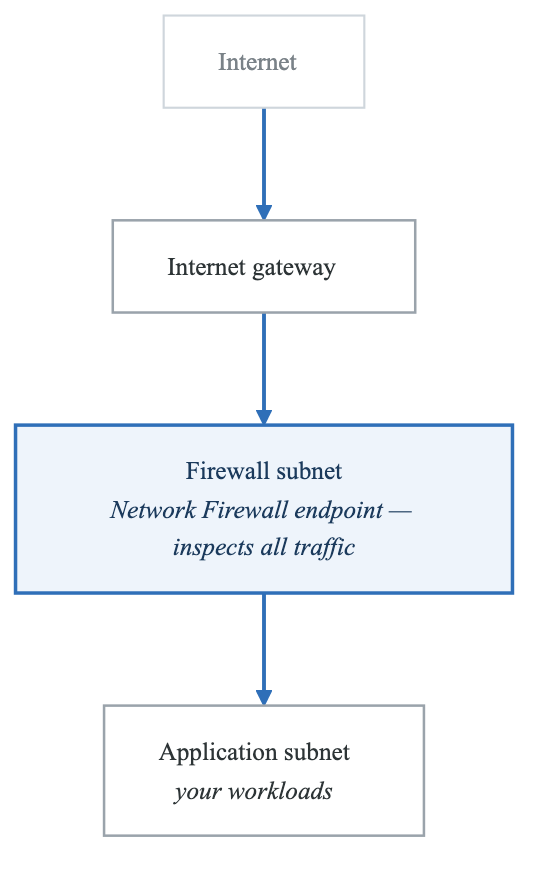
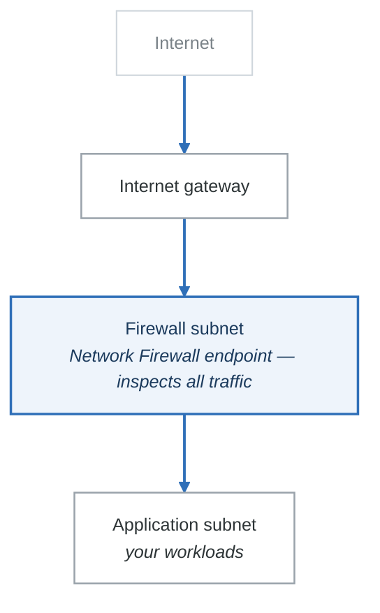

# 03 — Network Security (WAF, Shield, Firewall Manager, Network Firewall)

## Overview

AWS provides multiple layers of network security services. Understanding which service operates at which layer and when to use each is essential for the exam. This note covers WAF (Layer 7), Shield (DDoS), Firewall Manager (central management), Network Firewall (VPC-level), and AWS Verified Access.

---

## AWS WAF (Web Application Firewall)

### What It Does
- Protects web applications from common web exploits at **Layer 7 (HTTP/HTTPS)**
- Filters requests based on rules you define
- Deployed on **ALB, API Gateway, CloudFront, AppSync, Cognito User Pool**

### Key Components

| Component | Description |
|-----------|-------------|
| **Web ACL** | Container for rules; associated with AWS resources. One Web ACL per resource. |
| **Rules** | Individual conditions that inspect requests |
| **Rule Groups** | Reusable collection of rules |
| **Managed Rule Groups** | Pre-built rules by AWS or Marketplace sellers |
| **IP Sets** | Named list of IP addresses/CIDR ranges for allow/block |
| **Regex Pattern Sets** | Named set of regex patterns to match |

### Rule Types

| Rule Type | What It Checks | Example |
|-----------|---------------|---------|
| **IP-based** | Source IP address | Block known bad IPs, allow corporate CIDR |
| **Rate-based** | Request count per IP in 5-minute window | Block IPs exceeding 2,000 requests/5 min |
| **String match** | URI, query string, headers, body | Block requests containing `../` (path traversal) |
| **Regex match** | Pattern matching on request components | Block SQL injection patterns |
| **Geo match** | Country of origin | Block traffic from specific countries |
| **Size constraint** | Size of request components | Block requests with body > 10 KB |
| **Managed rules** | Pre-built rule sets | AWS Core Rule Set, SQL injection, XSS |

### Managed Rule Groups (Common Ones for Exam)

| Rule Group | Protects Against |
|------------|-----------------|
| **AWSManagedRulesCommonRuleSet** | OWASP Top 10, common exploits |
| **AWSManagedRulesSQLiRuleSet** | SQL injection |
| **AWSManagedRulesKnownBadInputsRuleSet** | Known bad request patterns |
| **AWSManagedRulesAmazonIpReputationList** | Known malicious IPs |
| **AWSManagedRulesBotControlRuleSet** | Bot traffic (additional cost) |

### Rate-Based Rules
- Count requests per IP over a **5-minute period**
- If threshold exceeded, automatically block the IP
- Threshold range: **100 to 20,000,000** requests per 5 minutes
- Automatically unblocks when rate drops below threshold
- Use case: brute force login protection, DDoS mitigation at Layer 7

### WAF Pricing (Budget Warning)
- $5.00/month per Web ACL
- $1.00/month per rule
- $0.60/million requests inspected
- Managed rule groups: varies ($1-20/month depending on group)
- **Delete Web ACLs immediately after labs**

---

## AWS Shield

### Shield Standard vs Shield Advanced

| Feature | Shield Standard | Shield Advanced |
|---------|----------------|-----------------|
| **Cost** | **Free** (automatic) | **$3,000/month** + 1-year commitment |
| **Protection** | Layer 3/4 DDoS (SYN floods, UDP reflection, etc.) | Layer 3/4/7 DDoS + advanced attack mitigation |
| **Enabled by default** | Yes, for all AWS customers | Must explicitly subscribe |
| **Resources protected** | All AWS resources | ALB, NLB, CloudFront, Global Accelerator, Route 53, EC2 EIPs |
| **DDoS Response Team (DRT)** | No | Yes — 24/7 access |
| **Cost protection** | No | Yes — credits for scaling charges caused by DDoS |
| **WAF integration** | No | WAF included at no extra cost for protected resources |
| **Real-time metrics** | No | Yes — CloudWatch metrics, near-real-time visibility |
| **Automatic application layer mitigation** | No | Yes — auto-creates WAF rules during attack |
| **Health-based detection** | No | Yes — uses Route 53 health checks for detection |

### Exam Tips for Shield
- "DDoS protection" with no budget constraint => Shield Advanced
- "DDoS protection" for budget-conscious company => Shield Standard (free, automatic)
- "24/7 DDoS response team" => Shield Advanced
- "Cost protection during DDoS attack" => Shield Advanced
- Shield Standard is ALWAYS on — you cannot turn it off

---

## AWS Firewall Manager

### What It Does
- **Centralized management** of firewall rules across multiple accounts in an **AWS Organization**
- Requires AWS Organizations with all features enabled
- Requires a Firewall Manager administrator account

### What It Manages

| Service | What Firewall Manager Configures |
|---------|----------------------------------|
| **WAF** | Web ACLs and rules across all accounts |
| **Shield Advanced** | Protection for resources across all accounts |
| **Security Groups** | Common security group policies, unused SG cleanup |
| **Network Firewall** | Network Firewall policies across VPCs |
| **Route 53 Resolver DNS Firewall** | DNS filtering rules |

### Key Benefit
- When a new account joins the Organization, Firewall Manager **automatically applies policies** to new resources
- Single pane of glass for all firewall rules across the organization

### Exam Tip
"Manage WAF rules across all accounts in the organization" or "automatically apply security groups to new accounts" => Firewall Manager.

---

## AWS Network Firewall

### What It Does
- **VPC-level stateful and stateless firewall** for all traffic entering/leaving a VPC
- Sits at the VPC perimeter (deployed in a dedicated firewall subnet)
- Operates at Layers 3-7
- Managed service — AWS handles scaling, availability

### Key Features

| Feature | Description |
|---------|-------------|
| **Stateless rules** | Inspect each packet independently (like NACLs but more powerful). 5-tuple: source/dest IP, source/dest port, protocol. |
| **Stateful rules** | Track connections, inspect traffic context. Supports Suricata-compatible IPS/IDS rules. |
| **Domain filtering** | Allow/deny traffic to specific domains (e.g., allow `*.amazonaws.com`, block everything else) |
| **TLS inspection** | Decrypt and inspect encrypted traffic (requires certificate) |
| **Custom Suricata rules** | Write IDS/IPS rules using Suricata syntax |

### Architecture
<!-- figure: generated from the Mermaid below by _shared/diagrams/embed-figures.py — do not edit the image -->

Diagram source (Mermaid)

### When to Use Network Firewall
- Need IDS/IPS at the VPC level
- Domain-based filtering for outbound traffic
- Centralized VPC egress filtering
- Suricata-compatible rule requirements

---

## AWS Verified Access

### What It Does
- Provides secure access to corporate applications **without a VPN**
- Verifies user identity AND device trust posture before granting access
- Zero Trust security model

### Key Concepts
- Integrates with identity providers (IAM Identity Center, OIDC providers)
- Integrates with device management solutions (CrowdStrike, Jamf)
- Creates access policies based on user identity + device posture
- Each application gets a Verified Access endpoint

### Exam Tip
"Provide secure access to internal applications without VPN" or "zero trust access" => AWS Verified Access.

---

## Network Security — Choosing the Right Service

| Requirement | Service |
|-------------|---------|
| Block SQL injection on web app | WAF |
| Rate limit API requests per IP | WAF (rate-based rule) |
| Block traffic from specific countries | WAF (geo match) |
| DDoS protection (free) | Shield Standard |
| DDoS protection with response team and cost protection | Shield Advanced |
| Manage WAF rules across all accounts | Firewall Manager |
| VPC-level IDS/IPS | Network Firewall |
| Filter outbound traffic by domain | Network Firewall |
| Secure app access without VPN | Verified Access |
| Block specific IPs from accessing CloudFront | WAF (IP set) |
| Protect against Layer 7 attacks | WAF + Shield Advanced |
| Protect against Layer 3/4 attacks | Shield Standard (free) or Shield Advanced |

---

## Common Exam Scenarios

| Scenario | Answer |
|----------|--------|
| "Web app under SQL injection attack" | WAF with SQL injection rule group |
| "Too many requests from single IP" | WAF rate-based rule |
| "Company needs DDoS protection, budget is limited" | Shield Standard (free, automatic) |
| "Need DDoS response team and cost protection" | Shield Advanced ($3K/month) |
| "Apply WAF rules to all accounts in org automatically" | Firewall Manager |
| "Inspect all traffic entering and leaving VPC" | Network Firewall |
| "Allow outbound traffic only to approved domains" | Network Firewall (domain filtering) |
| "Replace corporate VPN with zero trust" | Verified Access |
| "Block all traffic from Country X" | WAF geo match rule |
| "Protect ALB + CloudFront from DDoS and L7 attacks" | Shield Advanced (includes WAF) |

---

## Next Steps

- Complete **Lab 03: WAF & Shield** to create a Web ACL with rate-based rules
- Continue to **Note 04: Threat Detection & Compliance** for GuardDuty, Inspector, Macie, Config, and Security Hub

<!-- feynman-check -->

---

## Feynman check

Close the file. Blank page, no notes. Explain each of these to a competent engineer who has never
used this tool — **under five minutes, no jargon you can't define on the spot:**

- AWS WAF (Web Application Firewall)
- AWS Shield
- AWS Firewall Manager
- AWS Network Firewall

**The gap is not what you forgot. It is where you used a word instead of a mechanism.**

| | |
|---|---|
| ✗ | *"The security group allows the traffic."* |
| ✓ | *"A security group is a stateful allow-list attached to an ENI. Traffic matching an inbound rule is permitted and the reply is permitted automatically, because the connection is tracked — which is why you never write an outbound rule for a reply."* |

**Trace it:** A request from the internet to an instance in a private subnet. Name every hop, every route-table lookup, and every rule evaluated, in order.

Stop at the first component you cannot name. Reopen this file and read **only** that.

**Go deeper — only once the gap has a name:** [Timeouts, retries and backoff with jitter](https://aws.amazon.com/builders-library/timeouts-retries-and-backoff-with-jitter/) — 15 minutes from the AWS Builders' Library, and it changes how you write every client you touch afterwards.
Full list per domain: [`SOURCES.md`](../SOURCES.md#aws)

→ Protocol, the three levels of knowing, and worked examples: [`MASTERY.md`](../MASTERY.md)

<!-- /feynman-check -->
