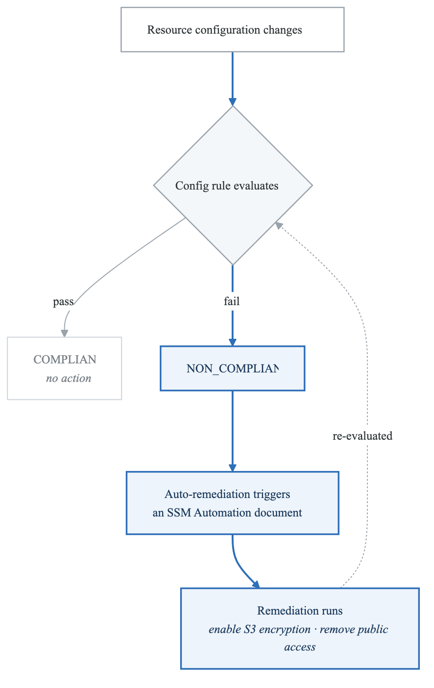
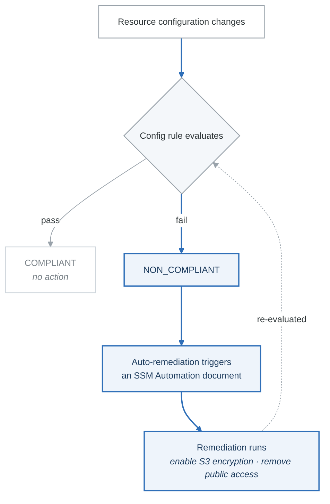

# 04 — Threat Detection & Compliance (GuardDuty, Inspector, Macie, Config, Security Hub)

## Overview

AWS offers five key services for threat detection and compliance that the exam frequently tests. The challenge is knowing which service does what since their names are not intuitive. This note provides a clear comparison and deep dive into each.

---

## Service Comparison Table — Which Service Does What?

| Feature | GuardDuty | Inspector | Macie | Config | Security Hub |
|---------|-----------|-----------|-------|--------|-------------|
| **Primary function** | Threat detection | Vulnerability scanning | Sensitive data discovery | Resource compliance | Centralized findings dashboard |
| **What it monitors** | AWS accounts, VPC flow logs, DNS logs, CloudTrail, S3, EKS, RDS, Lambda | EC2, ECR container images, Lambda functions | S3 buckets | All AWS resource configurations | Findings from GuardDuty, Inspector, Macie, Config, Firewall Manager, etc. |
| **How it works** | ML + threat intelligence | CVE scanning, network reachability analysis | ML + pattern matching for PII/secrets | Rules evaluated on config changes | Aggregates + normalizes findings |
| **Outputs** | Security findings (severity levels) | Vulnerability findings | Sensitive data findings | Compliance status (COMPLIANT / NON_COMPLIANT) | Unified findings dashboard |
| **Automated remediation** | Via EventBridge -> Lambda/SSM | Via EventBridge | Via EventBridge | Yes — auto-remediation with SSM | Via EventBridge |
| **Cost** | Per event volume (30-day free trial) | Per assessment (15-day free trial) | Per GB scanned + per S3 bucket | Per rule evaluation ($0.001 each) | Per finding ingested (30-day free trial) |
| **Key exam phrase** | "Detect compromised instances," "malicious IPs," "cryptocurrency mining" | "Find CVE vulnerabilities," "patch missing," "network exposure" | "Find PII in S3," "credit card numbers," "social security numbers" | "Resource must be compliant," "enforce tagging," "require encryption" | "Single pane of glass for security," "centralized findings" |

---

## Amazon GuardDuty

### What It Does
- **Intelligent threat detection** using ML, anomaly detection, and threat intelligence
- Continuously monitors for malicious activity and unauthorized behavior
- No software to install — just enable it

### Data Sources

| Source | What It Detects |
|--------|----------------|
| **CloudTrail management events** | Unusual API calls, unauthorized access patterns |
| **CloudTrail S3 data events** | Suspicious S3 access patterns |
| **VPC Flow Logs** | Unusual network traffic, port scanning, known bad IPs |
| **DNS logs** | Communication with known malicious domains, cryptocurrency mining DNS requests |
| **EKS Audit Logs** | Kubernetes-specific threats |
| **RDS Login Activity** | Anomalous database login attempts |
| **Lambda Network Activity** | Suspicious Lambda networking behavior |

### Finding Types (Common Exam Examples)

| Finding | What It Means |
|---------|--------------|
| `Backdoor:EC2/C&CActivity.B` | EC2 instance communicating with command-and-control server |
| `CryptoCurrency:EC2/BitcoinTool.B` | EC2 instance mining cryptocurrency |
| `UnauthorizedAccess:IAMUser/MaliciousIPCaller` | API call from known malicious IP |
| `Recon:EC2/PortProbeUnprotectedPort` | Unprotected port being probed |
| `Exfiltration:S3/MaliciousIPCaller` | S3 data accessed from malicious IP |

### Key Points
- Findings have severity levels: Low (1-3.9), Medium (4-6.9), High (7-10)
- Integrate with EventBridge to trigger automated responses
- Can be managed at Organization level (delegated administrator)
- **30-day free trial** — disable after if budget-conscious
- Does NOT prevent attacks — only detects and alerts

---

## Amazon Inspector

### What It Does
- **Automated vulnerability scanning** for compute workloads
- Checks for software vulnerabilities (CVEs) and network exposure

### What It Scans

| Target | What It Checks |
|--------|---------------|
| **EC2 instances** | OS vulnerabilities, network reachability, missing patches (requires SSM Agent) |
| **ECR container images** | Container image vulnerabilities when pushed to ECR |
| **Lambda functions** | Code dependencies for known vulnerabilities |

### Key Points
- Runs continuously (not just one-time scans)
- Uses CVE (Common Vulnerabilities and Exposures) database
- Assigns a risk score to each finding
- Sends findings to Security Hub automatically
- Network reachability analysis: checks if ports are exposed from the internet through Security Groups, NACLs, IGW, etc.

### Inspector vs GuardDuty

| Inspector | GuardDuty |
|-----------|-----------|
| "Is this software vulnerable?" | "Is this resource being attacked?" |
| Proactive scanning | Reactive detection |
| CVE-based | ML/threat intelligence-based |

---

## Amazon Macie

### What It Does
- Uses **ML and pattern matching** to discover and protect **sensitive data in S3**
- Identifies PII (Personally Identifiable Information), PHI (Protected Health Information), financial data

### What It Finds
- Credit card numbers
- Social Security numbers
- Passport numbers
- Email addresses
- API keys and credentials accidentally stored in S3
- Custom data identifiers (regex patterns you define)

### Key Points
- Works only with **S3**
- Can scan on a schedule (daily, weekly, monthly)
- Integrates with EventBridge for automated alerts/remediation
- Findings include severity and data sample location
- Great for GDPR, HIPAA, PCI-DSS compliance

### Exam Tip
Any question about "finding PII in S3" or "discovering sensitive data in S3 buckets" => Macie.

---

## AWS Config

### What It Does
- **Records and evaluates resource configurations** over time
- Answers: "Is this resource compliant with our rules?" and "How has this resource changed?"

### Key Concepts

| Concept | Description |
|---------|-------------|
| **Config Rules** | Define desired configuration (managed or custom). Evaluated when config changes or periodically. |
| **Managed Rules** | 300+ pre-built rules by AWS (e.g., `s3-bucket-server-side-encryption-enabled`) |
| **Custom Rules** | Your own rules using Lambda functions |
| **Conformance Packs** | Collection of Config rules + remediation actions deployed as a single entity |
| **Configuration Recorder** | Records all resource configurations and changes |
| **Configuration History** | Timeline of all changes to a resource |
| **Configuration Snapshot** | Point-in-time capture of all resource configs |
| **Remediation** | Automatic remediation using SSM Automation documents |

### Popular Managed Rules (Exam Favorites)

| Rule | What It Checks |
|------|---------------|
| `s3-bucket-server-side-encryption-enabled` | S3 buckets have encryption enabled |
| `s3-bucket-public-read-prohibited` | S3 buckets do not allow public read |
| `ec2-instance-no-public-ip` | EC2 instances do not have public IPs |
| `rds-instance-public-access-check` | RDS instances are not publicly accessible |
| `encrypted-volumes` | EBS volumes are encrypted |
| `required-tags` | Resources have required tags |
| `iam-password-policy` | IAM password policy meets requirements |
| `cloudtrail-enabled` | CloudTrail is enabled |
| `restricted-ssh` | Security groups do not allow SSH from 0.0.0.0/0 |

### Auto-Remediation Flow
<!-- figure: generated from the Mermaid below by _shared/diagrams/embed-figures.py — do not edit the image -->

Diagram source (Mermaid)

### Key Points
- Config is a REGIONAL service — enable in each region you use
- Can aggregate across accounts and regions with an aggregator
- Config records WHO changed what (integrates with CloudTrail)
- Evaluations are either COMPLIANT or NON_COMPLIANT
- Does not PREVENT misconfigurations — detects and optionally remediates them
- **First 25 rule evaluations per region per month are free**

---

## AWS Security Hub

### What It Does
- **Centralized dashboard** that aggregates security findings from multiple services
- Runs automated security checks against standards/benchmarks

### Data Sources
- GuardDuty findings
- Inspector findings
- Macie findings
- Config rule evaluations
- Firewall Manager findings
- IAM Access Analyzer findings
- Third-party partner findings
- Uses the **AWS Security Finding Format (ASFF)** — standardized JSON format

### Security Standards (Automated Checks)

| Standard | Description |
|----------|-------------|
| **AWS Foundational Security Best Practices** | AWS's own security best practices |
| **CIS AWS Foundations Benchmark** | Center for Internet Security benchmarks |
| **PCI DSS** | Payment Card Industry Data Security Standard |
| **NIST 800-53** | National Institute of Standards and Technology |

### Key Points
- Must enable Config in the region (Security Hub depends on Config rules)
- Cross-region and cross-account aggregation
- Findings have normalized severity (CRITICAL, HIGH, MEDIUM, LOW, INFORMATIONAL)
- Integrates with EventBridge for automation
- Free for 30 days, then per finding

### Exam Tip
"Single pane of glass for all security findings" or "centralized view of compliance" => Security Hub.

---

## Service Selection Quick Reference

| If You Need To... | Use This Service |
|-------------------|-----------------|
| Detect compromised EC2 instances | GuardDuty |
| Find cryptocurrency mining | GuardDuty |
| Detect unusual API calls | GuardDuty |
| Scan EC2 for missing patches/CVEs | Inspector |
| Scan container images for vulnerabilities | Inspector |
| Find PII in S3 buckets | Macie |
| Find credit card numbers in S3 | Macie |
| Ensure all S3 buckets are encrypted | Config |
| Enforce tagging policies | Config |
| Track resource configuration changes | Config |
| Auto-remediate non-compliant resources | Config + SSM |
| View all security findings in one place | Security Hub |
| Run CIS benchmark checks | Security Hub |
| Detect network port scanning | GuardDuty |
| Check if Lambda code has vulnerable dependencies | Inspector |

---

## Common Exam Scenarios

| Scenario | Answer |
|----------|--------|
| "EC2 instance is communicating with a known botnet" | GuardDuty |
| "Find which S3 buckets contain customer SSNs" | Macie |
| "Ensure all EBS volumes are encrypted" | Config rule (`encrypted-volumes`) |
| "Scan EC2 instances for unpatched vulnerabilities" | Inspector |
| "Centralized view of security across all accounts" | Security Hub |
| "Automatically enable encryption when S3 bucket is non-compliant" | Config rule + auto-remediation |
| "Detect unauthorized API calls from unusual location" | GuardDuty |
| "Ensure compliance with CIS benchmarks" | Security Hub (CIS standard) |
| "Track all changes to security groups over time" | Config (configuration history) |
| "Detect crypto mining on EC2" | GuardDuty |

---

## Next Steps

- Complete **Lab 04: GuardDuty & Config** to enable these services and create compliance rules
- Continue to **Note 05: Identity & Federation** for Cognito, IAM Identity Center, and STS

<!-- feynman-check -->

---

## Feynman check

Close the file. Blank page, no notes. Explain each of these to a competent engineer who has never
used this tool — **under five minutes, no jargon you can't define on the spot:**

- Service Comparison Table — Which Service Does What?
- Amazon GuardDuty
- Amazon Inspector
- Amazon Macie

**The gap is not what you forgot. It is where you used a word instead of a mechanism.**

| | |
|---|---|
| ✗ | *"The security group allows the traffic."* |
| ✓ | *"A security group is a stateful allow-list attached to an ENI. Traffic matching an inbound rule is permitted and the reply is permitted automatically, because the connection is tracked — which is why you never write an outbound rule for a reply."* |

**Trace it:** A request from the internet to an instance in a private subnet. Name every hop, every route-table lookup, and every rule evaluated, in order.

Stop at the first component you cannot name. Reopen this file and read **only** that.

**Go deeper — only once the gap has a name:** [Timeouts, retries and backoff with jitter](https://aws.amazon.com/builders-library/timeouts-retries-and-backoff-with-jitter/) — 15 minutes from the AWS Builders' Library, and it changes how you write every client you touch afterwards.
Full list per domain: [`SOURCES.md`](../SOURCES.md#aws)

→ Protocol, the three levels of knowing, and worked examples: [`MASTERY.md`](../MASTERY.md)

<!-- /feynman-check -->
