# 05 — Identity & Federation (Cognito, IAM Identity Center, STS)

## Overview

Identity federation allows users to access AWS resources using existing credentials from external identity providers (Google, SocialGraph, corporate Active Directory, etc.) instead of creating IAM users for each person. The exam tests Cognito heavily, especially the difference between User Pools and Identity Pools.

---

## Amazon Cognito

Cognito has two distinct components that work together but serve different purposes.

### User Pools vs Identity Pools

| Feature | User Pools | Identity Pools (Federated Identities) |
|---------|------------|--------------------------------------|
| **Primary function** | **Authentication** (who are you?) | **Authorization** (what can you access?) |
| **What it provides** | JWT tokens (ID token, access token, refresh token) | Temporary AWS credentials (access key, secret key, session token) |
| **User directory** | Yes — manages user sign-up, sign-in, profiles | No — does not store users |
| **Sign-up/sign-in** | Built-in hosted UI or custom UI | No sign-in capability |
| **MFA** | Yes | No (handled by upstream IdP or User Pool) |
| **Social sign-in** | Yes (Google, SocialGraph, Apple, Amazon) | Yes (via User Pool or directly) |
| **SAML/OIDC federation** | Yes (enterprise IdP like IdentityCo, Azure AD) | Yes |
| **Outputs** | JWT tokens for API authentication | AWS STS credentials for AWS service access |
| **Use case** | "Sign in to my web/mobile app" | "Access S3, DynamoDB, etc. from my app" |
| **Lambda triggers** | Yes (pre/post sign-up, pre/post auth, custom message) | No |
| **Customizable** | Hosted UI branding, Lambda triggers, custom auth flows | IAM role mapping based on user attributes |

### When You Need Both Together

Most real-world applications use **both** — User Pool for authentication, then Identity Pool to get AWS credentials.

<!-- figure: generated from the Mermaid below by _shared/diagrams/embed-figures.py — do not edit the image -->
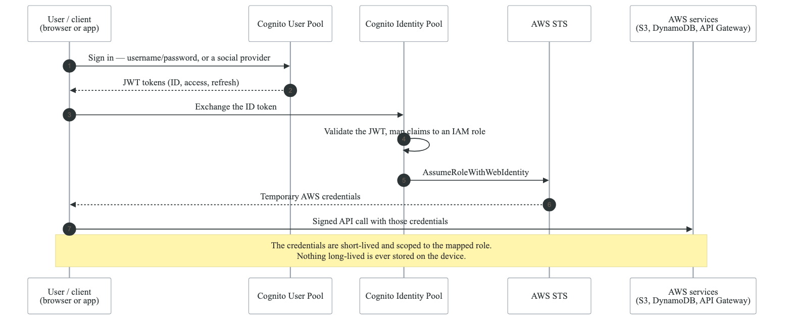

Diagram source (Mermaid)

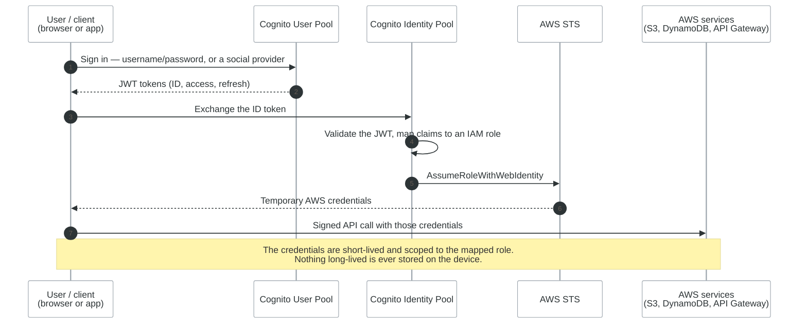

### Cognito User Pool — Authentication Flow

<!-- figure: generated from the Mermaid below by _shared/diagrams/embed-figures.py — do not edit the image -->
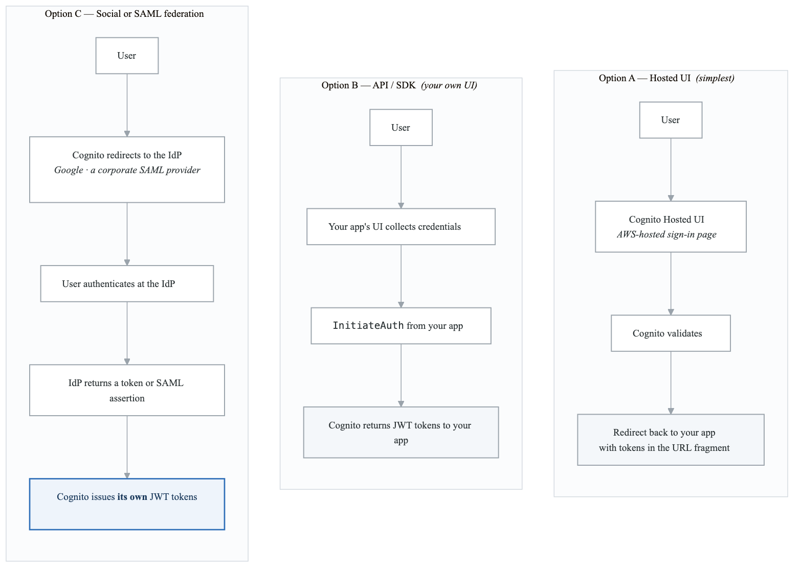

Diagram source (Mermaid)

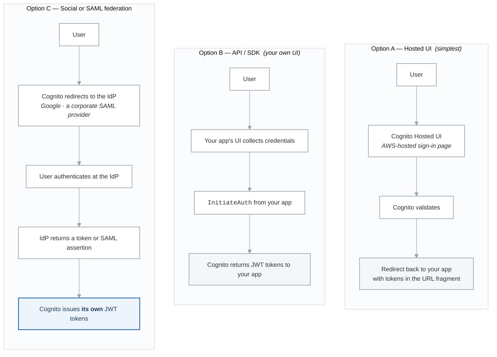

### Cognito Identity Pool — Authorization Flow

**Authenticated users**

<!-- figure: generated from the Mermaid below by _shared/diagrams/embed-figures.py — do not edit the image -->
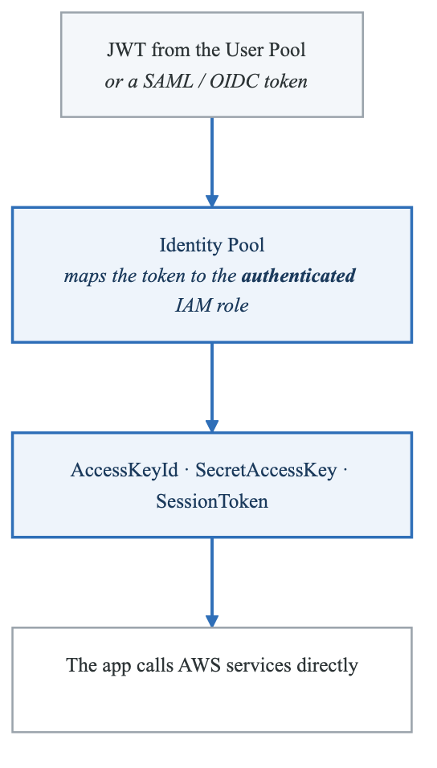

Diagram source (Mermaid)

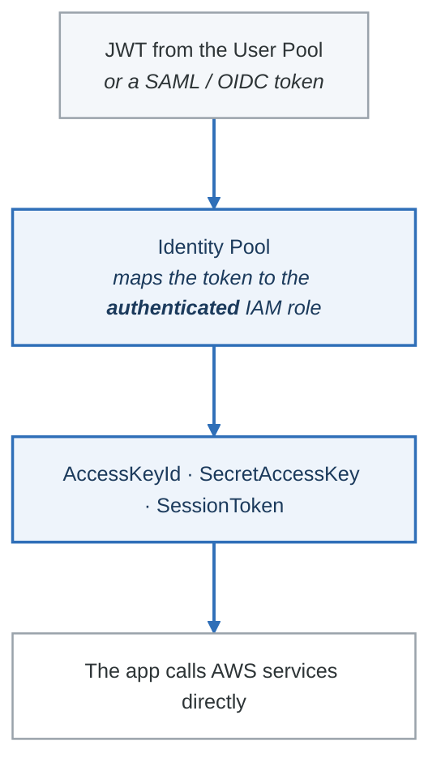

**Unauthenticated (guest) users**

<!-- figure: generated from the Mermaid below by _shared/diagrams/embed-figures.py — do not edit the image -->
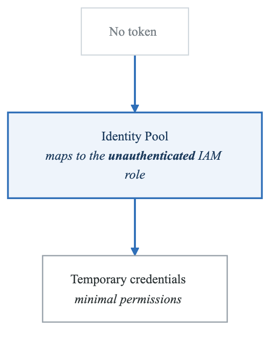

Diagram source (Mermaid)

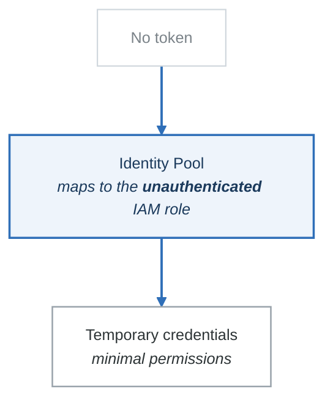

The unauthenticated role is the one that gets forgotten. It is real IAM, attached to anyone who can
reach the Identity Pool id — which is shipped inside your mobile app. Whatever it permits, the
internet permits.

### Key Cognito Features for the Exam

| Feature | Details |
|---------|---------|
| **Hosted UI** | Pre-built sign-in page with customizable branding |
| **Adaptive authentication** | Risk-based adaptive authentication (block suspicious sign-ins) |
| **Lambda triggers** | Custom logic at key points in auth flow (pre-sign-up validation, post-auth actions, custom email, migrate user) |
| **Groups** | Assign users to groups with different IAM roles |
| **Custom attributes** | Add custom fields to user profiles |
| **Password policy** | Configure minimum length, required characters |
| **Account recovery** | Email or phone verification |

---

## Federation Methods

### SAML 2.0 Federation (Enterprise)

<!-- figure: generated from the Mermaid below by _shared/diagrams/embed-figures.py — do not edit the image -->
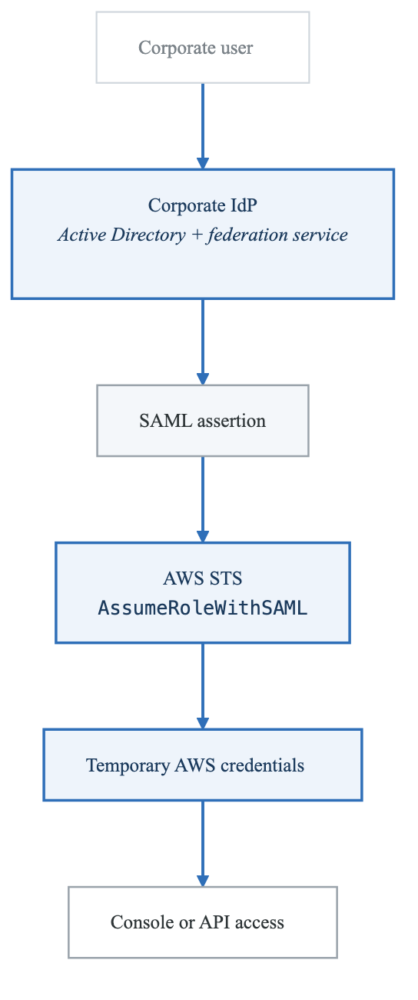

Diagram source (Mermaid)

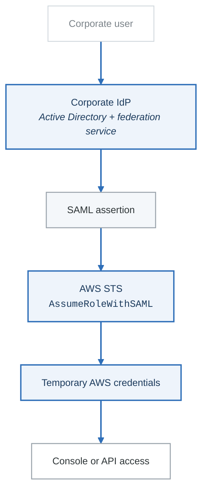

- Used for enterprise/corporate federation
- Common IdPs: Active Directory + ADFS, IdentityCo, Ping Identity, Azure AD
- User does not need an IAM user account
- STS returns temporary credentials

### OIDC (OpenID Connect) Federation

<!-- figure: generated from the Mermaid below by _shared/diagrams/embed-figures.py — do not edit the image -->
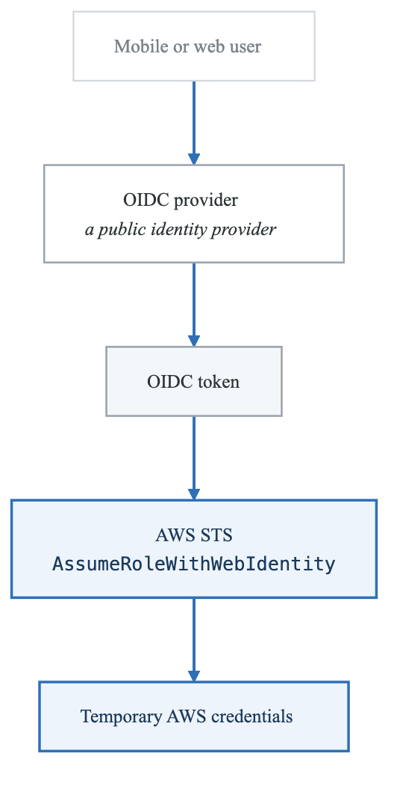

Diagram source (Mermaid)

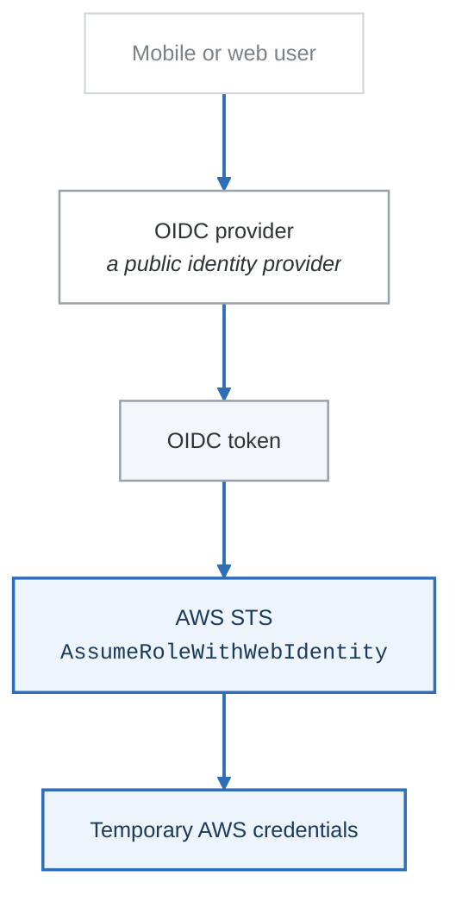

- **AWS recommends using Cognito Identity Pools instead of direct STS calls** for web/mobile apps
- Direct STS `AssumeRoleWithWebIdentity` works but Cognito is preferred (more features)

### Custom Identity Broker

<!-- figure: generated from the Mermaid below by _shared/diagrams/embed-figures.py — do not edit the image -->
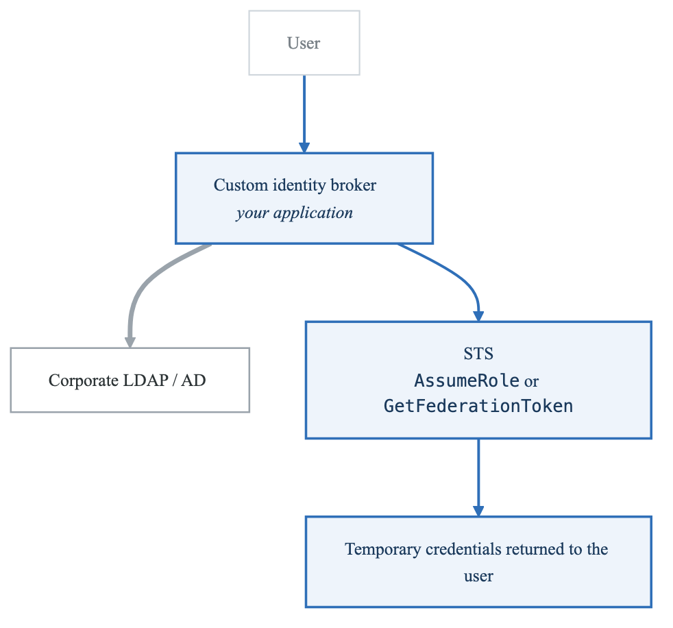

Diagram source (Mermaid)

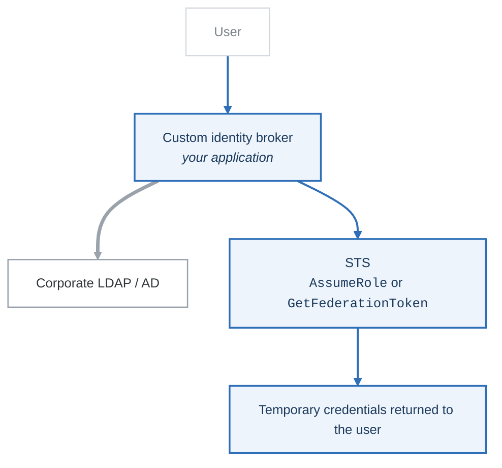

- Used when IdP is not SAML 2.0 compatible
- You build and manage the broker yourself
- Broker must have IAM permissions to call STS

---

## IAM Identity Center (formerly AWS SSO)

### What It Does
- **Single Sign-On** across multiple AWS accounts and business applications
- Central place to manage access for all AWS accounts in your Organization
- One login to access any account

### Key Features

| Feature | Description |
|---------|-------------|
| **Built-in identity store** | Create users and groups directly in IAM Identity Center |
| **External IdP** | Connect to Active Directory, IdentityCo, Azure AD via SAML 2.0 |
| **Permission Sets** | Define permissions (like IAM policies) and assign to users/groups per account |
| **AWS access portal** | Web portal where users see all accounts/apps they can access |
| **Multi-account access** | Assign different permissions per account (e.g., admin in dev, read-only in prod) |
| **Business app SSO** | SSO to Salesforce, Slack, Office 365, custom SAML apps |
| **Attribute-based access control (ABAC)** | Assign permissions based on user attributes (department, cost center) |

### IAM Identity Center vs Cognito

| IAM Identity Center | Cognito |
|---------------------|---------|
| For workforce users (employees) | For customer/external users (app users) |
| Accessing AWS accounts and business apps | Accessing your web/mobile application |
| Organization-level SSO | Application-level authentication |
| Replaces IAM users for human access | Provides user sign-up/sign-in for apps |

---

## AWS STS (Security Token Service)

### Key API Calls

| API Call | Use Case |
|----------|----------|
| `AssumeRole` | Cross-account access, least-privilege temporary access within same account |
| `AssumeRoleWithSAML` | Return temporary credentials after SAML authentication |
| `AssumeRoleWithWebIdentity` | Return temporary credentials after OIDC authentication (prefer Cognito) |
| `GetSessionToken` | MFA-protected API access (temporary credentials with MFA context) |
| `GetFederationToken` | Temporary credentials for federated users (via custom identity broker) |
| `DecodeAuthorizationMessage` | Decode an encoded authorization failure message |

### STS Credentials
- All STS credentials are temporary
- Include: AccessKeyId, SecretAccessKey, SessionToken, Expiration
- Duration: 15 minutes to 12 hours (depends on API call and role config)
- Cannot be revoked individually (but you can revoke all sessions for a role)

---

## Common Exam Scenarios

| Scenario | Answer |
|----------|--------|
| "Web app needs user sign-up with email verification" | Cognito User Pool |
| "Mobile app users need to upload to S3 directly" | Cognito User Pool (auth) + Identity Pool (AWS creds for S3) |
| "Allow unauthenticated guests limited S3 read access" | Cognito Identity Pool (unauthenticated role) |
| "Corporate users SSO into multiple AWS accounts" | IAM Identity Center |
| "Federation with Active Directory for AWS Console access" | SAML 2.0 with STS AssumeRoleWithSAML, or IAM Identity Center |
| "Social login (Google/SocialGraph) for mobile app" | Cognito User Pool with social provider |
| "10,000 external users need app access — don't create IAM users" | Cognito User Pool |
| "Employees need different permissions in dev vs prod accounts" | IAM Identity Center with Permission Sets |
| "Need MFA for API calls" | STS GetSessionToken |
| "Cross-account access from Account A to Account B" | STS AssumeRole |

---

## Next Steps

- Continue to **Note 06: CloudWatch** for metrics, alarms, logs, and dashboards
- Return to **Lab 05** after completing the monitoring notes

<!-- feynman-check -->

---

## Feynman check

Close the file. Blank page, no notes. Explain each of these to a competent engineer who has never
used this tool — **under five minutes, no jargon you can't define on the spot:**

- Amazon Cognito
- Federation Methods
- IAM Identity Center (formerly AWS SSO)
- AWS STS (Security Token Service)

**The gap is not what you forgot. It is where you used a word instead of a mechanism.**

| | |
|---|---|
| ✗ | *"The security group allows the traffic."* |
| ✓ | *"A security group is a stateful allow-list attached to an ENI. Traffic matching an inbound rule is permitted and the reply is permitted automatically, because the connection is tracked — which is why you never write an outbound rule for a reply."* |

**Trace it:** A request from the internet to an instance in a private subnet. Name every hop, every route-table lookup, and every rule evaluated, in order.

Stop at the first component you cannot name. Reopen this file and read **only** that.

**Go deeper — only once the gap has a name:** [Timeouts, retries and backoff with jitter](https://aws.amazon.com/builders-library/timeouts-retries-and-backoff-with-jitter/) — 15 minutes from the AWS Builders' Library, and it changes how you write every client you touch afterwards.
Full list per domain: [`SOURCES.md`](../SOURCES.md#aws)

→ Protocol, the three levels of knowing, and worked examples: [`MASTERY.md`](../MASTERY.md)

<!-- /feynman-check -->
