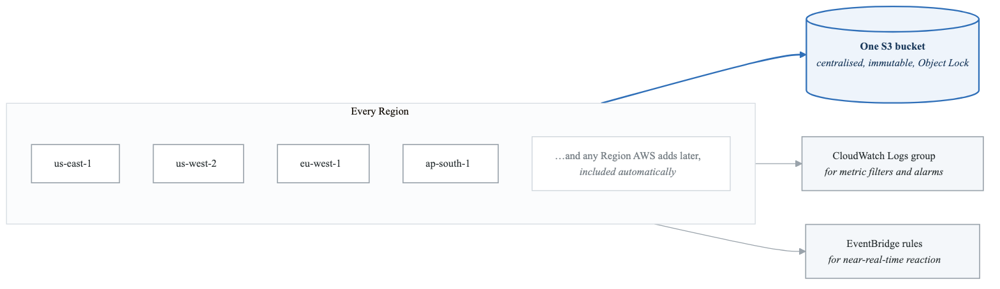
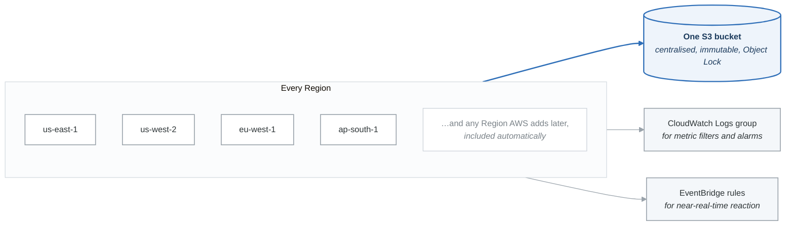

# 07 — CloudTrail, VPC Flow Logs & X-Ray

## Overview

CloudTrail records API activity ("who did what"), VPC Flow Logs record network traffic ("what traffic flowed"), and X-Ray traces requests through distributed applications ("where is the bottleneck"). Together, they provide complete visibility into your AWS environment.

---

## AWS CloudTrail

### What It Does
- Records **all API calls** made in your AWS account
- Answers: "Who did what, when, and from where?"
- Enabled by default for management events (90-day history in console)
- For long-term storage, create a trail that delivers logs to S3

### Event Types

| Event Type | What It Records | Examples | Cost |
|------------|----------------|---------|------|
| **Management Events** | Control plane operations (create, delete, configure resources) | `CreateBucket`, `RunInstances`, `CreateUser`, `AttachRolePolicy` | Free (first copy of management events per region) |
| **Data Events** | Data plane operations (read/write on resources) | `GetObject`, `PutObject` (S3), `Invoke` (Lambda) | **$0.10 per 100,000 events** — can be expensive on busy buckets |
| **Insights Events** | Unusual API activity detected by ML | Spike in `RunInstances` calls, unusual `TerminateInstances` pattern | $0.35 per 100,000 events analyzed |

### Management Events — Read vs Write

| Type | Description | Examples |
|------|-------------|---------|
| **Write events** | Modify resources | `CreateBucket`, `DeleteTable`, `RunInstances` |
| **Read events** | View/describe resources | `DescribeInstances`, `ListBuckets`, `GetBucketPolicy` |

You can configure a trail to log only write events, only read events, or both.

### Trail Configuration

| Feature | Description |
|---------|-------------|
| **Single-region trail** | Logs events only in one region |
| **Multi-region trail** | Logs events in ALL regions (recommended) |
| **Organization trail** | Logs events for ALL accounts in the organization (created from management account) |
| **S3 delivery** | Logs delivered to S3 bucket (compressed JSON files) |
| **CloudWatch Logs integration** | Stream events to CloudWatch Logs for real-time alerting |
| **EventBridge integration** | Trigger actions based on specific API calls |
| **Log file integrity** | SHA-256 hash digest files to verify logs have not been tampered with |
| **SSE-KMS encryption** | Encrypt log files with KMS key |

### Multi-Region Trail

<!-- figure: generated from the Mermaid below by _shared/diagrams/embed-figures.py — do not edit the image -->


<details>
<summary>Diagram source (Mermaid)</summary>



</details>

### Log File Integrity Validation
- CloudTrail creates a **digest file** every hour
- Digest contains SHA-256 hashes of all log files delivered in that hour
- Chain of digest files (each references the previous digest)
- Use `aws cloudtrail validate-logs` CLI command to verify
- Proves logs have not been modified or deleted
- Critical for forensics and compliance audits

### CloudTrail + EventBridge

```
API Call (e.g., someone deletes an S3 bucket)
    │
    v
CloudTrail records the event
    │
    v
EventBridge rule matches the event pattern
    │
    v
Trigger action: SNS notification, Lambda function, SSM automation
```

Example EventBridge rule pattern:
```json
{
  "source": ["aws.s3"],
  "detail-type": ["AWS API Call via CloudTrail"],
  "detail": {
    "eventName": ["DeleteBucket"]
  }
}
```

### CloudTrail Log Entry (Key Fields)

| Field | Description |
|-------|-------------|
| `eventTime` | When the API call was made |
| `eventName` | The API action (`RunInstances`, `CreateBucket`) |
| `userIdentity` | Who made the call (IAM user, role, root, service) |
| `sourceIPAddress` | IP address the call came from |
| `requestParameters` | Parameters passed to the API |
| `responseElements` | What was returned by the API |
| `errorCode` | Error code if the call failed |
| `eventSource` | Which AWS service (`ec2.amazonaws.com`, `s3.amazonaws.com`) |

---

## VPC Flow Logs

### What It Does
- Captures information about **IP traffic** going to and from network interfaces in your VPC
- Does NOT capture packet contents — only metadata (source, destination, port, protocol, action)

### Levels of Capture

| Level | What It Captures | Use Case |
|-------|-----------------|----------|
| **VPC level** | All traffic in the VPC | Full visibility |
| **Subnet level** | All traffic in a specific subnet | Targeted monitoring |
| **ENI (interface) level** | Traffic on a specific network interface | Instance-level troubleshooting |

### Destinations

| Destination | Use Case |
|-------------|----------|
| **CloudWatch Logs** | Real-time analysis, metric filters, Logs Insights queries |
| **S3** | Long-term storage, Athena queries, cost-effective |
| **Kinesis Data Firehose** | Real-time streaming to third-party tools |

### Flow Log Record Fields (Default Format)

```
<version> <account-id> <interface-id> <srcaddr> <dstaddr> <srcport> <dstport> <protocol> <packets> <bytes> <start> <end> <action> <log-status>
```

| Field | Description | Example |
|-------|-------------|---------|
| `version` | Flow log version | `2` |
| `account-id` | AWS account ID | `123456789012` |
| `interface-id` | ENI ID | `eni-0a1b2c3d4e5f` |
| `srcaddr` | Source IP | `10.0.1.5` |
| `dstaddr` | Destination IP | `10.0.2.10` |
| `srcport` | Source port | `49152` |
| `dstport` | Destination port | `443` |
| `protocol` | IANA protocol number | `6` (TCP), `17` (UDP), `1` (ICMP) |
| `packets` | Number of packets | `20` |
| `bytes` | Number of bytes | `4096` |
| `start` | Start time (Unix) | `1620000000` |
| `end` | End time (Unix) | `1620000060` |
| `action` | ACCEPT or REJECT | `ACCEPT` |
| `log-status` | Logging status | `OK`, `NODATA`, `SKIPDATA` |

### Analyzing Flow Logs — Common Patterns

**Traffic accepted by security group but rejected by NACL:**
```
action = REJECT, and you know the SG allows it
=> NACL is blocking the traffic
```

**Traffic rejected by security group:**
```
action = REJECT at the ENI level
=> Security group is blocking (most common)
```

**What Flow Logs Do NOT Capture:**
- Traffic to/from 169.254.169.254 (instance metadata)
- DHCP traffic
- Traffic to the VPC DNS server (unless using custom DNS)
- Traffic to the reserved IP of the VPC router
- Amazon Windows license activation traffic

### Querying Flow Logs with Athena

```sql
-- Find rejected traffic from external IPs
SELECT srcaddr, dstaddr, dstport, protocol, action, COUNT(*) as cnt
FROM vpc_flow_logs
WHERE action = 'REJECT'
  AND srcaddr NOT LIKE '10.%'
GROUP BY srcaddr, dstaddr, dstport, protocol, action
ORDER BY cnt DESC
LIMIT 20;
```

### Querying Flow Logs with CloudWatch Logs Insights

```
-- Top 10 source IPs with rejected traffic
fields @timestamp, srcAddr, dstAddr, dstPort, action
| filter action = "REJECT"
| stats count(*) as rejectCount by srcAddr
| sort rejectCount desc
| limit 10
```

---

## AWS X-Ray

### What It Does
- **Distributed tracing** for applications
- Traces requests as they flow through multiple services
- Identifies performance bottlenecks and errors
- Visualizes service map (which services call which)

### Key Concepts

| Concept | Description |
|---------|-------------|
| **Trace** | End-to-end path of a single request through your application |
| **Segment** | Data about work done by a single service |
| **Subsegment** | More granular data within a segment (e.g., a DynamoDB call within a Lambda function) |
| **Service Map** | Visual representation of your application's services and their connections |
| **Annotations** | Key-value pairs indexed for search (e.g., `user_id=123`) |
| **Metadata** | Key-value pairs NOT indexed (for additional data) |
| **Sampling** | Controls what percentage of requests are traced (to reduce cost) |

### Integration

| Service | How to Enable |
|---------|--------------|
| **EC2** | Install X-Ray daemon, instrument code with X-Ray SDK |
| **Lambda** | Enable "Active tracing" in function config (no daemon needed) |
| **ECS** | Run X-Ray daemon as sidecar container |
| **Elastic Beanstalk** | Enable in EB configuration |
| **API Gateway** | Enable tracing in stage settings |
| **ALB** | Passes trace headers to backend |

### Exam Tips for X-Ray
- "Trace requests across microservices" => X-Ray
- "Find which service is causing latency" => X-Ray service map
- "Debug Lambda timeout issue" => X-Ray tracing
- X-Ray is NOT for security/compliance — it is for performance debugging

---

## CloudTrail vs VPC Flow Logs vs X-Ray

| Feature | CloudTrail | VPC Flow Logs | X-Ray |
|---------|-----------|--------------|-------|
| **What it records** | API calls (who did what) | Network traffic metadata | Request traces through services |
| **Layer** | API/control plane | Network (Layer 3/4) | Application (Layer 7) |
| **Key question answered** | "Who deleted that S3 bucket?" | "Why can't instance A reach instance B?" | "Why is this API call slow?" |
| **Format** | JSON events | Text records (14+ fields) | Traces, segments, subsegments |
| **Destination** | S3, CloudWatch Logs | S3, CloudWatch Logs, Kinesis | X-Ray console |
| **Useful for** | Auditing, compliance, forensics | Network troubleshooting, security analysis | Performance debugging, bottleneck identification |

---

## Common Exam Scenarios

| Scenario | Answer |
|----------|--------|
| "Determine who deleted an S3 bucket" | CloudTrail (management event) |
| "Determine who accessed an S3 object" | CloudTrail (data event — extra cost) |
| "Log all API calls across all regions" | Multi-region CloudTrail trail |
| "Log all API calls for all accounts in org" | Organization trail |
| "Verify CloudTrail logs have not been tampered with" | Log file integrity validation |
| "Alert when someone creates an IAM user" | CloudTrail + EventBridge rule |
| "Troubleshoot why EC2 can't reach RDS" | VPC Flow Logs |
| "Find which IPs are being rejected by NACLs" | VPC Flow Logs (filter action = REJECT) |
| "Query flow logs cost-effectively at scale" | VPC Flow Logs -> S3 -> Athena |
| "Debug slow API responses across microservices" | X-Ray |
| "Visualize dependencies between Lambda, DynamoDB, and SQS" | X-Ray service map |

---

## Next Steps

- Complete **Lab 06: CloudTrail & Flow Logs** to enable multi-region logging and analyze flow logs
- Continue to **Note 08: Systems Manager** for operational management tools

<!-- feynman-check -->

---

## Feynman check

Close the file. Blank page, no notes. Explain each of these to a competent engineer who has never
used this tool — **under five minutes, no jargon you can't define on the spot:**

- AWS CloudTrail
- VPC Flow Logs
- AWS X-Ray
- CloudTrail vs VPC Flow Logs vs X-Ray

**The gap is not what you forgot. It is where you used a word instead of a mechanism.**

| | |
|---|---|
| ✗ | *"The security group allows the traffic."* |
| ✓ | *"A security group is a stateful allow-list attached to an ENI. Traffic matching an inbound rule is permitted and the reply is permitted automatically, because the connection is tracked — which is why you never write an outbound rule for a reply."* |

**Trace it:** A request from the internet to an instance in a private subnet. Name every hop, every route-table lookup, and every rule evaluated, in order.

Stop at the first component you cannot name. Reopen this file and read **only** that.

**Go deeper — only once the gap has a name:** [Timeouts, retries and backoff with jitter](https://aws.amazon.com/builders-library/timeouts-retries-and-backoff-with-jitter/) — 15 minutes from the AWS Builders' Library, and it changes how you write every client you touch afterwards.
Full list per domain: [`SOURCES.md`](../SOURCES.md#aws)

→ Protocol, the three levels of knowing, and worked examples: [`MASTERY.md`](../MASTERY.md)

<!-- /feynman-check -->
