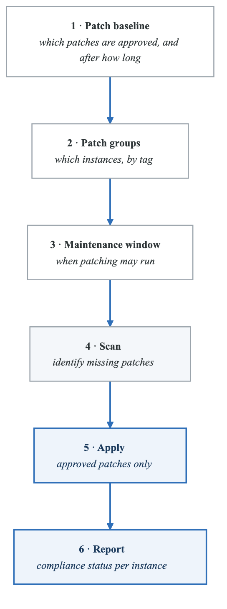
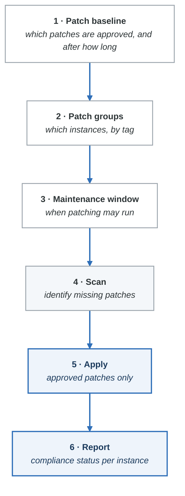
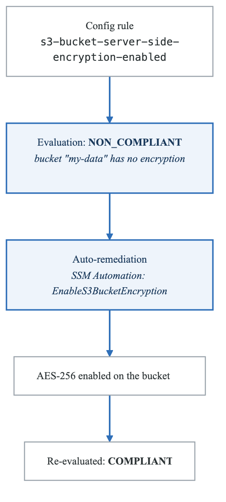
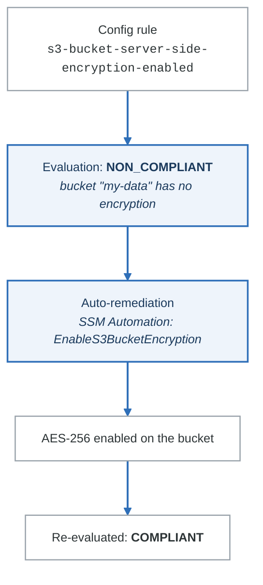

# 08 — AWS Systems Manager (SSM)

## Overview

AWS Systems Manager is a collection of operational tools for managing EC2 instances and on-premises servers at scale. It is an umbrella service with many capabilities. The exam focuses on Session Manager, Patch Manager, Run Command, Parameter Store, and Automation.

---

## Systems Manager — Capabilities Overview

| Capability | What It Does | Key Exam Use Case |
|------------|-------------|-------------------|
| **Session Manager** | Browser-based shell access to EC2 — no SSH, no bastion host | "Access EC2 without opening port 22" |
| **Run Command** | Execute commands on multiple instances remotely | "Run a script on 100 instances simultaneously" |
| **Patch Manager** | Automate OS and software patching | "Ensure all instances are patched on schedule" |
| **Parameter Store** | Store configuration data and secrets | "Store database connection strings" (covered in Note 02) |
| **Automation** | Run multi-step automated workflows (runbooks) | "Auto-remediate non-compliant resources" |
| **Inventory** | Collect metadata about instances (installed software, configurations) | "What software is installed across all instances?" |
| **State Manager** | Define and enforce desired state on instances | "Ensure CloudWatch Agent is always running" |
| **Maintenance Windows** | Schedule maintenance tasks during defined time windows | "Patch instances every Sunday at 2 AM" |
| **Distributor** | Package and distribute software to instances | "Deploy a custom agent to all instances" |
| **OpsCenter** | Aggregate and manage operational issues (OpsItems) | "Central place for operational alerts" |

### Prerequisites for All SSM Capabilities
1. **SSM Agent** installed on the instance (pre-installed on Amazon Linux 2, Amazon Linux 2023, some Ubuntu AMIs)
2. **IAM instance profile** with `AmazonSSMManagedInstanceCore` policy attached
3. **Network connectivity** to SSM endpoints (via internet, NAT gateway, or VPC endpoints)

---

## Session Manager — Deep Dive

### What It Does
- Provides interactive shell access to EC2 instances through the AWS Console, CLI, or SDK
- **No SSH keys, no bastion hosts, no open inbound ports**
- All sessions are logged (to S3 and/or CloudWatch Logs)
- Supports port forwarding

### Why Session Manager Over SSH

| Feature | SSH (Traditional) | Session Manager |
|---------|-------------------|-----------------|
| **Inbound port required** | Port 22 open in SG | **No inbound ports needed** |
| **Key management** | SSH key pairs | IAM-based authentication |
| **Bastion host** | Often needed for private subnets | **Not needed** |
| **Session logging** | Must configure separately | **Built-in** (S3 + CloudWatch Logs) |
| **Access control** | SSH key distribution | IAM policies |
| **Audit trail** | Limited | CloudTrail logs all sessions |
| **Port forwarding** | SSH tunnels | SSM port forwarding |
| **OS support** | Linux (SSH), Windows (RDP) | Linux, Windows, macOS |

### Session Manager for Private Instances (No Internet)
```
Private Subnet (no IGW, no NAT)
    │
    v
VPC Endpoints (PrivateLink):
  - com.amazonaws.<region>.ssm
  - com.amazonaws.<region>.ssmmessages
  - com.amazonaws.<region>.ec2messages
    │
    v
Session Manager connects through VPC endpoints
```

### CLI Session Example
```bash
# Start a session
aws ssm start-session --target i-0123456789abcdef0

# Port forwarding (e.g., access RDS on port 3306)
aws ssm start-session \
  --target i-0123456789abcdef0 \
  --document-name AWS-StartPortForwardingSessionToRemoteHost \
  --parameters '{"host":["mydb.cluster-abc123.us-east-1.rds.amazonaws.com"],"portNumber":["3306"],"localPortNumber":["3306"]}'
```

### Exam Tip
Any question about "access EC2 without SSH," "no bastion host," "no port 22," or "audit all shell sessions" => Session Manager.

---

## Run Command

### What It Does
- Execute commands across multiple instances simultaneously
- No SSH required — uses SSM Agent
- Uses **SSM Documents** (pre-defined or custom) that define the commands to run
- Results viewable in the console, S3, or CloudWatch Logs

### Common SSM Documents

| Document | What It Does |
|----------|-------------|
| `AWS-RunShellScript` | Run any shell command on Linux |
| `AWS-RunPowerShellScript` | Run PowerShell commands on Windows |
| `AWS-InstallApplication` | Install an application |
| `AWS-ConfigureAWSPackage` | Install/update/uninstall AWS packages (e.g., CloudWatch Agent) |
| `AWS-ApplyPatchBaseline` | Apply patches based on a patch baseline |
| `AWS-RunAnsiblePlaybook` | Run Ansible playbooks |

### Target Selection
- By instance IDs
- By tags (e.g., `Environment=Production`)
- By resource groups
- Rate control: limit concurrent executions and error thresholds

### Example: Run a command on all production instances
```bash
aws ssm send-command \
  --document-name "AWS-RunShellScript" \
  --targets "Key=tag:Environment,Values=Production" \
  --parameters 'commands=["sudo yum update -y","sudo systemctl restart httpd"]' \
  --max-concurrency "10" \
  --max-errors "5"
```

---

## Patch Manager

### What It Does
- Automates the process of patching instances with OS and software updates
- Works with Linux and Windows
- Uses **Patch Baselines** to define which patches to apply

### Key Concepts

| Concept | Description |
|---------|-------------|
| **Patch Baseline** | Rules for which patches to auto-approve (by classification, severity, days after release) |
| **Default Baseline** | AWS-provided baseline per OS (e.g., `AWS-DefaultPatchBaseline` for Linux) |
| **Custom Baseline** | Your own rules (e.g., auto-approve Critical patches after 7 days) |
| **Patch Group** | Tag-based grouping of instances (tag key: `Patch Group`, value: e.g., `Production`) |
| **Maintenance Window** | Scheduled time to run patching |
| **Compliance** | Report showing patch status per instance |

### Patch Manager Workflow
<!-- figure: generated from the Mermaid below by _shared/diagrams/embed-figures.py — do not edit the image -->


<details>
<summary>Diagram source (Mermaid)</summary>



</details>

---

## Automation

### What It Does
- Run multi-step automated workflows (runbooks)
- Pre-built AWS runbooks or custom runbooks
- Used for auto-remediation, operational tasks, and change management

### Common Automation Use Cases

| Use Case | Automation Document |
|----------|-------------------|
| Restart an EC2 instance | `AWS-RestartEC2Instance` |
| Create AMI from instance | `AWS-CreateImage` |
| Update CloudFormation stack | `AWS-UpdateCloudFormationStack` |
| Resize an instance | `AWS-ResizeInstance` |
| Enable S3 bucket encryption | Custom automation document |
| Remediate Config rule violation | Config auto-remediation triggers Automation |

### Integration with Config Auto-Remediation
<!-- figure: generated from the Mermaid below by _shared/diagrams/embed-figures.py — do not edit the image -->


<details>
<summary>Diagram source (Mermaid)</summary>



</details>

---

## Inventory

### What It Does
- Collects metadata from managed instances:
  - Installed applications
  - OS version
  - Network configuration
  - Windows updates
  - Instance details
  - Services running
  - Custom inventory (your own data)

### Use Cases
- "What software is installed across all instances?"
- "Which instances are running outdated OS versions?"
- "Find all instances running Apache version < 2.4.50"

---

## State Manager

### What It Does
- Ensures instances maintain a **desired state**
- Uses SSM Documents (Associations) applied on a schedule
- Examples: ensure CloudWatch Agent is always running, ensure specific packages are installed

### State Manager vs Patch Manager
- **Patch Manager:** specifically for OS/software patches
- **State Manager:** general-purpose desired state enforcement (any SSM document)

---

## Maintenance Windows

### What It Does
- Define a scheduled time window to run operational tasks
- Tasks can include: Run Command, Automation, Patch Manager, Lambda, Step Functions

### Components
| Component | Description |
|-----------|-------------|
| **Window** | Schedule (cron/rate expression) + duration |
| **Targets** | Which instances (by ID, tag, or resource group) |
| **Tasks** | What to run (Run Command, Automation, etc.) |
| **Task Priority** | Order of execution when multiple tasks |

---

## SSM for Hybrid Environments

### On-Premises Server Management
- Install SSM Agent on on-premises servers
- Register as "Managed Instances" using **Hybrid Activations**
- Instance IDs start with `mi-` (instead of `i-`)
- Full SSM capabilities: Session Manager, Run Command, Patch Manager, Inventory
- Requires outbound internet or Direct Connect + VPC endpoints

---

## Common Exam Scenarios

| Scenario | Answer |
|----------|--------|
| "SSH into private EC2 without bastion" | Session Manager |
| "Audit all shell access to instances" | Session Manager (logging to S3/CloudWatch) |
| "Run a script on all instances tagged Production" | Run Command |
| "Automate patching on a schedule" | Patch Manager + Maintenance Window |
| "Auto-remediate non-compliant Config findings" | Automation (triggered by Config) |
| "Inventory all installed software across fleet" | Inventory |
| "Ensure CloudWatch Agent is always running" | State Manager |
| "Manage on-premises servers with AWS tools" | SSM Hybrid Activation |
| "No port 22, no SSH keys, still need shell access" | Session Manager |
| "Store database password securely for application config" | Parameter Store (SecureString) |

---

## Next Steps

- Continue to **Note 09: CloudFormation & IaC** for Infrastructure as Code
- Return to labs after completing all notes in this section

<!-- feynman-check -->

---

## Feynman check

Close the file. Blank page, no notes. Explain each of these to a competent engineer who has never
used this tool — **under five minutes, no jargon you can't define on the spot:**

- Systems Manager — Capabilities Overview
- Session Manager — Deep Dive
- Run Command
- Patch Manager

**The gap is not what you forgot. It is where you used a word instead of a mechanism.**

| | |
|---|---|
| ✗ | *"The security group allows the traffic."* |
| ✓ | *"A security group is a stateful allow-list attached to an ENI. Traffic matching an inbound rule is permitted and the reply is permitted automatically, because the connection is tracked — which is why you never write an outbound rule for a reply."* |

**Trace it:** A request from the internet to an instance in a private subnet. Name every hop, every route-table lookup, and every rule evaluated, in order.

Stop at the first component you cannot name. Reopen this file and read **only** that.

**Go deeper — only once the gap has a name:** [Timeouts, retries and backoff with jitter](https://aws.amazon.com/builders-library/timeouts-retries-and-backoff-with-jitter/) — 15 minutes from the AWS Builders' Library, and it changes how you write every client you touch afterwards.
Full list per domain: [`SOURCES.md`](../SOURCES.md#aws)

→ Protocol, the three levels of knowing, and worked examples: [`MASTERY.md`](../MASTERY.md)

<!-- /feynman-check -->
