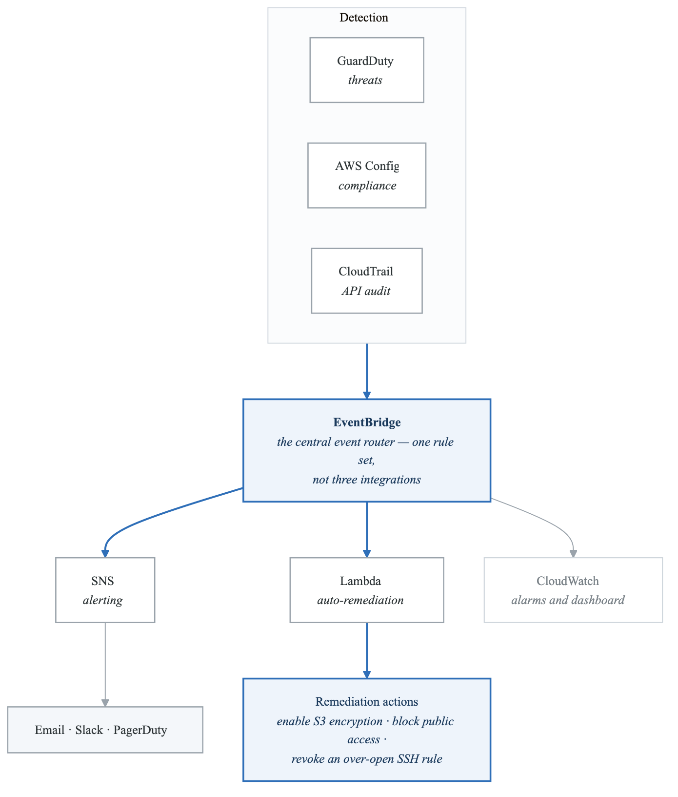
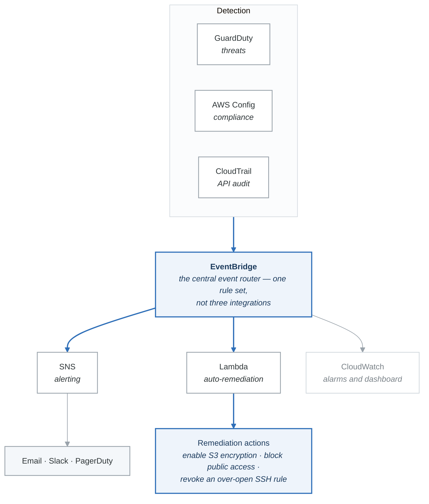

# Project 01 — Security Monitoring & Auto-Remediation Pipeline

## Overview

Build a comprehensive security monitoring pipeline that integrates GuardDuty, AWS Config, CloudTrail, and CloudWatch to detect security issues, send alerts via SNS, and automatically remediate non-compliant resources using Lambda. This is the kind of architecture the SAA-C03 exam expects you to understand.

## Architecture

<!-- figure: generated from the Mermaid below by _shared/diagrams/embed-figures.py — do not edit the image -->


<details>
<summary>Diagram source (Mermaid)</summary>



</details>

## Requirements

### Functional Requirements

1. **GuardDuty Integration**
   - Enable GuardDuty in the region
   - Route HIGH and MEDIUM severity findings to SNS for alerting
   - Log all findings to a centralized dashboard

2. **AWS Config Compliance**
   - Enable AWS Config with the following managed rules:
     - `s3-bucket-server-side-encryption-enabled`
     - `s3-bucket-public-read-prohibited`
     - `restricted-ssh` (no 0.0.0.0/0 on port 22)
     - `encrypted-volumes` (EBS encryption)
   - Non-compliant resources trigger auto-remediation Lambda

3. **CloudTrail Monitoring**
   - Multi-region trail logging to S3
   - Log file integrity validation enabled
   - EventBridge rules for critical API calls:
     - IAM user creation/deletion
     - Security group modification
     - S3 bucket policy changes

4. **CloudWatch**
   - Custom dashboard showing:
     - GuardDuty finding counts
     - Config compliance status
     - CloudTrail event volume
   - Alarm for high GuardDuty severity findings

5. **Auto-Remediation Lambda Functions**
   - `remediate_s3_encryption`: Enable AES-256 encryption on non-compliant S3 buckets
   - `remediate_s3_public_access`: Block public access on non-compliant S3 buckets
   - `remediate_ssh`: Remove 0.0.0.0/0 SSH rules from security groups

6. **SNS Notifications**
   - Topic for security alerts (email subscription)
   - Separate topic for remediation confirmations

### Non-Functional Requirements

- All infrastructure deployed with Terraform
- Lambda functions written in Python (Boto3)
- All resources tagged with `Project=SecurityPipeline` and `Environment=Lab`
- Total cost under $5 for a one-week lab session
- Cleanup script to remove all resources

---

## Acceptance Criteria

- [ ] GuardDuty is enabled and generating/receiving findings
- [ ] AWS Config has 4 managed rules configured and evaluating
- [ ] CloudTrail is logging across all regions to S3
- [ ] EventBridge rules trigger on GuardDuty findings and Config non-compliance
- [ ] Lambda auto-remediation function successfully enables S3 encryption on a non-compliant bucket
- [ ] Lambda auto-remediation function successfully blocks public access on an S3 bucket
- [ ] SNS sends email notifications for both alerts and remediation confirmations
- [ ] CloudWatch dashboard displays security metrics
- [ ] All infrastructure is reproducible via Terraform
- [ ] Cleanup script successfully removes all resources

---

## Implementation Guide

### Step 1: Project Structure

**`security-pipeline/`**

- `terraform/`
  - `main.tf` — Provider, backend
  - `variables.tf` — Input variables
  - `guardduty.tf` — GuardDuty detector
  - `config.tf` — Config recorder, rules
  - `cloudtrail.tf` — Trail, S3 bucket
  - `eventbridge.tf` — Event rules
  - `sns.tf` — Topics, subscriptions
  - `lambda.tf` — Lambda functions + IAM roles
  - `cloudwatch.tf` — Dashboard, alarms
  - `outputs.tf` — Output values
  - `terraform.tfvars` — Variable values
- `lambda/`
  - `remediate_s3_encryption/`
    - `handler.py`
  - `remediate_s3_public_access/`
    - `handler.py`
  - `remediate_ssh/`
    - `handler.py`
  - `alert_handler/`
    - `handler.py`
- `test/`
  - `create_noncompliant_resources.py` — Create test resources
  - `verify_remediation.py` — Verify auto-fix worked
- `cleanup.sh`


### Step 2: Lambda — S3 Encryption Remediation

`lambda/remediate_s3_encryption/handler.py`:

```python
"""
Auto-remediation: Enable S3 bucket encryption when AWS Config
detects a non-compliant bucket.
"""

import json
import boto3
import os

s3 = boto3.client("s3")
sns = boto3.client("sns")

REMEDIATION_TOPIC = os.environ.get("REMEDIATION_TOPIC_ARN", "")

def lambda_handler(event, context):
    """
    Triggered by EventBridge when Config rule
    s3-bucket-server-side-encryption-enabled is NON_COMPLIANT.
    """
    print(f"Event received: {json.dumps(event)}")

    # Extract bucket name from Config event
    detail = event.get("detail", {})
    resource_id = detail.get("resourceId", "")

    if not resource_id:
        # Try alternate event structure
        config_rule = detail.get("configRuleName", "")
        resource_id = detail.get("newEvaluationResult", {}).get(
            "evaluationResultIdentifier", {}
        ).get("evaluationResultQualifier", {}).get("resourceId", "")

    if not resource_id:
        print("Could not extract bucket name from event.")
        return {"statusCode": 400, "body": "No resource ID found"}

    bucket_name = resource_id
    print(f"Remediating bucket: {bucket_name}")

    try:
        # Enable AES-256 encryption
        s3.put_bucket_encryption(
            Bucket=bucket_name,
            ServerSideEncryptionConfiguration={
                "Rules": [{
                    "ApplyServerSideEncryptionByDefault": {
                        "SSEAlgorithm": "AES256"
                    },
                    "BucketKeyEnabled": True
                }]
            }
        )

        message = f"REMEDIATED: Enabled AES-256 encryption on S3 bucket '{bucket_name}'"
        print(message)

        # Send confirmation notification
        if REMEDIATION_TOPIC:
            sns.publish(
                TopicArn=REMEDIATION_TOPIC,
                Subject="Security Remediation: S3 Encryption Enabled",
                Message=message
            )

        return {"statusCode": 200, "body": message}

    except Exception as e:
        error_msg = f"FAILED to remediate bucket '{bucket_name}': {str(e)}"
        print(error_msg)

        if REMEDIATION_TOPIC:
            sns.publish(
                TopicArn=REMEDIATION_TOPIC,
                Subject="Security Remediation FAILED: S3 Encryption",
                Message=error_msg
            )

        return {"statusCode": 500, "body": error_msg}
```

### Step 3: Lambda — S3 Public Access Remediation

`lambda/remediate_s3_public_access/handler.py`:

```python
"""
Auto-remediation: Block public access on S3 buckets when
Config detects a non-compliant bucket.
"""

import json
import boto3
import os

s3 = boto3.client("s3")
sns = boto3.client("sns")

REMEDIATION_TOPIC = os.environ.get("REMEDIATION_TOPIC_ARN", "")

def lambda_handler(event, context):
    print(f"Event received: {json.dumps(event)}")

    detail = event.get("detail", {})
    resource_id = detail.get("resourceId", "")

    if not resource_id:
        resource_id = detail.get("newEvaluationResult", {}).get(
            "evaluationResultIdentifier", {}
        ).get("evaluationResultQualifier", {}).get("resourceId", "")

    if not resource_id:
        return {"statusCode": 400, "body": "No resource ID found"}

    bucket_name = resource_id
    print(f"Blocking public access on bucket: {bucket_name}")

    try:
        s3.put_public_access_block(
            Bucket=bucket_name,
            PublicAccessBlockConfiguration={
                "BlockPublicAcls": True,
                "IgnorePublicAcls": True,
                "BlockPublicPolicy": True,
                "RestrictPublicBuckets": True
            }
        )

        message = f"REMEDIATED: Blocked all public access on S3 bucket '{bucket_name}'"
        print(message)

        if REMEDIATION_TOPIC:
            sns.publish(
                TopicArn=REMEDIATION_TOPIC,
                Subject="Security Remediation: S3 Public Access Blocked",
                Message=message
            )

        return {"statusCode": 200, "body": message}

    except Exception as e:
        error_msg = f"FAILED to block public access on '{bucket_name}': {str(e)}"
        print(error_msg)
        return {"statusCode": 500, "body": error_msg}
```

### Step 4: Lambda — SSH Remediation

`lambda/remediate_ssh/handler.py`:

```python
"""
Auto-remediation: Remove unrestricted SSH (0.0.0.0/0 on port 22)
from security groups when Config detects non-compliance.
"""

import json
import boto3
import os

ec2 = boto3.client("ec2")
sns = boto3.client("sns")

REMEDIATION_TOPIC = os.environ.get("REMEDIATION_TOPIC_ARN", "")

def lambda_handler(event, context):
    print(f"Event received: {json.dumps(event)}")

    detail = event.get("detail", {})
    resource_id = detail.get("resourceId", "")

    if not resource_id:
        resource_id = detail.get("newEvaluationResult", {}).get(
            "evaluationResultIdentifier", {}
        ).get("evaluationResultQualifier", {}).get("resourceId", "")

    if not resource_id:
        return {"statusCode": 400, "body": "No resource ID found"}

    sg_id = resource_id
    print(f"Checking security group: {sg_id}")

    try:
        sg = ec2.describe_security_groups(GroupIds=[sg_id])
        rules = sg["SecurityGroups"][0]["IpPermissions"]

        removed_rules = []
        for rule in rules:
            if rule.get("FromPort") == 22 and rule.get("ToPort") == 22:
                for ip_range in rule.get("IpRanges", []):
                    if ip_range.get("CidrIp") == "0.0.0.0/0":
                        # Remove this rule
                        ec2.revoke_security_group_ingress(
                            GroupId=sg_id,
                            IpPermissions=[{
                                "IpProtocol": "tcp",
                                "FromPort": 22,
                                "ToPort": 22,
                                "IpRanges": [{"CidrIp": "0.0.0.0/0"}]
                            }]
                        )
                        removed_rules.append("0.0.0.0/0:22")

                for ip_range in rule.get("Ipv6Ranges", []):
                    if ip_range.get("CidrIpv6") == "::/0":
                        ec2.revoke_security_group_ingress(
                            GroupId=sg_id,
                            IpPermissions=[{
                                "IpProtocol": "tcp",
                                "FromPort": 22,
                                "ToPort": 22,
                                "Ipv6Ranges": [{"CidrIpv6": "::/0"}]
                            }]
                        )
                        removed_rules.append("::/0:22")

        if removed_rules:
            message = f"REMEDIATED: Removed unrestricted SSH rules from SG '{sg_id}': {removed_rules}"
        else:
            message = f"No unrestricted SSH rules found in SG '{sg_id}' (may have been fixed already)"

        print(message)

        if REMEDIATION_TOPIC:
            sns.publish(
                TopicArn=REMEDIATION_TOPIC,
                Subject="Security Remediation: SSH Rule Removed",
                Message=message
            )

        return {"statusCode": 200, "body": message}

    except Exception as e:
        error_msg = f"FAILED to remediate SG '{sg_id}': {str(e)}"
        print(error_msg)
        return {"statusCode": 500, "body": error_msg}
```

### Step 5: Terraform — EventBridge Rules (Key Snippet)

```hcl
# EventBridge rule for GuardDuty high/medium findings
resource "aws_cloudwatch_event_rule" "guardduty_findings" {
  name        = "guardduty-high-medium-findings"
  description = "Capture GuardDuty findings with severity >= 4"

  event_pattern = jsonencode({
    source      = ["aws.guardduty"]
    detail-type = ["GuardDuty Finding"]
    detail = {
      severity = [{ numeric = [">=", 4] }]
    }
  })
}

resource "aws_cloudwatch_event_target" "guardduty_sns" {
  rule      = aws_cloudwatch_event_rule.guardduty_findings.name
  target_id = "SendToSNS"
  arn       = aws_sns_topic.security_alerts.arn
}

# EventBridge rule for Config non-compliance
resource "aws_cloudwatch_event_rule" "config_noncompliant" {
  name        = "config-noncompliant-s3-encryption"
  description = "Trigger remediation when S3 bucket encryption rule is non-compliant"

  event_pattern = jsonencode({
    source      = ["aws.config"]
    detail-type = ["Config Rules Compliance Change"]
    detail = {
      messageType       = ["ComplianceChangeNotification"]
      configRuleName    = ["s3-bucket-server-side-encryption-enabled"]
      newEvaluationResult = {
        complianceType = ["NON_COMPLIANT"]
      }
    }
  })
}

resource "aws_cloudwatch_event_target" "remediate_s3_encryption" {
  rule      = aws_cloudwatch_event_rule.config_noncompliant.name
  target_id = "RemediateS3Encryption"
  arn       = aws_lambda_function.remediate_s3_encryption.arn
}

# EventBridge rule for critical CloudTrail events
resource "aws_cloudwatch_event_rule" "critical_api_calls" {
  name        = "critical-api-calls"
  description = "Alert on critical API calls"

  event_pattern = jsonencode({
    source      = ["aws.iam", "aws.s3", "aws.ec2"]
    detail-type = ["AWS API Call via CloudTrail"]
    detail = {
      eventName = [
        "CreateUser", "DeleteUser", "CreateAccessKey",
        "PutBucketPolicy", "DeleteBucketPolicy",
        "AuthorizeSecurityGroupIngress"
      ]
    }
  })
}

resource "aws_cloudwatch_event_target" "critical_api_sns" {
  rule      = aws_cloudwatch_event_rule.critical_api_calls.name
  target_id = "SendToSNS"
  arn       = aws_sns_topic.security_alerts.arn
}
```

### Step 6: Testing Script

`test/create_noncompliant_resources.py`:

```python
"""
Create non-compliant resources to test the auto-remediation pipeline.
"""

import boto3
import time

def main():
    s3 = boto3.client("s3")
    ec2 = boto3.client("ec2")

    print("Creating non-compliant resources for testing...\n")

    # 1. Create S3 bucket WITHOUT encryption
    bucket_name = f"security-pipeline-test-{int(time.time())}"
    s3.create_bucket(Bucket=bucket_name)
    print(f"[NON-COMPLIANT] Created S3 bucket without encryption: {bucket_name}")

    # 2. Create security group with open SSH
    vpc_id = ec2.describe_vpcs(
        Filters=[{"Name": "isDefault", "Values": ["true"]}]
    )["Vpcs"][0]["VpcId"]

    sg = ec2.create_security_group(
        GroupName=f"test-open-ssh-{int(time.time())}",
        Description="Test SG with open SSH for remediation testing",
        VpcId=vpc_id
    )
    sg_id = sg["GroupId"]

    ec2.authorize_security_group_ingress(
        GroupId=sg_id,
        IpPermissions=[{
            "IpProtocol": "tcp",
            "FromPort": 22,
            "ToPort": 22,
            "IpRanges": [{"CidrIp": "0.0.0.0/0", "Description": "Open SSH for testing"}]
        }]
    )
    print(f"[NON-COMPLIANT] Created SG with open SSH: {sg_id}")

    print(f"\nWait 3-5 minutes for Config to evaluate, then check:")
    print(f"  - S3 bucket '{bucket_name}' should be auto-encrypted")
    print(f"  - SG '{sg_id}' should have 0.0.0.0/0:22 rule removed")
    print(f"\nResources to clean up after testing:")
    print(f"  aws s3 rb s3://{bucket_name}")
    print(f"  aws ec2 delete-security-group --group-id {sg_id}")

if __name__ == "__main__":
    main()
```

---

## Cost Estimate

| Resource | Monthly Cost | Notes |
|----------|-------------|-------|
| GuardDuty | Free (30-day trial) | Disable after project |
| Config (4 rules) | ~$0.10 | 25 free evaluations, then $0.001 each |
| CloudTrail (1 mgmt trail) | Free | First trail is free |
| Lambda | Free tier | Minimal invocations |
| SNS | Free tier | < 1M notifications |
| S3 (logs) | ~$0.05 | Tiny log files |
| EventBridge | Free | First custom events are free |
| CloudWatch | Free tier | Within free tier limits |
| **Total** | **~$0.15-1.00** | Mostly free tier |

---

## Cleanup Script

```bash
#!/bin/bash
echo "Cleaning up Security Monitoring Pipeline..."

cd terraform/
terraform destroy -auto-approve

# Verify all resources are removed
echo "Verifying cleanup..."
aws guardduty list-detectors --query "DetectorIds"
aws configservice describe-config-rules --query "ConfigRules[?starts_with(ConfigRuleName, 'saa-lab')]"
aws cloudtrail describe-trails --query "trailList[?TrailName=='saa-lab-trail']"

echo "Cleanup complete."
```

---

## Extension Ideas (Optional)

1. Add Macie to scan S3 buckets for PII
2. Send alerts to Slack via Lambda
3. Create a Security Hub integration to aggregate all findings
4. Add auto-remediation for EBS encryption (create encrypted copy, swap volumes)
5. Add CloudWatch anomaly detection for unusual API call patterns

<!-- feynman-check -->

---

## Feynman check

Close the file. Blank page, no notes. Explain each of these to a competent engineer who has never
used this tool — **under five minutes, no jargon you can't define on the spot:**

- Cleanup Script
- Extension Ideas
- Functional Requirements
- Non-Functional Requirements

**The gap is not what you forgot. It is where you used a word instead of a mechanism.**

| | |
|---|---|
| ✗ | *"The security group allows the traffic."* |
| ✓ | *"A security group is a stateful allow-list attached to an ENI. Traffic matching an inbound rule is permitted and the reply is permitted automatically, because the connection is tracked — which is why you never write an outbound rule for a reply."* |

**Trace it:** A request from the internet to an instance in a private subnet. Name every hop, every route-table lookup, and every rule evaluated, in order.

Stop at the first component you cannot name. Reopen this file and read **only** that.

**Go deeper — only once the gap has a name:** [Timeouts, retries and backoff with jitter](https://aws.amazon.com/builders-library/timeouts-retries-and-backoff-with-jitter/) — 15 minutes from the AWS Builders' Library, and it changes how you write every client you touch afterwards.
Full list per domain: [`SOURCES.md`](../SOURCES.md#aws)

→ Protocol, the three levels of knowing, and worked examples: [`MASTERY.md`](../MASTERY.md)

<!-- /feynman-check -->
