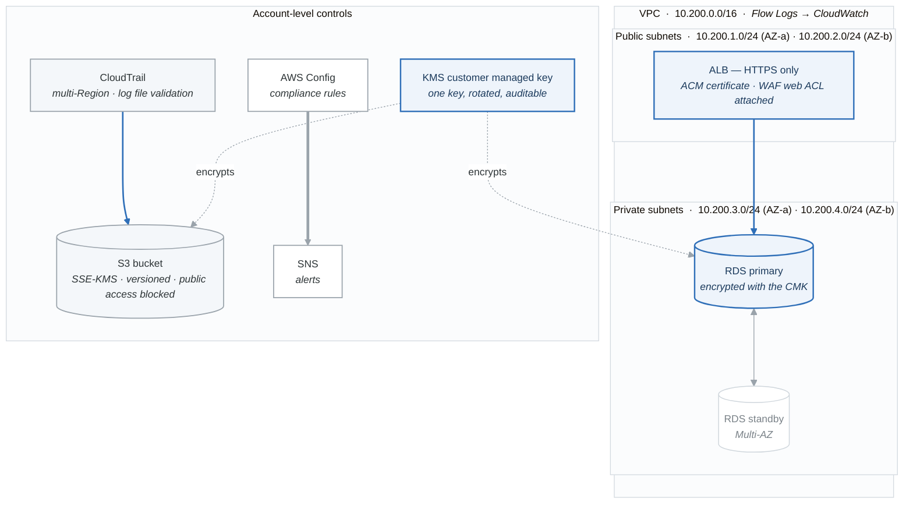

# Project 02 — Fully Compliant Infrastructure Stack

## Overview

Deploy a production-ready, fully compliant infrastructure stack using CloudFormation. The stack includes an encrypted S3 bucket, encrypted RDS database, VPC with flow logs, CloudTrail enabled, and WAF on an ALB. Then verify compliance using AWS Config rules.

This project ties together everything from Phase 4: encryption, logging, monitoring, network security, and Infrastructure as Code.

## Architecture

<!-- figure: generated from the Mermaid below by _shared/diagrams/embed-figures.py — do not edit the image -->


<details>
<summary>Diagram source (Mermaid)</summary>



</details>

## Requirements

### What the Stack Must Include

| Resource | Compliance Requirement |
|----------|----------------------|
| **VPC** | Two AZs, public + private subnets, VPC Flow Logs enabled |
| **S3 Bucket** | SSE-KMS encryption, versioning enabled, public access blocked, access logging |
| **RDS MySQL** | Encryption at rest (KMS), Multi-AZ, no public access, backup enabled |
| **ALB** | HTTPS listener (ACM certificate or HTTP for lab), access logging to S3 |
| **WAF Web ACL** | Rate-based rule, AWS managed common rules, attached to ALB |
| **KMS CMK** | Customer managed key for S3 and RDS encryption |
| **CloudTrail** | Multi-region trail, log file integrity, S3 delivery |
| **VPC Flow Logs** | All traffic logged to CloudWatch Logs |
| **Security Groups** | No unrestricted SSH (port 22) from 0.0.0.0/0 |

### AWS Config Rules to Validate

| Config Rule | What It Validates |
|-------------|------------------|
| `s3-bucket-server-side-encryption-enabled` | S3 bucket is encrypted |
| `s3-bucket-public-read-prohibited` | S3 bucket has no public read |
| `s3-bucket-versioning-enabled` | S3 bucket has versioning |
| `rds-instance-public-access-check` | RDS is not publicly accessible |
| `rds-storage-encrypted` | RDS storage is encrypted |
| `encrypted-volumes` | EBS volumes are encrypted |
| `restricted-ssh` | No open SSH in security groups |
| `cloudtrail-enabled` | CloudTrail is logging |
| `vpc-flow-logs-enabled` | VPC has flow logs |

---

## Acceptance Criteria

- [ ] CloudFormation stack deploys successfully with all resources
- [ ] S3 bucket is encrypted with KMS CMK and versioning is enabled
- [ ] RDS instance is encrypted, Multi-AZ, and not publicly accessible
- [ ] VPC Flow Logs are enabled and delivering to CloudWatch Logs
- [ ] CloudTrail is logging with integrity validation enabled
- [ ] WAF Web ACL is attached to ALB with rate-based and managed rules
- [ ] All security groups have no unrestricted SSH
- [ ] All 9 Config rules evaluate as COMPLIANT
- [ ] Stack can be deleted cleanly (with DeletionPolicy: Snapshot for RDS)

---

## CloudFormation Template

`compliant-infrastructure.yaml`:

```yaml
AWSTemplateFormatVersion: "2010-09-09"
Description: >
  Fully compliant infrastructure stack demonstrating AWS security
  best practices: encryption, logging, monitoring, and network security.

# ============================================================
# PARAMETERS
# ============================================================
Parameters:
  ProjectName:
    Type: String
    Default: "compliant-infra"
    Description: Project name used for resource naming

  DBMasterUsername:
    Type: String
    Default: "admin"
    Description: RDS master username

  DBMasterPassword:
    Type: String
    NoEcho: true
    MinLength: 8
    Description: RDS master password (min 8 characters)

  NotificationEmail:
    Type: String
    Description: Email for security notifications

# ============================================================
# RESOURCES
# ============================================================
Resources:

  # -------------------------------------------------------
  # KMS — Customer Managed Key for encryption
  # -------------------------------------------------------
  EncryptionKey:
    Type: AWS::KMS::Key
    Properties:
      Description: !Sub "CMK for ${ProjectName} encryption"
      EnableKeyRotation: true
      KeyPolicy:
        Version: "2012-10-17"
        Statement:
          - Sid: "EnableRootAccountAccess"
            Effect: Allow
            Principal:
              AWS: !Sub "arn:aws:iam::${AWS::AccountId}:root"
            Action: "kms:*"
            Resource: "*"
          - Sid: "AllowRDSAccess"
            Effect: Allow
            Principal:
              AWS: "*"
            Action:
              - "kms:Encrypt"
              - "kms:Decrypt"
              - "kms:ReEncrypt*"
              - "kms:GenerateDataKey*"
              - "kms:DescribeKey"
              - "kms:CreateGrant"
            Resource: "*"
            Condition:
              StringEquals:
                "kms:CallerAccount": !Ref "AWS::AccountId"
                "kms:ViaService":
                  - !Sub "rds.${AWS::Region}.amazonaws.com"
                  - !Sub "s3.${AWS::Region}.amazonaws.com"
      Tags:
        - Key: Project
          Value: !Ref ProjectName

  EncryptionKeyAlias:
    Type: AWS::KMS::Alias
    Properties:
      AliasName: !Sub "alias/${ProjectName}-key"
      TargetKeyId: !Ref EncryptionKey

  # -------------------------------------------------------
  # VPC — Multi-AZ with public and private subnets
  # -------------------------------------------------------
  VPC:
    Type: AWS::EC2::VPC
    Properties:
      CidrBlock: "10.200.0.0/16"
      EnableDnsHostnames: true
      EnableDnsSupport: true
      Tags:
        - Key: Name
          Value: !Sub "${ProjectName}-vpc"

  InternetGateway:
    Type: AWS::EC2::InternetGateway
    Properties:
      Tags:
        - Key: Name
          Value: !Sub "${ProjectName}-igw"

  IGWAttachment:
    Type: AWS::EC2::VPCGatewayAttachment
    Properties:
      VpcId: !Ref VPC
      InternetGatewayId: !Ref InternetGateway

  PublicSubnetA:
    Type: AWS::EC2::Subnet
    Properties:
      VpcId: !Ref VPC
      CidrBlock: "10.200.1.0/24"
      AvailabilityZone: !Select [0, !GetAZs ""]
      MapPublicIpOnLaunch: true
      Tags:
        - Key: Name
          Value: !Sub "${ProjectName}-public-a"

  PublicSubnetB:
    Type: AWS::EC2::Subnet
    Properties:
      VpcId: !Ref VPC
      CidrBlock: "10.200.2.0/24"
      AvailabilityZone: !Select [1, !GetAZs ""]
      MapPublicIpOnLaunch: true
      Tags:
        - Key: Name
          Value: !Sub "${ProjectName}-public-b"

  PrivateSubnetA:
    Type: AWS::EC2::Subnet
    Properties:
      VpcId: !Ref VPC
      CidrBlock: "10.200.3.0/24"
      AvailabilityZone: !Select [0, !GetAZs ""]
      Tags:
        - Key: Name
          Value: !Sub "${ProjectName}-private-a"

  PrivateSubnetB:
    Type: AWS::EC2::Subnet
    Properties:
      VpcId: !Ref VPC
      CidrBlock: "10.200.4.0/24"
      AvailabilityZone: !Select [1, !GetAZs ""]
      Tags:
        - Key: Name
          Value: !Sub "${ProjectName}-private-b"

  PublicRouteTable:
    Type: AWS::EC2::RouteTable
    Properties:
      VpcId: !Ref VPC
      Tags:
        - Key: Name
          Value: !Sub "${ProjectName}-public-rt"

  PublicRoute:
    Type: AWS::EC2::Route
    DependsOn: IGWAttachment
    Properties:
      RouteTableId: !Ref PublicRouteTable
      DestinationCidrBlock: "0.0.0.0/0"
      GatewayId: !Ref InternetGateway

  PublicSubnetARouteAssoc:
    Type: AWS::EC2::SubnetRouteTableAssociation
    Properties:
      SubnetId: !Ref PublicSubnetA
      RouteTableId: !Ref PublicRouteTable

  PublicSubnetBRouteAssoc:
    Type: AWS::EC2::SubnetRouteTableAssociation
    Properties:
      SubnetId: !Ref PublicSubnetB
      RouteTableId: !Ref PublicRouteTable

  # -------------------------------------------------------
  # VPC Flow Logs
  # -------------------------------------------------------
  FlowLogGroup:
    Type: AWS::Logs::LogGroup
    Properties:
      LogGroupName: !Sub "/aws/vpc/flowlogs/${ProjectName}"
      RetentionInDays: 30

  FlowLogRole:
    Type: AWS::IAM::Role
    Properties:
      AssumeRolePolicyDocument:
        Version: "2012-10-17"
        Statement:
          - Effect: Allow
            Principal:
              Service: vpc-flow-logs.amazonaws.com
            Action: sts:AssumeRole
      Policies:
        - PolicyName: FlowLogAccess
          PolicyDocument:
            Version: "2012-10-17"
            Statement:
              - Effect: Allow
                Action:
                  - logs:CreateLogGroup
                  - logs:CreateLogStream
                  - logs:PutLogEvents
                  - logs:DescribeLogGroups
                  - logs:DescribeLogStreams
                Resource: "*"

  VPCFlowLog:
    Type: AWS::EC2::FlowLog
    Properties:
      ResourceId: !Ref VPC
      ResourceType: VPC
      TrafficType: ALL
      LogGroupName: !Ref FlowLogGroup
      DeliverLogsPermissionArn: !GetAtt FlowLogRole.Arn

  # -------------------------------------------------------
  # Security Groups
  # -------------------------------------------------------
  ALBSecurityGroup:
    Type: AWS::EC2::SecurityGroup
    Properties:
      GroupDescription: !Sub "${ProjectName} ALB Security Group"
      VpcId: !Ref VPC
      SecurityGroupIngress:
        - IpProtocol: tcp
          FromPort: 80
          ToPort: 80
          CidrIp: "0.0.0.0/0"
          Description: "Allow HTTP"
        - IpProtocol: tcp
          FromPort: 443
          ToPort: 443
          CidrIp: "0.0.0.0/0"
          Description: "Allow HTTPS"
      Tags:
        - Key: Name
          Value: !Sub "${ProjectName}-alb-sg"

  RDSSecurityGroup:
    Type: AWS::EC2::SecurityGroup
    Properties:
      GroupDescription: !Sub "${ProjectName} RDS Security Group"
      VpcId: !Ref VPC
      SecurityGroupIngress:
        - IpProtocol: tcp
          FromPort: 3306
          ToPort: 3306
          SourceSecurityGroupId: !Ref ALBSecurityGroup
          Description: "Allow MySQL from ALB SG"
      Tags:
        - Key: Name
          Value: !Sub "${ProjectName}-rds-sg"

  # -------------------------------------------------------
  # S3 — Encrypted, Versioned, No Public Access
  # -------------------------------------------------------
  DataBucket:
    Type: AWS::S3::Bucket
    DeletionPolicy: Retain
    Properties:
      BucketName: !Sub "${ProjectName}-data-${AWS::AccountId}"
      BucketEncryption:
        ServerSideEncryptionConfiguration:
          - ServerSideEncryptionByDefault:
              SSEAlgorithm: "aws:kms"
              KMSMasterKeyID: !GetAtt EncryptionKey.Arn
            BucketKeyEnabled: true
      VersioningConfiguration:
        Status: Enabled
      PublicAccessBlockConfiguration:
        BlockPublicAcls: true
        BlockPublicPolicy: true
        IgnorePublicAcls: true
        RestrictPublicBuckets: true
      LoggingConfiguration:
        DestinationBucketName: !Ref LoggingBucket
        LogFilePrefix: "s3-access-logs/"
      Tags:
        - Key: Project
          Value: !Ref ProjectName

  LoggingBucket:
    Type: AWS::S3::Bucket
    DeletionPolicy: Retain
    Properties:
      BucketName: !Sub "${ProjectName}-logs-${AWS::AccountId}"
      BucketEncryption:
        ServerSideEncryptionConfiguration:
          - ServerSideEncryptionByDefault:
              SSEAlgorithm: AES256
      VersioningConfiguration:
        Status: Enabled
      PublicAccessBlockConfiguration:
        BlockPublicAcls: true
        BlockPublicPolicy: true
        IgnorePublicAcls: true
        RestrictPublicBuckets: true
      LifecycleConfiguration:
        Rules:
          - Id: TransitionToIA
            Status: Enabled
            Transitions:
              - StorageClass: STANDARD_IA
                TransitionInDays: 30
              - StorageClass: GLACIER
                TransitionInDays: 90

  # -------------------------------------------------------
  # RDS — Encrypted, Multi-AZ, Private
  # -------------------------------------------------------
  DBSubnetGroup:
    Type: AWS::RDS::DBSubnetGroup
    Properties:
      DBSubnetGroupDescription: !Sub "${ProjectName} DB Subnet Group"
      SubnetIds:
        - !Ref PrivateSubnetA
        - !Ref PrivateSubnetB

  Database:
    Type: AWS::RDS::DBInstance
    DeletionPolicy: Snapshot
    Properties:
      DBInstanceIdentifier: !Sub "${ProjectName}-db"
      DBInstanceClass: db.t3.micro
      Engine: mysql
      EngineVersion: "8.0"
      MasterUsername: !Ref DBMasterUsername
      MasterUserPassword: !Ref DBMasterPassword
      AllocatedStorage: 20
      StorageType: gp3
      StorageEncrypted: true
      KmsKeyId: !Ref EncryptionKey
      MultiAZ: false          # Set to true for production (costs more)
      PubliclyAccessible: false
      DBSubnetGroupName: !Ref DBSubnetGroup
      VPCSecurityGroups:
        - !Ref RDSSecurityGroup
      BackupRetentionPeriod: 7
      DeletionProtection: false    # Set to true for production
      Tags:
        - Key: Project
          Value: !Ref ProjectName

  # -------------------------------------------------------
  # ALB
  # -------------------------------------------------------
  ApplicationLoadBalancer:
    Type: AWS::ElasticLoadBalancingV2::LoadBalancer
    Properties:
      Name: !Sub "${ProjectName}-alb"
      Scheme: internet-facing
      Type: application
      Subnets:
        - !Ref PublicSubnetA
        - !Ref PublicSubnetB
      SecurityGroups:
        - !Ref ALBSecurityGroup
      Tags:
        - Key: Project
          Value: !Ref ProjectName

  ALBListener:
    Type: AWS::ElasticLoadBalancingV2::Listener
    Properties:
      LoadBalancerArn: !Ref ApplicationLoadBalancer
      Port: 80
      Protocol: HTTP
      DefaultAction:
        Type: fixed-response
        FixedResponseConfig:
          ContentType: text/plain
          MessageBody: "Compliant Infrastructure Stack is running"
          StatusCode: "200"

  # -------------------------------------------------------
  # WAF — Web ACL on ALB
  # -------------------------------------------------------
  WebACL:
    Type: AWS::WAFv2::WebACL
    Properties:
      Name: !Sub "${ProjectName}-waf"
      Scope: REGIONAL
      DefaultAction:
        Allow: {}
      Rules:
        - Name: RateLimit
          Priority: 1
          Action:
            Block: {}
          Statement:
            RateBasedStatement:
              Limit: 1000
              AggregateKeyType: IP
          VisibilityConfig:
            SampledRequestsEnabled: true
            CloudWatchMetricsEnabled: true
            MetricName: RateLimit
        - Name: AWSCommonRules
          Priority: 2
          OverrideAction:
            None: {}
          Statement:
            ManagedRuleGroupStatement:
              VendorName: AWS
              Name: AWSManagedRulesCommonRuleSet
          VisibilityConfig:
            SampledRequestsEnabled: true
            CloudWatchMetricsEnabled: true
            MetricName: AWSCommonRules
      VisibilityConfig:
        SampledRequestsEnabled: true
        CloudWatchMetricsEnabled: true
        MetricName: !Sub "${ProjectName}-waf"

  WebACLAssociation:
    Type: AWS::WAFv2::WebACLAssociation
    Properties:
      ResourceArn: !Ref ApplicationLoadBalancer
      WebACLArn: !GetAtt WebACL.Arn

  # -------------------------------------------------------
  # SNS — Notification Topic
  # -------------------------------------------------------
  SecurityNotificationTopic:
    Type: AWS::SNS::Topic
    Properties:
      TopicName: !Sub "${ProjectName}-security-alerts"
      Tags:
        - Key: Project
          Value: !Ref ProjectName

  EmailSubscription:
    Type: AWS::SNS::Subscription
    Properties:
      TopicArn: !Ref SecurityNotificationTopic
      Protocol: email
      Endpoint: !Ref NotificationEmail

# ============================================================
# OUTPUTS
# ============================================================
Outputs:
  VpcId:
    Value: !Ref VPC
    Export:
      Name: !Sub "${ProjectName}-VpcId"

  ALBDnsName:
    Value: !GetAtt ApplicationLoadBalancer.DNSName
    Description: "ALB DNS Name"

  DataBucketName:
    Value: !Ref DataBucket

  DatabaseEndpoint:
    Value: !GetAtt Database.Endpoint.Address

  KMSKeyArn:
    Value: !GetAtt EncryptionKey.Arn

  WebACLArn:
    Value: !GetAtt WebACL.Arn

  SNSTopicArn:
    Value: !Ref SecurityNotificationTopic
```

---

## Deployment Steps

### Step 1: Deploy the Stack

```bash
aws cloudformation create-stack \
  --stack-name compliant-infra \
  --template-body file://compliant-infrastructure.yaml \
  --parameters \
    ParameterKey=ProjectName,ParameterValue=compliant-infra \
    ParameterKey=DBMasterUsername,ParameterValue=admin \
    ParameterKey=DBMasterPassword,ParameterValue=MyS3cur3Pass! \
    ParameterKey=NotificationEmail,ParameterValue=your-email@example.com \
  --capabilities CAPABILITY_NAMED_IAM \
  --tags Key=Project,Value=compliant-infra

# Monitor progress
aws cloudformation wait stack-create-complete --stack-name compliant-infra

# View outputs
aws cloudformation describe-stacks \
  --stack-name compliant-infra \
  --query "Stacks[0].Outputs" \
  --output table
```

### Step 2: Verify Compliance with Config

After deployment, verify all Config rules pass. If Config is not already enabled, enable it first (see Lab 04).

```bash
# Trigger evaluation of all relevant rules
aws configservice start-config-rules-evaluation \
  --config-rule-names \
    s3-bucket-server-side-encryption-enabled \
    s3-bucket-public-read-prohibited \
    rds-storage-encrypted \
    rds-instance-public-access-check \
    restricted-ssh \
    cloudtrail-enabled \
    vpc-flow-logs-enabled

echo "Evaluation triggered. Check results in 2-3 minutes."
```

### Step 3: Generate a Compliance Report

```python
"""
Generate a compliance report for the compliant infrastructure stack.
"""

import boto3

def main():
    config = boto3.client("config")

    rules = [
        "s3-bucket-server-side-encryption-enabled",
        "s3-bucket-public-read-prohibited",
        "rds-storage-encrypted",
        "rds-instance-public-access-check",
        "restricted-ssh",
        "cloudtrail-enabled",
        "vpc-flow-logs-enabled",
    ]

    print("=" * 70)
    print("COMPLIANCE REPORT — Compliant Infrastructure Stack")
    print("=" * 70)

    all_compliant = True
    for rule_name in rules:
        try:
            response = config.get_compliance_details_by_config_rule(
                ConfigRuleName=rule_name,
                ComplianceTypes=["COMPLIANT", "NON_COMPLIANT"],
                Limit=25
            )
            compliant = sum(1 for r in response["EvaluationResults"]
                          if r["ComplianceType"] == "COMPLIANT")
            non_compliant = sum(1 for r in response["EvaluationResults"]
                               if r["ComplianceType"] == "NON_COMPLIANT")
            status = "PASS" if non_compliant == 0 else "FAIL"
            if non_compliant > 0:
                all_compliant = False
            print(f"  [{status}] {rule_name}: {compliant} compliant, {non_compliant} non-compliant")
        except Exception as e:
            print(f"  [SKIP] {rule_name}: {e}")

    print("=" * 70)
    print(f"  Overall: {'ALL COMPLIANT' if all_compliant else 'NON-COMPLIANT RESOURCES FOUND'}")

if __name__ == "__main__":
    main()
```

---

## Cost Estimate

| Resource | Hourly Cost | Daily Cost (8h) | Notes |
|----------|------------|-----------------|-------|
| ALB | $0.0225/hr | ~$0.18 | Delete when done |
| RDS db.t3.micro | $0.017/hr | ~$0.14 | Free tier eligible |
| WAF Web ACL | ~$0.007/hr | ~$0.17 | $5/month |
| KMS Key | ~$0.001/hr | ~$0.03 | $1/month |
| Other | Negligible | Negligible | VPC, S3, etc. |
| **Total** | **~$0.05/hr** | **~$0.52** | **Delete promptly** |

**One-week estimate: ~$3-8 depending on uptime.**

---

## Cleanup

```bash
# Delete the stack (RDS will create a final snapshot due to DeletionPolicy: Snapshot)
aws cloudformation delete-stack --stack-name compliant-infra
aws cloudformation wait stack-delete-complete --stack-name compliant-infra

# S3 buckets with DeletionPolicy: Retain must be deleted manually
ACCOUNT_ID=$(aws sts get-caller-identity --query Account --output text)
aws s3 rm s3://compliant-infra-data-${ACCOUNT_ID} --recursive
aws s3 rb s3://compliant-infra-data-${ACCOUNT_ID}
aws s3 rm s3://compliant-infra-logs-${ACCOUNT_ID} --recursive
aws s3 rb s3://compliant-infra-logs-${ACCOUNT_ID}

# Delete the RDS final snapshot if you do not need it
aws rds delete-db-snapshot --db-snapshot-identifier compliant-infra-db-final-snapshot

echo "Cleanup complete."
```

---

## What You Demonstrated

By completing this project, you have proven you can:

1. Design a multi-AZ VPC architecture
2. Encrypt data at rest using a customer managed KMS key
3. Enable VPC Flow Logs for network monitoring
4. Configure WAF rules on an ALB
5. Deploy complex infrastructure as code with CloudFormation
6. Use DeletionPolicy to protect critical resources
7. Validate compliance with AWS Config rules
8. Apply security best practices across multiple AWS services simultaneously

<!-- feynman-check -->

---

## Feynman check

Close the file. Blank page, no notes. Explain each of these to a competent engineer who has never
used this tool — **under five minutes, no jargon you can't define on the spot:**

- CloudFormation Template
- Deployment Steps
- What You Demonstrated
- What the Stack Must Include

**The gap is not what you forgot. It is where you used a word instead of a mechanism.**

| | |
|---|---|
| ✗ | *"The security group allows the traffic."* |
| ✓ | *"A security group is a stateful allow-list attached to an ENI. Traffic matching an inbound rule is permitted and the reply is permitted automatically, because the connection is tracked — which is why you never write an outbound rule for a reply."* |

**Trace it:** A request from the internet to an instance in a private subnet. Name every hop, every route-table lookup, and every rule evaluated, in order.

Stop at the first component you cannot name. Reopen this file and read **only** that.

**Go deeper — only once the gap has a name:** [Timeouts, retries and backoff with jitter](https://aws.amazon.com/builders-library/timeouts-retries-and-backoff-with-jitter/) — 15 minutes from the AWS Builders' Library, and it changes how you write every client you touch afterwards.
Full list per domain: [`SOURCES.md`](../SOURCES.md#aws)

→ Protocol, the three levels of knowing, and worked examples: [`MASTERY.md`](../MASTERY.md)

<!-- /feynman-check -->
