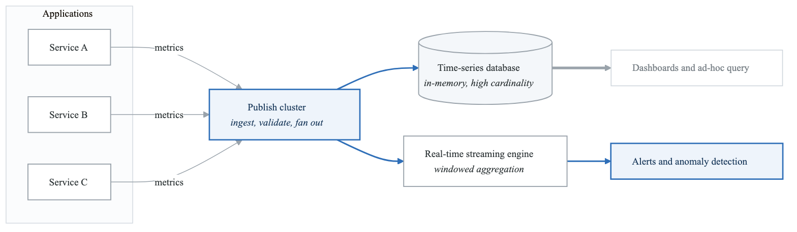
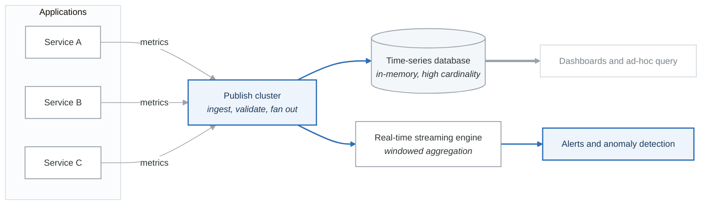

# Case Study: StreamCo - Chaos Engineering at Scale

## Executive Summary

StreamCo transformed from a DVD rental company to the world's leading streaming service, serving over 230 million subscribers across 190+ countries. This case study examines how StreamCo pioneered chaos engineering, built a cloud-native architecture on AWS, and created a culture of reliability that enables thousands of deployments per day while maintaining 99.99% availability.

## Company Background

### Organization Profile

| Attribute | Details |
|-----------|---------|
| **Industry** | Streaming Media & Entertainment |
| **Founded** | 1997 (streaming launched 2007) |
| **Subscribers** | 230+ million globally |
| **Engineering Team** | 2,500+ engineers |
| **Infrastructure** | 100% AWS cloud |
| **Daily Streams** | 1+ billion hours globally |

### Technical Scale

```yaml
streamco_scale:
  microservices: 1000+
  aws_instances: 100,000+
  deployments_per_day: 4,000+
  countries_served: 190+
  peak_traffic: 15% of global internet bandwidth
  video_encoding_hours: 140,000+ per day
```

## The Challenge

### 2008: The Great Outage

In August 2008, StreamCo experienced a major database corruption that took down the entire service for three days. This event became a turning point:

**Impact of the Outage:**
- 3 days of complete service unavailability
- Millions of customers unable to access service
- Significant revenue loss
- Brand reputation damage
- Engineering team demoralized

**Root Causes Identified:**
- Single points of failure in architecture
- Monolithic database dependency
- No disaster recovery capability
- Manual recovery processes
- Lack of failure testing

### The Strategic Decision

StreamCo leadership made a bold decision: migrate entirely to AWS and rebuild the architecture for resilience.

> "Our goal was to build systems that could survive failures, not just prevent them. We assume everything will fail eventually." - Adrian Cockcroft, Former Cloud Architect

## The Solution

### Phase 1: Cloud Migration (2008-2012)

**Migration Strategy:**

```yaml
migration_approach:
  methodology: "Lift, Shift, then Transform"

  phase_1_lift_shift:
    duration: 2 years
    focus:
      - Move workloads to EC2
      - Replicate data center architecture
      - Maintain existing patterns

  phase_2_transform:
    duration: 2 years
    focus:
      - Decompose monolith to microservices
      - Implement cloud-native patterns
      - Build resilience tooling
```

**Key Architectural Decisions:**

1. **Stateless Services**
   - No local state in application instances
   - All state in distributed data stores
   - Enables rapid scaling and recovery

2. **Distributed Data**
   - Cassandra for high-write workloads
   - EVCache (Memcached) for caching
   - S3 for object storage
   - No single database dependency

3. **Regional Isolation**
   - Deploy to multiple AWS regions
   - Each region can operate independently
   - Traffic routing via Route 53

### Phase 2: Chaos Engineering (2010-Present)

StreamCo invented chaos engineering to proactively find weaknesses before they cause outages.

**Chaos Monkey - The Beginning:**

```python
# Conceptual representation of Chaos Monkey logic
class ChaosMonkey:
    """
    Randomly terminates instances in production to ensure
    services can handle instance failures gracefully.
    """

    def __init__(self, config):
        self.enabled = config.get('enabled', False)
        self.probability = config.get('probability', 0.1)
        self.excluded_asgs = config.get('excluded', [])

    def run(self):
        if not self.enabled:
            return

        for asg in self.get_auto_scaling_groups():
            if asg.name in self.excluded_asgs:
                continue

            if random.random() < self.probability:
                instance = random.choice(asg.instances)
                self.terminate_instance(instance)
                self.notify(f"Terminated {instance.id} in {asg.name}")
```

**The Simian Army:**

StreamCo expanded beyond Chaos Monkey to a full suite of chaos tools:

```yaml
simian_army:
  chaos_monkey:
    purpose: Terminate random instances
    frequency: Business hours, weekdays
    scope: All production services

  latency_monkey:
    purpose: Inject artificial delays
    target: Service-to-service calls
    variations: [100ms, 500ms, 2000ms]

  conformity_monkey:
    purpose: Identify non-conforming instances
    checks:
      - Auto-scaling group membership
      - Required tags present
      - Security group compliance

  janitor_monkey:
    purpose: Clean up unused resources
    targets:
      - Unattached EBS volumes
      - Old AMIs
      - Unused security groups

  chaos_gorilla:
    purpose: Simulate entire AZ failure
    frequency: Quarterly exercises
    scope: Full production stack

  chaos_kong:
    purpose: Simulate entire region failure
    frequency: Annual exercises
    scope: Global infrastructure
```

**Chaos Engineering Principles:**

```yaml
chaos_principles:
  1_hypothesis:
    description: "Define steady state behavior"
    streamco_example: "Stream starts within 3 seconds, 99.99% success rate"

  2_vary_real_world:
    description: "Introduce realistic failure scenarios"
    streamco_examples:
      - Instance termination
      - Network partition
      - Dependency latency
      - Certificate expiration

  3_production:
    description: "Run experiments in production"
    rationale: "Staging doesn't reflect real complexity"
    safeguards:
      - Automatic rollback
      - Limited blast radius
      - Business hours only

  4_automate:
    description: "Automate experiments to run continuously"
    streamco_approach: "Chaos runs every business day"

  5_minimize_blast:
    description: "Limit scope of experiments"
    techniques:
      - Percentage-based rollout
      - Regional isolation
      - Automatic abort on SLO breach
```

### Phase 3: Platform Evolution

**The StreamCo OSS Stack:**

StreamCo open-sourced many of their tools:

```yaml
streamco_oss:
  service_discovery:
    eureka:
      purpose: Service registration and discovery
      pattern: Client-side load balancing

  resilience:
    hystrix:
      purpose: Circuit breaker pattern
      features:
        - Fallback responses
        - Bulkhead isolation
        - Real-time monitoring

  routing:
    zuul:
      purpose: API gateway
      features:
        - Dynamic routing
        - Load shedding
        - Security filtering

  configuration:
    archaius:
      purpose: Dynamic configuration
      features:
        - Runtime config changes
        - Cascading properties
        - Polling and callbacks
```

**Hystrix Circuit Breaker:**

```java
// Example Hystrix command pattern
public class GetUserCommand extends HystrixCommand<User> {

    private final UserService userService;
    private final String userId;

    public GetUserCommand(UserService userService, String userId) {
        super(HystrixCommandGroupKey.Factory.asKey("UserService"));
        this.userService = userService;
        this.userId = userId;
    }

    @Override
    protected User run() throws Exception {
        // Primary execution path
        return userService.getUser(userId);
    }

    @Override
    protected User getFallback() {
        // Fallback when circuit is open or execution fails
        return User.getDefaultUser();
    }
}

// Circuit breaker configuration
hystrix:
  command:
    default:
      circuitBreaker:
        requestVolumeThreshold: 20
        errorThresholdPercentage: 50
        sleepWindowInMilliseconds: 5000
      execution:
        isolation:
          thread:
            timeoutInMilliseconds: 1000
```

### Phase 4: Observability at Scale

**Monitoring Architecture:**

```yaml
streamco_observability:
  metrics:
    platform: Atlas (custom time-series database)
    scale: 2+ billion metrics per minute
    retention: 14 days high-resolution, 3 years aggregated
    features:
      - Dimensional data model
      - Real-time streaming
      - Custom query language

  logging:
    volume: 500+ TB per day
    pipeline:
      - Application -> Kafka
      - Kafka -> Elasticsearch
      - Elasticsearch -> Kibana

  tracing:
    spans_per_second: 1+ billion
    storage: Custom distributed trace store

  alerting:
    approach: Anomaly detection (not thresholds)
    algorithm: Robust PCA for dimensional analysis
    human_escalation: Only for critical anomalies
```

**Atlas Metrics System:**

<!-- figure: generated from the Mermaid below by _shared/diagrams/embed-figures.py — do not edit the image -->


<details>
<summary>Diagram source (Mermaid)</summary>



</details>

### Phase 5: Deployment Excellence

**Spinnaker - Continuous Delivery Platform:**

StreamCo built and open-sourced Spinnaker for multi-cloud deployment:

```yaml
spinnaker_capabilities:
  deployment_strategies:
    - Red/Black (Blue/Green)
    - Rolling deployment
    - Canary analysis
    - Custom strategies

  pipeline_features:
    - Multi-region deployment
    - Automated canary analysis
    - Manual judgment stages
    - Rollback automation

  integrations:
    cloud_providers:
      - AWS
      - GCP
      - Azure
      - Kubernetes
    ci_systems:
      - Jenkins
      - Travis CI
      - GitHub Actions
```

**Automated Canary Analysis (Kayenta):**

```yaml
canary_analysis:
  approach: Statistical comparison

  metrics_analyzed:
    - Error rate
    - Latency percentiles
    - CPU utilization
    - Custom business metrics

  process:
    1. Deploy canary to small percentage (1-5%)
    2. Collect metrics from canary and baseline
    3. Run statistical analysis (Mann-Whitney U test)
    4. Generate canary score (0-100)
    5. Pass/Fail based on threshold
    6. Automatic promotion or rollback

  example_config:
    canaryConfig:
      lifetimeMinutes: 60
      metricsAccountName: atlas-prod
      analysisIntervals:
        - 15
        - 30
        - 60
      scoreThresholds:
        marginal: 75
        pass: 90
```

## Results and Metrics

### Reliability Improvements

| Metric | 2008 (Pre-Cloud) | Current | Improvement |
|--------|------------------|---------|-------------|
| Availability | 99.0% | 99.99% | 99x fewer minutes of downtime |
| MTTR | Hours | Minutes | 95% reduction |
| Deployments/day | 1-2 | 4,000+ | 2000x increase |
| Rollback time | Hours | < 5 minutes | 98% reduction |
| Region failover | Not possible | < 10 minutes | New capability |

### Engineering Velocity

```yaml
velocity_metrics:
  deployment_frequency:
    2008: "Weekly releases"
    current: "4,000+ deployments per day"

  lead_time:
    2008: "2-4 weeks"
    current: "< 1 hour (code to production)"

  change_failure_rate:
    current: "< 0.1%"
    with_canary: "Automatic detection and rollback"

  recovery_time:
    current: "< 5 minutes (automated)"
```

### Cultural Transformation

**Freedom and Responsibility:**

```yaml
streamco_culture:
  principles:
    context_not_control:
      description: "Provide context, let teams decide"
      example: "No deployment approval gates"

    highly_aligned_loosely_coupled:
      description: "Agree on goals, independent execution"
      example: "Team-owned services, shared platforms"

    no_brilliant_jerks:
      description: "Culture fit matters as much as skills"
      impact: "Collaborative incident response"

  engineering_practices:
    full_ownership:
      - Teams own their services end-to-end
      - On-call for what you build
      - Direct production access

    no_qa_department:
      - Engineers responsible for quality
      - Automated testing required
      - Canary analysis catches issues

    blameless_culture:
      - Focus on systems, not individuals
      - Post-incident reviews are learning opportunities
      - Share failures openly
```

## Lessons Learned

### What Worked

1. **Embracing Failure**
   - Proactive chaos engineering found issues before customers did
   - Regular failure injection built confidence
   - Teams designed for failure from the start

2. **Open Source Strategy**
   - Open sourcing attracted talent
   - Community contributions improved tools
   - Industry adoption validated approaches

3. **Trusting Engineers**
   - No deployment gates or change advisory boards
   - Full production access for all engineers
   - Accountability through ownership

4. **Investment in Platform**
   - Internal platforms reduced cognitive load
   - Standardized observability across all services
   - Automated deployment reduced human error

### What Was Challenging

1. **Organizational Buy-in**
   - Initial resistance to chaos in production
   - Took years to build trust in the approach
   - Required executive sponsorship

2. **Tool Complexity**
   - Internal tools required significant investment
   - Open-source versions need community support
   - Steep learning curve for new engineers

3. **Scale Challenges**
   - Observability systems required constant evolution
   - Some patterns don't work at StreamCo scale
   - Costs are significant

## Key Takeaways

1. **Design for failure** - Don't try to prevent all failures; build systems that survive them

2. **Chaos engineering works** - Proactively finding weaknesses prevents outages

3. **Culture enables technology** - Freedom and responsibility allows rapid innovation

4. **Open source amplifies impact** - Sharing tools builds community and improves quality

5. **Observability is essential** - You can't fix what you can't see

---

## Discussion Questions

1. How did StreamCo's 2008 outage influence their architectural decisions?
2. What cultural changes were necessary to implement chaos engineering?
3. How does StreamCo balance velocity with reliability?
4. What are the prerequisites for successfully adopting chaos engineering?
5. How would you adapt StreamCo's practices for a smaller organization?

## Practical Exercises

### Exercise 1: Chaos Experiment Design
Design a chaos experiment for your application:
- Define steady-state hypothesis
- Identify variables to inject
- Plan abort conditions
- Document expected learnings

### Exercise 2: Circuit Breaker Implementation
Implement a circuit breaker pattern:
- Use Hystrix or Resilience4j
- Configure thresholds appropriately
- Implement meaningful fallbacks
- Add monitoring

### Exercise 3: Canary Deployment
Set up automated canary analysis:
- Deploy using Spinnaker or similar
- Configure metric collection
- Define success criteria
- Implement automatic rollback

## Further Reading

- [StreamCo Tech Blog](https://streamcotechblog.com/)
- "Chaos Engineering" by Casey Rosenthal and Nora Jones
- [Principles of Chaos Engineering](https://principlesofchaos.org/)
- [StreamCo OSS](https://streamco.github.io/)
- Adrian Cockcroft's talks on StreamCo architecture

<!-- feynman-check -->

---

## Feynman check

Close the file. Blank page, no notes. Explain each of these to a competent engineer who has never
used this tool — **under five minutes, no jargon you can't define on the spot:**

- Technical Scale
- 2008: The Great Outage
- The Strategic Decision
- Cloud Migration (2008-2012)

**The gap is not what you forgot. It is where you used a word instead of a mechanism.**

| | |
|---|---|
| ✗ | *"The architecture was badly designed."* |
| ✓ | *"The failure needed two independent weaknesses to compose. Name both, say why each one alone was survivable, and name the single control that would have broken the chain — that is the finding, not the vulnerability."* |

**Trace it:** The incident in this file, from entry to objective. At every step name the control that should have stopped it, and why it did not.

Stop at the first component you cannot name. Reopen this file and read **only** that.

**Go deeper — only once the gap has a name:** three postmortems from [danluu/post-mortems](https://github.com/danluu/post-mortems) — for each, name the one control that would have broken the chain.
Full list per domain: [`SOURCES.md`](../SOURCES.md#case-studies)

→ Protocol, the three levels of knowing, and worked examples: [`MASTERY.md`](../MASTERY.md)

<!-- /feynman-check -->
