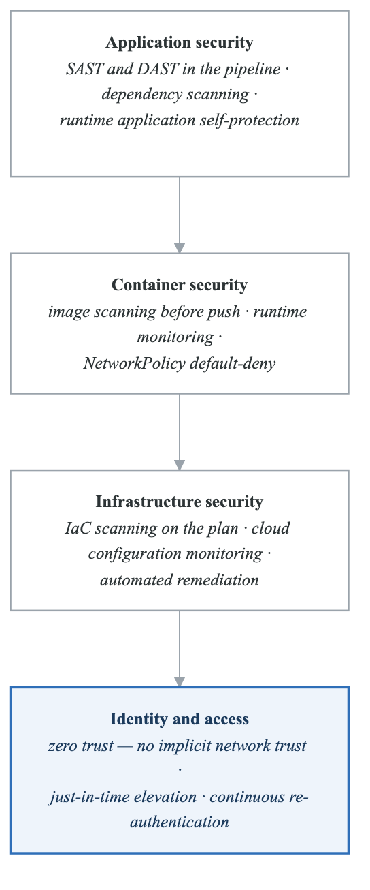
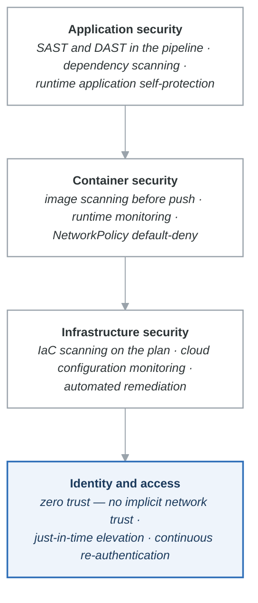

# Case Study: Meridian Bank - Cloud-Native Banking Transformation

## Executive Summary

Meridian Bank became the first major US bank to announce a full commitment to public cloud infrastructure, migrating entirely out of data centers to AWS. This case study examines how a heavily regulated financial institution transformed its technology stack, security posture, and engineering culture while maintaining compliance with stringent banking regulations.

## Company Background

### Organization Profile

| Attribute | Details |
|-----------|---------|
| **Industry** | Financial Services (Banking) |
| **Founded** | 1994 |
| **Customers** | 100+ million |
| **Assets** | $400+ billion |
| **Engineering Team** | 11,000+ technologists |
| **Data Centers** | 0 (fully cloud-native) |

### Regulatory Environment

```yaml
compliance_requirements:
  federal:
    - OCC (Office of the Comptroller of the Currency)
    - Federal Reserve
    - FDIC
    - CFPB (Consumer Financial Protection Bureau)

  standards:
    - PCI-DSS Level 1
    - SOX (Sarbanes-Oxley)
    - GLBA (Gramm-Leach-Bliley Act)

  data_requirements:
    - Data residency (US only for certain data)
    - Encryption at rest and in transit
    - Access logging and audit trails
    - Breach notification requirements
```

## The Challenge

### 2012: The Strategic Crossroads

Meridian Bank faced a critical decision about technology infrastructure:

**Existing State:**
- 8 data centers across the US
- Monolithic applications on legacy infrastructure
- 6-12 month delivery cycles for new features
- High operational costs ($1B+ annually in data center operations)
- Difficulty attracting top engineering talent

**Industry Pressures:**
- Fintech disruptors moving faster
- Customer expectations for digital experiences
- Competitors investing in technology
- Regulatory scrutiny increasing

**The Bold Decision:**

In 2012, Meridian Bank made an unprecedented announcement for a major bank:

> "We will exit all data centers and run entirely on public cloud infrastructure." - Rob Alexander, CIO

This decision was met with skepticism from regulators, competitors, and even some internal stakeholders.

## The Solution

### Phase 1: Foundation and Compliance (2012-2015)

**Regulatory Engagement:**

Meridian Bank proactively engaged with regulators:

```yaml
regulatory_strategy:
  education:
    - Briefed OCC on cloud security models
    - Demonstrated shared responsibility
    - Showed compliance capabilities

  frameworks:
    - Developed cloud-specific control frameworks
    - Mapped AWS services to regulatory requirements
    - Created audit-ready documentation

  continuous_engagement:
    - Regular updates on migration progress
    - Transparency on incidents
    - Collaboration on emerging guidance
```

**Security Architecture:**

<!-- figure: generated from the Mermaid below by _shared/diagrams/embed-figures.py — do not edit the image -->


<details>
<summary>Diagram source (Mermaid)</summary>



</details>

**Cloud Custodian:**

Meridian Bank developed and open-sourced Cloud Custodian for policy as code:

```yaml
# Example Cloud Custodian policies
policies:
  - name: ec2-require-encryption
    resource: ec2
    filters:
      - type: ebs
        key: Encrypted
        value: false
    actions:
      - type: terminate
        force: true

  - name: s3-require-encryption
    resource: s3
    filters:
      - type: bucket-encryption
        state: false
    actions:
      - type: set-bucket-encryption

  - name: iam-unused-credentials
    resource: iam-user
    filters:
      - type: credential
        key: access_keys.last_used
        value_type: age
        value: 90
        op: greater-than
    actions:
      - type: delete-access-key
```

### Phase 2: Migration at Scale (2015-2018)

**Migration Approach:**

```yaml
migration_strategy:
  pattern: "Strangle the Monolith"

  phases:
    1_lift_and_shift:
      approach: Move workloads with minimal changes
      target: 30% of applications
      benefit: Quick wins, build cloud experience

    2_re_platform:
      approach: Modify applications for cloud services
      target: 40% of applications
      benefit: Cost optimization, managed services

    3_re_architect:
      approach: Rebuild as cloud-native
      target: 30% of applications
      benefit: Full cloud capabilities, modern architecture

  data_migration:
    approach: "Dual write, then cut over"
    validation: Extensive reconciliation
    rollback: Maintained for 6 months post-migration
```

**Application Modernization:**

```yaml
modernization_patterns:
  api_gateway:
    technology: AWS API Gateway + Lambda
    use_case: Mobile banking APIs
    benefits:
      - Auto-scaling
      - Pay-per-request
      - Built-in security

  event_driven:
    technology: Kafka + AWS Lambda
    use_case: Transaction processing
    benefits:
      - Decoupled services
      - Real-time processing
      - Easy scaling

  container_platform:
    technology: Kubernetes (EKS)
    use_case: Microservices
    benefits:
      - Portability
      - Resource efficiency
      - Standard deployment
```

### Phase 3: Platform Engineering (2018-Present)

**Internal Developer Platform:**

```yaml
developer_platform:
  name: "Meridian Bank Developer Experience"

  capabilities:
    service_creation:
      - Templated microservice scaffolding
      - Automatic CI/CD pipeline setup
      - Service mesh integration
      - Observability configuration

    self_service_infrastructure:
      - Database provisioning
      - Cache clusters
      - Message queues
      - Storage buckets

    compliance_automation:
      - Automatic security scanning
      - Policy enforcement
      - Audit log generation
      - Compliance reporting

  golden_paths:
    backend_api:
      language: Java or Node.js
      framework: Spring Boot or Express
      database: PostgreSQL or DynamoDB
      deployment: EKS with Istio

    event_processor:
      language: Java
      messaging: Kafka
      processing: Kafka Streams
      deployment: EKS
```

**DevSecOps Pipeline:**

```yaml
devsecops_pipeline:
  stages:
    code:
      - SAST (Static Application Security Testing)
      - Secret scanning
      - Dependency vulnerability check
      - Code quality gates

    build:
      - Container image scanning
      - SBOM generation
      - License compliance check

    test:
      - DAST (Dynamic Application Security Testing)
      - Penetration testing (automated)
      - Compliance validation

    deploy:
      - Infrastructure policy validation
      - Configuration drift detection
      - Canary analysis

    runtime:
      - Continuous monitoring
      - Anomaly detection
      - Automated remediation

  shift_left_metrics:
    vulnerabilities_in_dev: "95% found before production"
    mean_time_to_remediate: "< 24 hours for critical"
    security_gate_pass_rate: "98% first attempt"
```

### Phase 4: Observability and Operations

**Observability Stack:**

```yaml
observability_platform:
  metrics:
    collection: Prometheus
    storage: Thanos (long-term)
    visualization: Grafana
    scale: 50+ million metrics/minute

  logging:
    collection: Fluent Bit
    processing: Kafka
    storage: Elasticsearch
    volume: 100+ TB/day

  tracing:
    standard: OpenTelemetry
    storage: Jaeger
    sampling: Adaptive (1% normal, 100% errors)

  alerting:
    platform: PagerDuty
    approach: SLO-based alerts
    noise_reduction: ML-based alert correlation
```

**SRE Practices:**

```yaml
sre_implementation:
  slos:
    customer_facing:
      - Mobile app availability: 99.95%
      - API latency (p99): < 500ms
      - Transaction success rate: 99.99%

    internal:
      - Build pipeline availability: 99.9%
      - Deployment success rate: 99%

  error_budgets:
    calculation: Monthly rolling
    policy: "If exhausted, freeze new features"
    exceptions: "Security fixes always proceed"

  incident_management:
    severity_levels:
      sev1: Customer-impacting, immediate response
      sev2: Degraded service, 30-minute response
      sev3: Minor impact, next business day
      sev4: No customer impact, normal workflow

    blameless_postmortems:
      required_for: Sev1 and Sev2
      format: Structured template
      sharing: Company-wide for learning
```

## Results and Metrics

### Migration Success

| Metric | 2012 | 2020 | Improvement |
|--------|------|------|-------------|
| Data centers | 8 | 0 | 100% cloud |
| Cloud workloads | 0% | 100% | Complete migration |
| Deployment frequency | Monthly | Multiple/day | 30x+ |
| Infrastructure costs | $1B+ | Significant reduction | Est. 30-40% |

### Engineering Velocity

```yaml
velocity_improvements:
  time_to_provision:
    before: "6-8 weeks for new server"
    after: "Minutes with self-service"

  deployment_frequency:
    before: "Monthly releases"
    after: "Thousands of deployments per day"

  lead_time:
    before: "6-12 months for new features"
    after: "Weeks to days"

  recovery_time:
    before: "Hours to days"
    after: "Minutes (automated)"
```

### Security Posture

```yaml
security_improvements:
  vulnerability_detection:
    before: "Periodic scans (quarterly)"
    after: "Continuous scanning in pipeline"

  mean_time_to_remediate:
    critical_vulnerabilities:
      before: "30+ days"
      after: "< 24 hours"

  compliance:
    audit_findings:
      trend: "Decreasing year over year"
    automated_controls: "90%+ of controls automated"
```

### Business Impact

**Customer Experience:**
- Mobile app rated #1 in banking apps
- 99.95%+ availability
- Real-time transaction notifications
- Instant credit decisions

**Competitive Position:**
- First major bank to close all data centers
- Recognized as technology leader in banking
- Attracts top engineering talent
- Faster time-to-market for products

## Lessons Learned

### What Worked

1. **Executive Commitment**
   - CEO and CIO publicly committed to cloud
   - Consistent messaging over 8+ years
   - Investment sustained through challenges

2. **Regulatory Partnership**
   - Proactive engagement with regulators
   - Transparency about approach and risks
   - Contributed to industry guidance

3. **Security-First Culture**
   - Security embedded in engineering
   - Automated compliance
   - Open-source contributions (Cloud Custodian)

4. **Developer Experience Focus**
   - Internal platforms reduce friction
   - Golden paths accelerate delivery
   - Self-service empowers teams

### Challenges Overcome

1. **Talent Gap**
   - Initial cloud skills shortage
   - Extensive training programs
   - Hired from tech companies
   - Built engineering brand

2. **Legacy Integration**
   - Mainframe dependencies
   - Gradual migration, not big bang
   - API layers for integration

3. **Cultural Resistance**
   - Traditional IT mindset
   - Demonstrated wins built trust
   - Celebrated cloud champions

4. **Regulatory Uncertainty**
   - No precedent for major bank on cloud
   - Worked to establish guidance
   - Became industry reference

### Key Success Factors

```yaml
success_factors:
  1_executive_sponsorship:
    description: "Visible, sustained commitment from top"
    example: "CIO personally championed cloud strategy"

  2_security_as_enabler:
    description: "Security team partners, not blockers"
    example: "Cloud Custodian enables self-service with guardrails"

  3_platform_thinking:
    description: "Build platforms, not just applications"
    example: "Developer Experience platform for 11,000 engineers"

  4_talent_investment:
    description: "Develop and attract cloud-native talent"
    example: "Acquired tech companies, extensive training"

  5_incremental_approach:
    description: "Migrate progressively, not big bang"
    example: "8-year journey, not overnight transformation"
```

## Key Takeaways

1. **Regulated industries can go cloud-native** - Compliance is achievable with proper architecture and automation

2. **Security becomes an enabler** - Automation and policy as code make security faster, not slower

3. **Platform engineering scales** - Internal platforms enable 11,000+ engineers to move fast safely

4. **Culture change takes time** - 8+ years of consistent effort transformed a traditional bank

5. **Open source builds credibility** - Contributing Cloud Custodian established thought leadership

---

## Discussion Questions

1. How did Meridian Bank manage regulatory risk during cloud migration?
2. What role did Cloud Custodian play in enabling self-service?
3. How would you prioritize applications for cloud migration?
4. What cultural changes were necessary for this transformation?
5. How does Meridian Bank's approach differ from other banks?

## Practical Exercises

### Exercise 1: Policy as Code
Implement Cloud Custodian policies for your environment:
- Write policies for encryption requirements
- Configure automatic remediation
- Set up compliance reporting

### Exercise 2: DevSecOps Pipeline
Design a security-integrated CI/CD pipeline:
- Include SAST, DAST, and container scanning
- Configure security gates
- Implement automated compliance checks

### Exercise 3: Migration Planning
Create a migration plan for a legacy application:
- Assess dependencies and risks
- Choose migration strategy
- Plan validation and rollback
- Define success criteria

## Further Reading

- [Meridian Bank Tech Blog](https://www.Meridian Bank.com/tech/)
- [Cloud Custodian Documentation](https://cloudcustodian.io/)
- AWS re:Invent talks by Meridian Bank
- "Cloud Native Transformation" by Pini Reznik et al.
- OCC guidance on cloud computing

<!-- feynman-check -->

---

## Feynman check

Close the file. Blank page, no notes. Explain each of these to a competent engineer who has never
used this tool — **under five minutes, no jargon you can't define on the spot:**

- Regulatory Environment
- 2012: The Strategic Crossroads
- Foundation and Compliance (2012-2015)
- Migration at Scale (2015-2018)

**The gap is not what you forgot. It is where you used a word instead of a mechanism.**

| | |
|---|---|
| ✗ | *"The architecture was badly designed."* |
| ✓ | *"The failure needed two independent weaknesses to compose. Name both, say why each one alone was survivable, and name the single control that would have broken the chain — that is the finding, not the vulnerability."* |

**Trace it:** The incident in this file, from entry to objective. At every step name the control that should have stopped it, and why it did not.

Stop at the first component you cannot name. Reopen this file and read **only** that.

**Go deeper — only once the gap has a name:** three postmortems from [danluu/post-mortems](https://github.com/danluu/post-mortems) — for each, name the one control that would have broken the chain.
Full list per domain: [`SOURCES.md`](../SOURCES.md#case-studies)

→ Protocol, the three levels of knowing, and worked examples: [`MASTERY.md`](../MASTERY.md)

<!-- /feynman-check -->
