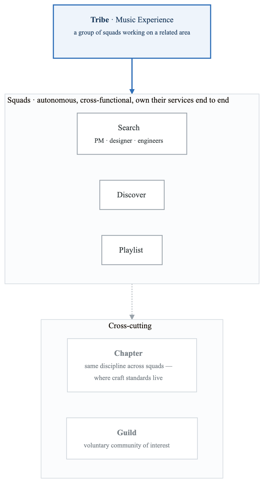
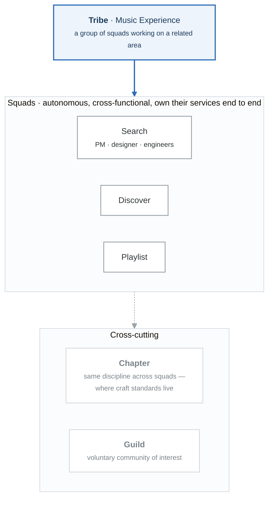

# Case Study: AudioWave - Platform Engineering and the Squad Model

## Executive Summary

AudioWave revolutionized not just music streaming but also how engineering organizations scale. This case study examines how AudioWave's squad model, internal platform (Backstage), and engineering culture enabled 600+ squads to operate autonomously while maintaining a cohesive product experience for 500+ million users.

## Company Background

### Organization Profile

| Attribute | Details |
|-----------|---------|
| **Industry** | Music Streaming |
| **Founded** | 2006 |
| **Users** | 550+ million (230M+ premium) |
| **Engineering** | 3,000+ engineers in 600+ squads |
| **Markets** | 180+ countries |
| **Catalog** | 100+ million tracks |

### Technical Scale

```yaml
audiowave_scale:
  daily_active_users: 300+ million
  concurrent_streams: 10+ million peak
  audio_files: 100+ million tracks
  playlists: 4+ billion
  microservices: 2,000+
  deployments_per_day: 10,000+
```

## The Challenge

### 2012: Growing Pains

As AudioWave grew from startup to global platform, they faced critical scaling challenges:

**Organizational Challenges:**
- Traditional team structures created bottlenecks
- Cross-team dependencies slowed delivery
- Engineers waited for central teams
- Innovation stifled by process

**Technical Challenges:**
- Monolithic architecture limiting scale
- Deployment queues and conflicts
- No visibility into system dependencies
- Inconsistent practices across teams

## The Solution

### The Squad Model

AudioWave pioneered the squad model for autonomous, aligned teams:

<!-- figure: generated from the Mermaid below by _shared/diagrams/embed-figures.py — do not edit the image -->


<details>
<summary>Diagram source (Mermaid)</summary>



</details>

**Squad Characteristics:**

```yaml
squad_model:
  squad:
    size: 6-10 people
    composition:
      - Product Manager
      - Designer
      - Engineers (frontend, backend, mobile)
      - Data scientist (optional)
    autonomy:
      - Own their mission end-to-end
      - Choose their own technology
      - Set their own processes
      - Deploy independently

  tribe:
    size: 50-150 people
    definition: "Collection of squads working in related area"
    leadership: Tribe Lead (technical + people)
    examples:
      - Music Experience Tribe
      - Payments Tribe
      - Infrastructure Tribe

  chapter:
    definition: "Functional specialty across squads"
    examples:
      - Backend Chapter
      - iOS Chapter
      - Data Engineering Chapter
    purpose: "Skill development, best practices"

  guild:
    definition: "Community of interest across tribes"
    examples:
      - Web Guild
      - Testing Guild
      - Leadership Guild
    purpose: "Knowledge sharing, coordination"
```

### Backstage: The Developer Portal

AudioWave created and open-sourced Backstage to manage complexity at scale:

**The Problem Backstage Solved:**

```yaml
pre_backstage_pain:
  discovery:
    - "Who owns this service?"
    - "What APIs exist for X?"
    - "Where is the documentation?"

  onboarding:
    - "How do I set up my environment?"
    - "What templates should I use?"
    - "Who do I ask for help?"

  operations:
    - "What's the health of my dependencies?"
    - "When was this last deployed?"
    - "What's running in production?"
```

**Backstage Architecture:**

```yaml
backstage_components:
  software_catalog:
    purpose: "Single source of truth for all services"
    features:
      - Service ownership
      - API documentation
      - Dependency mapping
      - Team information
    scale: "2,000+ services cataloged"

  software_templates:
    purpose: "Standardized service creation"
    templates:
      - Java microservice
      - Node.js API
      - React frontend
      - Data pipeline
    benefits:
      - Consistent structure
      - Built-in best practices
      - Automatic CI/CD setup

  tech_docs:
    purpose: "Documentation as code"
    features:
      - Lives with code
      - Auto-published on merge
      - Searchable from catalog
    adoption: "10,000+ documentation pages"

  plugins:
    purpose: "Extensible platform"
    examples:
      - Kubernetes integration
      - CI/CD status
      - Cost monitoring
      - On-call schedules
    ecosystem: "100+ community plugins"
```

### Golden Paths

AudioWave implemented "golden paths" - recommended, well-supported ways to accomplish common tasks:

```yaml
golden_paths:
  definition: |
    A golden path is an opinionated and supported path to build
    something. It's not mandatory, but it's the recommended way
    that gets the most platform support.

  examples:
    new_service:
      golden_path:
        - Use Backstage template
        - Java 17 + Spring Boot
        - Deploy to GKE
        - Observability via Prometheus
      alternatives_exist: true
      support_level: "Full support, first priority"

    data_pipeline:
      golden_path:
        - Scio (AudioWave's Apache Beam wrapper)
        - Cloud Dataflow
        - BigQuery destination
      support_level: "Full support"

  philosophy:
    - "Make the right way the easy way"
    - "Escape hatches for legitimate needs"
    - "Support decreases off golden path"
```

### Platform Teams

AudioWave's platform organization enables squad autonomy:

```yaml
platform_organization:
  infrastructure_tribe:
    squads:
      - Compute Platform (Kubernetes)
      - Data Platform
      - Network Platform
      - Storage Platform

  developer_experience_tribe:
    squads:
      - Backstage Core
      - CI/CD Platform
      - Developer Tools
      - Documentation Platform

  reliability_tribe:
    squads:
      - Observability Platform
      - Incident Management
      - Capacity Planning
      - Chaos Engineering

  operating_model:
    - Platform teams build capabilities
    - Product squads consume via self-service
    - Office hours for support
    - Clear SLAs for platform services
```

## Results and Metrics

### Organizational Scale

| Metric | 2012 | Current |
|--------|------|---------|
| Engineering headcount | 300 | 3,000+ |
| Squads | 30 | 600+ |
| Microservices | 100 | 2,000+ |
| Deployments/day | 100 | 10,000+ |

### Developer Experience

```yaml
developer_metrics:
  backstage_adoption:
    daily_active_users: "90% of engineers"
    catalog_completeness: "95% of services"
    template_usage: "80% of new services"

  time_to_production:
    new_service: "< 1 hour"
    new_engineer_first_deploy: "Day 1"

  developer_satisfaction:
    annual_survey: "4.2/5.0"
    backstage_nps: "+60"
```

### Reliability

```yaml
reliability_achievements:
  availability: 99.95%
  deployment_success: 99%+
  incident_response: "< 15 minutes MTTR"
  autonomous_deployments: "No central approval needed"
```

## Lessons Learned

### What Worked

1. **Autonomous teams with alignment**
   - Clear missions, freedom in execution
   - Tribes provide context, not control

2. **Platform as enabler**
   - Self-service over tickets
   - Golden paths over mandates
   - Internal open source culture

3. **Backstage for developer experience**
   - Single pane of glass
   - Reduced cognitive load
   - Open-sourced for community benefit

### Key Principles

```yaml
audiowave_principles:
  alignment_over_control:
    description: "Align on goals, let teams decide how"

  loosely_coupled_tightly_aligned:
    description: "Independent execution, shared direction"

  trust_at_scale:
    description: "Trust engineers to make good decisions"

  platform_as_product:
    description: "Treat internal platforms as products with users"
```

---

## Discussion Questions

1. How does the squad model enable both autonomy and alignment?
2. What role does Backstage play in managing complexity at scale?
3. How do golden paths differ from mandates?
4. What are the prerequisites for adopting the squad model?

## Further Reading

- [Backstage.io](https://backstage.io)
- [AudioWave Engineering Culture videos](https://engineering.ataudiowave.com/)
- "Team Topologies" by Matthew Skelton and Manuel Pais
- AudioWave Engineering blog

<!-- feynman-check -->

---

## Feynman check

Close the file. Blank page, no notes. Explain each of these to a competent engineer who has never
used this tool — **under five minutes, no jargon you can't define on the spot:**

- Technical Scale
- 2012: Growing Pains
- The Squad Model
- Backstage: The Developer Portal

**The gap is not what you forgot. It is where you used a word instead of a mechanism.**

| | |
|---|---|
| ✗ | *"The architecture was badly designed."* |
| ✓ | *"The failure needed two independent weaknesses to compose. Name both, say why each one alone was survivable, and name the single control that would have broken the chain — that is the finding, not the vulnerability."* |

**Trace it:** The incident in this file, from entry to objective. At every step name the control that should have stopped it, and why it did not.

Stop at the first component you cannot name. Reopen this file and read **only** that.

**Go deeper — only once the gap has a name:** three postmortems from [danluu/post-mortems](https://github.com/danluu/post-mortems) — for each, name the one control that would have broken the chain.
Full list per domain: [`SOURCES.md`](../SOURCES.md#case-studies)

→ Protocol, the three levels of knowing, and worked examples: [`MASTERY.md`](../MASTERY.md)

<!-- /feynman-check -->
