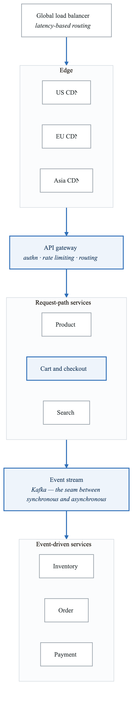

# Case Study: Apex Athletics - Global E-commerce Platform Transformation

## Executive Summary

Apex Athletics transformed its global e-commerce platform to handle peak traffic of 100,000+ requests per second during major product launches like Yeezy drops. This case study examines how Apex Athletics built a cloud-native platform across multiple regions, implemented advanced traffic management, and created an engineering culture capable of supporting a $25B+ digital business.

## Company Background

### Organization Profile

| Attribute | Details |
|-----------|---------|
| **Industry** | Athletic Apparel & E-commerce |
| **Founded** | 1949 |
| **Revenue** | €22B+ annually |
| **E-commerce** | €4B+ (18% of revenue) |
| **Markets** | 170+ countries |
| **Engineering** | 2,000+ digital technology staff |

### Technical Scale

```yaml
Apex Athletics_scale:
  peak_traffic: 100,000+ requests/second
  product_launches: 500+ per year
  concurrent_users: 1M+ during launches
  markets: 50+ localized e-commerce sites
  inventory_skus: 100,000+ active
  order_volume: millions per month
```

## The Challenge

### 2016: The Hype Culture Problem

Apex Athletics faced unique challenges from "hype culture" product launches:

**The Yeezy Problem:**
- Limited edition products sold out in seconds
- 10-100x normal traffic during launches
- Bot traffic overwhelming legitimate customers
- Site crashes during peak demand
- Customer frustration and brand damage

**Technical Debt:**
- Legacy monolithic commerce platform
- Single-region deployment
- Manual scaling processes
- Limited visibility during incidents
- Slow feature delivery

**Business Impact:**
- Lost revenue during outages
- Customer trust eroding
- Competitors gaining ground
- Marketing investments wasted on crashed sites

## The Solution

### Phase 1: Platform Modernization (2017-2019)

**Cloud Migration:**

```yaml
cloud_strategy:
  primary_cloud: AWS
  secondary_cloud: Azure (select workloads)

  architecture:
    - Multi-region active-active
    - Kubernetes for container orchestration
    - Microservices replacing monolith
    - Event-driven architecture

  regions:
    - US (us-east-1, us-west-2)
    - Europe (eu-west-1, eu-central-1)
    - Asia (ap-northeast-1, ap-southeast-1)
```

**Microservices Architecture:**

```mermaid
%%{init: {'theme':'base','themeVariables':{'fontFamily':'Helvetica, Arial, sans-serif','fontSize':'13px','primaryColor':'#ffffff','primaryTextColor':'#2d3436','primaryBorderColor':'#9aa3ab','lineColor':'#9aa3ab','textColor':'#2d3436','clusterBkg':'#fbfcfd','clusterBorder':'#d4dae0','edgeLabelBackground':'#ffffff','tertiaryColor':'#eef4fb'},'flowchart':{'curve':'basis','padding':14,'nodeSpacing':42,'rankSpacing':58}}}%%
flowchart TB
  classDef default fill:#ffffff,stroke:#9aa3ab,stroke-width:1.3px,color:#2d3436
  classDef n    fill:#ffffff,stroke:#9aa3ab,stroke-width:1.3px,color:#2d3436
  classDef crit fill:#eef4fb,stroke:#2f6fb8,stroke-width:1.8px,color:#1b3a5c
  classDef data fill:#f4f7fa,stroke:#9aa3ab,stroke-width:1.3px,color:#2d3436
  classDef mut  fill:#ffffff,stroke:#cfd6dc,stroke-width:1.1px,color:#7a8288
  classDef warn fill:#fdf0ec,stroke:#c0522d,stroke-width:1.6px,color:#8a3a1e
  GLB["Global load balancer<br/><i>latency-based routing</i>"]
  subgraph CDN["Edge"]
    direction LR
    US["US CDN"]
    EU["EU CDN"]
    AS["Asia CDN"]
  end
  GW["API gateway<br/><i>authn · rate limiting · routing</i>"]
  subgraph SVC["Request-path services"]
    direction LR
    P["Product"]
    CK["Cart and checkout"]
    SE["Search"]
  end
  K["Event stream<br/><i>Kafka — the seam between synchronous and asynchronous</i>"]
  subgraph ASY["Event-driven services"]
    direction LR
    INV["Inventory"]
    ORD["Order"]
    PAY["Payment"]
  end
  GLB ==> CDN ==> GW ==> SVC ==> K ==> ASY
  class GLB,US,EU,AS n
  class GW crit
  class P,SE n
  class CK crit
  class K crit
  class INV,ORD,PAY n
  linkStyle 0,1,2,3,4 stroke:#2f6fb8,stroke-width:2px

%% The interesting boundary is the Kafka one. Everything left of it must answer
%% inside a user's patience; everything right of it may retry, lag, and be
%% replayed. Checkout succeeding before payment settles is a deliberate choice,
%% and it is why the order service has to handle a payment that never arrives.
```

<!-- figure: generated from the Mermaid below by _shared/diagrams/embed-figures.py — do not edit the image -->


<details>
<summary>Diagram source (Mermaid)</summary>



</details>

### Phase 2: Launch Excellence (2019-2021)

**Queue Management System:**

For high-demand launches, Apex Athletics implemented a virtual waiting room:

```yaml
queue_system:
  purpose: "Fair access during high-demand launches"

  architecture:
    waiting_room:
      - Serverless (AWS Lambda)
      - Real-time position updates
      - Bot detection integration

    admission_control:
      - Rate-limited entry to site
      - Session-based access tokens
      - Automatic scaling

  features:
    - Random queue position (prevents refresh advantage)
    - Estimated wait time
    - Mobile notifications when turn arrives
    - Bot mitigation (fingerprinting, CAPTCHAs)

  capacity:
    waiting_room: "Unlimited users"
    shopping_site: "Controlled admission rate"
```

**Bot Mitigation:**

```yaml
bot_protection:
  layers:
    layer_1_cdn:
      - Rate limiting by IP
      - Geographic filtering
      - Known bot signature blocking

    layer_2_waf:
      - Behavioral analysis
      - Device fingerprinting
      - Challenge pages for suspicious traffic

    layer_3_application:
      - CAPTCHA challenges
      - Account reputation scoring
      - Purchase velocity limits

  effectiveness:
    bot_traffic_blocked: "95%+"
    false_positive_rate: "<0.5%"
    legitimate_customer_experience: "Minimal friction"
```

### Phase 3: Platform Engineering (2021-Present)

**Internal Developer Platform:**

```yaml
developer_platform:
  name: "Apex Athletics Digital Platform"

  capabilities:
    service_creation:
      - Templated microservices
      - Auto-configured CI/CD
      - Pre-integrated observability
      time_to_production: "< 1 day"

    self_service:
      - Database provisioning
      - Cache clusters
      - Message queues
      - Feature flags

    observability:
      - Centralized logging (ELK)
      - Metrics (Prometheus/Datadog)
      - Distributed tracing
      - Real-time dashboards

  golden_paths:
    backend: "Java Spring Boot"
    frontend: "React + Next.js"
    mobile: "React Native"
    data: "Spark + Airflow"
```

**GitOps Implementation:**

```yaml
gitops_architecture:
  tool: ArgoCD

  environments:
    development:
      sync: automatic
      approval: none

    staging:
      sync: automatic
      approval: none

    production:
      sync: manual promotion
      approval: required for critical services

  features:
    - Multi-cluster deployment
    - Canary releases
    - Automatic rollback on SLO breach
    - Drift detection and reconciliation
```

### Phase 4: Observability and Reliability

**Launch Command Center:**

```yaml
launch_command_center:
  purpose: "Real-time visibility during product launches"

  dashboards:
    traffic:
      - Requests per second (global and regional)
      - Queue depth and wait times
      - Bot vs. legitimate traffic ratio

    inventory:
      - Real-time stock levels
      - Reservation rates
      - Sold out predictions

    checkout:
      - Conversion funnel metrics
      - Payment success rates
      - Cart abandonment

    infrastructure:
      - Service health
      - Error rates
      - Latency percentiles
      - Auto-scaling status

  automation:
    - Automatic scaling triggers
    - Circuit breaker activation
    - Traffic shedding rules
    - Incident escalation
```

**SLO Framework:**

```yaml
service_level_objectives:
  availability:
    target: 99.95%
    measurement: "Successful requests / Total requests"

  latency:
    homepage:
      p50: 500ms
      p99: 2s
    checkout:
      p50: 1s
      p99: 3s

  launch_specific:
    queue_accuracy: "Wait time estimate within 20%"
    fairness: "Random position within 5% variance"

error_budgets:
  policy:
    healthy: "Normal development"
    warning: "Reduced non-critical deploys"
    exhausted: "Launch freeze, reliability focus"
```

## Results and Metrics

### Launch Performance

| Metric | 2017 | 2023 |
|--------|------|------|
| Peak traffic handled | 20K rps | 100K+ rps |
| Launch availability | 85% | 99.9%+ |
| Customer complaints | High | 90% reduction |
| Bot traffic blocked | 60% | 95%+ |

### Platform Maturity

```yaml
platform_metrics:
  deployment_frequency:
    before: "Monthly releases"
    after: "1000+ deploys per week"

  lead_time:
    before: "6-8 weeks"
    after: "Hours to days"

  availability:
    before: "99.0%"
    after: "99.95%"

  engineer_productivity:
    time_to_first_deploy: "1 day (was 4 weeks)"
    self_service_adoption: "90%"
```

### Business Impact

```yaml
business_results:
  e_commerce_growth:
    2017: "€1.5B"
    2023: "€4B+"

  launch_revenue:
    lost_to_outages:
      before: "Millions per launch"
      after: "Near zero"

  customer_satisfaction:
    launch_nps:
      before: "-10"
      after: "+35"
```

## Lessons Learned

### What Worked

1. **Queue System for Fairness**
   - Transformed hostile launch experience
   - Reduced bot impact significantly
   - Improved customer perception

2. **Multi-Region Active-Active**
   - Geographic load distribution
   - Failure isolation
   - Improved latency globally

3. **Platform Investment**
   - Self-service reduced bottlenecks
   - Golden paths accelerated delivery
   - Observability enabled confident launches

4. **Launch Rehearsals**
   - Load testing before every major launch
   - Runbooks practiced regularly
   - War rooms with clear roles

### Key Success Factors

```yaml
success_factors:
  executive_support:
    description: "Digital transformation funded as strategic priority"

  customer_focus:
    description: "Queue system prioritized fairness over maximum revenue"

  engineering_investment:
    description: "Built platform team before hitting scale"

  continuous_improvement:
    description: "Each launch improved from previous learnings"
```

## Key Takeaways

1. **Unique traffic patterns require unique solutions** - Hype culture launches needed virtual queues, not just scaling

2. **Bot mitigation is essential for e-commerce** - Multi-layer protection preserves customer experience

3. **Platform engineering enables velocity** - Self-service and golden paths accelerate delivery

4. **Observability is critical during peaks** - Real-time visibility enables quick decisions

5. **Rehearse for peak events** - Launch readiness requires practice and preparation

---

## Discussion Questions

1. How does the queue system balance fairness with conversion optimization?
2. What role does bot mitigation play in the overall architecture?
3. How would you design launch rehearsals for your platform?
4. What observability is essential during peak traffic events?
5. How does Apex Athletics balance global consistency with local market needs?

## Practical Exercises

### Exercise 1: Queue System Design
Design a virtual waiting room system:
- Define admission rate algorithm
- Plan position randomization
- Design notification system
- Consider mobile experience

### Exercise 2: Bot Mitigation Strategy
Create a multi-layer bot protection plan:
- Identify bot attack vectors
- Design detection mechanisms
- Plan challenge strategies
- Measure effectiveness

### Exercise 3: Launch Readiness
Build a launch readiness checklist:
- Load testing requirements
- Runbook preparation
- War room setup
- Rollback procedures

## Further Reading

- Apex Athletics Engineering Blog
- AWS retail architecture case studies
- E-commerce platform engineering best practices
- Bot mitigation techniques and tools

<!-- feynman-check -->

---

## Feynman check

Close the file. Blank page, no notes. Explain each of these to a competent engineer who has never
used this tool — **under five minutes, no jargon you can't define on the spot:**

- Technical Scale
- 2016: The Hype Culture Problem
- Platform Modernization (2017-2019)
- Launch Excellence (2019-2021)

**The gap is not what you forgot. It is where you used a word instead of a mechanism.**

| | |
|---|---|
| ✗ | *"The architecture was badly designed."* |
| ✓ | *"The failure needed two independent weaknesses to compose. Name both, say why each one alone was survivable, and name the single control that would have broken the chain — that is the finding, not the vulnerability."* |

**Trace it:** The incident in this file, from entry to objective. At every step name the control that should have stopped it, and why it did not.

Stop at the first component you cannot name. Reopen this file and read **only** that.

**Go deeper — only once the gap has a name:** three postmortems from [danluu/post-mortems](https://github.com/danluu/post-mortems) — for each, name the one control that would have broken the chain.
Full list per domain: [`SOURCES.md`](../SOURCES.md#case-studies)

→ Protocol, the three levels of knowing, and worked examples: [`MASTERY.md`](../MASTERY.md)

<!-- /feynman-check -->
