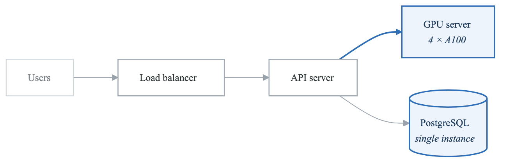
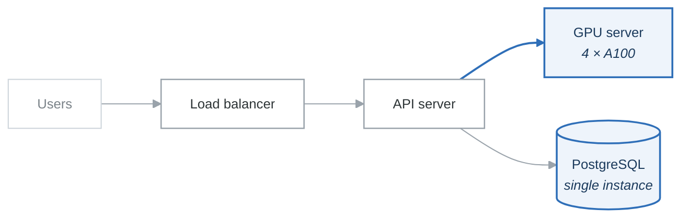
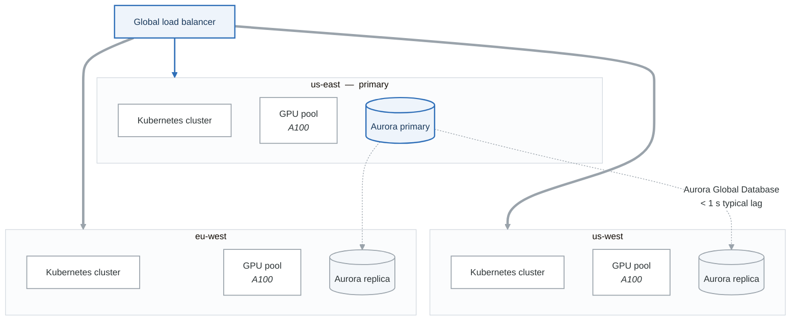

# Case Study: NexusAI - Scaling an AI Startup from Zero to 10 Million Users

## Executive Summary

NexusAI is a fictional AI startup that built a large language model platform serving enterprise customers. This case study follows their journey from a 5-person founding team to a 200-engineer organization serving 10 million users, examining how they built their platform engineering capabilities, managed GPU infrastructure at scale, implemented MLOps practices, and maintained reliability while growing 100x in 18 months.

## Company Background

### Organization Profile

| Attribute | Details |
|-----------|---------|
| **Industry** | AI/ML SaaS |
| **Founded** | 2023 |
| **Funding** | $120M Series B |
| **Employees** | 200 (150 engineers) |
| **Users** | 10 million monthly active |
| **API Calls** | 2 billion per day |
| **Models Hosted** | 50+ fine-tuned models |

### Product Overview

```yaml
nexusai_platform:
  core_product:
    name: "NexusAI API Platform"
    description: "Enterprise-grade LLM inference and fine-tuning"

  offerings:
    inference_api:
      - Multiple model sizes (7B, 13B, 70B parameters)
      - Low-latency inference (< 100ms first token)
      - 99.9% availability SLA
      - Custom model hosting

    fine_tuning:
      - No-code fine-tuning interface
      - Custom training data support
      - Model evaluation tools
      - Version management

    enterprise_features:
      - Private model deployment
      - VPC peering
      - SOC 2 Type II compliant
      - HIPAA available
```

## The Challenge

### Phase 1: Early Days (0-6 months)

**The Founding Team:**
- 5 engineers, 2 ML researchers
- Running inference on 4 rented A100 GPUs
- Deployed on a single cloud provider
- Manual deployments several times per week

**Initial Architecture:**

<!-- figure: generated from the Mermaid below by _shared/diagrams/embed-figures.py — do not edit the image -->


<details>
<summary>Diagram source (Mermaid)</summary>



</details>

**Growing Pains:**
- 99.5% availability (too many incidents)
- 2-3 hours to deploy new model versions
- No autoscaling (over-provisioning GPUs)
- Manual monitoring (watching logs)
- Single point of failure everywhere

### The Inflection Point

At month 6, NexusAI signed their first enterprise contract worth $2M ARR. The customer required:
- 99.9% availability SLA
- Sub-100ms latency at p99
- SOC 2 Type II compliance
- Multi-region deployment
- 24/7 support

**The Reality Check:**

```yaml
gap_analysis:
  availability:
    current: 99.5% (43 hours downtime/year)
    required: 99.9% (8.7 hours downtime/year)
    gap: 5x improvement needed

  latency:
    current_p99: 450ms
    required_p99: 100ms
    gap: 4.5x improvement needed

  compliance:
    current: None
    required: SOC 2 Type II
    gap: 6-12 month effort

  infrastructure:
    current: Single region, no redundancy
    required: Multi-region, full HA
    gap: Complete redesign needed
```

## The Solution

### Phase 2: Foundation Building (Months 7-12)

**Team Scaling:**
- Hired first Platform Engineer (employee #15)
- Built Platform team to 8 engineers by month 12
- Established SRE practices with 4 dedicated SREs
- Created dedicated ML Infrastructure team (6 engineers)

**Platform Team Structure:**

**Platform Engineering (Month 12)**

- Infrastructure Platform (4)
  - Kubernetes & Compute
  - GPU Infrastructure
  - Networking
- Developer Experience (2)
  - CI/CD & Tooling
  - Internal Tools
- Reliability (2)
  - Observability
  - Incident Response


**Infrastructure Redesign:**

```yaml
new_architecture:
  compute:
    kubernetes:
      clusters: 3 (one per region)
      node_pools:
        - cpu_general: c6i.xlarge (autoscaling 10-100)
        - cpu_api: c6i.2xlarge (autoscaling 20-200)
        - gpu_inference: p4d.24xlarge (8x A100)
        - gpu_training: p5.48xlarge (8x H100)

  gpu_management:
    scheduling: Custom Kubernetes scheduler
    fractional_gpus: MIG (Multi-Instance GPU)
    spot_instances: For training workloads (70% savings)
    reserved_capacity: For inference (guaranteed availability)

  networking:
    load_balancing: AWS ALB + NLB
    service_mesh: Istio
    cdn: CloudFront for static assets
    dns: Route 53 with health checks

  data:
    primary_db: Aurora PostgreSQL (Multi-AZ)
    cache: ElastiCache Redis Cluster
    model_storage: S3 with cross-region replication
    vector_db: Pinecone for embeddings
```

**Multi-Region Architecture:**

<!-- figure: generated from the Mermaid below by _shared/diagrams/embed-figures.py — do not edit the image -->


<details>
<summary>Diagram source (Mermaid)</summary>



</details>

### GPU Infrastructure Management

**The GPU Challenge:**

GPUs are expensive ($30K+/month per A100), scarce, and require specialized management:

```yaml
gpu_challenges:
  cost:
    - A100 on-demand: $32/hour
    - H100 on-demand: $98/hour
    - Need 100+ GPUs for inference
    - Monthly GPU bill: $500K+

  availability:
    - GPU capacity often sold out
    - Long lead times for reserved instances
    - Spot instances get interrupted

  utilization:
    - Inference is bursty (10-90% utilization swings)
    - Training is batch-oriented
    - Idle GPUs = wasted money
```

**GPU Orchestration Solution:**

```python
# Custom Kubernetes scheduler for GPU workloads
class GPUScheduler:
    """
    Intelligent GPU scheduling for inference and training workloads.
    """

    def __init__(self, config):
        self.reserved_pool = config.reserved_gpus
        self.spot_pool = config.spot_gpus
        self.mig_enabled = config.enable_mig

    def schedule_inference(self, request):
        """
        Schedule inference workload with latency priority.
        """
        # Priority 1: Use MIG slices for small models
        if request.model_size < 13e9 and self.mig_enabled:
            slice_type = self.get_mig_slice(request.memory_required)
            if available := self.find_mig_slice(slice_type):
                return self.assign_mig(request, available)

        # Priority 2: Use reserved instances for SLA workloads
        if request.sla_tier == "enterprise":
            if available := self.find_reserved_gpu(request):
                return self.assign_reserved(request, available)

        # Priority 3: Use on-demand for overflow
        return self.provision_on_demand(request)

    def schedule_training(self, job):
        """
        Schedule training job with cost priority.
        """
        # Priority 1: Use spot instances (70% cheaper)
        if spot := self.find_spot_capacity(job.gpu_count):
            return self.assign_spot(job, spot,
                                   checkpoint_interval=300)  # 5 min checkpoints

        # Priority 2: Queue for off-peak hours
        if job.priority != "urgent":
            return self.queue_for_offpeak(job)

        # Priority 3: Use on-demand as last resort
        return self.provision_on_demand(job)
```

**Multi-Instance GPU (MIG):**

```yaml
mig_configuration:
  # Split A100 80GB into multiple instances
  profiles:
    7g.40gb:  # Full GPU for 70B models
      instances_per_gpu: 1
      use_case: "Large model inference"

    3g.20gb:  # Half GPU for 13B models
      instances_per_gpu: 2
      use_case: "Medium model inference"

    1g.5gb:   # 1/7 GPU for 7B models
      instances_per_gpu: 7
      use_case: "Small model inference"

  benefits:
    utilization: "Increased from 40% to 85%"
    cost_savings: "45% reduction in GPU spend"
    latency: "Isolated performance, no noisy neighbors"
```

### MLOps Pipeline

**Model Lifecycle Management:**

```yaml
mlops_pipeline:
  model_development:
    experiment_tracking: MLflow
    notebooks: JupyterHub on Kubernetes
    compute: Training cluster (H100s)
    data_versioning: DVC

  model_training:
    orchestration: Kubeflow Pipelines
    distributed_training: DeepSpeed + FSDP
    hyperparameter_tuning: Ray Tune
    checkpointing: S3 with versioning

  model_evaluation:
    automated_benchmarks:
      - Perplexity on held-out data
      - Task-specific evaluations
      - Latency benchmarks
      - Memory profiling
    human_evaluation: "Label Studio integration"
    a_b_testing: "Gradual rollout with metrics"

  model_deployment:
    serving: "vLLM for inference optimization"
    containerization: "NVIDIA Triton"
    canary_deployment: "Argo Rollouts"
    rollback: "Instant model version switch"
```

**Model Serving Architecture:**

```yaml
inference_stack:
  serving_framework: vLLM
  features:
    - PagedAttention (efficient memory)
    - Continuous batching
    - Tensor parallelism
    - Dynamic batching

  configuration:
    max_batch_size: 256
    max_sequence_length: 8192
    kv_cache_dtype: fp8
    tensor_parallel_size: 4  # for 70B models

  performance:
    throughput: "10,000 tokens/second per GPU"
    latency_p50: "35ms first token"
    latency_p99: "85ms first token"
    utilization: "85% GPU compute"
```

### Developer Platform

**Internal Developer Platform:**

```yaml
developer_platform:
  service_creation:
    templates:
      - python-api: "FastAPI service with standard middleware"
      - ml-service: "Model serving with vLLM integration"
      - data-pipeline: "Airflow DAG with common transforms"

    automation:
      - Repository creation with CI/CD
      - Kubernetes namespace provisioning
      - Observability configuration
      - Security scanning integration

  self_service:
    infrastructure:
      - Database provisioning
      - Cache clusters
      - GPU allocation requests
      - Model deployment

    access_management:
      - AWS role assumption
      - Kubernetes RBAC
      - Secrets access
      - Model registry permissions

  developer_experience:
    local_development:
      - devcontainers for consistent environments
      - Local model inference with smaller models
      - Mocked external services

    debugging:
      - Distributed tracing across services
      - Log correlation
      - GPU profiling tools
      - Model inference debugging
```

**Platform CLI:**

```bash
# NexusAI Platform CLI examples

$ nexus model deploy my-fine-tuned-7b \
    --version v2.3 \
    --replicas 3 \
    --gpu-type a100 \
    --canary-percentage 10

Deploying model my-fine-tuned-7b:v2.3
  ✓ Image validated
  ✓ GPU quota approved
  ✓ Canary deployment started (10%)
  ✓ Health checks passing

Canary Status:
  Latency (p99): 78ms ✓ (threshold: 100ms)
  Error rate: 0.02% ✓ (threshold: 1%)
  GPU utilization: 72% ✓

Promote to full deployment? [y/N]

$ nexus service create customer-api \
    --template python-api \
    --team customer-success

Creating service customer-api...
  ✓ Repository created: github.com/nexusai/customer-api
  ✓ CI/CD pipeline configured
  ✓ Kubernetes namespace: customer-api-prod
  ✓ Observability configured
  ✓ Security scanning enabled

Service ready: https://customer-api.internal.nexusai.com
```

### Observability and Reliability

**Observability Stack:**

```yaml
observability:
  metrics:
    platform: Prometheus + Grafana
    custom_metrics:
      - tokens_per_second
      - model_latency_by_size
      - gpu_utilization_by_model
      - batch_queue_depth
      - cache_hit_rate

  logging:
    platform: Loki
    structured_logging: true
    retention: 30 days
    special_handling:
      - Model inference logs (sampled 1%)
      - Error logs (100% retention)

  tracing:
    platform: Jaeger
    sampling:
      default: 1%
      errors: 100%
      slow_requests: 100%

  ml_specific:
    model_monitoring:
      - Prediction drift detection
      - Feature distribution monitoring
      - Output quality metrics
    gpu_monitoring:
      - DCGM metrics (temperature, memory, utilization)
      - NCCL communication metrics
      - Error rates and recovery
```

**Custom ML Metrics Dashboard:**

```yaml
ml_dashboard:
  inference_metrics:
    - Total requests per second
    - Tokens generated per second
    - Time to first token (TTFT)
    - Inter-token latency (ITL)
    - Batch queue depth
    - KV cache utilization

  model_health:
    - Model version distribution
    - Error rate by model
    - Latency by model size
    - GPU memory utilization

  business_metrics:
    - API calls by customer
    - Token usage by tier
    - Revenue per GPU hour
    - Cost per 1M tokens
```

**SLO Framework:**

```yaml
slos:
  api_availability:
    target: 99.9%
    measurement: "Successful requests / Total requests"
    window: 30 days rolling

  inference_latency:
    target:
      p50: "< 50ms first token"
      p99: "< 100ms first token"
    measurement: "Time to first token"
    exclusions: "Requests > 4096 tokens"

  model_quality:
    target: "< 5% degradation from baseline"
    measurement: "Automated benchmark suite"
    frequency: "Daily"

error_budgets:
  calculation: "30-day rolling window"
  burn_rate_alerts:
    - 14.4x burn rate: "Page immediately"
    - 6x burn rate: "Page within 1 hour"
    - 3x burn rate: "Ticket, next business day"

  budget_policy:
    exhausted: "Freeze feature releases, focus on reliability"
    healthy: "Normal development velocity"
```

### Security and Compliance

**Security Architecture:**

```yaml
security:
  network:
    vpc_design:
      - Separate VPCs for prod/staging
      - Private subnets for compute
      - VPC endpoints for AWS services
      - No public IPs on instances

    ingress:
      - WAF on all public endpoints
      - DDoS protection (Shield Advanced)
      - Rate limiting per customer

  identity:
    authentication:
      - SSO for employees (IdentityCo)
      - API keys for customers
      - mTLS for service-to-service

    authorization:
      - RBAC in Kubernetes
      - Attribute-based access for models
      - Customer isolation (namespaces)

  data:
    encryption:
      - At-rest: AES-256
      - In-transit: TLS 1.3
      - Model weights: Customer-managed keys

    isolation:
      - Customer data in separate tables
      - Model inference in isolated containers
      - No cross-customer data leakage

  compliance:
    soc2_type2:
      - Annual audit
      - Continuous monitoring
      - Automated evidence collection

    gdpr:
      - Data residency options
      - Right to deletion
      - Consent management
```

## Results and Metrics

### Growth Metrics

| Metric | Month 6 | Month 18 | Growth |
|--------|---------|----------|--------|
| Monthly Active Users | 50K | 10M | 200x |
| API Calls/Day | 10M | 2B | 200x |
| Models Hosted | 3 | 50+ | 17x |
| GPU Fleet | 20 | 500+ | 25x |
| Engineering Team | 15 | 150 | 10x |

### Reliability Improvements

```yaml
reliability_journey:
  availability:
    month_6: 99.5%
    month_12: 99.9%
    month_18: 99.95%
    target: 99.99%

  latency_p99:
    month_6: 450ms
    month_12: 120ms
    month_18: 85ms
    target: 50ms

  incidents:
    month_6: "15 customer-impacting per month"
    month_12: "4 customer-impacting per month"
    month_18: "< 1 customer-impacting per month"

  mttr:
    month_6: "2 hours average"
    month_12: "30 minutes average"
    month_18: "10 minutes average"
```

### Cost Efficiency

```yaml
cost_optimization:
  gpu_utilization:
    before_mig: 40%
    after_mig: 85%
    savings: "$200K/month"

  spot_instances:
    training_workloads: "70% on spot"
    savings: "$150K/month"

  inference_optimization:
    vllm_throughput: "3x improvement"
    cost_per_token: "60% reduction"

  total_savings: "$500K+ monthly through optimization"
```

### Developer Productivity

```yaml
developer_metrics:
  deployment_frequency:
    month_6: "2-3 per week"
    month_18: "50+ per day"

  lead_time:
    month_6: "1 week"
    month_18: "< 1 hour"

  model_deployment:
    month_6: "2-3 hours manual process"
    month_18: "15 minutes automated"

  onboarding:
    month_6: "4 weeks to first deploy"
    month_18: "1 day to first deploy"
```

## Lessons Learned

### What Worked

1. **Early Platform Investment**
   - Hired platform engineer at employee #15
   - Built for scale before hitting scale
   - Reduced technical debt significantly

2. **GPU-Aware Architecture**
   - MIG for efficient utilization
   - Custom scheduler for ML workloads
   - Spot instances for training

3. **Developer Experience Focus**
   - Self-service everything
   - Fast feedback loops
   - Golden paths for common patterns

4. **SRE from Day One**
   - SLOs before they were needed
   - Error budgets drove decisions
   - Blameless culture from start

### What Would Be Done Differently

1. **Multi-Region Earlier**
   - Should have designed for multi-region from start
   - Retrofitting was expensive
   - Delayed enterprise contracts

2. **Compliance Planning**
   - SOC 2 took longer than expected
   - Should have started 6 months earlier
   - Underestimated documentation effort

3. **Team Structure**
   - Too flat initially, slowed decision-making
   - Should have established tech leads earlier
   - On-call rotation needed formal structure sooner

4. **Cost Monitoring**
   - GPU costs surprised us multiple times
   - Should have implemented FinOps earlier
   - Needed better forecasting

## Key Takeaways

1. **GPU infrastructure requires specialized expertise** - Standard cloud patterns don't apply; invest in GPU-specific tooling and knowledge

2. **ML workloads need ML-specific observability** - Token throughput, model latency, and inference quality are different from traditional metrics

3. **Scale planning must include GPU scarcity** - Capacity planning for GPUs is harder than for CPUs; reserve early

4. **Developer experience accelerates ML teams** - ML engineers especially benefit from good tooling; reduce friction to iterate faster

5. **Compliance is a feature, not a blocker** - Enterprise customers require it; build it in, don't bolt it on

---

## Discussion Questions

1. How does GPU infrastructure management differ from traditional compute?
2. What MLOps practices are essential for production ML systems?
3. How would you balance cost optimization with availability requirements?
4. What observability is specific to ML/AI workloads?
5. How should platform teams support ML engineers differently?

## Practical Exercises

### Exercise 1: GPU Cost Optimization
Design a GPU allocation strategy:
- Calculate cost of different instance types
- Design spot vs. reserved ratio
- Implement MIG partitioning scheme
- Create cost monitoring dashboard

### Exercise 2: ML Deployment Pipeline
Build an ML deployment pipeline:
- Model versioning and registry
- Automated testing (unit + benchmark)
- Canary deployment with ML metrics
- Automatic rollback triggers

### Exercise 3: Inference Optimization
Optimize an inference service:
- Implement batching strategy
- Configure KV cache management
- Set up autoscaling based on queue depth
- Measure and optimize TTFT

## Further Reading

- vLLM documentation and optimization guides
- NVIDIA Triton Inference Server
- Kubeflow for ML orchestration
- "Machine Learning Engineering" by Andriy Burkov
- GPU cloud cost optimization best practices

<!-- feynman-check -->

---

## Feynman check

Close the file. Blank page, no notes. Explain each of these to a competent engineer who has never
used this tool — **under five minutes, no jargon you can't define on the spot:**

- Product Overview
- Early Days (0-6 months)
- The Inflection Point
- Foundation Building (Months 7-12)

**The gap is not what you forgot. It is where you used a word instead of a mechanism.**

| | |
|---|---|
| ✗ | *"The architecture was badly designed."* |
| ✓ | *"The failure needed two independent weaknesses to compose. Name both, say why each one alone was survivable, and name the single control that would have broken the chain — that is the finding, not the vulnerability."* |

**Trace it:** The incident in this file, from entry to objective. At every step name the control that should have stopped it, and why it did not.

Stop at the first component you cannot name. Reopen this file and read **only** that.

**Go deeper — only once the gap has a name:** three postmortems from [danluu/post-mortems](https://github.com/danluu/post-mortems) — for each, name the one control that would have broken the chain.
Full list per domain: [`SOURCES.md`](../SOURCES.md#case-studies)

→ Protocol, the three levels of knowing, and worked examples: [`MASTERY.md`](../MASTERY.md)

<!-- /feynman-check -->
