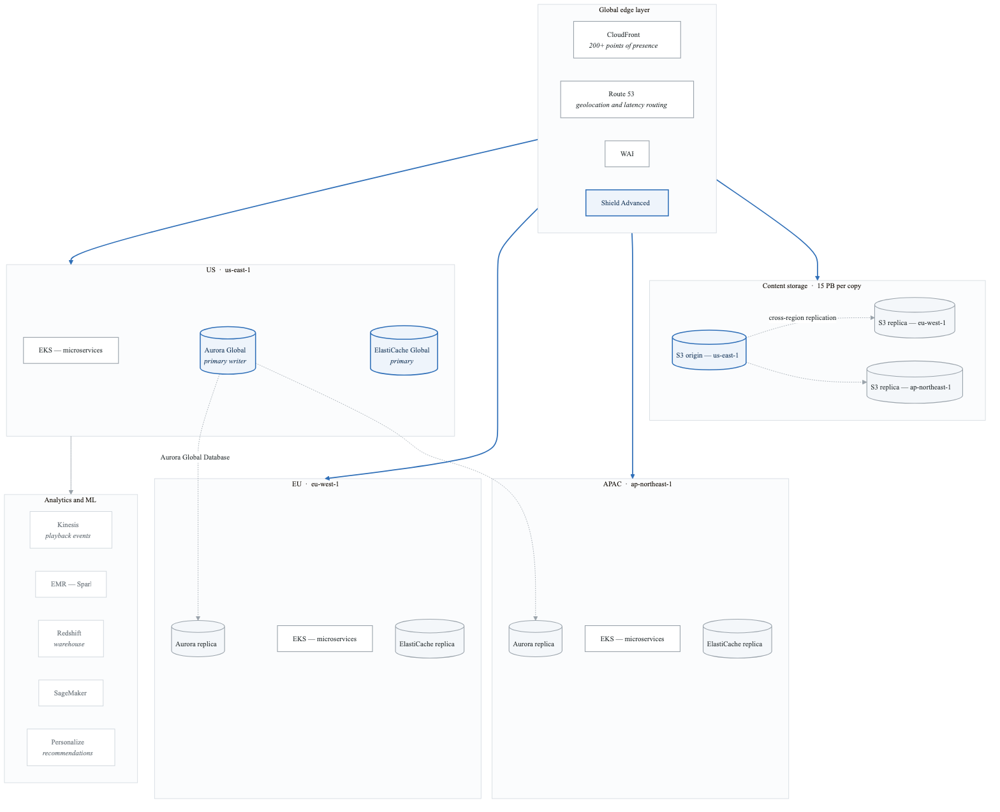
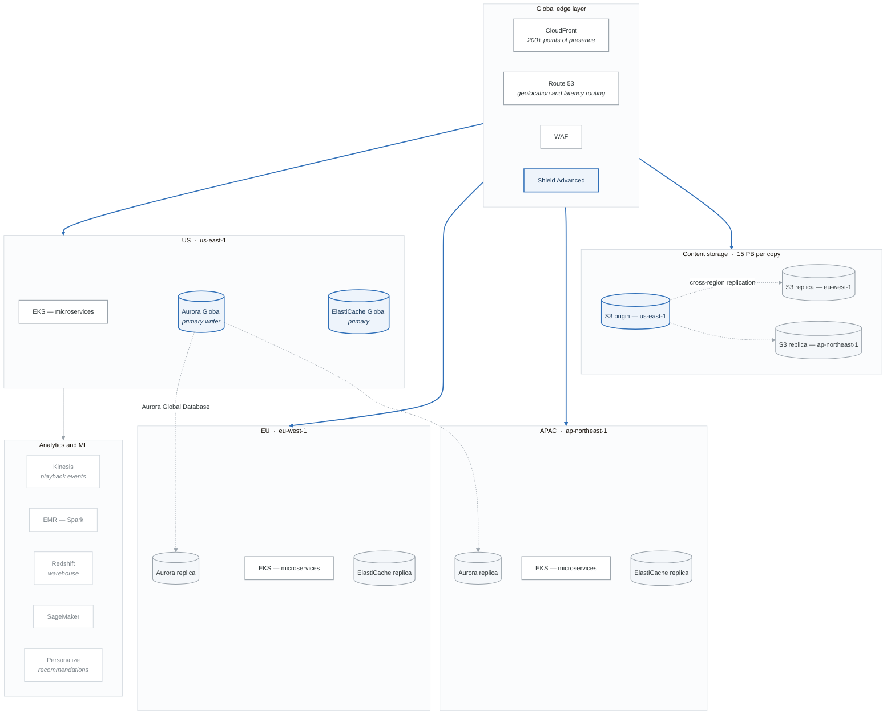
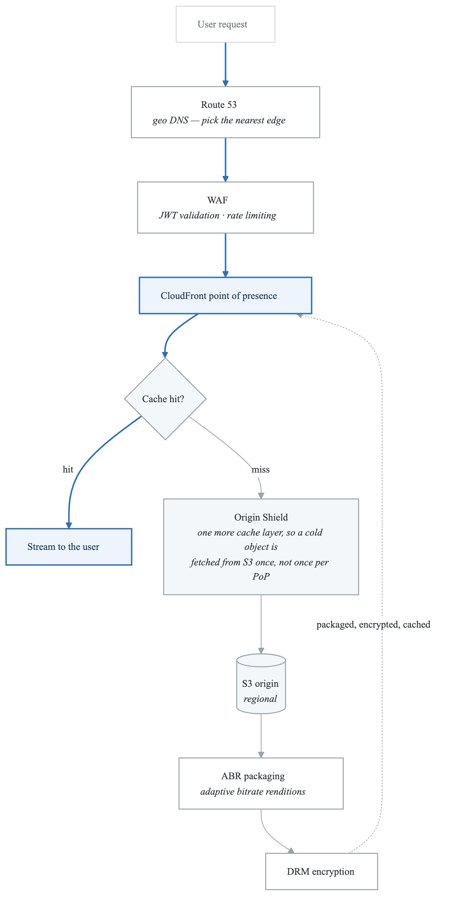
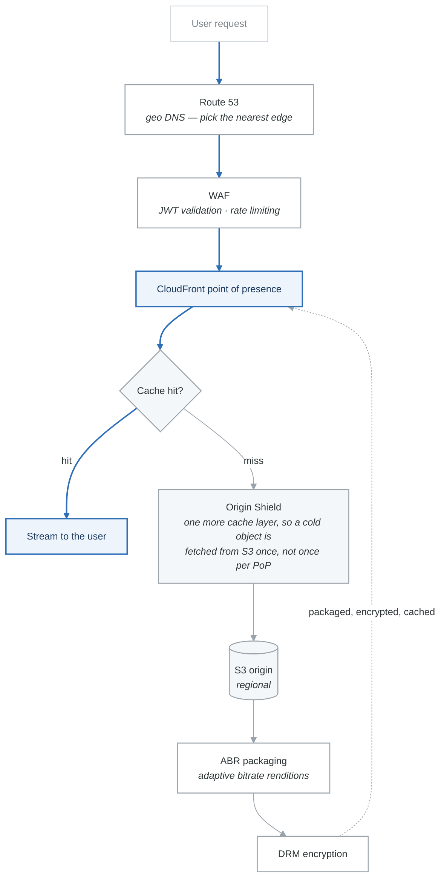

# Case Study 1: Global Streaming Platform Migration

## Executive Summary

StreamMax, a rapidly growing video streaming platform with 50 million subscribers, needed to migrate from a collocated data center to a multi-region cloud architecture to support global expansion and improve reliability.

## Company Background

| Attribute | Detail |
|-----------|--------|
| **Industry** | Media & Entertainment |
| **Company Size** | 2,500 employees |
| **Annual Revenue** | $1.2 billion |
| **Current Users** | 50 million subscribers |
| **Growth Rate** | 35% YoY |

## The Challenge

### Business Drivers

1. **Global Expansion**: Planned expansion into 40 new countries within 18 months
2. **Peak Load Management**: 10x traffic spikes during popular show releases
3. **Content Delivery**: Sub-100ms latency requirement for video startup
4. **Cost Optimization**: $15M annual infrastructure spend, 30% running idle
5. **Reliability**: Current architecture delivering only 99.5% availability

### Technical Constraints

- 15 petabytes of video content
- 200,000 concurrent streams during peak
- Complex DRM and geo-restriction requirements
- Real-time analytics for content recommendations
- Integration with 50+ content delivery partners

### Current Architecture Problems

**What was wrong with the legacy architecture**

| Problem | Symptoms |
|---|---|
| **Single data centre** | No geographic redundancy · 300 ms+ latency to APAC users · a full failover takes 4+ hours |
| **Monolithic application** | 3-week deployment cycles · one database bottleneck · components cannot scale independently |
| **Fixed infrastructure** | 30% average utilisation · cannot absorb a 10× spike · 6-month lead time for new hardware |

Read the three rows together and the business case writes itself: they are paying for peak capacity
they use 30% of, waiting six months to add more, and still cannot serve a continent.

## Solution Architecture

### Target State Architecture

<!-- figure: generated from the Mermaid below by _shared/diagrams/embed-figures.py — do not edit the image -->


<details>
<summary>Diagram source (Mermaid)</summary>



</details>

### Microservices Architecture

| Service | Technology | Scale Pattern | Data Store |
|---------|------------|---------------|------------|
| User Service | Go/EKS | Horizontal | Aurora Global |
| Catalog Service | Java/EKS | Horizontal | Aurora Global |
| Streaming Service | Rust/EKS | Horizontal | Redis Global |
| Recommendation | Python/EKS | ML-based | DynamoDB Global |
| Billing Service | Java/EKS | Event-driven | Aurora Global |
| Analytics | Spark/EMR | Batch + Stream | Redshift |
| Transcoding | FFmpeg/Lambda | Event-driven | S3 |

### Content Delivery Strategy

```yaml
# CloudFront Distribution Configuration
content_delivery:
  origins:
    - name: video-origin
      type: s3
      failover:
        - us-east-1
        - eu-west-1
        - ap-northeast-1
    - name: api-origin
      type: alb
      regional: true

  behaviors:
    - path_pattern: "/video/*"
      origin: video-origin
      cache_policy: video-optimized
      ttl: 86400
      signed_urls: true

    - path_pattern: "/api/*"
      origin: api-origin
      cache_policy: api-caching
      ttl: 0

  geo_restrictions:
    type: whitelist
    countries_allowed: 180

  security:
    waf_enabled: true
    shield_advanced: true
    origin_access_control: true
```

## Implementation Approach

### Phase 1: Foundation (Months 1-3)

**Objectives:**
- Deploy multi-region infrastructure
- Establish networking connectivity
- Implement security baseline

**Key Deliverables:**
1. Landing zone deployment across 3 regions
2. Transit Gateway mesh network
3. IAM and governance framework
4. Security Hub and GuardDuty

**Terraform Module Structure:**
**`terraform/`**

- `modules/`
  - `vpc/`
  - `eks/`
  - `aurora/`
  - `redis/`
  - `security/`
- `environments/`
  - `us-east-1/`
  - `eu-west-1/`
  - `ap-northeast-1/`
- `global/`
  - `route53/`
  - `cloudfront/`
  - `iam/`


### Phase 2: Data Migration (Months 3-6)

**Objectives:**
- Migrate 15 PB of video content
- Establish database replication
- Zero-downtime data sync

**Content Migration Strategy:**
```python
# Migration approach for 15 PB content
migration_config = {
    "approach": "wave-based",
    "waves": [
        {
            "name": "hot-content",
            "criteria": "viewed_last_30_days",
            "size_estimate": "2 PB",
            "method": "s3_batch_replication",
            "priority": 1
        },
        {
            "name": "warm-content",
            "criteria": "viewed_last_365_days",
            "size_estimate": "8 PB",
            "method": "datasync",
            "priority": 2
        },
        {
            "name": "cold-content",
            "criteria": "archive",
            "size_estimate": "5 PB",
            "method": "snowball_edge",
            "priority": 3,
            "storage_class": "GLACIER"
        }
    ],
    "validation": {
        "checksum_verification": True,
        "metadata_comparison": True,
        "playback_testing": "sample"
    }
}
```

### Phase 3: Application Migration (Months 6-12)

**Objectives:**
- Decompose monolith into microservices
- Deploy services to EKS
- Implement canary deployments

**Migration Sequence:**
1. Strangler fig pattern for monolith decomposition
2. Database per service with event sourcing
3. API gateway for traffic management
4. Gradual traffic shift (1% → 10% → 50% → 100%)

### Phase 4: Optimization (Months 12-18)

**Objectives:**
- Implement cost optimization
- Enhance performance
- Add advanced features

**Optimization Initiatives:**
- Spot instances for non-critical workloads (60% cost reduction)
- Reserved instances for baseline capacity
- S3 Intelligent-Tiering for content
- CloudFront caching optimization (85% cache hit ratio target)

## Technical Deep Dives

### Video Streaming Pipeline

<!-- figure: generated from the Mermaid below by _shared/diagrams/embed-figures.py — do not edit the image -->


<details>
<summary>Diagram source (Mermaid)</summary>



</details>

### Recommendation Engine Architecture

```python
# Real-time recommendation pipeline
class RecommendationPipeline:
    """
    Multi-stage recommendation system:
    1. Candidate generation (collaborative filtering)
    2. Ranking (ML model)
    3. Business rules (geo, licensing)
    4. Personalization (user context)
    """

    def __init__(self):
        self.personalize = boto3.client('personalize-runtime')
        self.dynamodb = boto3.resource('dynamodb')
        self.redis = redis.Redis(host='global-elasticache')

    async def get_recommendations(self, user_id: str,
                                   context: dict) -> List[str]:
        # Check cache first
        cache_key = f"recs:{user_id}:{hash(frozenset(context.items()))}"
        cached = await self.redis.get(cache_key)
        if cached:
            return json.loads(cached)

        # Stage 1: Get candidates from Personalize
        candidates = self.personalize.get_recommendations(
            campaignArn=CAMPAIGN_ARN,
            userId=user_id,
            numResults=100,
            context=context
        )

        # Stage 2: Apply business rules
        filtered = self.apply_geo_restrictions(
            candidates,
            context['country']
        )

        # Stage 3: Re-rank with real-time signals
        ranked = await self.rank_with_context(
            filtered,
            user_id,
            context
        )

        # Cache results
        await self.redis.setex(cache_key, 300, json.dumps(ranked[:20]))

        return ranked[:20]
```

### Auto-Scaling Configuration

```yaml
# Kubernetes HPA for streaming service
apiVersion: autoscaling/v2
kind: HorizontalPodAutoscaler
metadata:
  name: streaming-service-hpa
spec:
  scaleTargetRef:
    apiVersion: apps/v1
    kind: Deployment
    name: streaming-service
  minReplicas: 10
  maxReplicas: 500
  metrics:
    - type: Resource
      resource:
        name: cpu
        target:
          type: Utilization
          averageUtilization: 60
    - type: Pods
      pods:
        metric:
          name: active_streams
        target:
          type: AverageValue
          averageValue: "1000"
  behavior:
    scaleUp:
      stabilizationWindowSeconds: 60
      policies:
        - type: Percent
          value: 100
          periodSeconds: 60
        - type: Pods
          value: 50
          periodSeconds: 60
      selectPolicy: Max
    scaleDown:
      stabilizationWindowSeconds: 300
      policies:
        - type: Percent
          value: 10
          periodSeconds: 60
```

## Results and Outcomes

### Performance Improvements

| Metric | Before | After | Improvement |
|--------|--------|-------|-------------|
| Video Start Time | 3.2s | 0.8s | 75% faster |
| Rebuffering Rate | 2.1% | 0.3% | 86% reduction |
| API Latency (p99) | 450ms | 85ms | 81% faster |
| Global Availability | 99.5% | 99.99% | 4x improvement |

### Cost Optimization

| Category | Before | After | Savings |
|----------|--------|-------|---------|
| Compute | $6M/year | $2.4M/year | 60% |
| Storage | $4M/year | $2.5M/year | 38% |
| Bandwidth | $3M/year | $2M/year | 33% |
| Total | $15M/year | $8.5M/year | 43% |

### Operational Improvements

- **Deployment Frequency**: 2/month → 50/day
- **Lead Time**: 3 weeks → 2 hours
- **MTTR**: 4 hours → 15 minutes
- **Change Failure Rate**: 15% → 2%

## Lessons Learned

### What Worked Well

1. **Wave-based Migration**: Reduced risk and allowed course correction
2. **Feature Flags**: Enabled rapid rollback without deployments
3. **Synthetic Monitoring**: Caught issues before users reported them
4. **Chaos Engineering**: Regular GameDays improved resilience

### Challenges Faced

1. **Data Consistency**: Required careful coordination during DB migration
2. **CDN Cache Invalidation**: Needed custom tooling for content updates
3. **Regional Compliance**: GDPR required separate EU data processing
4. **Team Skills**: Significant training investment for cloud-native patterns

### Key Recommendations

1. Invest in observability early - you can't fix what you can't see
2. Plan for failure - design every component assuming it will fail
3. Automate everything - manual processes don't scale
4. Test at scale - load test before major releases

## Architecture Decision Records

### ADR 1: Multi-Region Active-Active vs Active-Passive

**Decision**: Active-Active in US and EU, Warm Standby in APAC

**Rationale**:
- 80% of traffic from US/EU regions
- Active-Active provides lowest latency for majority
- Warm standby for APAC reduces costs while meeting RTO

### ADR 2: Microservices vs Serverless for Core Services

**Decision**: EKS for streaming services, Lambda for supporting functions

**Rationale**:
- Streaming requires persistent connections (WebSocket)
- Lambda for event-driven tasks (transcoding, notifications)
- EKS provides better resource utilization for steady-state

### ADR 3: Aurora Global vs DynamoDB Global Tables

**Decision**: Aurora Global for transactional, DynamoDB for user state

**Rationale**:
- Complex transactions need ACID guarantees (Aurora)
- User session state needs low-latency reads (DynamoDB)
- Billing requires strong consistency (Aurora)

## Conclusion

StreamMax successfully migrated to a global, cloud-native architecture that:
- Supports 10x traffic spikes without degradation
- Delivers sub-second video start times globally
- Reduces infrastructure costs by 43%
- Enables 25x faster deployments

The migration took 18 months and required significant investment in team training and tooling, but the business benefits far exceeded the costs.

<!-- feynman-check -->

---

## Feynman check

Close the file. Blank page, no notes. Explain each of these to a competent engineer who has never
used this tool — **under five minutes, no jargon you can't define on the spot:**

- Solution Architecture
- Implementation Approach
- Technical Deep Dives
- Results and Outcomes

**The gap is not what you forgot. It is where you used a word instead of a mechanism.**

| | |
|---|---|
| ✗ | *"The architecture was badly designed."* |
| ✓ | *"The failure needed two independent weaknesses to compose. Name both, say why each one alone was survivable, and name the single control that would have broken the chain — that is the finding, not the vulnerability."* |

**Trace it:** The incident in this file, from entry to objective. At every step name the control that should have stopped it, and why it did not.

Stop at the first component you cannot name. Reopen this file and read **only** that.

**Go deeper — only once the gap has a name:** three postmortems from [danluu/post-mortems](https://github.com/danluu/post-mortems) — for each, name the one control that would have broken the chain.
Full list per domain: [`SOURCES.md`](../../SOURCES.md#case-studies)

→ Protocol, the three levels of knowing, and worked examples: [`MASTERY.md`](../../MASTERY.md)

<!-- /feynman-check -->
