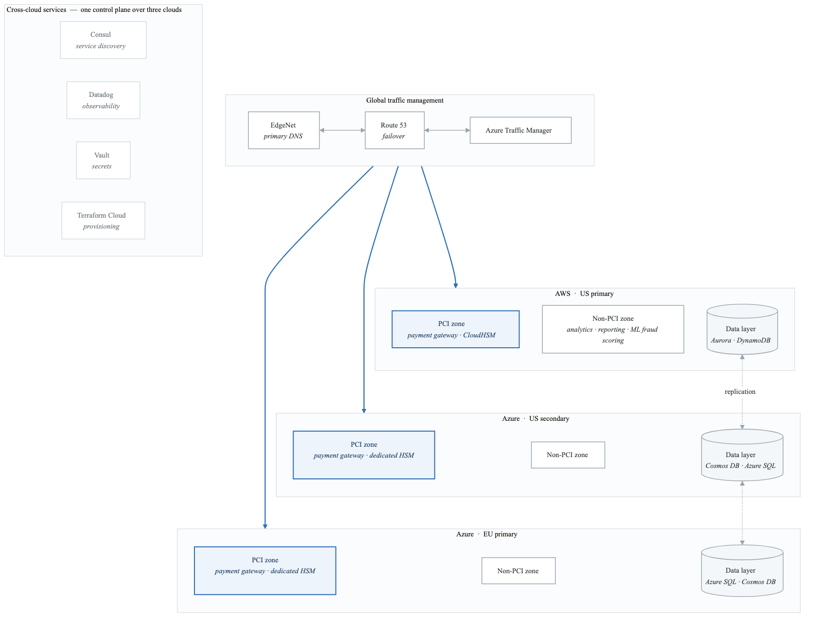
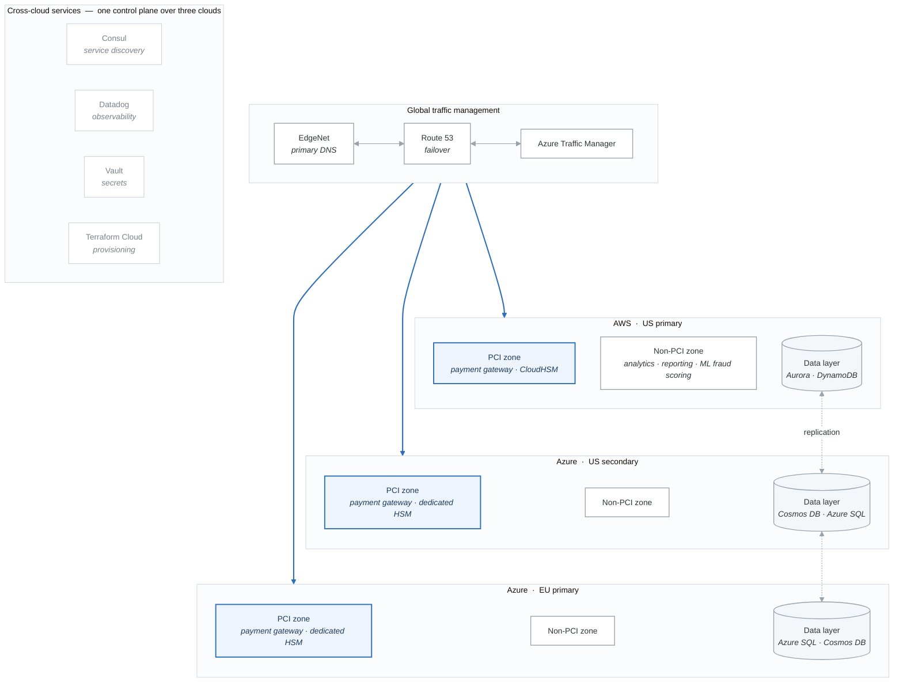
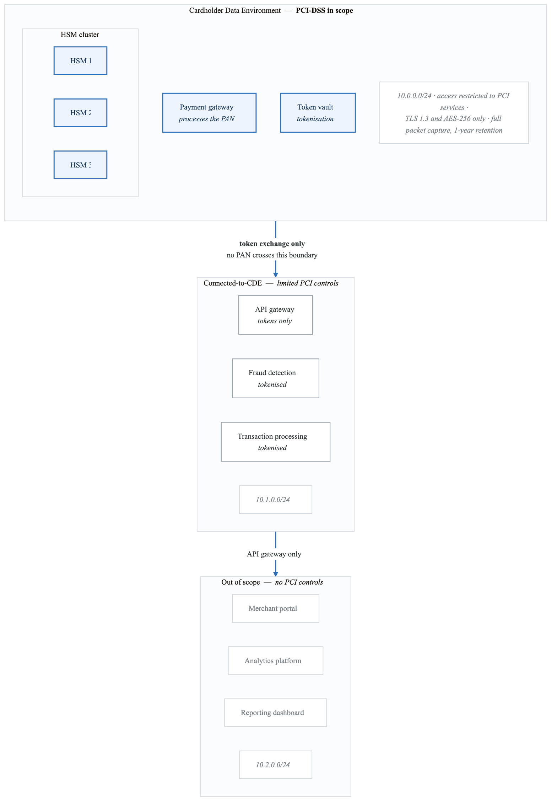
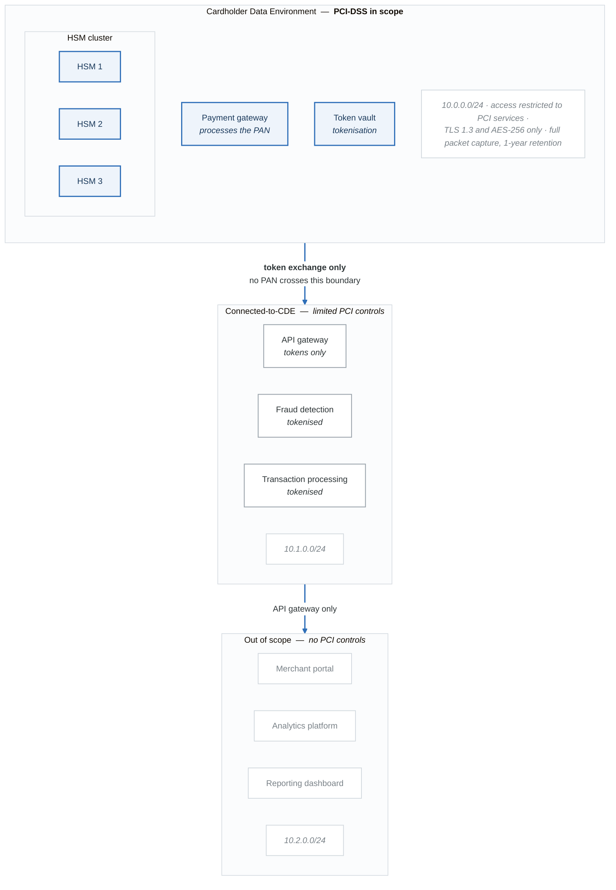

# Case Study 2: FinTech Multi-Cloud Compliance Architecture

## Executive Summary

PaySecure, a payment processing fintech serving 100,000+ merchants, implemented a multi-cloud architecture to meet regulatory requirements, avoid vendor lock-in, and ensure business continuity across AWS and Azure.

## Company Background

| Attribute | Detail |
|-----------|--------|
| **Industry** | Financial Services / Payments |
| **Company Size** | 800 employees |
| **Transaction Volume** | 500M transactions/year |
| **Annual TPV** | $75 billion |
| **Regulatory Requirements** | PCI-DSS Level 1, SOC 2, GDPR, PSD2 |

## The Challenge

### Business Requirements

1. **Regulatory Compliance**: Multiple compliance frameworks across regions
2. **Vendor Independence**: Board mandate to avoid single-cloud dependency
3. **Business Continuity**: Zero data loss (RPO=0), 15-minute RTO
4. **Global Operations**: Processing in NA, EU, and APAC
5. **Cost Predictability**: CFO required predictable monthly costs

### Technical Constraints

- PCI-DSS requires network segmentation and encryption
- SOX requires audit trails for all financial transactions
- GDPR requires EU data residency for EU customers
- Real-time fraud detection (<100ms decision time)
- 99.999% availability requirement (5 minutes downtime/year)

### Current State Issues

**What was wrong with the current architecture**

| Problem | Symptoms |
|---|---|
| **Single-cloud dependency** | A us-east-1 failure is a complete outage · no leverage in vendor negotiations · skills concentrated in one platform |
| **Compliance gaps** | PCI-DSS scope covers the entire environment · evidence collected by hand · audit findings take months to close |
| **Operational** | 2-hour RTO against a 15-minute target · DR tested twice a year · no automated failover |
| **Cost** | 40% month-over-month variance · reserved capacity underused · no FinOps practice |

The compliance row is the expensive one. "PCI scope is the whole environment" means every change to
any system is an audited change — which is also why the operational and cost rows look the way they
do.

## Solution Architecture

### Multi-Cloud Design

<!-- figure: generated from the Mermaid below by _shared/diagrams/embed-figures.py — do not edit the image -->


<details>
<summary>Diagram source (Mermaid)</summary>



</details>

### PCI-DSS Scope Segmentation

<!-- figure: generated from the Mermaid below by _shared/diagrams/embed-figures.py — do not edit the image -->


<details>
<summary>Diagram source (Mermaid)</summary>



</details>

## Implementation Details

### Multi-Cloud Terraform Configuration

```hcl
# terraform/multi-cloud/main.tf

terraform {
  required_version = ">= 1.0"
  required_providers {
    aws = {
      source  = "hashicorp/aws"
      version = "~> 5.0"
    }
    azurerm = {
      source  = "hashicorp/azurerm"
      version = "~> 3.0"
    }
    edgenet = {
      source  = "edgenet/edgenet"
      version = "~> 4.0"
    }
  }

  backend "remote" {
    organization = "paysecure"
    workspaces {
      prefix = "payment-platform-"
    }
  }
}

# Providers
provider "aws" {
  alias  = "us_primary"
  region = "us-east-1"
}

provider "azurerm" {
  alias           = "us_secondary"
  features {}
  subscription_id = var.azure_subscription_us
}

provider "azurerm" {
  alias           = "eu"
  features {}
  subscription_id = var.azure_subscription_eu
}

provider "edgenet" {}

# AWS US Primary
module "aws_us_primary" {
  source = "./modules/aws-payment-platform"
  providers = {
    aws = aws.us_primary
  }

  environment     = "production"
  region          = "us-east-1"
  vpc_cidr        = "10.0.0.0/16"
  pci_zone_cidr   = "10.0.0.0/24"
  enable_hsm      = true
  enable_waf      = true

  compliance_tags = {
    pci_dss     = "in-scope"
    data_class  = "confidential"
    retention   = "7-years"
  }
}

# Azure US Secondary
module "azure_us_secondary" {
  source = "./modules/azure-payment-platform"
  providers = {
    azurerm = azurerm.us_secondary
  }

  environment      = "production"
  location         = "East US 2"
  vnet_cidr        = "10.1.0.0/16"
  pci_subnet_cidr  = "10.1.0.0/24"
  enable_hsm       = true
  replication_role = "secondary"

  compliance_tags = {
    pci_dss     = "in-scope"
    data_class  = "confidential"
    retention   = "7-years"
  }
}

# Azure EU (GDPR)
module "azure_eu" {
  source = "./modules/azure-payment-platform"
  providers = {
    azurerm = azurerm.eu
  }

  environment      = "production"
  location         = "West Europe"
  vnet_cidr        = "10.2.0.0/16"
  pci_subnet_cidr  = "10.2.0.0/24"
  enable_hsm       = true
  replication_role = "primary"
  gdpr_compliant   = true

  compliance_tags = {
    pci_dss     = "in-scope"
    gdpr        = "applicable"
    data_class  = "confidential"
    retention   = "7-years"
  }
}

# EdgeNet Global Load Balancing
resource "edgenet_load_balancer" "payment_api" {
  zone_id     = var.edgenet_zone_id
  name        = "api.paysecure.com"
  fallback_pool_id = edgenet_load_balancer_pool.aws_us.id

  default_pool_ids = [
    edgenet_load_balancer_pool.aws_us.id,
    edgenet_load_balancer_pool.azure_us.id
  ]

  region_pools {
    region   = "WNAM"
    pool_ids = [
      edgenet_load_balancer_pool.aws_us.id,
      edgenet_load_balancer_pool.azure_us.id
    ]
  }

  region_pools {
    region   = "ENAM"
    pool_ids = [
      edgenet_load_balancer_pool.aws_us.id,
      edgenet_load_balancer_pool.azure_us.id
    ]
  }

  region_pools {
    region   = "WEU"
    pool_ids = [
      edgenet_load_balancer_pool.azure_eu.id
    ]
  }

  pop_pools {
    pop = "LAX"
    pool_ids = [edgenet_load_balancer_pool.aws_us.id]
  }

  rules {
    name      = "eu-traffic-rule"
    condition = "http.request.headers[\"cf-ipcountry\"] in {\"DE\" \"FR\" \"IT\" \"ES\" \"NL\" \"BE\" \"AT\" \"PL\"}"
    fixed_response {
      status_code = 0
    }
    overrides {
      region_pools {
        region   = "WEU"
        pool_ids = [edgenet_load_balancer_pool.azure_eu.id]
      }
    }
  }

  session_affinity    = "cookie"
  session_affinity_ttl = 3600
  proxied             = true
}

resource "edgenet_load_balancer_pool" "aws_us" {
  name = "aws-us-pool"

  origins {
    name    = "aws-us-east-1"
    address = module.aws_us_primary.nlb_dns_name
    enabled = true
    weight  = 1

    header {
      header = "Host"
      values = ["api.paysecure.com"]
    }
  }

  check_regions = ["WNAM", "ENAM"]
  minimum_origins = 1

  monitor = edgenet_load_balancer_monitor.payment_api.id
}

resource "edgenet_load_balancer_pool" "azure_us" {
  name = "azure-us-pool"

  origins {
    name    = "azure-east-us-2"
    address = module.azure_us_secondary.lb_ip
    enabled = true
    weight  = 1
  }

  check_regions = ["WNAM", "ENAM"]
  minimum_origins = 1

  monitor = edgenet_load_balancer_monitor.payment_api.id
}

resource "edgenet_load_balancer_pool" "azure_eu" {
  name = "azure-eu-pool"

  origins {
    name    = "azure-west-europe"
    address = module.azure_eu.lb_ip
    enabled = true
    weight  = 1
  }

  check_regions = ["WEU", "EEU"]
  minimum_origins = 1

  monitor = edgenet_load_balancer_monitor.payment_api.id
}

resource "edgenet_load_balancer_monitor" "payment_api" {
  type            = "https"
  expected_body   = "OK"
  expected_codes  = "200"
  method          = "GET"
  timeout         = 5
  path            = "/health"
  interval        = 30
  retries         = 2
  description     = "Payment API health check"

  header {
    header = "X-Health-Check"
    values = ["edgenet"]
  }
}
```

### Cross-Cloud Data Replication

```python
# services/data_replication/cross_cloud_sync.py
"""
Cross-cloud data replication service for multi-cloud consistency
"""

import asyncio
import hashlib
import json
from datetime import datetime
from typing import Dict, List, Optional
from dataclasses import dataclass
import boto3
from azure.cosmos import CosmosClient
from azure.servicebus import ServiceBusClient


@dataclass
class ReplicationEvent:
    """Event for cross-cloud replication"""
    event_id: str
    source_cloud: str
    target_clouds: List[str]
    entity_type: str
    entity_id: str
    operation: str  # CREATE, UPDATE, DELETE
    payload: Dict
    timestamp: datetime
    checksum: str


class CrossCloudReplicator:
    """Handle cross-cloud data replication with consistency guarantees"""

    def __init__(self, config: Dict):
        self.config = config
        self._init_aws_clients()
        self._init_azure_clients()

    def _init_aws_clients(self):
        self.dynamodb = boto3.resource('dynamodb')
        self.sqs = boto3.client('sqs')
        self.events = boto3.client('events')

    def _init_azure_clients(self):
        self.cosmos = CosmosClient(
            self.config['azure']['cosmos_endpoint'],
            self.config['azure']['cosmos_key']
        )
        self.servicebus = ServiceBusClient.from_connection_string(
            self.config['azure']['servicebus_connection']
        )

    def compute_checksum(self, payload: Dict) -> str:
        """Compute checksum for payload verification"""
        normalized = json.dumps(payload, sort_keys=True)
        return hashlib.sha256(normalized.encode()).hexdigest()

    async def replicate_to_azure(self, event: ReplicationEvent) -> bool:
        """Replicate data from AWS to Azure"""
        try:
            database = self.cosmos.get_database_client(
                self.config['azure']['cosmos_database']
            )
            container = database.get_container_client(event.entity_type)

            # Verify checksum
            if self.compute_checksum(event.payload) != event.checksum:
                raise ValueError("Checksum mismatch - data integrity error")

            if event.operation == 'DELETE':
                container.delete_item(
                    item=event.entity_id,
                    partition_key=event.payload.get('partition_key')
                )
            else:
                # Add metadata for conflict resolution
                event.payload['_source_cloud'] = event.source_cloud
                event.payload['_replicated_at'] = datetime.utcnow().isoformat()
                event.payload['_source_event_id'] = event.event_id

                container.upsert_item(event.payload)

            # Acknowledge replication
            await self._publish_replication_ack(event, 'azure')
            return True

        except Exception as e:
            await self._publish_replication_failure(event, 'azure', str(e))
            raise

    async def replicate_to_aws(self, event: ReplicationEvent) -> bool:
        """Replicate data from Azure to AWS"""
        try:
            table = self.dynamodb.Table(
                f"{self.config['aws']['table_prefix']}_{event.entity_type}"
            )

            # Verify checksum
            if self.compute_checksum(event.payload) != event.checksum:
                raise ValueError("Checksum mismatch - data integrity error")

            if event.operation == 'DELETE':
                table.delete_item(Key={'id': event.entity_id})
            else:
                # Add metadata
                event.payload['_source_cloud'] = event.source_cloud
                event.payload['_replicated_at'] = datetime.utcnow().isoformat()
                event.payload['_source_event_id'] = event.event_id

                table.put_item(Item=event.payload)

            # Acknowledge replication
            await self._publish_replication_ack(event, 'aws')
            return True

        except Exception as e:
            await self._publish_replication_failure(event, 'aws', str(e))
            raise

    async def handle_conflict(self, events: List[ReplicationEvent]) -> Dict:
        """Handle conflicting updates using last-writer-wins with vector clocks"""
        # Sort by timestamp
        sorted_events = sorted(events, key=lambda e: e.timestamp, reverse=True)
        winner = sorted_events[0]

        # Log conflict for audit
        conflict_record = {
            'entity_id': winner.entity_id,
            'entity_type': winner.entity_type,
            'winning_event': winner.event_id,
            'losing_events': [e.event_id for e in sorted_events[1:]],
            'resolution_strategy': 'last-writer-wins',
            'resolved_at': datetime.utcnow().isoformat()
        }

        await self._log_conflict(conflict_record)

        return winner.payload

    async def verify_consistency(self, entity_type: str,
                                  entity_id: str) -> Dict:
        """Verify data consistency across clouds"""
        results = {}

        # Read from AWS
        table = self.dynamodb.Table(
            f"{self.config['aws']['table_prefix']}_{entity_type}"
        )
        aws_response = table.get_item(Key={'id': entity_id})
        aws_data = aws_response.get('Item')

        # Read from Azure
        database = self.cosmos.get_database_client(
            self.config['azure']['cosmos_database']
        )
        container = database.get_container_client(entity_type)

        try:
            azure_data = container.read_item(
                item=entity_id,
                partition_key=entity_id
            )
        except Exception:
            azure_data = None

        # Compare
        if aws_data and azure_data:
            # Remove metadata for comparison
            aws_clean = {k: v for k, v in aws_data.items()
                        if not k.startswith('_')}
            azure_clean = {k: v for k, v in azure_data.items()
                         if not k.startswith('_')}

            aws_checksum = self.compute_checksum(aws_clean)
            azure_checksum = self.compute_checksum(azure_clean)

            results['consistent'] = aws_checksum == azure_checksum
            results['aws_checksum'] = aws_checksum
            results['azure_checksum'] = azure_checksum
        else:
            results['consistent'] = aws_data is None and azure_data is None
            results['aws_exists'] = aws_data is not None
            results['azure_exists'] = azure_data is not None

        return results

    async def _publish_replication_ack(self, event: ReplicationEvent,
                                       target: str):
        """Publish replication acknowledgment"""
        self.events.put_events(
            Entries=[{
                'Source': 'replication.service',
                'DetailType': 'ReplicationCompleted',
                'Detail': json.dumps({
                    'event_id': event.event_id,
                    'target_cloud': target,
                    'entity_type': event.entity_type,
                    'entity_id': event.entity_id,
                    'completed_at': datetime.utcnow().isoformat()
                })
            }]
        )

    async def _publish_replication_failure(self, event: ReplicationEvent,
                                           target: str, error: str):
        """Publish replication failure for alerting"""
        self.events.put_events(
            Entries=[{
                'Source': 'replication.service',
                'DetailType': 'ReplicationFailed',
                'Detail': json.dumps({
                    'event_id': event.event_id,
                    'target_cloud': target,
                    'entity_type': event.entity_type,
                    'entity_id': event.entity_id,
                    'error': error,
                    'failed_at': datetime.utcnow().isoformat()
                })
            }]
        )

    async def _log_conflict(self, conflict_record: Dict):
        """Log conflict for audit purposes"""
        table = self.dynamodb.Table('replication_conflicts')
        table.put_item(Item=conflict_record)
```

### Compliance Automation

```python
# compliance/continuous_compliance.py
"""
Continuous compliance monitoring and evidence collection
"""

import boto3
from azure.mgmt.security import SecurityCenter
from datetime import datetime
import json
from typing import Dict, List


class ComplianceOrchestrator:
    """Orchestrate compliance checks across clouds"""

    def __init__(self):
        self.aws_config = boto3.client('config')
        self.security_hub = boto3.client('securityhub')
        self.s3 = boto3.client('s3')

    def run_pci_dss_assessment(self) -> Dict:
        """Run PCI-DSS compliance assessment"""
        results = {
            'framework': 'PCI-DSS',
            'version': '4.0',
            'assessment_date': datetime.utcnow().isoformat(),
            'requirements': {}
        }

        # Requirement 1: Firewall Configuration
        results['requirements']['1'] = self._check_firewall_config()

        # Requirement 2: Vendor Defaults
        results['requirements']['2'] = self._check_vendor_defaults()

        # Requirement 3: Protect Stored Data
        results['requirements']['3'] = self._check_data_protection()

        # Requirement 4: Encrypt Transmission
        results['requirements']['4'] = self._check_encryption_transit()

        # Requirement 5: Anti-Malware
        results['requirements']['5'] = self._check_anti_malware()

        # Requirement 6: Secure Development
        results['requirements']['6'] = self._check_secure_development()

        # Requirement 7: Access Control
        results['requirements']['7'] = self._check_access_control()

        # Requirement 8: Authentication
        results['requirements']['8'] = self._check_authentication()

        # Requirement 9: Physical Security
        results['requirements']['9'] = self._check_physical_security()

        # Requirement 10: Logging and Monitoring
        results['requirements']['10'] = self._check_logging()

        # Requirement 11: Security Testing
        results['requirements']['11'] = self._check_security_testing()

        # Requirement 12: Security Policy
        results['requirements']['12'] = self._check_security_policy()

        # Calculate overall compliance
        total_checks = sum(len(r['checks']) for r in results['requirements'].values())
        passed_checks = sum(
            sum(1 for c in r['checks'] if c['status'] == 'PASSED')
            for r in results['requirements'].values()
        )

        results['summary'] = {
            'total_checks': total_checks,
            'passed': passed_checks,
            'failed': total_checks - passed_checks,
            'compliance_percentage': (passed_checks / total_checks * 100)
                                    if total_checks > 0 else 0
        }

        return results

    def _check_firewall_config(self) -> Dict:
        """PCI-DSS Requirement 1: Install and maintain firewall configuration"""
        checks = []

        # Check security groups
        ec2 = boto3.client('ec2')
        sgs = ec2.describe_security_groups(
            Filters=[{'Name': 'tag:pci_scope', 'Values': ['in-scope']}]
        )

        for sg in sgs['SecurityGroups']:
            # Check for unrestricted ingress
            unrestricted = False
            for rule in sg.get('IpPermissions', []):
                for ip_range in rule.get('IpRanges', []):
                    if ip_range.get('CidrIp') == '0.0.0.0/0':
                        unrestricted = True
                        break

            checks.append({
                'control': '1.2.1',
                'description': f'Security group {sg["GroupId"]} restricts inbound traffic',
                'status': 'FAILED' if unrestricted else 'PASSED',
                'resource': sg['GroupId'],
                'evidence': {
                    'inbound_rules': sg.get('IpPermissions', [])
                }
            })

        # Check NACLs
        nacls = ec2.describe_network_acls(
            Filters=[{'Name': 'tag:pci_scope', 'Values': ['in-scope']}]
        )

        for nacl in nacls['NetworkAcls']:
            has_deny_all = any(
                entry['RuleAction'] == 'deny' and entry['RuleNumber'] == 32767
                for entry in nacl['Entries']
            )

            checks.append({
                'control': '1.3.1',
                'description': f'NACL {nacl["NetworkAclId"]} has implicit deny',
                'status': 'PASSED' if has_deny_all else 'FAILED',
                'resource': nacl['NetworkAclId']
            })

        return {'requirement': 1, 'title': 'Firewall Configuration', 'checks': checks}

    def _check_data_protection(self) -> Dict:
        """PCI-DSS Requirement 3: Protect stored cardholder data"""
        checks = []

        # Check S3 encryption
        buckets = self.s3.list_buckets()['Buckets']

        for bucket in buckets:
            bucket_name = bucket['Name']

            try:
                encryption = self.s3.get_bucket_encryption(Bucket=bucket_name)
                has_encryption = True
                encryption_type = encryption['ServerSideEncryptionConfiguration']['Rules'][0]['ApplyServerSideEncryptionByDefault']['SSEAlgorithm']
            except Exception:
                has_encryption = False
                encryption_type = None

            checks.append({
                'control': '3.4',
                'description': f'S3 bucket {bucket_name} has encryption enabled',
                'status': 'PASSED' if has_encryption else 'FAILED',
                'resource': bucket_name,
                'evidence': {'encryption_type': encryption_type}
            })

        # Check RDS encryption
        rds = boto3.client('rds')
        instances = rds.describe_db_instances()

        for instance in instances['DBInstances']:
            checks.append({
                'control': '3.4',
                'description': f'RDS instance {instance["DBInstanceIdentifier"]} encrypted',
                'status': 'PASSED' if instance['StorageEncrypted'] else 'FAILED',
                'resource': instance['DBInstanceIdentifier'],
                'evidence': {
                    'encrypted': instance['StorageEncrypted'],
                    'kms_key': instance.get('KmsKeyId')
                }
            })

        # Check DynamoDB encryption
        dynamodb = boto3.client('dynamodb')
        tables = dynamodb.list_tables()['TableNames']

        for table_name in tables:
            table = dynamodb.describe_table(TableName=table_name)['Table']
            sse_spec = table.get('SSEDescription', {})

            checks.append({
                'control': '3.4',
                'description': f'DynamoDB table {table_name} encrypted',
                'status': 'PASSED' if sse_spec.get('Status') == 'ENABLED' else 'FAILED',
                'resource': table_name,
                'evidence': {'sse_status': sse_spec.get('Status')}
            })

        return {'requirement': 3, 'title': 'Protect Stored Data', 'checks': checks}

    def _check_encryption_transit(self) -> Dict:
        """PCI-DSS Requirement 4: Encrypt transmission of cardholder data"""
        checks = []

        # Check ALB listeners for HTTPS
        elbv2 = boto3.client('elbv2')
        lbs = elbv2.describe_load_balancers()

        for lb in lbs['LoadBalancers']:
            listeners = elbv2.describe_listeners(LoadBalancerArn=lb['LoadBalancerArn'])

            for listener in listeners['Listeners']:
                is_https = listener['Protocol'] == 'HTTPS'
                ssl_policy = listener.get('SslPolicy', 'None')

                # Check for strong TLS policy
                strong_policy = ssl_policy in [
                    'ELBSecurityPolicy-TLS13-1-2-2021-06',
                    'ELBSecurityPolicy-TLS-1-2-Ext-2018-06'
                ]

                checks.append({
                    'control': '4.1',
                    'description': f'ALB {lb["LoadBalancerName"]} listener uses TLS 1.2+',
                    'status': 'PASSED' if is_https and strong_policy else 'FAILED',
                    'resource': lb['LoadBalancerName'],
                    'evidence': {
                        'protocol': listener['Protocol'],
                        'ssl_policy': ssl_policy
                    }
                })

        # Check CloudFront distributions
        cloudfront = boto3.client('cloudfront')
        distributions = cloudfront.list_distributions()

        for dist in distributions.get('DistributionList', {}).get('Items', []):
            viewer_protocol = dist['DefaultCacheBehavior']['ViewerProtocolPolicy']
            min_protocol = dist['ViewerCertificate'].get('MinimumProtocolVersion', 'TLSv1')

            checks.append({
                'control': '4.1',
                'description': f'CloudFront {dist["Id"]} enforces HTTPS',
                'status': 'PASSED' if viewer_protocol in ['https-only', 'redirect-to-https'] else 'FAILED',
                'resource': dist['Id'],
                'evidence': {
                    'viewer_protocol': viewer_protocol,
                    'min_tls_version': min_protocol
                }
            })

        return {'requirement': 4, 'title': 'Encrypt Transmission', 'checks': checks}

    def _check_logging(self) -> Dict:
        """PCI-DSS Requirement 10: Track and monitor all access"""
        checks = []

        # Check CloudTrail
        cloudtrail = boto3.client('cloudtrail')
        trails = cloudtrail.describe_trails()

        for trail in trails['trailList']:
            status = cloudtrail.get_trail_status(Name=trail['TrailARN'])

            checks.append({
                'control': '10.2',
                'description': f'CloudTrail {trail["Name"]} is enabled and logging',
                'status': 'PASSED' if status['IsLogging'] else 'FAILED',
                'resource': trail['Name'],
                'evidence': {
                    'is_logging': status['IsLogging'],
                    'is_multi_region': trail.get('IsMultiRegionTrail'),
                    'has_log_validation': trail.get('LogFileValidationEnabled')
                }
            })

        # Check VPC Flow Logs
        ec2 = boto3.client('ec2')
        vpcs = ec2.describe_vpcs()

        for vpc in vpcs['Vpcs']:
            flow_logs = ec2.describe_flow_logs(
                Filters=[{'Name': 'resource-id', 'Values': [vpc['VpcId']]}]
            )

            has_flow_logs = len(flow_logs['FlowLogs']) > 0

            checks.append({
                'control': '10.3',
                'description': f'VPC {vpc["VpcId"]} has flow logs enabled',
                'status': 'PASSED' if has_flow_logs else 'FAILED',
                'resource': vpc['VpcId'],
                'evidence': {'flow_logs_count': len(flow_logs['FlowLogs'])}
            })

        return {'requirement': 10, 'title': 'Logging and Monitoring', 'checks': checks}

    # Stub methods for other requirements
    def _check_vendor_defaults(self) -> Dict:
        return {'requirement': 2, 'title': 'Vendor Defaults', 'checks': []}

    def _check_anti_malware(self) -> Dict:
        return {'requirement': 5, 'title': 'Anti-Malware', 'checks': []}

    def _check_secure_development(self) -> Dict:
        return {'requirement': 6, 'title': 'Secure Development', 'checks': []}

    def _check_access_control(self) -> Dict:
        return {'requirement': 7, 'title': 'Access Control', 'checks': []}

    def _check_authentication(self) -> Dict:
        return {'requirement': 8, 'title': 'Authentication', 'checks': []}

    def _check_physical_security(self) -> Dict:
        return {'requirement': 9, 'title': 'Physical Security', 'checks': []}

    def _check_security_testing(self) -> Dict:
        return {'requirement': 11, 'title': 'Security Testing', 'checks': []}

    def _check_security_policy(self) -> Dict:
        return {'requirement': 12, 'title': 'Security Policy', 'checks': []}

    def generate_evidence_package(self, assessment_results: Dict,
                                   output_bucket: str) -> str:
        """Generate compliance evidence package for auditors"""
        timestamp = datetime.utcnow().strftime('%Y%m%d-%H%M%S')
        package_key = f'compliance-evidence/{timestamp}/pci-dss-evidence.json'

        self.s3.put_object(
            Bucket=output_bucket,
            Key=package_key,
            Body=json.dumps(assessment_results, indent=2),
            ContentType='application/json',
            ServerSideEncryption='AES256'
        )

        return f's3://{output_bucket}/{package_key}'
```

## Results and Outcomes

### Multi-Cloud Benefits

| Metric | Single Cloud | Multi-Cloud | Improvement |
|--------|--------------|-------------|-------------|
| Vendor Negotiation Leverage | None | Strong | Significant |
| Regional Failure Impact | Complete outage | Single region | 67% reduction |
| Compliance Complexity | Medium | Higher | Trade-off |
| Skill Requirements | Single platform | Multiple | Increased |

### Reliability Improvements

| Metric | Before | After | Improvement |
|--------|--------|-------|-------------|
| Availability | 99.95% | 99.999% | 10x improvement |
| RTO | 2 hours | 15 minutes | 87% reduction |
| RPO | 1 hour | 0 (sync replication) | Eliminated |
| DR Test Frequency | 2x/year | Continuous | 180+ tests/year |

### Compliance Outcomes

- **PCI-DSS Scope**: Reduced from entire environment to 15% of infrastructure
- **Audit Findings**: Reduced from 23 to 3 over 12 months
- **Evidence Collection**: From 3 weeks manual to real-time automated
- **Remediation Time**: From 45 days average to 48 hours

### Cost Analysis

| Category | Before | After | Change |
|----------|--------|-------|--------|
| AWS Spend | $2.4M/year | $1.6M/year | -33% |
| Azure Spend | $0 | $1.1M/year | New |
| Total Cloud | $2.4M/year | $2.7M/year | +12% |
| Risk Mitigation Value | N/A | $5M/year | Significant |

## Lessons Learned

### Multi-Cloud Challenges

1. **Operational Complexity**: Required 50% more engineering investment
2. **Skill Development**: 6-month learning curve for team
3. **Tooling Gaps**: Many tools are cloud-specific
4. **Data Consistency**: Complex to maintain across clouds

### Success Factors

1. **Abstract Cloud Specifics**: Use Terraform and Kubernetes consistently
2. **Unified Observability**: Datadog across all clouds
3. **Strong Governance**: Central platform team for standards
4. **Incremental Adoption**: Start with non-critical workloads

### Key Recommendations

1. Multi-cloud is about business resilience, not cost savings
2. Invest heavily in abstraction layers
3. Choose battles wisely - not everything needs multi-cloud
4. PCI scope reduction provides significant ROI

## Conclusion

PaySecure successfully implemented a multi-cloud architecture that:
- Meets stringent PCI-DSS compliance requirements
- Provides 99.999% availability with 15-minute RTO
- Reduces vendor lock-in risk
- Enables regional data residency for GDPR

The additional complexity is justified by business continuity requirements and regulatory compliance needs in the financial services industry.

<!-- feynman-check -->

---

## Feynman check

Close the file. Blank page, no notes. Explain each of these to a competent engineer who has never
used this tool — **under five minutes, no jargon you can't define on the spot:**

- Solution Architecture
- Implementation Details
- Results and Outcomes
- Business Requirements

**The gap is not what you forgot. It is where you used a word instead of a mechanism.**

| | |
|---|---|
| ✗ | *"The architecture was badly designed."* |
| ✓ | *"The failure needed two independent weaknesses to compose. Name both, say why each one alone was survivable, and name the single control that would have broken the chain — that is the finding, not the vulnerability."* |

**Trace it:** The incident in this file, from entry to objective. At every step name the control that should have stopped it, and why it did not.

Stop at the first component you cannot name. Reopen this file and read **only** that.

**Go deeper — only once the gap has a name:** three postmortems from [danluu/post-mortems](https://github.com/danluu/post-mortems) — for each, name the one control that would have broken the chain.
Full list per domain: [`SOURCES.md`](../../SOURCES.md#case-studies)

→ Protocol, the three levels of knowing, and worked examples: [`MASTERY.md`](../../MASTERY.md)

<!-- /feynman-check -->
