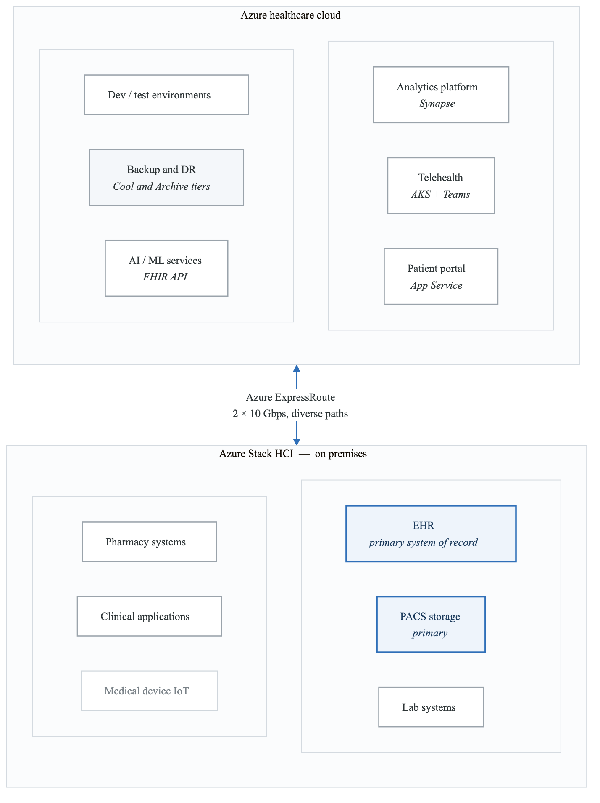
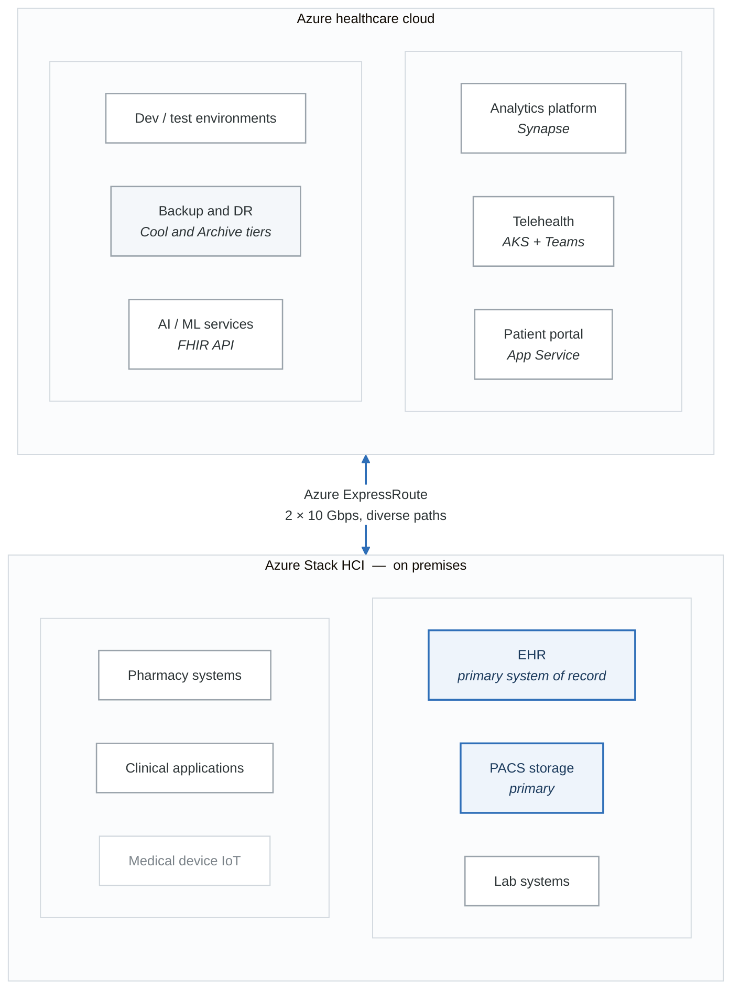
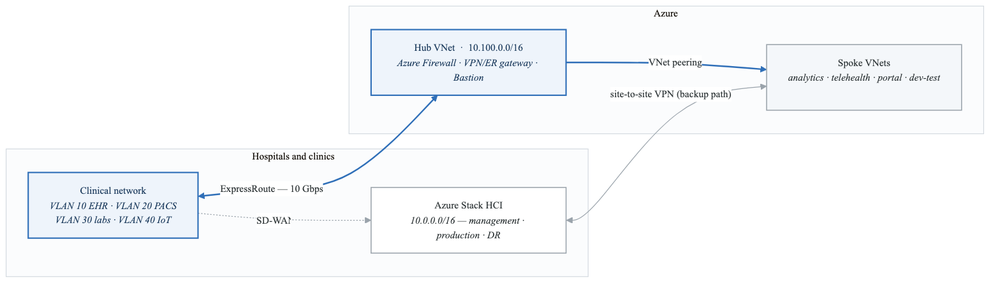
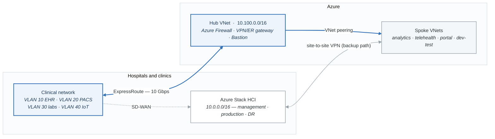
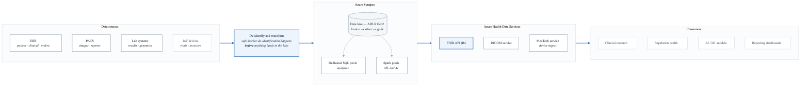
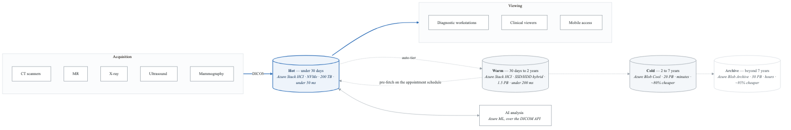
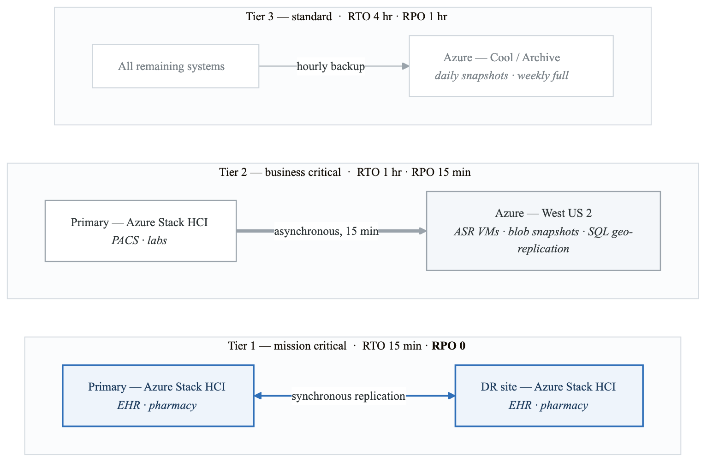
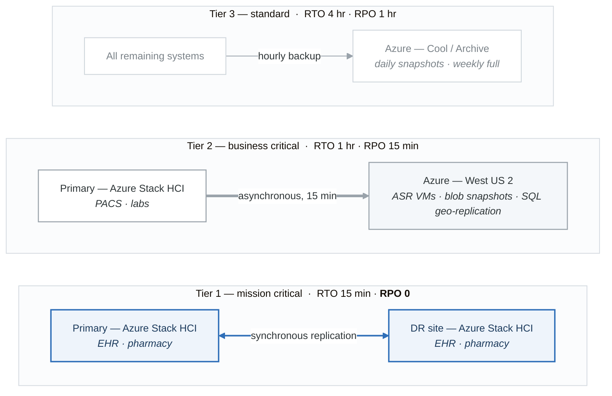

# Case Study 3: Healthcare System Hybrid Cloud Transformation

## Executive Summary

Regional Healthcare Partners (RHP), a network of 12 hospitals and 200+ clinics serving 5 million patients, undertook a comprehensive hybrid cloud transformation to modernize their IT infrastructure while maintaining strict HIPAA compliance and ensuring continuous availability of critical healthcare services.

## Organization Profile

### About Regional Healthcare Partners
- **Industry**: Healthcare
- **Size**: 45,000 employees, 12 hospitals, 200+ outpatient clinics
- **Patients**: 5 million active patient records
- **IT Budget**: $180M annually
- **Revenue**: $8.5 billion
- **Geography**: Serving 3 states in the Midwest United States

### Technology Landscape (Pre-Transformation)
**Healthcare IT Systems:**

- Electronic Health Records (EHR)
  - Epic Systems (on-premises)
  - Legacy Meditech (2 hospitals)
  - 15+ years of patient data
- Medical Imaging (PACS)
  - 50 PB of imaging data
  - Growing 15 TB/month
  - 10-year retention requirement
- Clinical Applications
  - 150+ departmental applications
  - Lab Information Systems
  - Pharmacy Management
- Infrastructure
  - 3 data centers (aging)
  - 2,500 physical servers
  - 85% virtualization (VMware)
- Network
  - MPLS connecting all locations
  - 10 Gbps backbone
  - Limited redundancy


## Business Challenges

### Critical Pain Points

**1. Infrastructure Constraints**
**Data centre assessment**

| Facility | Age | Capacity used | Limiting factor |
|---|---|---|---|
| Primary DC | 18 yrs | 95% | Power |
| Secondary DC | 12 yrs | 88% | Cooling |
| DR site | 8 yrs | 45% | Network |

**Growth projections**

- Storage: +40% annually
- Compute: +25% annually
- Network: +60% traffic growth
- Cost to expand on premises: **$45M — rejected by the board**

Those four lines are the whole business case. The primary site is out of power, not out of floor
space, and the cheapest additional megawatt was more expensive than the migration.

**2. Compliance and Security**
```yaml
Regulatory Requirements:
  HIPAA:
    - PHI protection across all systems
    - Audit logging for 6+ years
    - Breach notification procedures
    - Business associate agreements

  HITECH:
    - Electronic health record requirements
    - Meaningful use compliance
    - Patient access to records

  State Regulations:
    - Data residency requirements
    - Specific retention policies
    - Reporting mandates

  Current Gaps:
    - Inconsistent encryption practices
    - Manual audit processes
    - Limited access monitoring
    - Aging security infrastructure
```

**3. Operational Inefficiencies**
**IT Operations Metrics:**

- Mean Time to Provision: 6-8 weeks
- Change Success Rate: 72%
- Unplanned Downtime: 99.5% (target: 99.99%)
- Security Patching: 45-90 days behind
- Backup Success Rate: 94%
- Disaster Recovery: Untested for 3 years

**Cost Analysis:**

- Infrastructure: $65M/year
- Software Licensing: $42M/year
- IT Staff (380 FTEs): $58M/year
- Consultants: $15M/year
- Total IT Spend: $180M/year


**4. Clinical Requirements**
| System | RTO | RPO | SLA |
|---|---|---|---|
| EHR (Epic) | 15 min | 0 | 99.999% |
| PACS (Imaging) | 1 hour | 15 min | 99.99% |
| Lab Systems | 30 min | 5 min | 99.99% |
| Pharmacy | 15 min | 0 | 99.999% |
| Emergency Systems | 5 min | 0 | 99.999% |
| Administrative | 4 hour | 1 hour | 99.9% |
| Analytics/Reporting | 24 hr | 24 hr | 99.5% |


## Strategic Objectives

### Transformation Goals
**Primary Objectives:**

- 1. Infrastructure Modernization
  - Exit 2 aging data centers
  - Reduce hardware footprint 60%
  - Enable elastic scaling
- 2. Enhanced Security & Compliance
  - Unified security platform
  - Automated compliance monitoring
  - Zero-trust architecture
- 3. Operational Excellence
  - 99.99% availability for critical systems
  - Provisioning in hours, not weeks
  - Automated operations
- 4. Cost Optimization
  - 25% TCO reduction over 5 years
  - Convert CapEx to OpEx
  - Eliminate technical debt
- 5. Innovation Enablement
  - AI/ML for clinical analytics
  - IoT integration for medical devices
  - Telehealth platform expansion


## Solution Architecture

### Hybrid Cloud Design

<!-- figure: generated from the Mermaid below by _shared/diagrams/embed-figures.py — do not edit the image -->


<details>
<summary>Diagram source (Mermaid)</summary>



</details>

### Workload Placement Strategy

```yaml
On-Premises (Azure Stack HCI):
  Criteria:
    - Low-latency clinical requirements
    - Data sovereignty requirements
    - Vendor-mandated on-premises
    - Real-time clinical workflows

  Workloads:
    Epic EHR:
      reason: "Vendor requirement, latency sensitivity"
      compute: "128 cores, 2TB RAM per cluster"
      storage: "500 TB NVMe"

    PACS Primary:
      reason: "Latency for diagnostic viewing"
      compute: "64 cores, 512GB RAM"
      storage: "2 PB high-performance"

    Lab Information Systems:
      reason: "Real-time instrument integration"
      compute: "32 cores, 256GB RAM"

    Medical Device Integration:
      reason: "Low-latency IoT requirements"
      compute: "Edge processing nodes"

Azure Public Cloud:
  Criteria:
    - Variable workload patterns
    - Non-latency-sensitive
    - Analytics and reporting
    - Development and testing

  Workloads:
    Analytics Platform:
      service: "Azure Synapse Analytics"
      purpose: "Population health, clinical research"
      data: "De-identified datasets"

    Telehealth:
      service: "Azure Kubernetes Service"
      purpose: "Virtual visits platform"
      scale: "0 to 10,000 concurrent sessions"

    Patient Portal:
      service: "Azure App Service"
      purpose: "Patient self-service"
      integration: "FHIR API to Epic"

    Backup and DR:
      service: "Azure Blob Storage + Site Recovery"
      purpose: "Offsite protection"
      retention: "7 years archival"

    Dev/Test:
      service: "Azure DevTest Labs"
      purpose: "Non-production environments"
      savings: "Auto-shutdown, spot instances"
```

### Network Architecture

<!-- figure: generated from the Mermaid below by _shared/diagrams/embed-figures.py — do not edit the image -->


<details>
<summary>Diagram source (Mermaid)</summary>



</details>

**Security zones**

| Zone | Contains | Controls |
|---|---|---|
| **1 — Clinical** *(high)* | Every system that touches PHI | Micro-segmentation with NSGs, TLS 1.3 everywhere, hardware security modules |
| **2 — Administrative** *(medium)* | Business systems | Standard encryption, role-based access |
| **3 — Public** *(controlled)* | Patient portal, guest Wi-Fi | WAF in front, no path into zone 1 |

Guest Wi-Fi and the patient portal sharing a zone is deliberate: both are untrusted networks that
happen to be inside the building. The mistake that produces a breach report is treating "inside the
hospital" as a security boundary.

### Security and Compliance Architecture

```yaml
Zero Trust Security Model:
  Identity:
    provider: "Azure AD with Healthcare tenant"
    mfa: "Required for all clinical access"
    sso: "SAML/OIDC for 150+ applications"
    pim: "Privileged Identity Management"

  Device:
    mdm: "Microsoft Intune"
    compliance:
      - Encryption required
      - Pin/password required
      - Patch compliance
      - Healthcare app restrictions

  Network:
    segmentation: "Micro-segmentation per application"
    inspection: "Azure Firewall Premium"
    encryption: "TLS 1.3, IPsec for all tunnels"

  Data:
    classification:
      - PHI (Protected Health Information)
      - PII (Personally Identifiable)
      - Confidential
      - Public
    encryption:
      at_rest: "AES-256 with customer-managed keys"
      in_transit: "TLS 1.3"
      key_management: "Azure Key Vault (FIPS 140-2 Level 3)"

HIPAA Compliance Architecture:
  Technical Safeguards:
    Access Control:
      - Unique user identification
      - Emergency access procedures
      - Automatic logoff
      - Encryption/decryption
      implementation: |
        - Azure AD Conditional Access
        - Break-glass accounts in Key Vault
        - Session timeout policies
        - Transparent Data Encryption

    Audit Controls:
      - Hardware, software, procedural mechanisms
      implementation: |
        - Azure Monitor for all resources
        - Azure Sentinel SIEM
        - Log Analytics 7-year retention
        - Activity log immutability

    Integrity Controls:
      - Mechanism to authenticate ePHI
      implementation: |
        - Digital signatures
        - Checksum validation
        - Change data capture

    Transmission Security:
      - Encryption during transmission
      implementation: |
        - ExpressRoute with encryption
        - TLS 1.3 for all connections
        - VPN for remote access

  Physical Safeguards:
    Facility Access:
      - Azure data center certifications
      - On-premises biometric access

    Workstation Security:
      - Device encryption
      - Screen lock policies
      - Asset tracking

  Administrative Safeguards:
    Risk Analysis:
      tool: "Azure Security Center"
      frequency: "Continuous"

    Workforce Training:
      method: "Azure AD integrated LMS"
      tracking: "Compliance dashboard"

    Contingency Planning:
      implementation: |
        - Azure Site Recovery
        - Automated failover testing
        - Documented procedures
```

### Data Architecture

```mermaid
%%{init: {'theme':'base','themeVariables':{'fontFamily':'Helvetica, Arial, sans-serif','fontSize':'13px','primaryColor':'#ffffff','primaryTextColor':'#2d3436','primaryBorderColor':'#9aa3ab','lineColor':'#9aa3ab','textColor':'#2d3436','clusterBkg':'#fbfcfd','clusterBorder':'#d4dae0','edgeLabelBackground':'#ffffff','tertiaryColor':'#eef4fb'},'flowchart':{'curve':'basis','padding':14,'nodeSpacing':42,'rankSpacing':58}}}%%
flowchart LR
  classDef default fill:#ffffff,stroke:#9aa3ab,stroke-width:1.3px,color:#2d3436
  classDef n    fill:#ffffff,stroke:#9aa3ab,stroke-width:1.3px,color:#2d3436
  classDef crit fill:#eef4fb,stroke:#2f6fb8,stroke-width:1.8px,color:#1b3a5c
  classDef data fill:#f4f7fa,stroke:#9aa3ab,stroke-width:1.3px,color:#2d3436
  classDef mut  fill:#ffffff,stroke:#cfd6dc,stroke-width:1.1px,color:#7a8288
  classDef warn fill:#fdf0ec,stroke:#c0522d,stroke-width:1.6px,color:#8a3a1e
  subgraph SRC["Data sources"]
    direction TB
    EHR["EHR<br/><i>patient · clinical · orders</i>"]
    PACS["PACS<br/><i>images · reports</i>"]
    LAB["Lab systems<br/><i>results · genomics</i>"]
    IOT["IoT devices<br/><i>vitals · monitors</i>"]
  end
  DEID["De-identify and transform<br/><i>safe-harbor de-identification happens<br/><b>before</b> anything lands in the lake</i>"]
  subgraph SYN["Azure Synapse"]
    direction TB
    LAKE[("Data lake — ADLS Gen2<br/><i>bronze → silver → gold</i>")]
    SQL["Dedicated SQL pools<br/><i>analytics</i>"]
    SPARK["Spark pools<br/><i>ML and AI</i>"]
    LAKE --> SQL
    LAKE --> SPARK
  end
  subgraph HDS["Azure Health Data Services"]
    direction TB
    FHIR["FHIR API (R4)"]
    DICOM["DICOM service"]
    MED["MedTech service<br/><i>device ingest</i>"]
  end
  subgraph CONS["Consumers"]
    direction TB
    CR["Clinical research"]
    POP["Population health"]
    ML["AI / ML models"]
    RPT["Reporting dashboards"]
  end
  SRC ==> DEID ==> SYN
  SYN ==> HDS ==> CONS
  class EHR,PACS,LAB n
  class IOT mut
  class DEID crit
  class LAKE data
  class SQL,SPARK n
  class FHIR crit
  class DICOM,MED n
  class CR,POP,ML,RPT mut
  linkStyle 2,3,4,5 stroke:#2f6fb8,stroke-width:2px
```

<!-- figure: generated from the Mermaid below by _shared/diagrams/embed-figures.py — do not edit the image -->


<details>
<summary>Diagram source (Mermaid)</summary>



</details>

**Data governance**

- **Classification** — PHI · de-identified (safe-harbor method) · limited dataset (research use) ·
  public (aggregate statistics only)
- **Lineage** — Purview for the catalog, automatic PHI detection, a transformation audit trail that
  can answer *"where did this column come from"* under audit
- **Access control** — role-based (clinical, research, admin) **and** purpose-based (treatment,
  payment, operations), with a break-glass path that is logged loudly
- **Retention** — 7 years minimum while active, 25 years for records of minors, indefinite under
  litigation hold

Purpose-based access is the requirement people miss. HIPAA's minimum-necessary rule means a
clinician's role is not sufficient authority on its own — *why* they are looking matters, and the
system has to record the answer.

## Implementation Approach

### Phase 1: Foundation (Months 1-6)

```yaml
Phase 1 Objectives:
  - Establish hybrid connectivity
  - Deploy Azure Stack HCI
  - Implement security foundation
  - Migrate dev/test workloads

Key Activities:
  Month 1-2 (Connectivity):
    - Deploy ExpressRoute circuits (primary + backup)
    - Configure SD-WAN for clinic connectivity
    - Establish Azure Hub VNet architecture
    - Implement Azure Firewall

  Month 2-3 (On-Premises Infrastructure):
    - Deploy Azure Stack HCI clusters
    - Configure storage (S2D)
    - Integrate with Azure Arc
    - Validate Epic vendor requirements

  Month 3-4 (Security Foundation):
    - Deploy Azure Sentinel
    - Configure HIPAA policy baselines
    - Implement Azure AD integration
    - Enable Defender for Cloud

  Month 5-6 (Initial Migration):
    - Migrate dev/test environments
    - Deploy DevTest Labs
    - Validate CI/CD pipelines
    - Training for IT staff

Success Metrics:
  - ExpressRoute: < 5ms latency to Azure
  - Azure Stack HCI: 99.99% availability
  - Security: Zero critical findings in audit
  - Migration: 100% dev/test in cloud
```

### Phase 2: Platform Services (Months 7-12)

```yaml
Phase 2 Objectives:
  - Deploy Azure Health Data Services
  - Implement analytics platform
  - Migrate backup and DR
  - Launch telehealth platform

Key Activities:
  Month 7-8 (Health Data Services):
    - Deploy FHIR API service
    - Configure Epic FHIR integration
    - Implement DICOM service for imaging
    - Deploy IoT connector

  Month 9-10 (Analytics Platform):
    - Deploy Azure Synapse workspace
    - Implement data lake architecture
    - Build de-identification pipelines
    - Create initial analytics models

  Month 10-11 (Backup and DR):
    - Migrate backup to Azure
    - Configure Azure Site Recovery
    - Implement image tiering to Azure
    - Test DR failover procedures

  Month 11-12 (Telehealth):
    - Deploy AKS-based telehealth platform
    - Integrate with Epic scheduling
    - Configure Teams for clinical use
    - Launch pilot with 2 clinics

Success Metrics:
  - FHIR API: 99.9% availability
  - Backup: 100% success rate
  - DR: Successful failover test
  - Telehealth: 1,000 virtual visits
```

### Phase 3: Clinical Workloads (Months 13-24)

```yaml
Phase 3 Objectives:
  - Migrate Epic to Azure Stack HCI
  - Consolidate data centers
  - Deploy AI/ML capabilities
  - Achieve operational excellence

Key Activities:
  Month 13-15 (Epic Migration):
    - Plan Epic migration with vendor
    - Migrate Epic Cache databases
    - Migrate Clarity reporting
    - Validate clinical workflows

  Month 16-18 (PACS Migration):
    - Deploy new PACS on Azure Stack HCI
    - Migrate active imaging (2 years)
    - Tier older images to Azure cool storage
    - Validate diagnostic workflows

  Month 19-21 (Data Center Consolidation):
    - Migrate remaining clinical apps
    - Decommission primary DC
    - Decommission secondary DC
    - Retain modern DR site

  Month 22-24 (Optimization):
    - Deploy Azure Machine Learning
    - Implement predictive analytics
    - Optimize costs
    - Complete staff training

Success Metrics:
  - Epic: 99.999% availability
  - PACS: Sub-second image load
  - Data Centers: 2 facilities closed
  - Cost: 25% reduction achieved
```

## Technical Deep Dives

### Epic on Azure Stack HCI

```yaml
Epic Infrastructure Design:
  Compute Clusters:
    Production Cluster:
      nodes: 8
      cpu: "AMD EPYC 7763 (64 cores each)"
      memory: "2 TB per node (16 TB total)"
      storage: "NVMe, 500 TB usable"
      networking: "100 GbE RDMA"

    Cache Servers:
      type: "Caché/IRIS databases"
      configuration: "Active-passive failover"
      storage: "All-flash NVMe"
      replication: "Synchronous to DR"

    Web Servers:
      configuration: "Load-balanced pool"
      scaling: "Auto-scale based on sessions"
      sessions: "Peak 15,000 concurrent"

  High Availability:
    local_ha:
      - "S2D storage replication (3-way mirror)"
      - "VM live migration"
      - "Network load balancing"
      - "Database clustering"

    dr_strategy:
      - "Async replication to Azure (15-min RPO)"
      - "Automated DR runbooks"
      - "Quarterly DR testing"
      - "RTO: 4 hours"

  Integration Points:
    - "Azure AD for authentication"
    - "Azure Monitor for observability"
    - "Azure Backup for protection"
    - "Azure Arc for management"
```

### Medical Imaging Architecture

```mermaid
%%{init: {'theme':'base','themeVariables':{'fontFamily':'Helvetica, Arial, sans-serif','fontSize':'13px','primaryColor':'#ffffff','primaryTextColor':'#2d3436','primaryBorderColor':'#9aa3ab','lineColor':'#9aa3ab','textColor':'#2d3436','clusterBkg':'#fbfcfd','clusterBorder':'#d4dae0','edgeLabelBackground':'#ffffff','tertiaryColor':'#eef4fb'},'flowchart':{'curve':'basis','padding':14,'nodeSpacing':42,'rankSpacing':58}}}%%
flowchart LR
  classDef default fill:#ffffff,stroke:#9aa3ab,stroke-width:1.3px,color:#2d3436
  classDef n    fill:#ffffff,stroke:#9aa3ab,stroke-width:1.3px,color:#2d3436
  classDef crit fill:#eef4fb,stroke:#2f6fb8,stroke-width:1.8px,color:#1b3a5c
  classDef data fill:#f4f7fa,stroke:#9aa3ab,stroke-width:1.3px,color:#2d3436
  classDef mut  fill:#ffffff,stroke:#cfd6dc,stroke-width:1.1px,color:#7a8288
  classDef warn fill:#fdf0ec,stroke:#c0522d,stroke-width:1.6px,color:#8a3a1e
  subgraph ACQ["Acquisition"]
    direction TB
    CT["CT scanners"]
    MRI["MRI"]
    XR["X-ray"]
    US["Ultrasound"]
    MG["Mammography"]
  end
  HOT[("<b>Hot</b> — under 30 days<br/><i>Azure Stack HCI · NVMe · 200 TB · under 50 ms</i>")]
  WARM[("<b>Warm</b> — 30 days to 2 years<br/><i>Azure Stack HCI · SSD/HDD hybrid · 1.5 PB · under 200 ms</i>")]
  COLD[("<b>Cold</b> — 2 to 7 years<br/><i>Azure Blob Cool · 20 PB · minutes · ~80% cheaper</i>")]
  ARCH[("<b>Archive</b> — beyond 7 years<br/><i>Azure Blob Archive · 30 PB · hours · ~95% cheaper</i>")]
  subgraph VIEW["Viewing"]
    direction TB
    DX["Diagnostic workstations"]
    CV["Clinical viewers"]
    MOB["Mobile access"]
  end
  AIA["AI analysis<br/><i>Azure ML, over the DICOM API</i>"]
  ACQ ==>|"DICOM"| HOT
  HOT -.->|"auto-tier"| WARM
  WARM -.-> COLD
  COLD -.-> ARCH
  HOT ==> VIEW
  WARM -.->|"pre-fetch on the appointment schedule"| HOT
  HOT <--> AIA
  class CT,MRI,XR,US,MG n
  class HOT crit
  class WARM,COLD data
  class ARCH mut
  class DX,CV,MOB n
  class AIA n
  linkStyle 0,4 stroke:#2f6fb8,stroke-width:2px
```

<!-- figure: generated from the Mermaid below by _shared/diagrams/embed-figures.py — do not edit the image -->


<details>
<summary>Diagram source (Mermaid)</summary>



</details>

**Imaging workflow**

1. The study is acquired at the modality
2. Images are sent to PACS over DICOM
3. They land in the hot tier on Azure Stack HCI
4. They are available for diagnosis immediately — this is the latency that matters
5. AI analysis is triggered asynchronously, never in the radiologist's path
6. Auto-tiering moves the study as it ages
7. Studies are pre-fetched back to hot before a scheduled appointment

Step 7 is what makes the cheap tiers usable. Without scheduled pre-fetch, a radiologist opening a
two-year-old comparison study waits minutes, and the tiering policy quietly gets disabled.

### Telehealth Platform

```yaml
Telehealth Architecture:
  Platform: "Azure Kubernetes Service"

  Components:
    Video Service:
      technology: "Azure Communication Services"
      features:
        - "HD video conferencing"
        - "Screen sharing"
        - "Recording (with consent)"
        - "Virtual backgrounds"
      scaling: "0 to 10,000 concurrent sessions"

    Scheduling:
      integration: "Epic MyChart"
      features:
        - "Patient self-scheduling"
        - "Provider calendar sync"
        - "Automated reminders"
        - "Waitlist management"

    Clinical Tools:
      features:
        - "Virtual waiting room"
        - "Patient intake forms"
        - "Vital signs entry"
        - "E-prescribing integration"
        - "Clinical documentation"

    Device Integration:
      supported:
        - "Blood pressure monitors"
        - "Pulse oximeters"
        - "Glucose meters"
        - "Weight scales"
      protocol: "Azure IoT Hub"

  Security:
    authentication: "Azure AD B2C for patients"
    encryption: "End-to-end for video"
    compliance: "HIPAA BAA with Microsoft"
    audit: "Full session logging"

  Scaling:
    baseline: "500 concurrent sessions"
    peak: "5,000 concurrent sessions"
    scaling_trigger: "70% CPU utilization"
    scale_time: "< 2 minutes"

  Infrastructure as Code:
    # telehealth-deployment.yaml
    apiVersion: apps/v1
    kind: Deployment
    metadata:
      name: telehealth-api
      namespace: telehealth
    spec:
      replicas: 3
      selector:
        matchLabels:
          app: telehealth-api
      template:
        metadata:
          labels:
            app: telehealth-api
        spec:
          containers:
          - name: api
            image: rhp.azurecr.io/telehealth-api:v2.1
            resources:
              requests:
                memory: "512Mi"
                cpu: "500m"
              limits:
                memory: "1Gi"
                cpu: "1000m"
            env:
            - name: AZURE_CLIENT_ID
              valueFrom:
                secretKeyRef:
                  name: azure-credentials
                  key: client-id
            ports:
            - containerPort: 8080
            readinessProbe:
              httpGet:
                path: /health
                port: 8080
              initialDelaySeconds: 10
            livenessProbe:
              httpGet:
                path: /health
                port: 8080
              initialDelaySeconds: 30
```

## Disaster Recovery Design

<!-- figure: generated from the Mermaid below by _shared/diagrams/embed-figures.py — do not edit the image -->


<details>
<summary>Diagram source (Mermaid)</summary>



</details>

**DR automation** — Azure Site Recovery, with sequenced recovery plans (the EHR database comes up
before the application tier, not alongside it), automated runbooks, network mapping so DR addresses
are already known, and drills that run themselves.

**Testing schedule**

| Cadence | What is tested |
|---|---|
| Weekly | Component failover |
| Monthly | Application failover |
| Quarterly | Full site failover drill |
| Annually | Extended 24-hour DR exercise |

RPO 0 for tier 1 is the expensive line in this table. Synchronous replication means every write waits
for the DR site to acknowledge, which puts a hard ceiling on the distance between the two sites — far
enough apart to survive a regional event, close enough that the round trip does not slow down order
entry. That tension, not the software, is what makes tier 1 cost what it does.

## Results and Outcomes

### Technical Achievements

| Metric | Before | After | Improvement |
|---|---|---|---|
| System Availability | 99.5% | 99.99% | +0.49% |
| Mean Time to Provision | 6-8 weeks | 2-4 hours | 99% faster |
| Change Success Rate | 72% | 96% | +24% |
| Backup Success Rate | 94% | 99.9% | +5.9% |
| Security Patch Latency | 45-90 days | < 7 days | 85% faster |
| DR Test Frequency | Annual | Quarterly | 4x more |
| Data Center Footprint | 3 sites | 1 site | 67% reduced |
| Physical Servers | 2,500 | 400 | 84% reduced |
| Storage Efficiency | 60% | 85% | +25% |


### Clinical Outcomes

```yaml
Telehealth Impact:
  Virtual Visits:
    year_1: "150,000 visits"
    year_2: "450,000 visits"
    patient_satisfaction: "4.6/5.0"

  Access Improvement:
    - "Rural patients: 40% increase in specialist access"
    - "No-show rate: Reduced from 18% to 8%"
    - "Average wait for appointment: 12 days to 3 days"

Analytics Capabilities:
  Population Health:
    - "Risk stratification for 5M patients"
    - "Care gap identification (automated)"
    - "Quality measure reporting (real-time)"

  Clinical Decision Support:
    - "Sepsis prediction model (85% accuracy)"
    - "Readmission risk scoring"
    - "Drug interaction alerts (enhanced)"

  Operational Analytics:
    - "OR utilization optimization"
    - "Staff scheduling optimization"
    - "Supply chain forecasting"
```

### Financial Results

**Five-year financial summary &nbsp;($ millions)**

| | Year 1 | Year 2 | Year 3 | Year 4 | Year 5 |
|---|---|---|---|---|---|
| **Before — projected** | | | | | |
| Infrastructure | 65.0 | 68.0 | 71.0 | 74.0 | 77.0 |
| Data centre expansion | 15.0 | 10.0 | 5.0 | 0.0 | 0.0 |
| Software licensing | 42.0 | 44.0 | 46.0 | 48.0 | 50.0 |
| IT operations | 58.0 | 60.0 | 62.0 | 64.0 | 66.0 |
| **Total before** | **180.0** | **182.0** | **184.0** | **186.0** | **193.0** |
| **After — actual** | | | | | |
| Azure consumption | 18.0 | 24.0 | 28.0 | 30.0 | 32.0 |
| Azure Stack HCI | 8.0 | 6.0 | 6.0 | 6.0 | 6.0 |
| Remaining on-premises | 35.0 | 20.0 | 10.0 | 8.0 | 8.0 |
| Software (optimised) | 38.0 | 36.0 | 34.0 | 32.0 | 30.0 |
| IT operations | 55.0 | 50.0 | 46.0 | 44.0 | 42.0 |
| Migration costs | 12.0 | 8.0 | 4.0 | 0.0 | 0.0 |
| **Total after** | **166.0** | **144.0** | **128.0** | **120.0** | **118.0** |
| **Annual saving** | 14.0 | 38.0 | 56.0 | 66.0 | 75.0 |
| **Cumulative saving** | 14.0 | 52.0 | 108.0 | 174.0 | 249.0 |

**Return on investment**

| | |
|---|---|
| Total investment | $89M — migration, training, new infrastructure |
| Five-year saving | $249M |
| Net benefit | $160M |
| ROI | 180% |
| Payback period | 2.1 years |

Year 1 is the honest part of this table: $12M of migration cost eats most of the $14M saving. Any
business case whose first year is already strongly positive is either not counting the migration or
not going to happen.

### Compliance Achievements

```yaml
HIPAA Compliance:
  Pre-Transformation:
    audit_findings: 47
    critical_gaps: 12
    remediation_time: "6-12 months average"

  Post-Transformation:
    audit_findings: 3
    critical_gaps: 0
    remediation_time: "< 30 days"

  Continuous Compliance:
    monitoring: "Azure Policy (400+ policies)"
    detection: "Azure Sentinel (real-time)"
    reporting: "Automated compliance dashboards"

Security Improvements:
  Metrics:
    mean_time_to_detect: "4 hours → 15 minutes"
    mean_time_to_respond: "24 hours → 2 hours"
    phishing_susceptibility: "12% → 3%"
    vulnerability_remediation: "45 days → 7 days"

  Certifications Achieved:
    - "HITRUST CSF r2"
    - "SOC 2 Type II"
    - "ISO 27001"
```

## Lessons Learned

### What Worked Well

```yaml
Success Factors:
  Executive Sponsorship:
    - "CEO championed as patient safety initiative"
    - "Board approved multi-year funding"
    - "Clinical leadership engaged from start"

  Phased Approach:
    - "Started with low-risk workloads"
    - "Built confidence incrementally"
    - "Avoided big-bang migration"

  Vendor Partnership:
    - "Epic engaged early in planning"
    - "Microsoft healthcare team support"
    - "SI partner with healthcare expertise"

  Security-First Design:
    - "HIPAA requirements drove architecture"
    - "Zero trust from day one"
    - "Compliance automated, not afterthought"

  Staff Development:
    - "Extensive training program"
    - "Cloud certifications for team"
    - "Retained critical staff through transformation"
```

### Challenges Overcome

```yaml
Challenges:
  Legacy System Integration:
    problem: "150+ applications with limited APIs"
    solution: "API gateway pattern, incremental modernization"
    lesson: "Plan for integration complexity"

  Clinical Workflow Disruption:
    problem: "Physicians resistant to any downtime"
    solution: "Weekend migrations, simulation training"
    lesson: "Clinical workflows are sacred"

  Regulatory Uncertainty:
    problem: "Cloud PHI concerns from compliance"
    solution: "Azure BAA, HITRUST certification"
    lesson: "Document everything for auditors"

  Network Reliability:
    problem: "ExpressRoute outage during pilot"
    solution: "Dual circuits, SD-WAN backup"
    lesson: "Plan for connectivity failures"

  Change Management:
    problem: "IT staff fear of job loss"
    solution: "Reskilling commitment, new roles"
    lesson: "Address human factors early"
```

### Recommendations

Key Recommendations for Healthcare Cloud:

**1. PRIORITIZE CLINICAL WORKFLOWS**

- Engage clinicians in design
- Test workflows exhaustively
- Plan for zero downtime

**2. COMPLIANCE FROM THE START**

- HIPAA drives architecture decisions
- Automate compliance monitoring
- Document everything

**3. HYBRID IS THE REALITY**

- Not everything goes to public cloud
- Azure Stack HCI bridges the gap
- Plan workload placement carefully

**4. DATA IS THE ASSET**

- FHIR enables interoperability
- Analytics unlock clinical value
- Governance is non-negotiable

**5. SECURITY IS PARAMOUNT**

- Zero trust is essential
- PHI protection is job one
- Continuous monitoring required

**6. INVEST IN PEOPLE**

- Retrain, don't replace
- New skills for cloud operations
- Clinical IT bridges the gap


## Future Roadmap

```yaml
Year 3-5 Initiatives:
  AI/ML Expansion:
    - "Computer vision for radiology"
    - "NLP for clinical documentation"
    - "Predictive models for population health"

  IoT and Edge:
    - "Connected medical devices at scale"
    - "Real-time patient monitoring"
    - "Smart hospital infrastructure"

  Interoperability:
    - "National health information exchange"
    - "Patient data portability"
    - "Research network participation"

  Advanced Analytics:
    - "Real-world evidence generation"
    - "Precision medicine initiatives"
    - "Clinical trial matching"

  Sustainability:
    - "Carbon-neutral IT operations"
    - "Energy-efficient infrastructure"
    - "Sustainable healthcare delivery"
```

## Conclusion

Regional Healthcare Partners' hybrid cloud transformation demonstrates that even highly regulated healthcare organizations can successfully modernize their IT infrastructure. By taking a phased approach with Azure Stack HCI for latency-sensitive clinical workloads and Azure public cloud for analytics, backup, and new services, RHP achieved significant operational improvements while maintaining strict HIPAA compliance.

The key success factors were:
1. **Executive commitment** to a multi-year transformation
2. **Security-first architecture** that exceeded compliance requirements
3. **Clinical engagement** ensuring workflows were preserved
4. **Phased migration** that built confidence incrementally
5. **Investment in people** through reskilling and new roles

The 180% ROI and $249M in 5-year savings validate the business case, while the clinical improvements—including expanded telehealth, advanced analytics, and improved system availability—directly support better patient outcomes.

---

*This case study is based on a composite of real healthcare cloud transformations and represents common patterns, challenges, and solutions in the industry.*

<!-- feynman-check -->

---

## Feynman check

Close the file. Blank page, no notes. Explain each of these to a competent engineer who has never
used this tool — **under five minutes, no jargon you can't define on the spot:**

- Business Challenges
- Strategic Objectives
- Solution Architecture
- Implementation Approach

**The gap is not what you forgot. It is where you used a word instead of a mechanism.**

| | |
|---|---|
| ✗ | *"The architecture was badly designed."* |
| ✓ | *"The failure needed two independent weaknesses to compose. Name both, say why each one alone was survivable, and name the single control that would have broken the chain — that is the finding, not the vulnerability."* |

**Trace it:** The incident in this file, from entry to objective. At every step name the control that should have stopped it, and why it did not.

Stop at the first component you cannot name. Reopen this file and read **only** that.

**Go deeper — only once the gap has a name:** three postmortems from [danluu/post-mortems](https://github.com/danluu/post-mortems) — for each, name the one control that would have broken the chain.
Full list per domain: [`SOURCES.md`](../../SOURCES.md#case-studies)

→ Protocol, the three levels of knowing, and worked examples: [`MASTERY.md`](../../MASTERY.md)

<!-- /feynman-check -->
