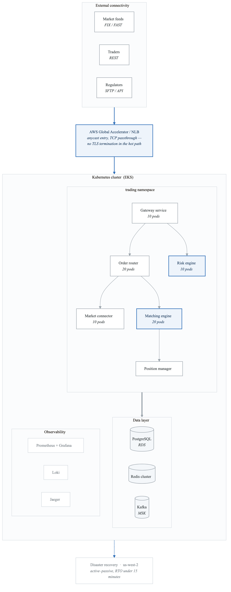
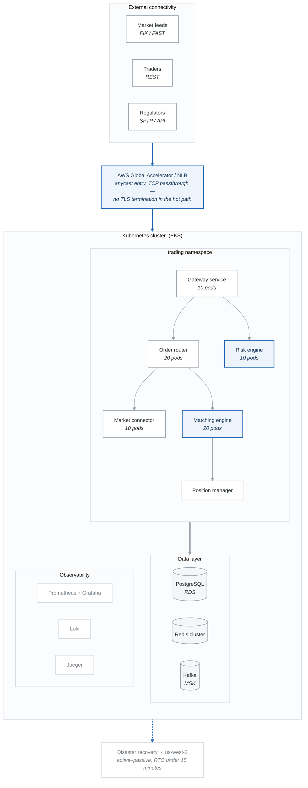
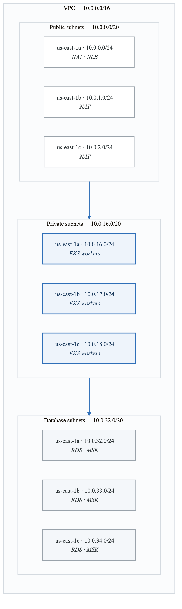
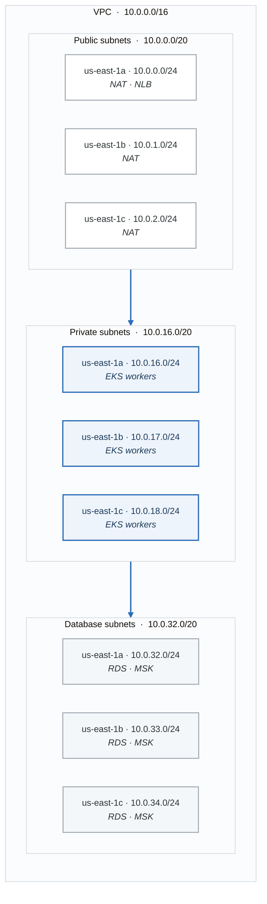

# Case Study: FinTech Trading Platform

## Executive Summary

**Company**: QuantumTrade Financial
**Industry**: Financial Services / Trading
**Challenge**: Migrate a monolithic trading platform to Kubernetes while meeting strict latency, compliance, and availability requirements
**Outcome**: 99.99% uptime, sub-millisecond latency, SOC2/PCI-DSS compliance

---

## Business Context

### The Challenge

QuantumTrade operates a high-frequency trading platform processing 500,000+ transactions per second during peak market hours. Their legacy infrastructure suffered from:

- **Scalability limits**: Couldn't scale during market volatility
- **Deployment friction**: 2-week release cycles, frequent rollback failures
- **Cost inefficiency**: Over-provisioned for peak loads 24/7
- **Compliance burden**: Manual audit processes, inconsistent environments

### Requirements

| Requirement | Target |
|-------------|--------|
| Latency (p99) | < 5ms |
| Availability | 99.99% (52 min downtime/year) |
| RTO (Recovery Time Objective) | < 15 minutes |
| RPO (Recovery Point Objective) | < 1 minute |
| Compliance | SOC2 Type II, PCI-DSS |
| Transactions/sec | 500,000+ sustained |

---

## Architecture

### High-Level Design

<!-- figure: generated from the Mermaid below by _shared/diagrams/embed-figures.py — do not edit the image -->


<details>
<summary>Diagram source (Mermaid)</summary>



</details>

### Network Architecture

<!-- figure: generated from the Mermaid below by _shared/diagrams/embed-figures.py — do not edit the image -->


<details>
<summary>Diagram source (Mermaid)</summary>



</details>

---

## Implementation

### Cluster Configuration

```hcl
# terraform/eks-trading.tf

module "eks_trading" {
  source  = "terraform-aws-modules/eks/aws"
  version = "~> 19.0"

  cluster_name    = "quantumtrade-prod"
  cluster_version = "1.28"

  cluster_endpoint_public_access  = false  # Private only
  cluster_endpoint_private_access = true

  vpc_id     = module.vpc.vpc_id
  subnet_ids = module.vpc.private_subnets

  # Enable encryption
  cluster_encryption_config = {
    provider_key_arn = aws_kms_key.eks.arn
    resources        = ["secrets"]
  }

  # Cluster add-ons
  cluster_addons = {
    coredns = {
      most_recent = true
    }
    kube-proxy = {
      most_recent = true
    }
    vpc-cni = {
      most_recent = true
      configuration_values = jsonencode({
        enableNetworkPolicy = "true"
      })
    }
    aws-ebs-csi-driver = {
      most_recent = true
    }
  }

  eks_managed_node_groups = {
    # Low-latency trading nodes
    trading = {
      name = "trading"

      instance_types = ["c6i.4xlarge"]  # Compute optimized
      capacity_type  = "ON_DEMAND"

      min_size     = 10
      max_size     = 50
      desired_size = 20

      labels = {
        workload = "trading"
        latency  = "critical"
      }

      taints = [
        {
          key    = "workload"
          value  = "trading"
          effect = "NO_SCHEDULE"
        }
      ]

      # Enhanced networking
      network_interfaces = [{
        associate_public_ip_address = false
        delete_on_termination       = true
      }]
    }

    # General workloads
    general = {
      name = "general"

      instance_types = ["m6i.2xlarge"]
      capacity_type  = "ON_DEMAND"

      min_size     = 5
      max_size     = 20
      desired_size = 10

      labels = {
        workload = "general"
      }
    }

    # Observability
    observability = {
      name = "observability"

      instance_types = ["r6i.2xlarge"]  # Memory optimized
      capacity_type  = "ON_DEMAND"

      min_size     = 3
      max_size     = 6
      desired_size = 3

      labels = {
        workload = "observability"
      }

      taints = [
        {
          key    = "workload"
          value  = "observability"
          effect = "NO_SCHEDULE"
        }
      ]
    }
  }

  # Enable logging
  cluster_enabled_log_types = [
    "api",
    "audit",
    "authenticator",
    "controllerManager",
    "scheduler"
  ]
}
```

### Low-Latency Deployment Configuration

```yaml
# k8s/trading/matching-engine.yaml
apiVersion: apps/v1
kind: Deployment
metadata:
  name: matching-engine
  namespace: trading
spec:
  replicas: 20
  strategy:
    type: RollingUpdate
    rollingUpdate:
      maxSurge: 5
      maxUnavailable: 0
  selector:
    matchLabels:
      app: matching-engine
  template:
    metadata:
      labels:
        app: matching-engine
        latency: critical
      annotations:
        prometheus.io/scrape: "true"
        prometheus.io/port: "9090"
    spec:
      # Pin to trading nodes
      nodeSelector:
        workload: trading

      tolerations:
      - key: workload
        value: trading
        effect: NoSchedule

      # Spread across AZs
      topologySpreadConstraints:
      - maxSkew: 1
        topologyKey: topology.kubernetes.io/zone
        whenUnsatisfiable: DoNotSchedule
        labelSelector:
          matchLabels:
            app: matching-engine

      # Anti-affinity for HA
      affinity:
        podAntiAffinity:
          requiredDuringSchedulingIgnoredDuringExecution:
          - labelSelector:
              matchLabels:
                app: matching-engine
            topologyKey: kubernetes.io/hostname

      # Priority for critical workloads
      priorityClassName: trading-critical

      containers:
      - name: matching-engine
        image: quantumtrade/matching-engine:v2.1.0
        ports:
        - containerPort: 8080
          name: http
        - containerPort: 9090
          name: metrics
        - containerPort: 5000
          name: fix

        # Generous resources for low latency
        resources:
          requests:
            memory: "8Gi"
            cpu: "4000m"
          limits:
            memory: "8Gi"
            cpu: "4000m"

        env:
        - name: JAVA_OPTS
          value: "-XX:+UseG1GC -XX:MaxGCPauseMillis=5 -Xms8g -Xmx8g"
        - name: POD_NAME
          valueFrom:
            fieldRef:
              fieldPath: metadata.name
        - name: NODE_NAME
          valueFrom:
            fieldRef:
              fieldPath: spec.nodeName

        # Startup probe for slow JVM startup
        startupProbe:
          httpGet:
            path: /health/startup
            port: 8080
          failureThreshold: 30
          periodSeconds: 10

        livenessProbe:
          httpGet:
            path: /health/live
            port: 8080
          periodSeconds: 5
          timeoutSeconds: 2
          failureThreshold: 3

        readinessProbe:
          httpGet:
            path: /health/ready
            port: 8080
          periodSeconds: 2
          timeoutSeconds: 1
          failureThreshold: 2

        # Graceful shutdown
        lifecycle:
          preStop:
            exec:
              command:
              - /bin/sh
              - -c
              - |
                # Drain connections gracefully
                curl -X POST localhost:8080/admin/drain
                sleep 30

      terminationGracePeriodSeconds: 60

      # DNS optimization
      dnsPolicy: ClusterFirst
      dnsConfig:
        options:
        - name: ndots
          value: "1"

---
# Priority Class for trading workloads
apiVersion: scheduling.k8s.io/v1
kind: PriorityClass
metadata:
  name: trading-critical
value: 1000000
globalDefault: false
description: "Critical trading workloads"
preemptionPolicy: PreemptLowerPriority
```

### Network Policies for Compliance

```yaml
# k8s/network-policies/trading-isolation.yaml
apiVersion: networking.k8s.io/v1
kind: NetworkPolicy
metadata:
  name: trading-isolation
  namespace: trading
spec:
  podSelector:
    matchLabels:
      app: matching-engine
  policyTypes:
  - Ingress
  - Egress
  ingress:
  # Allow from gateway only
  - from:
    - podSelector:
        matchLabels:
          app: gateway
    ports:
    - protocol: TCP
      port: 8080
  # Allow from other matching engines (cluster communication)
  - from:
    - podSelector:
        matchLabels:
          app: matching-engine
    ports:
    - protocol: TCP
      port: 5000
  # Allow Prometheus scraping
  - from:
    - namespaceSelector:
        matchLabels:
          name: monitoring
      podSelector:
        matchLabels:
          app: prometheus
    ports:
    - protocol: TCP
      port: 9090
  egress:
  # Allow to Redis
  - to:
    - podSelector:
        matchLabels:
          app: redis
    ports:
    - protocol: TCP
      port: 6379
  # Allow to Kafka
  - to:
    - namespaceSelector:
        matchLabels:
          name: kafka
    ports:
    - protocol: TCP
      port: 9092
  # Allow DNS
  - to:
    - namespaceSelector: {}
      podSelector:
        matchLabels:
          k8s-app: kube-dns
    ports:
    - protocol: UDP
      port: 53

---
# Default deny all for trading namespace
apiVersion: networking.k8s.io/v1
kind: NetworkPolicy
metadata:
  name: default-deny
  namespace: trading
spec:
  podSelector: {}
  policyTypes:
  - Ingress
  - Egress
```

### HPA with Custom Metrics

```yaml
# k8s/trading/matching-engine-hpa.yaml
apiVersion: autoscaling/v2
kind: HorizontalPodAutoscaler
metadata:
  name: matching-engine
  namespace: trading
spec:
  scaleTargetRef:
    apiVersion: apps/v1
    kind: Deployment
    name: matching-engine
  minReplicas: 20
  maxReplicas: 100
  metrics:
  # Scale based on orders per second
  - type: Pods
    pods:
      metric:
        name: orders_per_second
      target:
        type: AverageValue
        averageValue: "10000"
  # Also consider latency
  - type: Pods
    pods:
      metric:
        name: order_latency_p99_ms
      target:
        type: AverageValue
        averageValue: "3"
  behavior:
    scaleUp:
      stabilizationWindowSeconds: 30
      policies:
      - type: Percent
        value: 50
        periodSeconds: 60
    scaleDown:
      stabilizationWindowSeconds: 300
      policies:
      - type: Percent
        value: 10
        periodSeconds: 120
```

### Pod Disruption Budget

```yaml
# k8s/trading/pdb.yaml
apiVersion: policy/v1
kind: PodDisruptionBudget
metadata:
  name: matching-engine
  namespace: trading
spec:
  maxUnavailable: 1
  selector:
    matchLabels:
      app: matching-engine
```

---

## Compliance Implementation

### Audit Logging

```yaml
# k8s/audit/audit-policy.yaml
apiVersion: audit.k8s.io/v1
kind: Policy
rules:
# Log all changes to trading namespace at RequestResponse level
- level: RequestResponse
  namespaces: ["trading"]
  verbs: ["create", "update", "patch", "delete"]
  resources:
  - group: ""
    resources: ["pods", "secrets", "configmaps"]
  - group: "apps"
    resources: ["deployments", "statefulsets"]

# Log all authentication attempts
- level: Metadata
  users: ["system:anonymous"]
  verbs: ["*"]

# Log secrets access
- level: Metadata
  resources:
  - group: ""
    resources: ["secrets"]
  verbs: ["get", "list", "watch"]

# Default: log at metadata level
- level: Metadata
  omitStages:
  - RequestReceived
```

### OPA Gatekeeper Policies

```yaml
# k8s/policies/require-resources.yaml
apiVersion: templates.gatekeeper.sh/v1
kind: ConstraintTemplate
metadata:
  name: k8srequiredresources
spec:
  crd:
    spec:
      names:
        kind: K8sRequiredResources
  targets:
    - target: admission.k8s.gatekeeper.sh
      rego: |
        package k8srequiredresources

        violation[{"msg": msg}] {
          container := input.review.object.spec.containers[_]
          not container.resources.limits.memory
          msg := sprintf("Container %v must have memory limits", [container.name])
        }

        violation[{"msg": msg}] {
          container := input.review.object.spec.containers[_]
          not container.resources.limits.cpu
          msg := sprintf("Container %v must have CPU limits", [container.name])
        }

        violation[{"msg": msg}] {
          container := input.review.object.spec.containers[_]
          not container.resources.requests.memory
          msg := sprintf("Container %v must have memory requests", [container.name])
        }

        violation[{"msg": msg}] {
          container := input.review.object.spec.containers[_]
          not container.resources.requests.cpu
          msg := sprintf("Container %v must have CPU requests", [container.name])
        }
---
apiVersion: constraints.gatekeeper.sh/v1beta1
kind: K8sRequiredResources
metadata:
  name: require-resources-trading
spec:
  match:
    kinds:
      - apiGroups: [""]
        kinds: ["Pod"]
    namespaces: ["trading"]
```

```yaml
# k8s/policies/require-security-context.yaml
apiVersion: templates.gatekeeper.sh/v1
kind: ConstraintTemplate
metadata:
  name: k8ssecuritycontext
spec:
  crd:
    spec:
      names:
        kind: K8sSecurityContext
  targets:
    - target: admission.k8s.gatekeeper.sh
      rego: |
        package k8ssecuritycontext

        violation[{"msg": msg}] {
          container := input.review.object.spec.containers[_]
          container.securityContext.privileged == true
          msg := sprintf("Container %v cannot run as privileged", [container.name])
        }

        violation[{"msg": msg}] {
          container := input.review.object.spec.containers[_]
          not container.securityContext.readOnlyRootFilesystem
          msg := sprintf("Container %v must have readOnlyRootFilesystem", [container.name])
        }

        violation[{"msg": msg}] {
          container := input.review.object.spec.containers[_]
          container.securityContext.allowPrivilegeEscalation == true
          msg := sprintf("Container %v cannot allow privilege escalation", [container.name])
        }
---
apiVersion: constraints.gatekeeper.sh/v1beta1
kind: K8sSecurityContext
metadata:
  name: security-context-trading
spec:
  match:
    kinds:
      - apiGroups: [""]
        kinds: ["Pod"]
    namespaces: ["trading"]
```

---

## Disaster Recovery

### Multi-Region Architecture

```hcl
# terraform/dr.tf

# Primary Region: us-east-1
module "eks_primary" {
  source = "./modules/eks"
  providers = {
    aws = aws.us_east_1
  }
  cluster_name = "quantumtrade-prod"
  # ... configuration
}

# DR Region: us-west-2
module "eks_dr" {
  source = "./modules/eks"
  providers = {
    aws = aws.us_west_2
  }
  cluster_name = "quantumtrade-dr"
  # ... configuration
}

# Global Accelerator for failover
resource "aws_globalaccelerator_accelerator" "trading" {
  name            = "quantumtrade"
  ip_address_type = "IPV4"
  enabled         = true
}

resource "aws_globalaccelerator_listener" "trading" {
  accelerator_arn = aws_globalaccelerator_accelerator.trading.id
  protocol        = "TCP"

  port_range {
    from_port = 443
    to_port   = 443
  }
}

resource "aws_globalaccelerator_endpoint_group" "primary" {
  listener_arn = aws_globalaccelerator_listener.trading.id
  endpoint_group_region = "us-east-1"

  endpoint_configuration {
    endpoint_id = module.eks_primary.nlb_arn
    weight      = 100
  }

  health_check_interval_seconds = 10
  health_check_path             = "/health"
  health_check_port             = 443
  health_check_protocol         = "HTTPS"
  threshold_count               = 3
}

resource "aws_globalaccelerator_endpoint_group" "dr" {
  listener_arn = aws_globalaccelerator_listener.trading.id
  endpoint_group_region = "us-west-2"

  endpoint_configuration {
    endpoint_id = module.eks_dr.nlb_arn
    weight      = 0  # Standby
  }

  health_check_interval_seconds = 10
  health_check_path             = "/health"
  health_check_port             = 443
  health_check_protocol         = "HTTPS"
  threshold_count               = 3
}
```

### Velero Backup Configuration

```yaml
# k8s/velero/backup-schedule.yaml
apiVersion: velero.io/v1
kind: Schedule
metadata:
  name: trading-daily
  namespace: velero
spec:
  schedule: "0 2 * * *"
  template:
    includedNamespaces:
    - trading
    - monitoring
    excludedResources:
    - events
    - pods
    storageLocation: aws-primary
    volumeSnapshotLocations:
    - aws-primary
    ttl: 720h  # 30 days
---
# Continuous backup for critical data
apiVersion: velero.io/v1
kind: Schedule
metadata:
  name: trading-critical
  namespace: velero
spec:
  schedule: "*/15 * * * *"  # Every 15 minutes
  template:
    includedNamespaces:
    - trading
    includedResources:
    - secrets
    - configmaps
    labelSelector:
      matchLabels:
        backup: critical
    storageLocation: aws-primary
    ttl: 168h  # 7 days
```

---

## Observability

### Prometheus Rules for Trading

```yaml
# k8s/monitoring/trading-alerts.yaml
apiVersion: monitoring.coreos.com/v1
kind: PrometheusRule
metadata:
  name: trading-alerts
  namespace: monitoring
spec:
  groups:
  - name: trading.rules
    interval: 10s
    rules:
    # SLO: 99.99% availability
    - alert: TradingServiceDown
      expr: |
        up{job="matching-engine"} == 0
      for: 30s
      labels:
        severity: critical
        team: trading
      annotations:
        summary: "Trading service is down"
        description: "{{ $labels.pod }} has been down for 30 seconds"

    # Latency SLO breach
    - alert: TradingLatencyHigh
      expr: |
        histogram_quantile(0.99,
          sum(rate(order_processing_duration_seconds_bucket{job="matching-engine"}[1m])) by (le)
        ) > 0.005
      for: 1m
      labels:
        severity: critical
        team: trading
      annotations:
        summary: "Trading latency exceeds SLO"
        description: "p99 latency is {{ $value }}s (SLO: 5ms)"

    # Order processing errors
    - alert: TradingErrorRateHigh
      expr: |
        sum(rate(orders_failed_total{job="matching-engine"}[5m])) /
        sum(rate(orders_total{job="matching-engine"}[5m])) > 0.001
      for: 2m
      labels:
        severity: warning
        team: trading
      annotations:
        summary: "Trading error rate elevated"
        description: "Error rate is {{ $value | humanizePercentage }}"

    # Kafka lag
    - alert: KafkaConsumerLag
      expr: |
        kafka_consumer_group_lag{group=~"trading.*"} > 10000
      for: 5m
      labels:
        severity: warning
        team: trading
      annotations:
        summary: "Kafka consumer lag is high"
        description: "Consumer group {{ $labels.group }} has lag of {{ $value }}"
```

### Grafana Dashboard

```json
{
  "dashboard": {
    "title": "Trading Platform Overview",
    "panels": [
      {
        "title": "Orders Per Second",
        "type": "stat",
        "targets": [
          {
            "expr": "sum(rate(orders_total{job=\"matching-engine\"}[1m]))"
          }
        ]
      },
      {
        "title": "P99 Latency",
        "type": "gauge",
        "targets": [
          {
            "expr": "histogram_quantile(0.99, sum(rate(order_processing_duration_seconds_bucket[1m])) by (le)) * 1000"
          }
        ],
        "fieldConfig": {
          "defaults": {
            "unit": "ms",
            "thresholds": {
              "steps": [
                {"value": 0, "color": "green"},
                {"value": 3, "color": "yellow"},
                {"value": 5, "color": "red"}
              ]
            }
          }
        }
      },
      {
        "title": "Error Rate",
        "type": "stat",
        "targets": [
          {
            "expr": "sum(rate(orders_failed_total[5m])) / sum(rate(orders_total[5m])) * 100"
          }
        ],
        "fieldConfig": {
          "defaults": {
            "unit": "percent"
          }
        }
      }
    ]
  }
}
```

---

## Results

### Performance Metrics

| Metric | Before | After | Improvement |
|--------|--------|-------|-------------|
| p99 Latency | 50ms | 3ms | 94% |
| Orders/sec | 100,000 | 500,000+ | 5x |
| Availability | 99.9% | 99.99% | 10x less downtime |
| Deployment Time | 2 weeks | 15 minutes | 1000x |
| Recovery Time | 4 hours | 12 minutes | 20x |

### Cost Optimization

| Resource | Before (Annual) | After (Annual) | Savings |
|----------|-----------------|----------------|---------|
| Compute | $2.4M | $1.2M | 50% |
| Storage | $500K | $300K | 40% |
| Network | $200K | $150K | 25% |
| **Total** | **$3.1M** | **$1.65M** | **47%** |

---

## Key Learnings

### What Worked

1. **Dedicated node pools** - Isolating trading workloads prevented noisy neighbor issues
2. **Custom metrics HPA** - Scaling on business metrics (orders/sec) was more effective than CPU
3. **Network policies** - Essential for compliance, minimal performance impact
4. **Aggressive health checks** - Fast detection of issues (2-second readiness probes)

### What Didn't Work Initially

1. **Default DNS settings** - ndots=5 caused unnecessary DNS queries, adding 2-3ms latency
2. **Standard NLB** - Needed to enable cross-zone load balancing manually
3. **JVM tuning** - Default GC settings caused latency spikes

### Recommendations

1. Start with compliance requirements—they drive architecture decisions
2. Test latency under realistic load before production
3. Implement chaos engineering early (we use Gremlin)
4. Invest in observability—you can't optimize what you can't measure

---

## Implementation Checklist

Use this checklist to implement a similar trading platform:

- [ ] Network architecture with private subnets
- [ ] EKS cluster with dedicated node pools
- [ ] Network policies for isolation
- [ ] Custom metrics for HPA
- [ ] PodDisruptionBudgets for HA
- [ ] Audit logging enabled
- [ ] OPA Gatekeeper policies
- [ ] Prometheus + Grafana observability
- [ ] Velero backup configuration
- [ ] DR region with Global Accelerator
- [ ] Runbooks for incident response

## Related Resources

- Phase 3: Production Readiness
- Phase 5: Enterprise Multi-Cloud
- Troubleshooting Scenarios

<!-- feynman-check -->

---

## Feynman check

Close the file. Blank page, no notes. Explain each of these to a competent engineer who has never
used this tool — **under five minutes, no jargon you can't define on the spot:**

- Compliance Implementation
- Disaster Recovery
- Observability
- Implementation Checklist

**The gap is not what you forgot. It is where you used a word instead of a mechanism.**

| | |
|---|---|
| ✗ | *"The architecture was badly designed."* |
| ✓ | *"The failure needed two independent weaknesses to compose. Name both, say why each one alone was survivable, and name the single control that would have broken the chain — that is the finding, not the vulnerability."* |

**Trace it:** The incident in this file, from entry to objective. At every step name the control that should have stopped it, and why it did not.

Stop at the first component you cannot name. Reopen this file and read **only** that.

**Go deeper — only once the gap has a name:** three postmortems from [danluu/post-mortems](https://github.com/danluu/post-mortems) — for each, name the one control that would have broken the chain.
Full list per domain: [`SOURCES.md`](../../SOURCES.md#case-studies)

→ Protocol, the three levels of knowing, and worked examples: [`MASTERY.md`](../../MASTERY.md)

<!-- /feynman-check -->
