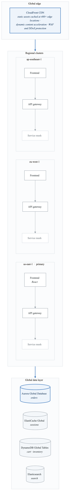
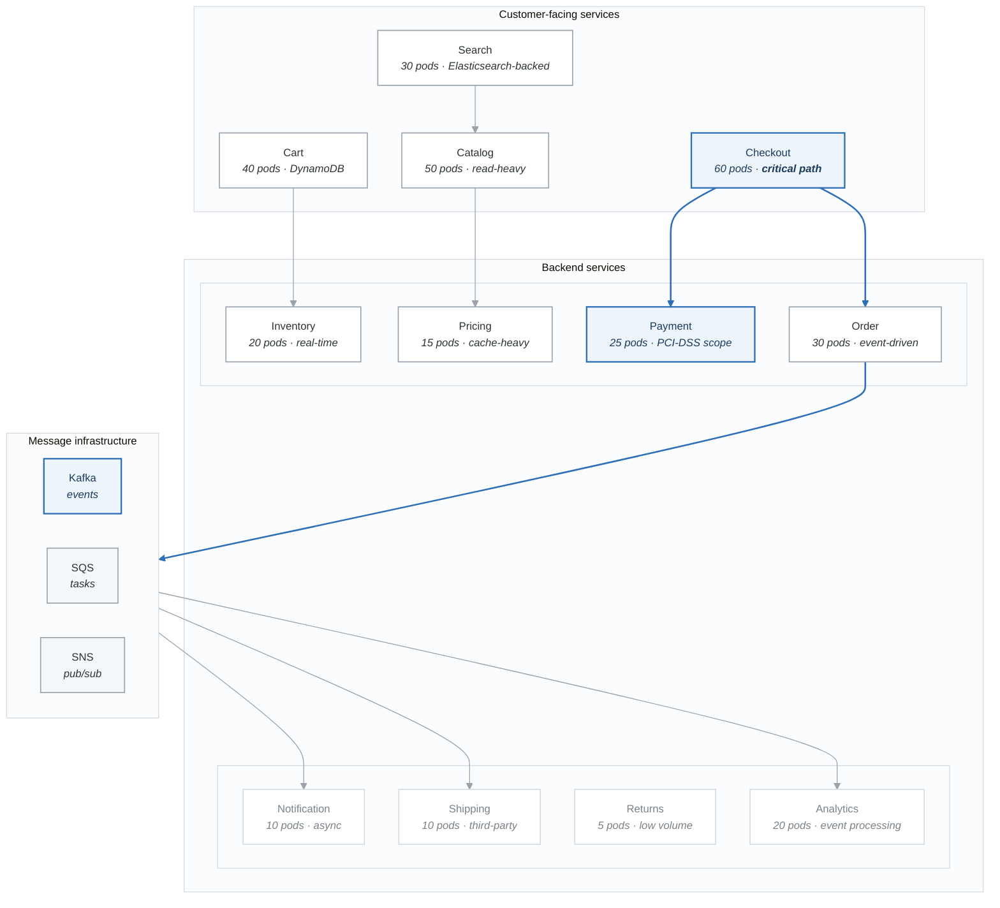

# Case Study: E-Commerce Black Friday Scale

## Executive Summary

**Company**: ShopMax Global
**Industry**: E-Commerce / Retail
**Challenge**: Handle 100x traffic spikes during Black Friday and seasonal sales events
**Outcome**: Zero downtime during peak, 85% cost reduction during off-peak, 99.99% availability

---

## Business Context

### The Challenge

ShopMax's legacy infrastructure couldn't handle peak traffic events:

- **Capacity planning failures**: Over-provisioned year-round or crashed during peaks
- **Slow scaling**: 30+ minutes to provision new servers
- **Cascading failures**: One service failure brought down entire checkout
- **Cost inefficiency**: Paying for peak capacity 365 days/year
- **Global latency**: Single-region deployment hurt international customers

### Requirements

| Requirement | Target |
|-------------|--------|
| Peak Traffic | 500,000 requests/second |
| Scale-up Time | < 2 minutes |
| Availability | 99.99% during sales events |
| Cart Abandonment | Reduce by 30% |
| Global Latency | < 100ms P95 |
| Cost | 50% reduction in infrastructure spend |

---

## Architecture

### High-Level Design

```mermaid
%%{init: {'theme':'base','themeVariables':{'fontFamily':'Helvetica, Arial, sans-serif','fontSize':'13px','primaryColor':'#ffffff','primaryTextColor':'#2d3436','primaryBorderColor':'#9aa3ab','lineColor':'#9aa3ab','textColor':'#2d3436','clusterBkg':'#fbfcfd','clusterBorder':'#d4dae0','edgeLabelBackground':'#ffffff','tertiaryColor':'#eef4fb'},'flowchart':{'curve':'basis','padding':14,'nodeSpacing':42,'rankSpacing':58}}}%%
flowchart TB
  classDef default fill:#ffffff,stroke:#9aa3ab,stroke-width:1.3px,color:#2d3436
  classDef n    fill:#ffffff,stroke:#9aa3ab,stroke-width:1.3px,color:#2d3436
  classDef crit fill:#eef4fb,stroke:#2f6fb8,stroke-width:1.8px,color:#1b3a5c
  classDef data fill:#f4f7fa,stroke:#9aa3ab,stroke-width:1.3px,color:#2d3436
  classDef mut  fill:#ffffff,stroke:#cfd6dc,stroke-width:1.1px,color:#7a8288
  classDef warn fill:#fdf0ec,stroke:#c0522d,stroke-width:1.6px,color:#8a3a1e
  subgraph EDGE["Global edge"]
    CF["CloudFront CDN<br/><i>static assets cached at 400+ edge locations ·<br/>dynamic content acceleration · WAF and DDoS protection</i>"]
  end
  subgraph REG["Regional clusters"]
    direction LR
    subgraph US["us-east-1 &nbsp;·&nbsp; primary"]
      direction TB
      F1["Frontend<br/><i>React</i>"]
      A1["API gateway"]
      M1["Service mesh"]
      F1 --> A1 --> M1
    end
    subgraph EU["eu-west-1"]
      direction TB
      F2["Frontend"]
      A2["API gateway"]
      M2["Service mesh"]
      F2 --> A2 --> M2
    end
    subgraph AP["ap-southeast-1"]
      direction TB
      F3["Frontend"]
      A3["API gateway"]
      M3["Service mesh"]
      F3 --> A3 --> M3
    end
  end
  subgraph DL["Global data layer"]
    direction LR
    AUR[("Aurora Global Database<br/><i>orders</i>")]
    EC[("ElastiCache Global<br/><i>sessions</i>")]
    DDB[("DynamoDB Global Tables<br/><i>cart · inventory</i>")]
    ES[("Elasticsearch<br/><i>search</i>")]
  end
  EDGE ==> REG ==> DL
  class CF crit
  class F1,F2,F3,A1,A2,A3 n
  class M1,M2,M3 mut
  class AUR crit
  class EC,DDB,ES data
  linkStyle 6,7 stroke:#2f6fb8,stroke-width:2px

%% Cart in DynamoDB Global Tables and orders in Aurora Global Database is not
%% an accident. A cart tolerates last-writer-wins across regions; an order does
%% not, so it accepts a single writer and the latency that comes with it.
```

<!-- figure: generated from the Mermaid below by _shared/diagrams/embed-figures.py — do not edit the image -->


<details>
<summary>Diagram source (Mermaid)</summary>



</details>

### Microservices Architecture

<!-- figure: generated from the Mermaid below by _shared/diagrams/embed-figures.py — do not edit the image -->


<details>
<summary>Diagram source (Mermaid)</summary>



</details>

---

## Implementation

### Multi-Cluster Setup with Terraform

```hcl
# terraform/multi-region-eks.tf

# Primary cluster - US East
module "eks_us_east" {
  source  = "terraform-aws-modules/eks/aws"
  version = "~> 19.0"

  cluster_name    = "shopmax-us-east"
  cluster_version = "1.28"

  vpc_id     = module.vpc_us_east.vpc_id
  subnet_ids = module.vpc_us_east.private_subnets

  cluster_endpoint_public_access = false

  eks_managed_node_groups = {
    # General workloads
    general = {
      name           = "general"
      instance_types = ["m6i.2xlarge"]
      min_size       = 10
      max_size       = 100
      desired_size   = 20

      labels = {
        workload = "general"
      }
    }

    # Critical checkout path
    checkout = {
      name           = "checkout"
      instance_types = ["c6i.4xlarge"]  # Compute optimized
      min_size       = 10
      max_size       = 200
      desired_size   = 30

      labels = {
        workload = "checkout"
        priority = "critical"
      }

      taints = [
        {
          key    = "workload"
          value  = "checkout"
          effect = "NO_SCHEDULE"
        }
      ]
    }

    # Spot instances for non-critical
    spot = {
      name           = "spot"
      instance_types = ["m6i.2xlarge", "m6i.xlarge", "m5.2xlarge"]
      capacity_type  = "SPOT"
      min_size       = 0
      max_size       = 300
      desired_size   = 10

      labels = {
        workload = "spot"
      }

      taints = [
        {
          key    = "spot"
          value  = "true"
          effect = "NO_SCHEDULE"
        }
      ]
    }
  }

  # Enable cluster autoscaler
  cluster_addons = {
    coredns    = { most_recent = true }
    kube-proxy = { most_recent = true }
    vpc-cni    = { most_recent = true }
  }
}

# Similar configuration for EU and APAC regions
module "eks_eu_west" {
  source = "./modules/eks-cluster"
  providers = {
    aws = aws.eu_west_1
  }
  cluster_name = "shopmax-eu-west"
  # ... similar configuration
}

module "eks_ap_southeast" {
  source = "./modules/eks-cluster"
  providers = {
    aws = aws.ap_southeast_1
  }
  cluster_name = "shopmax-ap-southeast"
  # ... similar configuration
}
```

### Aggressive Auto-Scaling Configuration

```yaml
# k8s/scaling/checkout-hpa.yaml
apiVersion: autoscaling/v2
kind: HorizontalPodAutoscaler
metadata:
  name: checkout-service
  namespace: ecommerce
spec:
  scaleTargetRef:
    apiVersion: apps/v1
    kind: Deployment
    name: checkout-service
  minReplicas: 30
  maxReplicas: 500
  metrics:
    # Scale on requests per second
    - type: Pods
      pods:
        metric:
          name: http_requests_per_second
        target:
          type: AverageValue
          averageValue: "100"

    # Also consider latency
    - type: Pods
      pods:
        metric:
          name: http_request_duration_p95_seconds
        target:
          type: AverageValue
          averageValue: "200m"  # 200ms

    # CPU as fallback
    - type: Resource
      resource:
        name: cpu
        target:
          type: Utilization
          averageUtilization: 60

  behavior:
    scaleUp:
      stabilizationWindowSeconds: 0  # Scale immediately
      policies:
        - type: Percent
          value: 100  # Double capacity
          periodSeconds: 15
        - type: Pods
          value: 50
          periodSeconds: 15
      selectPolicy: Max  # Use most aggressive

    scaleDown:
      stabilizationWindowSeconds: 300  # Wait 5 min before scaling down
      policies:
        - type: Percent
          value: 10
          periodSeconds: 60
---
# Vertical Pod Autoscaler for right-sizing
apiVersion: autoscaling.k8s.io/v1
kind: VerticalPodAutoscaler
metadata:
  name: checkout-service-vpa
  namespace: ecommerce
spec:
  targetRef:
    apiVersion: apps/v1
    kind: Deployment
    name: checkout-service
  updatePolicy:
    updateMode: "Auto"
  resourcePolicy:
    containerPolicies:
      - containerName: checkout
        minAllowed:
          cpu: "500m"
          memory: "512Mi"
        maxAllowed:
          cpu: "4"
          memory: "8Gi"
```

### KEDA for Event-Driven Scaling

```yaml
# k8s/scaling/keda-scalers.yaml
apiVersion: keda.sh/v1alpha1
kind: ScaledObject
metadata:
  name: order-processor
  namespace: ecommerce
spec:
  scaleTargetRef:
    name: order-processor
  minReplicaCount: 5
  maxReplicaCount: 200
  cooldownPeriod: 30
  pollingInterval: 5

  triggers:
    # Scale based on SQS queue depth
    - type: aws-sqs-queue
      metadata:
        queueURL: https://sqs.us-east-1.amazonaws.com/123456789/orders
        queueLength: "50"
        awsRegion: us-east-1
      authenticationRef:
        name: aws-credentials

    # Also scale on Kafka lag
    - type: kafka
      metadata:
        bootstrapServers: kafka.ecommerce:9092
        consumerGroup: order-processor
        topic: orders
        lagThreshold: "100"
---
# Cart service scales on Redis queue
apiVersion: keda.sh/v1alpha1
kind: ScaledObject
metadata:
  name: cart-service
  namespace: ecommerce
spec:
  scaleTargetRef:
    name: cart-service
  minReplicaCount: 20
  maxReplicaCount: 300
  triggers:
    - type: redis
      metadata:
        address: redis-cluster.ecommerce:6379
        listName: cart-operations
        listLength: "100"
```

### Checkout Service with Circuit Breaker

```yaml
# k8s/checkout/deployment.yaml
apiVersion: apps/v1
kind: Deployment
metadata:
  name: checkout-service
  namespace: ecommerce
  labels:
    app: checkout-service
    tier: critical
spec:
  replicas: 30
  strategy:
    type: RollingUpdate
    rollingUpdate:
      maxSurge: 25%
      maxUnavailable: 0
  selector:
    matchLabels:
      app: checkout-service
  template:
    metadata:
      labels:
        app: checkout-service
        tier: critical
      annotations:
        prometheus.io/scrape: "true"
        prometheus.io/port: "9090"
    spec:
      # Pin to checkout nodes
      nodeSelector:
        workload: checkout
      tolerations:
        - key: workload
          value: checkout
          effect: NoSchedule

      # Spread across AZs
      topologySpreadConstraints:
        - maxSkew: 2
          topologyKey: topology.kubernetes.io/zone
          whenUnsatisfiable: ScheduleAnyway
          labelSelector:
            matchLabels:
              app: checkout-service

      # Anti-affinity for HA
      affinity:
        podAntiAffinity:
          preferredDuringSchedulingIgnoredDuringExecution:
            - weight: 100
              podAffinityTerm:
                labelSelector:
                  matchLabels:
                    app: checkout-service
                topologyKey: kubernetes.io/hostname

      # High priority
      priorityClassName: checkout-critical

      containers:
        - name: checkout
          image: shopmax/checkout-service:v3.2.0
          ports:
            - containerPort: 8080
              name: http
            - containerPort: 9090
              name: metrics

          resources:
            requests:
              memory: "1Gi"
              cpu: "1000m"
            limits:
              memory: "2Gi"
              cpu: "2000m"

          env:
            - name: PAYMENT_TIMEOUT_MS
              value: "5000"
            - name: INVENTORY_TIMEOUT_MS
              value: "3000"
            # Circuit breaker configuration
            - name: CIRCUIT_BREAKER_ENABLED
              value: "true"
            - name: CIRCUIT_BREAKER_THRESHOLD
              value: "5"
            - name: CIRCUIT_BREAKER_TIMEOUT_MS
              value: "30000"
            # Connection pooling
            - name: DB_POOL_SIZE
              value: "20"
            - name: REDIS_POOL_SIZE
              value: "50"

          # Fast startup probe
          startupProbe:
            httpGet:
              path: /health/startup
              port: 8080
            failureThreshold: 30
            periodSeconds: 2

          # Aggressive readiness check
          readinessProbe:
            httpGet:
              path: /health/ready
              port: 8080
            initialDelaySeconds: 5
            periodSeconds: 2
            timeoutSeconds: 1
            failureThreshold: 2

          livenessProbe:
            httpGet:
              path: /health/live
              port: 8080
            initialDelaySeconds: 30
            periodSeconds: 5
            timeoutSeconds: 2
            failureThreshold: 3

          lifecycle:
            preStop:
              exec:
                command:
                  - /bin/sh
                  - -c
                  - |
                    # Graceful shutdown
                    curl -X POST localhost:8080/admin/drain
                    sleep 15

      terminationGracePeriodSeconds: 30
---
# Priority class for checkout
apiVersion: scheduling.k8s.io/v1
kind: PriorityClass
metadata:
  name: checkout-critical
value: 1000000
globalDefault: false
description: "Critical checkout workloads - never preempt"
preemptionPolicy: Never
```

### Istio Traffic Management for Canary

```yaml
# k8s/istio/checkout-canary.yaml
apiVersion: networking.istio.io/v1beta1
kind: VirtualService
metadata:
  name: checkout-service
  namespace: ecommerce
spec:
  hosts:
    - checkout-service
  http:
    # Canary: 5% to new version
    - match:
        - headers:
            x-canary:
              exact: "true"
      route:
        - destination:
            host: checkout-service
            subset: canary
          weight: 100

    # Production traffic split
    - route:
        - destination:
            host: checkout-service
            subset: stable
          weight: 95
        - destination:
            host: checkout-service
            subset: canary
          weight: 5

      # Retry configuration
      retries:
        attempts: 3
        perTryTimeout: 2s
        retryOn: 5xx,reset,connect-failure

      # Timeout
      timeout: 10s
---
apiVersion: networking.istio.io/v1beta1
kind: DestinationRule
metadata:
  name: checkout-service
  namespace: ecommerce
spec:
  host: checkout-service
  trafficPolicy:
    connectionPool:
      tcp:
        maxConnections: 1000
      http:
        h2UpgradePolicy: UPGRADE
        http1MaxPendingRequests: 1000
        http2MaxRequests: 2000
        maxRequestsPerConnection: 100

    # Circuit breaker
    outlierDetection:
      consecutive5xxErrors: 5
      interval: 10s
      baseEjectionTime: 30s
      maxEjectionPercent: 50
      minHealthPercent: 50

  subsets:
    - name: stable
      labels:
        version: stable
    - name: canary
      labels:
        version: canary
```

### Pre-Scaling for Black Friday

```yaml
# k8s/scaling/scheduled-scaling.yaml
apiVersion: batch/v1
kind: CronJob
metadata:
  name: black-friday-prescale
  namespace: ecommerce
spec:
  # Run 1 hour before Black Friday midnight
  schedule: "0 23 * 11 4"  # Thursday 11 PM in November
  jobTemplate:
    spec:
      template:
        spec:
          serviceAccountName: scaler
          containers:
            - name: scaler
              image: bitnami/kubectl:latest
              command:
                - /bin/bash
                - -c
                - |
                  echo "Pre-scaling for Black Friday..."

                  # Scale critical services
                  kubectl scale deployment checkout-service \
                    -n ecommerce --replicas=200

                  kubectl scale deployment cart-service \
                    -n ecommerce --replicas=150

                  kubectl scale deployment catalog-service \
                    -n ecommerce --replicas=100

                  kubectl scale deployment payment-service \
                    -n ecommerce --replicas=100

                  kubectl scale deployment inventory-service \
                    -n ecommerce --replicas=80

                  # Scale node pools via cluster autoscaler annotation
                  kubectl annotate deployment checkout-service \
                    cluster-autoscaler.kubernetes.io/safe-to-evict=false

                  # Warm up caches
                  kubectl create job cache-warmer-$(date +%s) \
                    --from=cronjob/cache-warmer -n ecommerce

                  # Send notification
                  curl -X POST $SLACK_WEBHOOK -d '{
                    "text": "🚀 Black Friday pre-scaling complete!",
                    "attachments": [{
                      "fields": [
                        {"title": "Checkout Pods", "value": "200", "short": true},
                        {"title": "Cart Pods", "value": "150", "short": true}
                      ]
                    }]
                  }'

                  echo "Pre-scaling complete!"
          restartPolicy: OnFailure
---
# Post Black Friday scale down
apiVersion: batch/v1
kind: CronJob
metadata:
  name: post-blackfriday-scaledown
  namespace: ecommerce
spec:
  schedule: "0 6 * 12 1"  # Monday 6 AM in December
  jobTemplate:
    spec:
      template:
        spec:
          serviceAccountName: scaler
          containers:
            - name: scaler
              image: bitnami/kubectl:latest
              command:
                - /bin/bash
                - -c
                - |
                  echo "Scaling down post Black Friday..."

                  # Return to normal replicas
                  kubectl scale deployment checkout-service \
                    -n ecommerce --replicas=30

                  kubectl scale deployment cart-service \
                    -n ecommerce --replicas=40

                  # Re-enable safe-to-evict
                  kubectl annotate deployment checkout-service \
                    cluster-autoscaler.kubernetes.io/safe-to-evict-

                  echo "Scale down complete"
          restartPolicy: OnFailure
```

### Cache Strategy

```yaml
# k8s/caching/redis-cluster.yaml
apiVersion: databases.spotahome.com/v1
kind: RedisFailover
metadata:
  name: ecommerce-cache
  namespace: ecommerce
spec:
  sentinel:
    replicas: 3
    resources:
      requests:
        cpu: 100m
        memory: 128Mi
      limits:
        cpu: 500m
        memory: 256Mi

  redis:
    replicas: 6
    resources:
      requests:
        cpu: "1"
        memory: 4Gi
      limits:
        cpu: "2"
        memory: 8Gi

    customConfig:
      - maxmemory 6gb
      - maxmemory-policy allkeys-lru
      - tcp-keepalive 60
      - timeout 0

    storage:
      persistentVolumeClaim:
        metadata:
          name: redis-data
        spec:
          accessModes:
            - ReadWriteOnce
          resources:
            requests:
              storage: 50Gi
          storageClassName: gp3-iops
---
# Application caching configuration
apiVersion: v1
kind: ConfigMap
metadata:
  name: cache-config
  namespace: ecommerce
data:
  cache.yaml: |
    redis:
      cluster:
        nodes:
          - redis-node-0.ecommerce:6379
          - redis-node-1.ecommerce:6379
          - redis-node-2.ecommerce:6379
        read_from_replicas: true

    caching:
      product_catalog:
        ttl: 3600  # 1 hour
        prefix: "catalog:"

      product_details:
        ttl: 1800  # 30 minutes
        prefix: "product:"

      inventory:
        ttl: 30  # 30 seconds - near real-time
        prefix: "inv:"

      pricing:
        ttl: 60  # 1 minute
        prefix: "price:"

      user_session:
        ttl: 86400  # 24 hours
        prefix: "session:"

      cart:
        ttl: 604800  # 7 days
        prefix: "cart:"

    # Cache warming strategy
    warming:
      enabled: true
      on_startup: true
      categories:
        - electronics
        - clothing
        - home
      top_products: 10000
```

---

## Load Testing and Validation

### Locust Load Test Configuration

```yaml
# k8s/testing/locust.yaml
apiVersion: apps/v1
kind: Deployment
metadata:
  name: locust-master
  namespace: load-testing
spec:
  replicas: 1
  selector:
    matchLabels:
      app: locust
      role: master
  template:
    metadata:
      labels:
        app: locust
        role: master
    spec:
      containers:
        - name: locust
          image: locustio/locust:2.20.0
          ports:
            - containerPort: 8089
            - containerPort: 5557
          command:
            - locust
            - --master
            - -f
            - /scripts/locustfile.py
            - --host=http://api-gateway.ecommerce
          volumeMounts:
            - name: scripts
              mountPath: /scripts
      volumes:
        - name: scripts
          configMap:
            name: locust-scripts
---
apiVersion: apps/v1
kind: Deployment
metadata:
  name: locust-worker
  namespace: load-testing
spec:
  replicas: 20
  selector:
    matchLabels:
      app: locust
      role: worker
  template:
    metadata:
      labels:
        app: locust
        role: worker
    spec:
      containers:
        - name: locust
          image: locustio/locust:2.20.0
          command:
            - locust
            - --worker
            - --master-host=locust-master
            - -f
            - /scripts/locustfile.py
          resources:
            requests:
              cpu: "500m"
              memory: "512Mi"
          volumeMounts:
            - name: scripts
              mountPath: /scripts
      volumes:
        - name: scripts
          configMap:
            name: locust-scripts
---
apiVersion: v1
kind: ConfigMap
metadata:
  name: locust-scripts
  namespace: load-testing
data:
  locustfile.py: |
    from locust import HttpUser, task, between
    import random

    class ShopMaxUser(HttpUser):
        wait_time = between(1, 3)

        @task(50)
        def browse_catalog(self):
            """Browse product catalog - most common action"""
            category = random.choice(['electronics', 'clothing', 'home'])
            self.client.get(f"/api/v1/catalog/{category}")

        @task(30)
        def view_product(self):
            """View product details"""
            product_id = random.randint(1, 100000)
            self.client.get(f"/api/v1/products/{product_id}")

        @task(10)
        def search(self):
            """Search for products"""
            terms = ['laptop', 'phone', 'headphones', 'watch', 'camera']
            self.client.get(f"/api/v1/search?q={random.choice(terms)}")

        @task(5)
        def add_to_cart(self):
            """Add item to cart"""
            product_id = random.randint(1, 100000)
            self.client.post("/api/v1/cart/items", json={
                "product_id": product_id,
                "quantity": random.randint(1, 3)
            })

        @task(3)
        def view_cart(self):
            """View shopping cart"""
            self.client.get("/api/v1/cart")

        @task(1)
        def checkout(self):
            """Complete checkout - critical path"""
            with self.client.post("/api/v1/checkout", json={
                "payment_method": "card",
                "shipping_address_id": random.randint(1, 1000)
            }, catch_response=True) as response:
                if response.elapsed.total_seconds() > 2:
                    response.failure("Checkout too slow")
```

---

## Results

### Black Friday 2024 Performance

| Metric | Target | Actual |
|--------|--------|--------|
| Peak Requests/sec | 500,000 | 650,000 |
| Checkout Latency (P99) | < 2s | 800ms |
| Cart API Latency (P99) | < 500ms | 180ms |
| Availability | 99.99% | 99.995% |
| Failed Checkouts | < 0.1% | 0.02% |

### Cost Analysis

| Category | Before (Annual) | After (Annual) | Savings |
|----------|-----------------|----------------|---------|
| On-Demand Compute | $3.6M | $1.2M | 67% |
| Spot Instances | $0 | $600K | N/A |
| Reserved Instances | $0 | $400K | N/A |
| Data Transfer | $500K | $300K | 40% |
| **Total** | **$4.1M** | **$2.5M** | **39%** |

### Business Impact

- **Cart Abandonment**: Reduced by 35% (target was 30%)
- **Conversion Rate**: Increased by 12%
- **Customer Satisfaction**: NPS improved from 42 to 58
- **Revenue**: +23% YoY during Black Friday

---

## Key Learnings

### What Worked

1. **Pre-scaling 1 hour before peak** - Avoided cold start issues
2. **Dedicated checkout node pool** - Protected critical path from noisy neighbors
3. **Aggressive HPA with 0s stabilization** - Scaled instantly with demand
4. **Circuit breakers** - Prevented cascade failures when payment provider had issues

### What Didn't Work Initially

1. **Single Redis instance** - Became bottleneck; switched to cluster
2. **HPA based only on CPU** - Didn't correlate with actual load; added custom metrics
3. **Same PDB for all services** - Blocked rolling updates during peak; relaxed for non-critical

### Recommendations

1. Load test at 2x expected peak
2. Pre-warm caches before sales events
3. Have runbooks for manual scaling if autoscaler fails
4. Monitor queue depths, not just pod metrics

---

## Implementation Checklist

- [ ] Multi-region EKS clusters deployed
- [ ] Cluster autoscaler configured
- [ ] HPA with custom metrics enabled
- [ ] KEDA for event-driven scaling
- [ ] Dedicated node pools for critical paths
- [ ] Redis cluster for caching
- [ ] Circuit breakers in all services
- [ ] Pre-scaling CronJobs configured
- [ ] Load testing framework ready
- [ ] Runbooks for Black Friday operations
- [ ] Observability dashboards created

## Related Resources

- [Phase 3: Production Readiness](../../phase-3-production-readiness/)
- [Phase 5: Enterprise Multi-Cloud](../../phase-5-enterprise-multi-cloud/)
- [Troubleshooting Scenarios](../../scenarios/troubleshooting/)

<!-- feynman-check -->

---

## Feynman check

Close the file. Blank page, no notes. Explain each of these to a competent engineer who has never
used this tool — **under five minutes, no jargon you can't define on the spot:**

- Load Testing and Validation
- Implementation Checklist
- Related Resources
- Microservices Architecture

**The gap is not what you forgot. It is where you used a word instead of a mechanism.**

| | |
|---|---|
| ✗ | *"The architecture was badly designed."* |
| ✓ | *"The failure needed two independent weaknesses to compose. Name both, say why each one alone was survivable, and name the single control that would have broken the chain — that is the finding, not the vulnerability."* |

**Trace it:** The incident in this file, from entry to objective. At every step name the control that should have stopped it, and why it did not.

Stop at the first component you cannot name. Reopen this file and read **only** that.

**Go deeper — only once the gap has a name:** three postmortems from [danluu/post-mortems](https://github.com/danluu/post-mortems) — for each, name the one control that would have broken the chain.
Full list per domain: [`SOURCES.md`](../../SOURCES.md#case-studies)

→ Protocol, the three levels of knowing, and worked examples: [`MASTERY.md`](../../MASTERY.md)

<!-- /feynman-check -->
