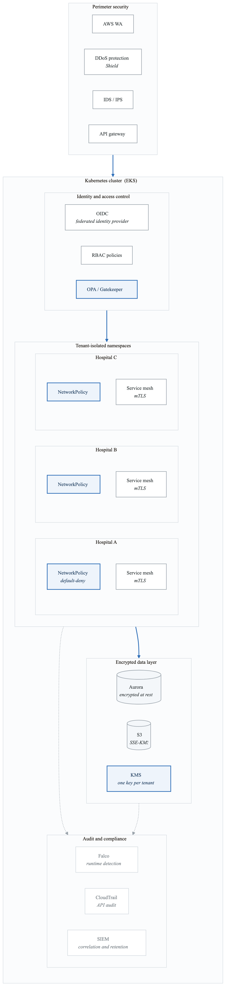

# Case Study: HIPAA-Compliant Healthcare Platform

## Executive Summary

**Company**: MedSecure Health Systems
**Industry**: Healthcare / Health Technology
**Challenge**: Build a HIPAA-compliant Kubernetes platform for patient data processing
**Outcome**: Full HIPAA compliance, SOC 2 Type II certification, zero security incidents

---

## Business Context

### The Challenge

MedSecure needed to modernize their patient data platform while maintaining strict HIPAA compliance:

- **Legacy infrastructure**: On-premise systems with manual security audits
- **Compliance burden**: 6+ months for security assessments on new services
- **Slow deployment**: Weeks to deploy new features due to compliance reviews
- **Audit fatigue**: Manual evidence collection consuming engineering time
- **Multi-tenant isolation**: Multiple hospital clients sharing infrastructure

### Requirements

| Requirement | Target |
|-------------|--------|
| HIPAA Compliance | Full Technical Safeguards |
| SOC 2 Type II | Certified |
| Encryption | At-rest and in-transit |
| Audit Logging | 7 years retention |
| Access Control | Role-based, MFA required |
| Incident Response | < 1 hour detection, < 72 hours notification |

### HIPAA Technical Safeguards

**HIPAA technical safeguards, and what implements each one**

| Rule | Requirement | How it is met here |
|---|---|---|
| **§164.312(a)(1)** Access control | Unique user identification | RBAC and per-workload ServiceAccounts — no shared identities |
| | Emergency access procedure | Break-glass role, time-boxed, alerts on use |
| | Automatic logoff | Session timeouts and idle termination |
| | Encryption and decryption | KMS, envelope encryption |
| **§164.312(b)** Audit controls | Record access to PHI | Audit logs on every PHI read and write |
| | Tamper-evident | WORM storage (Object Lock) |
| | Review | Scheduled audit-log review, with sign-off |
| | Retention | 7 years |
| **§164.312(c)(1)** Integrity | Verify data has not been altered | Checksums and signatures |
| | Immutable trail | Append-only audit store |
| | Configuration integrity | Everything in version control |
| **§164.312(d)** Authentication | Verify the person or entity | MFA for every human, certificate-based authentication for services, identity federation over SAML/OIDC |
| **§164.312(e)(1)** Transmission security | Encryption in transit | mTLS everywhere, enforced by the mesh |
| | Segmentation | NetworkPolicy, default-deny |
| | Integrity controls | TLS 1.3 |

Two of these are the ones auditors actually test. **Emergency access** must exist *and* be
demonstrable — a break-glass path nobody has ever exercised fails the control. And **audit log
review** is a process requirement: having the logs is not the control, reading them is.

---

## Architecture

### High-Level Design

```mermaid
%%{init: {'theme':'base','themeVariables':{'fontFamily':'Helvetica, Arial, sans-serif','fontSize':'13px','primaryColor':'#ffffff','primaryTextColor':'#2d3436','primaryBorderColor':'#9aa3ab','lineColor':'#9aa3ab','textColor':'#2d3436','clusterBkg':'#fbfcfd','clusterBorder':'#d4dae0','edgeLabelBackground':'#ffffff','tertiaryColor':'#eef4fb'},'flowchart':{'curve':'basis','padding':14,'nodeSpacing':42,'rankSpacing':58}}}%%
flowchart TB
  classDef default fill:#ffffff,stroke:#9aa3ab,stroke-width:1.3px,color:#2d3436
  classDef n    fill:#ffffff,stroke:#9aa3ab,stroke-width:1.3px,color:#2d3436
  classDef crit fill:#eef4fb,stroke:#2f6fb8,stroke-width:1.8px,color:#1b3a5c
  classDef data fill:#f4f7fa,stroke:#9aa3ab,stroke-width:1.3px,color:#2d3436
  classDef mut  fill:#ffffff,stroke:#cfd6dc,stroke-width:1.1px,color:#7a8288
  classDef warn fill:#fdf0ec,stroke:#c0522d,stroke-width:1.6px,color:#8a3a1e
  subgraph PER["Perimeter security"]
    direction LR
    WAF["AWS WAF"]
    DDOS["DDoS protection<br/><i>Shield</i>"]
    IDS["IDS / IPS"]
    AGW["API gateway"]
  end
  subgraph EKS["Kubernetes cluster &nbsp;(EKS)"]
    direction TB
    subgraph IAC["Identity and access control"]
      direction LR
      OIDC["OIDC<br/><i>federated identity provider</i>"]
      RBAC["RBAC policies"]
      OPA["OPA / Gatekeeper"]
    end
    subgraph TEN["Tenant-isolated namespaces"]
      direction LR
      subgraph HA["Hospital A"]
        direction TB
        NPA["NetworkPolicy<br/><i>default-deny</i>"]
        MSA["Service mesh<br/><i>mTLS</i>"]
      end
      subgraph HB["Hospital B"]
        direction TB
        NPB["NetworkPolicy"]
        MSB["Service mesh<br/><i>mTLS</i>"]
      end
      subgraph HC["Hospital C"]
        direction TB
        NPC["NetworkPolicy"]
        MSC["Service mesh<br/><i>mTLS</i>"]
      end
    end
    subgraph DATA["Encrypted data layer"]
      direction LR
      AUR[("Aurora<br/><i>encrypted at rest</i>")]
      S3[("S3<br/><i>SSE-KMS</i>")]
      KMS["KMS<br/><i>one key per tenant</i>"]
    end
    subgraph AUD["Audit and compliance"]
      direction LR
      FAL["Falco<br/><i>runtime detection</i>"]
      CT["CloudTrail<br/><i>API audit</i>"]
      SIEM["SIEM<br/><i>correlation and retention</i>"]
    end
    IAC ==> TEN ==> DATA
    TEN -.-> AUD
    DATA -.-> AUD
  end
  PER ==> EKS
  class WAF,DDOS,IDS,AGW n
  class OIDC,RBAC n
  class OPA crit
  class NPA,NPB,NPC crit
  class MSA,MSB,MSC n
  class AUR,S3 data
  class KMS crit
  class FAL,CT,SIEM mut
  linkStyle 0,1,4 stroke:#2f6fb8,stroke-width:2px

%% A key per tenant is the control that makes a breach containable. One shared
%% key means one compromised credential exposes every hospital's data; per-
%% tenant keys mean the blast radius is one customer, and you can prove it.
```

<!-- figure: generated from the Mermaid below by _shared/diagrams/embed-figures.py — do not edit the image -->


<details>
<summary>Diagram source (Mermaid)</summary>



</details>

---

## Implementation

### EKS Cluster with Security Hardening

```hcl
# terraform/eks-hipaa.tf

module "eks_hipaa" {
  source  = "terraform-aws-modules/eks/aws"
  version = "~> 19.0"

  cluster_name    = "medsecure-hipaa"
  cluster_version = "1.28"

  # Private-only cluster
  cluster_endpoint_public_access  = false
  cluster_endpoint_private_access = true

  vpc_id     = module.vpc.vpc_id
  subnet_ids = module.vpc.private_subnets

  # Encryption at rest for secrets
  cluster_encryption_config = {
    provider_key_arn = aws_kms_key.eks_secrets.arn
    resources        = ["secrets"]
  }

  # Enable all audit logging
  cluster_enabled_log_types = [
    "api",
    "audit",
    "authenticator",
    "controllerManager",
    "scheduler"
  ]

  # OIDC for IAM roles
  enable_irsa = true

  eks_managed_node_groups = {
    # Dedicated PHI processing nodes
    phi_processing = {
      name           = "phi-processing"
      instance_types = ["m6i.2xlarge"]

      min_size     = 3
      max_size     = 20
      desired_size = 5

      # Encrypted EBS
      block_device_mappings = {
        xvda = {
          device_name = "/dev/xvda"
          ebs = {
            volume_size           = 100
            volume_type           = "gp3"
            encrypted             = true
            kms_key_id            = aws_kms_key.ebs.arn
            delete_on_termination = true
          }
        }
      }

      labels = {
        workload       = "phi"
        data-class     = "hipaa"
        encryption     = "required"
      }

      taints = [
        {
          key    = "data-class"
          value  = "phi"
          effect = "NO_SCHEDULE"
        }
      ]

      # IMDSv2 required
      metadata_options = {
        http_endpoint               = "enabled"
        http_tokens                 = "required"
        http_put_response_hop_limit = 1
      }
    }

    # General workloads (non-PHI)
    general = {
      name           = "general"
      instance_types = ["m6i.xlarge"]

      min_size     = 2
      max_size     = 10
      desired_size = 3

      labels = {
        workload = "general"
      }
    }
  }

  # Node security group rules
  node_security_group_additional_rules = {
    # Deny all egress by default
    egress_deny_all = {
      description = "Deny all egress"
      protocol    = "-1"
      from_port   = 0
      to_port     = 0
      type        = "egress"
      cidr_blocks = ["0.0.0.0/0"]
    }
    # Allow specific egress
    egress_https = {
      description = "Allow HTTPS egress"
      protocol    = "tcp"
      from_port   = 443
      to_port     = 443
      type        = "egress"
      cidr_blocks = ["10.0.0.0/8"]
    }
  }

  tags = {
    Environment = "production"
    Compliance  = "hipaa"
    DataClass   = "phi"
  }
}

# KMS key for secrets encryption
resource "aws_kms_key" "eks_secrets" {
  description             = "EKS Secrets Encryption Key"
  deletion_window_in_days = 30
  enable_key_rotation     = true

  policy = jsonencode({
    Version = "2012-10-17"
    Statement = [
      {
        Sid    = "Enable IAM User Permissions"
        Effect = "Allow"
        Principal = {
          AWS = "arn:aws:iam::${data.aws_caller_identity.current.account_id}:root"
        }
        Action   = "kms:*"
        Resource = "*"
      },
      {
        Sid    = "Allow EKS"
        Effect = "Allow"
        Principal = {
          Service = "eks.amazonaws.com"
        }
        Action = [
          "kms:Encrypt",
          "kms:Decrypt",
          "kms:ReEncrypt*",
          "kms:GenerateDataKey*",
          "kms:DescribeKey"
        ]
        Resource = "*"
      }
    ]
  })

  tags = {
    Name       = "eks-secrets-key"
    Compliance = "hipaa"
  }
}
```

### OPA Gatekeeper HIPAA Policies

```yaml
# k8s/policies/hipaa-constraints.yaml

# Require encryption at rest for all PVCs
apiVersion: templates.gatekeeper.sh/v1
kind: ConstraintTemplate
metadata:
  name: k8sencryptedpvc
spec:
  crd:
    spec:
      names:
        kind: K8sEncryptedPVC
  targets:
    - target: admission.k8s.gatekeeper.sh
      rego: |
        package k8sencryptedpvc

        violation[{"msg": msg}] {
          input.review.object.kind == "PersistentVolumeClaim"
          namespace := input.review.object.metadata.namespace
          labels := input.review.object.metadata.labels

          # Check if in PHI namespace
          startswith(namespace, "hospital-")

          # Must specify encrypted storage class
          sc := input.review.object.spec.storageClassName
          not startswith(sc, "encrypted-")

          msg := sprintf("PVC in PHI namespace must use encrypted storage class. Got: %v", [sc])
        }
---
apiVersion: constraints.gatekeeper.sh/v1beta1
kind: K8sEncryptedPVC
metadata:
  name: require-encrypted-pvc
spec:
  match:
    kinds:
      - apiGroups: [""]
        kinds: ["PersistentVolumeClaim"]
    namespaces:
      - "hospital-*"
---
# Require PHI labels
apiVersion: templates.gatekeeper.sh/v1
kind: ConstraintTemplate
metadata:
  name: k8sphilabels
spec:
  crd:
    spec:
      names:
        kind: K8sPHILabels
      validation:
        openAPIV3Schema:
          type: object
          properties:
            requiredLabels:
              type: array
              items:
                type: string
  targets:
    - target: admission.k8s.gatekeeper.sh
      rego: |
        package k8sphilabels

        violation[{"msg": msg}] {
          input.review.object.kind == "Pod"
          namespace := input.review.object.metadata.namespace
          startswith(namespace, "hospital-")

          required := input.parameters.requiredLabels
          provided := {label | input.review.object.metadata.labels[label]}
          missing := required - provided

          count(missing) > 0
          msg := sprintf("PHI workloads require labels: %v. Missing: %v", [required, missing])
        }
---
apiVersion: constraints.gatekeeper.sh/v1beta1
kind: K8sPHILabels
metadata:
  name: require-phi-labels
spec:
  match:
    kinds:
      - apiGroups: [""]
        kinds: ["Pod"]
    namespaces:
      - "hospital-*"
  parameters:
    requiredLabels:
      - "data-classification"
      - "phi-access-level"
      - "audit-required"
---
# Deny privileged containers
apiVersion: templates.gatekeeper.sh/v1
kind: ConstraintTemplate
metadata:
  name: k8sdenypriv
spec:
  crd:
    spec:
      names:
        kind: K8sDenyPrivileged
  targets:
    - target: admission.k8s.gatekeeper.sh
      rego: |
        package k8sdenypriv

        violation[{"msg": msg}] {
          container := input.review.object.spec.containers[_]
          container.securityContext.privileged == true
          msg := sprintf("Privileged containers not allowed: %v", [container.name])
        }

        violation[{"msg": msg}] {
          container := input.review.object.spec.containers[_]
          container.securityContext.allowPrivilegeEscalation == true
          msg := sprintf("Privilege escalation not allowed: %v", [container.name])
        }

        violation[{"msg": msg}] {
          container := input.review.object.spec.containers[_]
          not container.securityContext.readOnlyRootFilesystem
          msg := sprintf("Read-only root filesystem required: %v", [container.name])
        }

        violation[{"msg": msg}] {
          container := input.review.object.spec.containers[_]
          container.securityContext.runAsUser == 0
          msg := sprintf("Running as root not allowed: %v", [container.name])
        }
---
apiVersion: constraints.gatekeeper.sh/v1beta1
kind: K8sDenyPrivileged
metadata:
  name: deny-privileged-hipaa
spec:
  match:
    kinds:
      - apiGroups: [""]
        kinds: ["Pod"]
```

### Tenant Isolation with Network Policies

```yaml
# k8s/network-policies/tenant-isolation.yaml

# Default deny all traffic
apiVersion: networking.k8s.io/v1
kind: NetworkPolicy
metadata:
  name: default-deny-all
  namespace: hospital-a
spec:
  podSelector: {}
  policyTypes:
    - Ingress
    - Egress
---
# Allow internal namespace communication
apiVersion: networking.k8s.io/v1
kind: NetworkPolicy
metadata:
  name: allow-same-namespace
  namespace: hospital-a
spec:
  podSelector: {}
  policyTypes:
    - Ingress
    - Egress
  ingress:
    - from:
        - podSelector: {}
  egress:
    - to:
        - podSelector: {}
---
# Allow egress to shared services only
apiVersion: networking.k8s.io/v1
kind: NetworkPolicy
metadata:
  name: allow-shared-services
  namespace: hospital-a
spec:
  podSelector: {}
  policyTypes:
    - Egress
  egress:
    # Allow DNS
    - to:
        - namespaceSelector:
            matchLabels:
              kubernetes.io/metadata.name: kube-system
          podSelector:
            matchLabels:
              k8s-app: kube-dns
      ports:
        - protocol: UDP
          port: 53
    # Allow Istio control plane
    - to:
        - namespaceSelector:
            matchLabels:
              kubernetes.io/metadata.name: istio-system
      ports:
        - protocol: TCP
          port: 15012
        - protocol: TCP
          port: 15017
    # Allow monitoring
    - to:
        - namespaceSelector:
            matchLabels:
              kubernetes.io/metadata.name: monitoring
          podSelector:
            matchLabels:
              app: prometheus
      ports:
        - protocol: TCP
          port: 9090
---
# Cilium network policy for L7 filtering
apiVersion: cilium.io/v2
kind: CiliumNetworkPolicy
metadata:
  name: phi-api-access
  namespace: hospital-a
spec:
  endpointSelector:
    matchLabels:
      app: patient-api
  ingress:
    - fromEndpoints:
        - matchLabels:
            app: frontend
      toPorts:
        - ports:
            - port: "8080"
              protocol: TCP
          rules:
            http:
              - method: "GET"
                path: "/api/v1/patients/.*"
              - method: "POST"
                path: "/api/v1/patients"
                headers:
                  - "X-Audit-ID"  # Require audit header
```

### Istio mTLS Configuration

```yaml
# k8s/istio/mtls-strict.yaml

# Enforce strict mTLS cluster-wide
apiVersion: security.istio.io/v1beta1
kind: PeerAuthentication
metadata:
  name: default
  namespace: istio-system
spec:
  mtls:
    mode: STRICT
---
# Per-tenant authentication policy
apiVersion: security.istio.io/v1beta1
kind: PeerAuthentication
metadata:
  name: hospital-a-mtls
  namespace: hospital-a
spec:
  mtls:
    mode: STRICT
  portLevelMtls:
    8080:
      mode: STRICT
---
# Authorization policy - require valid JWT
apiVersion: security.istio.io/v1beta1
kind: AuthorizationPolicy
metadata:
  name: require-jwt
  namespace: hospital-a
spec:
  selector:
    matchLabels:
      app: patient-api
  action: ALLOW
  rules:
    - from:
        - source:
            requestPrincipals: ["https://auth.medsecure.com/*"]
      when:
        - key: request.auth.claims[aud]
          values: ["patient-api"]
        - key: request.auth.claims[phi_access]
          values: ["true"]
---
# Request authentication
apiVersion: security.istio.io/v1beta1
kind: RequestAuthentication
metadata:
  name: jwt-auth
  namespace: hospital-a
spec:
  selector:
    matchLabels:
      app: patient-api
  jwtRules:
    - issuer: "https://auth.medsecure.com"
      jwksUri: "https://auth.medsecure.com/.well-known/jwks.json"
      audiences:
        - "patient-api"
      forwardOriginalToken: true
```

### Falco Runtime Security

```yaml
# k8s/falco/rules.yaml
apiVersion: v1
kind: ConfigMap
metadata:
  name: falco-rules
  namespace: falco
data:
  hipaa_rules.yaml: |
    # HIPAA-specific Falco rules

    # Detect PHI file access
    - rule: PHI Data Access
      desc: Detect access to PHI data files
      condition: >
        (open_read or open_write) and
        container and
        (fd.name startswith "/phi-data/" or
         fd.name startswith "/patient-records/")
      output: >
        PHI data accessed (user=%user.name command=%proc.cmdline
        file=%fd.name container=%container.name pod=%k8s.pod.name
        namespace=%k8s.ns.name)
      priority: WARNING
      tags: [hipaa, phi, audit]

    # Detect unauthorized shell
    - rule: Shell in PHI Container
      desc: Detect shell spawned in PHI container
      condition: >
        spawned_process and
        container and
        k8s.ns.name startswith "hospital-" and
        (proc.name = bash or proc.name = sh or proc.name = zsh)
      output: >
        Shell spawned in PHI container (user=%user.name command=%proc.cmdline
        container=%container.name pod=%k8s.pod.name namespace=%k8s.ns.name)
      priority: CRITICAL
      tags: [hipaa, security, shell]

    # Detect sensitive command execution
    - rule: Sensitive Command in PHI Namespace
      desc: Detect sensitive commands in PHI processing namespaces
      condition: >
        spawned_process and
        container and
        k8s.ns.name startswith "hospital-" and
        (proc.name in (curl, wget, nc, ncat, netcat) or
         proc.cmdline contains "base64" or
         proc.cmdline contains "/dev/tcp")
      output: >
        Sensitive command executed in PHI namespace
        (command=%proc.cmdline container=%container.name
        pod=%k8s.pod.name namespace=%k8s.ns.name)
      priority: CRITICAL
      tags: [hipaa, security, exfiltration]

    # Detect database credential access
    - rule: Database Credential File Access
      desc: Detect access to database credentials
      condition: >
        (open_read or open_write) and
        container and
        (fd.name contains "db-credentials" or
         fd.name contains ".pgpass" or
         fd.name contains "database-secret")
      output: >
        Database credentials accessed (user=%user.name file=%fd.name
        container=%container.name pod=%k8s.pod.name)
      priority: WARNING
      tags: [hipaa, credentials, audit]

    # Detect network connection to external IP
    - rule: External Network Connection from PHI Pod
      desc: Detect outbound connections from PHI pods
      condition: >
        outbound and
        container and
        k8s.ns.name startswith "hospital-" and
        not fd.sip.name in (private_ipv4_addresses)
      output: >
        External connection from PHI pod (command=%proc.cmdline
        connection=%fd.name container=%container.name
        pod=%k8s.pod.name namespace=%k8s.ns.name)
      priority: CRITICAL
      tags: [hipaa, security, network, exfiltration]
---
# Falco deployment
apiVersion: apps/v1
kind: DaemonSet
metadata:
  name: falco
  namespace: falco
spec:
  selector:
    matchLabels:
      app: falco
  template:
    metadata:
      labels:
        app: falco
    spec:
      serviceAccountName: falco
      hostNetwork: true
      hostPID: true
      containers:
        - name: falco
          image: falcosecurity/falco:0.37.0
          securityContext:
            privileged: true
          env:
            - name: FALCO_BPF_PROBE
              value: ""
          volumeMounts:
            - name: rules
              mountPath: /etc/falco/rules.d
            - name: proc
              mountPath: /host/proc
              readOnly: true
            - name: boot
              mountPath: /host/boot
              readOnly: true
            - name: lib-modules
              mountPath: /host/lib/modules
              readOnly: true
      volumes:
        - name: rules
          configMap:
            name: falco-rules
        - name: proc
          hostPath:
            path: /proc
        - name: boot
          hostPath:
            path: /boot
        - name: lib-modules
          hostPath:
            path: /lib/modules
```

### Comprehensive Audit Logging

```yaml
# k8s/audit/audit-policy.yaml
apiVersion: audit.k8s.io/v1
kind: Policy
rules:
  # Log all requests to PHI namespaces at RequestResponse level
  - level: RequestResponse
    namespaces: ["hospital-*"]
    verbs: ["*"]
    resources:
      - group: ""
        resources: ["*"]

  # Log all secrets access
  - level: Metadata
    resources:
      - group: ""
        resources: ["secrets"]
    verbs: ["get", "list", "watch", "create", "update", "patch", "delete"]

  # Log all authentication
  - level: RequestResponse
    users: ["system:anonymous"]
    verbs: ["*"]

  # Log RBAC changes
  - level: RequestResponse
    resources:
      - group: "rbac.authorization.k8s.io"
        resources: ["*"]

  # Log service account token creation
  - level: RequestResponse
    resources:
      - group: ""
        resources: ["serviceaccounts/token"]

  # Default: log at metadata level
  - level: Metadata
    omitStages:
      - RequestReceived
---
# Fluent Bit for log shipping to SIEM
apiVersion: v1
kind: ConfigMap
metadata:
  name: fluent-bit-config
  namespace: logging
data:
  fluent-bit.conf: |
    [SERVICE]
        Flush         5
        Daemon        Off
        Log_Level     info
        Parsers_File  parsers.conf

    [INPUT]
        Name              tail
        Tag               kube.*
        Path              /var/log/containers/*.log
        Parser            docker
        DB                /var/log/flb_kube.db
        Mem_Buf_Limit     50MB
        Skip_Long_Lines   On
        Refresh_Interval  10

    [INPUT]
        Name              tail
        Tag               audit.*
        Path              /var/log/kubernetes/audit/*.log
        Parser            json
        DB                /var/log/flb_audit.db
        Mem_Buf_Limit     100MB

    [FILTER]
        Name                kubernetes
        Match               kube.*
        Kube_URL            https://kubernetes.default.svc:443
        Kube_CA_File        /var/run/secrets/kubernetes.io/serviceaccount/ca.crt
        Kube_Token_File     /var/run/secrets/kubernetes.io/serviceaccount/token
        Merge_Log           On
        Keep_Log            Off
        K8S-Logging.Parser  On
        K8S-Logging.Exclude On

    # Add compliance metadata
    [FILTER]
        Name          modify
        Match         *
        Add           compliance hipaa
        Add           data_class phi
        Add           retention_years 7

    # Output to Splunk SIEM
    [OUTPUT]
        Name            splunk
        Match           *
        Host            splunk.medsecure.internal
        Port            8088
        TLS             On
        TLS.Verify      On
        Splunk_Token    ${SPLUNK_TOKEN}
        Splunk_Send_Raw On

    # Also output to S3 for long-term retention
    [OUTPUT]
        Name                          s3
        Match                         audit.*
        bucket                        medsecure-audit-logs
        region                        us-east-1
        total_file_size               100M
        upload_timeout                10m
        use_put_object                On
        s3_key_format                 /hipaa-audit/$TAG/%Y/%m/%d/%H_%M_%S.gz
        compression                   gzip
        store_dir                     /tmp/fluent-bit-s3
```

### PHI Processing Deployment

```yaml
# k8s/workloads/patient-api.yaml
apiVersion: apps/v1
kind: Deployment
metadata:
  name: patient-api
  namespace: hospital-a
  labels:
    app: patient-api
    data-classification: phi
    phi-access-level: high
    audit-required: "true"
spec:
  replicas: 3
  selector:
    matchLabels:
      app: patient-api
  template:
    metadata:
      labels:
        app: patient-api
        data-classification: phi
        phi-access-level: high
        audit-required: "true"
      annotations:
        vault.hashicorp.com/agent-inject: "true"
        vault.hashicorp.com/role: "patient-api"
        vault.hashicorp.com/agent-inject-secret-db-creds: "database/creds/patient-api"
    spec:
      serviceAccountName: patient-api
      automountServiceAccountToken: false

      # Run on PHI-dedicated nodes
      nodeSelector:
        data-class: hipaa

      tolerations:
        - key: data-class
          value: phi
          effect: NoSchedule

      securityContext:
        runAsNonRoot: true
        runAsUser: 1000
        runAsGroup: 1000
        fsGroup: 1000
        seccompProfile:
          type: RuntimeDefault

      containers:
        - name: patient-api
          image: medsecure/patient-api:v2.1.0
          imagePullPolicy: Always

          securityContext:
            allowPrivilegeEscalation: false
            readOnlyRootFilesystem: true
            capabilities:
              drop:
                - ALL

          ports:
            - containerPort: 8080
              name: http
            - containerPort: 9090
              name: metrics

          env:
            - name: AUDIT_ENABLED
              value: "true"
            - name: ENCRYPTION_KEY_ID
              valueFrom:
                secretKeyRef:
                  name: kms-key-ref
                  key: key-id
            - name: DB_SSL_MODE
              value: "verify-full"

          resources:
            requests:
              memory: "512Mi"
              cpu: "500m"
            limits:
              memory: "1Gi"
              cpu: "1000m"

          livenessProbe:
            httpGet:
              path: /health/live
              port: 8080
            initialDelaySeconds: 30
            periodSeconds: 10

          readinessProbe:
            httpGet:
              path: /health/ready
              port: 8080
            initialDelaySeconds: 10
            periodSeconds: 5

          volumeMounts:
            - name: tmp
              mountPath: /tmp
            - name: audit-config
              mountPath: /etc/audit
              readOnly: true

      volumes:
        - name: tmp
          emptyDir:
            medium: Memory
            sizeLimit: 100Mi
        - name: audit-config
          configMap:
            name: audit-config
---
# Service account with minimal permissions
apiVersion: v1
kind: ServiceAccount
metadata:
  name: patient-api
  namespace: hospital-a
  annotations:
    eks.amazonaws.com/role-arn: arn:aws:iam::123456789:role/patient-api-role
---
# Encrypted storage class
apiVersion: storage.k8s.io/v1
kind: StorageClass
metadata:
  name: encrypted-gp3
provisioner: ebs.csi.aws.com
parameters:
  type: gp3
  encrypted: "true"
  kmsKeyId: ${KMS_KEY_ARN}
volumeBindingMode: WaitForFirstConsumer
allowVolumeExpansion: true
```

---

## Compliance Automation

### Automated Compliance Checks

```yaml
# k8s/compliance/daily-scan.yaml
apiVersion: batch/v1
kind: CronJob
metadata:
  name: hipaa-compliance-scan
  namespace: compliance
spec:
  schedule: "0 2 * * *"  # Daily at 2 AM
  jobTemplate:
    spec:
      template:
        spec:
          serviceAccountName: compliance-scanner
          containers:
            - name: scanner
              image: medsecure/compliance-scanner:v1.0
              env:
                - name: REPORT_BUCKET
                  value: "medsecure-compliance-reports"
                - name: SLACK_WEBHOOK
                  valueFrom:
                    secretKeyRef:
                      name: slack-webhooks
                      key: compliance-channel
              command:
                - /bin/bash
                - -c
                - |
                  #!/bin/bash
                  set -e

                  REPORT_DATE=$(date +%Y-%m-%d)
                  REPORT_FILE="/tmp/hipaa-report-${REPORT_DATE}.json"

                  echo "Starting HIPAA compliance scan..."

                  # Check 1: Encryption at rest
                  echo "Checking encryption at rest..."
                  UNENCRYPTED_PVC=$(kubectl get pvc -A -o json | jq -r '
                    .items[] |
                    select(.metadata.namespace | startswith("hospital-")) |
                    select(.spec.storageClassName | startswith("encrypted-") | not) |
                    "\(.metadata.namespace)/\(.metadata.name)"
                  ')

                  # Check 2: Network policies
                  echo "Checking network policies..."
                  NS_WITHOUT_NETPOL=$(for ns in $(kubectl get ns -l compliance=hipaa -o name); do
                    POLICIES=$(kubectl get networkpolicy -n ${ns##*/} --no-headers 2>/dev/null | wc -l)
                    if [ "$POLICIES" -eq 0 ]; then
                      echo ${ns##*/}
                    fi
                  done)

                  # Check 3: Pod security
                  echo "Checking pod security..."
                  PRIVILEGED_PODS=$(kubectl get pods -A -o json | jq -r '
                    .items[] |
                    select(.metadata.namespace | startswith("hospital-")) |
                    select(.spec.containers[].securityContext.privileged == true) |
                    "\(.metadata.namespace)/\(.metadata.name)"
                  ')

                  # Check 4: mTLS enabled
                  echo "Checking mTLS..."
                  MTLS_STATUS=$(kubectl get peerauthentication -n istio-system default -o jsonpath='{.spec.mtls.mode}')

                  # Check 5: Audit logging
                  echo "Checking audit logging..."
                  AUDIT_ENABLED=$(kubectl logs -n kube-system -l component=kube-apiserver --tail=1 2>/dev/null | grep -c "audit" || echo "0")

                  # Generate report
                  cat > $REPORT_FILE << EOF
                  {
                    "report_date": "${REPORT_DATE}",
                    "checks": {
                      "encryption_at_rest": {
                        "status": "$([ -z "$UNENCRYPTED_PVC" ] && echo "PASS" || echo "FAIL")",
                        "findings": "$(echo $UNENCRYPTED_PVC | tr '\n' ',')"
                      },
                      "network_isolation": {
                        "status": "$([ -z "$NS_WITHOUT_NETPOL" ] && echo "PASS" || echo "FAIL")",
                        "findings": "$(echo $NS_WITHOUT_NETPOL | tr '\n' ',')"
                      },
                      "pod_security": {
                        "status": "$([ -z "$PRIVILEGED_PODS" ] && echo "PASS" || echo "FAIL")",
                        "findings": "$(echo $PRIVILEGED_PODS | tr '\n' ',')"
                      },
                      "mtls": {
                        "status": "$([ "$MTLS_STATUS" = "STRICT" ] && echo "PASS" || echo "FAIL")",
                        "mode": "${MTLS_STATUS}"
                      },
                      "audit_logging": {
                        "status": "$([ "$AUDIT_ENABLED" -gt 0 ] && echo "PASS" || echo "FAIL")"
                      }
                    }
                  }
                  EOF

                  # Upload report
                  aws s3 cp $REPORT_FILE s3://${REPORT_BUCKET}/daily/${REPORT_DATE}/

                  # Calculate overall status
                  FAILURES=$(cat $REPORT_FILE | jq '[.checks[].status] | map(select(. == "FAIL")) | length')

                  # Send notification
                  if [ "$FAILURES" -gt 0 ]; then
                    curl -X POST $SLACK_WEBHOOK -H 'Content-type: application/json' -d '{
                      "text": "🚨 HIPAA Compliance Issues Found",
                      "attachments": [{
                        "color": "danger",
                        "text": "'$FAILURES' compliance check(s) failed. Review report: s3://'${REPORT_BUCKET}'/daily/'${REPORT_DATE}'/"
                      }]
                    }'
                    exit 1
                  else
                    curl -X POST $SLACK_WEBHOOK -H 'Content-type: application/json' -d '{
                      "text": "✅ HIPAA Compliance Scan Passed",
                      "attachments": [{
                        "color": "good",
                        "text": "All compliance checks passed."
                      }]
                    }'
                  fi
          restartPolicy: OnFailure
```

---

## Results

### Compliance Achievements

| Certification | Status | Audit Date |
|---------------|--------|------------|
| HIPAA Technical Safeguards | Compliant | 2024-03 |
| SOC 2 Type II | Certified | 2024-01 |
| HITRUST CSF | In Progress | 2024-06 |

### Security Metrics

| Metric | Before | After |
|--------|--------|-------|
| Time to Compliance Review | 6 months | 2 weeks |
| Security Incidents | 3/year | 0 |
| Audit Evidence Collection | 2 weeks | Automated |
| Mean Time to Detect | 72 hours | 15 minutes |

### Operational Improvements

| Metric | Before | After | Improvement |
|--------|--------|-------|-------------|
| Deployment Time | 2 weeks | 30 minutes | 672x |
| Environment Parity | 60% | 100% | Full |
| Audit Preparation | 4 weeks | 2 days | 14x |

---

## Key Learnings

### What Worked

1. **Policy as Code (OPA)** - Automated compliance enforcement at admission
2. **mTLS everywhere** - Simplified audit trail for network security
3. **Dedicated PHI node pools** - Physical isolation simplified compliance narrative
4. **Automated compliance scanning** - Continuous assurance vs. point-in-time audits

### What Didn't Work Initially

1. **Generic network policies** - Needed tenant-specific policies for proper isolation
2. **Shared secrets** - Required per-tenant encryption keys
3. **Default Istio config** - mTLS was permissive by default

### Recommendations

1. Start with the strictest policies and relax as needed
2. Automate evidence collection from day one
3. Use separate encryption keys per tenant
4. Regular penetration testing by third parties

---

## Implementation Checklist

- [ ] EKS cluster with encryption enabled
- [ ] OPA Gatekeeper HIPAA policies
- [ ] Network policies for tenant isolation
- [ ] Istio mTLS in strict mode
- [ ] Falco runtime security
- [ ] Comprehensive audit logging
- [ ] Log shipping to SIEM
- [ ] Automated compliance scanning
- [ ] Break-glass procedures documented
- [ ] Incident response runbooks

## Related Resources

- Phase 3: Production Readiness
- Phase 5: Enterprise Multi-Cloud
- Security RBAC Exercises

<!-- feynman-check -->

---

## Feynman check

Close the file. Blank page, no notes. Explain each of these to a competent engineer who has never
used this tool — **under five minutes, no jargon you can't define on the spot:**

- Compliance Automation
- Implementation Checklist
- Related Resources
- HIPAA Technical Safeguards

**The gap is not what you forgot. It is where you used a word instead of a mechanism.**

| | |
|---|---|
| ✗ | *"The architecture was badly designed."* |
| ✓ | *"The failure needed two independent weaknesses to compose. Name both, say why each one alone was survivable, and name the single control that would have broken the chain — that is the finding, not the vulnerability."* |

**Trace it:** The incident in this file, from entry to objective. At every step name the control that should have stopped it, and why it did not.

Stop at the first component you cannot name. Reopen this file and read **only** that.

**Go deeper — only once the gap has a name:** three postmortems from [danluu/post-mortems](https://github.com/danluu/post-mortems) — for each, name the one control that would have broken the chain.
Full list per domain: [`SOURCES.md`](../../SOURCES.md#case-studies)

→ Protocol, the three levels of knowing, and worked examples: [`MASTERY.md`](../../MASTERY.md)

<!-- /feynman-check -->
