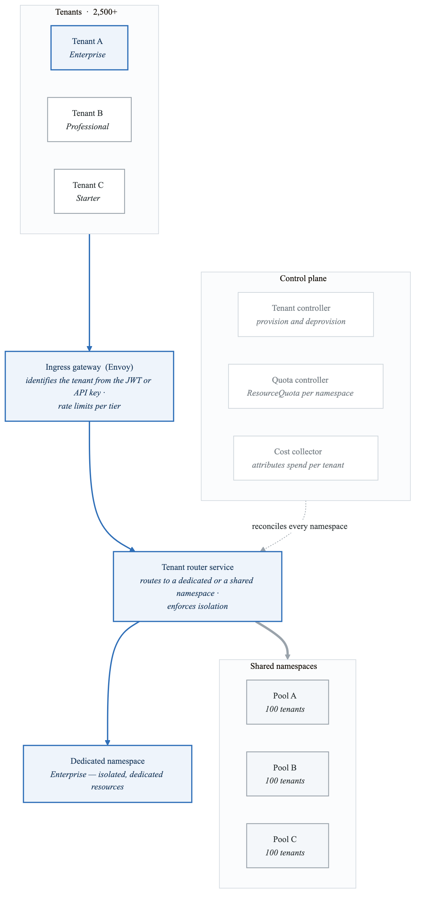
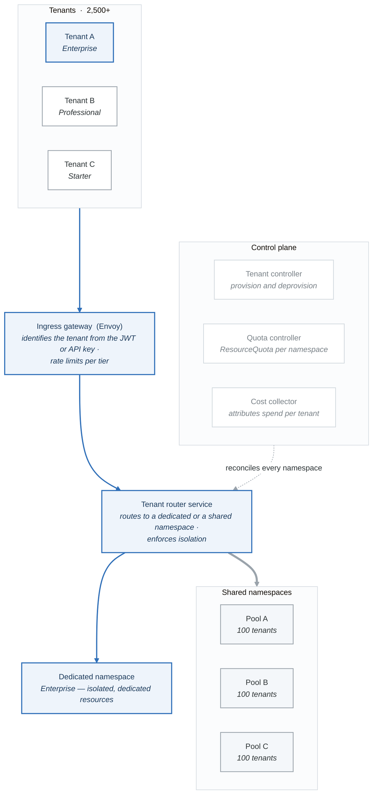

# Case Study: CloudPlatform SaaS - Multi-Tenant Enterprise Platform

## Executive Summary

CloudPlatform Inc. provides a B2B SaaS analytics platform serving 2,500+ enterprise tenants ranging from startups to Fortune 100 companies. This case study demonstrates advanced multi-tenant Kubernetes patterns including tenant isolation, automated onboarding, cost attribution, and per-tenant resource management.

## Company Profile

| Attribute | Details |
|-----------|---------|
| **Company** | CloudPlatform Inc. |
| **Industry** | B2B SaaS / Analytics |
| **Platform Users** | 2,500+ tenants, 500K+ end users |
| **Data Processed** | 50TB daily ingestion |
| **Tenant Tiers** | Free, Starter, Professional, Enterprise |
| **SLA Targets** | 99.9% (Standard), 99.99% (Enterprise) |

## Business Challenges

1. **Tenant Isolation**: Prevent noisy neighbor problems and ensure data separation
2. **Cost Attribution**: Accurate per-tenant cost tracking for pricing and profitability analysis
3. **Automated Onboarding**: Self-service tenant provisioning in under 5 minutes
4. **Tiered Resources**: Different resource allocations based on subscription tier
5. **Compliance**: SOC2, GDPR, and per-tenant data residency requirements

## Architecture Overview

<!-- figure: generated from the Mermaid below by _shared/diagrams/embed-figures.py — do not edit the image -->


<details>
<summary>Diagram source (Mermaid)</summary>



</details>

## Implementation Details

### 1. Tenant Custom Resource Definition

```yaml
# Tenant CRD for declarative tenant management
apiVersion: apiextensions.k8s.io/v1
kind: CustomResourceDefinition
metadata:
  name: tenants.platform.cloudplatform.io
spec:
  group: platform.cloudplatform.io
  versions:
    - name: v1
      served: true
      storage: true
      schema:
        openAPIV3Schema:
          type: object
          required:
            - spec
          properties:
            spec:
              type: object
              required:
                - displayName
                - tier
                - owner
              properties:
                displayName:
                  type: string
                tier:
                  type: string
                  enum: [free, starter, professional, enterprise]
                owner:
                  type: object
                  properties:
                    email:
                      type: string
                    organizationId:
                      type: string
                isolation:
                  type: string
                  enum: [shared, dedicated]
                  default: shared
                dataResidency:
                  type: string
                  enum: [us, eu, ap]
                  default: us
                customDomain:
                  type: string
                features:
                  type: array
                  items:
                    type: string
            status:
              type: object
              properties:
                phase:
                  type: string
                namespace:
                  type: string
                endpoints:
                  type: object
                  properties:
                    api:
                      type: string
                    dashboard:
                      type: string
                costs:
                  type: object
                  properties:
                    mtdCompute:
                      type: string
                    mtdStorage:
                      type: string
                    mtdNetwork:
                      type: string
      subresources:
        status: {}
      additionalPrinterColumns:
        - name: Tier
          type: string
          jsonPath: .spec.tier
        - name: Phase
          type: string
          jsonPath: .status.phase
        - name: Namespace
          type: string
          jsonPath: .status.namespace
        - name: Age
          type: date
          jsonPath: .metadata.creationTimestamp
  scope: Cluster
  names:
    plural: tenants
    singular: tenant
    kind: Tenant
    shortNames:
      - tn
```

### 2. Tier-Based Resource Quotas

```yaml
# Free tier quota
apiVersion: v1
kind: ResourceQuota
metadata:
  name: free-tier-quota
  namespace: "{{ .TenantNamespace }}"
  labels:
    tier: free
    tenant: "{{ .TenantID }}"
spec:
  hard:
    requests.cpu: "500m"
    requests.memory: "512Mi"
    limits.cpu: "1"
    limits.memory: "1Gi"
    persistentvolumeclaims: "1"
    requests.storage: "5Gi"
    pods: "5"
    services: "3"
    secrets: "10"
    configmaps: "10"
---
# Starter tier quota
apiVersion: v1
kind: ResourceQuota
metadata:
  name: starter-tier-quota
  namespace: "{{ .TenantNamespace }}"
  labels:
    tier: starter
    tenant: "{{ .TenantID }}"
spec:
  hard:
    requests.cpu: "2"
    requests.memory: "4Gi"
    limits.cpu: "4"
    limits.memory: "8Gi"
    persistentvolumeclaims: "5"
    requests.storage: "50Gi"
    pods: "20"
    services: "10"
    secrets: "30"
    configmaps: "30"
---
# Professional tier quota
apiVersion: v1
kind: ResourceQuota
metadata:
  name: professional-tier-quota
  namespace: "{{ .TenantNamespace }}"
  labels:
    tier: professional
    tenant: "{{ .TenantID }}"
spec:
  hard:
    requests.cpu: "8"
    requests.memory: "16Gi"
    limits.cpu: "16"
    limits.memory: "32Gi"
    persistentvolumeclaims: "20"
    requests.storage: "500Gi"
    pods: "100"
    services: "50"
    secrets: "100"
    configmaps: "100"
---
# Enterprise tier quota (generous limits)
apiVersion: v1
kind: ResourceQuota
metadata:
  name: enterprise-tier-quota
  namespace: "{{ .TenantNamespace }}"
  labels:
    tier: enterprise
    tenant: "{{ .TenantID }}"
spec:
  hard:
    requests.cpu: "32"
    requests.memory: "64Gi"
    limits.cpu: "64"
    limits.memory: "128Gi"
    persistentvolumeclaims: "100"
    requests.storage: "5Ti"
    pods: "500"
    services: "200"
    secrets: "500"
    configmaps: "500"
```

### 3. Tenant Controller Implementation

```go
// Tenant Controller - Reconciles Tenant CRs
package controllers

import (
    "context"
    "fmt"
    "time"

    platformv1 "cloudplatform.io/api/v1"
    corev1 "k8s.io/api/core/v1"
    networkingv1 "k8s.io/api/networking/v1"
    rbacv1 "k8s.io/api/rbac/v1"
    "k8s.io/apimachinery/pkg/api/errors"
    metav1 "k8s.io/apimachinery/pkg/apis/meta/v1"
    "k8s.io/apimachinery/pkg/runtime"
    ctrl "sigs.k8s.io/controller-runtime"
    "sigs.k8s.io/controller-runtime/pkg/client"
    "sigs.k8s.io/controller-runtime/pkg/log"
)

type TenantReconciler struct {
    client.Client
    Scheme *runtime.Scheme
}

func (r *TenantReconciler) Reconcile(ctx context.Context, req ctrl.Request) (ctrl.Result, error) {
    logger := log.FromContext(ctx)

    // Fetch the Tenant instance
    tenant := &platformv1.Tenant{}
    if err := r.Get(ctx, req.NamespacedName, tenant); err != nil {
        if errors.IsNotFound(err) {
            return ctrl.Result{}, nil
        }
        return ctrl.Result{}, err
    }

    // Handle deletion
    if !tenant.DeletionTimestamp.IsZero() {
        return r.reconcileDelete(ctx, tenant)
    }

    // Add finalizer if not present
    if !containsString(tenant.Finalizers, tenantFinalizer) {
        tenant.Finalizers = append(tenant.Finalizers, tenantFinalizer)
        if err := r.Update(ctx, tenant); err != nil {
            return ctrl.Result{}, err
        }
    }

    // Determine namespace based on isolation level
    namespace := r.determineNamespace(tenant)

    // Reconcile namespace
    if err := r.reconcileNamespace(ctx, tenant, namespace); err != nil {
        logger.Error(err, "Failed to reconcile namespace")
        return ctrl.Result{RequeueAfter: time.Minute}, err
    }

    // Reconcile resource quota
    if err := r.reconcileResourceQuota(ctx, tenant, namespace); err != nil {
        logger.Error(err, "Failed to reconcile resource quota")
        return ctrl.Result{RequeueAfter: time.Minute}, err
    }

    // Reconcile limit range
    if err := r.reconcileLimitRange(ctx, tenant, namespace); err != nil {
        logger.Error(err, "Failed to reconcile limit range")
        return ctrl.Result{RequeueAfter: time.Minute}, err
    }

    // Reconcile network policies
    if err := r.reconcileNetworkPolicies(ctx, tenant, namespace); err != nil {
        logger.Error(err, "Failed to reconcile network policies")
        return ctrl.Result{RequeueAfter: time.Minute}, err
    }

    // Reconcile RBAC
    if err := r.reconcileRBAC(ctx, tenant, namespace); err != nil {
        logger.Error(err, "Failed to reconcile RBAC")
        return ctrl.Result{RequeueAfter: time.Minute}, err
    }

    // Deploy tenant workloads
    if err := r.deployTenantWorkloads(ctx, tenant, namespace); err != nil {
        logger.Error(err, "Failed to deploy tenant workloads")
        return ctrl.Result{RequeueAfter: time.Minute}, err
    }

    // Update status
    tenant.Status.Phase = "Ready"
    tenant.Status.Namespace = namespace
    tenant.Status.Endpoints = platformv1.TenantEndpoints{
        API:       fmt.Sprintf("https://%s.api.cloudplatform.io", tenant.Name),
        Dashboard: fmt.Sprintf("https://%s.app.cloudplatform.io", tenant.Name),
    }

    if err := r.Status().Update(ctx, tenant); err != nil {
        return ctrl.Result{}, err
    }

    logger.Info("Tenant reconciled successfully", "tenant", tenant.Name)
    return ctrl.Result{RequeueAfter: 5 * time.Minute}, nil
}

func (r *TenantReconciler) determineNamespace(tenant *platformv1.Tenant) string {
    if tenant.Spec.Isolation == "dedicated" || tenant.Spec.Tier == "enterprise" {
        return fmt.Sprintf("tenant-%s", tenant.Name)
    }
    // Use shared namespace pools for non-enterprise tenants
    pool := hashTenantToPool(tenant.Name, 25) // 25 pools
    return fmt.Sprintf("tenant-pool-%d", pool)
}

func (r *TenantReconciler) reconcileNetworkPolicies(ctx context.Context, tenant *platformv1.Tenant, namespace string) error {
    // Default deny all ingress
    denyAll := &networkingv1.NetworkPolicy{
        ObjectMeta: metav1.ObjectMeta{
            Name:      "default-deny-ingress",
            Namespace: namespace,
        },
        Spec: networkingv1.NetworkPolicySpec{
            PodSelector: metav1.LabelSelector{},
            PolicyTypes: []networkingv1.PolicyType{
                networkingv1.PolicyTypeIngress,
            },
        },
    }

    // Allow ingress from same tenant only
    allowSameTenant := &networkingv1.NetworkPolicy{
        ObjectMeta: metav1.ObjectMeta{
            Name:      "allow-same-tenant",
            Namespace: namespace,
        },
        Spec: networkingv1.NetworkPolicySpec{
            PodSelector: metav1.LabelSelector{
                MatchLabels: map[string]string{
                    "tenant": tenant.Name,
                },
            },
            PolicyTypes: []networkingv1.PolicyType{
                networkingv1.PolicyTypeIngress,
            },
            Ingress: []networkingv1.NetworkPolicyIngressRule{
                {
                    From: []networkingv1.NetworkPolicyPeer{
                        {
                            PodSelector: &metav1.LabelSelector{
                                MatchLabels: map[string]string{
                                    "tenant": tenant.Name,
                                },
                            },
                        },
                    },
                },
            },
        },
    }

    // Allow ingress from ingress controller
    allowIngress := &networkingv1.NetworkPolicy{
        ObjectMeta: metav1.ObjectMeta{
            Name:      "allow-ingress-controller",
            Namespace: namespace,
        },
        Spec: networkingv1.NetworkPolicySpec{
            PodSelector: metav1.LabelSelector{},
            PolicyTypes: []networkingv1.PolicyType{
                networkingv1.PolicyTypeIngress,
            },
            Ingress: []networkingv1.NetworkPolicyIngressRule{
                {
                    From: []networkingv1.NetworkPolicyPeer{
                        {
                            NamespaceSelector: &metav1.LabelSelector{
                                MatchLabels: map[string]string{
                                    "name": "ingress-system",
                                },
                            },
                        },
                    },
                },
            },
        },
    }

    policies := []*networkingv1.NetworkPolicy{denyAll, allowSameTenant, allowIngress}
    for _, policy := range policies {
        if err := r.createOrUpdate(ctx, policy); err != nil {
            return err
        }
    }

    return nil
}
```

### 4. Automated Tenant Onboarding Pipeline

```yaml
# Tenant Onboarding Workflow (Argo Workflows)
apiVersion: argoproj.io/v1alpha1
kind: WorkflowTemplate
metadata:
  name: tenant-onboarding
  namespace: platform-system
spec:
  entrypoint: onboard-tenant
  arguments:
    parameters:
      - name: tenant-id
      - name: tenant-name
      - name: tier
      - name: owner-email
      - name: data-residency
        value: "us"
  templates:
    - name: onboard-tenant
      dag:
        tasks:
          - name: validate-tenant
            template: validate
            arguments:
              parameters:
                - name: tenant-id
                  value: "{{workflow.parameters.tenant-id}}"
                - name: owner-email
                  value: "{{workflow.parameters.owner-email}}"

          - name: create-tenant-cr
            template: create-cr
            dependencies: [validate-tenant]
            arguments:
              parameters:
                - name: tenant-id
                  value: "{{workflow.parameters.tenant-id}}"
                - name: tier
                  value: "{{workflow.parameters.tier}}"

          - name: provision-database
            template: provision-db
            dependencies: [create-tenant-cr]
            arguments:
              parameters:
                - name: tenant-id
                  value: "{{workflow.parameters.tenant-id}}"
                - name: tier
                  value: "{{workflow.parameters.tier}}"
                - name: data-residency
                  value: "{{workflow.parameters.data-residency}}"

          - name: setup-monitoring
            template: setup-monitoring
            dependencies: [create-tenant-cr]
            arguments:
              parameters:
                - name: tenant-id
                  value: "{{workflow.parameters.tenant-id}}"

          - name: configure-ingress
            template: configure-ingress
            dependencies: [create-tenant-cr]
            arguments:
              parameters:
                - name: tenant-id
                  value: "{{workflow.parameters.tenant-id}}"
                - name: tenant-name
                  value: "{{workflow.parameters.tenant-name}}"

          - name: send-welcome-email
            template: send-email
            dependencies: [provision-database, configure-ingress]
            arguments:
              parameters:
                - name: owner-email
                  value: "{{workflow.parameters.owner-email}}"
                - name: tenant-name
                  value: "{{workflow.parameters.tenant-name}}"

    - name: validate
      inputs:
        parameters:
          - name: tenant-id
          - name: owner-email
      container:
        image: cloudplatform/onboarding:v1.5.0
        command: ["/bin/validate"]
        args:
          - --tenant-id={{inputs.parameters.tenant-id}}
          - --email={{inputs.parameters.owner-email}}

    - name: create-cr
      inputs:
        parameters:
          - name: tenant-id
          - name: tier
      resource:
        action: create
        manifest: |
          apiVersion: platform.cloudplatform.io/v1
          kind: Tenant
          metadata:
            name: {{inputs.parameters.tenant-id}}
          spec:
            displayName: {{inputs.parameters.tenant-id}}
            tier: {{inputs.parameters.tier}}
            owner:
              email: {{workflow.parameters.owner-email}}
            dataResidency: {{workflow.parameters.data-residency}}

    - name: provision-db
      inputs:
        parameters:
          - name: tenant-id
          - name: tier
          - name: data-residency
      container:
        image: cloudplatform/db-provisioner:v2.1.0
        command: ["/bin/provision"]
        args:
          - --tenant-id={{inputs.parameters.tenant-id}}
          - --tier={{inputs.parameters.tier}}
          - --region={{inputs.parameters.data-residency}}
        env:
          - name: DB_ADMIN_PASSWORD
            valueFrom:
              secretKeyRef:
                name: db-admin-credentials
                key: password

    - name: setup-monitoring
      inputs:
        parameters:
          - name: tenant-id
      container:
        image: cloudplatform/monitoring-setup:v1.3.0
        command: ["/bin/setup"]
        args:
          - --tenant-id={{inputs.parameters.tenant-id}}
          - --prometheus-url=http://prometheus.monitoring:9090
          - --grafana-url=http://grafana.monitoring:3000

    - name: configure-ingress
      inputs:
        parameters:
          - name: tenant-id
          - name: tenant-name
      resource:
        action: create
        manifest: |
          apiVersion: networking.k8s.io/v1
          kind: Ingress
          metadata:
            name: tenant-{{inputs.parameters.tenant-id}}
            namespace: tenant-{{inputs.parameters.tenant-id}}
            annotations:
              cert-manager.io/cluster-issuer: letsencrypt-prod
          spec:
            ingressClassName: nginx
            tls:
              - hosts:
                  - {{inputs.parameters.tenant-id}}.app.cloudplatform.io
                secretName: tenant-{{inputs.parameters.tenant-id}}-tls
            rules:
              - host: {{inputs.parameters.tenant-id}}.app.cloudplatform.io
                http:
                  paths:
                    - path: /
                      pathType: Prefix
                      backend:
                        service:
                          name: tenant-app
                          port:
                            number: 8080

    - name: send-email
      inputs:
        parameters:
          - name: owner-email
          - name: tenant-name
      container:
        image: cloudplatform/email-sender:v1.0.0
        command: ["/bin/send"]
        args:
          - --to={{inputs.parameters.owner-email}}
          - --template=welcome
          - --tenant-name={{inputs.parameters.tenant-name}}
```

### 5. Cost Attribution with OpenCost

```yaml
# OpenCost deployment for per-tenant cost tracking
apiVersion: apps/v1
kind: Deployment
metadata:
  name: opencost
  namespace: cost-management
spec:
  replicas: 1
  selector:
    matchLabels:
      app: opencost
  template:
    metadata:
      labels:
        app: opencost
    spec:
      containers:
        - name: opencost
          image: quay.io/kubecost/opencost:1.108.0
          ports:
            - containerPort: 9003
          env:
            - name: PROMETHEUS_SERVER_ENDPOINT
              value: "http://prometheus.monitoring:9090"
            - name: CLOUD_PROVIDER_API_KEY
              valueFrom:
                secretKeyRef:
                  name: cloud-provider-credentials
                  key: api-key
            - name: CLUSTER_ID
              value: "cloudplatform-prod"
          resources:
            requests:
              cpu: 100m
              memory: 256Mi
            limits:
              cpu: 500m
              memory: 1Gi
---
# Cost aggregation per tenant
apiVersion: batch/v1
kind: CronJob
metadata:
  name: tenant-cost-aggregator
  namespace: cost-management
spec:
  schedule: "0 * * * *"  # Every hour
  jobTemplate:
    spec:
      template:
        spec:
          containers:
            - name: aggregator
              image: cloudplatform/cost-aggregator:v1.2.0
              command:
                - /bin/aggregate
                - --opencost-url=http://opencost:9003
                - --output=prometheus
              env:
                - name: TENANT_LABEL
                  value: "tenant"
                - name: COST_STORAGE
                  value: "postgresql://costs-db.cost-management:5432/costs"
          restartPolicy: OnFailure
---
# PrometheusRule for cost alerts
apiVersion: monitoring.coreos.com/v1
kind: PrometheusRule
metadata:
  name: tenant-cost-alerts
  namespace: cost-management
spec:
  groups:
    - name: tenant-costs
      interval: 1h
      rules:
        - alert: TenantOverBudget
          expr: |
            sum by (tenant) (
              tenant_mtd_cost_dollars
            ) > on(tenant) group_left()
            tenant_monthly_budget_dollars * 0.9
          for: 1h
          labels:
            severity: warning
          annotations:
            summary: "Tenant {{ $labels.tenant }} approaching budget limit"
            description: "Tenant has used 90% of monthly budget"

        - alert: TenantCostAnomaly
          expr: |
            (
              sum by (tenant) (rate(tenant_hourly_cost_dollars[1h]))
              /
              sum by (tenant) (avg_over_time(tenant_hourly_cost_dollars[7d]))
            ) > 3
          for: 2h
          labels:
            severity: warning
          annotations:
            summary: "Unusual cost spike for tenant {{ $labels.tenant }}"
            description: "Cost rate is 3x higher than 7-day average"

        - record: tenant_cost_efficiency_score
          expr: |
            (
              sum by (tenant) (tenant_resource_utilization_percent)
              /
              sum by (tenant) (tenant_resource_requested_percent)
            ) * 100
```

### 6. Tenant Cost Dashboard ConfigMap

```yaml
apiVersion: v1
kind: ConfigMap
metadata:
  name: tenant-cost-dashboard
  namespace: monitoring
  labels:
    grafana_dashboard: "1"
data:
  tenant-costs.json: |
    {
      "dashboard": {
        "title": "Tenant Cost Analysis",
        "uid": "tenant-costs",
        "panels": [
          {
            "title": "Monthly Cost by Tenant",
            "type": "barchart",
            "gridPos": {"x": 0, "y": 0, "w": 12, "h": 8},
            "targets": [
              {
                "expr": "topk(20, sum by (tenant) (tenant_mtd_cost_dollars))",
                "legendFormat": "{{tenant}}"
              }
            ]
          },
          {
            "title": "Cost by Resource Type",
            "type": "piechart",
            "gridPos": {"x": 12, "y": 0, "w": 12, "h": 8},
            "targets": [
              {
                "expr": "sum by (resource_type) (tenant_mtd_cost_dollars{tenant=~\"$tenant\"})",
                "legendFormat": "{{resource_type}}"
              }
            ]
          },
          {
            "title": "Daily Cost Trend",
            "type": "timeseries",
            "gridPos": {"x": 0, "y": 8, "w": 24, "h": 8},
            "targets": [
              {
                "expr": "sum by (tenant) (increase(tenant_total_cost_dollars[1d]))",
                "legendFormat": "{{tenant}}"
              }
            ]
          },
          {
            "title": "Cost Efficiency Score",
            "type": "gauge",
            "gridPos": {"x": 0, "y": 16, "w": 8, "h": 6},
            "targets": [
              {
                "expr": "avg(tenant_cost_efficiency_score{tenant=~\"$tenant\"})"
              }
            ],
            "options": {
              "thresholds": {
                "steps": [
                  {"value": 0, "color": "red"},
                  {"value": 50, "color": "yellow"},
                  {"value": 75, "color": "green"}
                ]
              }
            }
          },
          {
            "title": "Resource Utilization vs Requested",
            "type": "timeseries",
            "gridPos": {"x": 8, "y": 16, "w": 16, "h": 6},
            "targets": [
              {
                "expr": "sum by (resource) (tenant_resource_utilization_percent{tenant=~\"$tenant\"})",
                "legendFormat": "Used - {{resource}}"
              },
              {
                "expr": "sum by (resource) (tenant_resource_requested_percent{tenant=~\"$tenant\"})",
                "legendFormat": "Requested - {{resource}}"
              }
            ]
          }
        ],
        "templating": {
          "list": [
            {
              "name": "tenant",
              "type": "query",
              "query": "label_values(tenant_mtd_cost_dollars, tenant)",
              "multi": true
            }
          ]
        }
      }
    }
```

### 7. Hierarchical Namespace Controller for Tenant Subprojects

```yaml
# Using HNC (Hierarchical Namespace Controller) for tenant sub-namespaces
apiVersion: hnc.x-k8s.io/v1alpha2
kind: HierarchyConfiguration
metadata:
  name: hierarchy
  namespace: tenant-acme-corp
spec:
  parent: tenant-enterprise-pool
  labels:
    - key: tenant
      value: acme-corp
    - key: tier
      value: enterprise
---
# Subnamespace for tenant project
apiVersion: hnc.x-k8s.io/v1alpha2
kind: SubnamespaceAnchor
metadata:
  name: analytics-project
  namespace: tenant-acme-corp
---
apiVersion: hnc.x-k8s.io/v1alpha2
kind: SubnamespaceAnchor
metadata:
  name: ml-pipeline-project
  namespace: tenant-acme-corp
---
# HNC propagation policy for tenant resources
apiVersion: hnc.x-k8s.io/v1alpha2
kind: HNCConfiguration
metadata:
  name: config
spec:
  resources:
    - resource: secrets
      mode: Propagate
    - resource: configmaps
      mode: Propagate
    - resource: networkpolicies
      mode: Propagate
    - resource: resourcequotas
      mode: Remove  # Don't propagate quotas to subnamespaces
    - resource: limitranges
      mode: Propagate
```

### 8. Tenant Rate Limiting with Envoy

```yaml
# Rate limiting per tenant tier
apiVersion: networking.istio.io/v1alpha3
kind: EnvoyFilter
metadata:
  name: tenant-rate-limit
  namespace: istio-system
spec:
  workloadSelector:
    labels:
      app: istio-ingressgateway
  configPatches:
    - applyTo: HTTP_FILTER
      match:
        context: GATEWAY
        listener:
          filterChain:
            filter:
              name: envoy.filters.network.http_connection_manager
      patch:
        operation: INSERT_BEFORE
        value:
          name: envoy.filters.http.ratelimit
          typed_config:
            "@type": type.googleapis.com/envoy.extensions.filters.http.ratelimit.v3.RateLimit
            domain: tenant-ratelimit
            rate_limit_service:
              grpc_service:
                envoy_grpc:
                  cluster_name: rate_limit_cluster
              transport_api_version: V3
---
# Rate limit configuration
apiVersion: v1
kind: ConfigMap
metadata:
  name: ratelimit-config
  namespace: rate-limit
data:
  config.yaml: |
    domain: tenant-ratelimit
    descriptors:
      # Free tier: 100 requests/minute
      - key: tier
        value: free
        rate_limit:
          unit: minute
          requests_per_unit: 100

      # Starter tier: 1000 requests/minute
      - key: tier
        value: starter
        rate_limit:
          unit: minute
          requests_per_unit: 1000

      # Professional tier: 5000 requests/minute
      - key: tier
        value: professional
        rate_limit:
          unit: minute
          requests_per_unit: 5000

      # Enterprise tier: 50000 requests/minute
      - key: tier
        value: enterprise
        rate_limit:
          unit: minute
          requests_per_unit: 50000

      # Per-tenant burst protection
      - key: tenant_id
        rate_limit:
          unit: second
          requests_per_unit: 1000
```

### 9. Tenant Data Isolation with OPA

```yaml
# OPA policies for tenant data isolation
apiVersion: v1
kind: ConfigMap
metadata:
  name: tenant-isolation-policies
  namespace: opa-system
data:
  tenant-isolation.rego: |
    package kubernetes.admission

    # Deny pods without tenant label
    deny[msg] {
      input.request.kind.kind == "Pod"
      not input.request.object.metadata.labels.tenant
      msg := "All pods must have a tenant label"
    }

    # Deny cross-tenant volume access
    deny[msg] {
      input.request.kind.kind == "Pod"
      pod := input.request.object
      volume := pod.spec.volumes[_]
      volume.persistentVolumeClaim

      pvc_tenant := data.kubernetes.persistentvolumeclaims[pod.metadata.namespace][volume.persistentVolumeClaim.claimName].metadata.labels.tenant
      pod_tenant := pod.metadata.labels.tenant

      pvc_tenant != pod_tenant
      msg := sprintf("Pod tenant '%s' cannot access PVC owned by tenant '%s'", [pod_tenant, pvc_tenant])
    }

    # Deny cross-tenant secret access
    deny[msg] {
      input.request.kind.kind == "Pod"
      pod := input.request.object
      container := pod.spec.containers[_]
      env := container.env[_]
      env.valueFrom.secretKeyRef

      secret_name := env.valueFrom.secretKeyRef.name
      secret_tenant := data.kubernetes.secrets[pod.metadata.namespace][secret_name].metadata.labels.tenant
      pod_tenant := pod.metadata.labels.tenant

      secret_tenant != pod_tenant
      msg := sprintf("Pod tenant '%s' cannot access secret owned by tenant '%s'", [pod_tenant, secret_tenant])
    }

    # Enforce tenant network policy
    deny[msg] {
      input.request.kind.kind == "NetworkPolicy"
      np := input.request.object

      # Check if policy allows traffic from other tenants
      ingress := np.spec.ingress[_]
      from := ingress.from[_]
      from.podSelector.matchLabels.tenant != np.metadata.labels.tenant

      msg := "NetworkPolicy cannot allow ingress from other tenants"
    }

    # Resource quota enforcement per tier
    deny[msg] {
      input.request.kind.kind == "Pod"
      pod := input.request.object
      tenant := pod.metadata.labels.tenant

      tier := data.tenants[tenant].tier
      tier == "free"

      container := pod.spec.containers[_]
      memory_limit := container.resources.limits.memory
      parse_memory(memory_limit) > 1073741824  # 1Gi

      msg := "Free tier pods cannot request more than 1Gi memory"
    }

    parse_memory(mem) = bytes {
      endswith(mem, "Gi")
      bytes := to_number(trim_suffix(mem, "Gi")) * 1073741824
    }

    parse_memory(mem) = bytes {
      endswith(mem, "Mi")
      bytes := to_number(trim_suffix(mem, "Mi")) * 1048576
    }
```

## Results and Metrics

### Operational Improvements

| Metric | Before | After | Improvement |
|--------|--------|-------|-------------|
| Tenant onboarding time | 2-3 days | < 5 minutes | 99.7% |
| Cross-tenant incidents | 5-10/month | 0 | 100% |
| Cost attribution accuracy | 60% | 98% | 63% |
| Noisy neighbor complaints | 20/month | 2/month | 90% |
| Resource utilization | 25% | 68% | 172% |

### Cost Attribution Breakdown

**Monthly Cost Distribution by Tier**

```
Enterprise (50 tenants)    ████████████████████  $150,000
Professional (200 tenants) ██████████████        $80,000
Starter (800 tenants)      ████████              $45,000
Free (1450 tenants)        ██                    $12,000
Total Infrastructure Cost: $287,000/month
Average Cost per Tenant:   $114.80
Enterprise LTV: $180,000   Free Conversion: 12%
```


### Tenant SLA Achievement

| Tier | SLA Target | Achieved | Incidents/Year |
|------|------------|----------|----------------|
| Enterprise | 99.99% | 99.995% | 2 |
| Professional | 99.9% | 99.95% | 8 |
| Starter | 99.5% | 99.7% | 15 |
| Free | 99% | 99.2% | 45 |

## Lessons Learned

### 1. Namespace-per-Tenant vs Shared Pools

**Decision**: Hybrid approach - dedicated namespaces for Enterprise, shared pools for others

**Rationale**:
- 2,500 namespaces would strain the Kubernetes API server
- Shared pools with proper NetworkPolicies provide adequate isolation for lower tiers
- Enterprise customers require dedicated resources for compliance

### 2. Database Multitenancy Strategy

**Approach**: Database-per-tenant for Enterprise, schema-per-tenant for others

| Tier | Database isolation | Identifier |
|---|---|---|
| **Enterprise** | Dedicated instance | `tenant-acme-db` |
| **Professional** | Shared cluster, schema per tenant | `tenant_prof_001` |
| **Starter** | Shared cluster, schema per tenant | `tenant_start_001` |
| **Free** | Shared cluster, schema per tenant | `tenant_free_001` |

Three of the four tiers share a cluster, so a noisy-neighbour problem on the free tier is a
production incident for paying customers. Connection limits and per-schema resource governance are
not optimisations here — they are what stops the cheapest tier from being a denial-of-service vector
against the rest.

### 3. Ingress and SSL Certificate Management

**Challenge**: Managing thousands of SSL certificates for tenant custom domains

**Solution**:
- cert-manager with Let's Encrypt for auto-provisioning
- Wildcard certificates for platform subdomains
- Dedicated certificate management for enterprise custom domains

### 4. Observability at Scale

**Implementation**:
- Tenant-scoped Prometheus instances for data isolation
- Thanos for long-term storage and cross-tenant aggregation (admin only)
- Per-tenant Grafana folders with row-level security

## Key Takeaways

1. **CRDs for Tenant Management**: Custom Resource Definitions provide a declarative, auditable approach to tenant lifecycle management

2. **Automated Everything**: Self-service onboarding reduced support tickets by 85% and enabled 24/7 signup

3. **Cost Transparency**: Accurate per-tenant costing enabled profitable pricing and identified optimization opportunities

4. **Defense in Depth**: Multiple isolation layers (namespace, network, RBAC, OPA) prevent data leakage

5. **Tier-Based Architecture**: Different resource allocations and isolation levels match customer value and expectations

## Technology Stack

| Component | Technology | Purpose |
|-----------|------------|---------|
| Container Runtime | containerd | Pod execution |
| Networking | Cilium | CNI with eBPF |
| Ingress | Envoy/Istio | Traffic routing, rate limiting |
| Secrets | HashiCorp Vault | Tenant secret management |
| Policy | OPA Gatekeeper | Admission control |
| Cost | OpenCost | Resource cost attribution |
| Certificates | cert-manager | SSL automation |
| Workflows | Argo Workflows | Tenant provisioning |
| Monitoring | Prometheus + Thanos | Metrics and alerting |
| Logging | Loki | Tenant-scoped log aggregation |

---

*This case study demonstrates multi-tenant Kubernetes patterns. Implementations should be adapted based on specific compliance requirements and scale.*

<!-- feynman-check -->

---

## Feynman check

Close the file. Blank page, no notes. Explain each of these to a competent engineer who has never
used this tool — **under five minutes, no jargon you can't define on the spot:**

- Business Challenges
- Implementation Details
- Tenant Custom Resource Definition
- Tier-Based Resource Quotas

**The gap is not what you forgot. It is where you used a word instead of a mechanism.**

| | |
|---|---|
| ✗ | *"The architecture was badly designed."* |
| ✓ | *"The failure needed two independent weaknesses to compose. Name both, say why each one alone was survivable, and name the single control that would have broken the chain — that is the finding, not the vulnerability."* |

**Trace it:** The incident in this file, from entry to objective. At every step name the control that should have stopped it, and why it did not.

Stop at the first component you cannot name. Reopen this file and read **only** that.

**Go deeper — only once the gap has a name:** three postmortems from [danluu/post-mortems](https://github.com/danluu/post-mortems) — for each, name the one control that would have broken the chain.
Full list per domain: [`SOURCES.md`](../../SOURCES.md#case-studies)

→ Protocol, the three levels of knowing, and worked examples: [`MASTERY.md`](../../MASTERY.md)

<!-- /feynman-check -->
