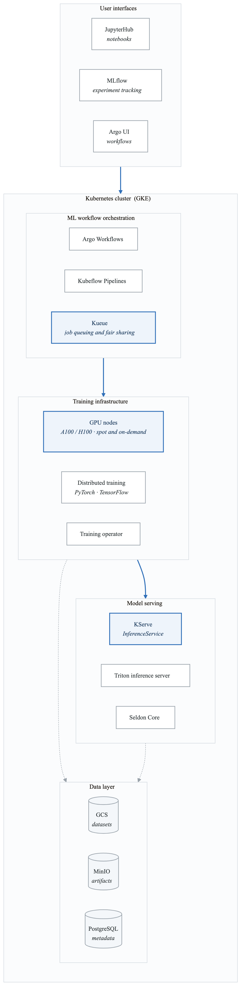
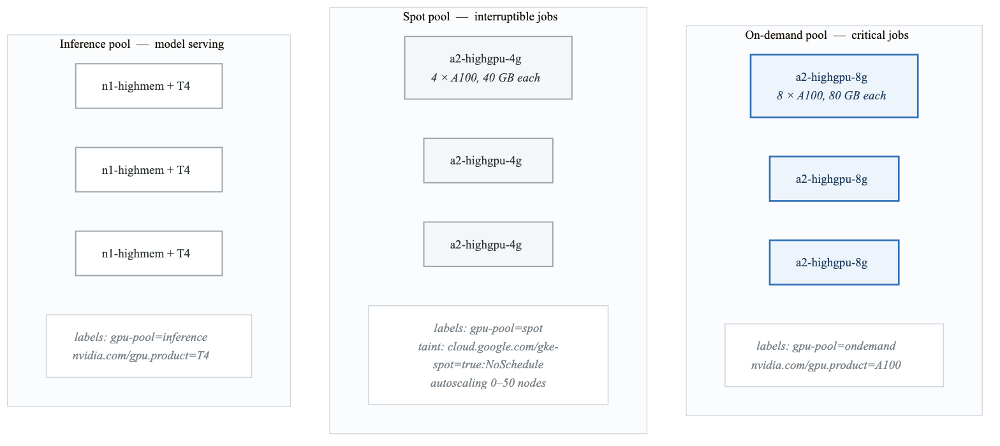
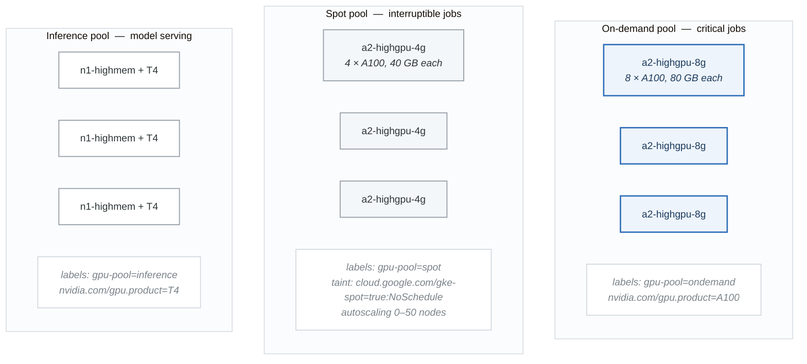

# Case Study: AI/ML Training Platform

## Executive Summary

**Company**: NeuralScale AI
**Industry**: Artificial Intelligence / Machine Learning
**Challenge**: Build a scalable, cost-efficient platform for training and serving ML models
**Outcome**: 60% cost reduction, 10x faster model iteration, multi-team self-service

---

## Business Context

### The Challenge

NeuralScale's data science teams were struggling with:

- **GPU scarcity**: Teams competing for limited GPU resources
- **Environment inconsistency**: "Works on my machine" problems
- **Long iteration cycles**: Days to provision training infrastructure
- **Cost overruns**: GPUs running 24/7 even when idle
- **No model lineage**: Difficulty tracking experiments and models

### Requirements

| Requirement | Target |
|-------------|--------|
| GPU Utilization | > 80% |
| Job Queue Time | < 5 minutes |
| Model Training Time | Reduce by 50% |
| Cost per Training Hour | Reduce by 40% |
| Self-Service | Teams deploy without platform team |

---

## Architecture

### Platform Overview

```mermaid
%%{init: {'theme':'base','themeVariables':{'fontFamily':'Helvetica, Arial, sans-serif','fontSize':'13px','primaryColor':'#ffffff','primaryTextColor':'#2d3436','primaryBorderColor':'#9aa3ab','lineColor':'#9aa3ab','textColor':'#2d3436','clusterBkg':'#fbfcfd','clusterBorder':'#d4dae0','edgeLabelBackground':'#ffffff','tertiaryColor':'#eef4fb'},'flowchart':{'curve':'basis','padding':14,'nodeSpacing':42,'rankSpacing':58}}}%%
flowchart TB
  classDef default fill:#ffffff,stroke:#9aa3ab,stroke-width:1.3px,color:#2d3436
  classDef n    fill:#ffffff,stroke:#9aa3ab,stroke-width:1.3px,color:#2d3436
  classDef crit fill:#eef4fb,stroke:#2f6fb8,stroke-width:1.8px,color:#1b3a5c
  classDef data fill:#f4f7fa,stroke:#9aa3ab,stroke-width:1.3px,color:#2d3436
  classDef mut  fill:#ffffff,stroke:#cfd6dc,stroke-width:1.1px,color:#7a8288
  classDef warn fill:#fdf0ec,stroke:#c0522d,stroke-width:1.6px,color:#8a3a1e
  subgraph UI["User interfaces"]
    direction LR
    JH["JupyterHub<br/><i>notebooks</i>"]
    MLF["MLflow<br/><i>experiment tracking</i>"]
    ARGUI["Argo UI<br/><i>workflows</i>"]
  end
  subgraph GKE["Kubernetes cluster &nbsp;(GKE)"]
    direction TB
    subgraph ORCH["ML workflow orchestration"]
      direction LR
      ARGO["Argo Workflows"]
      KFP["Kubeflow Pipelines"]
      KUE["Kueue<br/><i>job queuing and fair sharing</i>"]
    end
    subgraph TRAIN["Training infrastructure"]
      direction LR
      GPUN["GPU nodes<br/><i>A100 / H100 · spot and on-demand</i>"]
      DIST["Distributed training<br/><i>PyTorch · TensorFlow</i>"]
      TOP["Training operator"]
    end
    subgraph SERVE["Model serving"]
      direction LR
      KS["KServe<br/><i>InferenceService</i>"]
      TRT["Triton inference server"]
      SEL["Seldon Core"]
    end
    subgraph DATA["Data layer"]
      direction LR
      GCS[("GCS<br/><i>datasets</i>")]
      MIN[("MinIO<br/><i>artifacts</i>")]
      PG[("PostgreSQL<br/><i>metadata</i>")]
    end
    ORCH ==> TRAIN ==> SERVE
    TRAIN -.-> DATA
    SERVE -.-> DATA
  end
  UI ==> GKE
  class JH,MLF,ARGUI n
  class ARGO,KFP n
  class KUE crit
  class GPUN crit
  class DIST,TOP n
  class KS crit
  class TRT,SEL n
  class GCS,MIN,PG data
  linkStyle 0,1,4 stroke:#2f6fb8,stroke-width:2px

%% Kueue is the box that makes the GPU bill survivable. Without a queue,
%% Kubernetes schedules whatever fits, whenever it fits -- so a researcher's
%% eight-hour experiment can take the node a production retrain was waiting
%% for, and nothing in the cluster records that it happened.
```

<!-- figure: generated from the Mermaid below by _shared/diagrams/embed-figures.py — do not edit the image -->


<details>
<summary>Diagram source (Mermaid)</summary>



</details>

### GPU Node Architecture

<!-- figure: generated from the Mermaid below by _shared/diagrams/embed-figures.py — do not edit the image -->


<details>
<summary>Diagram source (Mermaid)</summary>



</details>

---

## Implementation

### Terraform Configuration for GKE with GPUs

```hcl
# terraform/gke-ml-platform.tf

module "gke" {
  source  = "terraform-google-modules/kubernetes-engine/google"
  version = "~> 29.0"

  project_id = var.project_id
  name       = "neuralscale-ml"
  region     = "us-central1"

  # Use release channel for automatic upgrades
  release_channel = "REGULAR"

  # Network configuration
  network           = module.vpc.network_name
  subnetwork        = module.vpc.subnets_names[0]
  ip_range_pods     = "pods"
  ip_range_services = "services"

  # Workload Identity
  identity_namespace = "${var.project_id}.svc.id.goog"

  # Node pools defined separately
  remove_default_node_pool = true

  node_pools = [
    # System pool (no GPUs)
    {
      name               = "system"
      machine_type       = "e2-standard-4"
      min_count          = 2
      max_count          = 5
      disk_size_gb       = 100
      disk_type          = "pd-standard"
      auto_repair        = true
      auto_upgrade       = true
      preemptible        = false
    },

    # On-demand GPU pool for critical training
    {
      name               = "gpu-ondemand"
      machine_type       = "a2-highgpu-8g"
      min_count          = 0
      max_count          = 10
      disk_size_gb       = 500
      disk_type          = "pd-ssd"
      accelerator_count  = 8
      accelerator_type   = "nvidia-tesla-a100"
      gpu_driver_version = "LATEST"
      auto_repair        = true
      auto_upgrade       = true
      preemptible        = false
    },

    # Spot GPU pool for interruptible workloads
    {
      name               = "gpu-spot"
      machine_type       = "a2-highgpu-4g"
      min_count          = 0
      max_count          = 50
      disk_size_gb       = 500
      disk_type          = "pd-ssd"
      accelerator_count  = 4
      accelerator_type   = "nvidia-tesla-a100"
      gpu_driver_version = "LATEST"
      auto_repair        = true
      auto_upgrade       = true
      spot               = true
    },

    # T4 pool for inference
    {
      name               = "gpu-inference"
      machine_type       = "n1-highmem-8"
      min_count          = 2
      max_count          = 20
      disk_size_gb       = 200
      disk_type          = "pd-ssd"
      accelerator_count  = 1
      accelerator_type   = "nvidia-tesla-t4"
      gpu_driver_version = "LATEST"
      auto_repair        = true
      auto_upgrade       = true
      preemptible        = false
    },
  ]

  node_pools_labels = {
    all = {
      environment = "production"
    }
    gpu-ondemand = {
      gpu-pool = "ondemand"
      workload = "training"
    }
    gpu-spot = {
      gpu-pool = "spot"
      workload = "training"
    }
    gpu-inference = {
      gpu-pool = "inference"
      workload = "serving"
    }
  }

  node_pools_taints = {
    gpu-ondemand = [
      {
        key    = "nvidia.com/gpu"
        value  = "present"
        effect = "NO_SCHEDULE"
      }
    ]
    gpu-spot = [
      {
        key    = "nvidia.com/gpu"
        value  = "present"
        effect = "NO_SCHEDULE"
      },
      {
        key    = "cloud.google.com/gke-spot"
        value  = "true"
        effect = "NO_SCHEDULE"
      }
    ]
    gpu-inference = [
      {
        key    = "nvidia.com/gpu"
        value  = "present"
        effect = "NO_SCHEDULE"
      }
    ]
  }
}

# Cloud Storage for datasets
resource "google_storage_bucket" "datasets" {
  name     = "${var.project_id}-ml-datasets"
  location = "US"

  uniform_bucket_level_access = true

  lifecycle_rule {
    condition {
      age = 90
    }
    action {
      type          = "SetStorageClass"
      storage_class = "NEARLINE"
    }
  }
}

# Cloud Storage for model artifacts
resource "google_storage_bucket" "models" {
  name     = "${var.project_id}-ml-models"
  location = "US"

  uniform_bucket_level_access = true
  versioning {
    enabled = true
  }
}
```

### Kueue for Job Queuing

```yaml
# k8s/kueue/resource-flavors.yaml
apiVersion: kueue.x-k8s.io/v1beta1
kind: ResourceFlavor
metadata:
  name: gpu-ondemand
spec:
  nodeLabels:
    gpu-pool: ondemand
  tolerations:
  - key: nvidia.com/gpu
    operator: Exists
    effect: NoSchedule
---
apiVersion: kueue.x-k8s.io/v1beta1
kind: ResourceFlavor
metadata:
  name: gpu-spot
spec:
  nodeLabels:
    gpu-pool: spot
  tolerations:
  - key: nvidia.com/gpu
    operator: Exists
    effect: NoSchedule
  - key: cloud.google.com/gke-spot
    operator: Exists
    effect: NoSchedule
---
# Cluster Queue for ML workloads
apiVersion: kueue.x-k8s.io/v1beta1
kind: ClusterQueue
metadata:
  name: ml-training
spec:
  namespaceSelector: {}
  queueingStrategy: BestEffortFIFO
  resourceGroups:
  - coveredResources: ["cpu", "memory", "nvidia.com/gpu"]
    flavors:
    # Prefer spot GPUs (cheaper)
    - name: gpu-spot
      resources:
      - name: cpu
        nominalQuota: 500
      - name: memory
        nominalQuota: 2000Gi
      - name: nvidia.com/gpu
        nominalQuota: 200
    # Fall back to on-demand
    - name: gpu-ondemand
      resources:
      - name: cpu
        nominalQuota: 100
      - name: memory
        nominalQuota: 500Gi
      - name: nvidia.com/gpu
        nominalQuota: 40
  preemption:
    reclaimWithinCohort: Any
    withinClusterQueue: LowerPriority
---
# Local Queue per team
apiVersion: kueue.x-k8s.io/v1beta1
kind: LocalQueue
metadata:
  name: team-nlp
  namespace: team-nlp
spec:
  clusterQueue: ml-training
---
apiVersion: kueue.x-k8s.io/v1beta1
kind: LocalQueue
metadata:
  name: team-vision
  namespace: team-vision
spec:
  clusterQueue: ml-training
```

### PyTorch Distributed Training Job

```yaml
# k8s/training/pytorch-distributed-job.yaml
apiVersion: kubeflow.org/v1
kind: PyTorchJob
metadata:
  name: llm-finetuning
  namespace: team-nlp
  labels:
    kueue.x-k8s.io/queue-name: team-nlp
spec:
  pytorchReplicaSpecs:
    Master:
      replicas: 1
      restartPolicy: OnFailure
      template:
        metadata:
          annotations:
            kueue.x-k8s.io/podset-required-topology: nvidia.com/gpu
        spec:
          tolerations:
          - key: nvidia.com/gpu
            operator: Exists
            effect: NoSchedule
          - key: cloud.google.com/gke-spot
            operator: Exists
            effect: NoSchedule
          containers:
          - name: pytorch
            image: neuralscale/llm-trainer:v1.2.0
            imagePullPolicy: Always
            command:
            - python
            - -m
            - torch.distributed.launch
            - --nnodes=5
            - --nproc_per_node=4
            - --master_addr=$(MASTER_ADDR)
            - --master_port=$(MASTER_PORT)
            - train.py
            - --model=llama-7b
            - --data=/data/training
            - --output=/models/output
            - --epochs=3
            - --batch-size=8
            - --gradient-accumulation=4
            resources:
              requests:
                cpu: "8"
                memory: "64Gi"
                nvidia.com/gpu: "4"
              limits:
                cpu: "16"
                memory: "128Gi"
                nvidia.com/gpu: "4"
            env:
            - name: NCCL_DEBUG
              value: INFO
            - name: NCCL_IB_DISABLE
              value: "1"
            volumeMounts:
            - name: data
              mountPath: /data
            - name: models
              mountPath: /models
            - name: shm
              mountPath: /dev/shm
          volumes:
          - name: data
            persistentVolumeClaim:
              claimName: training-data
          - name: models
            persistentVolumeClaim:
              claimName: model-artifacts
          - name: shm
            emptyDir:
              medium: Memory
              sizeLimit: 32Gi
    Worker:
      replicas: 4
      restartPolicy: OnFailure
      template:
        metadata:
          annotations:
            kueue.x-k8s.io/podset-required-topology: nvidia.com/gpu
        spec:
          tolerations:
          - key: nvidia.com/gpu
            operator: Exists
            effect: NoSchedule
          - key: cloud.google.com/gke-spot
            operator: Exists
            effect: NoSchedule
          containers:
          - name: pytorch
            image: neuralscale/llm-trainer:v1.2.0
            imagePullPolicy: Always
            command:
            - python
            - -m
            - torch.distributed.launch
            - --nnodes=5
            - --nproc_per_node=4
            - train.py
            - --model=llama-7b
            - --data=/data/training
            - --output=/models/output
            - --epochs=3
            - --batch-size=8
            resources:
              requests:
                cpu: "8"
                memory: "64Gi"
                nvidia.com/gpu: "4"
              limits:
                cpu: "16"
                memory: "128Gi"
                nvidia.com/gpu: "4"
            volumeMounts:
            - name: data
              mountPath: /data
            - name: models
              mountPath: /models
            - name: shm
              mountPath: /dev/shm
          volumes:
          - name: data
            persistentVolumeClaim:
              claimName: training-data
          - name: models
            persistentVolumeClaim:
              claimName: model-artifacts
          - name: shm
            emptyDir:
              medium: Memory
              sizeLimit: 32Gi
```

### ML Pipeline with Argo Workflows

```yaml
# k8s/pipelines/training-pipeline.yaml
apiVersion: argoproj.io/v1alpha1
kind: WorkflowTemplate
metadata:
  name: model-training-pipeline
  namespace: team-nlp
spec:
  entrypoint: train-and-deploy
  arguments:
    parameters:
    - name: model-name
      value: "sentiment-classifier"
    - name: dataset-path
      value: "gs://neuralscale-datasets/sentiment"
    - name: epochs
      value: "10"
    - name: batch-size
      value: "32"

  volumeClaimTemplates:
  - metadata:
      name: workspace
    spec:
      accessModes: ["ReadWriteOnce"]
      resources:
        requests:
          storage: 100Gi
      storageClassName: premium-rwo

  templates:
  - name: train-and-deploy
    dag:
      tasks:
      - name: data-validation
        template: validate-data
        arguments:
          parameters:
          - name: dataset-path
            value: "{{workflow.parameters.dataset-path}}"

      - name: train-model
        template: train
        dependencies: [data-validation]
        arguments:
          parameters:
          - name: model-name
            value: "{{workflow.parameters.model-name}}"
          - name: dataset-path
            value: "{{workflow.parameters.dataset-path}}"
          - name: epochs
            value: "{{workflow.parameters.epochs}}"
          - name: batch-size
            value: "{{workflow.parameters.batch-size}}"

      - name: evaluate-model
        template: evaluate
        dependencies: [train-model]
        arguments:
          parameters:
          - name: model-path
            value: "{{tasks.train-model.outputs.parameters.model-path}}"
          artifacts:
          - name: model
            from: "{{tasks.train-model.outputs.artifacts.model}}"

      - name: deploy-model
        template: deploy
        dependencies: [evaluate-model]
        when: "{{tasks.evaluate-model.outputs.parameters.accuracy}} > 0.95"
        arguments:
          parameters:
          - name: model-name
            value: "{{workflow.parameters.model-name}}"
          artifacts:
          - name: model
            from: "{{tasks.train-model.outputs.artifacts.model}}"

  - name: validate-data
    inputs:
      parameters:
      - name: dataset-path
    container:
      image: neuralscale/data-validator:v1.0
      command: [python, validate.py]
      args:
      - --path={{inputs.parameters.dataset-path}}

  - name: train
    inputs:
      parameters:
      - name: model-name
      - name: dataset-path
      - name: epochs
      - name: batch-size
    outputs:
      parameters:
      - name: model-path
        valueFrom:
          path: /tmp/model-path.txt
      artifacts:
      - name: model
        path: /workspace/models
    tolerations:
    - key: nvidia.com/gpu
      operator: Exists
      effect: NoSchedule
    - key: cloud.google.com/gke-spot
      operator: Exists
      effect: NoSchedule
    container:
      image: neuralscale/trainer:v2.0
      command: [python, train.py]
      args:
      - --model-name={{inputs.parameters.model-name}}
      - --data={{inputs.parameters.dataset-path}}
      - --epochs={{inputs.parameters.epochs}}
      - --batch-size={{inputs.parameters.batch-size}}
      - --output=/workspace/models
      resources:
        requests:
          cpu: "4"
          memory: "32Gi"
          nvidia.com/gpu: "1"
        limits:
          cpu: "8"
          memory: "64Gi"
          nvidia.com/gpu: "1"
      volumeMounts:
      - name: workspace
        mountPath: /workspace

  - name: evaluate
    inputs:
      parameters:
      - name: model-path
      artifacts:
      - name: model
        path: /workspace/models
    outputs:
      parameters:
      - name: accuracy
        valueFrom:
          path: /tmp/accuracy.txt
    container:
      image: neuralscale/evaluator:v1.0
      command: [python, evaluate.py]
      args:
      - --model=/workspace/models
      volumeMounts:
      - name: workspace
        mountPath: /workspace

  - name: deploy
    inputs:
      parameters:
      - name: model-name
      artifacts:
      - name: model
        path: /workspace/models
    container:
      image: neuralscale/deployer:v1.0
      command: [python, deploy.py]
      args:
      - --model-name={{inputs.parameters.model-name}}
      - --model-path=/workspace/models
      - --namespace=inference
      volumeMounts:
      - name: workspace
        mountPath: /workspace
```

### KServe Model Serving

```yaml
# k8s/serving/inference-service.yaml
apiVersion: serving.kserve.io/v1beta1
kind: InferenceService
metadata:
  name: sentiment-classifier
  namespace: inference
  annotations:
    sidecar.istio.io/inject: "true"
spec:
  predictor:
    minReplicas: 2
    maxReplicas: 10
    scaleTarget: 10  # Target 10 requests per pod
    scaleMetric: concurrency

    pytorch:
      storageUri: "gs://neuralscale-models/sentiment-classifier/v1"
      runtimeVersion: "2.1.0-gpu"
      resources:
        requests:
          cpu: "2"
          memory: "8Gi"
          nvidia.com/gpu: "1"
        limits:
          cpu: "4"
          memory: "16Gi"
          nvidia.com/gpu: "1"

      env:
      - name: PYTORCH_CUDA_ALLOC_CONF
        value: "max_split_size_mb:512"

    tolerations:
    - key: nvidia.com/gpu
      operator: Exists
      effect: NoSchedule

    nodeSelector:
      gpu-pool: inference

  transformer:
    minReplicas: 2
    maxReplicas: 20
    containers:
    - name: transformer
      image: neuralscale/sentiment-transformer:v1.0
      resources:
        requests:
          cpu: "500m"
          memory: "1Gi"
        limits:
          cpu: "1"
          memory: "2Gi"
---
# Horizontal scaling based on GPU utilization
apiVersion: autoscaling/v2
kind: HorizontalPodAutoscaler
metadata:
  name: sentiment-classifier-hpa
  namespace: inference
spec:
  scaleTargetRef:
    apiVersion: serving.kserve.io/v1beta1
    kind: InferenceService
    name: sentiment-classifier
  minReplicas: 2
  maxReplicas: 10
  metrics:
  - type: External
    external:
      metric:
        name: dcgm_gpu_utilization
        selector:
          matchLabels:
            inferenceservice: sentiment-classifier
      target:
        type: AverageValue
        averageValue: "70"
```

### JupyterHub for Interactive Development

```yaml
# k8s/jupyter/jupyterhub-config.yaml
apiVersion: v1
kind: ConfigMap
metadata:
  name: jupyterhub-config
  namespace: jupyter
data:
  jupyterhub_config.py: |
    c.JupyterHub.spawner_class = 'kubespawner.KubeSpawner'

    # Profile list for different compute requirements
    c.KubeSpawner.profile_list = [
        {
            'display_name': 'CPU - Small (2 CPU, 8GB)',
            'description': 'For data exploration and light workloads',
            'kubespawner_override': {
                'cpu_guarantee': 1,
                'cpu_limit': 2,
                'mem_guarantee': '4G',
                'mem_limit': '8G',
                'image': 'neuralscale/jupyter-cpu:v1.0',
            }
        },
        {
            'display_name': 'CPU - Large (8 CPU, 32GB)',
            'description': 'For data preprocessing and feature engineering',
            'kubespawner_override': {
                'cpu_guarantee': 4,
                'cpu_limit': 8,
                'mem_guarantee': '16G',
                'mem_limit': '32G',
                'image': 'neuralscale/jupyter-cpu:v1.0',
            }
        },
        {
            'display_name': 'GPU - T4 (4 CPU, 16GB, 1 T4)',
            'description': 'For model development and small training jobs',
            'kubespawner_override': {
                'cpu_guarantee': 2,
                'cpu_limit': 4,
                'mem_guarantee': '8G',
                'mem_limit': '16G',
                'image': 'neuralscale/jupyter-gpu:v1.0',
                'extra_resource_limits': {'nvidia.com/gpu': '1'},
                'extra_resource_guarantees': {'nvidia.com/gpu': '1'},
                'node_selector': {'gpu-pool': 'inference'},
                'tolerations': [
                    {
                        'key': 'nvidia.com/gpu',
                        'operator': 'Exists',
                        'effect': 'NoSchedule'
                    }
                ]
            }
        },
        {
            'display_name': 'GPU - A100 (16 CPU, 64GB, 1 A100)',
            'description': 'For large model training (requires approval)',
            'kubespawner_override': {
                'cpu_guarantee': 8,
                'cpu_limit': 16,
                'mem_guarantee': '32G',
                'mem_limit': '64G',
                'image': 'neuralscale/jupyter-gpu:v1.0',
                'extra_resource_limits': {'nvidia.com/gpu': '1'},
                'extra_resource_guarantees': {'nvidia.com/gpu': '1'},
                'node_selector': {'gpu-pool': 'ondemand'},
                'tolerations': [
                    {
                        'key': 'nvidia.com/gpu',
                        'operator': 'Exists',
                        'effect': 'NoSchedule'
                    }
                ]
            }
        }
    ]

    # Storage
    c.KubeSpawner.pvc_name_template = 'jupyter-{username}'
    c.KubeSpawner.storage_capacity = '50Gi'
    c.KubeSpawner.storage_class = 'premium-rwo'

    # Idle culling
    c.JupyterHub.services = [
        {
            'name': 'cull-idle',
            'admin': True,
            'command': [
                'python', '-m', 'jupyterhub_idle_culler',
                '--timeout=3600',  # 1 hour
                '--cull-every=300',
                '--max-age=28800'  # 8 hours max
            ]
        }
    ]

    # Team namespaces
    c.KubeSpawner.namespace = 'jupyter'
    c.KubeSpawner.enable_user_namespaces = False
```

### MLflow Tracking Server

```yaml
# k8s/mlflow/deployment.yaml
apiVersion: apps/v1
kind: Deployment
metadata:
  name: mlflow
  namespace: mlops
spec:
  replicas: 2
  selector:
    matchLabels:
      app: mlflow
  template:
    metadata:
      labels:
        app: mlflow
    spec:
      containers:
      - name: mlflow
        image: ghcr.io/mlflow/mlflow:v2.9.0
        command:
        - mlflow
        - server
        - --backend-store-uri=postgresql://$(DB_USER):$(DB_PASSWORD)@$(DB_HOST):5432/mlflow
        - --default-artifact-root=gs://neuralscale-ml-artifacts
        - --host=0.0.0.0
        - --port=5000
        ports:
        - containerPort: 5000
        env:
        - name: DB_HOST
          value: postgres-mlflow
        - name: DB_USER
          valueFrom:
            secretKeyRef:
              name: mlflow-db-secret
              key: username
        - name: DB_PASSWORD
          valueFrom:
            secretKeyRef:
              name: mlflow-db-secret
              key: password
        - name: GOOGLE_APPLICATION_CREDENTIALS
          value: /secrets/gcp/key.json
        resources:
          requests:
            cpu: "500m"
            memory: "1Gi"
          limits:
            cpu: "2"
            memory: "4Gi"
        volumeMounts:
        - name: gcp-credentials
          mountPath: /secrets/gcp
          readOnly: true
        livenessProbe:
          httpGet:
            path: /health
            port: 5000
          initialDelaySeconds: 30
          periodSeconds: 10
        readinessProbe:
          httpGet:
            path: /health
            port: 5000
          initialDelaySeconds: 5
          periodSeconds: 5
      volumes:
      - name: gcp-credentials
        secret:
          secretName: gcp-sa-key
---
apiVersion: v1
kind: Service
metadata:
  name: mlflow
  namespace: mlops
spec:
  ports:
  - port: 5000
    targetPort: 5000
  selector:
    app: mlflow
```

---

## Cost Optimization

### Spot Instance Strategy

```yaml
# k8s/config/spot-handler.yaml
apiVersion: apps/v1
kind: DaemonSet
metadata:
  name: spot-termination-handler
  namespace: kube-system
spec:
  selector:
    matchLabels:
      app: spot-handler
  template:
    metadata:
      labels:
        app: spot-handler
    spec:
      nodeSelector:
        cloud.google.com/gke-spot: "true"
      tolerations:
      - key: cloud.google.com/gke-spot
        operator: Exists
        effect: NoSchedule
      - key: nvidia.com/gpu
        operator: Exists
        effect: NoSchedule
      containers:
      - name: handler
        image: gcr.io/google-containers/gke-node-termination-handler:v1.1.0
        resources:
          requests:
            cpu: "10m"
            memory: "10Mi"
```

### Resource Quotas per Team

```yaml
# k8s/quotas/team-quotas.yaml
apiVersion: v1
kind: ResourceQuota
metadata:
  name: team-nlp-quota
  namespace: team-nlp
spec:
  hard:
    requests.cpu: "100"
    requests.memory: "500Gi"
    requests.nvidia.com/gpu: "20"
    limits.cpu: "200"
    limits.memory: "1Ti"
    limits.nvidia.com/gpu: "40"
    persistentvolumeclaims: "50"
    requests.storage: "10Ti"
---
# Limit Range for default limits
apiVersion: v1
kind: LimitRange
metadata:
  name: team-nlp-limits
  namespace: team-nlp
spec:
  limits:
  - default:
      cpu: "2"
      memory: "8Gi"
    defaultRequest:
      cpu: "500m"
      memory: "2Gi"
    type: Container
  - default:
      nvidia.com/gpu: "1"
    type: Container
    max:
      nvidia.com/gpu: "8"
```

---

## Results

### Performance Improvements

| Metric | Before | After | Improvement |
|--------|--------|-------|-------------|
| GPU Utilization | 30% | 85% | 183% |
| Job Queue Time | 2 hours | 3 min | 40x |
| Model Iteration Time | 1 week | 1 day | 7x |
| Environment Setup | 2 days | 5 min | 576x |

### Cost Analysis

| Category | Before (Monthly) | After (Monthly) | Savings |
|----------|-----------------|-----------------|---------|
| On-demand GPUs | $150,000 | $30,000 | 80% |
| Spot GPUs | $0 | $45,000 | N/A |
| Storage | $20,000 | $15,000 | 25% |
| Compute (CPU) | $30,000 | $25,000 | 17% |
| **Total** | **$200,000** | **$115,000** | **42%** |

---

## Key Learnings

### What Worked

1. **Kueue for job scheduling** - Fair sharing and preemption across teams
2. **Spot instances with checkpointing** - 70% cost savings on training
3. **JupyterHub profiles** - Self-service with guardrails
4. **MLflow integration** - Full experiment lineage

### What Didn't Work Initially

1. **Default GPU scheduling** - Needed topology-aware scheduling for multi-GPU
2. **Shared filesystem** - GCS Fuse caused performance issues; switched to local SSD + sync
3. **Single cluster** - Split training and inference clusters for isolation

### Recommendations

1. Implement checkpointing early for spot instance resilience
2. Use topology-aware scheduling for distributed training
3. Separate training and inference workloads
4. Monitor GPU memory fragmentation

---

## Implementation Checklist

- [ ] GKE cluster with GPU node pools
- [ ] NVIDIA GPU operator installed
- [ ] Kueue for job queuing
- [ ] Kubeflow Training Operator
- [ ] KServe for model serving
- [ ] JupyterHub for notebooks
- [ ] MLflow for experiment tracking
- [ ] Spot instance handler
- [ ] Resource quotas per team
- [ ] Monitoring dashboards

## Related Resources

- [Phase 4: Platform Engineering](../../phase-4-platform-engineering/)
- [Phase 5: Enterprise Multi-Cloud](../../phase-5-enterprise-multicloud/)
- [Troubleshooting Scenarios](../../scenarios/troubleshooting/)

<!-- feynman-check -->

---

## Feynman check

Close the file. Blank page, no notes. Explain each of these to a competent engineer who has never
used this tool — **under five minutes, no jargon you can't define on the spot:**

- Cost Optimization
- Implementation Checklist
- Related Resources
- Platform Overview

**The gap is not what you forgot. It is where you used a word instead of a mechanism.**

| | |
|---|---|
| ✗ | *"The architecture was badly designed."* |
| ✓ | *"The failure needed two independent weaknesses to compose. Name both, say why each one alone was survivable, and name the single control that would have broken the chain — that is the finding, not the vulnerability."* |

**Trace it:** The incident in this file, from entry to objective. At every step name the control that should have stopped it, and why it did not.

Stop at the first component you cannot name. Reopen this file and read **only** that.

**Go deeper — only once the gap has a name:** three postmortems from [danluu/post-mortems](https://github.com/danluu/post-mortems) — for each, name the one control that would have broken the chain.
Full list per domain: [`SOURCES.md`](../../SOURCES.md#case-studies)

→ Protocol, the three levels of knowing, and worked examples: [`MASTERY.md`](../../MASTERY.md)

<!-- /feynman-check -->
