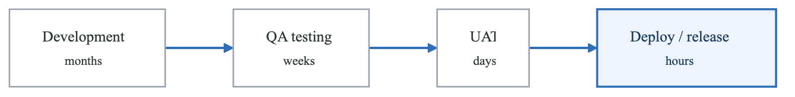
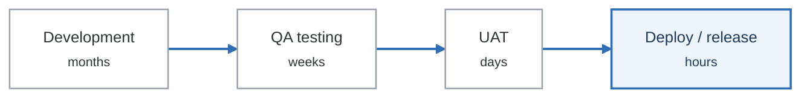
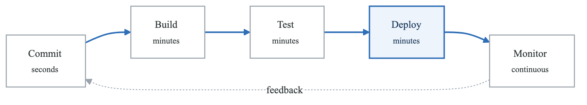
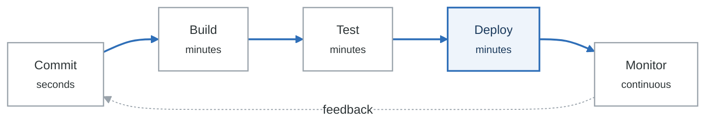
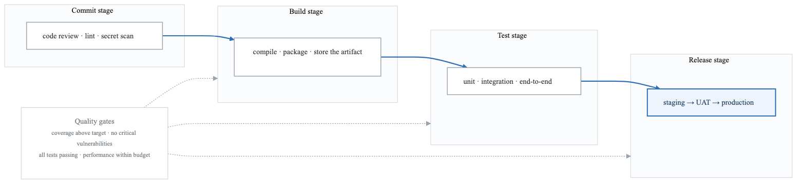
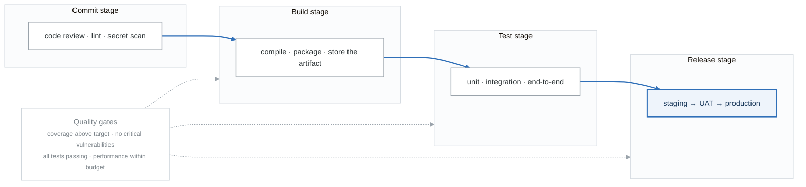
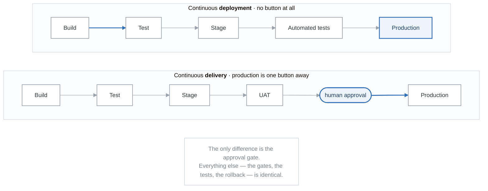

# Module 01: CI/CD Fundamentals

## Learning Objectives

By the end of this module, you will be able to:
- Explain the principles and benefits of Continuous Integration and Continuous Delivery
- Differentiate between Continuous Delivery and Continuous Deployment
- Design effective CI/CD pipelines for various application types
- Identify anti-patterns and best practices in CI/CD implementation
- Understand the cultural and organizational aspects of CI/CD adoption

## Introduction

Continuous Integration and Continuous Delivery (CI/CD) represent fundamental practices in modern software development that enable teams to deliver software reliably and frequently. These practices automate the building, testing, and deployment of applications, reducing manual errors and accelerating time-to-market.

## The Evolution of Software Delivery

### Traditional Software Delivery

<!-- figure: generated from the Mermaid below by _shared/diagrams/embed-figures.py — do not edit the image -->


<details>
<summary>Diagram source (Mermaid)</summary>



</details>

### Modern CI/CD Approach

<!-- figure: generated from the Mermaid below by _shared/diagrams/embed-figures.py — do not edit the image -->


<details>
<summary>Diagram source (Mermaid)</summary>



</details>

## Continuous Integration (CI)

### Definition

Continuous Integration is a development practice where developers integrate code into a shared repository frequently, preferably several times a day. Each integration is verified by an automated build and automated tests.

### Key Principles

1. **Maintain a Single Source Repository**
   - All code in version control
   - Main branch always deployable
   - Feature branches short-lived

2. **Automate the Build**
   - One-command build process
   - Include all dependencies
   - Reproducible across environments

3. **Make the Build Self-Testing**
   - Automated test execution
   - Tests must pass before merge
   - Fast feedback on failures

4. **Everyone Commits to Mainline Every Day**
   - Small, frequent commits
   - Reduces integration conflicts
   - Enables continuous feedback

5. **Every Commit Triggers a Build**
   - Automated trigger on push
   - Immediate feedback
   - No manual intervention needed

6. **Keep the Build Fast**
   - Target under 10 minutes
   - Parallelize where possible
   - Optimize test suites

7. **Test in a Clone of Production**
   - Environment parity
   - Realistic test conditions
   - Catch environment-specific issues

8. **Make it Easy to Get Latest Deliverables**
   - Artifact repository
   - Version everything
   - Easy rollback capability

### CI Workflow

```yaml
# Example CI Workflow Structure
name: Continuous Integration

on:
  push:
    branches: [main, develop]
  pull_request:
    branches: [main]

jobs:
  build:
    runs-on: ubuntu-latest
    steps:
      - name: Checkout code
        uses: actions/checkout@v4

      - name: Setup environment
        run: |
          # Install dependencies
          # Configure build tools

      - name: Build application
        run: |
          # Compile/build the application
          # Generate artifacts

      - name: Run unit tests
        run: |
          # Execute unit test suite
          # Generate coverage report

      - name: Run static analysis
        run: |
          # Lint code
          # Security scanning
          # Code quality checks

      - name: Upload artifacts
        uses: actions/upload-artifact@v4
        with:
          name: build-artifacts
          path: dist/
```

## Continuous Delivery (CD)

### Definition

Continuous Delivery is a software development practice where code changes are automatically built, tested, and prepared for release to production. Every change that passes all stages of the production pipeline is releasable at the push of a button.

### Key Principles

1. **Build Quality In**
   - Quality at every stage
   - Automated testing layers
   - Security scanning integrated

2. **Work in Small Batches**
   - Smaller changes = less risk
   - Easier to review and test
   - Faster feedback

3. **Automate Everything**
   - Builds, tests, deployments
   - Infrastructure provisioning
   - Configuration management

4. **Pursue Continuous Improvement**
   - Measure pipeline metrics
   - Identify bottlenecks
   - Iterate and optimize

5. **Everyone is Responsible**
   - Shared ownership
   - Cross-functional collaboration
   - DevOps culture

### The Deployment Pipeline

<!-- figure: generated from the Mermaid below by _shared/diagrams/embed-figures.py — do not edit the image -->


<details>
<summary>Diagram source (Mermaid)</summary>



</details>

## Continuous Deployment

### Definition

Continuous Deployment extends Continuous Delivery by automatically deploying every change that passes through the pipeline to production without human intervention.

### Comparison

<!-- figure: generated from the Mermaid below by _shared/diagrams/embed-figures.py — do not edit the image -->


<details>
<summary>Diagram source (Mermaid)</summary>



</details>

### When to Use Each

| Factor | Continuous Delivery | Continuous Deployment |
|--------|--------------------|-----------------------|
| Regulatory requirements | High compliance needs | Low compliance overhead |
| Risk tolerance | Conservative | High confidence in tests |
| Release cadence | Controlled timing | Real-time |
| Team maturity | Building confidence | High maturity |
| Business alignment | Marketing coordination | Technical releases |

## Pipeline Design Patterns

### Basic Pipeline

```yaml
# Basic single-stage pipeline
stages:
  - build
  - test
  - deploy

build:
  stage: build
  script:
    - npm install
    - npm run build

test:
  stage: test
  script:
    - npm run test

deploy:
  stage: deploy
  script:
    - npm run deploy
```

### Multi-Environment Pipeline

```yaml
# Environment promotion pipeline
stages:
  - build
  - test
  - deploy-dev
  - deploy-staging
  - deploy-production

variables:
  APP_NAME: myapp

build:
  stage: build
  script:
    - docker build -t $APP_NAME:$CI_COMMIT_SHA .
    - docker push $APP_NAME:$CI_COMMIT_SHA

test:
  stage: test
  script:
    - docker run $APP_NAME:$CI_COMMIT_SHA npm test

deploy-dev:
  stage: deploy-dev
  script:
    - helm upgrade --install $APP_NAME ./chart -n dev
  environment:
    name: development

deploy-staging:
  stage: deploy-staging
  script:
    - helm upgrade --install $APP_NAME ./chart -n staging
  environment:
    name: staging
  when: manual

deploy-production:
  stage: deploy-production
  script:
    - helm upgrade --install $APP_NAME ./chart -n prod
  environment:
    name: production
  when: manual
  only:
    - main
```

### Parallel Testing Pipeline

```yaml
# Parallel test execution for speed
stages:
  - build
  - test
  - deploy

build:
  stage: build
  script:
    - npm install
    - npm run build

# Parallel test jobs
unit-tests:
  stage: test
  parallel: 3
  script:
    - npm run test:unit -- --shard=$CI_NODE_INDEX/$CI_NODE_TOTAL

integration-tests:
  stage: test
  script:
    - npm run test:integration

e2e-tests:
  stage: test
  script:
    - npm run test:e2e

security-scan:
  stage: test
  script:
    - npm audit
    - snyk test

lint:
  stage: test
  script:
    - npm run lint
```

### Matrix Build Pipeline

```yaml
# Test across multiple configurations
name: Matrix Build

on: [push, pull_request]

jobs:
  test:
    runs-on: ${{ matrix.os }}
    strategy:
      matrix:
        os: [ubuntu-latest, macos-latest, windows-latest]
        node: [16, 18, 20]
        exclude:
          - os: windows-latest
            node: 16
    steps:
      - uses: actions/checkout@v4
      - uses: actions/setup-node@v4
        with:
          node-version: ${{ matrix.node }}
      - run: npm install
      - run: npm test
```

## Quality Gates

### Types of Quality Gates

**The six categories of quality gate**

| Category | Checks |
|---|---|
| **Code quality** | coverage · complexity · duplication · style |
| **Security** | SAST · DAST · dependency scanning · secret scanning |
| **Performance** | load tests · benchmarks · memory usage · response time |
| **Compliance** | licence · regulatory · policy · audit trail |
| **Operational** | health checks · smoke tests · rollback tested · monitoring in place |
| **Business** | feature flags · A/B tests · approvals · sign-off |

A gate that never fails is not a gate. If it is too noisy to keep hard-failing, fix the noise with
documented per-check exceptions rather than disabling the failure.

### Implementing Quality Gates

```yaml
# Example quality gate configuration
quality_gate:
  stage: quality
  script:
    - |
      # Code coverage check
      COVERAGE=$(cat coverage/coverage-summary.json | jq '.total.lines.pct')
      if (( $(echo "$COVERAGE < 80" | bc -l) )); then
        echo "Coverage $COVERAGE% is below 80% threshold"
        exit 1
      fi

      # Security vulnerability check
      CRITICAL=$(cat security-report.json | jq '.vulnerabilities.critical')
      if [ "$CRITICAL" -gt 0 ]; then
        echo "Found $CRITICAL critical vulnerabilities"
        exit 1
      fi

      # Code quality check
      ISSUES=$(cat lint-report.json | jq '.errorCount')
      if [ "$ISSUES" -gt 0 ]; then
        echo "Found $ISSUES linting errors"
        exit 1
      fi
  artifacts:
    reports:
      coverage_report:
        coverage_format: cobertura
        path: coverage/cobertura-coverage.xml
```

## CI/CD Anti-Patterns

### Common Anti-Patterns

1. **The Broken Window**
   - Ignoring failing tests
   - "It's been red for weeks"
   - Erodes team confidence

   **Solution**: Fix failures immediately, block merges on failures

2. **The Long Build**
   - Builds taking 30+ minutes
   - Developers context-switch
   - Slow feedback loop

   **Solution**: Parallelize, cache dependencies, optimize tests

3. **The Flaky Test**
   - Intermittent failures
   - "Just re-run it"
   - Time wasted investigating

   **Solution**: Quarantine and fix, improve test isolation

4. **Manual Steps**
   - "After deploy, remember to..."
   - Human error prone
   - Not reproducible

   **Solution**: Automate everything, document as code

5. **Big Bang Integration**
   - Long-lived feature branches
   - Painful merges
   - Integration surprises

   **Solution**: Feature flags, trunk-based development

6. **Environment Drift**
   - "Works on my machine"
   - Prod differs from test
   - Hidden configuration

   **Solution**: Infrastructure as Code, containers

### Anti-Pattern Checklist

```
□ Builds complete in under 10 minutes
□ All environments are automated
□ No manual configuration changes
□ Tests are reliable (< 1% flake rate)
□ Deployments can be rolled back automatically
□ Secrets are not in version control
□ Pipeline changes are versioned
□ All team members can deploy
```

## Metrics and Measurement

### DORA Metrics

The DevOps Research and Assessment (DORA) metrics provide industry-standard measures for CI/CD effectiveness:

**The four DORA metrics**

| Metric | Elite | High | Medium | Low |
|---|---|---|---|---|
| **Deployment frequency** | multiple per day | weekly – monthly | monthly – 6 months | > 6 months |
| **Lead time for changes** | < 1 hour | 1 day – 1 week | 1 week – 6 months | > 6 months |
| **Change failure rate** | 0–15% | 16–30% | 16–30% | > 30% |
| **Time to restore service** | < 1 hour | < 1 day | 1 day – 1 week | > 6 months |

A personal project reaches "elite" on the first two almost by construction. The hard problem at real
scale is keeping change failure rate low **as** deployment frequency rises — which is what the test
gates and progressive delivery are for.

### Pipeline Metrics

```yaml
# Metrics to track in your CI/CD system
pipeline_metrics:
  throughput:
    - builds_per_day
    - deployments_per_day
    - commits_per_day

  speed:
    - build_duration
    - test_duration
    - deployment_duration
    - queue_wait_time

  quality:
    - build_success_rate
    - test_pass_rate
    - deployment_success_rate
    - rollback_rate

  efficiency:
    - pipeline_efficiency  # (successful_runs / total_runs)
    - resource_utilization
    - parallel_execution_ratio
```

## Cultural Considerations

### DevOps Culture Principles

1. **Shared Responsibility**
   - Developers own deployment
   - Operations enable self-service
   - Everyone on-call

2. **Blameless Postmortems**
   - Focus on systems, not individuals
   - Learn from failures
   - Document and share

3. **Continuous Learning**
   - Experimentation encouraged
   - Technical debt addressed
   - Skills development prioritized

4. **Automation First**
   - Manual tasks become tech debt
   - Document as code
   - Self-service platforms

### Organizational Adoption

**CI/CD Adoption Stages**

**Stage 1: Foundation**

- Version control for all code
- Basic automated builds
- Some automated tests

**Stage 2: Standardization**

- Consistent pipeline patterns
- Quality gates implemented
- Artifact management

**Stage 3: Automation**

- Deployment automation
- Infrastructure as Code
- Environment provisioning

**Stage 4: Optimization**

- Metrics-driven improvement
- Self-service platforms
- Continuous deployment

**Stage 5: Excellence**

- Advanced deployment strategies
- Chaos engineering
- Business value optimization


## Hands-On Exercise

### Exercise: Analyze Your Current Pipeline

1. **Map your current process**:
   - Document each step from commit to production
   - Identify manual steps
   - Note wait times between stages

2. **Measure current state**:
   - Calculate deployment frequency
   - Measure lead time for changes
   - Track change failure rate
   - Determine recovery time

3. **Identify improvements**:
   - List automation opportunities
   - Find bottlenecks
   - Prioritize changes by impact

4. **Create improvement plan**:
   - Set target metrics
   - Define milestones
   - Identify required resources

## Summary

- CI/CD automates the software delivery process, enabling faster and more reliable releases
- Continuous Integration focuses on frequent integration and automated testing
- Continuous Delivery ensures code is always deployable with manual approval
- Continuous Deployment fully automates the release process
- Quality gates ensure only acceptable changes progress through the pipeline
- DORA metrics provide industry standards for measuring CI/CD effectiveness
- Cultural change is as important as technical implementation

## Additional Resources

- [Continuous Delivery](https://continuousdelivery.com/) - Jez Humble
- [Accelerate](https://itrevolution.com/book/accelerate/) - DORA Research
- [The DevOps Handbook](https://itrevolution.com/book/the-devops-handbook/)
- [CI/CD Best Practices](https://docs.gitlab.com/ee/ci/pipelines/pipeline_architectures.html)

## Next Steps

In the next module, we'll dive deep into Jenkins, one of the most widely-used CI/CD platforms, learning how to configure pipelines, manage plugins, and implement complex workflows.

<!-- feynman-check -->

---

## Feynman check

Close the file. Blank page, no notes. Explain each of these to a competent engineer who has never
used this tool — **under five minutes, no jargon you can't define on the spot:**

- The Evolution of Software Delivery
- Continuous Integration (CI)
- Continuous Delivery (CD)
- Continuous Deployment

**The gap is not what you forgot. It is where you used a word instead of a mechanism.**

| | |
|---|---|
| ✗ | *"The pipeline deploys the application."* |
| ✓ | *"CI writes a new image tag into a config repository and stops. A controller running *inside* the cluster polls that repo, diffs the rendered manifests against live state, and applies the difference — so nothing outside the cluster ever holds credentials to it."* |

**Trace it:** `git push` → the new version serving traffic, with nothing else typed. Name where the handoff between CI and CD happens, and what that handoff physically is.

Stop at the first component you cannot name. Reopen this file and read **only** that.

**Go deeper — only once the gap has a name:** the four [OpenGitOps principles](https://opengitops.dev/#principles) — then say which one a `kubectl apply` inside CI violates.
Full list per domain: [`SOURCES.md`](../SOURCES.md#cicd-gitops)

→ Protocol, the three levels of knowing, and worked examples: [`MASTERY.md`](../MASTERY.md)

<!-- /feynman-check -->
