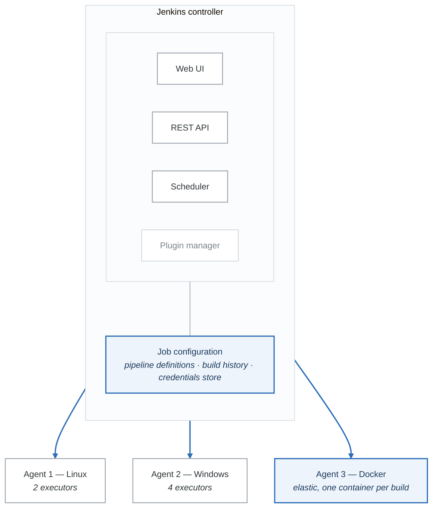

# Module 02: Jenkins Deep Dive

## Learning Objectives

By the end of this module, you will be able to:
- Install and configure Jenkins in various environments
- Create and manage Jenkins pipelines using Declarative and Scripted syntax
- Implement shared libraries for pipeline reusability
- Configure Jenkins security and manage credentials
- Scale Jenkins with distributed builds and agents
- Integrate Jenkins with external tools and services

## Introduction

Jenkins is the most widely-adopted open-source automation server, powering CI/CD pipelines for organizations of all sizes. Originally forked from Hudson in 2011, Jenkins has evolved into a highly extensible platform with thousands of plugins supporting building, deploying, and automating any project.

## Jenkins Architecture

### Core Components

<!-- figure: generated from the Mermaid below by _shared/diagrams/embed-figures.py — do not edit the image -->


<details>
<summary>Diagram source (Mermaid)</summary>



</details>

### Installation Methods

#### Docker Installation

```yaml
# docker-compose.yml
version: '3.8'

services:
  jenkins:
    image: jenkins/jenkins:lts-jdk17
    container_name: jenkins
    restart: unless-stopped
    ports:
      - "8080:8080"
      - "50000:50000"
    volumes:
      - jenkins_home:/var/jenkins_home
      - /var/run/docker.sock:/var/run/docker.sock
    environment:
      - JAVA_OPTS=-Djenkins.install.runSetupWizard=false
      - CASC_JENKINS_CONFIG=/var/jenkins_home/casc_configs

  jenkins-agent:
    image: jenkins/inbound-agent
    container_name: jenkins-agent
    restart: unless-stopped
    environment:
      - JENKINS_URL=http://jenkins:8080
      - JENKINS_AGENT_NAME=docker-agent
      - JENKINS_SECRET=${AGENT_SECRET}
      - JENKINS_AGENT_WORKDIR=/home/jenkins/agent
    volumes:
      - agent_workspace:/home/jenkins/agent
    depends_on:
      - jenkins

volumes:
  jenkins_home:
  agent_workspace:
```

#### Kubernetes Installation (Helm)

```bash
# Add Jenkins Helm repository
helm repo add jenkins https://charts.jenkins.io
helm repo update

# Install Jenkins
helm install jenkins jenkins/jenkins \
  --namespace jenkins \
  --create-namespace \
  --set controller.serviceType=LoadBalancer \
  --set controller.installPlugins="kubernetes:latest\,workflow-aggregator:latest\,git:latest" \
  --set agent.enabled=true \
  --set agent.containerCap=10
```

```yaml
# Custom values.yaml for Jenkins Helm chart
controller:
  image: jenkins/jenkins
  tag: lts-jdk17

  resources:
    requests:
      cpu: "500m"
      memory: "1Gi"
    limits:
      cpu: "2000m"
      memory: "4Gi"

  installPlugins:
    - kubernetes:latest
    - workflow-aggregator:latest
    - git:latest
    - configuration-as-code:latest
    - job-dsl:latest

  JCasC:
    defaultConfig: true
    configScripts:
      welcome-message: |
        jenkins:
          systemMessage: "Jenkins configured automatically by Helm"

agent:
  enabled: true
  defaultsProviderTemplate: ""
  containerCap: 10
  podTemplates:
    podTemplate:
      name: default
      containers:
        - name: jnlp
          image: jenkins/inbound-agent
          resourceRequestCpu: "500m"
          resourceRequestMemory: "512Mi"
```

## Jenkins Pipelines

### Declarative Pipeline

The Declarative Pipeline provides a simplified, opinionated syntax for defining pipelines.

```groovy
// Jenkinsfile - Declarative Pipeline
pipeline {
    agent any

    options {
        timeout(time: 30, unit: 'MINUTES')
        disableConcurrentBuilds()
        buildDiscarder(logRotator(numToKeepStr: '10'))
        timestamps()
    }

    environment {
        APP_NAME = 'myapp'
        DOCKER_REGISTRY = 'registry.example.com'
        DOCKER_CREDENTIALS = credentials('docker-registry')
    }

    parameters {
        string(name: 'BRANCH', defaultValue: 'main', description: 'Branch to build')
        choice(name: 'ENVIRONMENT', choices: ['dev', 'staging', 'prod'], description: 'Target environment')
        booleanParam(name: 'SKIP_TESTS', defaultValue: false, description: 'Skip tests')
    }

    stages {
        stage('Checkout') {
            steps {
                checkout scm
                script {
                    env.GIT_COMMIT_SHORT = sh(
                        script: 'git rev-parse --short HEAD',
                        returnStdout: true
                    ).trim()
                }
            }
        }

        stage('Build') {
            steps {
                sh '''
                    echo "Building ${APP_NAME}..."
                    npm install
                    npm run build
                '''
            }
        }

        stage('Test') {
            when {
                expression { !params.SKIP_TESTS }
            }
            parallel {
                stage('Unit Tests') {
                    steps {
                        sh 'npm run test:unit'
                    }
                    post {
                        always {
                            junit 'test-results/unit/*.xml'
                        }
                    }
                }
                stage('Integration Tests') {
                    steps {
                        sh 'npm run test:integration'
                    }
                }
                stage('Security Scan') {
                    steps {
                        sh 'npm audit --audit-level=high'
                    }
                }
            }
        }

        stage('Build Image') {
            steps {
                script {
                    docker.withRegistry("https://${DOCKER_REGISTRY}", 'docker-registry') {
                        def image = docker.build("${APP_NAME}:${GIT_COMMIT_SHORT}")
                        image.push()
                        image.push('latest')
                    }
                }
            }
        }

        stage('Deploy') {
            when {
                anyOf {
                    branch 'main'
                    branch 'release/*'
                }
            }
            stages {
                stage('Deploy to Dev') {
                    when {
                        expression { params.ENVIRONMENT in ['dev', 'staging', 'prod'] }
                    }
                    steps {
                        deployToEnvironment('dev')
                    }
                }
                stage('Deploy to Staging') {
                    when {
                        expression { params.ENVIRONMENT in ['staging', 'prod'] }
                    }
                    steps {
                        deployToEnvironment('staging')
                    }
                }
                stage('Deploy to Production') {
                    when {
                        expression { params.ENVIRONMENT == 'prod' }
                        beforeInput true
                    }
                    input {
                        message "Deploy to production?"
                        ok "Deploy"
                        submitter "admin,release-manager"
                    }
                    steps {
                        deployToEnvironment('prod')
                    }
                }
            }
        }
    }

    post {
        always {
            cleanWs()
            archiveArtifacts artifacts: 'dist/**/*', fingerprint: true
        }
        success {
            slackSend(
                channel: '#deployments',
                color: 'good',
                message: "Build Successful: ${env.JOB_NAME} #${env.BUILD_NUMBER}"
            )
        }
        failure {
            slackSend(
                channel: '#deployments',
                color: 'danger',
                message: "Build Failed: ${env.JOB_NAME} #${env.BUILD_NUMBER}"
            )
        }
    }
}

def deployToEnvironment(String env) {
    echo "Deploying to ${env}..."
    sh """
        kubectl config use-context ${env}
        helm upgrade --install ${APP_NAME} ./chart \
            --namespace ${env} \
            --set image.tag=${GIT_COMMIT_SHORT}
    """
}
```

### Scripted Pipeline

Scripted Pipeline provides full Groovy flexibility for complex scenarios.

```groovy
// Jenkinsfile - Scripted Pipeline
node('linux') {
    def appName = 'myapp'
    def imageTag = ''

    try {
        stage('Checkout') {
            checkout scm
            imageTag = sh(script: 'git rev-parse --short HEAD', returnStdout: true).trim()
        }

        stage('Build') {
            // Parallel builds for multiple platforms
            def builds = [:]

            ['linux', 'darwin', 'windows'].each { platform ->
                builds[platform] = {
                    node(platform) {
                        checkout scm
                        sh "GOOS=${platform} go build -o ${appName}-${platform}"
                        archiveArtifacts "${appName}-${platform}"
                    }
                }
            }

            parallel builds
        }

        stage('Test') {
            def testStages = [:]

            // Dynamic test matrix
            def testSuites = ['unit', 'integration', 'e2e']
            testSuites.each { suite ->
                testStages["${suite} tests"] = {
                    try {
                        sh "npm run test:${suite}"
                    } catch (e) {
                        currentBuild.result = 'UNSTABLE'
                        echo "Test suite ${suite} failed: ${e.message}"
                    }
                }
            }

            parallel testStages
        }

        stage('Deploy') {
            if (env.BRANCH_NAME == 'main') {
                // Use retry for flaky deployments
                retry(3) {
                    timeout(time: 5, unit: 'MINUTES') {
                        sh './deploy.sh production'
                    }
                }
            }
        }

        currentBuild.result = 'SUCCESS'

    } catch (Exception e) {
        currentBuild.result = 'FAILURE'
        throw e
    } finally {
        // Send notification based on result
        notifyBuild(currentBuild.result)
    }
}

def notifyBuild(String buildStatus) {
    def color = buildStatus == 'SUCCESS' ? 'good' : 'danger'
    slackSend(color: color, message: "${env.JOB_NAME} #${env.BUILD_NUMBER}: ${buildStatus}")
}
```

## Shared Libraries

Shared Libraries allow you to create reusable pipeline components.

### Library Structure

**`shared-library/`**

- `vars/`
  - `buildDockerImage.groovy` — Global variables
  - `deployToK8s.groovy`
  - `notifySlack.groovy`
  - `standardPipeline.groovy`
- `src/`
  - `com/`
    - `company/`
      - `Docker.groovy` — Classes
      - `Kubernetes.groovy`
      - `Utils.groovy`
- `resources/`
  - `templates/`
    - Dockerfile
    - `deployment.yaml`
- `test/`
  - `groovy/`
    - `TestUtils.groovy`


### Global Variables (vars/)

```groovy
// vars/buildDockerImage.groovy
def call(Map config = [:]) {
    def imageName = config.imageName ?: env.JOB_NAME
    def tag = config.tag ?: env.BUILD_NUMBER
    def dockerfile = config.dockerfile ?: 'Dockerfile'
    def context = config.context ?: '.'
    def registry = config.registry ?: 'docker.io'

    echo "Building Docker image: ${registry}/${imageName}:${tag}"

    docker.withRegistry("https://${registry}", 'docker-credentials') {
        def image = docker.build("${imageName}:${tag}", "-f ${dockerfile} ${context}")
        image.push()

        if (config.pushLatest) {
            image.push('latest')
        }

        return image
    }
}

// vars/deployToK8s.groovy
def call(Map config) {
    def namespace = config.namespace ?: 'default'
    def chart = config.chart
    def release = config.release
    def values = config.values ?: [:]

    echo "Deploying ${release} to ${namespace}"

    // Build values arguments
    def valuesArgs = values.collect { k, v -> "--set ${k}=${v}" }.join(' ')

    withKubeConfig(credentialsId: 'kubeconfig', namespace: namespace) {
        sh """
            helm upgrade --install ${release} ${chart} \
                --namespace ${namespace} \
                --create-namespace \
                ${valuesArgs} \
                --wait \
                --timeout 5m
        """
    }
}

// vars/notifySlack.groovy
def call(Map config) {
    def status = config.status ?: currentBuild.currentResult
    def channel = config.channel ?: '#builds'

    def colors = [
        SUCCESS: 'good',
        FAILURE: 'danger',
        UNSTABLE: 'warning',
        ABORTED: '#808080'
    ]

    def message = """
        *${status}*: Job ${env.JOB_NAME} build #${env.BUILD_NUMBER}
        Duration: ${currentBuild.durationString}
        <${env.BUILD_URL}|View Build>
    """.stripIndent()

    slackSend(
        channel: channel,
        color: colors[status] ?: '#808080',
        message: message
    )
}

// vars/standardPipeline.groovy
def call(Map pipelineConfig) {
    pipeline {
        agent { label pipelineConfig.agent ?: 'linux' }

        options {
            timeout(time: pipelineConfig.timeout ?: 30, unit: 'MINUTES')
            disableConcurrentBuilds()
            timestamps()
        }

        stages {
            stage('Checkout') {
                steps {
                    checkout scm
                }
            }

            stage('Build') {
                steps {
                    script {
                        if (pipelineConfig.buildScript) {
                            sh pipelineConfig.buildScript
                        } else {
                            sh 'make build'
                        }
                    }
                }
            }

            stage('Test') {
                steps {
                    script {
                        if (pipelineConfig.testScript) {
                            sh pipelineConfig.testScript
                        } else {
                            sh 'make test'
                        }
                    }
                }
            }

            stage('Deploy') {
                when {
                    branch 'main'
                }
                steps {
                    script {
                        deployToK8s(
                            namespace: pipelineConfig.namespace,
                            chart: pipelineConfig.chart,
                            release: pipelineConfig.release
                        )
                    }
                }
            }
        }

        post {
            always {
                notifySlack(channel: pipelineConfig.slackChannel)
            }
        }
    }
}
```

### Using Shared Library

```groovy
// Jenkinsfile using shared library
@Library('my-shared-library@main') _

standardPipeline(
    agent: 'docker',
    buildScript: 'npm install && npm run build',
    testScript: 'npm test',
    namespace: 'production',
    chart: './helm/myapp',
    release: 'myapp',
    slackChannel: '#deployments'
)

// Or use individual functions
@Library('my-shared-library@main') _

pipeline {
    agent any

    stages {
        stage('Build') {
            steps {
                script {
                    buildDockerImage(
                        imageName: 'myapp',
                        tag: env.GIT_COMMIT,
                        registry: 'gcr.io/my-project',
                        pushLatest: true
                    )
                }
            }
        }

        stage('Deploy') {
            steps {
                script {
                    deployToK8s(
                        namespace: 'production',
                        chart: './chart',
                        release: 'myapp',
                        values: [
                            'image.tag': env.GIT_COMMIT,
                            'replicas': 3
                        ]
                    )
                }
            }
        }
    }

    post {
        always {
            notifySlack(channel: '#deployments')
        }
    }
}
```

## Configuration as Code (JCasC)

### Jenkins Configuration

```yaml
# jenkins.yaml - JCasC configuration
jenkins:
  systemMessage: "Jenkins configured automatically via JCasC"

  securityRealm:
    ldap:
      configurations:
        - server: "ldap.example.com"
          rootDN: "dc=example,dc=com"
          userSearch: "uid={0}"
          groupSearchBase: "ou=groups"

  authorizationStrategy:
    roleBased:
      roles:
        global:
          - name: "admin"
            permissions:
              - "Overall/Administer"
            entries:
              - group: "admins"
          - name: "developer"
            permissions:
              - "Overall/Read"
              - "Job/Build"
              - "Job/Read"
              - "Job/Workspace"
            entries:
              - group: "developers"

  nodes:
    - permanent:
        name: "linux-agent-1"
        remoteFS: "/var/jenkins"
        launcher:
          ssh:
            host: "agent1.example.com"
            port: 22
            credentialsId: "agent-ssh"
            sshHostKeyVerificationStrategy: "nonVerifyingKeyVerificationStrategy"
        nodeProperties:
          - toolLocation:
              locations:
                - home: "/usr/bin/docker"
                  key: "org.jenkinsci.plugins.docker.commons.tools.DockerTool$DescriptorImpl@docker"

  clouds:
    - kubernetes:
        name: "kubernetes"
        serverUrl: "https://kubernetes.default.svc"
        namespace: "jenkins"
        jenkinsUrl: "http://jenkins:8080"
        jenkinsTunnel: "jenkins-agent:50000"
        containerCapStr: "10"
        templates:
          - name: "jnlp"
            label: "k8s-agent"
            nodeUsageMode: "NORMAL"
            containers:
              - name: "jnlp"
                image: "jenkins/inbound-agent"
                workingDir: "/home/jenkins/agent"
                ttyEnabled: true
                resourceRequestCpu: "500m"
                resourceRequestMemory: "512Mi"

credentials:
  system:
    domainCredentials:
      - credentials:
          - usernamePassword:
              scope: GLOBAL
              id: "docker-registry"
              username: "${DOCKER_USER}"
              password: "${DOCKER_PASSWORD}"
              description: "Docker Registry Credentials"
          - string:
              scope: GLOBAL
              id: "slack-token"
              secret: "${SLACK_TOKEN}"
              description: "Slack Bot Token"
          - file:
              scope: GLOBAL
              id: "kubeconfig"
              fileName: "config"
              secretBytes: "${KUBECONFIG_CONTENT}"

jobs:
  - script: >
      folder('microservices') {
        displayName('Microservices')
        description('All microservice pipelines')
      }
  - script: >
      multibranchPipelineJob('microservices/api') {
        branchSources {
          git {
            id('api-repo')
            remote('https://github.com/company/api.git')
            credentialsId('github-token')
          }
        }
        triggers {
          periodic(5)
        }
      }

unclassified:
  location:
    url: "https://jenkins.example.com/"
    adminAddress: "admin@example.com"

  slackNotifier:
    teamDomain: "mycompany"
    tokenCredentialId: "slack-token"
    room: "#jenkins"

  gitHubPluginConfig:
    hookUrl: "https://jenkins.example.com/github-webhook/"

  globalLibraries:
    libraries:
      - name: "shared-library"
        defaultVersion: "main"
        retriever:
          modernSCM:
            scm:
              git:
                remote: "https://github.com/company/jenkins-shared-library.git"
                credentialsId: "github-token"
```

## Security Best Practices

### Credential Management

```groovy
// Using credentials in pipelines
pipeline {
    agent any

    environment {
        // Username/Password credential
        DOCKER_CREDS = credentials('docker-registry')

        // Secret text credential
        API_KEY = credentials('api-key')

        // SSH key credential
        SSH_KEY = credentials('ssh-private-key')
    }

    stages {
        stage('Docker Login') {
            steps {
                sh '''
                    echo "$DOCKER_CREDS_PSW" | docker login -u "$DOCKER_CREDS_USR" --password-stdin
                '''
            }
        }

        stage('Use SSH Key') {
            steps {
                sshagent(['ssh-private-key']) {
                    sh 'ssh user@server "command"'
                }
            }
        }

        stage('Use Secret File') {
            steps {
                withCredentials([file(credentialsId: 'kubeconfig', variable: 'KUBECONFIG')]) {
                    sh 'kubectl get pods'
                }
            }
        }
    }
}
```

### Script Security

```groovy
// Approved script patterns in pipeline
@NonCPS
def parseJson(String json) {
    new groovy.json.JsonSlurper().parseText(json)
}

// Using sandbox-approved methods
pipeline {
    agent any

    stages {
        stage('Safe Operations') {
            steps {
                script {
                    // Approved: String manipulation
                    def version = "1.2.3"
                    def parts = version.split('\\.')

                    // Approved: Collections
                    def items = ['a', 'b', 'c']
                    items.each { println it }

                    // Requires approval: File operations
                    // def content = new File('/etc/passwd').text  // NOT APPROVED

                    // Safe alternative
                    def content = readFile('/etc/passwd')
                }
            }
        }
    }
}
```

## Distributed Builds

### Agent Configuration

```groovy
// Jenkinsfile with multiple agents
pipeline {
    agent none

    stages {
        stage('Build') {
            matrix {
                axes {
                    axis {
                        name 'PLATFORM'
                        values 'linux', 'windows', 'macos'
                    }
                    axis {
                        name 'ARCH'
                        values 'amd64', 'arm64'
                    }
                }
                excludes {
                    exclude {
                        axis {
                            name 'PLATFORM'
                            values 'windows'
                        }
                        axis {
                            name 'ARCH'
                            values 'arm64'
                        }
                    }
                }
                stages {
                    stage('Build Binary') {
                        agent {
                            label "${PLATFORM}-${ARCH}"
                        }
                        steps {
                            sh "GOOS=${PLATFORM} GOARCH=${ARCH} go build -o app-${PLATFORM}-${ARCH}"
                        }
                    }
                }
            }
        }

        stage('Aggregate') {
            agent any
            steps {
                // Collect all artifacts
                copyArtifacts(projectName: env.JOB_NAME, selector: specific(env.BUILD_NUMBER))
            }
        }
    }
}
```

### Kubernetes Pod Templates

```groovy
// Dynamic pod templates
pipeline {
    agent {
        kubernetes {
            yaml '''
apiVersion: v1
kind: Pod
metadata:
  labels:
    jenkins: agent
spec:
  containers:
  - name: maven
    image: maven:3.9-eclipse-temurin-17
    command:
    - cat
    tty: true
    resources:
      requests:
        memory: "1Gi"
        cpu: "500m"
      limits:
        memory: "2Gi"
        cpu: "1000m"
  - name: docker
    image: docker:24-dind
    securityContext:
      privileged: true
    volumeMounts:
    - name: docker-socket
      mountPath: /var/run/docker.sock
  - name: kubectl
    image: bitnami/kubectl:latest
    command:
    - cat
    tty: true
  volumes:
  - name: docker-socket
    emptyDir: {}
'''
        }
    }

    stages {
        stage('Build') {
            steps {
                container('maven') {
                    sh 'mvn clean package'
                }
            }
        }

        stage('Docker Build') {
            steps {
                container('docker') {
                    sh 'docker build -t myapp:latest .'
                }
            }
        }

        stage('Deploy') {
            steps {
                container('kubectl') {
                    sh 'kubectl apply -f deployment.yaml'
                }
            }
        }
    }
}
```

## Jenkins Plugins

### Essential Plugins

```yaml
# Essential plugins for enterprise Jenkins
plugins:
  pipeline:
    - workflow-aggregator         # Pipeline as code
    - pipeline-stage-view        # Stage visualization
    - pipeline-utility-steps     # Utility functions

  scm:
    - git                        # Git integration
    - github                     # GitHub integration
    - github-branch-source      # GitHub multibranch
    - bitbucket                  # Bitbucket integration

  build:
    - docker-workflow            # Docker support
    - kubernetes                 # Kubernetes support
    - matrix-project             # Matrix builds

  security:
    - credentials               # Credentials management
    - credentials-binding       # Use credentials in builds
    - role-strategy             # Role-based access
    - authorize-project         # Project-based auth

  quality:
    - warnings-ng               # Static analysis
    - junit                     # Test results
    - code-coverage-api         # Coverage reports
    - sonar                     # SonarQube integration

  notifications:
    - slack                     # Slack notifications
    - email-ext                 # Extended email
    - build-monitor-plugin      # Build monitor

  operations:
    - configuration-as-code     # JCasC
    - job-dsl                   # Job DSL
    - prometheus                # Metrics export
    - timestamper               # Timestamps in logs
```

## Performance Optimization

### Build Optimization

```groovy
// Optimized pipeline with caching
pipeline {
    agent any

    options {
        // Preserve stashes for restart
        preserveStashes(buildCount: 5)
    }

    stages {
        stage('Restore Cache') {
            steps {
                script {
                    // Use external cache (e.g., S3)
                    sh '''
                        if aws s3 cp s3://cache-bucket/node_modules.tar.gz .; then
                            tar -xzf node_modules.tar.gz
                        fi
                    '''
                }
            }
        }

        stage('Build') {
            steps {
                sh 'npm ci --prefer-offline'
                sh 'npm run build'

                // Stash for later stages
                stash includes: 'dist/**', name: 'build-output'
            }
        }

        stage('Test') {
            parallel {
                stage('Unit') {
                    steps {
                        unstash 'build-output'
                        sh 'npm test -- --maxWorkers=4'
                    }
                }
                stage('Lint') {
                    steps {
                        sh 'npm run lint'
                    }
                }
            }
        }

        stage('Save Cache') {
            steps {
                sh '''
                    tar -czf node_modules.tar.gz node_modules
                    aws s3 cp node_modules.tar.gz s3://cache-bucket/
                '''
            }
        }
    }
}
```

## Hands-On Exercise

### Exercise: Create a Multi-Branch Pipeline

1. Create a shared library with common build functions
2. Configure JCasC for automatic plugin installation
3. Create a multi-branch pipeline for a sample repository
4. Implement parallel testing across multiple environments
5. Add Slack notifications for build status

## Summary

- Jenkins provides a flexible, extensible CI/CD platform
- Declarative pipelines offer simplified syntax for common patterns
- Scripted pipelines provide full Groovy flexibility
- Shared libraries enable code reuse across pipelines
- Configuration as Code (JCasC) enables reproducible Jenkins setup
- Distributed builds scale through agents and Kubernetes
- Security requires careful credential management and access control

## Additional Resources

- [Jenkins Documentation](https://www.jenkins.io/doc/)
- [Jenkins Pipeline Syntax](https://www.jenkins.io/doc/book/pipeline/syntax/)
- [JCasC Documentation](https://www.jenkins.io/projects/jcasc/)
- [Jenkins Shared Libraries](https://www.jenkins.io/doc/book/pipeline/shared-libraries/)

## Next Steps

In the next module, we'll explore GitHub Actions, learning how to build CI/CD workflows in GitHub's native platform.

<!-- feynman-check -->

---

## Feynman check

Close the file. Blank page, no notes. Explain each of these to a competent engineer who has never
used this tool — **under five minutes, no jargon you can't define on the spot:**

- Jenkins Architecture
- Jenkins Pipelines
- Shared Libraries
- Configuration as Code (JCasC)

**The gap is not what you forgot. It is where you used a word instead of a mechanism.**

| | |
|---|---|
| ✗ | *"The pipeline deploys the application."* |
| ✓ | *"CI writes a new image tag into a config repository and stops. A controller running *inside* the cluster polls that repo, diffs the rendered manifests against live state, and applies the difference — so nothing outside the cluster ever holds credentials to it."* |

**Trace it:** `git push` → the new version serving traffic, with nothing else typed. Name where the handoff between CI and CD happens, and what that handoff physically is.

Stop at the first component you cannot name. Reopen this file and read **only** that.

**Go deeper — only once the gap has a name:** the four [OpenGitOps principles](https://opengitops.dev/#principles) — then say which one a `kubectl apply` inside CI violates.
Full list per domain: [`SOURCES.md`](../SOURCES.md#cicd-gitops)

→ Protocol, the three levels of knowing, and worked examples: [`MASTERY.md`](../MASTERY.md)

<!-- /feynman-check -->
