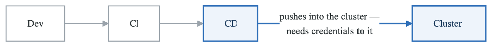
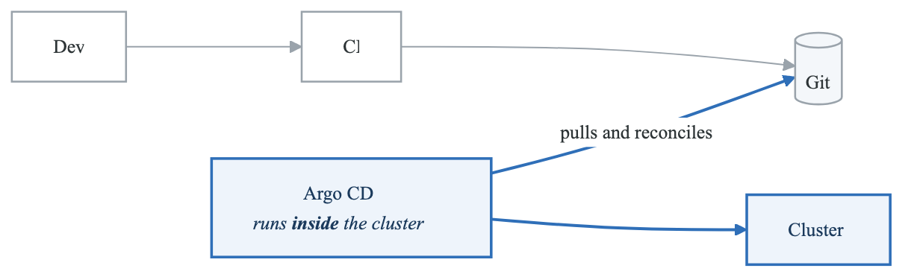
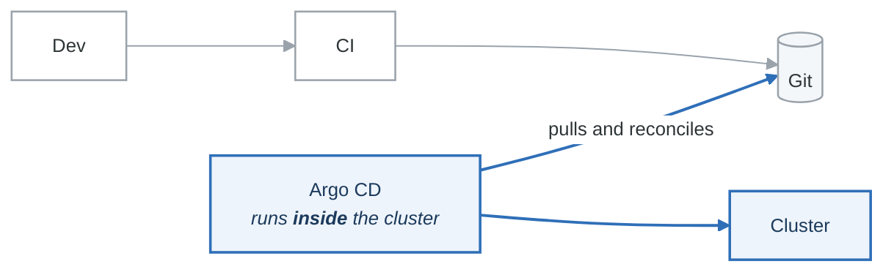
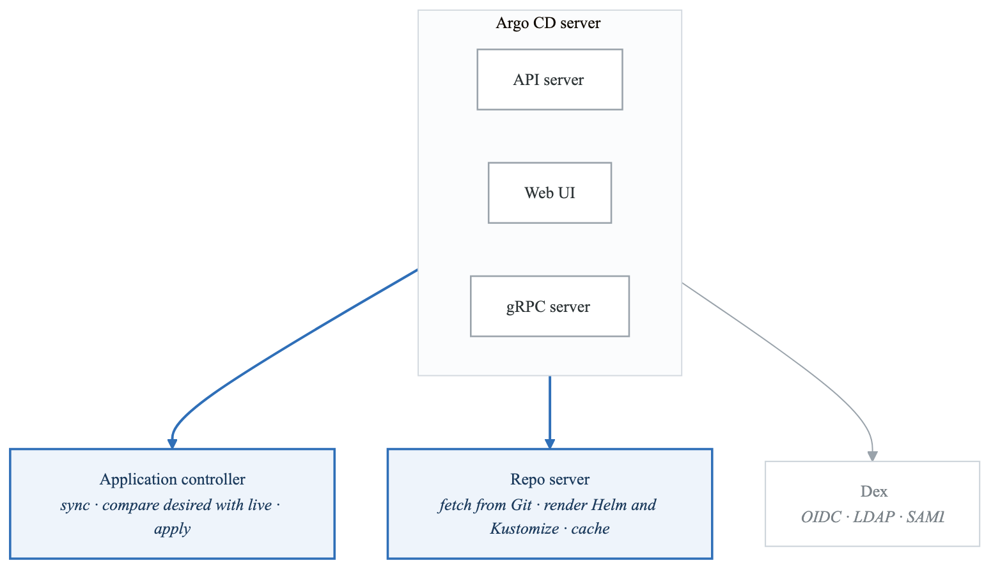
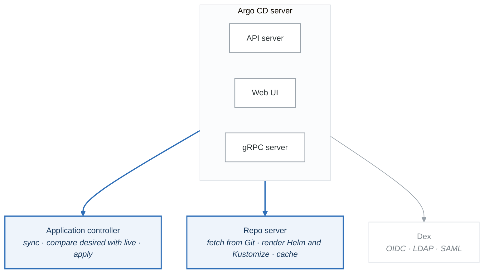

# Module 05: ArgoCD and GitOps

## Learning Objectives

By the end of this module, you will be able to:
- Explain GitOps principles and their benefits
- Install and configure ArgoCD on Kubernetes
- Create and manage ArgoCD Applications
- Implement multi-cluster deployments
- Configure sync policies and self-healing
- Integrate ArgoCD with CI pipelines
- Implement advanced deployment patterns with ApplicationSets

## Introduction

GitOps is an operational framework that uses Git as the single source of truth for declarative infrastructure and applications. ArgoCD is a declarative, GitOps continuous delivery tool for Kubernetes that automates the deployment of applications based on the desired state defined in Git repositories.

## GitOps Principles

### Core Principles

**The four GitOps principles**

| | Principle | What it means in practice |
|---|---|---|
| **1** | **Declarative** | The whole system is described declaratively — YAML manifests, Helm charts, Kustomize overlays. Not scripts that produce it |
| **2** | **Version controlled** | Git is the single source of truth. Every change is tracked, attributable, and revertible |
| **3** | **Automatically applied** | Approved changes are applied without anyone running a command. Pull-based, not pushed |
| **4** | **Continuously reconciled** | Agents watch actual state against Git and correct drift. Self-healing, not one-shot |

Principle 4 is the one that separates GitOps from "CI that runs `kubectl apply`." A pipeline applies
once and stops caring. A reconciler notices when someone edits the cluster by hand at 2am, and either
reverts it or tells you — which means the repository stays a true description of production instead
of a description of what production looked like at the last deploy.

### Push vs Pull Model

**Push**

```mermaid
%%{init: {'theme':'base','themeVariables':{'fontFamily':'Helvetica, Arial, sans-serif','fontSize':'13px','primaryColor':'#ffffff','primaryTextColor':'#2d3436','primaryBorderColor':'#9aa3ab','lineColor':'#9aa3ab','textColor':'#2d3436','clusterBkg':'#fbfcfd','clusterBorder':'#d4dae0','edgeLabelBackground':'#ffffff','tertiaryColor':'#eef4fb'},'flowchart':{'curve':'basis','padding':14,'nodeSpacing':42,'rankSpacing':58}}}%%
flowchart LR
  classDef default fill:#ffffff,stroke:#9aa3ab,stroke-width:1.3px,color:#2d3436
  classDef n    fill:#ffffff,stroke:#9aa3ab,stroke-width:1.3px,color:#2d3436
  classDef crit fill:#eef4fb,stroke:#2f6fb8,stroke-width:1.8px,color:#1b3a5c
  classDef data fill:#f4f7fa,stroke:#9aa3ab,stroke-width:1.3px,color:#2d3436
  classDef mut  fill:#ffffff,stroke:#cfd6dc,stroke-width:1.1px,color:#7a8288
  classDef warn fill:#fdf0ec,stroke:#c0522d,stroke-width:1.6px,color:#8a3a1e
  D["Dev"] --> CI["CI"] --> CD["CD"] ==>|"pushes into the cluster —<br/>needs credentials <b>to</b> it"| K["Cluster"]
  class D,CI n
  class CD crit
  class K crit
  linkStyle 2 stroke:#2f6fb8,stroke-width:2px
```

<!-- figure: generated from the Mermaid below by _shared/diagrams/embed-figures.py — do not edit the image -->


<details>
<summary>Diagram source (Mermaid)</summary>



</details>

**Pull &nbsp;(GitOps)**

<!-- figure: generated from the Mermaid below by _shared/diagrams/embed-figures.py — do not edit the image -->


<details>
<summary>Diagram source (Mermaid)</summary>



</details>

The security difference is the whole argument. In the push model your CI system holds credentials to
production, and CI systems execute code from pull requests. In the pull model nothing outside the
cluster has credentials to it — the agent inside reaches *out* to Git, which is read-only.

## ArgoCD Architecture

### Components

<!-- figure: generated from the Mermaid below by _shared/diagrams/embed-figures.py — do not edit the image -->


<details>
<summary>Diagram source (Mermaid)</summary>



</details>

**Where state lives**

| Store | Holds |
|---|---|
| etcd, via the Kubernetes API | Application and AppProject resources — Argo CD stores its own config as CRDs |
| Redis | Cache only. Losing it costs performance, not data |
| Git repositories | The source of truth |

Argo CD keeping its own configuration in etcd as custom resources is why it can manage itself: an
`Application` whose source is the repository containing Argo CD's own manifests is a legitimate and
common setup.

### Installation

```bash
# Create namespace
kubectl create namespace argocd

# Install ArgoCD
kubectl apply -n argocd -f https://raw.githubusercontent.com/argoproj/argo-cd/stable/manifests/install.yaml

# Or using Helm
helm repo add argo https://argoproj.github.io/argo-helm
helm install argocd argo/argo-cd -n argocd --create-namespace

# Get initial admin password
kubectl -n argocd get secret argocd-initial-admin-secret -o jsonpath="{.data.password}" | base64 -d

# Access the UI
kubectl port-forward svc/argocd-server -n argocd 8080:443
```

### Helm Values Configuration

```yaml
# values.yaml for ArgoCD Helm chart
global:
  image:
    tag: v2.9.0

server:
  replicas: 2

  ingress:
    enabled: true
    ingressClassName: nginx
    hosts:
      - argocd.example.com
    tls:
      - secretName: argocd-tls
        hosts:
          - argocd.example.com

  config:
    url: https://argocd.example.com
    dex.config: |
      connectors:
        - type: github
          id: github
          name: GitHub
          config:
            clientID: $dex.github.clientID
            clientSecret: $dex.github.clientSecret
            orgs:
              - name: my-org

  rbacConfig:
    policy.default: role:readonly
    policy.csv: |
      p, role:admin, applications, *, */*, allow
      p, role:admin, clusters, *, *, allow
      p, role:admin, repositories, *, *, allow
      g, my-org:devops-team, role:admin
      g, my-org:developers, role:readonly

controller:
  replicas: 2
  resources:
    requests:
      cpu: 500m
      memory: 512Mi
    limits:
      cpu: 2000m
      memory: 2Gi

repoServer:
  replicas: 2
  resources:
    requests:
      cpu: 250m
      memory: 256Mi

redis-ha:
  enabled: true

applicationSet:
  enabled: true
  replicas: 2
```

## ArgoCD Applications

### Application Resource

```yaml
# Application manifest
apiVersion: argoproj.io/v1alpha1
kind: Application
metadata:
  name: myapp
  namespace: argocd
  finalizers:
    - resources-finalizer.argocd.argoproj.io
spec:
  project: default

  source:
    repoURL: https://github.com/company/app-manifests.git
    targetRevision: HEAD
    path: environments/production

    # For Helm charts
    # chart: myapp
    # helm:
    #   valueFiles:
    #     - values.yaml
    #     - values-production.yaml
    #   parameters:
    #     - name: replicas
    #       value: "3"

  destination:
    server: https://kubernetes.default.svc
    namespace: myapp

  syncPolicy:
    automated:
      prune: true
      selfHeal: true
      allowEmpty: false
    syncOptions:
      - CreateNamespace=true
      - PrunePropagationPolicy=foreground
      - PruneLast=true
      - ApplyOutOfSyncOnly=true
    retry:
      limit: 5
      backoff:
        duration: 5s
        factor: 2
        maxDuration: 3m

  ignoreDifferences:
    - group: apps
      kind: Deployment
      jsonPointers:
        - /spec/replicas
    - group: ""
      kind: ConfigMap
      jqPathExpressions:
        - .data.config

  info:
    - name: "Maintainer"
      value: "platform-team@company.com"
```

### Application with Helm

```yaml
apiVersion: argoproj.io/v1alpha1
kind: Application
metadata:
  name: myapp-helm
  namespace: argocd
spec:
  project: default

  source:
    repoURL: https://charts.example.com
    chart: myapp
    targetRevision: 1.2.3
    helm:
      releaseName: myapp
      valueFiles:
        - values.yaml
      values: |
        replicaCount: 3
        image:
          tag: v1.0.0
        ingress:
          enabled: true
          host: app.example.com
      parameters:
        - name: service.type
          value: LoadBalancer

  destination:
    server: https://kubernetes.default.svc
    namespace: myapp

  syncPolicy:
    automated:
      prune: true
      selfHeal: true
```

### Application with Kustomize

```yaml
apiVersion: argoproj.io/v1alpha1
kind: Application
metadata:
  name: myapp-kustomize
  namespace: argocd
spec:
  project: default

  source:
    repoURL: https://github.com/company/app-manifests.git
    targetRevision: main
    path: overlays/production
    kustomize:
      namePrefix: prod-
      nameSuffix: -v1
      images:
        - myapp=registry.example.com/myapp:v1.0.0
      commonLabels:
        env: production
      commonAnnotations:
        managed-by: argocd

  destination:
    server: https://kubernetes.default.svc
    namespace: production
```

## Projects

### Project Configuration

```yaml
apiVersion: argoproj.io/v1alpha1
kind: AppProject
metadata:
  name: production
  namespace: argocd
spec:
  description: "Production applications"

  # Source repositories
  sourceRepos:
    - 'https://github.com/company/*'
    - 'https://charts.example.com'

  # Destination clusters and namespaces
  destinations:
    - namespace: 'prod-*'
      server: https://production-cluster.example.com
    - namespace: production
      server: https://kubernetes.default.svc

  # Allowed cluster resources
  clusterResourceWhitelist:
    - group: ''
      kind: Namespace
    - group: rbac.authorization.k8s.io
      kind: ClusterRole
    - group: rbac.authorization.k8s.io
      kind: ClusterRoleBinding

  # Denied namespace resources
  namespaceResourceBlacklist:
    - group: ''
      kind: ResourceQuota
    - group: ''
      kind: LimitRange

  # Role definitions
  roles:
    - name: developer
      description: "Developer access"
      policies:
        - p, proj:production:developer, applications, get, production/*, allow
        - p, proj:production:developer, applications, sync, production/*, allow
      groups:
        - developers

    - name: admin
      description: "Admin access"
      policies:
        - p, proj:production:admin, applications, *, production/*, allow
        - p, proj:production:admin, repositories, *, production/*, allow
      groups:
        - platform-team

  # Sync windows
  syncWindows:
    - kind: allow
      schedule: "0 10-18 * * 1-5"
      duration: 8h
      applications:
        - '*'
      namespaces:
        - 'prod-*'
    - kind: deny
      schedule: "0 0-10,18-24 * * *"
      duration: 16h
      applications:
        - '*'
      manualSync: true

  # Signature keys
  signatureKeys:
    - keyID: ABC123
```

## ApplicationSets

### Generator Types

```yaml
# ApplicationSet with multiple generators
apiVersion: argoproj.io/v1alpha1
kind: ApplicationSet
metadata:
  name: microservices
  namespace: argocd
spec:
  generators:
    # List generator
    - list:
        elements:
          - name: api
            namespace: api
            image: registry.example.com/api
          - name: web
            namespace: web
            image: registry.example.com/web

    # Git directory generator
    - git:
        repoURL: https://github.com/company/app-manifests.git
        revision: HEAD
        directories:
          - path: services/*

    # Git file generator
    - git:
        repoURL: https://github.com/company/app-config.git
        revision: HEAD
        files:
          - path: "apps/**/config.json"

    # Cluster generator
    - clusters:
        selector:
          matchLabels:
            env: production

    # Matrix generator (combinations)
    - matrix:
        generators:
          - git:
              repoURL: https://github.com/company/apps.git
              revision: HEAD
              directories:
                - path: apps/*
          - clusters:
              selector:
                matchLabels:
                  env: production

  template:
    metadata:
      name: '{{name}}-{{cluster}}'
      labels:
        app: '{{name}}'
        env: '{{metadata.labels.env}}'
    spec:
      project: default
      source:
        repoURL: https://github.com/company/app-manifests.git
        targetRevision: HEAD
        path: '{{path}}'
      destination:
        server: '{{server}}'
        namespace: '{{namespace}}'
      syncPolicy:
        automated:
          prune: true
          selfHeal: true
```

### Progressive Rollout

```yaml
apiVersion: argoproj.io/v1alpha1
kind: ApplicationSet
metadata:
  name: guestbook
  namespace: argocd
spec:
  generators:
    - list:
        elements:
          - cluster: dev
            url: https://dev-cluster.example.com
          - cluster: staging
            url: https://staging-cluster.example.com
          - cluster: production
            url: https://production-cluster.example.com

  strategy:
    type: RollingSync
    rollingSync:
      steps:
        - matchExpressions:
            - key: cluster
              operator: In
              values:
                - dev
        - matchExpressions:
            - key: cluster
              operator: In
              values:
                - staging
          maxUpdate: 100%
        - matchExpressions:
            - key: cluster
              operator: In
              values:
                - production
          maxUpdate: 25%

  template:
    metadata:
      name: 'guestbook-{{cluster}}'
    spec:
      project: default
      source:
        repoURL: https://github.com/company/guestbook.git
        targetRevision: HEAD
        path: k8s
      destination:
        server: '{{url}}'
        namespace: guestbook
```

## Multi-Cluster Management

### Cluster Registration

```bash
# Add cluster using CLI
argocd cluster add production-cluster \
  --name production \
  --kubeconfig ~/.kube/production-config

# Add cluster with service account
argocd cluster add production-cluster \
  --service-account argocd-manager \
  --system-namespace kube-system
```

### Cluster Secret

```yaml
apiVersion: v1
kind: Secret
metadata:
  name: production-cluster
  namespace: argocd
  labels:
    argocd.argoproj.io/secret-type: cluster
type: Opaque
stringData:
  name: production
  server: https://production-cluster.example.com
  config: |
    {
      "bearerToken": "<token>",
      "tlsClientConfig": {
        "insecure": false,
        "caData": "<base64-ca-cert>"
      }
    }
```

### Multi-Cluster Application

```yaml
apiVersion: argoproj.io/v1alpha1
kind: ApplicationSet
metadata:
  name: multi-cluster-app
  namespace: argocd
spec:
  generators:
    - clusters:
        selector:
          matchLabels:
            env: production
        values:
          revision: main
    - clusters:
        selector:
          matchLabels:
            env: staging
        values:
          revision: develop

  template:
    metadata:
      name: 'myapp-{{name}}'
    spec:
      project: default
      source:
        repoURL: https://github.com/company/myapp.git
        targetRevision: '{{values.revision}}'
        path: k8s/overlays/{{metadata.labels.env}}
      destination:
        server: '{{server}}'
        namespace: myapp
      syncPolicy:
        automated:
          prune: true
          selfHeal: true
```

## CI/CD Integration

### Image Updater

```yaml
# Install ArgoCD Image Updater
kubectl apply -n argocd -f https://raw.githubusercontent.com/argoproj-labs/argocd-image-updater/stable/manifests/install.yaml

# Application with image update annotations
apiVersion: argoproj.io/v1alpha1
kind: Application
metadata:
  name: myapp
  namespace: argocd
  annotations:
    argocd-image-updater.argoproj.io/image-list: myapp=registry.example.com/myapp
    argocd-image-updater.argoproj.io/myapp.update-strategy: semver
    argocd-image-updater.argoproj.io/myapp.allow-tags: regexp:^v\d+\.\d+\.\d+$
    argocd-image-updater.argoproj.io/write-back-method: git:secret:argocd/git-creds
spec:
  # ... application spec
```

### GitHub Actions Integration

```yaml
# .github/workflows/deploy.yml
name: Deploy to ArgoCD

on:
  push:
    branches: [main]

jobs:
  build-and-push:
    runs-on: ubuntu-latest
    outputs:
      image-tag: ${{ steps.build.outputs.tag }}
    steps:
      - uses: actions/checkout@v4

      - name: Build and push
        id: build
        run: |
          TAG=${GITHUB_SHA::8}
          docker build -t registry.example.com/myapp:$TAG .
          docker push registry.example.com/myapp:$TAG
          echo "tag=$TAG" >> $GITHUB_OUTPUT

  update-manifests:
    needs: build-and-push
    runs-on: ubuntu-latest
    steps:
      - name: Checkout manifests repo
        uses: actions/checkout@v4
        with:
          repository: company/app-manifests
          token: ${{ secrets.GH_PAT }}

      - name: Update image tag
        run: |
          cd environments/production
          yq -i '.spec.template.spec.containers[0].image = "registry.example.com/myapp:${{ needs.build-and-push.outputs.image-tag }}"' deployment.yaml

      - name: Commit and push
        run: |
          git config user.name "GitHub Actions"
          git config user.email "actions@github.com"
          git add .
          git commit -m "Update image to ${{ needs.build-and-push.outputs.image-tag }}"
          git push

  # Alternative: Trigger ArgoCD sync directly
  sync-argocd:
    needs: update-manifests
    runs-on: ubuntu-latest
    steps:
      - name: Sync ArgoCD Application
        run: |
          argocd app sync myapp \
            --server argocd.example.com \
            --auth-token ${{ secrets.ARGOCD_TOKEN }} \
            --prune
```

## Notifications

### Notification Configuration

```yaml
apiVersion: v1
kind: ConfigMap
metadata:
  name: argocd-notifications-cm
  namespace: argocd
data:
  service.slack: |
    token: $slack-token
    signingSecret: $slack-signing-secret

  service.webhook.github: |
    url: https://api.github.com
    headers:
      - name: Authorization
        value: token $github-token

  template.app-deployed: |
    message: |
      Application {{.app.metadata.name}} has been deployed.
      Revision: {{.app.status.sync.revision}}
      Status: {{.app.status.health.status}}
    slack:
      attachments: |
        [{
          "color": "#18be52",
          "fields": [{
            "title": "Application",
            "value": "{{.app.metadata.name}}",
            "short": true
          }, {
            "title": "Environment",
            "value": "{{.app.spec.destination.namespace}}",
            "short": true
          }]
        }]

  trigger.on-deployed: |
    - description: Application is synced and healthy
      send:
        - app-deployed
      when: app.status.operationState.phase in ['Succeeded'] and app.status.health.status == 'Healthy'

  subscriptions: |
    - recipients:
        - slack:deployments
      triggers:
        - on-deployed

---
apiVersion: v1
kind: Secret
metadata:
  name: argocd-notifications-secret
  namespace: argocd
stringData:
  slack-token: xoxb-xxx
  github-token: ghp_xxx
```

### Application Notification Annotations

```yaml
apiVersion: argoproj.io/v1alpha1
kind: Application
metadata:
  name: myapp
  namespace: argocd
  annotations:
    notifications.argoproj.io/subscribe.on-deployed.slack: deployments
    notifications.argoproj.io/subscribe.on-health-degraded.slack: alerts
    notifications.argoproj.io/subscribe.on-sync-failed.slack: alerts
spec:
  # ...
```

## Hands-On Exercise

### Exercise: Implement GitOps with ArgoCD

1. Install ArgoCD on a Kubernetes cluster
2. Create a Git repository with application manifests
3. Deploy an application using ArgoCD
4. Implement auto-sync and self-healing
5. Configure ApplicationSet for multi-environment deployment
6. Set up notifications for deployment events

## Summary

- GitOps uses Git as the single source of truth for infrastructure
- ArgoCD implements GitOps for Kubernetes deployments
- Applications define what to deploy and where
- Projects provide multi-tenancy and access control
- ApplicationSets enable templated, dynamic application generation
- Multi-cluster support enables centralized management
- Image Updater automates container image updates
- Notifications keep teams informed of deployment status

## Additional Resources

- [ArgoCD Documentation](https://argo-cd.readthedocs.io/)
- [GitOps Principles](https://opengitops.dev/)
- [ArgoCD Best Practices](https://argo-cd.readthedocs.io/en/stable/user-guide/best_practices/)
- [ApplicationSet Documentation](https://argocd-applicationset.readthedocs.io/)

## Next Steps

In the next module, we'll explore deployment strategies including blue-green, canary, and rolling deployments, learning how to safely release new versions of applications.

<!-- feynman-check -->

---

## Feynman check

Close the file. Blank page, no notes. Explain each of these to a competent engineer who has never
used this tool — **under five minutes, no jargon you can't define on the spot:**

- GitOps Principles
- ArgoCD Architecture
- ArgoCD Applications
- Projects

**The gap is not what you forgot. It is where you used a word instead of a mechanism.**

| | |
|---|---|
| ✗ | *"The pipeline deploys the application."* |
| ✓ | *"CI writes a new image tag into a config repository and stops. A controller running *inside* the cluster polls that repo, diffs the rendered manifests against live state, and applies the difference — so nothing outside the cluster ever holds credentials to it."* |

**Trace it:** `git push` → the new version serving traffic, with nothing else typed. Name where the handoff between CI and CD happens, and what that handoff physically is.

Stop at the first component you cannot name. Reopen this file and read **only** that.

**Go deeper — only once the gap has a name:** the four [OpenGitOps principles](https://opengitops.dev/#principles) — then say which one a `kubectl apply` inside CI violates.
Full list per domain: [`SOURCES.md`](../SOURCES.md#cicd-gitops)

→ Protocol, the three levels of knowing, and worked examples: [`MASTERY.md`](../MASTERY.md)

<!-- /feynman-check -->
