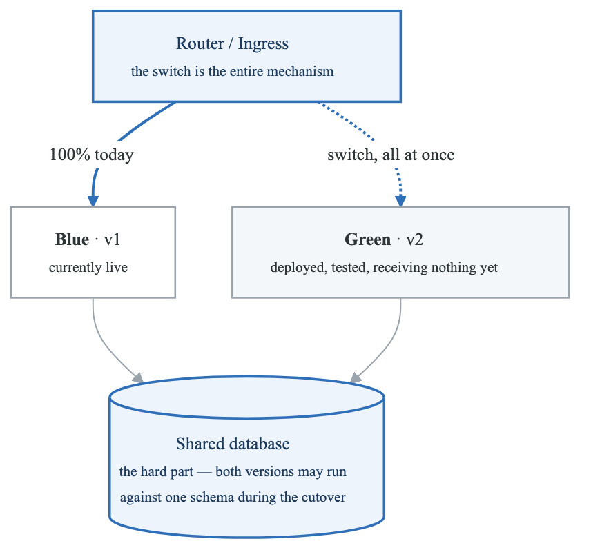
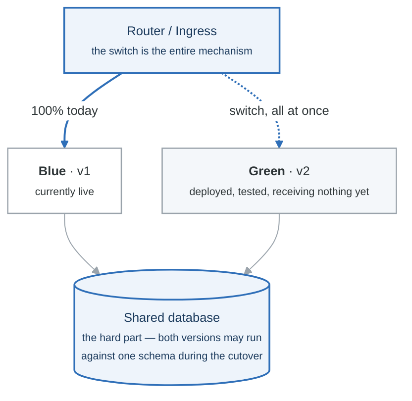

# Module 06: Deployment Strategies

## Learning Objectives

By the end of this module, you will be able to:
- Understand various deployment strategies and their trade-offs
- Implement rolling, blue-green, and canary deployments
- Configure traffic management for progressive delivery
- Use feature flags for controlled releases
- Implement automated rollback mechanisms
- Choose the appropriate strategy for different scenarios

## Introduction

Deployment strategies determine how new versions of applications are released to production. The right strategy balances the need for rapid delivery with the requirement for reliability and minimal user impact. Modern deployment strategies enable teams to release frequently while minimizing risk.

## Deployment Strategy Overview

### Strategy Comparison

**The four deployment strategies**

| Strategy | How it works | Downtime | Cost | Rollback |
|---|---|---|---|---|
| **Recreate** | stop v1, start v2 | **yes** | lowest | redeploy v1 |
| **Rolling** | replace instances gradually in place | none | low | roll forward again — slow |
| **Blue/green** | stand up a full v2, switch traffic at once | none | **2× during cutover** | **instant** — switch back |
| **Canary** | send 5% to v2, watch the metrics, increase | none | low | instant, tiny blast radius |

**Canary requires good observability.** Without SLI metrics to judge the 5% against, a canary is
just a slower rolling deploy with extra steps.

**Blue/green's hard part is the database.** Both versions may run against one schema during the
cutover, which is what expand/contract migrations exist for.

### Strategy Selection Matrix

| Strategy | Downtime | Rollback | Risk | Resource Cost | Complexity |
|----------|----------|----------|------|---------------|------------|
| Recreate | Yes | Redeploy | High | Low | Low |
| Rolling | No | Manual | Medium | Low | Medium |
| Blue-Green | No | Instant | Low | High (2x) | Medium |
| Canary | No | Instant | Very Low | Medium | High |
| A/B Testing | No | Instant | Very Low | Medium | High |

## Rolling Deployments

### Kubernetes Rolling Update

```yaml
# deployment.yaml
apiVersion: apps/v1
kind: Deployment
metadata:
  name: myapp
spec:
  replicas: 10
  strategy:
    type: RollingUpdate
    rollingUpdate:
      maxSurge: 25%        # Max pods over desired count
      maxUnavailable: 25%  # Max pods that can be unavailable

  selector:
    matchLabels:
      app: myapp

  template:
    metadata:
      labels:
        app: myapp
    spec:
      containers:
        - name: myapp
          image: myapp:v2
          ports:
            - containerPort: 8080

          readinessProbe:
            httpGet:
              path: /health/ready
              port: 8080
            initialDelaySeconds: 5
            periodSeconds: 5
            failureThreshold: 3

          livenessProbe:
            httpGet:
              path: /health/live
              port: 8080
            initialDelaySeconds: 15
            periodSeconds: 10
            failureThreshold: 3

          resources:
            requests:
              cpu: 100m
              memory: 128Mi
            limits:
              cpu: 500m
              memory: 512Mi
```

### Rolling Update Process

**Rolling Update with maxSurge=25%, maxUnavailable=25%**

Initial State (10 replicas v1):
v1 v1 v1 v1 v1 v1 v1 v1 v1 v1
Step 1: Scale up (add 25% = 2-3 new pods):
v1 v1 v1 v1 v1 v1 v1 v1 v1 v1 v2 v2 v2
Step 2: Scale down old (remove 25% = 2-3 old pods):
v1 v1 v1 v1 v1 v1 v1 -- -- -- v2 v2 v2
Step 3-N: Repeat until complete:
v1 v1 v1 v1 -- -- -- -- v2 v2 v2 v2 v2
v1 v1 -- -- -- -- v2 v2 v2 v2 v2 v2 v2
-- -- -- -- v2 v2 v2 v2 v2 v2 v2 v2 v2
Final State (10 replicas v2):
v2 v2 v2 v2 v2 v2 v2 v2 v2 v2


## Blue-Green Deployments

### Architecture

<!-- figure: generated from the Mermaid below by _shared/diagrams/embed-figures.py — do not edit the image -->


<details>
<summary>Diagram source (Mermaid)</summary>



</details>

### Kubernetes Implementation

```yaml
# blue-deployment.yaml
apiVersion: apps/v1
kind: Deployment
metadata:
  name: myapp-blue
  labels:
    app: myapp
    version: blue
spec:
  replicas: 3
  selector:
    matchLabels:
      app: myapp
      version: blue
  template:
    metadata:
      labels:
        app: myapp
        version: blue
    spec:
      containers:
        - name: myapp
          image: myapp:v1
          ports:
            - containerPort: 8080

---
# green-deployment.yaml
apiVersion: apps/v1
kind: Deployment
metadata:
  name: myapp-green
  labels:
    app: myapp
    version: green
spec:
  replicas: 3
  selector:
    matchLabels:
      app: myapp
      version: green
  template:
    metadata:
      labels:
        app: myapp
        version: green
    spec:
      containers:
        - name: myapp
          image: myapp:v2
          ports:
            - containerPort: 8080

---
# service.yaml - Switch by changing selector
apiVersion: v1
kind: Service
metadata:
  name: myapp
spec:
  selector:
    app: myapp
    version: blue  # Change to 'green' to switch
  ports:
    - port: 80
      targetPort: 8080
```

### Blue-Green with Istio

```yaml
# VirtualService for blue-green
apiVersion: networking.istio.io/v1beta1
kind: VirtualService
metadata:
  name: myapp
spec:
  hosts:
    - myapp.example.com
  http:
    - route:
        - destination:
            host: myapp-blue
            port:
              number: 80
          weight: 100
        - destination:
            host: myapp-green
            port:
              number: 80
          weight: 0

---
# After switch
apiVersion: networking.istio.io/v1beta1
kind: VirtualService
metadata:
  name: myapp
spec:
  hosts:
    - myapp.example.com
  http:
    - route:
        - destination:
            host: myapp-blue
            port:
              number: 80
          weight: 0
        - destination:
            host: myapp-green
            port:
              number: 80
          weight: 100
```

## Canary Deployments

### Progressive Canary Rollout

```yaml
# Argo Rollouts Canary Strategy
apiVersion: argoproj.io/v1alpha1
kind: Rollout
metadata:
  name: myapp
spec:
  replicas: 10
  selector:
    matchLabels:
      app: myapp
  template:
    metadata:
      labels:
        app: myapp
    spec:
      containers:
        - name: myapp
          image: myapp:v2
          ports:
            - containerPort: 8080

  strategy:
    canary:
      # Traffic routing
      canaryService: myapp-canary
      stableService: myapp-stable

      # Traffic management with Istio
      trafficRouting:
        istio:
          virtualService:
            name: myapp
            routes:
              - primary

      # Progressive rollout steps
      steps:
        # Step 1: 5% traffic to canary
        - setWeight: 5
        - pause: { duration: 5m }

        # Step 2: Analysis run
        - analysis:
            templates:
              - templateName: success-rate
            args:
              - name: service-name
                value: myapp-canary

        # Step 3: 25% traffic
        - setWeight: 25
        - pause: { duration: 10m }

        # Step 4: Another analysis
        - analysis:
            templates:
              - templateName: latency-check

        # Step 5: 50% traffic
        - setWeight: 50
        - pause: { duration: 15m }

        # Step 6: Final analysis
        - analysis:
            templates:
              - templateName: comprehensive-check

        # Step 7: Full rollout
        - setWeight: 100

      # Rollback on failure
      abortScaleDownDelaySeconds: 30
      scaleDownDelaySeconds: 30

      # Anti-affinity for canary pods
      antiAffinity:
        requiredDuringSchedulingIgnoredDuringExecution: {}

---
# Analysis Template
apiVersion: argoproj.io/v1alpha1
kind: AnalysisTemplate
metadata:
  name: success-rate
spec:
  args:
    - name: service-name
  metrics:
    - name: success-rate
      interval: 1m
      count: 5
      successCondition: result[0] >= 0.95
      failureCondition: result[0] < 0.90
      failureLimit: 3
      provider:
        prometheus:
          address: http://prometheus:9090
          query: |
            sum(rate(http_requests_total{service="{{args.service-name}}",status=~"2.."}[5m])) /
            sum(rate(http_requests_total{service="{{args.service-name}}"}[5m]))

    - name: error-rate
      interval: 1m
      successCondition: result[0] <= 0.01
      failureLimit: 3
      provider:
        prometheus:
          address: http://prometheus:9090
          query: |
            sum(rate(http_requests_total{service="{{args.service-name}}",status=~"5.."}[5m])) /
            sum(rate(http_requests_total{service="{{args.service-name}}"}[5m]))

---
# Latency Analysis
apiVersion: argoproj.io/v1alpha1
kind: AnalysisTemplate
metadata:
  name: latency-check
spec:
  metrics:
    - name: p99-latency
      interval: 2m
      successCondition: result[0] < 500
      failureLimit: 2
      provider:
        prometheus:
          address: http://prometheus:9090
          query: |
            histogram_quantile(0.99, sum(rate(http_request_duration_seconds_bucket{service="myapp-canary"}[5m])) by (le)) * 1000
```

### Canary with Flagger

```yaml
# Flagger Canary configuration
apiVersion: flagger.app/v1beta1
kind: Canary
metadata:
  name: myapp
spec:
  targetRef:
    apiVersion: apps/v1
    kind: Deployment
    name: myapp

  progressDeadlineSeconds: 600

  service:
    port: 80
    targetPort: 8080
    gateways:
      - public-gateway.istio-system.svc.cluster.local
    hosts:
      - myapp.example.com

  analysis:
    interval: 1m
    threshold: 5
    maxWeight: 50
    stepWeight: 10

    metrics:
      - name: request-success-rate
        thresholdRange:
          min: 99
        interval: 1m

      - name: request-duration
        thresholdRange:
          max: 500
        interval: 1m

    webhooks:
      - name: acceptance-test
        type: pre-rollout
        url: http://flagger-loadtester.test/
        timeout: 30s
        metadata:
          type: bash
          cmd: "curl -s http://myapp-canary/health | grep ok"

      - name: load-test
        type: rollout
        url: http://flagger-loadtester.test/
        timeout: 5s
        metadata:
          type: cmd
          cmd: "hey -z 1m -q 10 -c 2 http://myapp-canary/"

  alerts:
    - name: slack
      severity: info
      providerRef:
        name: slack
        namespace: flagger-system
```

## A/B Testing

### Header-Based Routing

```yaml
# A/B Testing with Istio
apiVersion: networking.istio.io/v1beta1
kind: VirtualService
metadata:
  name: myapp
spec:
  hosts:
    - myapp.example.com
  http:
    # Route beta users to v2
    - match:
        - headers:
            x-beta-user:
              exact: "true"
      route:
        - destination:
            host: myapp
            subset: v2

    # Route by cookie
    - match:
        - headers:
            cookie:
              regex: ".*experiment=variant-b.*"
      route:
        - destination:
            host: myapp
            subset: v2

    # Route by user-agent (mobile users)
    - match:
        - headers:
            user-agent:
              regex: ".*Mobile.*"
      route:
        - destination:
            host: myapp
            subset: mobile

    # Default route
    - route:
        - destination:
            host: myapp
            subset: v1

---
apiVersion: networking.istio.io/v1beta1
kind: DestinationRule
metadata:
  name: myapp
spec:
  host: myapp
  subsets:
    - name: v1
      labels:
        version: v1
    - name: v2
      labels:
        version: v2
    - name: mobile
      labels:
        version: mobile
```

## Feature Flags

### LaunchDarkly Integration

```python
# Python application with feature flags
import ldclient
from ldclient.config import Config

# Initialize LaunchDarkly client
ldclient.set_config(Config("sdk-key"))
client = ldclient.get()

def get_user_context(user_id, email, plan):
    return {
        "key": user_id,
        "email": email,
        "custom": {
            "plan": plan,
            "region": get_user_region(user_id)
        }
    }

@app.route('/api/feature')
def feature_endpoint():
    user = get_user_context(
        request.user_id,
        request.user_email,
        request.user_plan
    )

    # Check feature flag
    if client.variation("new-checkout-flow", user, False):
        return new_checkout_flow()
    else:
        return legacy_checkout_flow()

# Percentage rollout
@app.route('/api/dashboard')
def dashboard():
    user = get_user_context(...)

    # 10% of users get new dashboard
    if client.variation("new-dashboard", user, False):
        return render_new_dashboard()
    return render_dashboard()
```

### Kubernetes Feature Flags with ConfigMap

```yaml
# feature-flags ConfigMap
apiVersion: v1
kind: ConfigMap
metadata:
  name: feature-flags
data:
  flags.json: |
    {
      "new-payment-system": {
        "enabled": true,
        "rollout": 25,
        "allowlist": ["user-123", "user-456"]
      },
      "dark-mode": {
        "enabled": true,
        "rollout": 100
      },
      "beta-features": {
        "enabled": true,
        "rollout": 0,
        "groups": ["beta-testers"]
      }
    }

---
# Deployment using feature flags
apiVersion: apps/v1
kind: Deployment
metadata:
  name: myapp
spec:
  template:
    spec:
      containers:
        - name: myapp
          image: myapp:v2
          volumeMounts:
            - name: feature-flags
              mountPath: /config/flags
          env:
            - name: FEATURE_FLAGS_PATH
              value: /config/flags/flags.json
      volumes:
        - name: feature-flags
          configMap:
            name: feature-flags
```

## Automated Rollback

### Kubernetes Rollback

```bash
# View rollout history
kubectl rollout history deployment/myapp

# Rollback to previous version
kubectl rollout undo deployment/myapp

# Rollback to specific revision
kubectl rollout undo deployment/myapp --to-revision=2

# Check rollback status
kubectl rollout status deployment/myapp
```

### Automated Rollback with Metrics

```yaml
# Argo Rollouts with automated rollback
apiVersion: argoproj.io/v1alpha1
kind: Rollout
metadata:
  name: myapp
spec:
  strategy:
    canary:
      steps:
        - setWeight: 10
        - pause: { duration: 5m }
        - analysis:
            templates:
              - templateName: error-rate
            args:
              - name: threshold
                value: "0.01"

---
apiVersion: argoproj.io/v1alpha1
kind: AnalysisTemplate
metadata:
  name: error-rate
spec:
  args:
    - name: threshold
  metrics:
    - name: error-rate
      interval: 1m
      count: 5
      # Auto-rollback if error rate exceeds threshold
      successCondition: result[0] < {{args.threshold}}
      failureLimit: 2
      provider:
        prometheus:
          address: http://prometheus:9090
          query: |
            sum(rate(http_requests_total{status=~"5.."}[5m])) /
            sum(rate(http_requests_total[5m]))
```

### CI/CD Pipeline Rollback

```yaml
# GitHub Actions with rollback
name: Deploy with Rollback

on:
  push:
    branches: [main]

jobs:
  deploy:
    runs-on: ubuntu-latest
    steps:
      - uses: actions/checkout@v4

      - name: Deploy
        id: deploy
        run: |
          kubectl apply -f k8s/
          kubectl rollout status deployment/myapp --timeout=5m

      - name: Smoke Test
        id: smoke-test
        run: |
          sleep 30
          response=$(curl -s -o /dev/null -w "%{http_code}" https://app.example.com/health)
          if [ "$response" != "200" ]; then
            echo "Smoke test failed"
            exit 1
          fi

      - name: Rollback on Failure
        if: failure()
        run: |
          echo "Deployment failed, rolling back..."
          kubectl rollout undo deployment/myapp
          kubectl rollout status deployment/myapp

      - name: Notify on Rollback
        if: failure()
        uses: slackapi/slack-github-action@v1
        with:
          payload: |
            {
              "text": "Deployment rolled back for ${{ github.repository }}"
            }
```

## Shadow Deployments

### Traffic Mirroring

```yaml
# Istio traffic mirroring (shadow deployment)
apiVersion: networking.istio.io/v1beta1
kind: VirtualService
metadata:
  name: myapp
spec:
  hosts:
    - myapp.example.com
  http:
    - route:
        - destination:
            host: myapp-v1
      # Mirror traffic to v2 (shadow)
      mirror:
        host: myapp-v2
      mirrorPercentage:
        value: 100.0
```

## Deployment Pipeline Example

### Complete CI/CD with Deployment Strategy

```yaml
# .github/workflows/deploy.yml
name: Deploy Pipeline

on:
  push:
    branches: [main]

env:
  IMAGE: myapp

jobs:
  build:
    runs-on: ubuntu-latest
    outputs:
      image-tag: ${{ steps.build.outputs.tag }}
    steps:
      - uses: actions/checkout@v4

      - name: Build and push
        id: build
        run: |
          TAG=$(git rev-parse --short HEAD)
          docker build -t ${{ env.IMAGE }}:$TAG .
          docker push ${{ env.IMAGE }}:$TAG
          echo "tag=$TAG" >> $GITHUB_OUTPUT

  deploy-canary:
    needs: build
    runs-on: ubuntu-latest
    steps:
      - uses: actions/checkout@v4

      - name: Deploy canary
        run: |
          # Update canary deployment
          kubectl set image deployment/myapp-canary \
            myapp=${{ env.IMAGE }}:${{ needs.build.outputs.image-tag }}

          # Wait for rollout
          kubectl rollout status deployment/myapp-canary

      - name: Run canary analysis
        run: |
          # Wait and analyze metrics
          sleep 300

          # Check error rate
          ERROR_RATE=$(curl -s prometheus:9090/api/v1/query \
            --data-urlencode 'query=rate(http_errors_total[5m])' | jq '.data.result[0].value[1]')

          if (( $(echo "$ERROR_RATE > 0.01" | bc -l) )); then
            echo "Canary failed: error rate too high"
            exit 1
          fi

  promote-to-stable:
    needs: [build, deploy-canary]
    runs-on: ubuntu-latest
    steps:
      - name: Promote canary to stable
        run: |
          kubectl set image deployment/myapp-stable \
            myapp=${{ env.IMAGE }}:${{ needs.build.outputs.image-tag }}

          kubectl rollout status deployment/myapp-stable

      - name: Scale down canary
        run: |
          kubectl scale deployment/myapp-canary --replicas=1
```

## Hands-On Exercise

### Exercise: Implement Multiple Deployment Strategies

1. Set up a Kubernetes cluster with Istio
2. Implement rolling deployment for a sample application
3. Configure blue-green deployment with instant switchover
4. Set up canary deployment with automated analysis
5. Implement rollback mechanism based on metrics

## Summary

- Rolling deployments provide zero-downtime updates with gradual replacement
- Blue-green enables instant switchover and easy rollback
- Canary deployments allow testing with real traffic at low risk
- Feature flags provide fine-grained control over feature releases
- Automated rollback based on metrics reduces risk
- Choose strategy based on risk tolerance, resource constraints, and requirements

## Additional Resources

- [Argo Rollouts Documentation](https://argoproj.github.io/argo-rollouts/)
- [Flagger Documentation](https://docs.flagger.app/)
- [Istio Traffic Management](https://istio.io/latest/docs/concepts/traffic-management/)
- [Kubernetes Deployment Strategies](https://kubernetes.io/docs/concepts/workloads/controllers/deployment/)

## Next Steps

In the next module, we'll explore pipeline security, learning how to secure CI/CD pipelines and protect the software supply chain.

<!-- feynman-check -->

---

## Feynman check

Close the file. Blank page, no notes. Explain each of these to a competent engineer who has never
used this tool — **under five minutes, no jargon you can't define on the spot:**

- Deployment Strategy Overview
- Rolling Deployments
- Blue-Green Deployments
- Canary Deployments

**The gap is not what you forgot. It is where you used a word instead of a mechanism.**

| | |
|---|---|
| ✗ | *"The pipeline deploys the application."* |
| ✓ | *"CI writes a new image tag into a config repository and stops. A controller running *inside* the cluster polls that repo, diffs the rendered manifests against live state, and applies the difference — so nothing outside the cluster ever holds credentials to it."* |

**Trace it:** `git push` → the new version serving traffic, with nothing else typed. Name where the handoff between CI and CD happens, and what that handoff physically is.

Stop at the first component you cannot name. Reopen this file and read **only** that.

**Go deeper — only once the gap has a name:** the four [OpenGitOps principles](https://opengitops.dev/#principles) — then say which one a `kubectl apply` inside CI violates.
Full list per domain: [`SOURCES.md`](../SOURCES.md#cicd-gitops)

→ Protocol, the three levels of knowing, and worked examples: [`MASTERY.md`](../MASTERY.md)

<!-- /feynman-check -->
