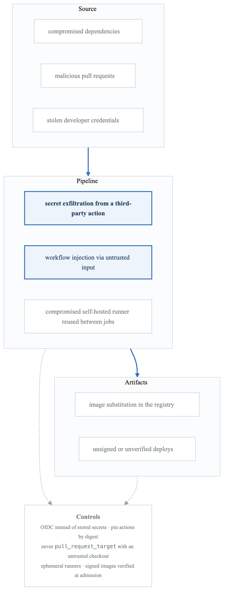
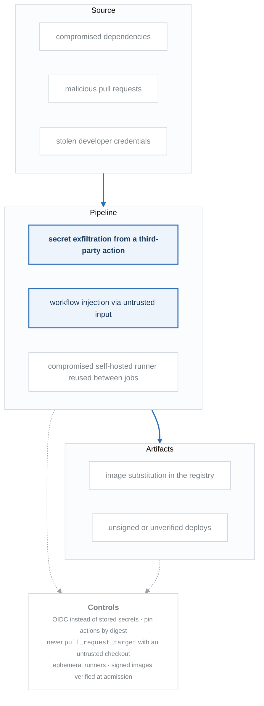

# Module 07: Pipeline Security

## Learning Objectives

By the end of this module, you will be able to:
- Identify security risks in CI/CD pipelines
- Implement secure credential management
- Configure SLSA compliance for supply chain security
- Implement code signing and artifact verification
- Secure container images and dependencies
- Apply least privilege principles to pipelines

## Introduction

CI/CD pipelines are high-value targets for attackers because they have privileged access to source code, secrets, and production environments. Securing your pipeline is essential to protecting your software supply chain and preventing unauthorized access to sensitive resources.

## Pipeline Security Landscape

### Attack Vectors

<!-- figure: generated from the Mermaid below by _shared/diagrams/embed-figures.py — do not edit the image -->


<details>
<summary>Diagram source (Mermaid)</summary>



</details>

## Credential Management

### Secret Storage Best Practices

```yaml
# GitHub Actions - Using secrets properly
name: Secure Pipeline

on:
  push:
    branches: [main]

# Minimal permissions
permissions:
  contents: read

jobs:
  build:
    runs-on: ubuntu-latest
    steps:
      - uses: actions/checkout@v4

      # Use OIDC instead of long-lived credentials
      - name: Configure AWS credentials
        uses: aws-actions/configure-aws-credentials@v4
        with:
          role-to-assume: arn:aws:iam::123456789012:role/GitHubActionsRole
          aws-region: us-east-1

      # Never echo secrets
      - name: Deploy
        env:
          API_KEY: ${{ secrets.API_KEY }}
        run: |
          # Secret is masked in logs
          ./deploy.sh

      # Use secret scanning
      - name: Scan for secrets
        uses: trufflesecurity/trufflehog@main
        with:
          path: ./
          base: ${{ github.event.repository.default_branch }}
          extra_args: --only-verified
```

### HashiCorp Vault Integration

```yaml
# GitLab CI with Vault
variables:
  VAULT_ADDR: https://vault.example.com

.vault-secrets:
  id_tokens:
    VAULT_ID_TOKEN:
      aud: https://vault.example.com
  secrets:
    DATABASE_PASSWORD:
      vault: secret/data/myapp/db/password@production
      file: false
    API_KEY:
      vault: secret/data/myapp/api/key@production
      file: false

build:
  extends: .vault-secrets
  script:
    - echo "Using secrets from Vault"
    - ./build.sh

---
# GitHub Actions with Vault
- name: Import Secrets
  uses: hashicorp/vault-action@v2
  with:
    url: https://vault.example.com
    method: jwt
    role: github-actions-role
    secrets: |
      secret/data/myapp/db password | DATABASE_PASSWORD ;
      secret/data/myapp/api key | API_KEY

- name: Use secrets
  run: |
    ./deploy.sh
  env:
    DATABASE_PASSWORD: ${{ steps.secrets.outputs.DATABASE_PASSWORD }}
```

### OIDC Authentication

```yaml
# AWS OIDC Trust Policy
{
  "Version": "2012-10-17",
  "Statement": [
    {
      "Effect": "Allow",
      "Principal": {
        "Federated": "arn:aws:iam::123456789012:oidc-provider/token.actions.githubusercontent.com"
      },
      "Action": "sts:AssumeRoleWithWebIdentity",
      "Condition": {
        "StringEquals": {
          "token.actions.githubusercontent.com:aud": "sts.amazonaws.com"
        },
        "StringLike": {
          "token.actions.githubusercontent.com:sub": "repo:myorg/myrepo:*"
        }
      }
    }
  ]
}

---
# GCP Workload Identity Federation
apiVersion: v1
kind: ServiceAccount
metadata:
  name: github-actions
  annotations:
    iam.gke.io/gcp-service-account: github-actions@project.iam.gserviceaccount.com

---
# Azure OIDC
- name: Azure Login
  uses: azure/login@v1
  with:
    client-id: ${{ secrets.AZURE_CLIENT_ID }}
    tenant-id: ${{ secrets.AZURE_TENANT_ID }}
    subscription-id: ${{ secrets.AZURE_SUBSCRIPTION_ID }}
```

## Supply Chain Security (SLSA)

### SLSA Levels

**SLSA Compliance Levels**

**Level 1: Documentation**

- Build process is scripted/automated
- Provenance generated (may be unsigned)

**Level 2: Hosted Build**

- Build service is hosted (not local)
- Provenance is signed
- Version control for source

**Level 3: Hardened Build**

- Source and build platforms verified
- Ephemeral, isolated build environment
- Provenance is non-falsifiable
- Entry points are controlled

**Level 4: Complete Trust**

- Hermetic, reproducible builds
- Two-person review for all changes
- Complete provenance chain


### Generating SLSA Provenance

```yaml
# GitHub Actions SLSA Generator
name: SLSA Build

on:
  push:
    tags:
      - 'v*'

permissions:
  contents: read
  id-token: write
  actions: read

jobs:
  build:
    runs-on: ubuntu-latest
    outputs:
      hashes: ${{ steps.hash.outputs.hashes }}
    steps:
      - uses: actions/checkout@v4

      - name: Build artifacts
        run: |
          make build
          sha256sum dist/* > checksums.txt

      - name: Generate hash
        id: hash
        run: |
          echo "hashes=$(sha256sum dist/* | base64 -w0)" >> $GITHUB_OUTPUT

      - uses: actions/upload-artifact@v4
        with:
          name: artifacts
          path: dist/

  provenance:
    needs: build
    permissions:
      actions: read
      id-token: write
      contents: write
    uses: slsa-framework/slsa-github-generator/.github/workflows/generator_generic_slsa3.yml@v1.9.0
    with:
      base64-subjects: ${{ needs.build.outputs.hashes }}
      upload-assets: true
```

### Sigstore/Cosign Signing

```yaml
# Container image signing with Cosign
name: Build and Sign Image

on:
  push:
    tags:
      - 'v*'

permissions:
  contents: read
  packages: write
  id-token: write

jobs:
  build-sign:
    runs-on: ubuntu-latest
    steps:
      - uses: actions/checkout@v4

      - name: Install Cosign
        uses: sigstore/cosign-installer@v3

      - name: Login to GHCR
        uses: docker/login-action@v3
        with:
          registry: ghcr.io
          username: ${{ github.actor }}
          password: ${{ secrets.GITHUB_TOKEN }}

      - name: Build and push
        id: build
        uses: docker/build-push-action@v5
        with:
          push: true
          tags: ghcr.io/${{ github.repository }}:${{ github.ref_name }}

      - name: Sign image with Cosign
        env:
          COSIGN_EXPERIMENTAL: "true"
        run: |
          cosign sign --yes \
            ghcr.io/${{ github.repository }}@${{ steps.build.outputs.digest }}

      - name: Verify signature
        run: |
          cosign verify \
            --certificate-identity-regexp "https://github.com/${{ github.repository }}/*" \
            --certificate-oidc-issuer "https://token.actions.githubusercontent.com" \
            ghcr.io/${{ github.repository }}@${{ steps.build.outputs.digest }}

      - name: Generate SBOM
        uses: anchore/sbom-action@v0
        with:
          image: ghcr.io/${{ github.repository }}@${{ steps.build.outputs.digest }}
          output-file: sbom.spdx.json

      - name: Attach SBOM to image
        run: |
          cosign attach sbom \
            --sbom sbom.spdx.json \
            ghcr.io/${{ github.repository }}@${{ steps.build.outputs.digest }}
```

## Dependency Security

### Dependency Scanning

```yaml
# GitHub Actions with Dependabot and scanning
name: Security Scan

on:
  push:
    branches: [main]
  pull_request:
    branches: [main]
  schedule:
    - cron: '0 6 * * 1'

jobs:
  dependency-scan:
    runs-on: ubuntu-latest
    steps:
      - uses: actions/checkout@v4

      # NPM audit
      - name: NPM Audit
        run: npm audit --audit-level=high

      # Snyk scanning
      - name: Snyk vulnerability scan
        uses: snyk/actions/node@master
        env:
          SNYK_TOKEN: ${{ secrets.SNYK_TOKEN }}
        with:
          args: --severity-threshold=high

      # Trivy scanning
      - name: Trivy vulnerability scan
        uses: aquasecurity/trivy-action@master
        with:
          scan-type: 'fs'
          scan-ref: '.'
          severity: 'CRITICAL,HIGH'
          exit-code: '1'

  container-scan:
    runs-on: ubuntu-latest
    steps:
      - uses: actions/checkout@v4

      - name: Build image
        run: docker build -t myapp:test .

      - name: Trivy container scan
        uses: aquasecurity/trivy-action@master
        with:
          image-ref: 'myapp:test'
          format: 'sarif'
          output: 'trivy-results.sarif'
          severity: 'CRITICAL,HIGH'

      - name: Upload Trivy scan results
        uses: github/codeql-action/upload-sarif@v2
        with:
          sarif_file: 'trivy-results.sarif'
```

### Lock File Verification

```yaml
# Verify lock files haven't been tampered with
- name: Verify package-lock.json
  run: |
    npm ci
    git diff --exit-code package-lock.json

- name: Verify go.sum
  run: |
    go mod verify
    git diff --exit-code go.sum
```

## Code Signing

### Git Commit Signing

```yaml
# Require signed commits
name: Verify Signatures

on:
  pull_request:
    branches: [main]

jobs:
  verify-signatures:
    runs-on: ubuntu-latest
    steps:
      - uses: actions/checkout@v4
        with:
          fetch-depth: 0

      - name: Verify commit signatures
        run: |
          # Get commits in PR
          COMMITS=$(git log --format='%H' origin/${{ github.base_ref }}..${{ github.sha }})

          for COMMIT in $COMMITS; do
            if ! git verify-commit $COMMIT 2>/dev/null; then
              echo "Unsigned commit: $COMMIT"
              exit 1
            fi
          done
          echo "All commits are signed"
```

### Binary Signing

```yaml
# Sign binaries with GPG
- name: Import GPG key
  uses: crazy-max/ghaction-import-gpg@v6
  with:
    gpg_private_key: ${{ secrets.GPG_PRIVATE_KEY }}
    passphrase: ${{ secrets.GPG_PASSPHRASE }}

- name: Sign binaries
  run: |
    for file in dist/*; do
      gpg --armor --detach-sign $file
    done

- name: Upload signatures
  uses: actions/upload-artifact@v4
  with:
    name: signatures
    path: dist/*.asc
```

## Pipeline Hardening

### Least Privilege Permissions

```yaml
# Minimal permissions for GitHub Actions
name: Secure Build

# Default to no permissions
permissions: {}

on:
  push:
    branches: [main]

jobs:
  build:
    runs-on: ubuntu-latest
    # Only permissions needed for this job
    permissions:
      contents: read
    steps:
      - uses: actions/checkout@v4
      - run: npm ci && npm run build

  deploy:
    needs: build
    runs-on: ubuntu-latest
    permissions:
      contents: read
      id-token: write  # For OIDC
      packages: write  # For GHCR
    environment: production
    steps:
      - uses: actions/checkout@v4
      - name: Deploy
        run: ./deploy.sh
```

### Branch Protection

```yaml
# Branch protection rules (via Terraform)
resource "github_branch_protection" "main" {
  repository_id = github_repository.main.node_id
  pattern       = "main"

  required_status_checks {
    strict   = true
    contexts = ["build", "test", "security-scan"]
  }

  required_pull_request_reviews {
    dismiss_stale_reviews           = true
    require_code_owner_reviews      = true
    required_approving_review_count = 2
  }

  require_signed_commits = true

  enforce_admins = true

  restrictions {
    users = []
    teams = ["release-team"]
  }
}
```

### Runner Security

```yaml
# Self-hosted runner security
apiVersion: v1
kind: Pod
metadata:
  name: github-runner
spec:
  securityContext:
    runAsNonRoot: true
    runAsUser: 1000
    fsGroup: 1000

  containers:
    - name: runner
      image: myrunner:latest
      securityContext:
        allowPrivilegeEscalation: false
        readOnlyRootFilesystem: true
        capabilities:
          drop:
            - ALL

      resources:
        limits:
          cpu: "2"
          memory: "4Gi"
        requests:
          cpu: "500m"
          memory: "1Gi"

      volumeMounts:
        - name: work
          mountPath: /home/runner/work
        - name: tmp
          mountPath: /tmp

  volumes:
    - name: work
      emptyDir: {}
    - name: tmp
      emptyDir: {}
```

## Security Scanning Integration

### SAST (Static Application Security Testing)

```yaml
# CodeQL analysis
name: CodeQL Analysis

on:
  push:
    branches: [main]
  pull_request:
    branches: [main]
  schedule:
    - cron: '0 6 * * 1'

jobs:
  analyze:
    runs-on: ubuntu-latest
    permissions:
      security-events: write
      contents: read
    strategy:
      matrix:
        language: ['javascript', 'python']
    steps:
      - uses: actions/checkout@v4

      - name: Initialize CodeQL
        uses: github/codeql-action/init@v2
        with:
          languages: ${{ matrix.language }}
          queries: security-and-quality

      - name: Build
        uses: github/codeql-action/autobuild@v2

      - name: Perform CodeQL Analysis
        uses: github/codeql-action/analyze@v2
        with:
          category: "/language:${{ matrix.language }}"
```

### DAST (Dynamic Application Security Testing)

```yaml
# OWASP ZAP scanning
name: DAST Scan

on:
  deployment_status:

jobs:
  zap-scan:
    if: github.event.deployment_status.state == 'success'
    runs-on: ubuntu-latest
    steps:
      - name: ZAP Baseline Scan
        uses: zaproxy/action-baseline@v0.9.0
        with:
          target: ${{ github.event.deployment_status.target_url }}
          rules_file_name: 'zap-rules.tsv'
          allow_issue_writing: true

      - name: Upload ZAP Report
        uses: actions/upload-artifact@v4
        if: always()
        with:
          name: zap-report
          path: report_html.html
```

## Audit and Compliance

### Pipeline Audit Logging

```yaml
# Audit logging for deployments
- name: Audit deployment
  run: |
    cat << EOF | jq -c . >> audit.jsonl
    {
      "event": "deployment",
      "timestamp": "$(date -u +%Y-%m-%dT%H:%M:%SZ)",
      "actor": "${{ github.actor }}",
      "repository": "${{ github.repository }}",
      "ref": "${{ github.ref }}",
      "sha": "${{ github.sha }}",
      "environment": "production",
      "workflow": "${{ github.workflow }}",
      "run_id": "${{ github.run_id }}"
    }
    EOF

- name: Send to audit log
  run: |
    aws logs put-log-events \
      --log-group-name /cicd/audit \
      --log-stream-name deployments \
      --log-events file://audit.jsonl
```

### Policy Enforcement

```yaml
# OPA policy for CI/CD
package cicd.deployment

default allow = false

# Allow deployment if all checks pass
allow {
    signed_commits
    security_scan_passed
    approval_required
    environment_approved
}

signed_commits {
    input.commits[_].verified == true
}

security_scan_passed {
    input.security_scan.critical_count == 0
    input.security_scan.high_count < 5
}

approval_required {
    count(input.approvals) >= 2
}

environment_approved {
    input.environment in ["staging", "production"]
    input.actor in data.authorized_deployers
}
```

## Hands-On Exercise

### Exercise: Secure Your Pipeline

1. Configure OIDC authentication for cloud providers
2. Implement dependency scanning in CI
3. Set up container image signing with Cosign
4. Generate and verify SLSA provenance
5. Configure branch protection with required checks

## Summary

- CI/CD pipelines are high-value targets requiring strong security
- Use OIDC/keyless authentication instead of long-lived credentials
- Implement SLSA compliance for supply chain security
- Sign artifacts and verify signatures before deployment
- Scan dependencies and container images for vulnerabilities
- Apply least privilege principles to pipeline permissions
- Enable audit logging for compliance and incident response

## Additional Resources

- [SLSA Framework](https://slsa.dev/)
- [Sigstore/Cosign](https://docs.sigstore.dev/)
- [GitHub Actions Security Hardening](https://docs.github.com/en/actions/security-guides)
- [OWASP CI/CD Security](https://owasp.org/www-project-devsecops-guideline/)

## Next Steps

In the next module, we'll explore artifact management, learning how to manage build artifacts, container registries, and package repositories effectively.

<!-- feynman-check -->

---

## Feynman check

Close the file. Blank page, no notes. Explain each of these to a competent engineer who has never
used this tool — **under five minutes, no jargon you can't define on the spot:**

- Pipeline Security Landscape
- Credential Management
- Supply Chain Security (SLSA)
- Dependency Security

**The gap is not what you forgot. It is where you used a word instead of a mechanism.**

| | |
|---|---|
| ✗ | *"The pipeline deploys the application."* |
| ✓ | *"CI writes a new image tag into a config repository and stops. A controller running *inside* the cluster polls that repo, diffs the rendered manifests against live state, and applies the difference — so nothing outside the cluster ever holds credentials to it."* |

**Trace it:** `git push` → the new version serving traffic, with nothing else typed. Name where the handoff between CI and CD happens, and what that handoff physically is.

Stop at the first component you cannot name. Reopen this file and read **only** that.

**Go deeper — only once the gap has a name:** the four [OpenGitOps principles](https://opengitops.dev/#principles) — then say which one a `kubectl apply` inside CI violates.
Full list per domain: [`SOURCES.md`](../SOURCES.md#cicd-gitops)

→ Protocol, the three levels of knowing, and worked examples: [`MASTERY.md`](../MASTERY.md)

<!-- /feynman-check -->
