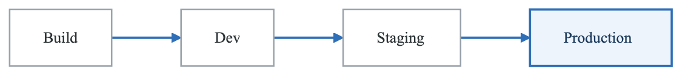
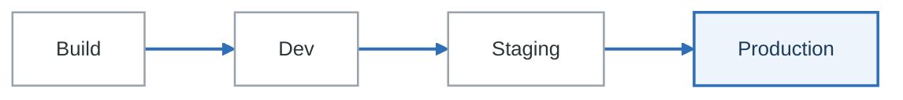

# Module 08: Artifact Management

## Learning Objectives

By the end of this module, you will be able to:
- Understand artifact types and their lifecycle management
- Configure and manage container registries
- Implement package repository management
- Design artifact promotion strategies across environments
- Implement artifact retention and cleanup policies
- Secure artifacts with signing and access controls

## Introduction

Artifact management is a critical component of CI/CD pipelines, encompassing the storage, versioning, and distribution of build outputs. Effective artifact management ensures reproducible builds, enables traceability, and facilitates efficient deployments across environments.

## Artifact Types

### Categories of Artifacts

**Artifact types**

| Category | Examples |
|---|---|
| **Build artifacts** | Compiled binaries (JAR, DLL, EXE) · JavaScript bundles · generated documentation · test and coverage reports |
| **Container images** | Application images · base images · sidecars |
| **Packages** | npm · Python wheels · Maven · NuGet · Go modules · Helm charts |
| **Infrastructure artifacts** | Terraform modules · Ansible playbooks · configuration bundles |

One item in that last row does not belong with the others: **Terraform state is not an artifact.** It
is live, mutable, shared state with a lock, and storing it where you store build outputs is how two
applies end up racing. It belongs in a versioned backend with locking, not in an artifact repository.

## Container Registries

### Registry Options

```yaml
# Docker Hub
docker pull docker.io/library/nginx:latest

# GitHub Container Registry
docker pull ghcr.io/owner/image:tag

# AWS ECR
docker pull 123456789012.dkr.ecr.us-east-1.amazonaws.com/myapp:latest

# Google Container Registry / Artifact Registry
docker pull gcr.io/project/image:tag
docker pull us-docker.pkg.dev/project/repo/image:tag

# Azure Container Registry
docker pull myregistry.azurecr.io/myapp:latest

# Harbor (Self-hosted)
docker pull harbor.example.com/project/image:tag
```

### AWS ECR Configuration

```yaml
# GitHub Actions with ECR
name: Build and Push to ECR

on:
  push:
    branches: [main]

permissions:
  id-token: write
  contents: read

jobs:
  build:
    runs-on: ubuntu-latest
    steps:
      - uses: actions/checkout@v4

      - name: Configure AWS credentials
        uses: aws-actions/configure-aws-credentials@v4
        with:
          role-to-assume: arn:aws:iam::123456789012:role/ECRPushRole
          aws-region: us-east-1

      - name: Login to ECR
        id: login-ecr
        uses: aws-actions/amazon-ecr-login@v2

      - name: Build and push
        env:
          REGISTRY: ${{ steps.login-ecr.outputs.registry }}
          REPOSITORY: myapp
          IMAGE_TAG: ${{ github.sha }}
        run: |
          docker build -t $REGISTRY/$REPOSITORY:$IMAGE_TAG .
          docker push $REGISTRY/$REPOSITORY:$IMAGE_TAG

          # Also tag as latest for main branch
          docker tag $REGISTRY/$REPOSITORY:$IMAGE_TAG $REGISTRY/$REPOSITORY:latest
          docker push $REGISTRY/$REPOSITORY:latest
```

### ECR Lifecycle Policy

```json
{
  "rules": [
    {
      "rulePriority": 1,
      "description": "Keep last 30 production images",
      "selection": {
        "tagStatus": "tagged",
        "tagPrefixList": ["prod-"],
        "countType": "imageCountMoreThan",
        "countNumber": 30
      },
      "action": {
        "type": "expire"
      }
    },
    {
      "rulePriority": 2,
      "description": "Keep last 10 staging images",
      "selection": {
        "tagStatus": "tagged",
        "tagPrefixList": ["staging-"],
        "countType": "imageCountMoreThan",
        "countNumber": 10
      },
      "action": {
        "type": "expire"
      }
    },
    {
      "rulePriority": 3,
      "description": "Expire untagged images older than 7 days",
      "selection": {
        "tagStatus": "untagged",
        "countType": "sinceImagePushed",
        "countUnit": "days",
        "countNumber": 7
      },
      "action": {
        "type": "expire"
      }
    },
    {
      "rulePriority": 4,
      "description": "Expire dev images older than 14 days",
      "selection": {
        "tagStatus": "tagged",
        "tagPrefixList": ["dev-", "feature-"],
        "countType": "sinceImagePushed",
        "countUnit": "days",
        "countNumber": 14
      },
      "action": {
        "type": "expire"
      }
    }
  ]
}
```

### Harbor Registry Setup

```yaml
# Harbor via Helm
helm repo add harbor https://helm.goharbor.io
helm install harbor harbor/harbor \
  --namespace harbor \
  --create-namespace \
  --set expose.type=ingress \
  --set expose.ingress.hosts.core=harbor.example.com \
  --set expose.ingress.className=nginx \
  --set externalURL=https://harbor.example.com \
  --set persistence.persistentVolumeClaim.registry.size=100Gi \
  --set persistence.persistentVolumeClaim.database.size=10Gi

---
# Harbor project configuration
apiVersion: goharbor.io/v1beta1
kind: HarborProject
metadata:
  name: production
spec:
  projectName: production
  membershipRules:
    - role: projectAdmin
      kind: Group
      name: platform-team
    - role: developer
      kind: Group
      name: developers
  storageQuota: 50Gi
  registryRef: default-registry
```

## Package Repositories

### npm Registry (Verdaccio)

```yaml
# verdaccio config.yaml
storage: /verdaccio/storage
auth:
  htpasswd:
    file: /verdaccio/conf/htpasswd
    max_users: 100

uplinks:
  npmjs:
    url: https://registry.npmjs.org/
    timeout: 30s
    maxage: 2m
    cache: true

packages:
  '@company/*':
    access: $authenticated
    publish: $authenticated
    unpublish: $authenticated

  '**':
    access: $all
    publish: $authenticated
    proxy: npmjs

middlewares:
  audit:
    enabled: true

logs:
  - { type: stdout, format: pretty, level: warn }

---
# .npmrc for CI
@company:registry=https://npm.example.com/
//npm.example.com/:_authToken=${NPM_TOKEN}
```

### Maven Repository (Nexus)

```xml
<!-- settings.xml for Maven -->
<settings>
  <servers>
    <server>
      <id>nexus-releases</id>
      <username>${env.NEXUS_USER}</username>
      <password>${env.NEXUS_PASSWORD}</password>
    </server>
    <server>
      <id>nexus-snapshots</id>
      <username>${env.NEXUS_USER}</username>
      <password>${env.NEXUS_PASSWORD}</password>
    </server>
  </servers>

  <mirrors>
    <mirror>
      <id>nexus</id>
      <mirrorOf>*</mirrorOf>
      <url>https://nexus.example.com/repository/maven-public/</url>
    </mirror>
  </mirrors>

  <profiles>
    <profile>
      <id>nexus</id>
      <repositories>
        <repository>
          <id>central</id>
          <url>https://nexus.example.com/repository/maven-public/</url>
          <releases><enabled>true</enabled></releases>
          <snapshots><enabled>true</enabled></snapshots>
        </repository>
      </repositories>
    </profile>
  </profiles>

  <activeProfiles>
    <activeProfile>nexus</activeProfile>
  </activeProfiles>
</settings>
```

### Python Package Repository

```yaml
# pip.conf for private PyPI
[global]
index-url = https://pypi.example.com/simple/
extra-index-url = https://pypi.org/simple/
trusted-host = pypi.example.com

---
# Publishing to private PyPI
# pyproject.toml
[build-system]
requires = ["setuptools>=61.0", "wheel"]
build-backend = "setuptools.build_meta"

[project]
name = "my-package"
version = "1.0.0"

---
# GitHub Actions for Python package
- name: Build and publish
  env:
    TWINE_USERNAME: __token__
    TWINE_PASSWORD: ${{ secrets.PYPI_TOKEN }}
  run: |
    python -m pip install build twine
    python -m build
    twine upload --repository-url https://pypi.example.com/simple/ dist/*
```

### Helm Chart Repository

```yaml
# Chart Museum via Helm
helm repo add chartmuseum https://chartmuseum.github.io/charts
helm install chartmuseum chartmuseum/chartmuseum \
  --namespace chartmuseum \
  --set env.open.STORAGE=amazon \
  --set env.open.STORAGE_AMAZON_BUCKET=helm-charts \
  --set env.open.STORAGE_AMAZON_REGION=us-east-1 \
  --set env.open.DISABLE_API=false \
  --set persistence.enabled=true

---
# Publishing Helm charts
name: Publish Helm Chart

on:
  push:
    tags:
      - 'chart-v*'

jobs:
  publish:
    runs-on: ubuntu-latest
    steps:
      - uses: actions/checkout@v4

      - name: Package chart
        run: |
          helm package ./chart -d .cr-release-packages

      - name: Push to ChartMuseum
        run: |
          curl --data-binary "@.cr-release-packages/myapp-*.tgz" \
            https://charts.example.com/api/charts

      # Or use GitHub Pages
      - name: Configure Git
        run: |
          git config user.name "$GITHUB_ACTOR"
          git config user.email "$GITHUB_ACTOR@users.noreply.github.com"

      - name: Run chart-releaser
        uses: helm/chart-releaser-action@v1
        env:
          CR_TOKEN: "${{ secrets.GITHUB_TOKEN }}"
```

## Artifact Promotion

### Promotion Strategy

<!-- figure: generated from the Mermaid below by _shared/diagrams/embed-figures.py — do not edit the image -->


<details>
<summary>Diagram source (Mermaid)</summary>



</details>

**The same image, re-tagged — never rebuilt**

| Stage | Immutable tag | Moving tag |
|---|---|---|
| Build | `myapp:abc123` | `myapp:latest` |
| Dev | `myapp:abc123` | `myapp:dev` |
| Staging | `myapp:abc123` | `myapp:staging` |
| Production | `myapp:abc123` | `myapp:v1.2.3` |

**Promotion rules**

| Transition | Gate |
|---|---|
| Build → Dev | Automatic, on merge to main |
| Dev → Staging | Automatic, when the dev tests pass |
| Staging → Production | **Manual**, after approval |

The immutable column is the contract: the digest that reached production is the digest that passed
the tests. Rebuilding from the same commit for each environment gives you a *different* image — a
newer base layer, a re-resolved dependency — and now the thing you tested is not the thing you
shipped.

### Tag-Based Promotion

```yaml
# Promote by retagging
name: Promote to Production

on:
  workflow_dispatch:
    inputs:
      image_tag:
        description: 'Image tag to promote'
        required: true
        type: string

jobs:
  promote:
    runs-on: ubuntu-latest
    environment: production
    steps:
      - name: Login to ECR
        uses: aws-actions/amazon-ecr-login@v2

      - name: Promote image
        env:
          SOURCE_TAG: staging-${{ inputs.image_tag }}
          TARGET_TAG: prod-${{ inputs.image_tag }}
          REGISTRY: 123456789012.dkr.ecr.us-east-1.amazonaws.com
          REPO: myapp
        run: |
          # Pull staging image
          docker pull $REGISTRY/$REPO:$SOURCE_TAG

          # Tag for production
          docker tag $REGISTRY/$REPO:$SOURCE_TAG $REGISTRY/$REPO:$TARGET_TAG
          docker tag $REGISTRY/$REPO:$SOURCE_TAG $REGISTRY/$REPO:latest-prod

          # Push production tags
          docker push $REGISTRY/$REPO:$TARGET_TAG
          docker push $REGISTRY/$REPO:latest-prod

      - name: Update deployment manifest
        run: |
          git clone https://github.com/company/deployments.git
          cd deployments
          yq -i '.spec.template.spec.containers[0].image = "123456789012.dkr.ecr.us-east-1.amazonaws.com/myapp:prod-${{ inputs.image_tag }}"' \
            production/deployment.yaml
          git add .
          git commit -m "Promote ${{ inputs.image_tag }} to production"
          git push
```

### Immutable Tags

```yaml
# ECR immutable tag configuration (Terraform)
resource "aws_ecr_repository" "app" {
  name                 = "myapp"
  image_tag_mutability = "IMMUTABLE"

  image_scanning_configuration {
    scan_on_push = true
  }

  encryption_configuration {
    encryption_type = "KMS"
    kms_key        = aws_kms_key.ecr.arn
  }
}

---
# Using semantic versioning for immutable tags
name: Build with Semantic Version

on:
  push:
    tags:
      - 'v*'

jobs:
  build:
    runs-on: ubuntu-latest
    steps:
      - uses: actions/checkout@v4

      - name: Extract version
        id: version
        run: |
          VERSION=${GITHUB_REF#refs/tags/v}
          echo "version=$VERSION" >> $GITHUB_OUTPUT
          echo "major=$(echo $VERSION | cut -d. -f1)" >> $GITHUB_OUTPUT
          echo "minor=$(echo $VERSION | cut -d. -f1-2)" >> $GITHUB_OUTPUT

      - name: Build and push
        run: |
          # Push with multiple tags
          docker build -t myapp:${{ steps.version.outputs.version }} .
          docker tag myapp:${{ steps.version.outputs.version }} myapp:${{ steps.version.outputs.major }}
          docker tag myapp:${{ steps.version.outputs.version }} myapp:${{ steps.version.outputs.minor }}

          docker push myapp:${{ steps.version.outputs.version }}
          docker push myapp:${{ steps.version.outputs.major }}
          docker push myapp:${{ steps.version.outputs.minor }}
```

## Artifact Storage

### Build Artifact Storage

```yaml
# GitHub Actions artifact storage
- name: Build
  run: npm run build

- name: Upload build artifact
  uses: actions/upload-artifact@v4
  with:
    name: dist-${{ github.sha }}
    path: dist/
    retention-days: 7

# Download in another job
- name: Download artifact
  uses: actions/download-artifact@v4
  with:
    name: dist-${{ github.sha }}
    path: dist/
```

### S3 Artifact Storage

```yaml
# Store artifacts in S3
- name: Upload to S3
  run: |
    aws s3 cp dist/ s3://artifacts-bucket/builds/${{ github.repository }}/${{ github.sha }}/ \
      --recursive \
      --metadata "commit=${{ github.sha }},branch=${{ github.ref_name }},build=${{ github.run_id }}"

- name: Generate signed URL
  id: signed-url
  run: |
    URL=$(aws s3 presign s3://artifacts-bucket/builds/${{ github.repository }}/${{ github.sha }}/app.zip \
      --expires-in 86400)
    echo "url=$URL" >> $GITHUB_OUTPUT
```

### Artifact Caching

```yaml
# Aggressive caching for faster builds
- name: Cache node modules
  uses: actions/cache@v4
  with:
    path: |
      ~/.npm
      node_modules
    key: npm-${{ runner.os }}-${{ hashFiles('package-lock.json') }}
    restore-keys: |
      npm-${{ runner.os }}-

- name: Cache build output
  uses: actions/cache@v4
  with:
    path: |
      dist/
      .next/cache
    key: build-${{ runner.os }}-${{ github.sha }}
    restore-keys: |
      build-${{ runner.os }}-
```

## Retention and Cleanup

### Automated Cleanup

```yaml
# GitHub Actions artifact cleanup
name: Cleanup Old Artifacts

on:
  schedule:
    - cron: '0 0 * * 0'  # Weekly

jobs:
  cleanup:
    runs-on: ubuntu-latest
    steps:
      - name: Delete old artifacts
        uses: actions/github-script@v7
        with:
          script: |
            const artifacts = await github.rest.actions.listArtifactsForRepo({
              owner: context.repo.owner,
              repo: context.repo.repo,
            });

            const thirtyDaysAgo = new Date();
            thirtyDaysAgo.setDate(thirtyDaysAgo.getDate() - 30);

            for (const artifact of artifacts.data.artifacts) {
              const createdAt = new Date(artifact.created_at);
              if (createdAt < thirtyDaysAgo) {
                await github.rest.actions.deleteArtifact({
                  owner: context.repo.owner,
                  repo: context.repo.repo,
                  artifact_id: artifact.id,
                });
                console.log(`Deleted artifact: ${artifact.name}`);
              }
            }
```

### Container Image Cleanup

```bash
#!/bin/bash
# cleanup-images.sh

# Clean up images older than 30 days
CUTOFF_DATE=$(date -d '30 days ago' +%s)

# Get all images
aws ecr describe-images \
  --repository-name myapp \
  --query 'imageDetails[?imagePushedAt<`'$CUTOFF_DATE'`].imageDigest' \
  --output text | while read digest; do

  # Skip if tagged with prod- or latest
  TAGS=$(aws ecr describe-images \
    --repository-name myapp \
    --image-ids imageDigest=$digest \
    --query 'imageDetails[0].imageTags' \
    --output text)

  if [[ ! "$TAGS" =~ "prod-" ]] && [[ ! "$TAGS" =~ "latest" ]]; then
    echo "Deleting image: $digest"
    aws ecr batch-delete-image \
      --repository-name myapp \
      --image-ids imageDigest=$digest
  fi
done
```

## Hands-On Exercise

### Exercise: Set Up Complete Artifact Management

1. Configure container registry with lifecycle policies
2. Set up private npm/PyPI registry
3. Implement artifact promotion pipeline
4. Configure artifact signing and verification
5. Create cleanup automation

## Summary

- Artifact management encompasses container images, packages, and build outputs
- Container registries should have lifecycle policies for cleanup
- Private package repositories enable controlled dependency management
- Promotion strategies ensure controlled progression through environments
- Immutable tags and signing ensure artifact integrity
- Automated cleanup prevents storage bloat and reduces costs

## Additional Resources

- [ECR Documentation](https://docs.aws.amazon.com/ecr/)
- [Harbor Documentation](https://goharbor.io/docs/)
- [Verdaccio Documentation](https://verdaccio.org/docs/what-is-verdaccio)
- [JFrog Artifactory](https://jfrog.com/artifactory/)

## Next Steps

In the next module, we'll explore testing strategies in CI/CD pipelines, learning how to implement effective test automation at every stage.

<!-- feynman-check -->

---

## Feynman check

Close the file. Blank page, no notes. Explain each of these to a competent engineer who has never
used this tool — **under five minutes, no jargon you can't define on the spot:**

- Artifact Types
- Container Registries
- Package Repositories
- Artifact Promotion

**The gap is not what you forgot. It is where you used a word instead of a mechanism.**

| | |
|---|---|
| ✗ | *"The pipeline deploys the application."* |
| ✓ | *"CI writes a new image tag into a config repository and stops. A controller running *inside* the cluster polls that repo, diffs the rendered manifests against live state, and applies the difference — so nothing outside the cluster ever holds credentials to it."* |

**Trace it:** `git push` → the new version serving traffic, with nothing else typed. Name where the handoff between CI and CD happens, and what that handoff physically is.

Stop at the first component you cannot name. Reopen this file and read **only** that.

**Go deeper — only once the gap has a name:** the four [OpenGitOps principles](https://opengitops.dev/#principles) — then say which one a `kubectl apply` inside CI violates.
Full list per domain: [`SOURCES.md`](../SOURCES.md#cicd-gitops)

→ Protocol, the three levels of knowing, and worked examples: [`MASTERY.md`](../MASTERY.md)

<!-- /feynman-check -->
